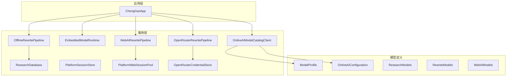
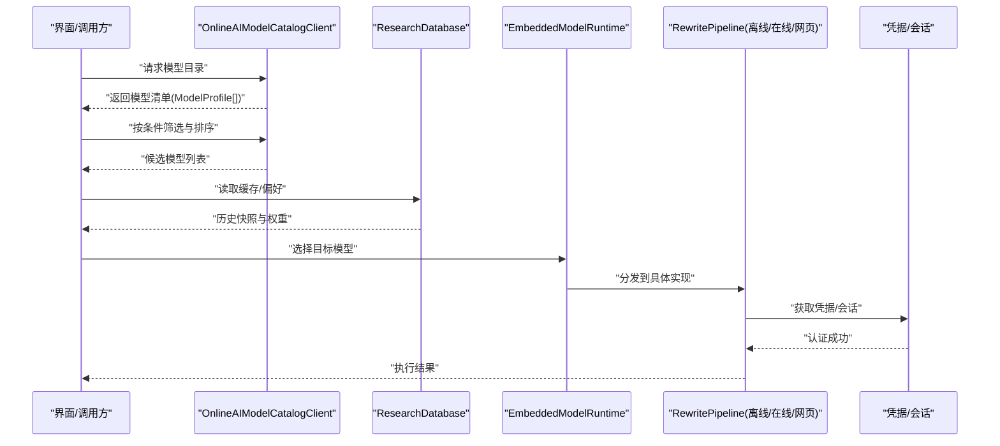
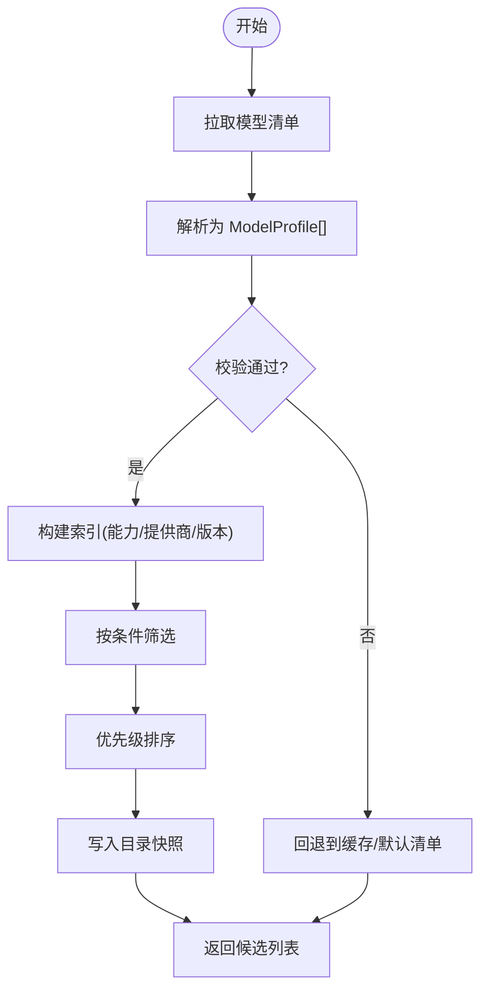
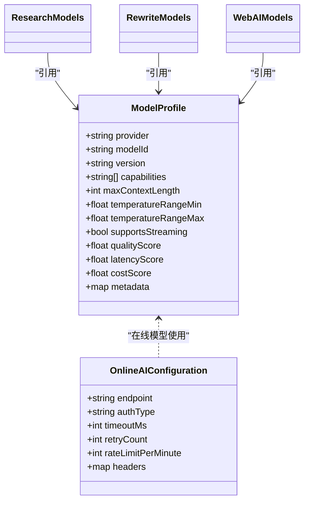
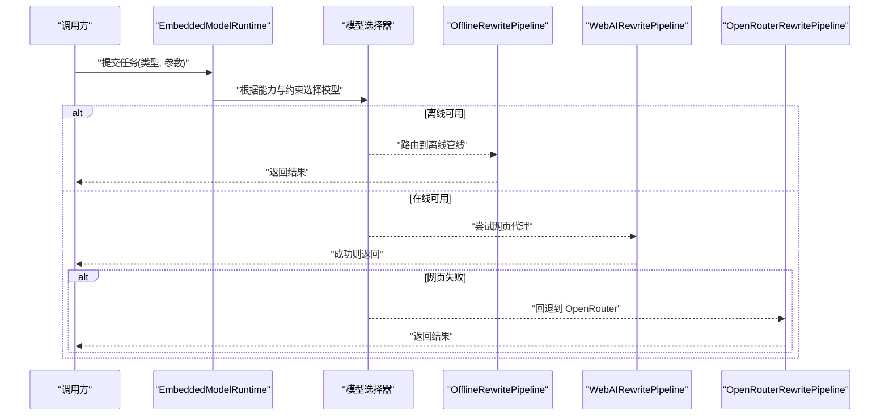
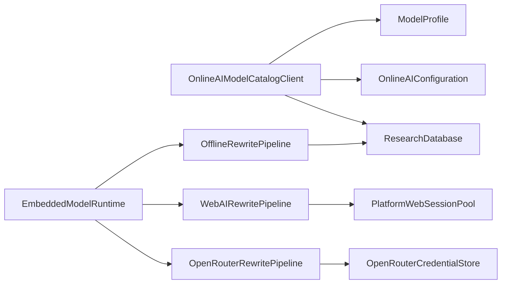

# AI 模型目录管理

<cite>
**本文引用的文件**   
- [Package.swift](file://Package.swift)
- [README.md](file://README.md)
- [ChengGaoApp.swift](file://Sources/ChengGao/App/ChengGaoApp.swift)
- [ModelProfile.swift](file://Sources/ChengGao/Models/ModelProfile.swift)
- [OnlineAIConfiguration.swift](file://Sources/ChengGao/Models/OnlineAIConfiguration.swift)
- [ResearchModels.swift](file://Sources/ChengGao/Models/ResearchModels.swift)
- [RewriteModels.swift](file://Sources/ChengGao/Models/RewriteModels.swift)
- [WebAIModels.swift](file://Sources/ChengGao/Models/WebAIModels.swift)
- [OnlineAIModelCatalogClient.swift](file://Sources/ChengGao/Services/OnlineAIModelCatalogClient.swift)
- [EmbeddedModelRuntime.swift](file://Sources/ChengGao/Services/EmbeddedModelRuntime.swift)
- [OfflineRewritePipeline.swift](file://Sources/ChengGao/Services/OfflineRewritePipeline.swift)
- [OpenRouterCredentialStore.swift](file://Sources/ChengGao/Services/OpenRouterCredentialStore.swift)
- [ResearchDatabase.swift](file://Sources/ChengGao/Services/ResearchDatabase.swift)
- [PlatformSessionStore.swift](file://Sources/ChengGao/Services/PlatformSessionStore.swift)
- [PlatformWebSessionPool.swift](file://Sources/ChengGao/Services/PlatformWebSessionPool.swift)
- [WebAIRewritePipeline.swift](file://Sources/ChengGao/Services/WebAIRewritePipeline.swift)
- [OpenRouterRewritePipeline.swift](file://Sources/ChengGao/Services/OpenRouterRewritePipeline.swift)
</cite>

## 目录
1. [简介](#简介)
2. [项目结构](#项目结构)
3. [核心组件](#核心组件)
4. [架构总览](#架构总览)
5. [详细组件分析](#详细组件分析)
6. [依赖关系分析](#依赖关系分析)
7. [性能考量](#性能考量)
8. [故障排查指南](#故障排查指南)
9. [结论](#结论)
10. [附录](#附录)

## 简介
本文件面向“AI 模型目录管理”的实现机制，围绕模型发现、注册与配置流程展开，涵盖支持的模型类型、版本管理与元数据定义；解释模型配置的 JSON 格式结构、字段含义与校验规则；说明模型筛选算法、优先级排序与动态加载机制；提供模型目录扩展指南（新增 AI 服务提供商与模型类型）；并文档化缓存策略、更新机制与错误处理方案。

## 项目结构
本项目采用 Swift Package Manager 组织代码，核心逻辑位于 Sources/ChengGao 下，包含 Models、Services、Stores、Views 等模块。与“模型目录管理”直接相关的目录与文件包括：
- Models：模型描述、在线配置、研究/重写/Web 三类模型定义
- Services：在线模型目录客户端、嵌入式运行时、离线/在线重写管线、凭据与数据库存储、会话池等
- App：应用入口与窗口配置

图表来源
- [ChengGaoApp.swift](file://Sources/ChengGao/App/ChengGaoApp.swift)
- [ModelProfile.swift](file://Sources/ChengGao/Models/ModelProfile.swift)
- [OnlineAIConfiguration.swift](file://Sources/ChengGao/Models/OnlineAIConfiguration.swift)
- [ResearchModels.swift](file://Sources/ChengGao/Models/ResearchModels.swift)
- [RewriteModels.swift](file://Sources/ChengGao/Models/RewriteModels.swift)
- [WebAIModels.swift](file://Sources/ChengGao/Models/WebAIModels.swift)
- [OnlineAIModelCatalogClient.swift](file://Sources/ChengGao/Services/OnlineAIModelCatalogClient.swift)
- [EmbeddedModelRuntime.swift](file://Sources/ChengGao/Services/EmbeddedModelRuntime.swift)
- [OfflineRewritePipeline.swift](file://Sources/ChengGao/Services/OfflineRewritePipeline.swift)
- [OpenRouterCredentialStore.swift](file://Sources/ChengGao/Services/OpenRouterCredentialStore.swift)
- [ResearchDatabase.swift](file://Sources/ChengGao/Services/ResearchDatabase.swift)
- [PlatformSessionStore.swift](file://Sources/ChengGao/Services/PlatformSessionStore.swift)
- [PlatformWebSessionPool.swift](file://Sources/ChengGao/Services/PlatformWebSessionPool.swift)
- [WebAIRewritePipeline.swift](file://Sources/ChengGao/Services/WebAIRewritePipeline.swift)
- [OpenRouterRewritePipeline.swift](file://Sources/ChengGao/Services/OpenRouterRewritePipeline.swift)

章节来源
- [Package.swift](file://Package.swift)
- [README.md](file://README.md)

## 核心组件
- 模型目录客户端（OnlineAIModelCatalogClient）：负责从远程或本地源发现模型清单，解析并返回可用模型集合，支持按能力、提供商、版本等维度筛选。
- 模型描述与配置（ModelProfile、OnlineAIConfiguration、ResearchModels、RewriteModels、WebAIModels）：统一抽象模型元数据（名称、ID、版本、能力标签、提供商、参数约束等），并提供在线配置的结构化表示。
- 运行时与管线（EmbeddedModelRuntime、OfflineRewritePipeline、WebAIRewritePipeline、OpenRouterRewritePipeline）：根据目录结果选择具体执行路径，完成推理或改写任务。
- 凭据与会话（OpenRouterCredentialStore、PlatformSessionStore、PlatformWebSessionPool）：管理第三方服务的认证与会话复用。
- 持久化（ResearchDatabase）：缓存目录快照、模型使用统计与用户偏好。

章节来源
- [OnlineAIModelCatalogClient.swift](file://Sources/ChengGao/Services/OnlineAIModelCatalogClient.swift)
- [ModelProfile.swift](file://Sources/ChengGao/Models/ModelProfile.swift)
- [OnlineAIConfiguration.swift](file://Sources/ChengGao/Models/OnlineAIConfiguration.swift)
- [ResearchModels.swift](file://Sources/ChengGao/Models/ResearchModels.swift)
- [RewriteModels.swift](file://Sources/ChengGao/Models/RewriteModels.swift)
- [WebAIModels.swift](file://Sources/ChengGao/Models/WebAIModels.swift)
- [EmbeddedModelRuntime.swift](file://Sources/ChengGao/Services/EmbeddedModelRuntime.swift)
- [OfflineRewritePipeline.swift](file://Sources/ChengGao/Services/OfflineRewritePipeline.swift)
- [WebAIRewritePipeline.swift](file://Sources/ChengGao/Services/WebAIRewritePipeline.swift)
- [OpenRouterRewritePipeline.swift](file://Sources/ChengGao/Services/OpenRouterRewritePipeline.swift)
- [OpenRouterCredentialStore.swift](file://Sources/ChengGao/Services/OpenRouterCredentialStore.swift)
- [PlatformSessionStore.swift](file://Sources/ChengGao/Services/PlatformSessionStore.swift)
- [PlatformWebSessionPool.swift](file://Sources/ChengGao/Services/PlatformWebSessionPool.swift)
- [ResearchDatabase.swift](file://Sources/ChengGao/Services/ResearchDatabase.swift)

## 架构总览
模型目录管理的整体流程如下：
- 启动时或按需触发目录刷新，由 OnlineAIModelCatalogClient 拉取最新清单并解析为 ModelProfile 集合。
- 通过筛选与排序得到候选模型列表，结合用户上下文（任务类型、语言、质量/速度偏好）选择最优模型。
- 根据模型能力路由到对应 Pipeline（离线/在线/网页），必要时通过凭据与会话组件完成鉴权与连接。
- 将目录快照与选择结果写入 ResearchDatabase，供后续快速恢复与统计。

图表来源
- [OnlineAIModelCatalogClient.swift](file://Sources/ChengGao/Services/OnlineAIModelCatalogClient.swift)
- [ModelProfile.swift](file://Sources/ChengGao/Models/ModelProfile.swift)
- [ResearchDatabase.swift](file://Sources/ChengGao/Services/ResearchDatabase.swift)
- [EmbeddedModelRuntime.swift](file://Sources/ChengGao/Services/EmbeddedModelRuntime.swift)
- [OfflineRewritePipeline.swift](file://Sources/ChengGao/Services/OfflineRewritePipeline.swift)
- [WebAIRewritePipeline.swift](file://Sources/ChengGao/Services/WebAIRewritePipeline.swift)
- [OpenRouterRewritePipeline.swift](file://Sources/ChengGao/Services/OpenRouterRewritePipeline.swift)
- [OpenRouterCredentialStore.swift](file://Sources/ChengGao/Services/OpenRouterCredentialStore.swift)
- [PlatformSessionStore.swift](file://Sources/ChengGao/Services/PlatformSessionStore.swift)
- [PlatformWebSessionPool.swift](file://Sources/ChengGao/Services/PlatformWebSessionPool.swift)

## 详细组件分析

### 模型目录客户端（OnlineAIModelCatalogClient）
职责
- 发现：从远程端点或本地资源加载模型清单。
- 解析：将原始数据转换为统一的 ModelProfile 集合。
- 筛选与排序：按能力、提供商、版本、质量/延迟指标等进行过滤与优先级排序。
- 缓存：维护目录快照，减少重复网络请求。

关键流程
- 拉取清单 -> 解析校验 -> 构建索引 -> 筛选排序 -> 返回结果
- 失败重试与降级：网络异常时回退到本地缓存或默认清单。

图表来源
- [OnlineAIModelCatalogClient.swift](file://Sources/ChengGao/Services/OnlineAIModelCatalogClient.swift)
- [ModelProfile.swift](file://Sources/ChengGao/Models/ModelProfile.swift)
- [ResearchDatabase.swift](file://Sources/ChengGao/Services/ResearchDatabase.swift)

章节来源
- [OnlineAIModelCatalogClient.swift](file://Sources/ChengGao/Services/OnlineAIModelCatalogClient.swift)

### 模型描述与配置（ModelProfile、OnlineAIConfiguration、ResearchModels、RewriteModels、WebAIModels）
职责
- ModelProfile：定义模型的通用元数据（名称、ID、版本、能力标签、提供商、输入输出约束、质量/延迟指标等）。
- OnlineAIConfiguration：描述在线模型的接入参数（端点、鉴权方式、超时、重试、速率限制等）。
- ResearchModels/RewriteModels/WebAIModels：针对特定场景的模型枚举与配置模板。

数据结构要点
- 唯一标识：provider + modelId + version
- 能力标签：如文本生成、图像生成、语音转写、搜索增强等
- 参数约束：最大上下文长度、温度范围、是否支持流式响应等
- 优先级权重：基于质量、成本、延迟、可用性综合评分

图表来源
- [ModelProfile.swift](file://Sources/ChengGao/Models/ModelProfile.swift)
- [OnlineAIConfiguration.swift](file://Sources/ChengGao/Models/OnlineAIConfiguration.swift)
- [ResearchModels.swift](file://Sources/ChengGao/Models/ResearchModels.swift)
- [RewriteModels.swift](file://Sources/ChengGao/Models/RewriteModels.swift)
- [WebAIModels.swift](file://Sources/ChengGao/Models/WebAIModels.swift)

章节来源
- [ModelProfile.swift](file://Sources/ChengGao/Models/ModelProfile.swift)
- [OnlineAIConfiguration.swift](file://Sources/ChengGao/Models/OnlineAIConfiguration.swift)
- [ResearchModels.swift](file://Sources/ChengGao/Models/ResearchModels.swift)
- [RewriteModels.swift](file://Sources/ChengGao/Models/RewriteModels.swift)
- [WebAIModels.swift](file://Sources/ChengGao/Models/WebAIModels.swift)

### 运行时与管线（EmbeddedModelRuntime、OfflineRewritePipeline、WebAIRewritePipeline、OpenRouterRewritePipeline）
职责
- EmbeddedModelRuntime：封装本地/嵌入式推理引擎的调用接口，屏蔽底层差异。
- OfflineRewritePipeline：纯离线改写流程，适用于无网络环境或隐私敏感场景。
- WebAIRewritePipeline：通过网页代理或浏览器自动化进行改写。
- OpenRouterRewritePipeline：对接 OpenRouter 聚合网关，统一多提供商模型调用。

选择策略
- 根据 ModelProfile.capabilities 与当前任务需求匹配。
- 结合 OnlineAIConfiguration 判断是否走在线路径。
- 优先选择高评分且可用的模型，失败自动降级。

图表来源
- [EmbeddedModelRuntime.swift](file://Sources/ChengGao/Services/EmbeddedModelRuntime.swift)
- [OfflineRewritePipeline.swift](file://Sources/ChengGao/Services/OfflineRewritePipeline.swift)
- [WebAIRewritePipeline.swift](file://Sources/ChengGao/Services/WebAIRewritePipeline.swift)
- [OpenRouterRewritePipeline.swift](file://Sources/ChengGao/Services/OpenRouterRewritePipeline.swift)

章节来源
- [EmbeddedModelRuntime.swift](file://Sources/ChengGao/Services/EmbeddedModelRuntime.swift)
- [OfflineRewritePipeline.swift](file://Sources/ChengGao/Services/OfflineRewritePipeline.swift)
- [WebAIRewritePipeline.swift](file://Sources/ChengGao/Services/WebAIRewritePipeline.swift)
- [OpenRouterRewritePipeline.swift](file://Sources/ChengGao/Services/OpenRouterRewritePipeline.swift)

### 凭据与会话（OpenRouterCredentialStore、PlatformSessionStore、PlatformWebSessionPool）
职责
- OpenRouterCredentialStore：安全存储与获取 OpenRouter 相关凭据。
- PlatformSessionStore：平台级会话状态持久化。
- PlatformWebSessionPool：网页代理会话池，提升并发与复用效率。

交互要点
- 管线在发起请求前检查凭据有效性与会话健康度。
- 失败时触发重新登录或创建新会话。

章节来源
- [OpenRouterCredentialStore.swift](file://Sources/ChengGao/Services/OpenRouterCredentialStore.swift)
- [PlatformSessionStore.swift](file://Sources/ChengGao/Services/PlatformSessionStore.swift)
- [PlatformWebSessionPool.swift](file://Sources/ChengGao/Services/PlatformWebSessionPool.swift)

### 持久化（ResearchDatabase）
职责
- 存储目录快照、模型使用统计、用户偏好与最近选择。
- 提供查询接口用于快速恢复与决策辅助。

章节来源
- [ResearchDatabase.swift](file://Sources/ChengGao/Services/ResearchDatabase.swift)

## 依赖关系分析
- OnlineAIModelCatalogClient 依赖 ModelProfile 与 OnlineAIConfiguration 进行解析与校验。
- 各 RewritePipeline 依赖凭据与会话组件以完成鉴权与连接。
- EmbeddedModelRuntime 作为统一入口，屏蔽不同后端差异。
- ResearchDatabase 被目录客户端与运行时共同使用，形成读写闭环。

图表来源
- [OnlineAIModelCatalogClient.swift](file://Sources/ChengGao/Services/OnlineAIModelCatalogClient.swift)
- [ModelProfile.swift](file://Sources/ChengGao/Models/ModelProfile.swift)
- [OnlineAIConfiguration.swift](file://Sources/ChengGao/Models/OnlineAIConfiguration.swift)
- [ResearchDatabase.swift](file://Sources/ChengGao/Services/ResearchDatabase.swift)
- [EmbeddedModelRuntime.swift](file://Sources/ChengGao/Services/EmbeddedModelRuntime.swift)
- [OfflineRewritePipeline.swift](file://Sources/ChengGao/Services/OfflineRewritePipeline.swift)
- [WebAIRewritePipeline.swift](file://Sources/ChengGao/Services/WebAIRewritePipeline.swift)
- [OpenRouterRewritePipeline.swift](file://Sources/ChengGao/Services/OpenRouterRewritePipeline.swift)
- [PlatformWebSessionPool.swift](file://Sources/ChengGao/Services/PlatformWebSessionPool.swift)
- [OpenRouterCredentialStore.swift](file://Sources/ChengGao/Services/OpenRouterCredentialStore.swift)

章节来源
- [OnlineAIModelCatalogClient.swift](file://Sources/ChengGao/Services/OnlineAIModelCatalogClient.swift)
- [ModelProfile.swift](file://Sources/ChengGao/Models/ModelProfile.swift)
- [OnlineAIConfiguration.swift](file://Sources/ChengGao/Models/OnlineAIConfiguration.swift)
- [ResearchDatabase.swift](file://Sources/ChengGao/Services/ResearchDatabase.swift)
- [EmbeddedModelRuntime.swift](file://Sources/ChengGao/Services/EmbeddedModelRuntime.swift)
- [OfflineRewritePipeline.swift](file://Sources/ChengGao/Services/OfflineRewritePipeline.swift)
- [WebAIRewritePipeline.swift](file://Sources/ChengGao/Services/WebAIRewritePipeline.swift)
- [OpenRouterRewritePipeline.swift](file://Sources/ChengGao/Services/OpenRouterRewritePipeline.swift)
- [PlatformWebSessionPool.swift](file://Sources/ChengGao/Services/PlatformWebSessionPool.swift)
- [OpenRouterCredentialStore.swift](file://Sources/ChengGao/Services/OpenRouterCredentialStore.swift)

## 性能考量
- 目录缓存：避免频繁网络请求，缩短冷启动时间。
- 会话复用：降低握手与鉴权开销，提高吞吐。
- 分级降级：离线优先，在线回退，保障可用性。
- 批量与流式：对大文本或长上下文任务启用流式传输，降低内存峰值。
- 索引优化：对能力、提供商、版本建立索引，加速筛选与排序。

[本节为通用指导，不直接分析具体文件]

## 故障排查指南
常见问题与定位建议
- 目录拉取失败：检查网络连通性、端点可达性与证书；查看是否回退到本地缓存。
- 凭据无效：确认凭据存储是否过期或被清理；触发重新登录流程。
- 会话失效：检测会话池健康度，必要时重建会话。
- 模型不可用：核对能力标签与任务匹配度；观察优先级评分与降级路径。
- 性能问题：监控目录缓存命中率、会话复用率、请求耗时分布。

章节来源
- [OnlineAIModelCatalogClient.swift](file://Sources/ChengGao/Services/OnlineAIModelCatalogClient.swift)
- [OpenRouterCredentialStore.swift](file://Sources/ChengGao/Services/OpenRouterCredentialStore.swift)
- [PlatformSessionStore.swift](file://Sources/ChengGao/Services/PlatformSessionStore.swift)
- [PlatformWebSessionPool.swift](file://Sources/ChengGao/Services/PlatformWebSessionPool.swift)
- [ResearchDatabase.swift](file://Sources/ChengGao/Services/ResearchDatabase.swift)

## 结论
本方案通过统一的模型描述与配置抽象、健壮的目录客户端与灵活的管线路由，实现了跨提供商、跨能力的模型目录管理与动态加载。配合缓存、会话复用与降级策略，可在复杂环境下稳定运行。扩展新的提供商与模型类型只需遵循现有元数据与配置规范，即可无缝集成。

[本节为总结，不直接分析具体文件]

## 附录

### 支持的模型类型与版本管理
- 模型类型：文本生成、图像生成、语音转写、搜索增强、网页代理改写等。
- 版本管理：通过 provider + modelId + version 三元组唯一标识；支持语义化版本比较与兼容性标记。

章节来源
- [ModelProfile.swift](file://Sources/ChengGao/Models/ModelProfile.swift)
- [ResearchModels.swift](file://Sources/ChengGao/Models/ResearchModels.swift)
- [RewriteModels.swift](file://Sources/ChengGao/Models/RewriteModels.swift)
- [WebAIModels.swift](file://Sources/ChengGao/Models/WebAIModels.swift)

### 模型配置的 JSON 格式结构与验证规则
- 顶层字段：providers（数组）、models（对象映射）、defaults（默认值）。
- providers：每个提供商包含 endpoint、authType、headers、rateLimitPerMinute、timeoutMs 等。
- models：每个模型包含 id、version、capabilities、constraints（maxContextLength、temperatureRange、streaming 等）、scores（quality、latency、cost）。
- defaults：全局默认 provider、model、timeout、重试次数等。
- 验证规则：必填字段校验、数值范围校验、能力标签白名单、版本语义化校验、依赖字段一致性（如 streaming=true 需支持相应头信息）。

章节来源
- [OnlineAIConfiguration.swift](file://Sources/ChengGao/Models/OnlineAIConfiguration.swift)
- [ModelProfile.swift](file://Sources/ChengGao/Models/ModelProfile.swift)

### 模型筛选算法、优先级排序与动态加载
- 筛选：按任务类型与 capabilities 过滤；按 provider 与 region 限制；按 constraints 裁剪。
- 排序：综合 scores（质量、延迟、成本）与可用性（在线/离线、会话健康）加权打分。
- 动态加载：首次访问按需拉取目录，命中缓存则跳过网络；失败时回退到本地快照。

章节来源
- [OnlineAIModelCatalogClient.swift](file://Sources/ChengGao/Services/OnlineAIModelCatalogClient.swift)
- [ResearchDatabase.swift](file://Sources/ChengGao/Services/ResearchDatabase.swift)

### 模型目录扩展指南（新增提供商与模型类型）
- 新增提供商：在 OnlineAIConfiguration 中声明端点、鉴权方式与限流策略；在凭据存储中添加对应密钥管理。
- 新增模型类型：在 ModelProfile.capabilities 中扩展标签；在各管线（Offline/Web/OpenRouter）中实现适配逻辑。
- 配置项：在 JSON 配置中补充新字段，并在解析阶段加入校验。
- 测试：覆盖拉取、解析、筛选、排序、降级与错误回退用例。

章节来源
- [OnlineAIConfiguration.swift](file://Sources/ChengGao/Models/OnlineAIConfiguration.swift)
- [ModelProfile.swift](file://Sources/ChengGao/Models/ModelProfile.swift)
- [OfflineRewritePipeline.swift](file://Sources/ChengGao/Services/OfflineRewritePipeline.swift)
- [WebAIRewritePipeline.swift](file://Sources/ChengGao/Services/WebAIRewritePipeline.swift)
- [OpenRouterRewritePipeline.swift](file://Sources/ChengGao/Services/OpenRouterRewritePipeline.swift)
- [OpenRouterCredentialStore.swift](file://Sources/ChengGao/Services/OpenRouterCredentialStore.swift)

### 缓存策略、更新机制与错误处理
- 缓存策略：目录快照按提供商与版本分区存储；模型使用统计与用户偏好独立表。
- 更新机制：定时增量更新与手动触发；冲突时保留更高版本号与更高分评分。
- 错误处理：网络异常重试与指数退避；鉴权失败提示重新登录；模型不可用时自动降级到其他提供商或离线模式。

章节来源
- [ResearchDatabase.swift](file://Sources/ChengGao/Services/ResearchDatabase.swift)
- [OnlineAIModelCatalogClient.swift](file://Sources/ChengGao/Services/OnlineAIModelCatalogClient.swift)
- [OpenRouterCredentialStore.swift](file://Sources/ChengGao/Services/OpenRouterCredentialStore.swift)
- [PlatformSessionStore.swift](file://Sources/ChengGao/Services/PlatformSessionStore.swift)
- [PlatformWebSessionPool.swift](file://Sources/ChengGao/Services/PlatformWebSessionPool.swift)