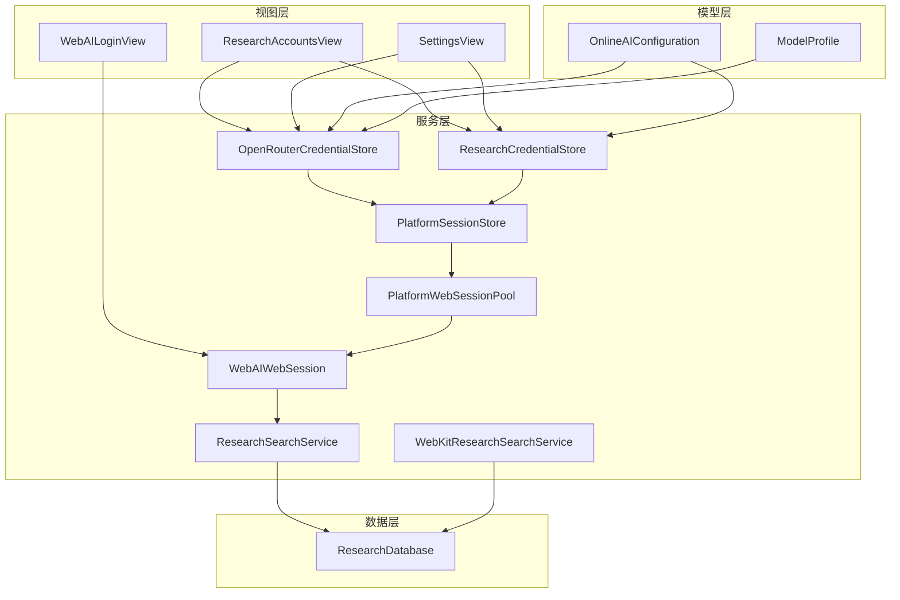
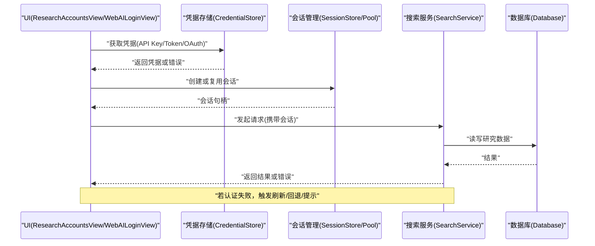
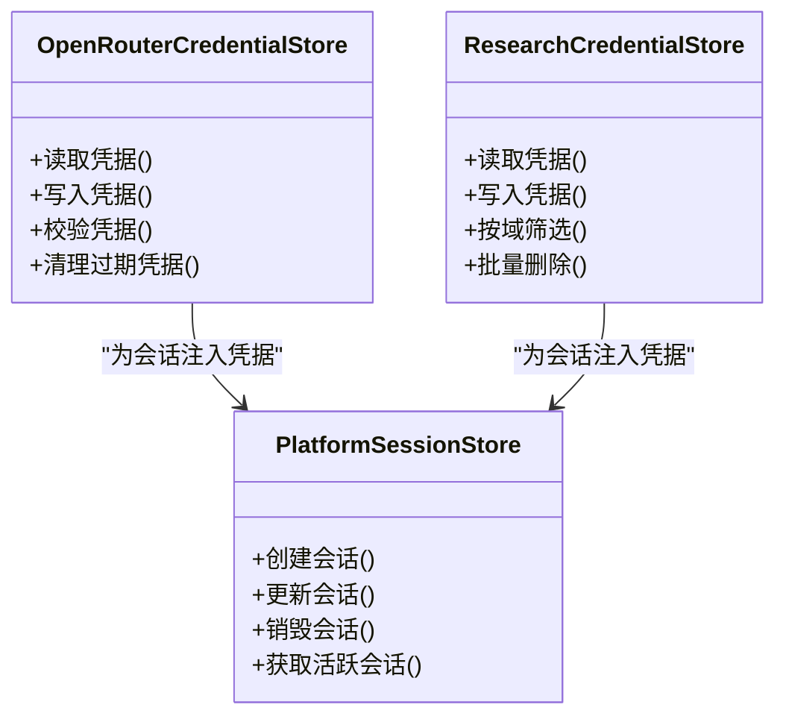
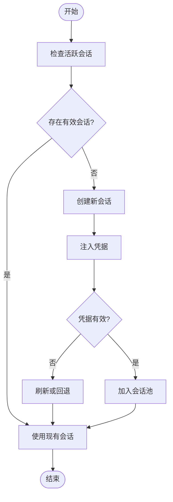
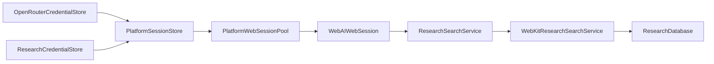

# AI 认证与凭据管理

<cite>
**本文引用的文件**   
- [OpenRouterCredentialStore.swift](file://Sources/ChengGao/Services/OpenRouterCredentialStore.swift)
- [ResearchCredentialStore.swift](file://Sources/ChengGao/Services/ResearchCredentialStore.swift)
- [PlatformSessionStore.swift](file://Sources/ChengGao/Services/PlatformSessionStore.swift)
- [PlatformWebSessionPool.swift](file://Sources/ChengGao/Services/PlatformWebSessionPool.swift)
- [WebAIWebSession.swift](file://Sources/ChengGao/Services/WebAIWebSession.swift)
- [OnlineAIConfiguration.swift](file://Sources/ChengGao/Models/OnlineAIConfiguration.swift)
- [ModelProfile.swift](file://Sources/ChengGao/Models/ModelProfile.swift)
- [ResearchDatabase.swift](file://Sources/ChengGao/Services/ResearchDatabase.swift)
- [ResearchSearchService.swift](file://Sources/ChengGao/Services/ResearchSearchService.swift)
- [WebKitResearchSearchService.swift](file://Sources/ChengGao/Services/WebKitResearchSearchService.swift)
- [ResearchAccountsView.swift](file://Sources/ChengGao/Views/ResearchAccountsView.swift)
- [WebAILoginView.swift](file://Sources/ChengGao/Views/WebAILoginView.swift)
- [SettingsView.swift](file://Sources/ChengGao/Views/SettingsView.swift)
</cite>

## 目录
1. [简介](#简介)
2. [项目结构](#项目结构)
3. [核心组件](#核心组件)
4. [架构总览](#架构总览)
5. [详细组件分析](#详细组件分析)
6. [依赖关系分析](#依赖关系分析)
7. [性能考量](#性能考量)
8. [故障排查指南](#故障排查指南)
9. [结论](#结论)
10. [附录：集成新认证方式与安全最佳实践](#附录集成新认证方式与安全最佳实践)

## 简介
本文件系统化说明本项目的 AI 服务认证与凭据管理机制，覆盖多提供商的认证方式（API Key、OAuth、Token 等）、安全存储方案与会话生命周期管理；阐述凭据加密存储、自动刷新与故障转移策略；并给出多账户支持、权限控制与访问审计的实现思路。同时提供新认证方式的集成指南、密钥轮换机制以及认证失败的错误处理与用户提示策略，帮助开发者快速扩展与维护系统的安全性与可用性。

## 项目结构
本项目采用分层组织：模型层定义配置与数据模型，服务层实现认证、会话与网络交互，视图层负责用户交互与账户管理。关键路径包括：
- 凭据存储：OpenRouterCredentialStore、ResearchCredentialStore
- 会话管理：PlatformSessionStore、PlatformWebSessionPool、WebAIWebSession
- 配置与模型：OnlineAIConfiguration、ModelProfile
- 研究与搜索：ResearchDatabase、ResearchSearchService、WebKitResearchSearchService
- 用户界面：ResearchAccountsView、WebAILoginView、SettingsView

图表来源
- [OpenRouterCredentialStore.swift](file://Sources/ChengGao/Services/OpenRouterCredentialStore.swift)
- [ResearchCredentialStore.swift](file://Sources/ChengGao/Services/ResearchCredentialStore.swift)
- [PlatformSessionStore.swift](file://Sources/ChengGao/Services/PlatformSessionStore.swift)
- [PlatformWebSessionPool.swift](file://Sources/ChengGao/Services/PlatformWebSessionPool.swift)
- [WebAIWebSession.swift](file://Sources/ChengGao/Services/WebAIWebSession.swift)
- [OnlineAIConfiguration.swift](file://Sources/ChengGao/Models/OnlineAIConfiguration.swift)
- [ModelProfile.swift](file://Sources/ChengGao/Models/ModelProfile.swift)
- [ResearchDatabase.swift](file://Sources/ChengGao/Services/ResearchDatabase.swift)
- [ResearchSearchService.swift](file://Sources/ChengGao/Services/ResearchSearchService.swift)
- [WebKitResearchSearchService.swift](file://Sources/ChengGao/Services/WebKitResearchSearchService.swift)

章节来源
- [OpenRouterCredentialStore.swift](file://Sources/ChengGao/Services/OpenRouterCredentialStore.swift)
- [ResearchCredentialStore.swift](file://Sources/ChengGao/Services/ResearchCredentialStore.swift)
- [PlatformSessionStore.swift](file://Sources/ChengGao/Services/PlatformSessionStore.swift)
- [PlatformWebSessionPool.swift](file://Sources/ChengGao/Services/PlatformWebSessionPool.swift)
- [WebAIWebSession.swift](file://Sources/ChengGao/Services/WebAIWebSession.swift)
- [OnlineAIConfiguration.swift](file://Sources/ChengGao/Models/OnlineAIConfiguration.swift)
- [ModelProfile.swift](file://Sources/ChengGao/Models/ModelProfile.swift)
- [ResearchDatabase.swift](file://Sources/ChengGao/Services/ResearchDatabase.swift)
- [ResearchSearchService.swift](file://Sources/ChengGao/Services/ResearchSearchService.swift)
- [WebKitResearchSearchService.swift](file://Sources/ChengGao/Services/WebKitResearchSearchService.swift)

## 核心组件
- 凭据存储
  - OpenRouterCredentialStore：面向 OpenRouter 的 API Key 与 Token 管理，提供读取、写入、校验与清理能力。
  - ResearchCredentialStore：面向研究场景的凭据管理，支持多凭据项与按域或用途区分。
- 会话管理
  - PlatformSessionStore：平台级会话持久化与访问控制，统一会话生命周期。
  - PlatformWebSessionPool：Web 会话池，复用浏览器上下文，降低登录成本。
  - WebAIWebSession：封装 Web 端会话状态、Cookie/Token 注入与失效处理。
- 配置与模型
  - OnlineAIConfiguration：集中管理在线 AI 配置（如端点、鉴权类型、超时）。
  - ModelProfile：模型描述与可选的凭据绑定信息。
- 研究与搜索
  - ResearchDatabase：本地研究数据存储与查询。
  - ResearchSearchService / WebKitResearchSearchService：搜索服务抽象与基于 WebKit 的具体实现，承载认证后的请求执行。

章节来源
- [OpenRouterCredentialStore.swift](file://Sources/ChengGao/Services/OpenRouterCredentialStore.swift)
- [ResearchCredentialStore.swift](file://Sources/ChengGao/Services/ResearchCredentialStore.swift)
- [PlatformSessionStore.swift](file://Sources/ChengGao/Services/PlatformSessionStore.swift)
- [PlatformWebSessionPool.swift](file://Sources/ChengGao/Services/PlatformWebSessionPool.swift)
- [WebAIWebSession.swift](file://Sources/ChengGao/Services/WebAIWebSession.swift)
- [OnlineAIConfiguration.swift](file://Sources/ChengGao/Models/OnlineAIConfiguration.swift)
- [ModelProfile.swift](file://Sources/ChengGao/Models/ModelProfile.swift)
- [ResearchDatabase.swift](file://Sources/ChengGao/Services/ResearchDatabase.swift)
- [ResearchSearchService.swift](file://Sources/ChengGao/Services/ResearchSearchService.swift)
- [WebKitResearchSearchService.swift](file://Sources/ChengGao/Services/WebKitResearchSearchService.swift)

## 架构总览
下图展示从 UI 到凭据存储、会话管理与网络请求的整体流程，体现认证失败时的回退与重试路径。

图表来源
- [ResearchAccountsView.swift](file://Sources/ChengGao/Views/ResearchAccountsView.swift)
- [WebAILoginView.swift](file://Sources/ChengGao/Views/WebAILoginView.swift)
- [OpenRouterCredentialStore.swift](file://Sources/ChengGao/Services/OpenRouterCredentialStore.swift)
- [ResearchCredentialStore.swift](file://Sources/ChengGao/Services/ResearchCredentialStore.swift)
- [PlatformSessionStore.swift](file://Sources/ChengGao/Services/PlatformSessionStore.swift)
- [PlatformWebSessionPool.swift](file://Sources/ChengGao/Services/PlatformWebSessionPool.swift)
- [ResearchSearchService.swift](file://Sources/ChengGao/Services/ResearchSearchService.swift)
- [WebKitResearchSearchService.swift](file://Sources/ChengGao/Services/WebKitResearchSearchService.swift)
- [ResearchDatabase.swift](file://Sources/ChengGao/Services/ResearchDatabase.swift)

## 详细组件分析

### 凭据存储组件（OpenRouter 与研究凭据）
- 职责
  - 提供统一的凭据存取接口，支持按提供商/用途分类。
  - 校验凭据格式与有效性，必要时触发刷新。
  - 支持多账户并存与切换。
- 设计要点
  - 将敏感字段与元数据分离，便于加密与审计。
  - 暴露最小权限接口，避免直接暴露原始密钥。
  - 提供批量清理与导出（脱敏）能力。

图表来源
- [OpenRouterCredentialStore.swift](file://Sources/ChengGao/Services/OpenRouterCredentialStore.swift)
- [ResearchCredentialStore.swift](file://Sources/ChengGao/Services/ResearchCredentialStore.swift)
- [PlatformSessionStore.swift](file://Sources/ChengGao/Services/PlatformSessionStore.swift)

章节来源
- [OpenRouterCredentialStore.swift](file://Sources/ChengGao/Services/OpenRouterCredentialStore.swift)
- [ResearchCredentialStore.swift](file://Sources/ChengGao/Services/ResearchCredentialStore.swift)
- [PlatformSessionStore.swift](file://Sources/ChengGao/Services/PlatformSessionStore.swift)

### 会话管理组件（平台会话与 Web 会话池）
- 职责
  - 统一管理会话生命周期（创建、刷新、回收）。
  - 维护 Web 会话池，减少重复登录与 Cookie 初始化开销。
  - 在凭据失效时自动刷新或降级。
- 设计要点
  - 会话与凭据解耦，通过注入方式装配。
  - 支持并发访问与线程安全。
  - 提供健康检查与自动重建机制。

图表来源
- [PlatformSessionStore.swift](file://Sources/ChengGao/Services/PlatformSessionStore.swift)
- [PlatformWebSessionPool.swift](file://Sources/ChengGao/Services/PlatformWebSessionPool.swift)
- [WebAIWebSession.swift](file://Sources/ChengGao/Services/WebAIWebSession.swift)

章节来源
- [PlatformSessionStore.swift](file://Sources/ChengGao/Services/PlatformSessionStore.swift)
- [PlatformWebSessionPool.swift](file://Sources/ChengGao/Services/PlatformWebSessionPool.swift)
- [WebAIWebSession.swift](file://Sources/ChengGao/Services/WebAIWebSession.swift)

### 配置与模型（在线配置与模型档案）
- OnlineAIConfiguration
  - 集中管理在线 AI 服务的端点、鉴权类型、超时与重试策略。
  - 作为凭据与请求构建的桥梁，确保不同提供商的差异被正确映射。
- ModelProfile
  - 描述模型名称、版本、可用性与可选的凭据绑定标识。
  - 用于 UI 选择与运行时动态装配。

章节来源
- [OnlineAIConfiguration.swift](file://Sources/ChengGao/Models/OnlineAIConfiguration.swift)
- [ModelProfile.swift](file://Sources/ChengGao/Models/ModelProfile.swift)

### 研究与搜索（数据与服务）
- ResearchDatabase
  - 本地持久化研究结果与元数据，支持索引与查询优化。
- ResearchSearchService / WebKitResearchSearchService
  - 抽象搜索服务，具体实现可基于 WebKit 渲染与抓取。
  - 在认证通过后执行请求，并将结果落库。

章节来源
- [ResearchDatabase.swift](file://Sources/ChengGao/Services/ResearchDatabase.swift)
- [ResearchSearchService.swift](file://Sources/ChengGao/Services/ResearchSearchService.swift)
- [WebKitResearchSearchService.swift](file://Sources/ChengGao/Services/WebKitResearchSearchService.swift)

### UI 与账户管理
- ResearchAccountsView
  - 展示与管理多个 AI 账户，支持切换默认账户与查看状态。
- WebAILoginView
  - 引导完成 Web 端 OAuth/登录流程，捕获并保存会话凭据。
- SettingsView
  - 全局设置入口，包含凭据管理、安全选项与日志级别。

章节来源
- [ResearchAccountsView.swift](file://Sources/ChengGao/Views/ResearchAccountsView.swift)
- [WebAILoginView.swift](file://Sources/ChengGao/Views/WebAILoginView.swift)
- [SettingsView.swift](file://Sources/ChengGao/Views/SettingsView.swift)

## 依赖关系分析
- 低耦合高内聚
  - 凭据存储与会话管理解耦，通过接口注入，便于替换实现与单元测试。
- 外部依赖
  - 网络栈与 WebKit 渲染引擎由上层服务调用，凭据与会话不直接依赖具体网络实现。
- 潜在循环依赖
  - 通过抽象服务（ResearchSearchService）与具体实现（WebKitResearchSearchService）隔离，避免循环引用。

图表来源
- [OpenRouterCredentialStore.swift](file://Sources/ChengGao/Services/OpenRouterCredentialStore.swift)
- [ResearchCredentialStore.swift](file://Sources/ChengGao/Services/ResearchCredentialStore.swift)
- [PlatformSessionStore.swift](file://Sources/ChengGao/Services/PlatformSessionStore.swift)
- [PlatformWebSessionPool.swift](file://Sources/ChengGao/Services/PlatformWebSessionPool.swift)
- [WebAIWebSession.swift](file://Sources/ChengGao/Services/WebAIWebSession.swift)
- [ResearchSearchService.swift](file://Sources/ChengGao/Services/ResearchSearchService.swift)
- [WebKitResearchSearchService.swift](file://Sources/ChengGao/Services/WebKitResearchSearchService.swift)
- [ResearchDatabase.swift](file://Sources/ChengGao/Services/ResearchDatabase.swift)

章节来源
- [OpenRouterCredentialStore.swift](file://Sources/ChengGao/Services/OpenRouterCredentialStore.swift)
- [ResearchCredentialStore.swift](file://Sources/ChengGao/Services/ResearchCredentialStore.swift)
- [PlatformSessionStore.swift](file://Sources/ChengGao/Services/PlatformSessionStore.swift)
- [PlatformWebSessionPool.swift](file://Sources/ChengGao/Services/PlatformWebSessionPool.swift)
- [WebAIWebSession.swift](file://Sources/ChengGao/Services/WebAIWebSession.swift)
- [ResearchSearchService.swift](file://Sources/ChengGao/Services/ResearchSearchService.swift)
- [WebKitResearchSearchService.swift](file://Sources/ChengGao/Services/WebKitResearchSearchService.swift)
- [ResearchDatabase.swift](file://Sources/ChengGao/Services/ResearchDatabase.swift)

## 性能考量
- 会话复用
  - 通过 PlatformWebSessionPool 复用浏览器上下文，显著减少登录与 Cookie 初始化时间。
- 并发与锁
  - 会话池与凭据存储需保证线程安全，避免竞态条件导致的状态不一致。
- 缓存与降级
  - 对频繁查询的研究结果进行本地缓存；当认证失败时，优先尝试刷新，再回退到离线或只读模式。
- I/O 优化
  - 数据库操作批量提交与索引优化，减少磁盘抖动。

[本节为通用指导，无需特定文件来源]

## 故障排查指南
- 常见问题定位
  - 凭据无效：检查凭据是否过期或被撤销，确认存储中是否为最新值。
  - 会话失效：观察会话健康检查与自动重建日志，确认刷新逻辑是否触发。
  - 网络异常：检查超时、重试次数与回退策略是否生效。
- 调试建议
  - 开启详细日志，记录认证流程的关键节点（获取凭据、创建会话、注入凭据、请求发送、响应处理）。
  - 使用最小复现用例，隔离第三方依赖问题。
- 用户提示策略
  - 明确告知认证失败原因（如“令牌已过期”“需要重新登录”），并提供一键修复入口。
  - 对敏感错误信息进行脱敏，避免泄露密钥片段。

章节来源
- [OpenRouterCredentialStore.swift](file://Sources/ChengGao/Services/OpenRouterCredentialStore.swift)
- [ResearchCredentialStore.swift](file://Sources/ChengGao/Services/ResearchCredentialStore.swift)
- [PlatformSessionStore.swift](file://Sources/ChengGao/Services/PlatformSessionStore.swift)
- [PlatformWebSessionPool.swift](file://Sources/ChengGao/Services/PlatformWebSessionPool.swift)
- [WebAIWebSession.swift](file://Sources/ChengGao/Services/WebAIWebSession.swift)
- [ResearchSearchService.swift](file://Sources/ChengGao/Services/ResearchSearchService.swift)
- [WebKitResearchSearchService.swift](file://Sources/ChengGao/Services/WebKitResearchSearchService.swift)

## 结论
本项目的认证与凭据管理以“凭据存储 + 会话管理 + 服务抽象”为核心，结合 UI 账户管理与配置模型，形成可扩展、可维护且安全的体系。通过会话池与自动刷新机制提升性能与稳定性，并通过清晰的错误处理与用户提示策略保障用户体验。未来可按本文档的集成指南扩展新的认证方式，持续完善安全与可靠性。

[本节为总结性内容，无需特定文件来源]

## 附录：集成新认证方式与安全最佳实践

### 新增认证方式集成步骤
- 定义配置与模型
  - 在 OnlineAIConfiguration 中新增鉴权类型与参数映射。
  - 在 ModelProfile 中增加可选的凭据绑定字段。
- 实现凭据存储
  - 新建或扩展现有 CredentialStore，提供读取、写入、校验与清理接口。
  - 遵循最小权限原则，仅暴露必要方法。
- 接入会话管理
  - 在 PlatformSessionStore 中支持新凭据类型的注入与验证。
  - 在 PlatformWebSessionPool 中适配新会话的创建与复用。
- 服务层适配
  - 在 ResearchSearchService 抽象中增加新鉴权的请求头或 Cookie 注入逻辑。
  - 在 WebKitResearchSearchService 中实现具体的 Web 端行为。
- UI 与账户管理
  - 在 ResearchAccountsView 中展示新账户类型与状态。
  - 在 WebAILoginView 中补充登录流程与凭据捕获。
  - 在 SettingsView 中提供凭据管理与安全设置入口。

章节来源
- [OnlineAIConfiguration.swift](file://Sources/ChengGao/Models/OnlineAIConfiguration.swift)
- [ModelProfile.swift](file://Sources/ChengGao/Models/ModelProfile.swift)
- [OpenRouterCredentialStore.swift](file://Sources/ChengGao/Services/OpenRouterCredentialStore.swift)
- [ResearchCredentialStore.swift](file://Sources/ChengGao/Services/ResearchCredentialStore.swift)
- [PlatformSessionStore.swift](file://Sources/ChengGao/Services/PlatformSessionStore.swift)
- [PlatformWebSessionPool.swift](file://Sources/ChengGao/Services/PlatformWebSessionPool.swift)
- [ResearchSearchService.swift](file://Sources/ChengGao/Services/ResearchSearchService.swift)
- [WebKitResearchSearchService.swift](file://Sources/ChengGao/Services/WebKitResearchSearchService.swift)
- [ResearchAccountsView.swift](file://Sources/ChengGao/Views/ResearchAccountsView.swift)
- [WebAILoginView.swift](file://Sources/ChengGao/Views/WebAILoginView.swift)
- [SettingsView.swift](file://Sources/ChengGao/Views/SettingsView.swift)

### 安全存储方案
- 加密存储
  - 对敏感字段（API Key、Token、Cookie）进行加密后持久化，密钥由系统安全存储提供。
  - 定期轮换加密密钥，确保历史数据可迁移。
- 最小暴露
  - 仅在请求构造阶段临时解密并注入，避免内存中长期驻留明文。
- 访问控制
  - 按进程/用户隔离凭据访问权限，限制非必要模块读取。

章节来源
- [OpenRouterCredentialStore.swift](file://Sources/ChengGao/Services/OpenRouterCredentialStore.swift)
- [ResearchCredentialStore.swift](file://Sources/ChengGao/Services/ResearchCredentialStore.swift)
- [PlatformSessionStore.swift](file://Sources/ChengGao/Services/PlatformSessionStore.swift)

### 会话生命周期管理
- 创建与复用
  - 首次登录创建会话，后续复用；会话池根据活跃度与容量策略回收。
- 刷新与失效
  - 检测到 401/403 或 Token 过期时，自动刷新；失败则回退到备用凭据或提示用户重新登录。
- 健康检查
  - 周期性检测会话有效性，提前重建失效会话，降低请求失败率。

章节来源
- [PlatformSessionStore.swift](file://Sources/ChengGao/Services/PlatformSessionStore.swift)
- [PlatformWebSessionPool.swift](file://Sources/ChengGao/Services/PlatformWebSessionPool.swift)
- [WebAIWebSession.swift](file://Sources/ChengGao/Services/WebAIWebSession.swift)

### 多账户支持与权限控制
- 多账户
  - 支持同一提供商的多套凭据并存，按域或用途区分，默认账户可切换。
- 权限控制
  - 基于角色或范围限制凭据的使用范围（如只读、受限写入）。
- 访问审计
  - 记录凭据访问与使用事件（谁、何时、何用），便于追踪与合规审计。

章节来源
- [ResearchCredentialStore.swift](file://Sources/ChengGao/Services/ResearchCredentialStore.swift)
- [OpenRouterCredentialStore.swift](file://Sources/ChengGao/Services/OpenRouterCredentialStore.swift)
- [ResearchAccountsView.swift](file://Sources/ChengGao/Views/ResearchAccountsView.swift)

### 自动刷新与故障转移策略
- 自动刷新
  - 基于 Token 有效期与最近使用时间预测刷新时机，避免临界失效。
- 故障转移
  - 主凭据不可用时，切换到备用凭据或降级到只读模式；必要时提示用户介入。
- 重试与退避
  - 对瞬时错误实施指数退避重试，限制最大重试次数，防止雪崩。

章节来源
- [PlatformSessionStore.swift](file://Sources/ChengGao/Services/PlatformSessionStore.swift)
- [PlatformWebSessionPool.swift](file://Sources/ChengGao/Services/PlatformWebSessionPool.swift)
- [ResearchSearchService.swift](file://Sources/ChengGao/Services/ResearchSearchService.swift)

### 密钥轮换机制
- 计划轮换
  - 定期生成新密钥，逐步迁移流量至新密钥，旧密钥保留过渡期。
- 无缝切换
  - 支持双写与灰度切换，确保业务连续性。
- 回滚策略
  - 若新密钥异常，快速回滚至旧密钥并告警。

章节来源
- [OpenRouterCredentialStore.swift](file://Sources/ChengGao/Services/OpenRouterCredentialStore.swift)
- [ResearchCredentialStore.swift](file://Sources/ChengGao/Services/ResearchCredentialStore.swift)

### 认证失败的错误处理与用户提示
- 错误分类
  - 网络错误、凭据无效、服务端限流、会话失效等。
- 处理流程
  - 记录详细日志（脱敏），尝试刷新或回退，最终向用户呈现清晰提示与修复指引。
- 用户提示
  - 提供“重新登录”“更换凭据”“查看帮助”等操作入口，减少用户困惑。

章节来源
- [WebAILoginView.swift](file://Sources/ChengGao/Views/WebAILoginView.swift)
- [ResearchAccountsView.swift](file://Sources/ChengGao/Views/ResearchAccountsView.swift)
- [SettingsView.swift](file://Sources/ChengGao/Views/SettingsView.swift)