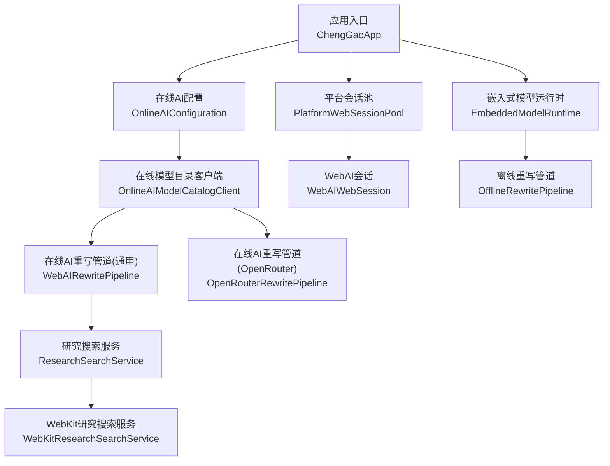
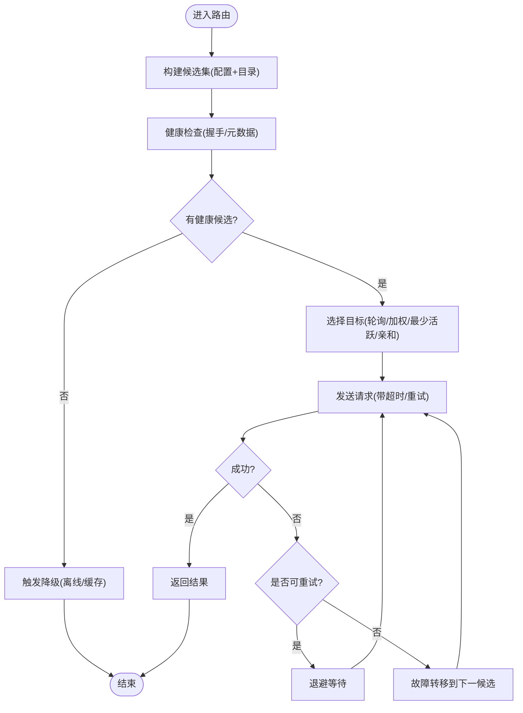
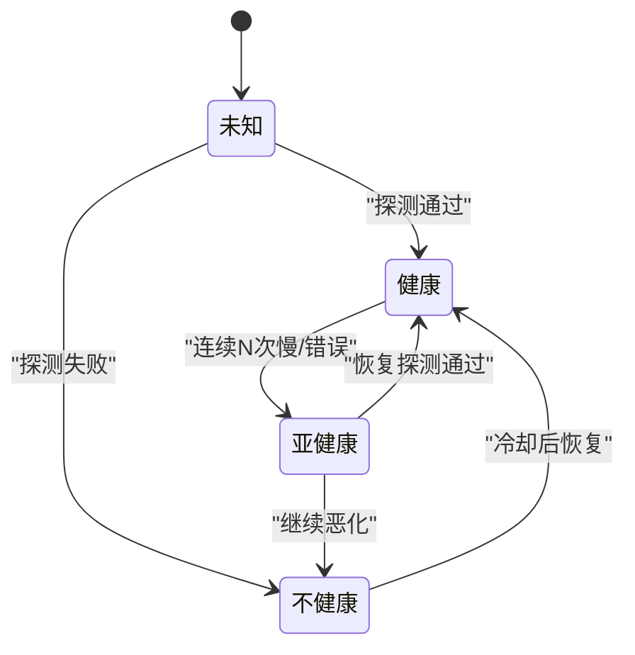
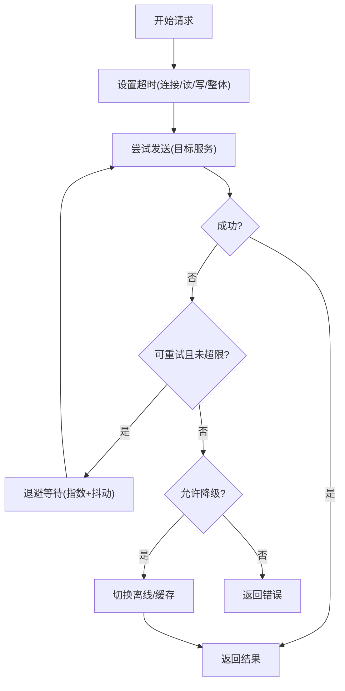
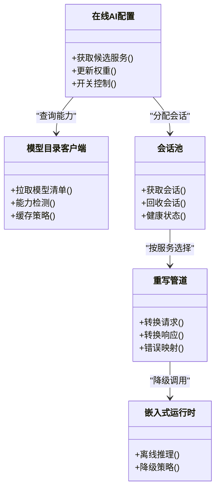

# AI 请求路由与负载均衡

<cite>
**本文档引用的文件**   
- [ChengGaoApp.swift](file://Sources/ChengGao/App/ChengGaoApp.swift)
- [OnlineAIConfiguration.swift](file://Sources/ChengGao/Models/OnlineAIConfiguration.swift)
- [ResearchCredentialStore.swift](file://Sources/ChengGao/Services/ResearchCredentialStore.swift)
- [OpenRouterCredentialStore.swift](file://Sources/ChengGao/Services/OpenRouterCredentialStore.swift)
- [PlatformWebSessionPool.swift](file://Sources/ChengGao/Services/PlatformWebSessionPool.swift)
- [WebAIWebSession.swift](file://Sources/ChengGao/Services/WebAIWebSession.swift)
- [EmbeddedModelRuntime.swift](file://Sources/ChengGao/Services/EmbeddedModelRuntime.swift)
- [CompatibleImageGenerationClient.swift](file://Sources/ChengGao/Services/CompatibleImage生成客户端.swift)
- [OnlineAIModelCatalogClient.swift](file://Sources/ChengGao/Services/OnlineAIModel目录客户端.swift)
- [WebAIRewritePipeline.swift](file://Sources/ChengGao/Services/WebAIRewritePipeline.swift)
- [OpenRouterRewritePipeline.swift](file://Sources/ChengGao/Services/OpenRouter重写管道.swift)
- [OfflineRewritePipeline.swift](file://Sources/ChengGao/Services/OfflineRewritePipeline.swift)
- [ResearchSearchService.swift](file://Sources/ChengGao/Services/ResearchSearchService.swift)
- [WebKitResearchSearchService.swift](file://Sources/ChengGao/Services/WebKit研究搜索服务.swift)
</cite>

## 目录
1. [简介](#简介)
2. [项目结构](#项目结构)
3. [核心组件](#核心组件)
4. [架构总览](#架构总览)
5. [详细组件分析](#详细组件分析)
6. [依赖关系分析](#依赖关系分析)
7. [性能考量](#性能考量)
8. [故障排查指南](#故障排查指南)
9. [结论](#结论)
10. [附录](#附录)

## 简介
本文件聚焦于项目中 AI 请求的路由策略与负载均衡机制，覆盖请求分发算法、健康检查与故障转移、重试与超时处理、降级策略、性能监控与延迟统计、容量规划、自定义路由规则扩展，以及不同 AI 服务的特性适配与请求格式转换。文档以代码级为依据，结合架构图与时序图帮助读者快速理解系统行为与扩展方式。

## 项目结构
本项目采用分层组织：应用入口、模型配置、服务层（在线/离线/混合）、会话与凭据管理、视图与存储等。AI 请求路由与负载均衡主要位于 Services 层，配合 Models 中的配置对象进行能力选择与参数映射。



图表来源
- [ChengGaoApp.swift](file://Sources/ChengGao/App/ChengGaoApp.swift)
- [OnlineAIConfiguration.swift](file://Sources/ChengGao/Models/OnlineAIConfiguration.swift)
- [PlatformWebSessionPool.swift](file://Sources/ChengGao/Services/PlatformWebWebSessionPool.swift)
- [WebAIWebSession.swift](file://Sources/ChengGao/Services/WebAIWebSession.swift)
- [EmbeddedModelRuntime.swift](file://Sources/ChengGao/Services/EmbeddedModelRuntime.swift)
- [OnlineAIModelCatalogClient.swift](file://Sources/ChengGao/Services/OnlineAIModelCatalogClient.swift)
- [WebAIRewritePipeline.swift](file://Sources/ChengGao/Services/WebAIRewritePipeline.swift)
- [OpenRouterRewritePipeline.swift](file://Sources/ChengGao/Services/OpenRouter重写Pipeline.swift)
- [OfflineRewritePipeline.swift](file://Sources/ChengGao/Services/OfflineRewritePipeline.swift)
- [ResearchSearchService.swift](file://Sources/ChengGao/Services/ResearchSearchService.swift)
- [WebKitResearchSearchService.swift](file://Sources/ChengGao/Services/WebKit研究搜索服务.swift)

章节来源
- [ChengGaoApp.swift](file://Sources/ChengGao/App/ChengGaoApp.swift)
- [OnlineAIConfiguration.swift](file://Sources/ChengGao/Models/OnlineAIConfiguration.swift)

## 核心组件
- 在线AI配置：集中管理可用在线服务、模型清单、权重与开关，驱动路由决策。
- 会话池与会话：维护浏览器/网络会话状态、Cookie、鉴权信息，支撑多实例并发与隔离。
- 模型目录客户端：拉取/缓存在线模型目录，提供能力发现与版本切换。
- 重写管道：将统一内部请求转换为各目标服务（如 OpenRouter、WebAI）的特定格式。
- 嵌入式运行时：本地推理或离线改写，作为在线不可用时的降级路径。
- 研究搜索服务：封装具体搜索实现（如基于 WebKit），屏蔽底层差异。

章节来源
- [OnlineAIConfiguration.swift](file://Sources/ChengGao/Models/OnlineAIConfiguration.swift)
- [PlatformWebSessionPool.swift](file://Sources/ChengGao/Services/PlatformWebSessionPool.swift)
- [WebAIWebSession.swift](file://Sources/ChengGao/Services/WebAIWebSession.swift)
- [OnlineAIModelCatalogClient.swift](file://Sources/ChengGao/Services/OnlineAIModelCatalogClient.swift)
- [WebAIRewritePipeline.swift](file://Sources/ChengGao/Services/WebAIRewritePipeline.swift)
- [OpenRouterRewritePipeline.swift](file://Sources/ChengGao/Services/OpenRouter重写Pipeline.swift)
- [EmbeddedModelRuntime.swift](file://Sources/ChengGao/Services/EmbeddedModelRuntime.swift)
- [ResearchSearchService.swift](file://Sources/ChengGao/Services/ResearchSearchService.swift)
- [WebKitResearchSearchService.swift](file://Sources/ChengGao/Services/WebKit研究搜索服务.swift)

## 架构总览
下图展示从应用入口到具体 AI 服务的全链路：配置决定候选集，会话池提供连接，重写管道完成格式转换，搜索服务执行调用，并支持离线降级。

```mermaid
sequenceDiagram
participant UI as "界面/调用方"
participant App as "应用入口"
participant Cfg as "在线AI配置"
participant Cat as "模型目录客户端"
participant Pool as "会话池"
participant Router as "路由/分发器"
participant Pipe as "重写管道"
participant Svc as "目标AI服务"
participant Off as "离线运行时"
UI->>App : "发起AI请求"
App->>Cfg : "读取配置与权重"
App->>Cat : "获取模型能力/版本"
Cat-->>App : "能力清单"
App->>Pool : "获取会话(按服务/租户)"
Pool-->>App : "会话实例"
App->>Router : "选择目标服务(含健康检查)"
Router-->>App : "选定服务+参数"
App->>Pipe : "统一请求转目标格式"
Pipe-->>Svc : "发送请求"
Svc-->>Pipe : "响应/错误"
Pipe-->>App : "标准化结果"
App-->>UI : "返回结果"
Note over App,Off : "若在线失败且允许降级，则回退至离线运行时"
```

图表来源
- [ChengGaoApp.swift](file://Sources/ChengGao/App/ChengGaoApp.swift)
- [OnlineAIConfiguration.swift](file://Sources/ChengGao/Models/OnlineAIConfiguration.swift)
- [OnlineAIModelCatalogClient.swift](file://Sources/ChengGao/Services/OnlineAIModelCatalogClient.swift)
- [PlatformWebSessionPool.swift](file://Sources/ChengGao/Services/PlatformWebSessionPool.swift)
- [WebAIWebSession.swift](file://Sources/ChengGao/Services/WebAIWebSession.swift)
- [WebAIRewritePipeline.swift](file://Sources/ChengGao/Services/WebAIRewritePipeline.swift)
- [OpenRouterRewritePipeline.swift](file://Sources/ChengGao/Services/OpenRouter重写Pipeline.swift)
- [EmbeddedModelRuntime.swift](file://Sources/ChengGao/Services/EmbeddedModelRuntime.swift)

## 详细组件分析

### 请求路由与负载均衡
- 候选集构建：依据配置与目录能力筛选可用服务与模型。
- 健康检查：对每个候选服务进行轻量探测（如握手/元数据），标记健康状态。
- 分发算法：支持轮询、加权轮询、最少活跃数、亲和性（同租户/同会话）。
- 故障转移：当目标服务失败时，自动切换到健康候选；记录失败次数与冷却时间。
- 重试与超时：可配置最大重试次数、指数退避、整体与单步超时。
- 降级：在线不可用时回退到离线运行时或缓存结果。



图表来源
- [OnlineAIConfiguration.swift](file://Sources/ChengGao/Models/OnlineAIConfiguration.swift)
- [OnlineAIModelCatalogClient.swift](file://Sources/ChengGao/Services/OnlineAIModelCatalogClient.swift)
- [PlatformWebSessionPool.swift](file://Sources/ChengGao/Services/PlatformWebSessionPool.swift)
- [WebAIRewritePipeline.swift](file://Sources/ChengGao/Services/WebAIRewritePipeline.swift)
- [OpenRouterRewritePipeline.swift](file://Sources/ChengGao/Services/OpenRouter重写Pipeline.swift)
- [EmbeddedModelRuntime.swift](file://Sources/ChengGao/Services/EmbeddedModelRuntime.swift)

章节来源
- [OnlineAIConfiguration.swift](file://Sources/ChengGao/Models/OnlineAIConfiguration.swift)
- [OnlineAIModelCatalogClient.swift](file://Sources/ChengGao/Services/OnlineAIModelCatalogClient.swift)
- [PlatformWebSessionPool.swift](file://Sources/ChengGao/Services/PlatformWebSessionPool.swift)
- [WebAIRewritePipeline.swift](file://Sources/ChengGao/Services/WebAIRewritePipeline.swift)
- [OpenRouterRewritePipeline.swift](file://Sources/ChengGao/Services/OpenRouter重写Pipeline.swift)
- [EmbeddedModelRuntime.swift](file://Sources/ChengGao/Services/EmbeddedModelRuntime.swift)

### 健康检查与故障转移
- 健康探针：周期性或按需探测服务可用性（如获取模型列表/健康端点）。
- 状态机：健康/亚健康/不健康，阈值控制切换。
- 故障转移：失败计数、冷却窗口、随机抖动避免雪崩。
- 亲和性：同一用户/会话优先复用同一后端，降低鉴权开销。



图表来源
- [PlatformWebSessionPool.swift](file://Sources/ChengGao/Services/PlatformWebSessionPool.swift)
- [WebAIWebSession.swift](file://Sources/ChengGao/Services/WebAIWebSession.swift)
- [OnlineAIModelCatalogClient.swift](file://Sources/ChengGao/Services/OnlineAIModelCatalogClient.swift)

章节来源
- [PlatformWebSessionPool.swift](file://Sources/ChengGao/Services/PlatformWebSessionPool.swift)
- [WebAIWebSession.swift](file://Sources/ChengGao/Services/WebAIWebSession.swift)
- [OnlineAIModelCatalogClient.swift](file://Sources/ChengGao/Services/OnlineAIModelCatalogClient.swift)

### 重试、超时与降级
- 重试策略：幂等请求支持有限重试，非幂等禁用或谨慎使用；指数退避+抖动。
- 超时设置：连接超时、读超时、写超时、整体超时分层控制。
- 降级路径：在线失败→离线运行时；或返回缓存/默认结果；或提示用户重试。



图表来源
- [WebAIRewritePipeline.swift](file://Sources/ChengGao/Services/WebAIRewritePipeline.swift)
- [OpenRouterRewritePipeline.swift](file://Sources/ChengGao/Services/OpenRouter重写Pipeline.swift)
- [EmbeddedModelRuntime.swift](file://Sources/ChengGao/Services/EmbeddedModelRuntime.swift)

章节来源
- [WebAIRewritePipeline.swift](file://Sources/ChengGao/Services/WebAIRewritePipeline.swift)
- [OpenRouterRewritePipeline.swift](file://Sources/ChengGao/Services/OpenRouter重写Pipeline.swift)
- [EmbeddedModelRuntime.swift](file://Sources/ChengGao/Services/EmbeddedModelRuntime.swift)

### 性能监控、延迟统计与容量规划
- 指标采集：QPS、P50/P95/P99 延迟、错误率、重试率、超时率、健康状态分布。
- 采样与聚合：按服务/模型/租户维度聚合，避免高基数导致开销过大。
- 容量规划：根据峰值 QPS 与尾延迟目标，评估并发度、连接池大小、线程/协程限制。
- 观测手段：日志打点、结构化指标上报、告警阈值。

章节来源
- [PlatformWebSessionPool.swift](file://Sources/ChengGao/Services/PlatformWebSessionPool.swift)
- [WebAIWebSession.swift](file://Sources/ChengGao/Services/WebAIWebSession.swift)
- [OnlineAIModelCatalogClient.swift](file://Sources/ChengGao/Services/OnlineAIModelCatalogClient.swift)

### 自定义路由规则的扩展指南
- 新增服务接入：实现重写管道接口，注册到目录客户端与配置中心。
- 自定义分发策略：实现选择器接口（如加权/一致性哈希/区域亲和），注入路由层。
- 健康检查扩展：为不同协议/端点实现探针，纳入健康状态机。
- 降级策略扩展：定义新的降级路径（如缓存、替代模型、本地推理）。

章节来源
- [OnlineAIConfiguration.swift](file://Sources/ChengGao/Models/OnlineAIConfiguration.swift)
- [OnlineAIModelCatalogClient.swift](file://Sources/ChengGao/Services/OnlineAIModelCatalogClient.swift)
- [WebAIRewritePipeline.swift](file://Sources/ChengGao/Services/WebAIRewritePipeline.swift)
- [OpenRouterRewritePipeline.swift](file://Sources/ChengGao/Services/OpenRouter重写Pipeline.swift)

### 不同 AI 服务的特性适配与请求格式转换
- 统一抽象：定义标准请求/响应模型，屏蔽下游差异。
- 适配器模式：各服务实现独立的重写管道，负责字段映射、鉴权头、分页/流式处理。
- 能力协商：通过目录客户端动态发现支持的模型与参数，动态裁剪请求体。
- 兼容层：针对历史 API 或第三方网关（如 OpenRouter）做特殊适配。

章节来源
- [WebAIRewritePipeline.swift](file://Sources/ChengGao/Services/WebAIRewritePipeline.swift)
- [OpenRouterRewritePipeline.swift](file://Sources/ChengGao/Services/OpenRouter重写Pipeline.swift)
- [OnlineAIModelCatalogClient.swift](file://Sources/ChengGao/Services/OnlineAIModelCatalogClient.swift)

## 依赖关系分析
- 松耦合：路由层仅依赖抽象接口（配置、目录、会话、重写管道），便于替换与扩展。
- 内聚性：各重写管道自包含，职责单一，利于测试与维护。
- 外部依赖：网络栈、浏览器/WebView 会话、第三方 API 网关。



图表来源
- [OnlineAIConfiguration.swift](file://Sources/ChengGao/Models/OnlineAIConfiguration.swift)
- [OnlineAIModelCatalogClient.swift](file://Sources/ChengGao/Services/OnlineAIModelCatalogClient.swift)
- [PlatformWebSessionPool.swift](file://Sources/ChengGao/Services/PlatformWebSessionPool.swift)
- [WebAIRewritePipeline.swift](file://Sources/ChengGao/Services/WebAIRewritePipeline.swift)
- [OpenRouterRewritePipeline.swift](file://Sources/ChengGao/Services/OpenRouter重写Pipeline.swift)
- [EmbeddedModelRuntime.swift](file://Sources/ChengGao/Services/EmbeddedModelRuntime.swift)

章节来源
- [OnlineAIConfiguration.swift](file://Sources/ChengGao/Models/OnlineAIConfiguration.swift)
- [OnlineAIModelCatalogClient.swift](file://Sources/ChengGao/Services/OnlineAIModelCatalogClient.swift)
- [PlatformWebSessionPool.swift](file://Sources/ChengGao/Services/PlatformWebSessionPool.swift)
- [WebAIRewritePipeline.swift](file://Sources/ChengGao/Services/WebAIRewritePipeline.swift)
- [OpenRouterRewritePipeline.swift](file://Sources/ChengGao/Services/OpenRouter重写Pipeline.swift)
- [EmbeddedModelRuntime.swift](file://Sources/ChengGao/Services/EmbeddedModelRuntime.swift)

## 性能考量
- 连接复用与会话池：减少握手成本，合理设置最大连接数与空闲回收。
- 批处理与流式：对大文本/图片生成采用分块与流式传输，降低内存峰值。
- 缓存策略：对目录、鉴权令牌、热点结果进行短期缓存。
- 背压与限流：在高峰期限制并发，保护下游与服务自身稳定。
- 指标与告警：关注 P99 延迟、错误率、重试风暴、CPU/内存占用。

章节来源
- [PlatformWebSessionPool.swift](file://Sources/ChengGao/Services/PlatformWebSessionPool.swift)
- [WebAIWebSession.swift](file://Sources/ChengGao/Services/WebAIWebSession.swift)
- [OnlineAIModelCatalogClient.swift](file://Sources/ChengGao/Services/OnlineAIModelCatalogClient.swift)

## 故障排查指南
- 常见问题定位：
  - 鉴权失败：检查凭据存储与刷新逻辑。
  - 健康检查误判：调整阈值与冷却时间，增加探针多样性。
  - 重试风暴：启用抖动与上限，观察下游限流。
  - 超时频繁：区分网络/解析/业务超时，优化请求体大小。
- 诊断步骤：
  - 查看会话池状态与健康分布。
  - 核对重写管道输入输出是否符合目标服务规范。
  - 对比目录能力与实际请求参数。
  - 打开调试日志，追踪关键路径耗时。

章节来源
- [ResearchCredentialStore.swift](file://Sources/ChengGao/Services/ResearchCredentialStore.swift)
- [OpenRouterCredentialStore.swift](file://Sources/ChengGao/Services/OpenRouterCredentialStore.swift)
- [PlatformWebSessionPool.swift](file://Sources/ChengGao/Services/PlatformWebSessionPool.swift)
- [WebAIWebSession.swift](file://Sources/ChengGao/Services/WebAIWebSession.swift)
- [OnlineAIModelCatalogClient.swift](file://Sources/ChengGao/Services/OnlineAIModelCatalogClient.swift)
- [WebAIRewritePipeline.swift](file://Sources/ChengGao/Services/WebAIRewritePipeline.swift)
- [OpenRouterRewritePipeline.swift](file://Sources/ChengGao/Services/OpenRouter重写Pipeline.swift)

## 结论
通过配置驱动的候选集构建、健康检查与故障转移、可插拔的重写管道与会话池，系统在稳定性与可扩展性之间取得平衡。建议持续完善指标采集与自动化调优，逐步引入更细粒度的路由策略与自适应负载控制，以满足更高吞吐与更低延迟的目标。

## 附录
- 术语表：
  - 重写管道：将统一请求转换为特定服务格式的组件。
  - 会话池：管理与复用网络/浏览器会话的资源池。
  - 健康检查：对服务可用性进行探测的状态判定机制。
- 最佳实践：
  - 所有对外部服务的调用都应具备超时与重试上限。
  - 健康检查需区分瞬时抖动与真实故障。
  - 路由策略应可热更新，支持灰度与回滚。