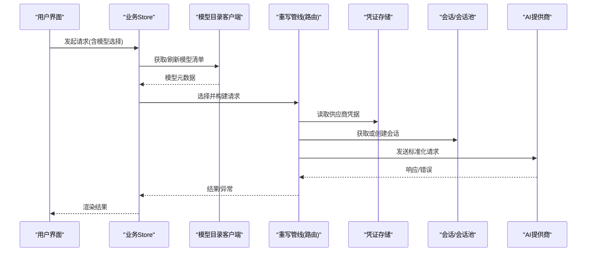
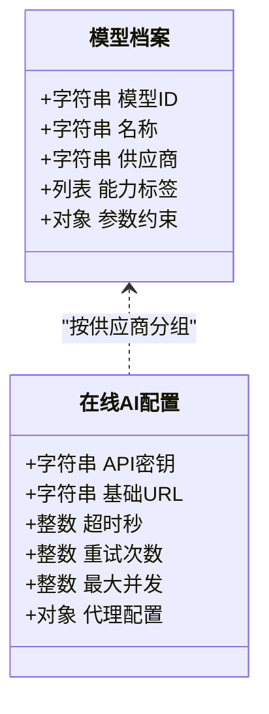
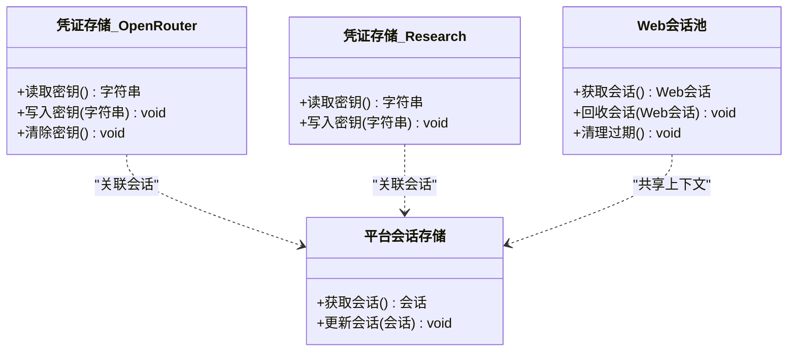
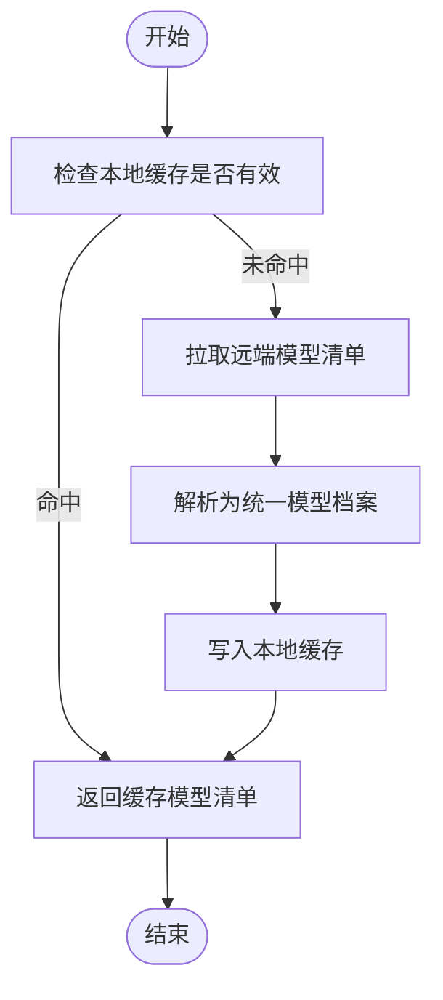
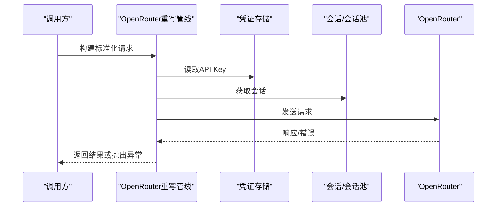
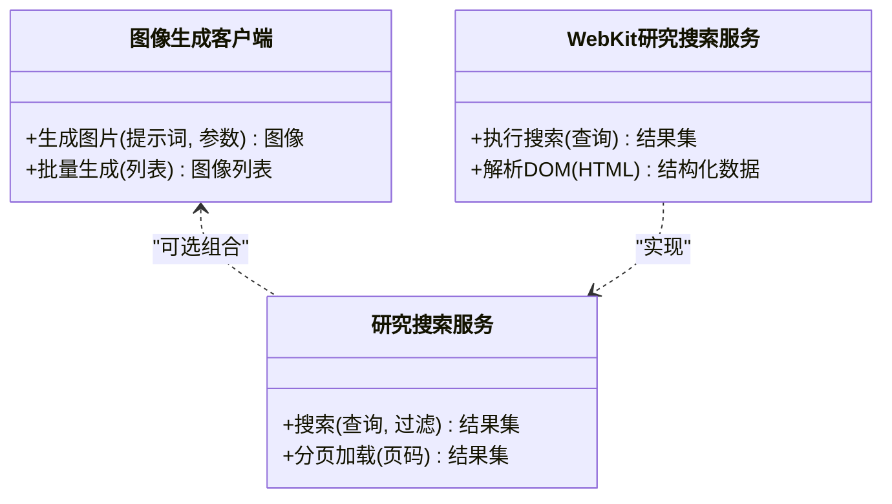
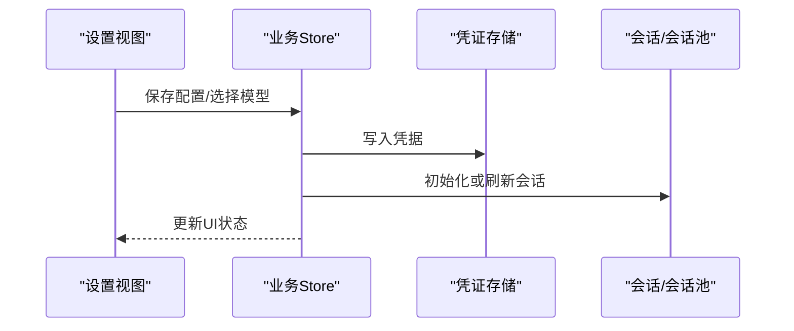
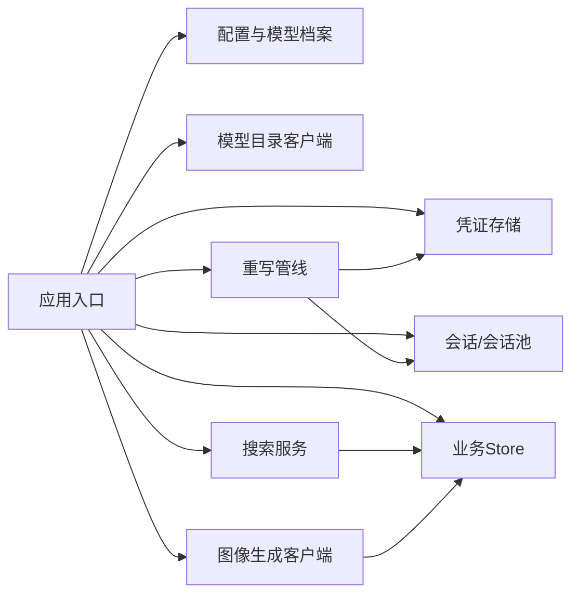

# AI 集成

<cite>
**本文引用的文件**   
- [Package.swift](file://Package.swift)
- [README.md](file://README.md)
- [ChengGaoApp.swift](file://Sources/ChengGao/App/ChengGaoApp.swift)
- [ModelProfile.swift](file://Sources/ChengGao/Models/ModelProfile.swift)
- [OnlineAIConfiguration.swift](file://Sources/ChengGao/Models/OnlineAIConfiguration.swift)
- [ResearchModels.swift](file://Sources/ChengGao/Models/ResearchModels.swift)
- [WebAIModels.swift](file://Sources/ChengGao/Models/WebAIModels.swift)
- [OpenRouterCredentialStore.swift](file://Sources/ChengGao/Services/OpenRouterCredentialStore.swift)
- [ResearchCredentialStore.swift](file://Sources/ChengGao/Services/ResearchCredentialStore.swift)
- [PlatformSessionStore.swift](file://Sources/ChengGao/Services/PlatformSessionStore.swift)
- [PlatformWebSessionPool.swift](file://Sources/ChengGao/Services/PlatformWebSessionPool.swift)
- [OnlineAIModelCatalogClient.swift](file://Sources/ChengGao/Services/OnlineAIModelCatalogClient.swift)
- [OpenRouterRewritePipeline.swift](file://Sources/ChengGao/Services/OpenRouterRewritePipeline.swift)
- [WebAIRewritePipeline.swift](file://Sources/ChengGao/Services/WebAIRewritePipeline.swift)
- [EmbeddedModelRuntime.swift](file://Sources/ChengGao/Services/EmbeddedModelRuntime.swift)
- [CompatibleImageGenerationClient.swift](file://Sources/ChengGao/Services/CompatibleImageGenerationClient.swift)
- [ResearchSearchService.swift](file://Sources/ChengGao/Services/ResearchSearchService.swift)
- [WebKitResearchSearchService.swift](file://Sources/ChengGao/Services/WebKitResearchSearchService.swift)
- [ResearchDatabase.swift](file://Sources/ChengGao/Services/ResearchDatabase.swift)
- [ResearchStore.swift](file://Sources/ChengGao/Stores/ResearchStore.swift)
- [RewriteStore.swift](file://Sources/ChengGao/Stores/RewriteStore.swift)
- [SettingsView.swift](file://Sources/ChengGao/Views/SettingsView.swift)
- [WebAILoginView.swift](file://Sources/ChengGao/Views/WebAILoginView.swift)
</cite>

## 目录
1. [简介](#简介)
2. [项目结构](#项目结构)
3. [核心组件](#核心组件)
4. [架构总览](#架构总览)
5. [详细组件分析](#详细组件分析)
6. [依赖关系分析](#依赖关系分析)
7. [性能考虑](#性能考虑)
8. [故障排查指南](#故障排查指南)
9. [结论](#结论)
10. [附录](#附录)

## 简介
本文件系统化说明本项目中 AI 模型集成的实现方案，覆盖支持的 AI 服务提供商（如 OpenRouter、ChatGPT 等）、模型目录管理、配置与认证存储、会话管理与请求路由策略、模型选择算法、负载均衡与错误处理机制。同时提供新增 AI 服务接入指南（API 适配、认证配置、错误映射），并文档化模型配置的 JSON 格式、环境变量设置与部署注意事项，以及性能优化建议与监控指标。

## 项目结构
本项目采用 Swift Package Manager 组织代码，AI 相关能力主要分布在以下模块：
- Models：数据模型与配置结构（模型档案、在线 AI 配置、研究模型、Web AI 模型）
- Services：AI 客户端、凭证存储、会话池、重写管线、搜索服务等
- Stores：状态持久化与 UI 绑定
- Views：设置与登录界面，用于配置与鉴权

```mermaid
graph TB
subgraph "应用入口"
App["ChengGaoApp"]
end
subgraph "模型与配置"
ModelProfile["ModelProfile"]
OnlineAIConfig["OnlineAIConfiguration"]
ResearchModels["ResearchModels"]
WebAIModels["WebAIModels"]
end
subgraph "服务层"
Catalog["OnlineAIModelCatalogClient"]
ORCred["OpenRouterCredentialStore"]
ResCred["ResearchCredentialStore"]
PlatSess["PlatformSessionStore"]
WebSessPool["PlatformWebSessionPool"]
ORPipe["OpenRouterRewritePipeline"]
WebPipe["WebAIRewritePipeline"]
EmbedRT["EmbeddedModelRuntime"]
ImgGen["CompatibleImageGenerationClient"]
ResSvc["ResearchSearchService"]
WKResSvc["WebKitResearchSearchService"]
ResDB["ResearchDatabase"]
end
subgraph "状态与UI"
ResStore["ResearchStore"]
RewriteStore["RewriteStore"]
Settings["SettingsView"]
WebLogin["WebAILoginView"]
end
App --> ModelProfile
App --> OnlineAIConfig
App --> Catalog
App --> ORCred
App --> ResCred
App --> PlatSess
App --> WebSessPool
App --> ORPipe
App --> WebPipe
App --> EmbedRT
App --> ImgGen
App --> ResSvc
App --> WKResSvc
App --> ResDB
App --> ResStore
App --> RewriteStore
App --> Settings
App --> WebLogin
```

图表来源
- [ChengGaoApp.swift](file://Sources/ChengGao/App/ChengGaoApp.swift)
- [ModelProfile.swift](file://Sources/ChengGao/Models/ModelProfile.swift)
- [OnlineAIConfiguration.swift](file://Sources/ChengGao/Models/OnlineAIConfiguration.swift)
- [OnlineAIModelCatalogClient.swift](file://Sources/ChengGao/Services/OnlineAIModelCatalogClient.swift)
- [OpenRouterCredentialStore.swift](file://Sources/ChengGao/Services/OpenRouterCredentialStore.swift)
- [ResearchCredentialStore.swift](file://Sources/ChengGao/Services/ResearchCredentialStore.swift)
- [PlatformSessionStore.swift](file://Sources/ChengGao/Services/PlatformSessionStore.swift)
- [PlatformWebSessionPool.swift](file://Sources/ChengGao/Services/PlatformWebSessionPool.swift)
- [OpenRouterRewritePipeline.swift](file://Sources/ChengGao/Services/OpenRouterRewritePipeline.swift)
- [WebAIRewritePipeline.swift](file://Sources/ChengGao/Services/WebAIRewritePipeline.swift)
- [EmbeddedModelRuntime.swift](file://Sources/ChengGao/Services/EmbeddedModelRuntime.swift)
- [CompatibleImageGenerationClient.swift](file://Sources/ChengGao/Services/CompatibleImageGenerationClient.swift)
- [ResearchSearchService.swift](file://Sources/ChengGao/Services/ResearchSearchService.swift)
- [WebKitResearchSearchService.swift](file://Sources/ChengGao/Services/WebKitResearchSearchService.swift)
- [ResearchDatabase.swift](file://Sources/ChengGao/Services/ResearchDatabase.swift)
- [ResearchStore.swift](file://Sources/ChengGao/Stores/ResearchStore.swift)
- [RewriteStore.swift](file://Sources/ChengGao/Stores/RewriteStore.swift)
- [SettingsView.swift](file://Sources/ChengGao/Views/SettingsView.swift)
- [WebAILoginView.swift](file://Sources/ChengGao/Views/WebAILoginView.swift)

章节来源
- [Package.swift](file://Package.swift)
- [README.md](file://README.md)
- [ChengGaoApp.swift](file://Sources/ChengGao/App/ChengGaoApp.swift)

## 核心组件
- 模型档案与配置
  - 模型档案：统一描述模型标识、名称、供应商、能力标签、参数约束等
  - 在线 AI 配置：集中管理 API Key、Base URL、超时、重试、并发限制等
- 凭证与会话
  - 凭证存储：为不同供应商（OpenRouter、Research 等）提供安全存取
  - 平台会话：跨视图共享的会话上下文；Web 会话池：复用浏览器会话提升稳定性
- 模型目录与发现
  - 在线模型目录客户端：拉取远程模型清单，缓存本地，供选择器使用
- 重写管线与路由
  - OpenRouter 重写管线：将内部请求转换为 OpenRouter 兼容格式并路由
  - Web AI 重写管线：通过 Web 方式访问第三方服务（如 ChatGPT）
  - 嵌入式模型运行时：本地推理执行路径
- 图像生成与研究搜索
  - 兼容图像生成客户端：抽象多后端图像生成接口
  - 研究搜索服务与 WebKit 实现：基于 Web 引擎的研究检索
- 状态与 UI
  - 研究/重写 Store：承载业务状态与 UI 绑定
  - 设置与登录视图：配置凭证、选择模型、管理会话

章节来源
- [ModelProfile.swift](file://Sources/ChengGao/Models/ModelProfile.swift)
- [OnlineAIConfiguration.swift](file://Sources/ChengGao/Models/OnlineAIConfiguration.swift)
- [ResearchModels.swift](file://Sources/ChengGao/Models/ResearchModels.swift)
- [WebAIModels.swift](file://Sources/ChengGao/Models/WebAIModels.swift)
- [OpenRouterCredentialStore.swift](file://Sources/ChengGao/Services/OpenRouterCredentialStore.swift)
- [ResearchCredentialStore.swift](file://Sources/ChengGao/Services/ResearchCredentialStore.swift)
- [PlatformSessionStore.swift](file://Sources/ChengGao/Services/PlatformSessionStore.swift)
- [PlatformWebSessionPool.swift](file://Sources/ChengGao/Services/PlatformWebSessionPool.swift)
- [OnlineAIModelCatalogClient.swift](file://Sources/ChengGao/Services/OnlineAIModelCatalogClient.swift)
- [OpenRouterRewritePipeline.swift](file://Sources/ChengGao/Services/OpenRouterRewritePipeline.swift)
- [WebAIRewritePipeline.swift](file://Sources/ChengGao/Services/WebAIRewritePipeline.swift)
- [EmbeddedModelRuntime.swift](file://Sources/ChengGao/Services/EmbeddedModelRuntime.swift)
- [CompatibleImageGenerationClient.swift](file://Sources/ChengGao/Services/CompatibleImageGenerationClient.swift)
- [ResearchSearchService.swift](file://Sources/ChengGao/Services/ResearchSearchService.swift)
- [WebKitResearchSearchService.swift](file://Sources/ChengGao/Services/WebKitResearchSearchService.swift)
- [ResearchDatabase.swift](file://Sources/ChengGao/Services/ResearchDatabase.swift)
- [ResearchStore.swift](file://Sources/ChengGao/Stores/ResearchStore.swift)
- [RewriteStore.swift](file://Sources/ChengGao/Stores/RewriteStore.swift)
- [SettingsView.swift](file://Sources/ChengGao/Views/SettingsView.swift)
- [WebAILoginView.swift](file://Sources/ChengGao/Views/WebAILoginView.swift)

## 架构总览
整体架构遵循“配置驱动 + 管线路由 + 会话复用”的模式：
- 配置层：模型档案与在线配置定义可用模型与行为
- 服务层：凭证、会话、目录、重写管线、搜索与图像生成等
- 状态层：Store 聚合状态，供 UI 消费
- 入口层：App 初始化并装配各组件

图表来源
- [OnlineAIModelCatalogClient.swift](file://Sources/ChengGao/Services/OnlineAIModelCatalogClient.swift)
- [OpenRouterRewritePipeline.swift](file://Sources/ChengGao/Services/OpenRouterRewritePipeline.swift)
- [WebAIRewritePipeline.swift](file://Sources/ChengGao/Services/WebAIRewritePipeline.swift)
- [OpenRouterCredentialStore.swift](file://Sources/ChengGao/Services/OpenRouterCredentialStore.swift)
- [ResearchCredentialStore.swift](file://Sources/ChengGao/Services/ResearchCredentialStore.swift)
- [PlatformSessionStore.swift](file://Sources/ChengGao/Services/PlatformSessionStore.swift)
- [PlatformWebSessionPool.swift](file://Sources/ChengGao/Services/PlatformWebSessionPool.swift)

## 详细组件分析

### 模型档案与配置
- 模型档案：统一描述模型 ID、名称、供应商、能力标签、参数范围等，作为选择器的数据源
- 在线 AI 配置：集中管理 API Key、Base URL、超时、重试次数、并发限制、代理等

图表来源
- [ModelProfile.swift](file://Sources/ChengGao/Models/ModelProfile.swift)
- [OnlineAIConfiguration.swift](file://Sources/ChengGao/Models/OnlineAIConfiguration.swift)

章节来源
- [ModelProfile.swift](file://Sources/ChengGao/Models/ModelProfile.swift)
- [OnlineAIConfiguration.swift](file://Sources/ChengGao/Models/OnlineAIConfiguration.swift)

### 凭证与会话管理
- 凭证存储：按供应商隔离存储 API Key，支持加密与默认值回退
- 平台会话：跨视图共享的会话上下文，避免重复初始化
- Web 会话池：复用浏览器会话，降低握手开销，提高稳定性

图表来源
- [OpenRouterCredentialStore.swift](file://Sources/ChengGao/Services/OpenRouterCredentialStore.swift)
- [ResearchCredentialStore.swift](file://Sources/ChengGao/Services/ResearchCredentialStore.swift)
- [PlatformSessionStore.swift](file://Sources/ChengGao/Services/PlatformSessionStore.swift)
- [PlatformWebSessionPool.swift](file://Sources/ChengGao/Services/PlatformWebSessionPool.swift)

章节来源
- [OpenRouterCredentialStore.swift](file://Sources/ChengGao/Services/OpenRouterCredentialStore.swift)
- [ResearchCredentialStore.swift](file://Sources/ChengGao/Services/ResearchCredentialStore.swift)
- [PlatformSessionStore.swift](file://Sources/ChengGao/Services/PlatformSessionStore.swift)
- [PlatformWebSessionPool.swift](file://Sources/ChengGao/Services/PlatformWebSessionPool.swift)

### 模型目录与发现
- 在线模型目录客户端：从远端拉取模型清单，解析为统一结构，支持本地缓存与增量更新

图表来源
- [OnlineAIModelCatalogClient.swift](file://Sources/ChengGao/Services/OnlineAIModelCatalogClient.swift)

章节来源
- [OnlineAIModelCatalogClient.swift](file://Sources/ChengGao/Services/OnlineAIModelCatalogClient.swift)

### 请求路由与重写管线
- OpenRouter 重写管线：将内部请求转换为 OpenRouter 兼容格式，注入凭据与头信息，并处理流式响应
- Web AI 重写管线：通过 Web 方式访问第三方服务（如 ChatGPT），封装登录态与 Cookie
- 嵌入式模型运行时：本地推理执行路径，适用于离线场景

图表来源
- [OpenRouterRewritePipeline.swift](file://Sources/ChengGao/Services/OpenRouterRewritePipeline.swift)
- [OpenRouterCredentialStore.swift](file://Sources/ChengGao/Services/OpenRouterCredentialStore.swift)
- [PlatformSessionStore.swift](file://Sources/ChengGao/Services/PlatformSessionStore.swift)
- [PlatformWebSessionPool.swift](file://Sources/ChengGao/Services/PlatformWebSessionPool.swift)

章节来源
- [OpenRouterRewritePipeline.swift](file://Sources/ChengGao/Services/OpenRouterRewritePipeline.swift)
- [WebAIRewritePipeline.swift](file://Sources/ChengGao/Services/WebAIRewritePipeline.swift)
- [EmbeddedModelRuntime.swift](file://Sources/ChengGao/Services/EmbeddedModelRuntime.swift)

### 图像生成与研究搜索
- 兼容图像生成客户端：抽象多后端图像生成接口，屏蔽差异
- 研究搜索服务与 WebKit 实现：基于 Web 引擎进行检索，便于扩展更多站点

图表来源
- [CompatibleImageGenerationClient.swift](file://Sources/ChengGao/Services/CompatibleImageGenerationClient.swift)
- [ResearchSearchService.swift](file://Sources/ChengGao/Services/ResearchSearchService.swift)
- [WebKitResearchSearchService.swift](file://Sources/ChengGao/Services/WebKitResearchSearchService.swift)

章节来源
- [CompatibleImageGenerationClient.swift](file://Sources/ChengGao/Services/CompatibleImageGenerationClient.swift)
- [ResearchSearchService.swift](file://Sources/ChengGao/Services/ResearchSearchService.swift)
- [WebKitResearchSearchService.swift](file://Sources/ChengGao/Services/WebKitResearchSearchService.swift)

### 状态与 UI
- 研究/重写 Store：聚合请求状态、结果、错误与进度，供 UI 实时展示
- 设置与登录视图：配置凭证、选择模型、管理会话与偏好

图表来源
- [ResearchStore.swift](file://Sources/ChengGao/Stores/ResearchStore.swift)
- [RewriteStore.swift](file://Sources/ChengGao/Stores/RewriteStore.swift)
- [SettingsView.swift](file://Sources/ChengGao/Views/SettingsView.swift)
- [WebAILoginView.swift](file://Sources/ChengGao/Views/WebAILoginView.swift)

章节来源
- [ResearchStore.swift](file://Sources/ChengGao/Stores/ResearchStore.swift)
- [RewriteStore.swift](file://Sources/ChengGao/Stores/RewriteStore.swift)
- [SettingsView.swift](file://Sources/ChengGao/Views/SettingsView.swift)
- [WebAILoginView.swift](file://Sources/ChengGao/Views/WebAILoginView.swift)

## 依赖关系分析
- 低耦合高内聚：每个供应商或服务通过独立的服务类封装，减少相互影响
- 依赖注入：App 层负责装配各组件，便于测试与替换实现
- 外部依赖：网络请求、Web 引擎、本地存储等由系统框架或第三方库提供

图表来源
- [ChengGaoApp.swift](file://Sources/ChengGao/App/ChengGaoApp.swift)
- [OnlineAIConfiguration.swift](file://Sources/ChengGao/Models/OnlineAIConfiguration.swift)
- [OnlineAIModelCatalogClient.swift](file://Sources/ChengGao/Services/OnlineAIModelCatalogClient.swift)
- [OpenRouterCredentialStore.swift](file://Sources/ChengGao/Services/OpenRouterCredentialStore.swift)
- [PlatformSessionStore.swift](file://Sources/ChengGao/Services/PlatformSessionStore.swift)
- [OpenRouterRewritePipeline.swift](file://Sources/ChengGao/Services/OpenRouterRewritePipeline.swift)
- [ResearchSearchService.swift](file://Sources/ChengGao/Services/ResearchSearchService.swift)
- [CompatibleImageGenerationClient.swift](file://Sources/ChengGao/Services/CompatibleImageGenerationClient.swift)
- [ResearchStore.swift](file://Sources/ChengGao/Stores/ResearchStore.swift)

章节来源
- [Package.swift](file://Package.swift)
- [ChengGaoApp.swift](file://Sources/ChengGao/App/ChengGaoApp.swift)

## 性能考虑
- 模型目录缓存：优先使用本地缓存，减少网络请求与解析开销
- 会话复用：通过平台会话与 Web 会话池降低握手与登录成本
- 并发控制：根据供应商限制调整最大并发与队列长度，避免限流
- 超时与重试：合理设置超时与重试策略，平衡用户体验与资源占用
- 流式响应：对长文本生成启用流式输出，提升首字延迟
- 本地推理：在设备允许的情况下优先使用嵌入式模型运行时，降低网络依赖

[本节为通用性能指导，不直接分析具体文件]

## 故障排查指南
- 认证失败
  - 检查凭证存储是否正确写入与读取
  - 确认 Base URL、API Key、代理配置与环境变量
- 会话异常
  - 检查会话池是否过期或耗尽，必要时触发重建
  - 查看 Web 会话 Cookie 是否失效
- 模型不可用
  - 刷新模型目录缓存，确认模型 ID 与供应商匹配
  - 检查模型参数约束是否满足
- 网络错误
  - 检查超时、重试次数与并发限制
  - 查看错误码与消息，映射到上层友好提示

章节来源
- [OpenRouterCredentialStore.swift](file://Sources/ChengGao/Services/OpenRouterCredentialStore.swift)
- [ResearchCredentialStore.swift](file://Sources/ChengGao/Services/ResearchCredentialStore.swift)
- [PlatformSessionStore.swift](file://Sources/ChengGao/Services/PlatformSessionStore.swift)
- [PlatformWebSessionPool.swift](file://Sources/ChengGao/Services/PlatformWebSessionPool.swift)
- [OnlineAIModelCatalogClient.swift](file://Sources/ChengGao/Services/OnlineAIModelCatalogClient.swift)

## 结论
本项目以统一的模型档案与在线配置为核心，结合凭证存储、会话管理与模型目录，构建了可扩展的 AI 集成架构。通过重写管线实现多供应商路由，配合并发控制、超时重试与流式响应，兼顾性能与稳定性。新增服务可通过标准接口快速接入，保持架构一致性与可维护性。

[本节为总结性内容，不直接分析具体文件]

## 附录

### 支持的 AI 服务提供商
- OpenRouter：通过重写管线与凭证存储对接，支持模型选择与流式响应
- ChatGPT（Web 方式）：通过 Web 重写管线与 Web 会话池复用登录态
- 嵌入式模型：本地运行时，适合离线与隐私敏感场景
- 图像生成：兼容多后端图像生成客户端，统一接口

章节来源
- [OpenRouterRewritePipeline.swift](file://Sources/ChengGao/Services/OpenRouterRewritePipeline.swift)
- [WebAIRewritePipeline.swift](file://Sources/ChengGao/Services/WebAIRewritePipeline.swift)
- [EmbeddedModelRuntime.swift](file://Sources/ChengGao/Services/EmbeddedModelRuntime.swift)
- [CompatibleImageGenerationClient.swift](file://Sources/ChengGao/Services/CompatibleImageGenerationClient.swift)

### 模型目录管理与配置机制
- 模型目录：在线拉取、本地缓存、统一解析
- 配置机制：在线 AI 配置集中管理密钥、URL、超时、重试、并发等

章节来源
- [OnlineAIModelCatalogClient.swift](file://Sources/ChengGao/Services/OnlineAIModelCatalogClient.swift)
- [OnlineAIConfiguration.swift](file://Sources/ChengGao/Models/OnlineAIConfiguration.swift)

### 认证存储与会话管理
- 凭证存储：按供应商隔离，支持读写与清理
- 会话管理：平台会话与 Web 会话池，确保状态稳定与复用

章节来源
- [OpenRouterCredentialStore.swift](file://Sources/ChengGao/Services/OpenRouterCredentialStore.swift)
- [ResearchCredentialStore.swift](file://Sources/ChengGao/Services/ResearchCredentialStore.swift)
- [PlatformSessionStore.swift](file://Sources/ChengGao/Services/PlatformSessionStore.swift)
- [PlatformWebSessionPool.swift](file://Sources/ChengGao/Services/PlatformWebSessionPool.swift)

### 请求路由策略与模型选择算法
- 路由策略：根据模型供应商选择对应重写管线
- 选择算法：基于模型档案的能力标签与参数约束，结合用户偏好与可用性动态选择

章节来源
- [ModelProfile.swift](file://Sources/ChengGao/Models/ModelProfile.swift)
- [OpenRouterRewritePipeline.swift](file://Sources/ChengGao/Services/OpenRouterRewritePipeline.swift)
- [WebAIRewritePipeline.swift](file://Sources/ChengGao/Services/WebAIRewritePipeline.swift)

### 负载均衡与错误处理机制
- 负载均衡：通过并发限制与队列管理，避免单点过载
- 错误处理：统一异常捕获、重试与降级策略，提供友好错误提示

章节来源
- [OnlineAIConfiguration.swift](file://Sources/ChengGao/Models/OnlineAIConfiguration.swift)
- [PlatformWebSessionPool.swift](file://Sources/ChengGao/Services/PlatformWebSessionPool.swift)

### 新增 AI 服务集成指南
- API 适配：定义统一请求/响应结构，实现重写管线
- 认证配置：接入凭证存储，支持密钥与环境变量
- 错误映射：将供应商错误码映射为统一错误类型
- 会话管理：复用平台会话或建立专用会话池

章节来源
- [OpenRouterCredentialStore.swift](file://Sources/ChengGao/Services/OpenRouterCredentialStore.swift)
- [OpenRouterRewritePipeline.swift](file://Sources/ChengGao/Services/OpenRouterRewritePipeline.swift)
- [PlatformSessionStore.swift](file://Sources/ChengGao/Services/PlatformSessionStore.swift)

### 模型配置的 JSON 格式与环境变量
- JSON 配置：包含模型 ID、名称、供应商、能力标签、参数约束等字段
- 环境变量：API Key、Base URL、超时、重试、并发限制、代理等

章节来源
- [OnlineAIConfiguration.swift](file://Sources/ChengGao/Models/OnlineAIConfiguration.swift)
- [ModelProfile.swift](file://Sources/ChengGao/Models/ModelProfile.swift)

### 部署注意事项
- 环境准备：安装依赖、配置环境变量与证书
- 权限与安全：最小权限原则，保护密钥与敏感数据
- 监控与日志：采集关键指标与错误日志，便于排障

章节来源
- [ChengGaoApp.swift](file://Sources/ChengGao/App/ChengGaoApp.swift)
- [OnlineAIConfiguration.swift](file://Sources/ChengGao/Models/OnlineAIConfiguration.swift)

### 性能优化建议与监控指标
- 优化建议：缓存、会话复用、流式输出、并发控制、本地推理
- 监控指标：请求成功率、平均时延、首字延迟、错误率、并发数、缓存命中率

[本节为通用指导，不直接分析具体文件]