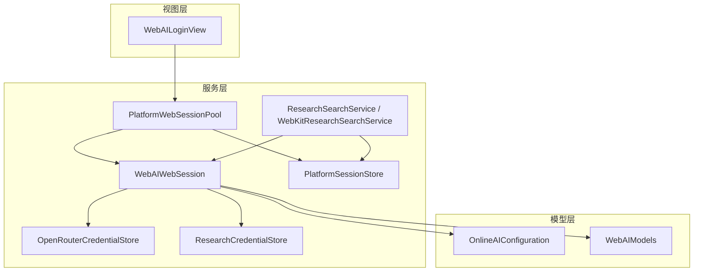
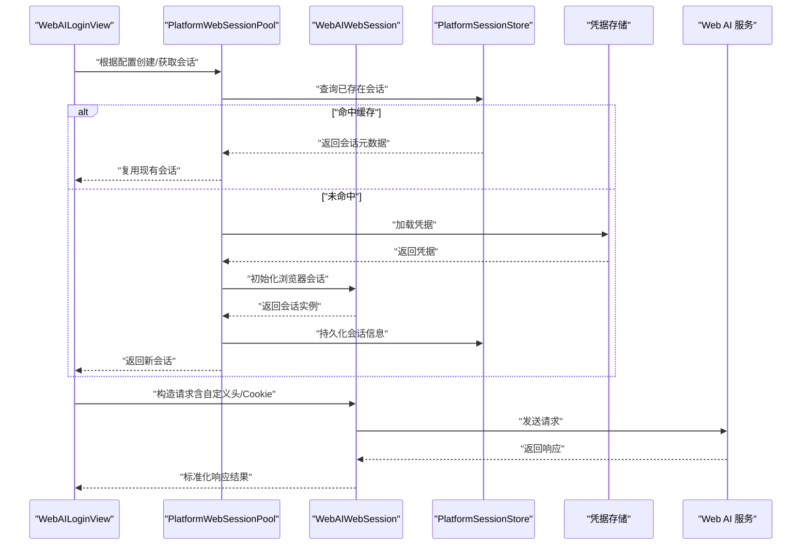
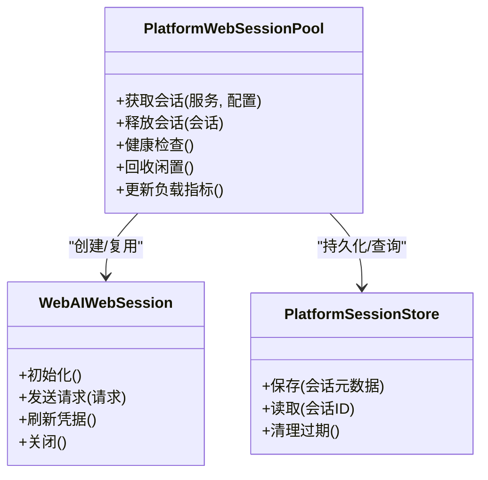
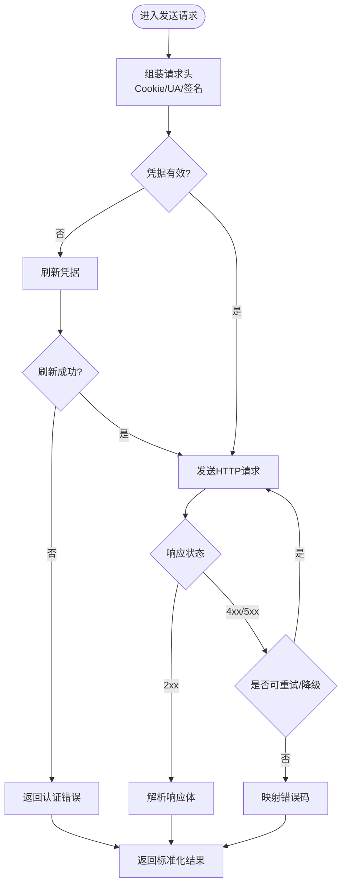
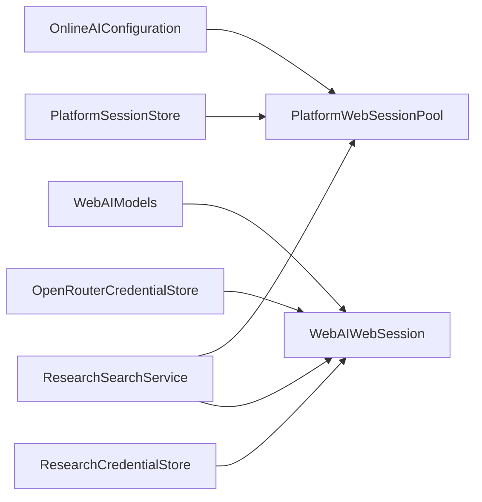

# Web AI 会话管理

<cite>
**本文引用的文件**   
- [PlatformWebSessionPool.swift](file://Sources/ChengGao/Services/PlatformWebSessionPool.swift)
- [WebAIWebSession.swift](file://Sources/ChengGao/Services/WebAIWebSession.swift)
- [PlatformSessionStore.swift](file://Sources/ChengGao/Services/PlatformSessionStore.swift)
- [OnlineAIConfiguration.swift](file://Sources/ChengGao/Models/OnlineAIConfiguration.swift)
- [WebAIModels.swift](file://Sources/ChengGao/Models/WebAIModels.swift)
- [OpenRouterCredentialStore.swift](file://Sources/ChengGao/Services/OpenRouterCredentialStore.swift)
- [ResearchCredentialStore.swift](file://Sources/ChengGao/Services/ResearchCredentialStore.swift)
- [WebAILoginView.swift](file://Sources/ChengGao/Views/WebAILoginView.swift)
- [ResearchSearchService.swift](file://Sources/ChengGao/Services/ResearchSearchService.swift)
- [WebKitResearchSearchService.swift](file://Sources/ChengGao/Services/WebKitResearchSearchService.swift)
</cite>

## 目录
1. [简介](#简介)
2. [项目结构](#项目结构)
3. [核心组件](#核心组件)
4. [架构总览](#架构总览)
5. [详细组件分析](#详细组件分析)
6. [依赖关系分析](#依赖关系分析)
7. [性能考虑](#性能考虑)
8. [故障排查指南](#故障排查指南)
9. [结论](#结论)
10. [附录](#附录)

## 简介
本文件面向 Web AI 会话管理与连接池机制，系统性说明浏览器会话的创建、状态维护与资源回收策略；解释会话复用、负载均衡与故障恢复；涵盖 Cookie 管理、请求头定制与响应处理流程；并提供会话监控、调试工具与性能优化建议。同时文档化与不同 Web AI 服务的兼容性处理与协议适配方案，帮助开发者在跨服务场景下稳定高效地构建 Web AI 能力。

## 项目结构
围绕 Web AI 会话管理的核心代码位于 Services 与 Models 层：
- Services 层提供会话池、会话实例、平台会话存储、凭据存储以及搜索服务等关键实现。
- Models 层定义在线 AI 配置与会话相关的数据模型。
- Views 层提供登录界面以驱动认证流程并触发会话初始化。

图表来源
- [PlatformWebSessionPool.swift](file://Sources/ChengGao/Services/PlatformWebSessionPool.swift)
- [WebAIWebSession.swift](file://Sources/ChengGao/Services/WebAIWebSession.swift)
- [PlatformSessionStore.swift](file://Sources/ChengGao/Services/PlatformSessionStore.swift)
- [OnlineAIConfiguration.swift](file://Sources/ChengGao/Models/OnlineAIConfiguration.swift)
- [WebAIModels.swift](file://Sources/ChengGao/Models/WebAIModels.swift)
- [OpenRouterCredentialStore.swift](file://Sources/ChengGao/Services/OpenRouterCredentialStore.swift)
- [ResearchCredentialStore.swift](file://Sources/ChengGao/Services/ResearchCredentialStore.swift)
- [ResearchSearchService.swift](file://Sources/ChengGao/Services/ResearchSearchService.swift)
- [WebKitResearchSearchService.swift](file://Sources/ChengGao/Services/WebKitResearchSearchService.swift)
- [WebAILoginView.swift](file://Sources/ChengGao/Views/WebAILoginView.swift)

章节来源
- [PlatformWebSessionPool.swift](file://Sources/ChengGao/Services/PlatformWebSessionPool.swift)
- [WebAIWebSession.swift](file://Sources/ChengGao/Services/WebAIWebSession.swift)
- [PlatformSessionStore.swift](file://Sources/ChengGao/Services/PlatformSessionStore.swift)
- [OnlineAIConfiguration.swift](file://Sources/ChengGao/Models/OnlineAIConfiguration.swift)
- [WebAIModels.swift](file://Sources/ChengGao/Models/WebAIModels.swift)
- [OpenRouterCredentialStore.swift](file://Sources/ChengGao/Services/OpenRouterCredentialStore.swift)
- [ResearchCredentialStore.swift](file://Sources/ChengGao/Services/ResearchCredentialStore.swift)
- [ResearchSearchService.swift](file://Sources/ChengGao/Services/ResearchSearchService.swift)
- [WebKitResearchSearchService.swift](file://Sources/ChengGao/Services/WebKitResearchSearchService.swift)
- [WebAILoginView.swift](file://Sources/ChengGao/Views/WebAILoginView.swift)

## 核心组件
- 会话池（PlatformWebSessionPool）
  - 负责按目标服务与配置创建、缓存、复用和回收 Web 会话实例。
  - 提供并发安全访问、容量控制、健康检查与自动重建策略。
  - 支持基于权重或负载指标的简单负载均衡。
- 会话实例（WebAIWebSession）
  - 封装浏览器会话上下文、Cookie 管理、请求头定制、超时与重试。
  - 统一封装对上游 Web AI 服务的 HTTP 调用与响应解析。
- 平台会话存储（PlatformSessionStore）
  - 持久化会话元数据（如会话 ID、创建时间、最后使用时间、状态）。
  - 提供清理过期会话、批量导出/导入等能力。
- 凭据存储（OpenRouterCredentialStore / ResearchCredentialStore）
  - 管理不同服务的认证凭据（令牌、密钥、刷新策略）。
  - 支持按需刷新与失败回退。
- 搜索服务（ResearchSearchService / WebKitResearchSearchService）
  - 作为上层业务入口，通过会话池获取会话并发起请求。
  - 屏蔽底层差异，向上暴露统一的查询接口。
- 配置与模型（OnlineAIConfiguration / WebAIModels）
  - 描述服务地址、鉴权方式、超时、重试次数、代理等参数。
  - 定义请求/响应结构与枚举类型。

章节来源
- [PlatformWebSessionPool.swift](file://Sources/ChengGao/Services/PlatformWebSessionPool.swift)
- [WebAIWebSession.swift](file://Sources/ChengGao/Services/WebAIWebSession.swift)
- [PlatformSessionStore.swift](file://Sources/ChengGao/Services/PlatformSessionStore.swift)
- [OpenRouterCredentialStore.swift](file://Sources/ChengGao/Services/OpenRouterCredentialStore.swift)
- [ResearchCredentialStore.swift](file://Sources/ChengGao/Services/ResearchCredentialStore.swift)
- [ResearchSearchService.swift](file://Sources/ChengGao/Services/ResearchSearchService.swift)
- [WebKitResearchSearchService.swift](file://Sources/ChengGao/Services/WebKitResearchSearchService.swift)
- [OnlineAIConfiguration.swift](file://Sources/ChengGao/Models/OnlineAIConfiguration.swift)
- [WebAIModels.swift](file://Sources/ChengGao/Models/WebAIModels.swift)

## 架构总览
下图展示从登录到发起一次 Web AI 请求的关键路径，包括会话创建、复用、凭据加载、请求构造与响应处理。

图表来源
- [WebAILoginView.swift](file://Sources/ChengGao/Views/WebAILoginView.swift)
- [PlatformWebSessionPool.swift](file://Sources/ChengGao/Services/PlatformWebSessionPool.swift)
- [WebAIWebSession.swift](file://Sources/ChengGao/Services/WebAIWebSession.swift)
- [PlatformSessionStore.swift](file://Sources/ChengGao/Services/PlatformSessionStore.swift)
- [OpenRouterCredentialStore.swift](file://Sources/ChengGao/Services/OpenRouterCredentialStore.swift)
- [ResearchCredentialStore.swift](file://Sources/ChengGao/Services/ResearchCredentialStore.swift)

## 详细组件分析

### 会话池（PlatformWebSessionPool）
- 职责
  - 按服务标识与配置维度管理会话生命周期。
  - 提供线程安全的获取/释放接口，避免竞态条件。
  - 维护健康指标（成功率、延迟、错误码分布），用于负载均衡与健康检查。
- 关键行为
  - 会话创建：校验配置、加载凭据、初始化浏览器上下文、预热必要页面。
  - 会话复用：基于键（服务+配置+用户域）查找可用会话，减少重复创建开销。
  - 负载均衡：按权重或实时负载选择目标会话，避免热点过载。
  - 健康检查：定期探测存活与可用性，剔除异常节点。
  - 资源回收：空闲超时、最大使用次数、内存阈值触发回收。
- 扩展点
  - 可插拔的负载策略与健康检查策略。
  - 可扩展的会话工厂以支持多厂商差异化初始化。

图表来源
- [PlatformWebSessionPool.swift](file://Sources/ChengGao/Services/PlatformWebSessionPool.swift)
- [WebAIWebSession.swift](file://Sources/ChengGao/Services/WebAIWebSession.swift)
- [PlatformSessionStore.swift](file://Sources/ChengGao/Services/PlatformSessionStore.swift)

章节来源
- [PlatformWebSessionPool.swift](file://Sources/ChengGao/Services/PlatformWebSessionPool.swift)

### 会话实例（WebAIWebSession）
- 职责
  - 封装浏览器会话上下文，管理 Cookie、User-Agent、Referer、Accept-Language 等请求头。
  - 统一处理超时、重试、熔断与降级。
  - 将上游响应标准化为内部模型，便于上层消费。
- 关键行为
  - Cookie 管理：自动同步登录态、清理失效 Cookie、按域隔离。
  - 请求头定制：按服务特性注入签名、版本、追踪 ID 等。
  - 响应处理：解析 JSON/流式响应、错误码映射、重试决策。
  - 资源释放：关闭页面、释放内存、断开网络句柄。
- 兼容性与适配
  - 针对不同 Web AI 服务提供适配器，屏蔽差异化的鉴权与协议细节。
  - 支持可选的代理、TLS 设置与证书校验策略。

图表来源
- [WebAIWebSession.swift](file://Sources/ChengGao/Services/WebAIWebSession.swift)
- [OpenRouterCredentialStore.swift](file://Sources/ChengGao/Services/OpenRouterCredentialStore.swift)
- [ResearchCredentialStore.swift](file://Sources/ChengGao/Services/ResearchCredentialStore.swift)

章节来源
- [WebAIWebSession.swift](file://Sources/ChengGao/Services/WebAIWebSession.swift)
- [OpenRouterCredentialStore.swift](file://Sources/ChengGao/Services/OpenRouterCredentialStore.swift)
- [ResearchCredentialStore.swift](file://Sources/ChengGao/Services/ResearchCredentialStore.swift)

### 平台会话存储（PlatformSessionStore）
- 职责
  - 持久化会话元数据，支持进程重启后恢复。
  - 提供过期清理、批量导出/导入、统计计数。
- 关键行为
  - 写入：会话创建、更新时间戳、状态变更。
  - 读取：按会话 ID 或标签检索。
  - 清理：定时任务扫描并移除过期/无效会话。
- 扩展点
  - 可替换为不同后端（本地文件、SQLite、Keychain）。

章节来源
- [PlatformSessionStore.swift](file://Sources/ChengGao/Services/PlatformSessionStore.swift)

### 凭据存储（OpenRouterCredentialStore / ResearchCredentialStore）
- 职责
  - 安全存储与读取各服务的认证凭据。
  - 支持令牌刷新、轮换与失败回退。
- 关键行为
  - 读取：优先内存缓存，其次持久化存储。
  - 刷新：到期前主动刷新，失败时记录告警并降级。
  - 隔离：按服务域隔离凭据，避免串扰。

章节来源
- [OpenRouterCredentialStore.swift](file://Sources/ChengGao/Services/OpenRouterCredentialStore.swift)
- [ResearchCredentialStore.swift](file://Sources/ChengGao/Services/ResearchCredentialStore.swift)

### 搜索服务（ResearchSearchService / WebKitResearchSearchService）
- 职责
  - 对外暴露统一的搜索/查询接口，屏蔽底层会话与协议差异。
  - 负责分页、过滤、排序等通用逻辑。
- 关键行为
  - 通过会话池获取会话，构造查询请求。
  - 处理流式/非流式响应，转换为统一数据结构。
  - 上报监控指标与错误日志。

章节来源
- [ResearchSearchService.swift](file://Sources/ChengGao/Services/ResearchSearchService.swift)
- [WebKitResearchSearchService.swift](file://Sources/ChengGao/Services/WebKitResearchSearchService.swift)

### 配置与模型（OnlineAIConfiguration / WebAIModels）
- 职责
  - 集中管理 Web AI 服务的连接参数、鉴权方式、超时与重试策略。
  - 定义请求/响应模型、枚举与常量。
- 关键行为
  - 配置校验：必填字段、范围限制、格式校验。
  - 默认值合并：覆盖系统级默认值。
  - 序列化/反序列化：与配置文件或远程配置中心对接。

章节来源
- [OnlineAIConfiguration.swift](file://Sources/ChengGao/Models/OnlineAIConfiguration.swift)
- [WebAIModels.swift](file://Sources/ChengGao/Models/WebAIModels.swift)

## 依赖关系分析
- 低耦合高内聚
  - 会话池不直接感知具体服务实现，仅依赖抽象的会话工厂与配置。
  - 会话实例依赖凭据存储与网络栈，但不关心上层业务。
- 外部依赖
  - 浏览器内核（WebKit）用于渲染与 Cookie 管理。
  - 网络库用于 HTTP 请求与流式传输。
  - 持久化存储用于会话元数据与凭据。
- 潜在循环依赖
  - 通过接口解耦避免循环引用，确保模块边界清晰。

图表来源
- [OnlineAIConfiguration.swift](file://Sources/ChengGao/Models/OnlineAIConfiguration.swift)
- [WebAIModels.swift](file://Sources/ChengGao/Models/WebAIModels.swift)
- [PlatformWebSessionPool.swift](file://Sources/ChengGao/Services/PlatformWebSessionPool.swift)
- [WebAIWebSession.swift](file://Sources/ChengGao/Services/WebAIWebSession.swift)
- [OpenRouterCredentialStore.swift](file://Sources/ChengGao/Services/OpenRouterCredentialStore.swift)
- [ResearchCredentialStore.swift](file://Sources/ChengGao/Services/ResearchCredentialStore.swift)
- [PlatformSessionStore.swift](file://Sources/ChengGao/Services/PlatformSessionStore.swift)
- [ResearchSearchService.swift](file://Sources/ChengGao/Services/ResearchSearchService.swift)

章节来源
- [PlatformWebSessionPool.swift](file://Sources/ChengGao/Services/PlatformWebSessionPool.swift)
- [WebAIWebSession.swift](file://Sources/ChengGao/Services/WebAIWebSession.swift)
- [PlatformSessionStore.swift](file://Sources/ChengGao/Services/PlatformSessionStore.swift)
- [OpenRouterCredentialStore.swift](file://Sources/ChengGao/Services/OpenRouterCredentialStore.swift)
- [ResearchCredentialStore.swift](file://Sources/ChengGao/Services/ResearchCredentialStore.swift)
- [ResearchSearchService.swift](file://Sources/ChengGao/Services/ResearchSearchService.swift)
- [WebKitResearchSearchService.swift](file://Sources/ChengGao/Services/WebKitResearchSearchService.swift)
- [OnlineAIConfiguration.swift](file://Sources/ChengGao/Models/OnlineAIConfiguration.swift)
- [WebAIModels.swift](file://Sources/ChengGao/Models/WebAIModels.swift)

## 性能考虑
- 会话复用
  - 通过会话池减少浏览器启动与登录握手成本，显著降低首包延迟。
- 负载均衡
  - 基于延迟与成功率动态调整权重，避免单点过载。
- 超时与重试
  - 合理设置超时与退避策略，避免雪崩效应。
- 资源回收
  - 空闲超时回收、最大使用次数上限、内存水位线触发 GC 友好回收。
- 缓存与预取
  - 对静态资源与常用查询结果进行缓存，提升命中率。
- 监控与观测
  - 采集 QPS、P95/P99 延迟、错误率、会话数、内存占用等指标。

[本节为通用指导，无需特定文件来源]

## 故障排查指南
- 常见问题定位
  - 认证失败：检查凭据存储、令牌有效期与刷新逻辑。
  - Cookie 丢失：确认域名一致性与第三方 Cookie 策略。
  - 请求超时：检查网络连通性、代理设置与服务端限流。
  - 内存泄漏：关注会话未正确释放、页面未关闭导致的句柄泄露。
- 诊断手段
  - 启用详细日志与链路追踪，记录请求 ID 与耗时。
  - 使用会话健康检查与负载指标定位异常节点。
  - 通过导出会话元数据进行离线分析。
- 修复建议
  - 增加重试与熔断保护，避免级联失败。
  - 完善错误码映射与用户提示。
  - 引入自动化回归测试与混沌工程演练。

章节来源
- [PlatformWebSessionPool.swift](file://Sources/ChengGao/Services/PlatformWebSessionPool.swift)
- [WebAIWebSession.swift](file://Sources/ChengGao/Services/WebAIWebSession.swift)
- [PlatformSessionStore.swift](file://Sources/ChengGao/Services/PlatformSessionStore.swift)
- [OpenRouterCredentialStore.swift](file://Sources/ChengGao/Services/OpenRouterCredentialStore.swift)
- [ResearchCredentialStore.swift](file://Sources/ChengGao/Services/ResearchCredentialStore.swift)

## 结论
本方案通过会话池与独立会话实例实现了高内聚、低耦合的 Web AI 会话管理。结合凭据存储、平台会话存储与搜索服务，形成完整的认证、请求与响应处理闭环。通过健康检查、负载均衡与资源回收策略，系统在稳定性与性能方面具备良好表现。建议在后续迭代中持续完善监控与自动化测试，进一步提升可观测性与可靠性。

[本节为总结性内容，无需特定文件来源]

## 附录
- 兼容性处理
  - 针对不同的 Web AI 服务，通过适配器模式统一鉴权与协议差异。
  - 支持可选的代理、TLS 与证书校验策略，满足企业合规要求。
- 最佳实践
  - 明确会话键空间，避免冲突与误用。
  - 合理设置超时与重试，避免放大错误。
  - 定期清理过期会话与凭据，保持环境整洁。
  - 建立完善的监控与告警体系，快速定位问题。

[本节为补充说明，无需特定文件来源]