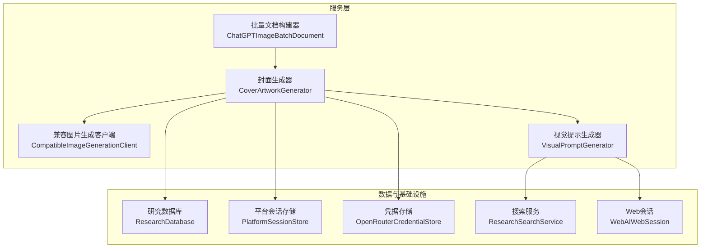
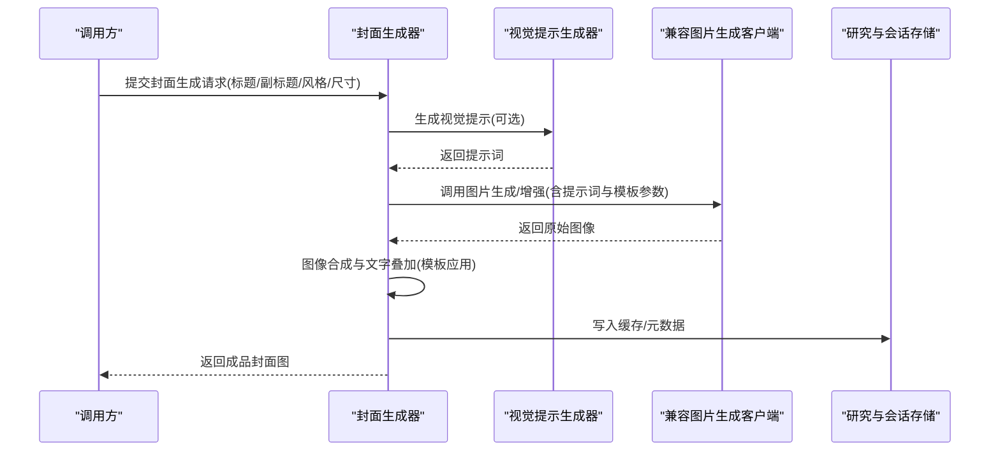
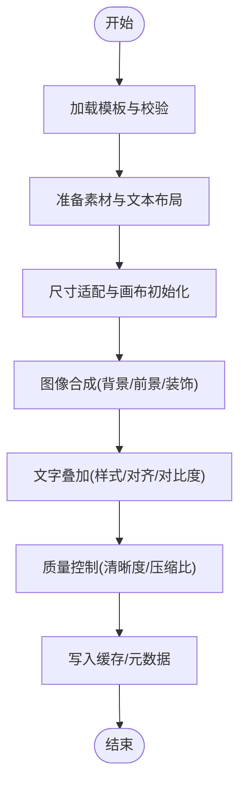
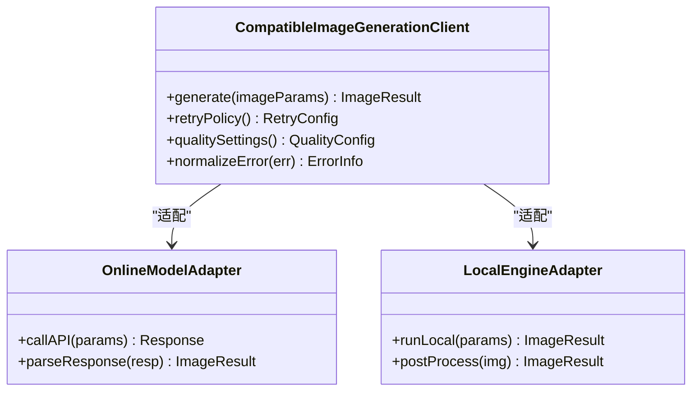
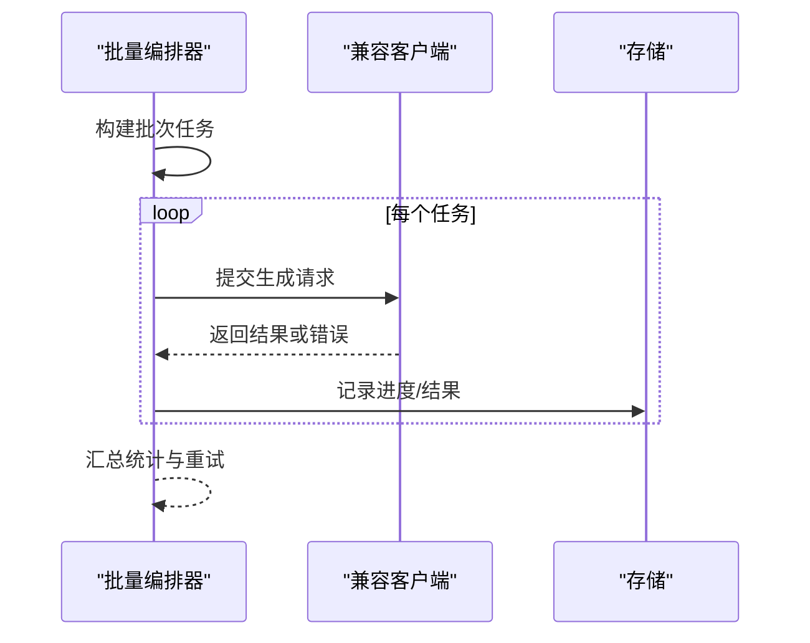
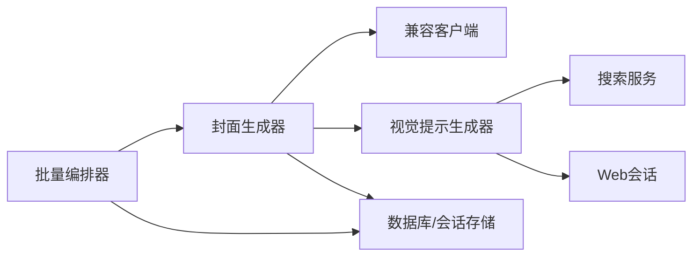

# 图片生成

<cite>
**本文引用的文件**   
- [CoverArtworkGenerator.swift](file://Sources/ChengGao/Services/CoverArtworkGenerator.swift)
- [CompatibleImageGenerationClient.swift](file://Sources/ChengGao/Services/CompatibleImageGenerationClient.swift)
- [ChatGPTImageBatchDocument.swift](file://Sources/ChengGao/Services/ChatGPTImageBatchDocument.swift)
- [VisualPromptGenerator.swift](file://Sources/ChengGao/Services/VisualPromptGenerator.swift)
- [ResearchDatabase.swift](file://Sources/ChengGao/Services/ResearchDatabase.swift)
- [PlatformSessionStore.swift](file://Sources/ChengGao/Services/PlatformSessionStore.swift)
- [OpenRouterCredentialStore.swift](file://Sources/ChengGao/Services/OpenRouterCredentialStore.swift)
- [ResearchSearchService.swift](file://Sources/ChengGao/Services/ResearchSearchService.swift)
- [WebAIWebSession.swift](file://Sources/ChengGao/Services/WebAIWebSession.swift)
- [OnlineAIModelCatalogClient.swift](file://Sources/ChengGao/Services/OnlineAIModel目录客户端.swift)
</cite>

## 目录
1. [简介](#简介)
2. [项目结构](#项目结构)
3. [核心组件](#核心组件)
4. [架构总览](#架构总览)
5. [详细组件分析](#详细组件分析)
6. [依赖关系分析](#依赖关系分析)
7. [性能考虑](#性能考虑)
8. [故障排除指南](#故障排除指南)
9. [结论](#结论)
10. [附录](#附录)

## 简介
本文件面向“自动封面生成”功能，系统性说明图像合成、文字叠加与样式模板系统的设计与实现要点，覆盖尺寸适配、分辨率优化、质量控制机制；解释自定义模板的创建方法与样式配置选项；并给出缓存策略、批量生成优化、内存使用最佳实践以及失败排查与性能调优建议。文档力求兼顾技术深度与可读性，帮助开发者快速理解与扩展该能力。

## 项目结构
围绕封面生成的关键代码位于 Services 层，主要涉及：
- 封面生成编排与渲染管线（图像合成、文字叠加、模板应用）
- 兼容的图片生成客户端（对接不同后端或本地引擎）
- 批量任务组织与提交
- 提示词/视觉提示生成（用于在线模型或本地模型）
- 数据持久化与会话/凭据管理（用于缓存、重试与认证）

图表来源
- [CoverArtworkGenerator.swift](file://Sources/ChengGao/Services/CoverArtworkGenerator.swift)
- [CompatibleImageGenerationClient.swift](file://Sources/ChengGao/Services/CompatibleImageGenerationClient.swift)
- [ChatGPTImageBatchDocument.swift](file://Sources/ChengGao/Services/ChatGPTImageBatchDocument.swift)
- [VisualPromptGenerator.swift](file://Sources/ChengGao/Services/VisualPromptGenerator.swift)
- [ResearchDatabase.swift](file://Sources/ChengGao/Services/ResearchDatabase.swift)
- [PlatformSessionStore.swift](file://Sources/ChengGao/Services/PlatformSessionStore.swift)
- [OpenRouterCredentialStore.swift](file://Sources/ChengGao/Services/OpenRouterCredentialStore.swift)
- [ResearchSearchService.swift](file://Sources/ChengGao/Services/ResearchSearchService.swift)
- [WebAIWebSession.swift](file://Sources/ChengGao/Services/WebAIWebSession.swift)

章节来源
- [CoverArtworkGenerator.swift](file://Sources/ChengGao/Services/CoverArtworkGenerator.swift)
- [CompatibleImageGenerationClient.swift](file://Sources/ChengGao/Services/CompatibleImageGenerationClient.swift)
- [ChatGPTImageBatchDocument.swift](file://Sources/ChengGao/Services/ChatGPTImageBatchDocument.swift)
- [VisualPromptGenerator.swift](file://Sources/ChengGao/Services/VisualPromptGenerator.swift)
- [ResearchDatabase.swift](file://Sources/ChengGao/Services/ResearchDatabase.swift)
- [PlatformSessionStore.swift](file://Sources/ChengGao/Services/PlatformSessionStore.swift)
- [OpenRouterCredentialStore.swift](file://Sources/ChengGao/Services/OpenRouterCredentialStore.swift)
- [ResearchSearchService.swift](file://Sources/ChengGao/Services/ResearchSearchService.swift)
- [WebAIWebSession.swift](file://Sources/ChengGao/Services/WebAIWebSession.swift)

## 核心组件
- 封面生成器：负责将素材（背景图、图标、装饰元素）、文本内容与样式模板组合，输出最终封面图。包含尺寸适配、排版布局、质量压缩等步骤。
- 兼容图片生成客户端：封装对不同后端（在线模型、本地推理引擎）的调用差异，统一输入输出格式，提供重试、超时、错误归一化能力。
- 批量文档构建器：将多个封面生成请求组织为批处理任务，减少网络往返与上下文切换开销。
- 视觉提示生成器：根据主题、关键词、风格偏好生成可用于在线模型的提示词，辅助提升生成质量。
- 数据与基础设施：数据库与会话/凭据存储支撑缓存命中、重试、认证与审计追踪。

章节来源
- [CoverArtworkGenerator.swift](file://Sources/ChengGao/Services/CoverArtworkGenerator.swift)
- [CompatibleImageGenerationClient.swift](file://Sources/ChengGao/Services/CompatibleImageGenerationClient.swift)
- [ChatGPTImageBatchDocument.swift](file://Sources/ChengGao/Services/ChatGPTImageBatchDocument.swift)
- [VisualPromptGenerator.swift](file://Sources/ChengGao/Services/VisualPromptGenerator.swift)
- [ResearchDatabase.swift](file://Sources/ChengGao/Services/ResearchDatabase.swift)
- [PlatformSessionStore.swift](file://Sources/ChengGao/Services/PlatformSessionStore.swift)
- [OpenRouterCredentialStore.swift](file://Sources/ChengGao/Services/OpenRouterCredentialStore.swift)

## 架构总览
封面生成采用“编排 + 渲染 + 生成”的分层架构：
- 编排层：接收业务参数（标题、副标题、作者、标签、风格），选择模板，准备素材与文本布局。
- 渲染层：执行图像合成（背景、蒙版、阴影、圆角）、文字叠加（字体、字号、行距、对齐、描边、渐变）。
- 生成层：通过兼容客户端调用在线/本地模型生成或增强图像，并进行后处理（缩放、裁剪、压缩）。

图表来源
- [CoverArtworkGenerator.swift](file://Sources/ChengGao/Services/CoverArtworkGenerator.swift)
- [CompatibleImageGenerationClient.swift](file://Sources/ChengGao/Services/CompatibleImageGenerationClient.swift)
- [VisualPromptGenerator.swift](file://Sources/ChengGao/Services/VisualPromptGenerator.swift)
- [ResearchDatabase.swift](file://Sources/ChengGao/Services/ResearchDatabase.swift)

## 详细组件分析

### 封面生成器（图像合成、文字叠加、样式模板）
- 图像合成
  - 支持多层叠加（背景、前景、装饰元素），具备透明度混合、阴影、圆角、遮罩能力。
  - 尺寸适配：按目标画布比例进行智能裁剪与留白填充，避免主体被裁切。
  - 分辨率优化：在内存允许范围内选择合适分辨率，必要时进行降采样以减少峰值内存。
- 文字叠加
  - 支持多行文本、自动换行、对齐方式、字重、字号、行距、字间距、描边、渐变填充。
  - 文本安全区：根据背景亮度自适应调整对比度，确保可读性。
- 样式模板系统
  - 模板定义包含：画布尺寸、图层顺序、文本区域、样式属性（颜色、字体、阴影）、占位符映射。
  - 模板校验：在加载时检查必填字段与资源可用性，失败时回退到默认模板。
  - 动态替换：根据内容长度与密度动态调整字号与行距，保持版面平衡。

图表来源
- [CoverArtworkGenerator.swift](file://Sources/ChengGao/Services/CoverArtworkGenerator.swift)

章节来源
- [CoverArtworkGenerator.swift](file://Sources/ChengGao/Services/CoverArtworkGenerator.swift)

### 兼容图片生成客户端（在线/本地模型统一接口）
- 统一接口：抽象不同后端的输入输出格式，屏蔽差异。
- 重试与超时：指数退避重试、可配置超时与熔断阈值。
- 错误归一化：将后端异常转换为标准错误码与消息，便于上层处理。
- 质量开关：可选择是否启用锐化、降噪、超分等后处理。

图表来源
- [CompatibleImageGenerationClient.swift](file://Sources/ChengGao/Services/CompatibleImageGenerationClient.swift)

章节来源
- [CompatibleImageGenerationClient.swift](file://Sources/ChengGao/Services/CompatibleImageGenerationClient.swift)

### 批量生成（任务组织与并发控制）
- 任务组织：将多个封面生成请求打包为批次，减少重复初始化与网络握手。
- 并发控制：限制并发数，避免内存峰值过高与后端限流。
- 进度与结果聚合：支持部分成功、失败统计与重试队列。

图表来源
- [ChatGPTImageBatchDocument.swift](file://Sources/ChengGao/Services/ChatGPTImageBatchDocument.swift)

章节来源
- [ChatGPTImageBatchDocument.swift](file://Sources/ChengGao/Services/ChatGPTImageBatchDocument.swift)

### 视觉提示生成（提升在线模型生成质量）
- 输入：主题、关键词、风格偏好、受众定位。
- 输出：结构化提示词（场景描述、构图建议、色彩倾向、细节要求）。
- 优化：基于历史反馈微调提示词权重，提高命中率与一致性。

章节来源
- [VisualPromptGenerator.swift](file://Sources/ChengGao/Services/VisualPromptGenerator.swift)

### 数据与基础设施（缓存、会话、凭据）
- 缓存策略：以“内容指纹+模板ID+尺寸”作为键，命中则直接返回成品图。
- 会话与凭据：集中管理认证信息与会话状态，支持刷新与失效处理。
- 审计与追踪：记录生成耗时、成功率、错误类型，便于监控与排障。

章节来源
- [ResearchDatabase.swift](file://Sources/ChengGao/Services/ResearchDatabase.swift)
- [PlatformSessionStore.swift](file://Sources/ChengGao/Services/PlatformSessionStore.swift)
- [OpenRouterCredentialStore.swift](file://Sources/ChengGao/Services/OpenRouterCredentialStore.swift)
- [ResearchSearchService.swift](file://Sources/ChengGao/Services/ResearchSearchService.swift)
- [WebAIWebSession.swift](file://Sources/ChengGao/Services/WebAIWebSession.swift)

## 依赖关系分析
- 封面生成器依赖兼容客户端与视觉提示生成器，同时读写数据库与会话存储。
- 批量编排器依赖封面生成器与存储，形成“任务—执行—结果”闭环。
- 外部依赖包括在线模型与本地引擎，通过兼容客户端解耦。

图表来源
- [CoverArtworkGenerator.swift](file://Sources/ChengGao/Services/CoverArtworkGenerator.swift)
- [CompatibleImageGenerationClient.swift](file://Sources/ChengGao/Services/CompatibleImageGenerationClient.swift)
- [ChatGPTImageBatchDocument.swift](file://Sources/ChengGao/Services/ChatGPTImageBatchDocument.swift)
- [VisualPromptGenerator.swift](file://Sources/ChengGao/Services/VisualPromptGenerator.swift)
- [ResearchDatabase.swift](file://Sources/ChengGao/Services/ResearchDatabase.swift)
- [PlatformSessionStore.swift](file://Sources/ChengGao/Services/PlatformSessionStore.swift)
- [OpenRouterCredentialStore.swift](file://Sources/ChengGao/Services/OpenRouterCredentialStore.swift)
- [ResearchSearchService.swift](file://Sources/ChengGao/Services/ResearchSearchService.swift)
- [WebAIWebSession.swift](file://Sources/ChengGao/Services/WebAIWebSession.swift)

章节来源
- [CoverArtworkGenerator.swift](file://Sources/ChengGao/Services/CoverArtworkGenerator.swift)
- [CompatibleImageGenerationClient.swift](file://Sources/ChengGao/Services/CompatibleImageGenerationClient.swift)
- [ChatGPTImageBatchDocument.swift](file://Sources/ChengGao/Services/ChatGPTImageBatchDocument.swift)
- [VisualPromptGenerator.swift](file://Sources/ChengGao/Services/VisualPromptGenerator.swift)
- [ResearchDatabase.swift](file://Sources/ChengGao/Services/ResearchDatabase.swift)
- [PlatformSessionStore.swift](file://Sources/ChengGao/Services/PlatformSessionStore.swift)
- [OpenRouterCredentialStore.swift](file://Sources/ChengGao/Services/OpenRouterCredentialStore.swift)
- [ResearchSearchService.swift](file://Sources/ChengGao/Services/ResearchSearchService.swift)
- [WebAIWebSession.swift](file://Sources/ChengGao/Services/WebAIWebSession.swift)

## 性能考虑
- 尺寸适配与分辨率优化
  - 优先使用目标尺寸的中间分辨率进行合成，仅在导出阶段按需放大或缩小，减少不必要的计算。
  - 对大图进行分块处理，降低峰值内存占用。
- 质量控制
  - 设置合理的压缩比与清晰度阈值，避免过度压缩导致模糊。
  - 对文字区域进行局部锐化，保证边缘清晰。
- 缓存策略
  - 使用稳定哈希（内容+模板+尺寸）作为缓存键，避免重复生成。
  - 定期清理过期缓存，释放磁盘空间。
- 批量生成优化
  - 限制并发度，结合后端限流策略，避免触发熔断。
  - 合并相同模板的请求，复用中间结果。
- 内存使用最佳实践
  - 及时释放临时图像对象，避免持有大对象引用。
  - 使用流式处理与池化技术，降低分配与回收成本。

[本节为通用指导，不直接分析具体文件]

## 故障排除指南
- 常见失败原因
  - 模板缺失或资源不可用：检查模板路径与依赖资源是否存在。
  - 文本渲染异常：确认字体安装与编码正确，避免特殊字符导致换行异常。
  - 生成超时或限流：调整重试策略与并发度，关注后端健康状态。
  - 内存不足：降低分辨率或分批处理，监控进程内存曲线。
- 诊断方法
  - 开启详细日志，记录关键步骤耗时与错误堆栈。
  - 使用最小复现用例隔离问题（单一样板、单条文本）。
  - 检查缓存键冲突与脏数据，必要时清空缓存重试。
- 恢复策略
  - 自动重试与降级（回退到默认模板或简化样式）。
  - 异步补偿任务，修复失败条目。

章节来源
- [CompatibleImageGenerationClient.swift](file://Sources/ChengGao/Services/CompatibleImageGenerationClient.swift)
- [ResearchDatabase.swift](file://Sources/ChengGao/Services/ResearchDatabase.swift)
- [PlatformSessionStore.swift](file://Sources/ChengGao/Services/PlatformSessionStore.swift)
- [OpenRouterCredentialStore.swift](file://Sources/ChengGao/Services/OpenRouterCredentialStore.swift)

## 结论
封面生成功能通过清晰的编排与渲染分层、统一的客户端适配、完善的缓存与会话管理，实现了高质量、可扩展且稳定的自动化封面生产。遵循本文的尺寸适配、质量控制、缓存与批量优化建议，可在复杂业务场景下获得更佳的体验与性能表现。

[本节为总结性内容，不直接分析具体文件]

## 附录
- 自定义模板创建方法
  - 定义画布尺寸与图层顺序，指定文本区域与占位符。
  - 配置样式属性（颜色、字体、阴影、描边、渐变）。
  - 提供预览与校验工具，确保模板可用性与兼容性。
- 样式配置选项
  - 文本：字号、行距、字重、对齐、换行策略、对比度阈值。
  - 图像：透明度、混合模式、阴影强度、圆角半径、遮罩形状。
  - 质量：压缩比、锐化强度、降噪级别、输出格式。
- 性能调优建议
  - 合理设置并发与超时，结合后端限流与熔断。
  - 使用缓存预热与热点模板常驻内存。
  - 监控关键指标（成功率、延迟、内存、CPU），持续优化。

[本节为概念性内容，不直接分析具体文件]