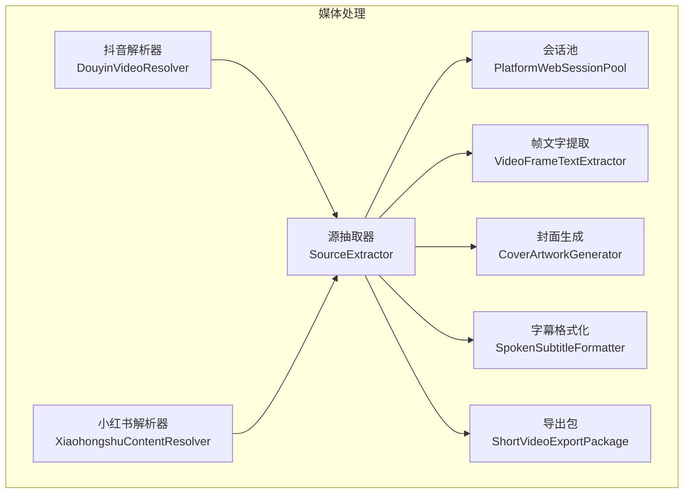
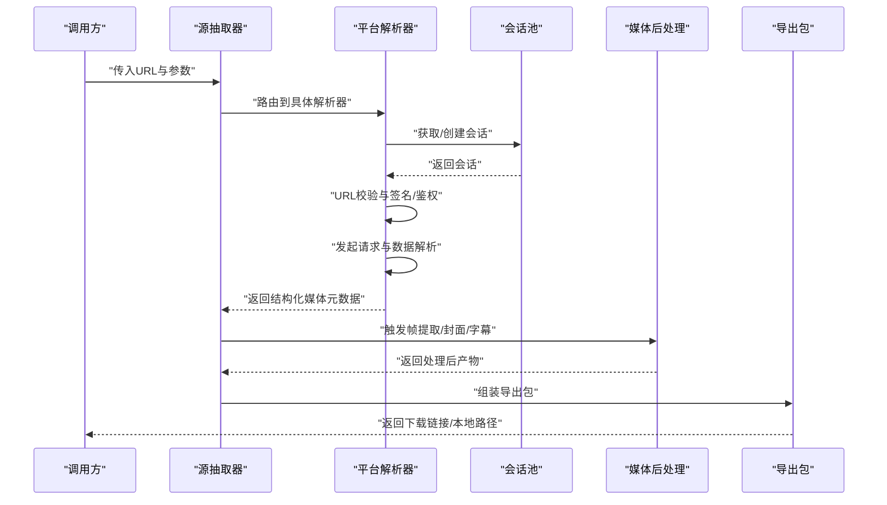
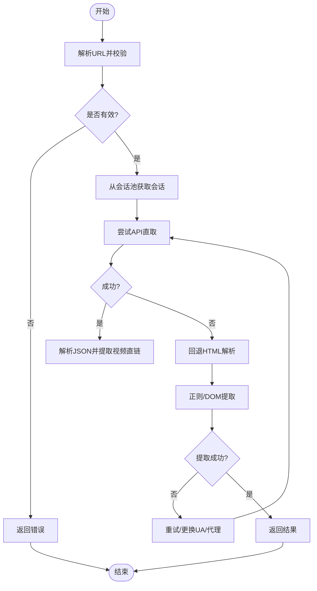
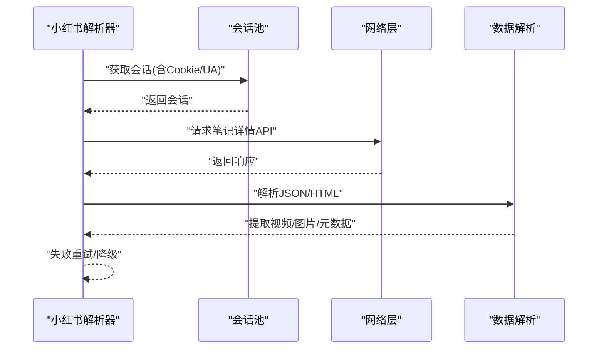
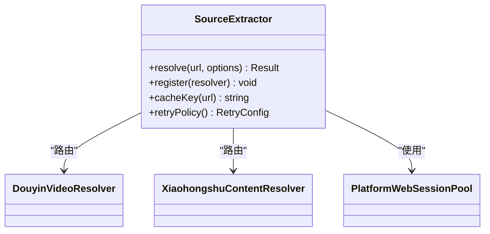
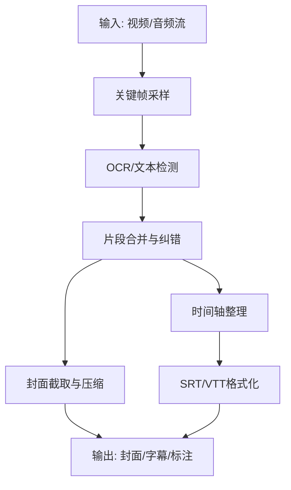
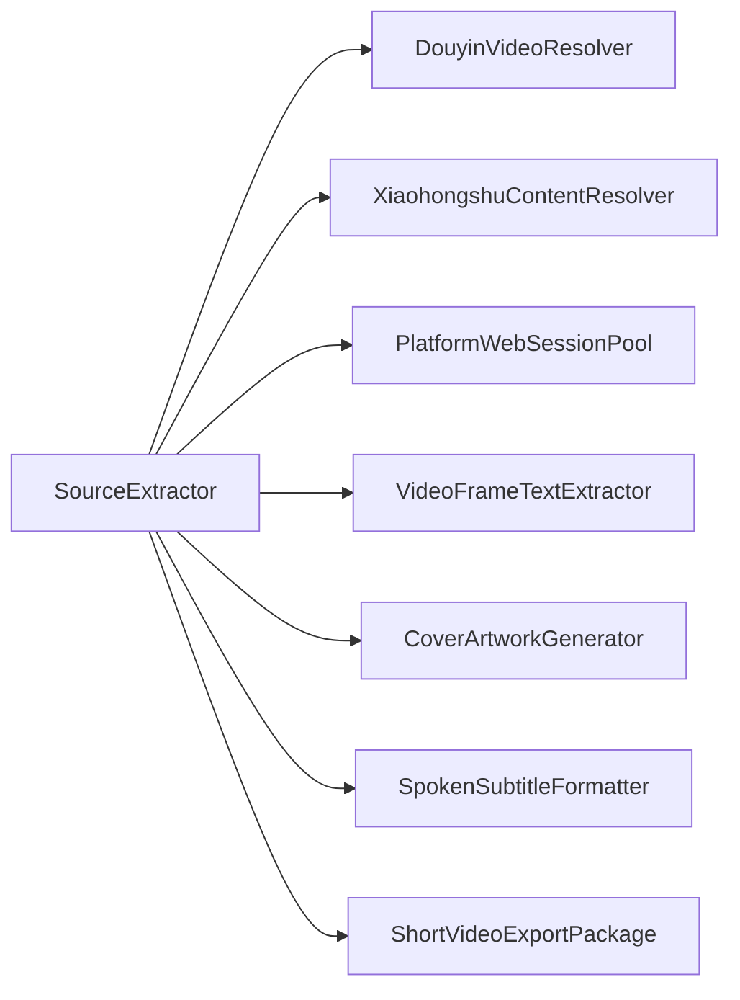

# 媒体处理

<cite>
**本文引用的文件**   
- [DouyinVideoResolver.swift](file://Sources/ChengGao/Services/DouyinVideoResolver.swift)
- [XiaohongshuContentResolver.swift](file://Sources/ChengGao/Services/XiaohongshuContentResolver.swift)
- [VideoFrameTextExtractor.swift](file://Sources/ChengGao/Services/VideoFrameTextExtractor.swift)
- [CoverArtworkGenerator.swift](file://Sources/ChengGao/Services/CoverArtworkGenerator.swift)
- [SpokenSubtitleFormatter.swift](file://Sources/ChengGao/Services/SpokenSubtitleFormatter.swift)
- [SourceExtractor.swift](file://Sources/ChengGao/Services/SourceExtractor.swift)
- [PlatformWebSessionPool.swift](file://Sources/ChengGao/Services/PlatformWebSessionPool.swift)
- [ShortVideoExportPackage.swift](file://Sources/ChengGao/Services/ShortVideoExportPackage.swift)
</cite>

## 目录
1. [简介](#简介)
2. [项目结构](#项目结构)
3. [核心组件](#核心组件)
4. [架构总览](#架构总览)
5. [详细组件分析](#详细组件分析)
6. [依赖关系分析](#依赖关系分析)
7. [性能考虑](#性能考虑)
8. [故障排查指南](#故障排查指南)
9. [结论](#结论)
10. [附录](#附录)

## 简介
本文件聚焦于“媒体内容处理与解析”能力，覆盖短视频平台（抖音、小红书等）的视频解析器实现原理、URL 解析规则与提取策略；文档化视频帧文字提取、封面图片生成与字幕格式化功能；解释媒体内容的缓存机制、下载优化与错误重试策略；并提供新平台支持的扩展方法与自定义解析器的实现指南。同时给出媒体处理的性能优化建议与内存管理最佳实践，帮助开发者在复杂多平台的媒体场景中稳定高效地工作。

## 项目结构
本项目采用按服务/能力划分的模块化组织方式，媒体处理相关代码集中在 Services 目录下：
- 平台解析器：DouyinVideoResolver.swift、XiaohongshuContentResolver.swift
- 媒体提取与后处理：VideoFrameTextExtractor.swift、CoverArtworkGenerator.swift、SpokenSubtitleFormatter.swift
- 通用工具与封装：SourceExtractor.swift、PlatformWebSessionPool.swift、ShortVideoExportPackage.swift

图表来源
- [DouyinVideoResolver.swift](file://Sources/ChengGao/Services/DouyinVideoResolver.swift)
- [XiaohongshuContentResolver.swift](file://Sources/ChengGao/Services/XiaohongshuContentResolver.swift)
- [SourceExtractor.swift](file://Sources/ChengGao/Services/SourceExtractor.swift)
- [PlatformWebSessionPool.swift](file://Sources/ChengGao/Services/PlatformWebSessionPool.swift)
- [VideoFrameTextExtractor.swift](file://Sources/ChengGao/Services/VideoFrameTextExtractor.swift)
- [CoverArtworkGenerator.swift](file://Sources/ChengGao/Services/CoverArtworkGenerator.swift)
- [SpokenSubtitleFormatter.swift](file://Sources/ChengGao/Services/SpokenSubtitleFormatter.swift)
- [ShortVideoExportPackage.swift](file://Sources/ChengGao/Services/ShortVideoExportPackage.swift)

章节来源
- [DouyinVideoResolver.swift](file://Sources/ChengGao/Services/DouyinVideoResolver.swift)
- [XiaohongshuContentResolver.swift](file://Sources/ChengGao/Services/XiaohongshuContentResolver.swift)
- [SourceExtractor.swift](file://Sources/ChengGao/Services/SourceExtractor.swift)
- [PlatformWebSessionPool.swift](file://Sources/ChengGao/Services/PlatformWebSessionPool.swift)
- [VideoFrameTextExtractor.swift](file://Sources/ChengGao/Services/VideoFrameTextExtractor.swift)
- [CoverArtworkGenerator.swift](file://Sources/ChengGao/Services/CoverArtworkGenerator.swift)
- [SpokenSubtitleFormatter.swift](file://Sources/ChengGao/Services/SpokenSubtitleFormatter.swift)
- [ShortVideoExportPackage.swift](file://Sources/ChengGao/Services/ShortVideoExportPackage.swift)

## 核心组件
- 平台解析器
  - 抖音解析器：负责识别抖音 URL、构造请求头与会话、抓取页面或 API 数据、解析视频直链与元信息。
  - 小红书解析器：负责识别小红书 URL、处理反爬策略、解析图文/视频内容与封面。
- 源抽取器：统一入口，根据 URL 选择对应解析器，协调网络请求、数据清洗与结果组装。
- 会话池：维护跨平台 Web 会话（Cookie、UA、代理等），提供复用与隔离能力，降低重复登录与握手开销。
- 媒体后处理
  - 帧文字提取：对关键帧进行 OCR 或文本检测，输出结构化字幕/标注。
  - 封面生成：从视频首帧或指定时间点截取并压缩为封面图。
  - 字幕格式化：将原始时间轴与文本转换为 SRT/VTT 等标准格式。
- 导出包：将视频、封面、字幕、元数据打包为可分发的短内容包。

章节来源
- [DouyinVideoResolver.swift](file://Sources/ChengGao/Services/DouyinVideoResolver.swift)
- [XiaohongshuContentResolver.swift](file://Sources/ChengGao/Services/XiaohongshuContentResolver.swift)
- [SourceExtractor.swift](file://Sources/ChengGao/Services/SourceExtractor.swift)
- [PlatformWebSessionPool.swift](file://Sources/ChengGao/Services/PlatformWebSessionPool.swift)
- [VideoFrameTextExtractor.swift](file://Sources/ChengGao/Services/VideoFrameTextExtractor.swift)
- [CoverArtworkGenerator.swift](file://Sources/ChengGao/Services/CoverArtworkGenerator.swift)
- [SpokenSubtitleFormatter.swift](file://Sources/ChengGao/Services/SpokenSubtitleFormatter.swift)
- [ShortVideoExportPackage.swift](file://Sources/ChengGao/Services/ShortVideoExportPackage.swift)

## 架构总览
整体流程以“URL 输入 -> 解析器选择 -> 数据抓取 -> 媒体后处理 -> 导出”为主线，通过会话池统一管理网络上下文，确保高并发下的稳定性与资源复用。

图表来源
- [SourceExtractor.swift](file://Sources/ChengGao/Services/SourceExtractor.swift)
- [DouyinVideoResolver.swift](file://Sources/ChengGao/Services/DouyinVideoResolver.swift)
- [XiaohongshuContentResolver.swift](file://Sources/ChengGao/Services/XiaohongshuContentResolver.swift)
- [PlatformWebSessionPool.swift](file://Sources/ChengGao/Services/PlatformWebSessionPool.swift)
- [VideoFrameTextExtractor.swift](file://Sources/ChengGao/Services/VideoFrameTextExtractor.swift)
- [CoverArtworkGenerator.swift](file://Sources/ChengGao/Services/CoverArtworkGenerator.swift)
- [SpokenSubtitleFormatter.swift](file://Sources/ChengGao/Services/SpokenSubtitleFormatter.swift)
- [ShortVideoExportPackage.swift](file://Sources/ChengGao/Services/ShortVideoExportPackage.swift)

## 详细组件分析

### 抖音解析器（DouyinVideoResolver）
- URL 解析规则
  - 支持分享链接、短链重定向、带参数的分享页。
  - 识别域名、路径段与查询参数，过滤无效或受保护链接。
- 提取策略
  - 优先尝试直接 API 接口获取 JSON 数据；失败时回退到 HTML 解析。
  - 使用会话池维持 Cookie/UA，避免频繁验证码与封禁。
  - 对防盗链与签名参数进行动态计算或注入。
- 错误处理
  - 网络异常、反爬拦截、页面结构变更的降级与重试。
  - 记录失败原因与上下文，便于定位问题。

图表来源
- [DouyinVideoResolver.swift](file://Sources/ChengGao/Services/DouyinVideoResolver.swift)
- [PlatformWebSessionPool.swift](file://Sources/ChengGao/Services/PlatformWebSessionPool.swift)

章节来源
- [DouyinVideoResolver.swift](file://Sources/ChengGao/Services/DouyinVideoResolver.swift)
- [PlatformWebSessionPool.swift](file://Sources/ChengGao/Services/PlatformWebSessionPool.swift)

### 小红书解析器（XiaohongshuContentResolver）
- URL 解析规则
  - 支持笔记链接、搜索页、话题页等场景，区分图文与视频类型。
  - 识别用户态与游客态差异，必要时走登录态会话。
- 提取策略
  - 优先通过内部 API 获取结构化数据；失败时回退到页面解析。
  - 针对反爬策略，动态调整请求频率、随机 UA、延迟与重试。
- 错误处理
  - 对限流、验证码、页面改版进行自适应处理与告警。

图表来源
- [XiaohongshuContentResolver.swift](file://Sources/ChengGao/Services/XiaohongshuContentResolver.swift)
- [PlatformWebSessionPool.swift](file://Sources/ChengGao/Services/PlatformWebSessionPool.swift)

章节来源
- [XiaohongshuContentResolver.swift](file://Sources/ChengGao/Services/XiaohongshuContentResolver.swift)
- [PlatformWebSessionPool.swift](file://Sources/ChengGao/Services/PlatformWebSessionPool.swift)

### 源抽取器（SourceExtractor）
- 职责
  - 统一入口，依据 URL 选择平台解析器。
  - 编排解析流程：URL 校验、会话获取、请求执行、数据清洗、结果组装。
  - 提供缓存键生成、下载进度回调、错误码映射。
- 设计要点
  - 插件式解析器注册表，便于新增平台。
  - 可插拔的后处理管线（帧提取、封面、字幕）。

图表来源
- [SourceExtractor.swift](file://Sources/ChengGao/Services/SourceExtractor.swift)
- [DouyinVideoResolver.swift](file://Sources/ChengGao/Services/DouyinVideoResolver.swift)
- [XiaohongshuContentResolver.swift](file://Sources/ChengGao/Services/XiaohongshuContentResolver.swift)
- [PlatformWebSessionPool.swift](file://Sources/ChengGao/Services/PlatformWebSessionPool.swift)

章节来源
- [SourceExtractor.swift](file://Sources/ChengGao/Services/SourceExtractor.swift)

### 媒体后处理管线
- 视频帧文字提取（VideoFrameTextExtractor）
  - 采样关键帧，调用 OCR/文本检测模型，输出时间轴与文本。
  - 支持去噪、合并相邻片段、语言识别与转写。
- 封面图片生成（CoverArtworkGenerator）
  - 从首帧或指定时间点截取，自动裁剪与压缩，适配不同尺寸。
  - 可选水印、背景填充与质量调优。
- 字幕格式化（SpokenSubtitleFormatter）
  - 将时间轴与文本序列转换为 SRT/VTT，支持样式与对齐。
  - 提供批量导出与预览校验。

图表来源
- [VideoFrameTextExtractor.swift](file://Sources/ChengGao/Services/VideoFrameTextExtractor.swift)
- [CoverArtworkGenerator.swift](file://Sources/ChengGao/Services/CoverArtworkGenerator.swift)
- [SpokenSubtitleFormatter.swift](file://Sources/ChengGao/Services/SpokenSubtitleFormatter.swift)

章节来源
- [VideoFrameTextExtractor.swift](file://Sources/ChengGao/Services/VideoFrameTextExtractor.swift)
- [CoverArtworkGenerator.swift](file://Sources/ChengGao/Services/CoverArtworkGenerator.swift)
- [SpokenSubtitleFormatter.swift](file://Sources/ChengGao/Services/SpokenSubtitleFormatter.swift)

### 导出包（ShortVideoExportPackage）
- 职责
  - 将视频、封面、字幕、元数据打包为统一结构，便于分发与二次处理。
  - 支持增量更新、版本标记与完整性校验。
- 设计要点
  - 原子写入与临时目录清理，保证一致性。
  - 可配置压缩级别与目标格式。

章节来源
- [ShortVideoExportPackage.swift](file://Sources/ChengGao/Services/ShortVideoExportPackage.swift)

## 依赖关系分析
- 组件耦合
  - SourceExtractor 作为编排中心，低耦合接入各平台解析器。
  - PlatformWebSessionPool 被所有解析器共享，减少状态分散。
  - 媒体后处理模块独立，可通过管线组合灵活启用。
- 外部依赖
  - 网络库（HTTP/HTTPS）、OCR/文本检测模型、音视频编解码库、文件系统。
- 潜在循环依赖
  - 通过抽象接口与事件回调解耦，避免解析器与后处理模块互相引用。

图表来源
- [SourceExtractor.swift](file://Sources/ChengGao/Services/SourceExtractor.swift)
- [DouyinVideoResolver.swift](file://Sources/ChengGao/Services/DouyinVideoResolver.swift)
- [XiaohongshuContentResolver.swift](file://Sources/ChengGao/Services/XiaohongshuContentResolver.swift)
- [PlatformWebSessionPool.swift](file://Sources/ChengGao/Services/PlatformWebSessionPool.swift)
- [VideoFrameTextExtractor.swift](file://Sources/ChengGao/Services/VideoFrameTextExtractor.swift)
- [CoverArtworkGenerator.swift](file://Sources/ChengGao/Services/CoverArtworkGenerator.swift)
- [SpokenSubtitleFormatter.swift](file://Sources/ChengGao/Services/SpokenSubtitleFormatter.swift)
- [ShortVideoExportPackage.swift](file://Sources/ChengGao/Services/ShortVideoExportPackage.swift)

章节来源
- [SourceExtractor.swift](file://Sources/ChengGao/Services/SourceExtractor.swift)
- [PlatformWebSessionPool.swift](file://Sources/ChengGao/Services/PlatformWebSessionPool.swift)

## 性能考虑
- 网络与缓存
  - 会话复用：通过 PlatformWebSessionPool 复用连接与 Cookie，减少握手与鉴权开销。
  - 结果缓存：基于 URL 生成稳定缓存键，命中则跳过解析与下载。
  - 断点续传与分块下载：大文件分段拉取，提升弱网稳定性。
- 媒体处理
  - 关键帧采样率可调，平衡精度与速度。
  - 封面生成采用异步与批处理，避免阻塞主线程。
  - OCR/文本检测模型按需加载，释放未使用资源。
- 内存管理
  - 流式处理视频帧，避免全量加载。
  - 及时释放中间缓冲区，限制并发任务数。
  - 使用对象池复用 IO 缓冲与图像对象。
- 错误重试
  - 指数退避与抖动策略，避免雪崩。
  - 针对不同错误码采取差异化重试（网络超时、限流、反爬）。

[本节为通用指导，不直接分析具体文件]

## 故障排查指南
- 常见问题
  - URL 无法解析：检查域名白名单与正则匹配规则。
  - 解析失败：查看会话状态、UA/代理设置与反爬策略。
  - 下载中断：确认网络稳定性与断点续传开关。
  - 帧文字缺失：调整采样间隔与 OCR 阈值。
- 诊断手段
  - 启用详细日志与请求抓包，记录失败堆栈与响应体。
  - 使用最小复现用例与固定会话，快速定位问题。
  - 监控指标：成功率、平均耗时、缓存命中率、内存峰值。

章节来源
- [DouyinVideoResolver.swift](file://Sources/ChengGao/Services/DouyinVideoResolver.swift)
- [XiaohongshuContentResolver.swift](file://Sources/ChengGao/Services/XiaohongshuContentResolver.swift)
- [PlatformWebSessionPool.swift](file://Sources/ChengGao/Services/PlatformWebSessionPool.swift)
- [VideoFrameTextExtractor.swift](file://Sources/ChengGao/Services/VideoFrameTextExtractor.swift)
- [CoverArtworkGenerator.swift](file://Sources/ChengGao/Services/CoverArtworkGenerator.swift)
- [SpokenSubtitleFormatter.swift](file://Sources/ChengGao/Services/SpokenSubtitleFormatter.swift)

## 结论
本方案以统一的源抽取器为核心，结合平台解析器与会话池，实现了可扩展、高可用的短视频内容解析与媒体处理能力。通过关键帧文字提取、封面生成与字幕格式化，形成完整的媒体后处理管线。配合缓存、下载优化与错误重试策略，能够在复杂网络与反爬环境下稳定运行。新增平台只需遵循解析器接口规范，即可快速接入。

[本节为总结性内容，不直接分析具体文件]

## 附录

### 新平台支持与自定义解析器实现指南
- 步骤
  - 定义解析器接口：包含 URL 校验、请求构建、数据解析、错误处理。
  - 实现具体解析器：遵循抖音/小红书解析器的模式，处理平台特性。
  - 注册到源抽取器：在解析器注册表中添加新平台映射。
  - 配置会话策略：在会话池中为新平台设置 UA、代理与 Cookie 策略。
  - 测试与回归：覆盖正常、异常与边界用例，验证缓存与重试。
- 最佳实践
  - 保持幂等与可重试，避免副作用。
  - 分离网络与解析逻辑，便于替换与调试。
  - 使用结构化日志与指标上报，便于追踪问题。

章节来源
- [SourceExtractor.swift](file://Sources/ChengGao/Services/SourceExtractor.swift)
- [DouyinVideoResolver.swift](file://Sources/ChengGao/Services/DouyinVideoResolver.swift)
- [XiaohongshuContentResolver.swift](file://Sources/ChengGao/Services/XiaohongshuContentResolver.swift)
- [PlatformWebSessionPool.swift](file://Sources/ChengGao/Services/PlatformWebSessionPool.swift)