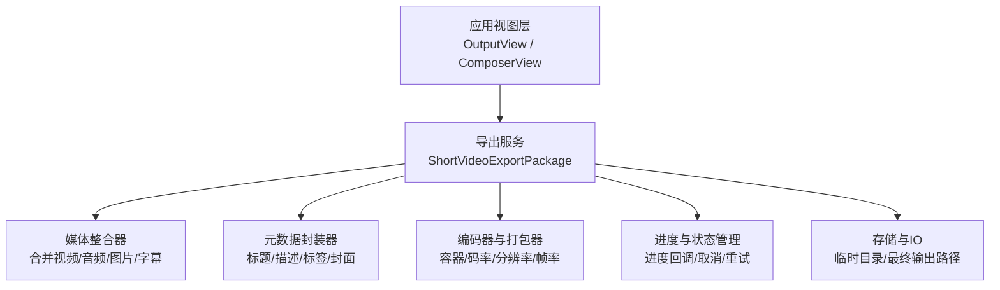
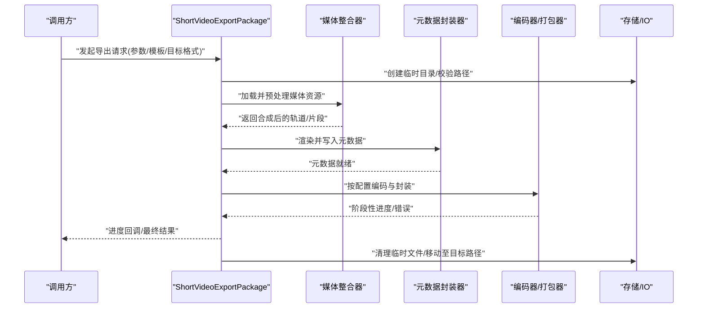
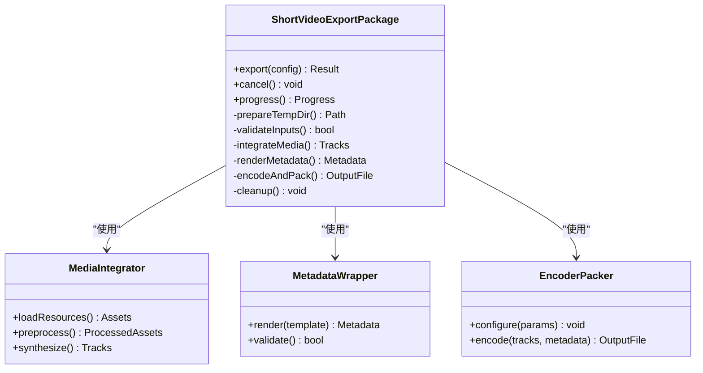
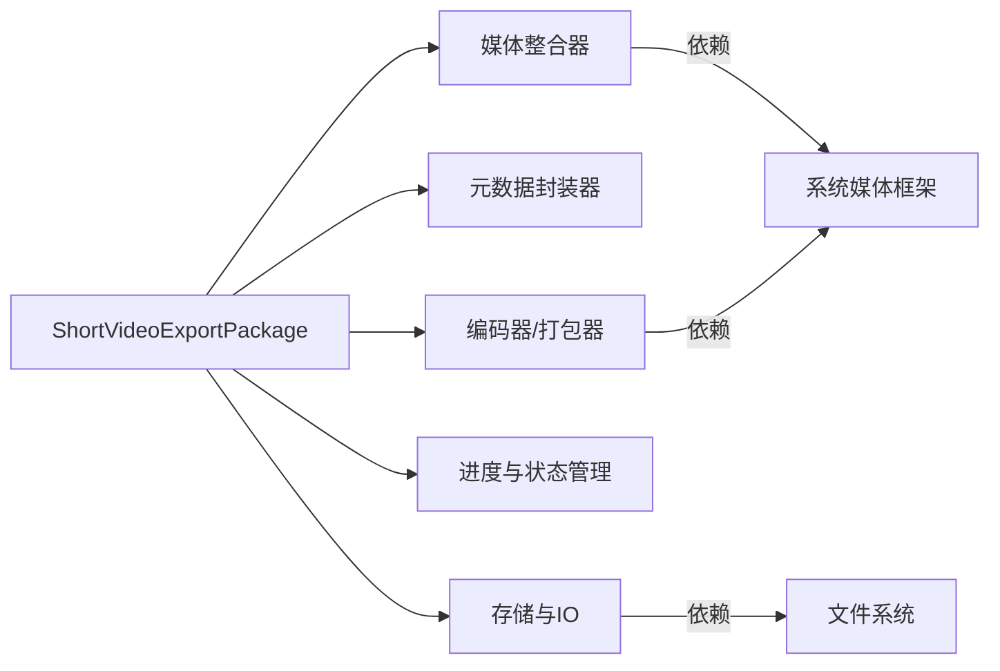

# 导出打包

<cite>
**本文引用的文件**   
- [ShortVideoExportPackage.swift](file://Sources/ChengGao/Services/ShortVideoExportPackage.swift)
</cite>

## 目录
1. [简介](#简介)
2. [项目结构](#项目结构)
3. [核心组件](#核心组件)
4. [架构总览](#架构总览)
5. [详细组件分析](#详细组件分析)
6. [依赖关系分析](#依赖关系分析)
7. [性能考虑](#性能考虑)
8. [故障排查指南](#故障排查指南)
9. [结论](#结论)
10. [附录](#附录)

## 简介
本章节概述短视频导出打包功能的目标与范围。该功能负责将短视频素材、字幕、封面等媒体资源进行整合，封装为标准化输出格式，并提供进度跟踪、错误恢复与中断处理机制。同时支持多种输出格式、压缩选项与质量设置，并提供自定义模板扩展与第三方格式扩展能力。

## 项目结构
导出打包相关代码位于 Services 层，以“服务”形式提供可复用的导出能力。核心入口为 ShortVideoExportPackage，对外暴露统一的导出接口，内部协调媒体整合、元数据封装、编码与打包流程。

图表来源
- [ShortVideoExportPackage.swift](file://Sources/ChengGao/Services/ShortVideoExportPackage.swift)

章节来源
- [ShortVideoExportPackage.swift](file://Sources/ChengGao/Services/ShortVideoExportPackage.swift)

## 核心组件
- 导出服务（ShortVideoExportPackage）
  - 职责：编排导出全流程，包括输入校验、任务调度、进度上报、异常捕获与结果回传。
  - 关键能力：多格式输出、质量与压缩配置、模板渲染、并发控制、断点续写（如适用）。
- 媒体整合器
  - 职责：统一读取视频、音频、图片、字幕等资源，进行时间轴对齐、转码与合成。
- 元数据封装器
  - 职责：生成并写入标题、描述、标签、封面、作者信息等元数据。
- 编码器与打包器
  - 职责：根据目标格式选择编码器参数（分辨率、码率、帧率、色彩空间），完成容器封装。
- 进度与状态管理
  - 职责：提供进度回调、任务取消、重试策略与错误分类上报。
- 存储与IO
  - 职责：管理临时工作目录、中间产物清理、最终文件落盘与权限检查。

章节来源
- [ShortVideoExportPackage.swift](file://Sources/ChengGao/Services/ShortVideoExportPackage.swift)

## 架构总览
导出流程采用分层与流水线设计：输入准备 → 媒体整合 → 元数据封装 → 编码打包 → 输出归档。各阶段通过回调与事件驱动实现进度与错误传播，保证可观测性与可恢复性。

图表来源
- [ShortVideoExportPackage.swift](file://Sources/ChengGao/Services/ShortVideoExportPackage.swift)

## 详细组件分析

### 导出服务（ShortVideoExportPackage）
- 设计要点
  - 统一入口：对外暴露单一导出方法，接收配置对象（格式、质量、压缩、模板、输出路径等）。
  - 任务编排：按阶段顺序执行，支持并行化子任务（如多轨转码、封面生成）。
  - 进度与中断：周期性上报进度；支持外部取消信号；失败时自动回滚或保留中间产物以便重试。
  - 错误分类：区分IO错误、编码错误、资源缺失、格式不支持等，便于上层提示与重试。
- 典型流程
  - 输入校验与默认值填充
  - 创建工作目录与权限检查
  - 媒体资源拉取与预处理（转码/裁剪/拼接）
  - 元数据渲染与校验
  - 编码与封装（容器、码率、分辨率、帧率、色彩）
  - 输出归档与清理
- 扩展点
  - 模板引擎：支持文本与结构化模板渲染（标题、描述、标签、封面占位符）。
  - 格式插件：新增输出格式需实现编码器适配与容器封装接口。

章节来源
- [ShortVideoExportPackage.swift](file://Sources/ChengGao/Services/ShortVideoExportPackage.swift)

#### 类图（概念映射到实际文件）

图表来源
- [ShortVideoExportPackage.swift](file://Sources/ChengGao/Services/ShortVideoExportPackage.swift)

### 媒体整合器
- 职责
  - 统一读取视频、音频、图片、字幕等多类型资源。
  - 进行时间轴对齐、转码、裁剪、拼接、音画同步。
  - 输出标准化的轨道集合供后续编码。
- 关键点
  - 资源一致性：分辨率、帧率、采样率、色彩空间的归一化。
  - 内存与磁盘：大文件流式处理，避免一次性加载。
  - 错误隔离：单个轨道失败不影响整体任务的错误分类上报。

章节来源
- [ShortVideoExportPackage.swift](file://Sources/ChengGao/Services/ShortVideoExportPackage.swift)

### 元数据封装器
- 职责
  - 基于模板渲染标题、描述、标签、作者、封面等元数据。
  - 校验元数据的合法性与平台限制（长度、字符集、封面尺寸）。
- 关键点
  - 模板变量：支持动态字段（时间戳、时长、分辨率、平台标签等）。
  - 国际化：多语言模板与本地化资源。
  - 封面生成：从视频帧或用户指定图片生成合规封面。

章节来源
- [ShortVideoExportPackage.swift](file://Sources/ChengGao/Services/ShortVideoExportPackage.swift)

### 编码器与打包器
- 职责
  - 根据目标格式选择编码器参数（分辨率、码率、帧率、色彩空间、声道布局）。
  - 完成容器封装（MP4、MOV、WebM、AVI 等）与文件头写入。
- 关键点
  - 质量与压缩：恒定码率（CBR）、可变码率（VBR）、CRF 等模式。
  - 硬件加速：GPU/CPU 编解码切换与降级策略。
  - 兼容性：不同平台的容器与编码组合验证。

章节来源
- [ShortVideoExportPackage.swift](file://Sources/ChengGao/Services/ShortVideoExportPackage.swift)

### 进度与状态管理
- 职责
  - 周期性上报进度（百分比、阶段、剩余时间估算）。
  - 支持取消与重试；记录失败原因与上下文。
- 关键点
  - 细粒度阶段：输入校验、媒体整合、元数据、编码、归档。
  - 幂等性：同一任务多次执行不产生重复输出。
  - 可观测性：日志与指标采集（耗时、吞吐、错误率）。

章节来源
- [ShortVideoExportPackage.swift](file://Sources/ChengGao/Services/ShortVideoExportPackage.swift)

### 存储与IO
- 职责
  - 管理工作目录、临时文件与最终输出路径。
  - 权限检查、磁盘空间预估与不足时的优雅降级。
- 关键点
  - 原子写入：先写临时文件，成功后再移动到目标路径。
  - 清理策略：任务完成后自动清理中间产物。
  - 并发安全：多任务并发时的目录隔离与锁机制。

章节来源
- [ShortVideoExportPackage.swift](file://Sources/ChengGao/Services/ShortVideoExportPackage.swift)

## 依赖关系分析
- 内部依赖
  - ShortVideoExportPackage 依赖媒体整合器、元数据封装器、编码器与打包器、进度管理与存储IO。
- 外部依赖
  - 系统媒体框架（视频/音频编解码、容器封装）。
  - 文件系统与临时目录管理。
  - 可选：硬件加速库（GPU/CPU 编解码）。
- 耦合与内聚
  - 服务层高内聚，通过明确接口降低模块间耦合。
  - 扩展点清晰，新增格式或模板无需改动核心流程。

图表来源
- [ShortVideoExportPackage.swift](file://Sources/ChengGao/Services/ShortVideoExportPackage.swift)

章节来源
- [ShortVideoExportPackage.swift](file://Sources/ChengGao/Services/ShortVideoExportPackage.swift)

## 性能考虑
- 编码优化
  - 选择合适的码率模式（VBR 在质量与体积间平衡；CRF 用于固定主观质量）。
  - 启用硬件加速，必要时回退到软件编码。
  - 批量转码与流水线并行，减少IO等待。
- 内存与IO
  - 流式处理大文件，避免全量加载。
  - 合理设置缓冲区大小，减少频繁读写。
  - 预分配输出文件大小，避免扩容开销。
- 存储管理
  - 任务前进行磁盘空间预估，不足时提前失败。
  - 及时清理中间产物，释放空间。
  - 使用原子写入与快照机制，确保一致性。
- 并发与调度
  - 控制并发度，避免CPU/GPU过载。
  - 优先级队列：重要任务优先处理。
  - 背压机制：下游慢时主动降速。

[本节为通用指导，不直接分析具体文件]

## 故障排查指南
- 常见问题定位
  - 输入资源缺失或损坏：检查路径、权限、文件格式与完整性。
  - 编码失败：确认编码器支持、参数合法性、硬件可用性。
  - 存储空间不足：预估输出大小，预留临时空间。
  - 进度卡住：检查IO阻塞、锁竞争、线程死锁。
- 错误分类与恢复
  - IO错误：重试或更换路径；检查权限与磁盘健康。
  - 编码错误：降级参数或切换编码器；记录上下文日志。
  - 资源错误：提示用户替换或修复；支持跳过与继续。
- 调试建议
  - 开启详细日志，记录阶段、参数、耗时与错误堆栈。
  - 使用最小复现用例，逐步缩小问题范围。
  - 监控指标：CPU/GPU占用、内存峰值、IO吞吐。

章节来源
- [ShortVideoExportPackage.swift](file://Sources/ChengGao/Services/ShortVideoExportPackage.swift)

## 结论
短视频导出打包功能通过分层与流水线设计，实现了媒体整合、元数据封装与格式标准化的完整流程。其进度跟踪、错误恢复与中断处理机制保障了用户体验与稳定性。通过模板与格式扩展点，系统具备良好的可定制性与可扩展性。结合性能优化与存储管理策略，可在复杂场景下保持高效与可靠。

[本节为总结性内容，不直接分析具体文件]

## 附录

### 支持的输出格式与配置
- 常见容器格式
  - MP4、MOV、WebM、AVI 等（依据平台与编码器支持情况）。
- 质量与压缩
  - 码率模式：CBR、VBR、CRF。
  - 分辨率与帧率：自适应或固定配置。
  - 色彩空间：BT.709、BT.2020、HDR 支持（视设备与平台而定）。
- 元数据字段
  - 标题、描述、标签、作者、封面、发布时间等。

章节来源
- [ShortVideoExportPackage.swift](file://Sources/ChengGao/Services/ShortVideoExportPackage.swift)

### 自定义导出模板开发指南
- 模板语法
  - 文本占位符：{title}、{description}、{tags}、{cover} 等。
  - 条件分支：根据平台或资源存在与否渲染不同内容。
  - 循环与列表：支持标签、关键词等多值字段。
- 开发步骤
  - 定义模板文件与变量字典。
  - 实现渲染引擎，解析并替换占位符。
  - 校验输出合法性（长度、字符集、平台限制）。
- 最佳实践
  - 模板版本化管理，兼容历史版本。
  - 提供预览与调试工具，快速验证效果。
  - 多语言支持与本地化资源。

章节来源
- [ShortVideoExportPackage.swift](file://Sources/ChengGao/Services/ShortVideoExportPackage.swift)

### 第三方格式扩展方法
- 扩展点
  - 编码器适配：实现特定格式的编码参数映射。
  - 容器封装：实现文件头写入与轨道复用逻辑。
  - 元数据映射：将标准元数据转换为平台特定字段。
- 集成步骤
  - 注册新格式到格式工厂或路由表。
  - 提供默认配置与质量预设。
  - 编写单元测试与兼容性测试。
- 注意事项
  - 平台兼容性验证（iOS/macOS/Windows）。
  - 性能基准测试，避免引入瓶颈。
  - 错误处理与降级策略。

章节来源
- [ShortVideoExportPackage.swift](file://Sources/ChengGao/Services/ShortVideoExportPackage.swift)

### 进度跟踪、错误恢复与中断处理
- 进度跟踪
  - 阶段划分：输入校验、媒体整合、元数据、编码、归档。
  - 回调频率：高频更新（如每帧编码）与低频汇总（如阶段完成）。
- 错误恢复
  - 自动重试：针对瞬时IO错误与网络波动。
  - 断点续写：支持从最近成功阶段继续。
  - 资源回滚：失败时清理中间产物，保持环境一致。
- 中断处理
  - 外部取消信号：用户主动停止或系统资源不足。
  - 优雅退出：保存当前进度，允许后续恢复。
  - 状态持久化：记录任务状态与上下文，便于诊断。

章节来源
- [ShortVideoExportPackage.swift](file://Sources/ChengGao/Services/ShortVideoExportPackage.swift)

### 存储空间管理策略
- 预估与预留
  - 根据输入资源与编码参数预估输出大小。
  - 预留临时空间与缓冲区域。
- 清理与回收
  - 任务完成后自动清理中间产物。
  - 定期扫描并删除过期临时文件。
- 并发与隔离
  - 多任务并发时使用独立目录与命名空间。
  - 锁机制防止资源竞争与覆盖。

章节来源
- [ShortVideoExportPackage.swift](file://Sources/ChengGao/Services/ShortVideoExportPackage.swift)