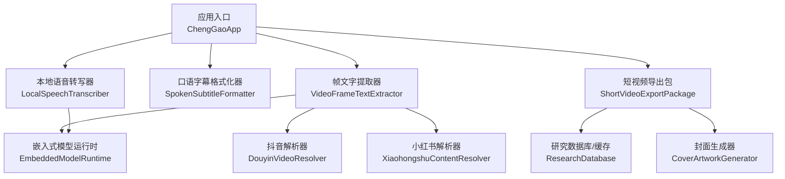
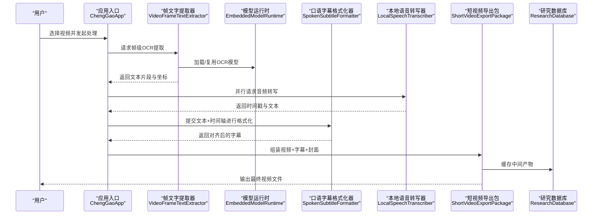
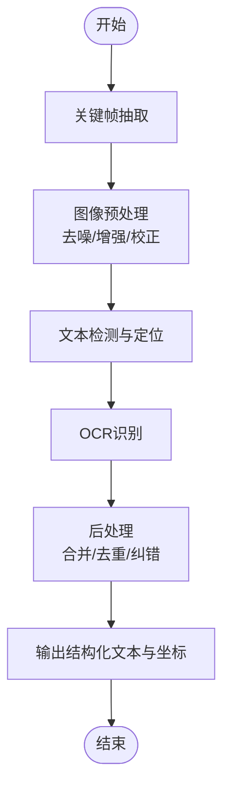
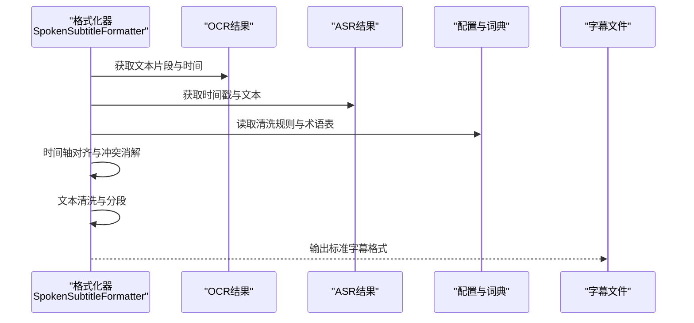
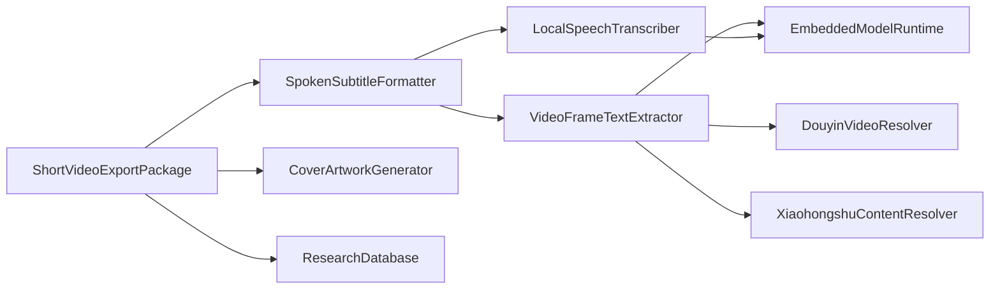

# 视频处理

<cite>
**本文引用的文件**   
- [VideoFrameTextExtractor.swift](file://Sources/ChengGao/Services/VideoFrameTextExtractor.swift)
- [SpokenSubtitleFormatter.swift](file://Sources/ChengGao/Services/SpokenSubtitleFormatter.swift)
- [LocalSpeechTranscriber.swift](file://Sources/ChengGao/Services/LocalSpeechTranscriber.swift)
- [ShortVideoExportPackage.swift](file://Sources/ChengGao/Services/ShortVideoExportPackage.swift)
- [EmbeddedModelRuntime.swift](file://Sources/ChengGao/Services/EmbeddedModelRuntime.swift)
- [ResearchDatabase.swift](file://Sources/ChengGao/Services/ResearchDatabase.swift)
- [DouyinVideoResolver.swift](file://Sources/ChengGao/Services/DouyinVideoResolver.swift)
- [XiaohongshuContentResolver.swift](file://Sources/ChengGao/Services/XiaohongshuContentResolver.swift)
- [SourceExtractor.swift](file://Sources/ChengGao/Services/SourceExtractor.swift)
- [CoverArtworkGenerator.swift](file://Sources/ChengGao/Services/CoverArtworkGenerator.swift)
- [ChengGaoApp.swift](file://Sources/ChengGao/App/ChengGaoApp.swift)
</cite>

## 目录
1. [简介](#简介)
2. [项目结构](#项目结构)
3. [核心组件](#核心组件)
4. [架构总览](#架构总览)
5. [详细组件分析](#详细组件分析)
6. [依赖关系分析](#依赖关系分析)
7. [性能考虑](#性能考虑)
8. [故障排查指南](#故障排查指南)
9. [结论](#结论)
10. [附录](#附录)

## 简介
本文件围绕“视频内容处理”能力进行系统化说明，重点覆盖：
- 视频帧文字提取（OCR）的实现原理、文本定位与精度优化策略
- 口语字幕格式化（时间轴对齐、文本清洗、格式转换）
- 视频处理的内存管理、批处理与异步机制
- 视频质量调整、格式转换与压缩配置方法
- 常见错误诊断与解决方案

上述能力由服务层模块协同完成，包括帧级OCR提取、本地语音转写、字幕格式化、导出打包以及模型运行时管理等。

## 项目结构
与视频处理相关的代码主要位于 Services 层，按职责划分：
- 帧级OCR与文本定位：VideoFrameTextExtractor
- 口语字幕格式化：SpokenSubtitleFormatter
- 本地语音转写：LocalSpeechTranscriber
- 视频导出与封装：ShortVideoExportPackage
- 模型运行时与资源管理：EmbeddedModelRuntime
- 数据持久化与缓存：ResearchDatabase
- 外部源解析与封面生成：DouyinVideoResolver、XiaohongshuContentResolver、CoverArtworkGenerator
- 应用入口与生命周期：ChengGaoApp

**图示来源** 
- [ChengGaoApp.swift](file://Sources/ChengGao/App/ChengGaoApp.swift)
- [VideoFrameTextExtractor.swift](file://Sources/ChengGao/Services/VideoFrameTextExtractor.swift)
- [SpokenSubtitleFormatter.swift](file://Sources/ChengGao/Services/SpokenSubtitleFormatter.swift)
- [LocalSpeechTranscriber.swift](file://Sources/ChengGao/Services/LocalSpeechTranscriber.swift)
- [ShortVideoExportPackage.swift](file://Sources/ChengGao/Services/ShortVideoExportPackage.swift)
- [EmbeddedModelRuntime.swift](file://Sources/ChengGao/Services/EmbeddedModelRuntime.swift)
- [ResearchDatabase.swift](file://Sources/ChengGao/Services/ResearchDatabase.swift)
- [DouyinVideoResolver.swift](file://Sources/ChengGao/Services/DouyinVideoResolver.swift)
- [XiaohongshuContentResolver.swift](file://Sources/ChengGao/Services/XiaohongshuContentResolver.swift)
- [CoverArtworkGenerator.swift](file://Sources/ChengGao/Services/CoverArtworkGenerator.swift)

**章节来源**
- [ChengGaoApp.swift](file://Sources/ChengGao/App/ChengGaoApp.swift)

## 核心组件
- 视频帧文字提取器：负责从视频中抽取关键帧、执行OCR识别、进行文本区域定位与后处理，输出结构化文本片段及坐标信息。
- 口语字幕格式化器：将原始文本与时间戳对齐，进行文本清洗、断句与分段，并转换为常用字幕格式。
- 本地语音转写器：在设备端对音频进行转写，提供与字幕对齐的文本流。
- 短视频导出包：整合视频、字幕、封面等素材，进行编码、压缩与封装输出。
- 嵌入式模型运行时：管理OCR与语音模型的加载、推理与资源释放。
- 研究数据库：用于缓存中间结果、提升重复处理效率。
- 外部源解析器：从不同平台拉取视频或元数据，辅助后续处理。
- 封面生成器：为导出产物生成预览封面。

**章节来源**
- [VideoFrameTextExtractor.swift](file://Sources/ChengGao/Services/VideoFrameTextExtractor.swift)
- [SpokenSubtitleFormatter.swift](file://Sources/ChengGao/Services/SpokenSubtitleFormatter.swift)
- [LocalSpeechTranscriber.swift](file://Sources/ChengGao/Services/LocalSpeechTranscriber.swift)
- [ShortVideoExportPackage.swift](file://Sources/ChengGao/Services/ShortVideoExportPackage.swift)
- [EmbeddedModelRuntime.swift](file://Sources/ChengGao/Services/EmbeddedModelRuntime.swift)
- [ResearchDatabase.swift](file://Sources/ChengGao/Services/ResearchDatabase.swift)
- [DouyinVideoResolver.swift](file://Sources/ChengGao/Services/DouyinVideoResolver.swift)
- [XiaohongshuContentResolver.swift](file://Sources/ChengGao/Services/XiaohongshuContentResolver.swift)
- [CoverArtworkGenerator.swift](file://Sources/ChengGao/Services/CoverArtworkGenerator.swift)

## 架构总览
整体流程以“输入视频 → 多模态提取（OCR/ASR）→ 字幕格式化 → 导出封装”为主线，结合运行时与数据库实现高效稳定处理。

**图示来源** 
- [ChengGaoApp.swift](file://Sources/ChengGao/App/ChengGaoApp.swift)
- [VideoFrameTextExtractor.swift](file://Sources/ChengGao/Services/VideoFrameTextExtractor.swift)
- [EmbeddedModelRuntime.swift](file://Sources/ChengGao/Services/EmbeddedModelRuntime.swift)
- [LocalSpeechTranscriber.swift](file://Sources/ChengGao/Services/LocalSpeechTranscriber.swift)
- [SpokenSubtitleFormatter.swift](file://Sources/ChengGao/Services/SpokenSubtitleFormatter.swift)
- [ShortVideoExportPackage.swift](file://Sources/ChengGao/Services/ShortVideoExportPackage.swift)
- [ResearchDatabase.swift](file://Sources/ChengGao/Services/ResearchDatabase.swift)

## 详细组件分析

### 视频帧文字提取器（OCR）
- 功能要点
  - 关键帧抽取：基于场景变化、运动检测或固定间隔采样，减少冗余计算。
  - OCR识别：调用嵌入式模型运行时进行文本识别，支持多语言与复杂版面。
  - 文本定位：输出边界框与置信度，便于后续去重与合并。
  - 后处理：基于几何规则与语义规则进行文本块合并、噪声过滤与纠错。
- 精度优化策略
  - 自适应阈值与对比度增强，改善暗光与低对比度场景。
  - 多尺度检测与融合，提高小字与倾斜文本召回率。
  - 置信度门控与上下文校验，降低误识率。
  - 增量更新与缓存命中，避免重复计算。
- 内存与并发
  - 模型按需加载与共享，避免重复初始化。
  - 帧切片批处理，限制峰值内存占用。
  - 任务队列与背压控制，防止阻塞UI线程。

**图示来源** 
- [VideoFrameTextExtractor.swift](file://Sources/ChengGao/Services/VideoFrameTextExtractor.swift)
- [EmbeddedModelRuntime.swift](file://Sources/ChengGao/Services/EmbeddedModelRuntime.swift)

**章节来源**
- [VideoFrameTextExtractor.swift](file://Sources/ChengGao/Services/VideoFrameTextExtractor.swift)
- [EmbeddedModelRuntime.swift](file://Sources/ChengGao/Services/EmbeddedModelRuntime.swift)

### 口语字幕格式化器
- 功能要点
  - 时间轴对齐：将OCR文本与ASR时间戳对齐，解决时序不一致问题。
  - 文本清洗：去除多余空格、标点规范化、大小写统一、敏感词替换。
  - 分段与断句：依据语义与时长约束切分字幕条，保证可读性。
  - 格式转换：输出SRT/ASS/VTT等常见字幕格式，兼容播放器。
- 对齐算法
  - 动态时间窗匹配与滑动窗口对齐，容忍轻微漂移。
  - 双向映射与冲突消解，确保一对一或一对多映射合理。
  - 置信度加权融合，优先采用高可信度片段。
- 质量保障
  - 长度限制与换行策略，避免超长字幕。
  - 重叠检测与合并，避免重复显示。
  - 可配置的术语表与白名单，提升领域一致性。

**图示来源** 
- [SpokenSubtitleFormatter.swift](file://Sources/ChengGao/Services/SpokenSubtitleFormatter.swift)
- [LocalSpeechTranscriber.swift](file://Sources/ChengGao/Services/LocalSpeechTranscriber.swift)

**章节来源**
- [SpokenSubtitleFormatter.swift](file://Sources/ChengGao/Services/SpokenSubtitleFormatter.swift)
- [LocalSpeechTranscriber.swift](file://Sources/ChengGao/Services/LocalSpeechTranscriber.swift)

### 本地语音转写器
- 功能要点
  - 音频解码与降噪，提升转写鲁棒性。
  - 端侧模型推理，离线可用，保护隐私。
  - 流式或批量转写，适配长视频与实时需求。
- 集成点
  - 与格式化器协作，提供精确时间戳。
  - 与运行时交互，管理模型生命周期。

**章节来源**
- [LocalSpeechTranscriber.swift](file://Sources/ChengGao/Services/LocalSpeechTranscriber.swift)
- [EmbeddedModelRuntime.swift](file://Sources/ChengGao/Services/EmbeddedModelRuntime.swift)

### 短视频导出包
- 功能要点
  - 合成视频轨道、字幕轨道与封面图。
  - 编码参数配置（分辨率、码率、帧率、编解码器）。
  - 压缩选项（H.264/H.265、CRF、预设）。
  - 输出路径管理与进度回调。
- 质量与体积平衡
  - 自适应码率与两级编码，兼顾画质与体积。
  - 字幕嵌入策略（软字幕/硬字幕）可选。

**章节来源**
- [ShortVideoExportPackage.swift](file://Sources/ChengGao/Services/ShortVideoExportPackage.swift)
- [CoverArtworkGenerator.swift](file://Sources/ChengGao/Services/CoverArtworkGenerator.swift)

### 嵌入式模型运行时
- 功能要点
  - 模型加载、预热与缓存。
  - 推理调度与资源隔离。
  - 错误恢复与降级策略。
- 与OCR/ASR协作
  - 统一接口抽象，屏蔽底层差异。
  - 多线程安全与内存池管理。

**章节来源**
- [EmbeddedModelRuntime.swift](file://Sources/ChengGao/Services/EmbeddedModelRuntime.swift)

### 研究数据库（缓存）
- 功能要点
  - 中间结果缓存（帧特征、OCR片段、转写片段）。
  - 键值与索引设计，加速重复处理。
  - 清理策略与容量上限，避免膨胀。

**章节来源**
- [ResearchDatabase.swift](file://Sources/ChengGao/Services/ResearchDatabase.swift)

### 外部源解析与封面生成
- 外部源解析
  - 抖音/小红书等平台视频链接解析与元数据获取。
  - 鉴权与会话管理，提升稳定性。
- 封面生成
  - 关键帧选取与缩略图生成。
  - 尺寸适配与水印叠加（可选）。

**章节来源**
- [DouyinVideoResolver.swift](file://Sources/ChengGao/Services/DouyinVideoResolver.swift)
- [XiaohongshuContentResolver.swift](file://Sources/ChengGao/Services/XiaohongshuContentResolver.swift)
- [CoverArtworkGenerator.swift](file://Sources/ChengGao/Services/CoverArtworkGenerator.swift)

## 依赖关系分析
- 组件耦合
  - 提取器与运行时强耦合（模型加载/推理）。
  - 格式化器依赖OCR与ASR输出，弱耦合于具体实现。
  - 导出包依赖格式化结果与封面素材，独立于上游。
- 潜在循环依赖
  - 通过分层与接口抽象避免循环引用。
- 外部依赖
  - 平台解析器依赖网络与第三方API。
  - 运行时依赖系统多媒体框架与模型库。

**图示来源** 
- [VideoFrameTextExtractor.swift](file://Sources/ChengGao/Services/VideoFrameTextExtractor.swift)
- [EmbeddedModelRuntime.swift](file://Sources/ChengGao/Services/EmbeddedModelRuntime.swift)
- [LocalSpeechTranscriber.swift](file://Sources/ChengGao/Services/LocalSpeechTranscriber.swift)
- [SpokenSubtitleFormatter.swift](file://Sources/ChengGao/Services/SpokenSubtitleFormatter.swift)
- [ShortVideoExportPackage.swift](file://Sources/ChengGao/Services/ShortVideoExportPackage.swift)
- [CoverArtworkGenerator.swift](file://Sources/ChengGao/Services/CoverArtworkGenerator.swift)
- [DouyinVideoResolver.swift](file://Sources/ChengGao/Services/DouyinVideoResolver.swift)
- [XiaohongshuContentResolver.swift](file://Sources/ChengGao/Services/XiaohongshuContentResolver.swift)
- [ResearchDatabase.swift](file://Sources/ChengGao/Services/ResearchDatabase.swift)

**章节来源**
- [VideoFrameTextExtractor.swift](file://Sources/ChengGao/Services/VideoFrameTextExtractor.swift)
- [SpokenSubtitleFormatter.swift](file://Sources/ChengGao/Services/SpokenSubtitleFormatter.swift)
- [LocalSpeechTranscriber.swift](file://Sources/ChengGao/Services/LocalSpeechTranscriber.swift)
- [ShortVideoExportPackage.swift](file://Sources/ChengGao/Services/ShortVideoExportPackage.swift)
- [EmbeddedModelRuntime.swift](file://Sources/ChengGao/Services/EmbeddedModelRuntime.swift)
- [ResearchDatabase.swift](file://Sources/ChengGao/Services/ResearchDatabase.swift)
- [DouyinVideoResolver.swift](file://Sources/ChengGao/Services/DouyinVideoResolver.swift)
- [XiaohongshuContentResolver.swift](file://Sources/ChengGao/Services/XiaohongshuContentResolver.swift)
- [CoverArtworkGenerator.swift](file://Sources/ChengGao/Services/CoverArtworkGenerator.swift)

## 性能考虑
- 内存管理
  - 模型懒加载与共享，避免重复占用。
  - 帧缓冲池与对象复用，降低GC压力。
  - 及时释放临时图像与中间数组。
- 批处理优化
  - 帧切片批量推理，提高吞吐。
  - 字幕批量对齐与合并，减少IO次数。
- 异步处理
  - 使用后台队列与回调，避免阻塞主线程。
  - 任务优先级与取消机制，提升响应性。
- 编码与压缩
  - 选择合适的编码器与预设，平衡速度与质量。
  - 两遍编码与自适应码率，优化体积。

[本节为通用指导，不直接分析具体文件]

## 故障排查指南
- 常见问题
  - OCR识别率低：检查图像预处理参数、光照条件与字体大小；启用多尺度检测与置信度门控。
  - 时间轴错位：校准ASR时间戳偏移，增大对齐时间窗；增加冲突消解策略。
  - 内存溢出：降低批大小、启用对象池；监控峰值内存并及时释放。
  - 导出失败：确认编码器可用性与权限；检查输入素材完整性与格式兼容性。
- 诊断步骤
  - 查看运行时日志与错误码，定位失败阶段。
  - 检查缓存命中率与数据库状态，排除脏数据。
  - 逐步禁用优化项（如批处理），验证是否为并发导致。
- 解决方案
  - 调整模型参数与阈值，重新训练或更换更优模型。
  - 增加重试与降级逻辑，提升鲁棒性。
  - 完善输入校验与异常捕获，提前拦截非法数据。

**章节来源**
- [EmbeddedModelRuntime.swift](file://Sources/ChengGao/Services/EmbeddedModelRuntime.swift)
- [ResearchDatabase.swift](file://Sources/ChengGao/Services/ResearchDatabase.swift)
- [ShortVideoExportPackage.swift](file://Sources/ChengGao/Services/ShortVideoExportPackage.swift)

## 结论
本项目围绕视频内容处理构建了完整链路：从帧级OCR到口语字幕格式化，再到导出封装，配合嵌入式模型运行时与缓存机制，实现了高效、稳定且可扩展的处理能力。通过合理的内存管理、批处理与异步策略，能够在资源受限环境下保持良好性能。针对常见错误提供了系统的诊断与修复建议，有助于快速定位与解决问题。

[本节为总结性内容，不直接分析具体文件]

## 附录
- 配置建议
  - OCR：开启多尺度检测、对比度增强与置信度门控。
  - ASR：启用降噪与流式转写，设置合理的时间窗。
  - 导出：选择H.264/H.265编码器，CRF适中，启用两遍编码。
- 最佳实践
  - 输入预处理标准化，提升识别稳定性。
  - 中间结果缓存，加速重复处理。
  - 错误分级与回退策略，保障用户体验。

[本节为补充信息，不直接分析具体文件]