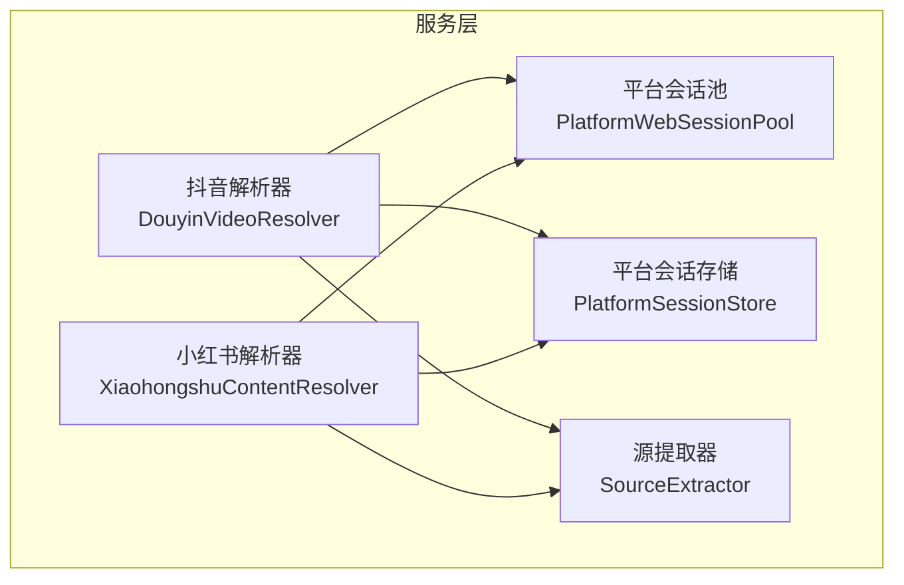
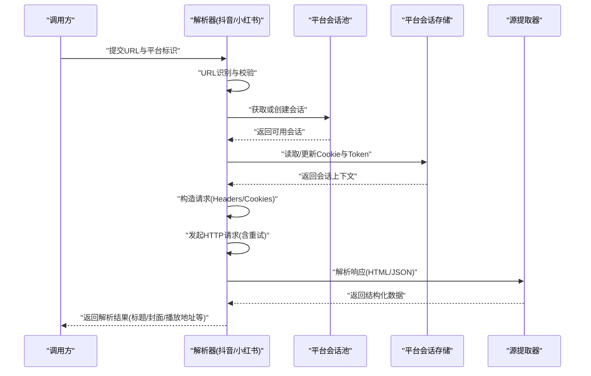
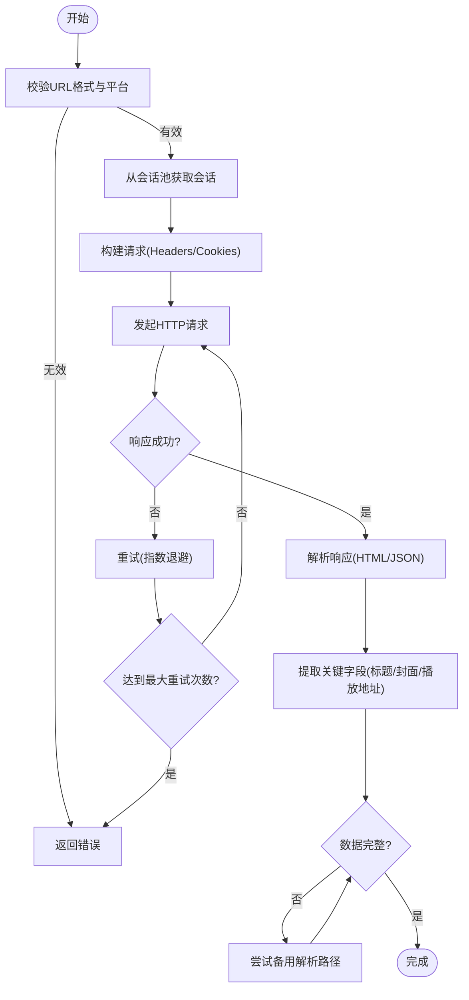
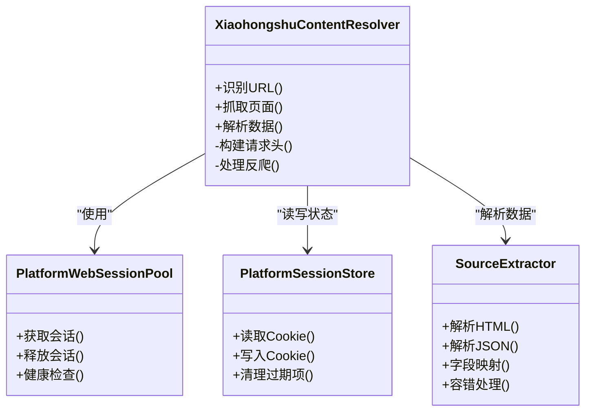
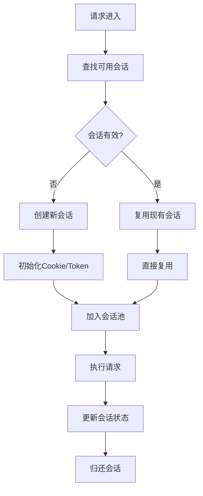
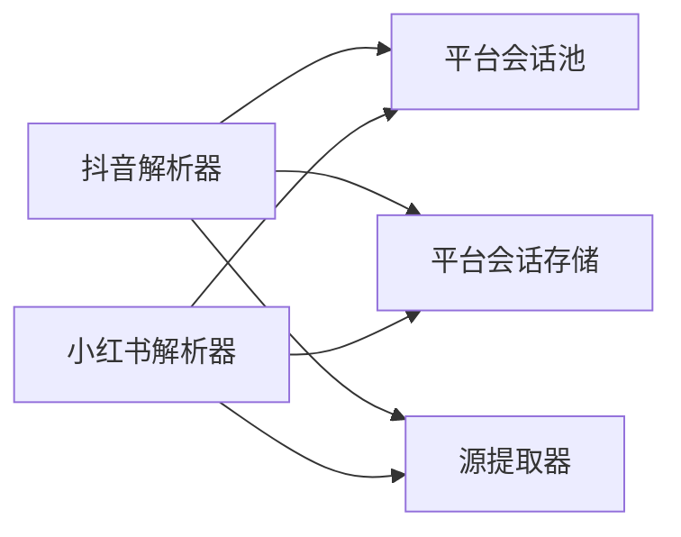

# 视频平台解析器

<cite>
**本文档引用的文件**
- [DouyinVideoResolver.swift](file://Sources/ChengGao/Services/DouyinVideoResolver.swift)
- [XiaohongshuContentResolver.swift](file://Sources/ChengGao/Services/XiaohongshuContentResolver.swift)
- [PlatformWebSessionPool.swift](file://Sources/ChengGao/Services/PlatformWebSessionPool.swift)
- [PlatformSessionStore.swift](file://Sources/ChengGao/Services/PlatformSessionStore.swift)
- [SourceExtractor.swift](file://Sources/ChengGao/Services/SourceExtractor.swift)
- [Package.swift](file://Package.swift)
</cite>

## 目录
1. [简介](#简介)
2. [项目结构](#项目结构)
3. [核心组件](#核心组件)
4. [架构总览](#架构总览)
5. [详细组件分析](#详细组件分析)
6. [依赖分析](#依赖分析)
7. [性能考虑](#性能考虑)
8. [故障排查指南](#故障排查指南)
9. [结论](#结论)
10. [附录](#附录)

## 简介
本仓库包含一个面向短视频平台的解析子系统，重点实现抖音与小红书两个平台的视频内容解析。其目标包括：
- URL识别规则：对输入链接进行平台判定与规范化处理
- 页面抓取策略：基于会话池与存储的网页访问策略
- 反爬虫机制应对：通过会话、Cookie、请求头与重试策略降低风控概率
- 数据提取逻辑：从页面或接口返回中提取视频信息（如标题、封面、播放地址等）
- 可扩展性：提供统一的解析器接口，便于扩展新平台

该文档将围绕上述目标，结合源码中的关键模块进行系统化说明，并提供架构图、流程图与最佳实践建议。

## 项目结构
本项目采用模块化组织方式，解析相关能力集中在 Services 层，具体包括：
- 平台解析器：分别针对抖音与小红书实现解析逻辑
- 会话管理：统一维护跨平台 Web 会话与会话池
- 源提取工具：通用数据抽取与清洗能力
- 包配置：Swift Package Manager 的依赖与模块声明

**图表来源**
- [DouyinVideoResolver.swift](file://Sources/ChengGao/Services/DouyinVideoResolver.swift)
- [XiaohongshuContentResolver.swift](file://Sources/ChengGao/Services/XiaohongshuContentResolver.swift)
- [PlatformWebSessionPool.swift](file://Sources/ChengGao/Services/PlatformWebSessionPool.swift)
- [PlatformSessionStore.swift](file://Sources/ChengGao/Services/PlatformSessionStore.swift)
- [SourceExtractor.swift](file://Sources/ChengGao/Services/SourceExtractor.swift)

**章节来源**
- [Package.swift](file://Package.swift)

## 核心组件
- 抖音解析器：负责抖音链接识别、页面抓取、反爬规避与数据提取
- 小红书解析器：负责小红书链接识别、页面抓取、反爬规避与数据提取
- 平台会话池：管理多平台并发会话，避免频繁创建销毁带来的开销与风控风险
- 平台会话存储：持久化 Cookie、Token 等状态，保障登录态与访问连续性
- 源提取器：提供通用的 HTML/JSON 解析、字段映射与容错处理

这些组件共同构成“解析流水线”：URL 识别 → 会话选择 → 页面抓取 → 数据提取 → 结果封装。

**章节来源**
- [DouyinVideoResolver.swift](file://Sources/ChengGao/Services/DouyinVideoResolver.swift)
- [XiaohongshuContentResolver.swift](file://Sources/ChengGao/Services/XiaohongshuContentResolver.swift)
- [PlatformWebSessionPool.swift](file://Sources/ChengGao/Services/PlatformWebSessionPool.swift)
- [PlatformSessionStore.swift](file://Sources/ChengGao/Services/PlatformSessionStore.swift)
- [SourceExtractor.swift](file://Sources/ChengGao/Services/SourceExtractor.swift)

## 架构总览
下图展示了从输入 URL 到输出结构化数据的整体流程，以及各组件之间的交互关系。

**图表来源**
- [DouyinVideoResolver.swift](file://Sources/ChengGao/Services/DouyinVideoResolver.swift)
- [XiaohongshuContentResolver.swift](file://Sources/ChengGao/Services/XiaohongshuContentResolver.swift)
- [PlatformWebSessionPool.swift](file://Sources/ChengGao/Services/PlatformWebSessionPool.swift)
- [PlatformSessionStore.swift](file://Sources/ChengGao/Services/PlatformSessionStore.swift)
- [SourceExtractor.swift](file://Sources/ChengGao/Services/SourceExtractor.swift)

## 详细组件分析

### 抖音解析器
- URL识别规则：匹配抖音域名与分享链接模式，支持短链与长链；必要时进行重定向跟踪
- 页面抓取策略：优先使用已登录会话，携带必要 Headers（User-Agent、Referer、Accept-Language），并设置合理的超时
- 反爬虫机制应对：随机化请求间隔、轮换 User-Agent、限制并发、失败时触发指数退避重试
- 数据提取逻辑：从页面 JSON 或 HTML 片段中抽取视频标题、作者、封面图、播放地址等信息；若遇到加密字段，则按约定解码或回退到备用字段

**图表来源**
- [DouyinVideoResolver.swift](file://Sources/ChengGao/Services/DouyinVideoResolver.swift)
- [PlatformWebSessionPool.swift](file://Sources/ChengGao/Services/PlatformWebSessionPool.swift)
- [PlatformSessionStore.swift](file://Sources/ChengGao/Services/PlatformSessionStore.swift)
- [SourceExtractor.swift](file://Sources/ChengGao/Services/SourceExtractor.swift)

**章节来源**
- [DouyinVideoResolver.swift](file://Sources/ChengGao/Services/DouyinVideoResolver.swift)
- [PlatformWebSessionPool.swift](file://Sources/ChengGao/Services/PlatformWebSessionPool.swift)
- [PlatformSessionStore.swift](file://Sources/ChengGao/Services/PlatformSessionStore.swift)
- [SourceExtractor.swift](file://Sources/ChengGao/Services/SourceExtractor.swift)

### 小红书解析器
- URL识别规则：匹配小红书域名与笔记/商品链接模式，支持多种分享形式
- 页面抓取策略：优先走服务端渲染页面，必要时模拟浏览器行为（如滚动加载），确保动态内容可被捕获
- 反爬虫机制应对：控制请求频率、使用真实设备指纹、在失败时切换会话与代理（如有）
- 数据提取逻辑：从页面脚本或 API 响应中提取笔记标题、作者、封面图、正文摘要、媒体列表等

**图表来源**
- [XiaohongshuContentResolver.swift](file://Sources/ChengGao/Services/XiaohongshuContentResolver.swift)
- [PlatformWebSessionPool.swift](file://Sources/ChengGao/Services/PlatformWebSessionPool.swift)
- [PlatformSessionStore.swift](file://Sources/ChengGao/Services/PlatformSessionStore.swift)
- [SourceExtractor.swift](file://Sources/ChengGao/Services/SourceExtractor.swift)

**章节来源**
- [XiaohongshuContentResolver.swift](file://Sources/ChengGao/Services/XiaohongshuContentResolver.swift)
- [PlatformWebSessionPool.swift](file://Sources/ChengGao/Services/PlatformWebSessionPool.swift)
- [PlatformSessionStore.swift](file://Sources/ChengGao/Services/PlatformSessionStore.swift)
- [SourceExtractor.swift](file://Sources/ChengGao/Services/SourceExtractor.swift)

### 平台会话池与会话存储
- 会话池：维护多个平台会话实例，支持并发访问与资源复用；提供健康检查与自动回收
- 会话存储：持久化 Cookie、Token、UA 等上下文，保证跨进程/重启后的状态一致性；支持过期清理与冲突合并

**图表来源**
- [PlatformWebSessionPool.swift](file://Sources/ChengGao/Services/PlatformWebSessionPool.swift)
- [PlatformSessionStore.swift](file://Sources/ChengGao/Services/PlatformSessionStore.swift)

**章节来源**
- [PlatformWebSessionPool.swift](file://Sources/ChengGao/Services/PlatformWebSessionPool.swift)
- [PlatformSessionStore.swift](file://Sources/ChengGao/Services/PlatformSessionStore.swift)

### 源提取器
- 功能：统一处理 HTML/JSON 解析、字段映射、默认值填充与异常回退
- 设计：以可插拔策略为核心，允许为不同平台定制提取规则；提供调试日志与采样统计

**章节来源**
- [SourceExtractor.swift](file://Sources/ChengGao/Services/SourceExtractor.swift)

## 依赖分析
- 内部依赖：解析器依赖会话池与会话存储，均通过抽象接口解耦；源提取器作为通用工具被所有解析器复用
- 外部依赖：HTTP 客户端、网络栈、序列化库（由 Swift 标准库与系统框架提供）
- 耦合度：解析器与底层网络细节解耦，仅通过会话池与存储访问；平台差异集中在 URL 识别与数据提取策略

**图表来源**
- [DouyinVideoResolver.swift](file://Sources/ChengGao/Services/DouyinVideoResolver.swift)
- [XiaohongshuContentResolver.swift](file://Sources/ChengGao/Services/XiaohongshuContentResolver.swift)
- [PlatformWebSessionPool.swift](file://Sources/ChengGao/Services/PlatformWebSessionPool.swift)
- [PlatformSessionStore.swift](file://Sources/ChengGao/Services/PlatformSessionStore.swift)
- [SourceExtractor.swift](file://Sources/ChengGao/Services/SourceExtractor.swift)

**章节来源**
- [Package.swift](file://Package.swift)

## 性能考虑
- 会话复用：减少握手与鉴权开销，提升吞吐
- 并发控制：限制同一平台的并发数，避免触发风控
- 缓存策略：对静态资源（如封面图）与稳定字段进行本地缓存
- 重试策略：指数退避与抖动，避免雪崩效应
- 解析优化：优先解析轻量级响应（如 JSON），避免全量 HTML 解析

[本节为通用指导，不直接分析具体文件]

## 故障排查指南
- 常见问题
  - URL 无法识别：检查域名白名单与正则规则
  - 请求被拒绝：检查 Cookie/Token 是否过期，UA 是否被标记
  - 数据不完整：确认页面结构变化，调整提取规则
  - 频繁失败：检查网络延迟与限流策略，适当增加重试上限
- 诊断方法
  - 启用详细日志：记录请求头、响应码、解析步骤
  - 抓包验证：对比浏览器与程序请求差异
  - 单元测试：覆盖典型 URL 与边界情况
- 恢复策略
  - 自动切换会话与代理
  - 降级到备用解析路径
  - 人工介入提示（需重新登录或更新规则）

**章节来源**
- [DouyinVideoResolver.swift](file://Sources/ChengGao/Services/DouyinVideoResolver.swift)
- [XiaohongshuContentResolver.swift](file://Sources/ChengGao/Services/XiaohongshuContentResolver.swift)
- [PlatformWebSessionPool.swift](file://Sources/ChengGao/Services/PlatformWebSessionPool.swift)
- [PlatformSessionStore.swift](file://Sources/ChengGao/Services/PlatformSessionStore.swift)
- [SourceExtractor.swift](file://Sources/ChengGao/Services/SourceExtractor.swift)

## 结论
本解析子系统以清晰的职责划分与良好的扩展性，支撑抖音与小红书两大平台的视频内容解析。通过会话池与存储的统一管理、源提取器的通用能力以及健壮的重试与容错机制，系统在稳定性与性能上具备良好表现。未来可通过新增解析器快速接入更多平台，并保持核心流程一致。

[本节为总结性内容，不直接分析具体文件]

## 附录

### 如何扩展支持新的视频平台
- 步骤概览
  - 定义平台常量与 URL 识别规则
  - 实现解析器类，继承或遵循统一接口
  - 配置会话池与会话存储的平台参数
  - 编写数据提取规则与容错逻辑
  - 添加单元测试与集成测试
- 开发要点
  - 保持与现有解析器一致的请求头与 Cookie 策略
  - 合理设置超时与重试参数
  - 对敏感字段进行脱敏与最小化暴露
  - 提供调试开关与日志级别控制

[本节为概念性指导，不直接分析具体文件]

### 接口设计与错误处理
- 接口设计
  - 统一解析入口：接收 URL 与平台标识，返回结构化结果
  - 会话管理接口：获取/释放/健康检查
  - 提取策略接口：定义字段映射与回退规则
- 错误处理
  - 分类错误码：网络错误、解析错误、业务错误
  - 统一异常包装：便于上层处理与监控
  - 重试与降级：根据错误类型决定策略

[本节为概念性指导，不直接分析具体文件]

### 调试工具使用方法
- 启用调试模式：输出详细请求与解析日志
- 模拟请求：构造典型 URL 与响应体进行离线测试
- 可视化验证：展示解析前后数据结构对比
- 性能分析：统计耗时与成功率，定位瓶颈

[本节为概念性指导，不直接分析具体文件]