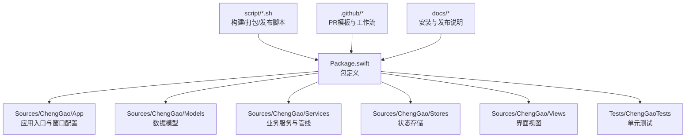
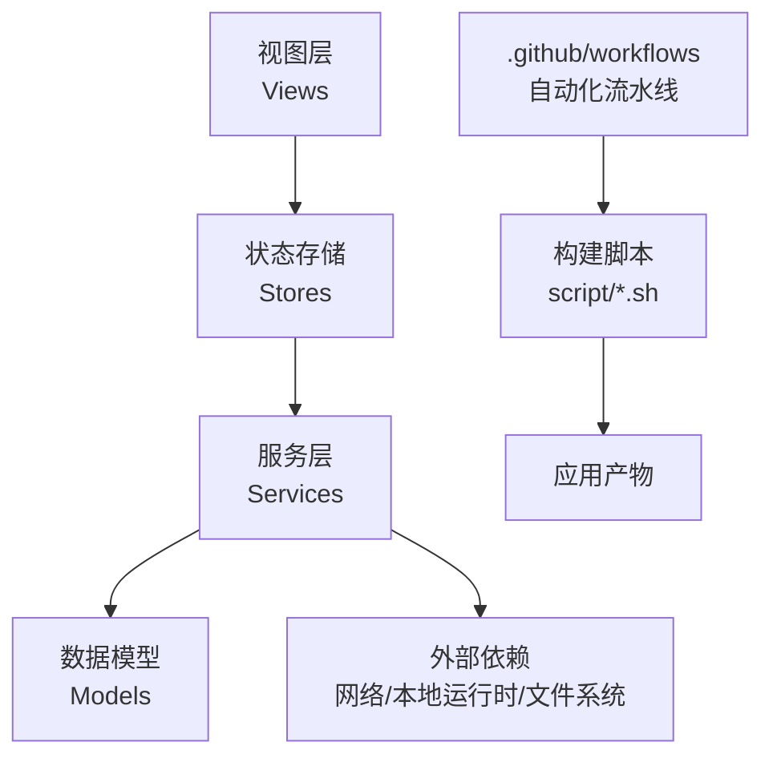
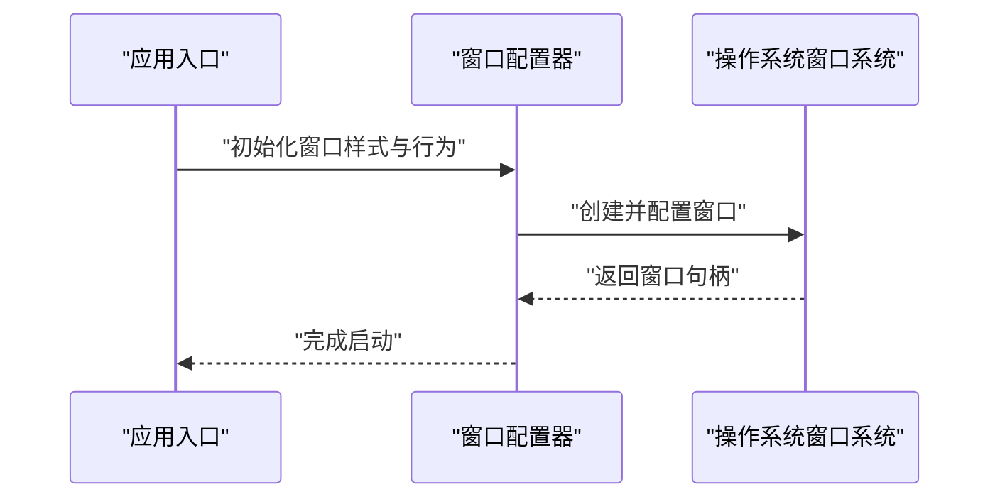
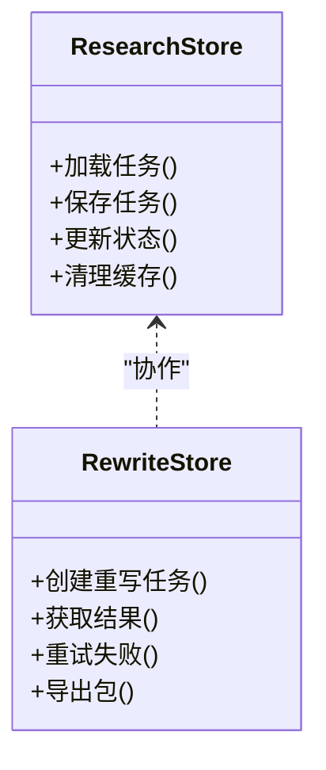
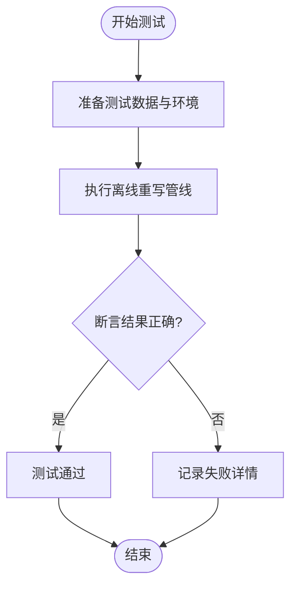
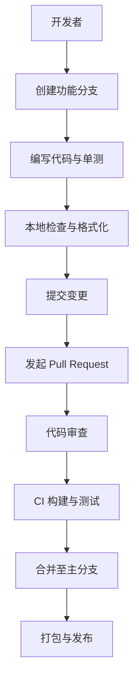
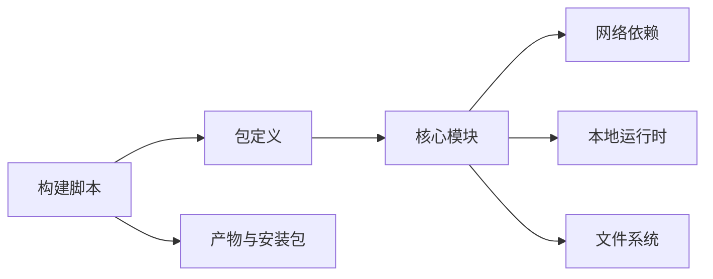

# 开发指南

<cite>
**本文引用的文件**   
- [Package.swift](file://Package.swift)
- [README.md](file://README.md)
- [CONTRIBUTING.md](file://CONTRIBUTING.md)
- [CODE_OF_CONDUCT.md](file://CODE_OF_CONDUCT.md)
- [SECURITY.md](file://SECURITY.md)
- [SUPPORT.md](file://SUPPORT.md)
- [ChengGaoApp.swift](file://Sources/ChengGao/App/ChengGaoApp.swift)
- [WindowGlassConfigurator.swift](file://Sources/ChengGao/App/WindowGlassConfigurator.swift)
- [ResearchStore.swift](file://Sources/ChengGao/Stores/ResearchStore.swift)
- [RewriteStore.swift](file://Sources/ChengGao/Stores/RewriteStore.swift)
- [OfflineRewritePipelineTests.swift](file://Tests/ChengGaoTests/OfflineRewritePipelineTests.swift)
- [bootstrap_runtime.sh](file://script/bootstrap_runtime.sh)
- [build_and_run.sh](file://script/build_and_run.sh)
- [install_local.sh](file://script/install_local.sh)
- [package_dmg.sh](file://script/package_dmg.sh)
- [package_release.sh](file://script/package_release.sh)
- [release_local.sh](file://script/release_local.sh)
- [CURRENT_HANDOFF.md](file://docs/CURRENT_HANDOFF.md)
- [RELEASE_NOTARIZATION.md](file://docs/RELEASE_NOTARIZATION.md)
- [请先阅读-安装与使用说明.txt](file://docs/请先阅读-安装与使用说明.txt)
- [.github/PULL_REQUEST_TEMPLATE.md](file://.github/PULL_REQUEST_TEMPLATE.md)
</cite>

## 目录
1. [简介](#简介)
2. [项目结构](#项目结构)
3. [核心组件](#核心组件)
4. [架构总览](#架构总览)
5. [详细组件分析](#详细组件分析)
6. [依赖分析](#依赖分析)
7. [性能考虑](#性能考虑)
8. [故障排查指南](#故障排查指南)
9. [结论](#结论)
10. [附录](#附录)

## 简介
本指南面向希望参与本项目开发与贡献的开发者，涵盖代码规范、提交约定、分支管理策略、开发环境搭建、依赖管理、调试技巧、新功能开发流程、代码审查标准、质量保证要求、安全编码规范、漏洞报告与处理流程、社区行为准则、问题报告模板与支持渠道，以及性能优化、内存管理与资源使用最佳实践。文档内容基于仓库现有结构与脚本进行整理，确保与实际实现一致。

## 项目结构
项目采用 Swift Package Manager 组织，核心应用位于 Sources/ChengGao，包含 App、Models、Services、Stores、Support、Views 等模块；测试位于 Tests/ChengGaoTests；构建与打包脚本集中于 script；文档与说明位于 docs；GitHub 相关配置在 .github。

图表来源
- [Package.swift](file://Package.swift)
- [ChengGaoApp.swift](file://Sources/ChengGao/App/ChengGaoApp.swift)
- [WindowGlassConfigurator.swift](file://Sources/ChengGao/App/WindowGlassConfigurator.swift)
- [ResearchStore.swift](file://Sources/ChengGao/Stores/ResearchStore.swift)
- [RewriteStore.swift](file://Sources/ChengGao/Stores/RewriteStore.swift)
- [OfflineRewritePipelineTests.swift](file://Tests/ChengGaoTests/OfflineRewritePipelineTests.swift)
- [bootstrap_runtime.sh](file://script/bootstrap_runtime.sh)
- [build_and_run.sh](file://script/build_and_run.sh)
- [.github/PULL_REQUEST_TEMPLATE.md](file://.github/PULL_REQUEST_TEMPLATE.md)

章节来源
- [Package.swift](file://Package.swift)
- [README.md](file://README.md)

## 核心组件
- 应用入口与窗口配置：负责应用生命周期与窗口样式初始化。
- 数据模型：定义研究、重写、在线 AI 等数据结构。
- 服务层：封装离线/在线重写管线、图像生成、语音转写、网络会话池、凭据存储等能力。
- 状态存储：集中管理研究与重写任务的状态与持久化。
- 视图层：提供用户交互界面与布局。
- 测试：对关键管线进行单元测试覆盖。

章节来源
- [ChengGaoApp.swift](file://Sources/ChengGao/App/ChengGaoApp.swift)
- [WindowGlassConfigurator.swift](file://Sources/ChengGao/App/WindowGlassConfigurator.swift)
- [ResearchStore.swift](file://Sources/ChengGao/Stores/ResearchStore.swift)
- [RewriteStore.swift](file://Sources/ChengGao/Stores/RewriteStore.swift)
- [OfflineRewritePipelineTests.swift](file://Tests/ChengGaoTests/OfflineRewritePipelineTests.swift)

## 架构总览
整体采用分层架构：UI 层通过 Store 访问 Services，Services 调用 Models 与外部系统（本地运行时、网络 API）。构建与发布由脚本驱动，CI/CD 由 GitHub Actions 支持。

图表来源
- [ResearchStore.swift](file://Sources/ChengGao/Stores/ResearchStore.swift)
- [RewriteStore.swift](file://Sources/ChengGao/Stores/RewriteStore.swift)
- [bootstrap_runtime.sh](file://script/bootstrap_runtime.sh)
- [build_and_run.sh](file://script/build_and_run.sh)
- [.github/PULL_REQUEST_TEMPLATE.md](file://.github/PULL_REQUEST_TEMPLATE.md)

## 详细组件分析

### 应用启动与窗口配置
- 应用入口负责初始化全局配置、主题与窗口玻璃效果。
- 窗口配置器统一设置窗口外观与行为，保证一致的视觉体验。

图表来源
- [ChengGaoApp.swift](file://Sources/ChengGao/App/ChengGaoApp.swift)
- [WindowGlassConfigurator.swift](file://Sources/ChengGao/App/WindowGlassConfigurator.swift)

章节来源
- [ChengGaoApp.swift](file://Sources/ChengGao/App/ChengGaoApp.swift)
- [WindowGlassConfigurator.swift](file://Sources/ChengGao/App/WindowGlassConfigurator.swift)

### 状态存储（ResearchStore / RewriteStore）
- ResearchStore 管理研究任务的数据与状态，提供查询、更新与持久化接口。
- RewriteStore 管理重写任务的生命周期与结果缓存。
- 两者均遵循单一职责，便于扩展与维护。

图表来源
- [ResearchStore.swift](file://Sources/ChengGao/Stores/ResearchStore.swift)
- [RewriteStore.swift](file://Sources/ChengGao/Stores/RewriteStore.swift)

章节来源
- [ResearchStore.swift](file://Sources/ChengGao/Stores/ResearchStore.swift)
- [RewriteStore.swift](file://Sources/ChengGao/Stores/RewriteStore.swift)

### 离线重写管线（测试视角）
- 通过单元测试验证离线重写的输入输出一致性、边界条件与错误恢复。
- 测试用例覆盖典型路径与异常路径，保障稳定性。

图表来源
- [OfflineRewritePipelineTests.swift](file://Tests/ChengGaoTests/OfflineRewritePipelineTests.swift)

章节来源
- [OfflineRewritePipelineTests.swift](file://Tests/ChengGaoTests/OfflineRewritePipelineTests.swift)

### 概念性概览
以下为通用开发工作流的概念图，不直接映射到具体源码文件：

## 依赖分析
- 包管理：使用 Swift Package Manager，依赖声明集中在包定义文件中。
- 构建脚本：提供运行时引导、构建运行、本地安装、DMG 打包与发布流程。
- 外部依赖：包括网络客户端、本地运行时、平台会话池与凭据存储等。

图表来源
- [Package.swift](file://Package.swift)
- [bootstrap_runtime.sh](file://script/bootstrap_runtime.sh)
- [build_and_run.sh](file://script/build_and_run.sh)
- [install_local.sh](file://script/install_local.sh)
- [package_dmg.sh](file://script/package_dmg.sh)
- [package_release.sh](file://script/package_release.sh)
- [release_local.sh](file://script/release_local.sh)

章节来源
- [Package.swift](file://Package.swift)
- [bootstrap_runtime.sh](file://script/bootstrap_runtime.sh)
- [build_and_run.sh](file://script/build_and_run.sh)

## 性能考虑
- 避免在主线程执行耗时 IO 或网络请求，使用异步队列与回调。
- 合理使用缓存与对象池，减少频繁分配与释放。
- 控制日志级别与输出量，避免 I/O 瓶颈。
- 对大对象进行延迟加载与按需解析，降低内存峰值。
- 使用 Instruments 与 Xcode 诊断工具定位热点与泄漏。

[本节为通用指导，无需特定文件引用]

## 故障排查指南
- 构建失败：检查依赖版本与平台兼容性，确认环境变量与 SDK 路径。
- 运行时崩溃：启用详细日志，复现步骤最小化，定位堆栈信息。
- 网络问题：校验凭据与代理设置，检查超时与重试策略。
- 资源占用过高：监控 CPU、内存与磁盘 I/O，识别热点函数。

章节来源
- [请先阅读-安装与使用说明.txt](file://docs/请先阅读-安装与使用说明.txt)
- [RELEASE_NOTARIZATION.md](file://docs/RELEASE_NOTARIZATION.md)

## 结论
本指南总结了项目的结构、核心组件、依赖关系与开发流程，提供了性能优化与故障排查建议。请遵循代码规范与安全编码实践，积极参与代码审查与质量保证，共同提升项目质量与可维护性。

[本节为总结性内容，无需特定文件引用]

## 附录

### 开发环境与依赖管理
- 使用 Swift Package Manager 管理依赖，确保工具链与 SDK 版本匹配。
- 通过 bootstrap 脚本初始化本地运行时，再执行构建与运行脚本。
- 本地安装与打包流程由脚本统一封装，便于重复执行。

章节来源
- [bootstrap_runtime.sh](file://script/bootstrap_runtime.sh)
- [build_and_run.sh](file://script/build_and_run.sh)
- [install_local.sh](file://script/install_local.sh)
- [package_dmg.sh](file://script/package_dmg.sh)
- [package_release.sh](file://script/package_release.sh)
- [release_local.sh](file://script/release_local.sh)

### 代码规范与提交约定
- 命名：类型与常量使用大驼峰，变量与方法使用小驼峰，保持语义清晰。
- 格式：统一缩进与换行，避免多余空行与注释冗余。
- 提交：提交信息应简洁明确，包含改动范围与动机；必要时关联 Issue。
- 分支：功能分支以 feature/ 前缀，修复分支以 fix/ 前缀，热修复以 hotfix/ 前缀。
- 合并：通过 Pull Request 合并，需至少一名审查者批准并通过 CI。

章节来源
- [CONTRIBUTING.md](file://CONTRIBUTING.md)
- [.github/PULL_REQUEST_TEMPLATE.md](file://.github/PULL_REQUEST_TEMPLATE.md)

### 新功能开发流程
- 需求分析：明确目标、范围与验收标准。
- 设计评审：产出简要设计文档与接口契约。
- 实现与自测：编写代码与单测，确保覆盖率与边界条件。
- 代码审查：提交 PR，响应审查意见，完善改动。
- 集成与发布：合并后进入构建与发布流程。

章节来源
- [CONTRIBUTING.md](file://CONTRIBUTING.md)
- [.github/PULL_REQUEST_TEMPLATE.md](file://.github/PULL_REQUEST_TEMPLATE.md)

### 代码审查标准与质量保证
- 可读性：逻辑清晰、命名准确、注释必要且不过度。
- 健壮性：错误处理完备，边界条件覆盖，避免未捕获异常。
- 可测试性：易于构造测试场景，依赖注入与解耦良好。
- 安全性：敏感数据处理合规，输入校验严格。
- 性能：无显著性能回归，资源使用合理。

章节来源
- [CONTRIBUTING.md](file://CONTRIBUTING.md)
- [OfflineRewritePipelineTests.swift](file://Tests/ChengGaoTests/OfflineRewritePipelineTests.swift)

### 安全编码规范与漏洞处理
- 输入校验：对所有外部输入进行白名单校验与长度限制。
- 凭据管理：使用安全存储，避免硬编码密钥与明文传输。
- 权限控制：最小权限原则，按功能授权访问。
- 漏洞报告：通过安全通道提交，遵循披露流程与时间线。
- 应急响应：评估影响、制定修复方案、发布补丁与公告。

章节来源
- [SECURITY.md](file://SECURITY.md)

### 社区行为准则与支持渠道
- 行为准则：尊重、包容、专业沟通，禁止骚扰与歧视。
- 支持渠道：通过 Issue 与讨论区反馈问题与建议。
- 问题模板：使用标准化模板描述问题背景、复现步骤与期望结果。

章节来源
- [CODE_OF_CONDUCT.md](file://CODE_OF_CONDUCT.md)
- [SUPPORT.md](file://SUPPORT.md)
- [.github/PULL_REQUEST_TEMPLATE.md](file://.github/PULL_REQUEST_TEMPLATE.md)

### 构建与发布流程
- 构建：执行构建脚本，生成可执行文件与依赖包。
- 本地安装：将产物安装到本地环境以便调试与演示。
- DMG 打包：生成安装包并进行签名与公证。
- 发布：按版本标签发布，附带发布说明与校验信息。

章节来源
- [build_and_run.sh](file://script/build_and_run.sh)
- [install_local.sh](file://script/install_local.sh)
- [package_dmg.sh](file://script/package_dmg.sh)
- [package_release.sh](file://script/package_release.sh)
- [release_local.sh](file://script/release_local.sh)
- [RELEASE_NOTARIZATION.md](file://docs/RELEASE_NOTARIZATION.md)

### 安装与使用说明
- 首次安装：按说明文档准备环境、下载依赖与初始化运行时。
- 日常使用：启动应用、登录账号、选择模型与服务。
- 常见问题：参考常见问题与解决方案，必要时提交 Issue。

章节来源
- [请先阅读-安装与使用说明.txt](file://docs/请先阅读-安装与使用说明.txt)