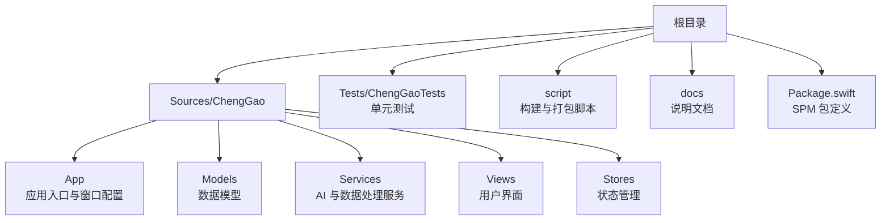
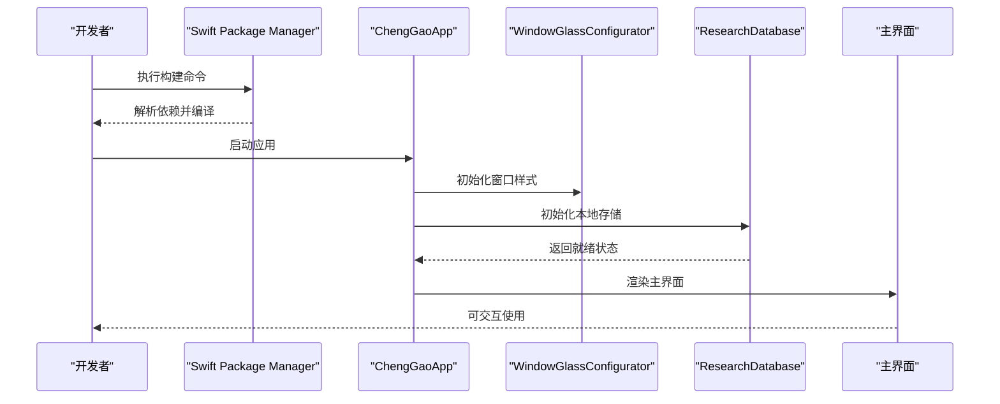
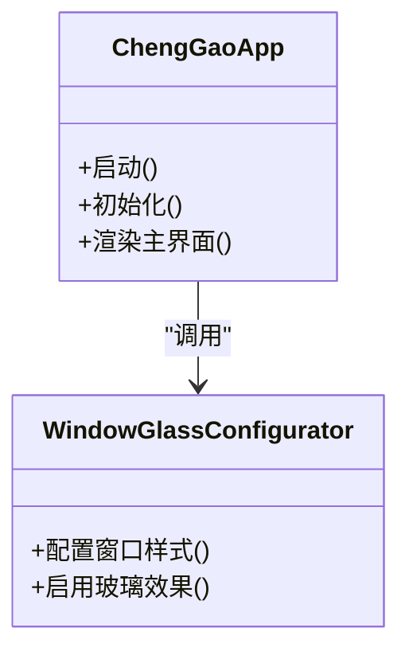
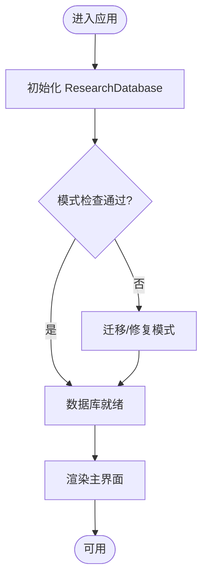
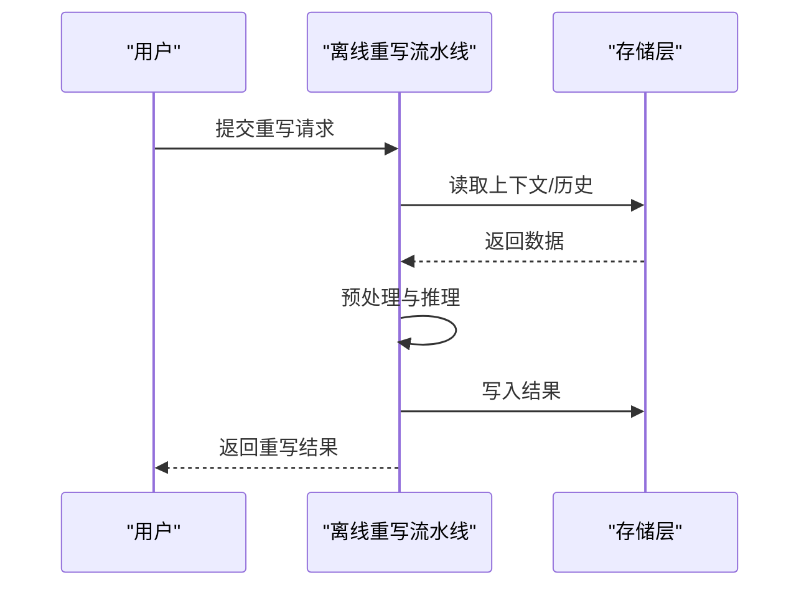
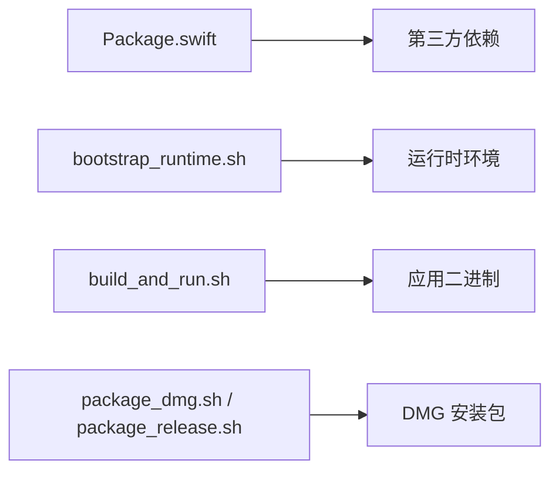

# 快速开始

<cite>
**本文引用的文件**   
- [README.md](file://README.md)
- [Package.swift](file://Package.swift)
- [bootstrap_runtime.sh](file://script/bootstrap_runtime.sh)
- [build_and_run.sh](file://script/build_and_run.sh)
- [install_local.sh](file://script/install_local.sh)
- [package_dmg.sh](file://script/package_dmg.sh)
- [package_release.sh](file://script/package_release.sh)
- [release_local.sh](file://script/release_local.sh)
- [请先阅读-安装与使用说明.txt](file://docs/请先阅读-安装与使用说明.txt)
- [ChengGaoApp.swift](file://Sources/ChengGao/App/ChengGaoApp.swift)
- [WindowGlassConfigurator.swift](file://Sources/ChengGao/App/WindowGlassConfigurator.swift)
- [ResearchDatabase.swift](file://Sources/ChengGao/Services/ResearchDatabase.swift)
- [OfflineRewritePipelineTests.swift](file://Tests/ChengGaoTests/OfflineRewritePipelineTests.swift)
</cite>

## 目录
1. [简介](#简介)
2. [项目结构](#项目结构)
3. [核心组件](#核心组件)
4. [架构总览](#架构总览)
5. [详细组件分析](#详细组件分析)
6. [依赖分析](#依赖分析)
7. [性能考虑](#性能考虑)
8. [故障排除指南](#故障排除指南)
9. [结论](#结论)
10. [附录](#附录)

## 简介
本快速开始指南面向首次接触 ChengGao 的开发者，目标是帮助你在最短时间内完成环境准备、克隆与构建、首次运行配置，并顺利体验核心功能。文档同时提供常见安装问题的排查建议与开发环境最佳实践，确保你能够高效上手。

## 项目结构
ChengGao 采用 Swift Package Manager（SPM）组织代码，入口应用位于 Sources/ChengGao/App，业务服务集中在 Services，数据模型在 Models，界面视图在 Views，测试用例在 Tests。脚本目录 script 包含运行时初始化、构建与打包等自动化流程。

**图示来源**
- [Package.swift](file://Package.swift)
- [ChengGaoApp.swift](file://Sources/ChengGao/App/ChengGaoApp.swift)
- [WindowGlassConfigurator.swift](file://Sources/ChengGao/App/WindowGlassConfigurator.swift)
- [ResearchDatabase.swift](file://Sources/ChengGao/Services/ResearchDatabase.swift)
- [OfflineRewritePipelineTests.swift](file://Tests/ChengGaoTests/OfflineRewritePipelineTests.swift)

**章节来源**
- [Package.swift](file://Package.swift)
- [ChengGaoApp.swift](file://Sources/ChengGao/App/ChengGaoApp.swift)
- [WindowGlassConfigurator.swift](file://Sources/ChengGao/App/WindowGlassConfigurator.swift)
- [ResearchDatabase.swift](file://Sources/ChengGao/Services/ResearchDatabase.swift)
- [OfflineRewritePipelineTests.swift](file://Tests/ChengGaoTests/OfflineRewritePipelineTests.swift)

## 核心组件
- 应用入口与窗口配置：负责应用生命周期与窗口样式初始化。
- 研究数据库：本地数据存储与访问封装。
- 离线重写流水线：本地 AI 处理管线（有对应单测）。
- 构建与打包脚本：一键初始化运行时、构建、运行与打包 DMG。

**章节来源**
- [ChengGaoApp.swift](file://Sources/ChengGao/App/ChengGaoApp.swift)
- [WindowGlassConfigurator.swift](file://Sources/ChengGao/App/WindowGlassConfigurator.swift)
- [ResearchDatabase.swift](file://Sources/ChengGao/Services/ResearchDatabase.swift)
- [OfflineRewritePipelineTests.swift](file://Tests/ChengGaoTests/OfflineRewritePipelineTests.swift)

## 架构总览
下图展示了从启动到首次运行的关键路径：SPM 解析依赖 -> 应用入口初始化 -> 窗口样式配置 -> 本地数据库就绪 -> 主界面渲染。

**图示来源**
- [Package.swift](file://Package.swift)
- [ChengGaoApp.swift](file://Sources/ChengGao/App/ChengGaoApp.swift)
- [WindowGlassConfigurator.swift](file://Sources/ChengGao/App/WindowGlassConfigurator.swift)
- [ResearchDatabase.swift](file://Sources/ChengGao/Services/ResearchDatabase.swift)

## 详细组件分析

### 应用入口与窗口配置
- 职责：应用启动、窗口外观与玻璃效果配置、全局设置注入。
- 关键点：窗口样式应在应用早期初始化，避免后续重绘；数据库连接需在界面渲染前就绪。

**图示来源**
- [ChengGaoApp.swift](file://Sources/ChengGao/App/ChengGaoApp.swift)
- [WindowGlassConfigurator.swift](file://Sources/ChengGao/App/WindowGlassConfigurator.swift)

**章节来源**
- [ChengGaoApp.swift](file://Sources/ChengGao/App/ChengGaoApp.swift)
- [WindowGlassConfigurator.swift](file://Sources/ChengGao/App/WindowGlassConfigurator.swift)

### 本地研究与数据存储
- 职责：本地数据库初始化、读写操作封装、缓存策略。
- 关键点：确保首次运行创建必要表结构与索引；异常时回滚或降级。

**图示来源**
- [ResearchDatabase.swift](file://Sources/ChengGao/Services/ResearchDatabase.swift)

**章节来源**
- [ResearchDatabase.swift](file://Sources/ChengGao/Services/ResearchDatabase.swift)

### 离线重写流水线（含测试）
- 职责：本地 AI 重写任务编排、输入预处理、输出后处理。
- 关键点：单测覆盖核心路径，便于回归验证。

**图示来源**
- [OfflineRewritePipelineTests.swift](file://Tests/ChengGaoTests/OfflineRewritePipelineTests.swift)

**章节来源**
- [OfflineRewritePipelineTests.swift](file://Tests/ChengGaoTests/OfflineRewritePipelineTests.swift)

## 依赖分析
- 包管理：使用 Swift Package Manager，依赖声明位于 Package.swift。
- 运行时依赖：通过脚本 bootstrap_runtime.sh 进行运行时环境初始化。
- 构建与运行：使用 build_and_run.sh 一键构建并运行。
- 打包发布：package_dmg.sh、package_release.sh、release_local.sh 支持生成 DMG 与发布产物。

**图示来源**
- [Package.swift](file://Package.swift)
- [bootstrap_runtime.sh](file://script/bootstrap_runtime.sh)
- [build_and_run.sh](file://script/build_and_run.sh)
- [package_dmg.sh](file://script/package_dmg.sh)
- [package_release.sh](file://script/package_release.sh)

**章节来源**
- [Package.swift](file://Package.swift)
- [bootstrap_runtime.sh](file://script/bootstrap_runtime.sh)
- [build_and_run.sh](file://script/build_and_run.sh)
- [package_dmg.sh](file://script/package_dmg.sh)
- [package_release.sh](file://script/package_release.sh)

## 性能考虑
- 首次启动优化：延迟加载非关键资源，优先保证数据库与窗口样式初始化。
- I/O 优化：批量写入与事务提交，减少磁盘抖动。
- 内存管理：避免大对象常驻内存，及时释放临时数据。
- 并发控制：合理限制并行度，防止 CPU/GPU 过载。

[本节为通用指导，不直接分析具体文件]

## 故障排除指南
- 无法找到 Xcode 或命令行工具：
  - 确认已安装 Xcode 并接受许可协议；安装 Command Line Tools。
  - 若仍失败，尝试重置 xcode-select 指向。
- 依赖下载失败或网络超时：
  - 检查代理与镜像源配置；必要时切换网络环境重试。
- 运行时初始化失败：
  - 重新执行 bootstrap_runtime.sh；查看日志定位缺失组件。
- 构建失败或符号未解析：
  - 清理构建缓存后重试；核对 Package.swift 版本约束。
- 首次运行崩溃或界面空白：
  - 检查数据库初始化是否成功；删除损坏的本地数据目录后重试。
- 打包 DMG 失败：
  - 确认签名与证书有效；检查输出目录权限。

**章节来源**
- [bootstrap_runtime.sh](file://script/bootstrap_runtime.sh)
- [build_and_run.sh](file://script/build_and_run.sh)
- [package_dmg.sh](file://script/package_dmg.sh)
- [package_release.sh](file://script/package_release.sh)
- [请先阅读-安装与使用说明.txt](file://docs/请先阅读-安装与使用说明.txt)

## 结论
按照本指南完成环境准备、克隆与构建、首次运行配置后，你将能够快速体验 ChengGao 的核心功能。建议在开发过程中遵循最佳实践：保持依赖版本稳定、善用脚本自动化、完善本地数据备份与错误日志，以提升开发与交付效率。

## 附录

### 环境准备清单
- 操作系统：macOS（建议使用最新稳定版）
- 开发工具：Xcode（含 Command Line Tools）
- 包管理器：Swift Package Manager（随 Xcode 提供）
- 可选：Git 客户端用于克隆仓库

### 克隆与构建步骤
- 克隆仓库至本地目录
- 进入项目根目录
- 执行运行时初始化脚本
- 执行构建与运行脚本
- 如需要，执行安装或打包脚本

**章节来源**
- [bootstrap_runtime.sh](file://script/bootstrap_runtime.sh)
- [build_and_run.sh](file://script/build_and_run.sh)
- [install_local.sh](file://script/install_local.sh)
- [package_dmg.sh](file://script/package_dmg.sh)
- [package_release.sh](file://script/package_release.sh)
- [release_local.sh](file://script/release_local.sh)

### 首次运行配置说明
- 启动应用后，等待窗口样式与数据库初始化完成
- 如需联网功能，按提示配置相关凭据与服务端地址
- 首次使用建议先运行一次基础功能以验证环境正确性

**章节来源**
- [ChengGaoApp.swift](file://Sources/ChengGao/App/ChengGaoApp.swift)
- [WindowGlassConfigurator.swift](file://Sources/ChengGao/App/WindowGlassConfigurator.swift)
- [ResearchDatabase.swift](file://Sources/ChengGao/Services/ResearchDatabase.swift)
- [请先阅读-安装与使用说明.txt](file://docs/请先阅读-安装与使用说明.txt)

### 开发环境最佳实践
- 使用脚本统一构建与打包流程，避免手工差异
- 保持依赖版本锁定，定期更新并验证兼容性
- 编写并维护关键路径的单测，保障回归质量
- 对本地数据进行备份与版本化，降低误删风险
- 开启详细日志，便于问题定位与性能分析

**章节来源**
- [OfflineRewritePipelineTests.swift](file://Tests/ChengGaoTests/OfflineRewritePipelineTests.swift)
- [请先阅读-安装与使用说明.txt](file://docs/请先阅读-安装与使用说明.txt)