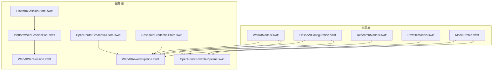
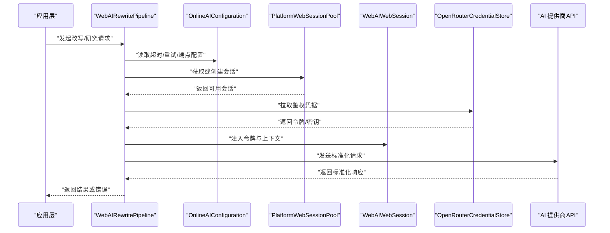
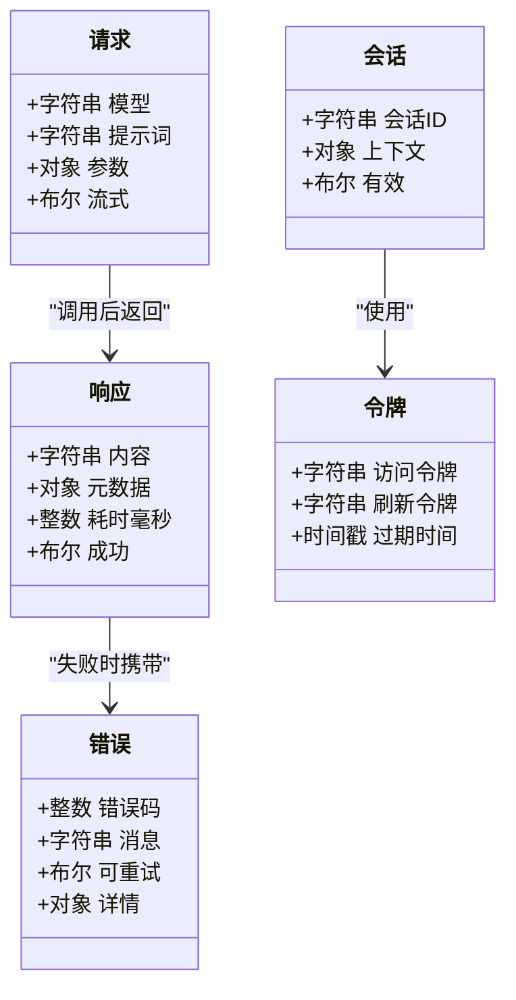
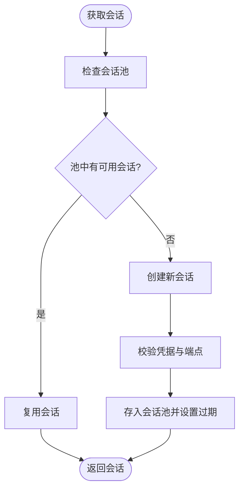
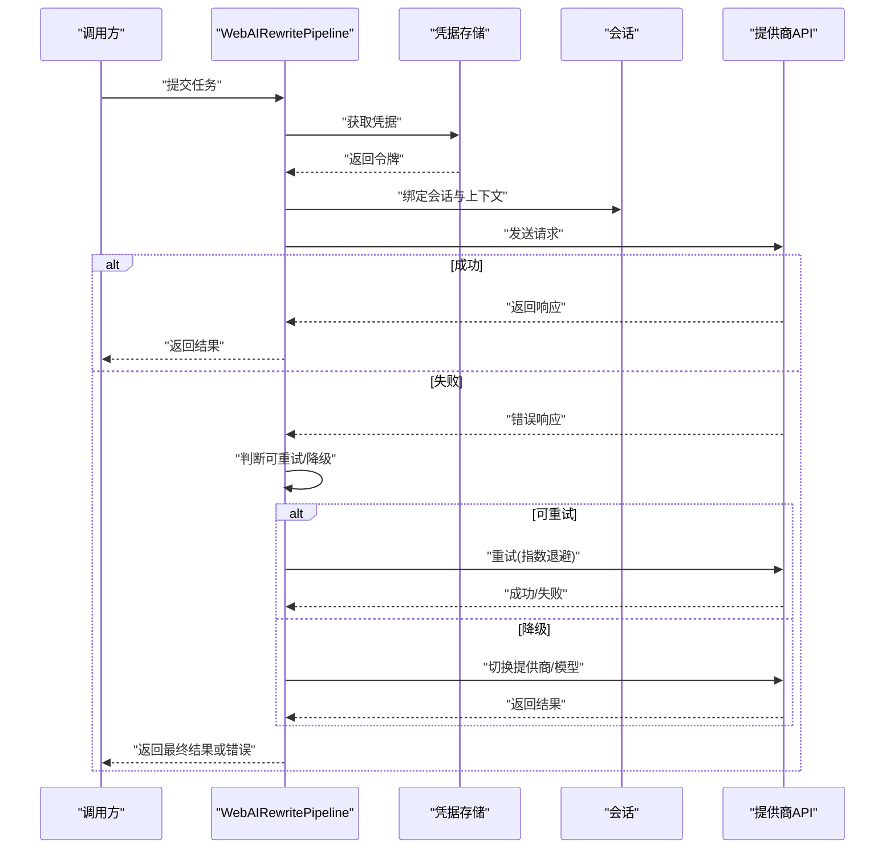
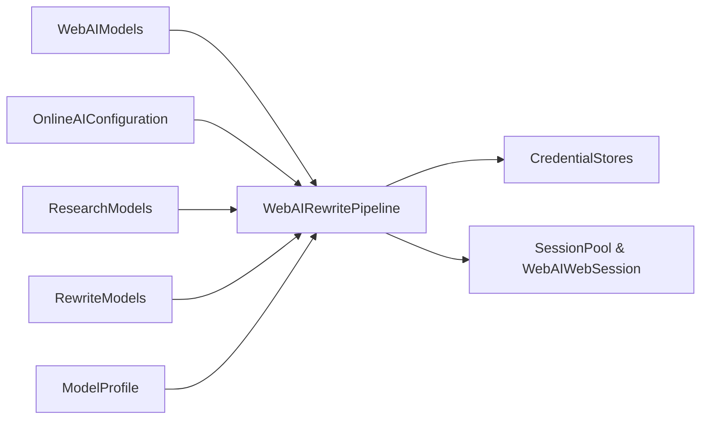
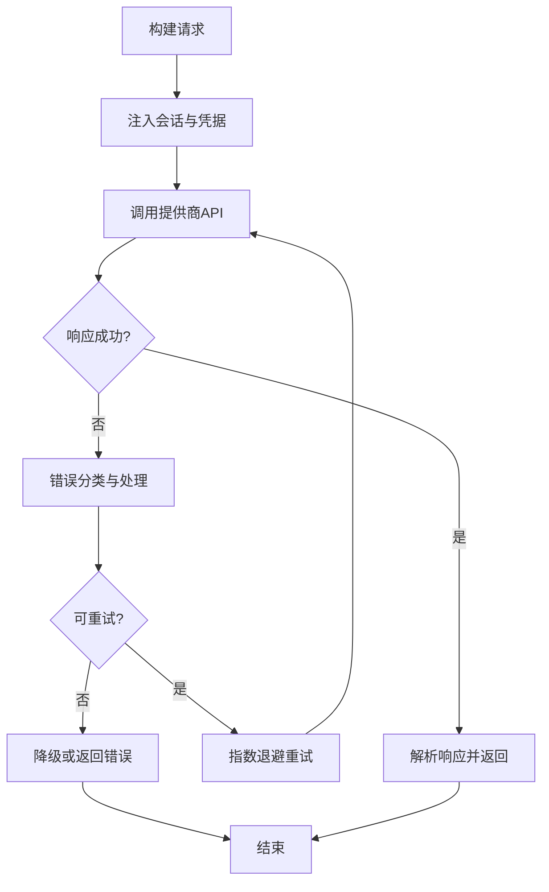

# Web AI 数据模型

<cite>
**本文引用的文件**   
- [WebAIModels.swift](file://Sources/ChengGao/Models/WebAIModels.swift)
- [OnlineAIConfiguration.swift](file://Sources/ChengGao/Models/OnlineAIConfiguration.swift)
- [ResearchModels.swift](file://Sources/ChengGao/Models/ResearchModels.swift)
- [RewriteModels.swift](file://Sources/ChengGao/Models/RewriteModels.swift)
- [ModelProfile.swift](file://Sources/ChengGao/Models/ModelProfile.swift)
- [PlatformSessionStore.swift](file://Sources/ChengGao/Services/PlatformSessionStore.swift)
- [PlatformWebSessionPool.swift](file://Sources/ChengGao/Services/PlatformWebSessionPool.swift)
- [WebAIWebSession.swift](file://Sources/ChengGao/Services/WebAIWebSession.swift)
- [OpenRouterCredentialStore.swift](file://Sources/ChengGao/Services/OpenRouterCredentialStore.swift)
- [ResearchCredentialStore.swift](file://Sources/ChengGao/Services/ResearchCredentialStore.swift)
- [WebAIRewritePipeline.swift](file://Sources/ChengGao/Services/WebAIRewritePipeline.swift)
- [OpenRouterRewritePipeline.swift](file://Sources/ChengGao/Services/OpenRouterRewritePipeline.swift)
</cite>

## 目录
1. [简介](#简介)
2. [项目结构](#项目结构)
3. [核心组件](#核心组件)
4. [架构总览](#架构总览)
5. [详细组件分析](#详细组件分析)
6. [依赖关系分析](#依赖关系分析)
7. [性能考量](#性能考量)
8. [故障排查指南](#故障排查指南)
9. [结论](#结论)
10. [附录](#附录)

## 简介
本文件面向集成与二次开发者，系统化梳理 Web AI 数据模型与相关服务。重点覆盖：
- Web API 请求/响应结构、认证令牌与会话管理
- 不同 AI 服务提供商的数据格式规范、参数映射与响应解析
- 会话状态持久化、超时处理与自动重试机制
- API 调用数据流图、错误码定义与降级策略
- 集成示例（请求构建、响应处理、异常捕获）
- 数据安全考虑、敏感信息加密与访问控制

## 项目结构
本项目采用按功能域组织代码的方式，核心数据模型集中在 Models 目录，服务层在 Services 目录中实现网络、会话、凭据与流水线编排。关键文件职责如下：
- WebAIModels.swift：定义通用 Web AI 请求/响应、错误与令牌等基础数据结构
- OnlineAIConfiguration.swift：在线 AI 配置项（端点、鉴权、超时、重试等）
- ResearchModels.swift / RewriteModels.swift：研究/重写任务相关的输入输出模型
- ModelProfile.swift：模型能力与元数据描述
- PlatformSessionStore.swift：平台级会话存储抽象
- PlatformWebSessionPool.swift：Web 会话池管理与复用
- WebAIWebSession.swift：具体 Web 会话封装（Cookie/Token/上下文）
- OpenRouterCredentialStore.swift / ResearchCredentialStore.swift：凭据安全存储
- WebAIRewritePipeline.swift / OpenRouterRewritePipeline.swift：AI 调用流水线编排

图表来源
- [WebAIModels.swift](file://Sources/ChengGao/Models/WebAIModels.swift)
- [OnlineAIConfiguration.swift](file://Sources/ChengGao/Models/OnlineAIConfiguration.swift)
- [ResearchModels.swift](file://Sources/ChengGao/Models/ResearchModels.swift)
- [RewriteModels.swift](file://Sources/ChengGao/Models/RewriteModels.swift)
- [ModelProfile.swift](file://Sources/ChengGao/Models/ModelProfile.swift)
- [PlatformSessionStore.swift](file://Sources/ChengGao/Services/PlatformSessionStore.swift)
- [PlatformWebSessionPool.swift](file://Sources/ChengGao/Services/PlatformWebSessionPool.swift)
- [WebAIWebSession.swift](file://Sources/ChengGao/Services/WebAIWebSession.swift)
- [OpenRouterCredentialStore.swift](file://Sources/ChengGao/Services/OpenRouterCredentialStore.swift)
- [ResearchCredentialStore.swift](file://Sources/ChengGao/Services/ResearchCredentialStore.swift)
- [WebAIRewritePipeline.swift](file://Sources/ChengGao/Services/WebAIRewritePipeline.swift)
- [OpenRouterRewritePipeline.swift](file://Sources/ChengGao/Services/OpenRouterRewritePipeline.swift)

章节来源
- [WebAIModels.swift](file://Sources/ChengGao/Models/WebAIModels.swift)
- [OnlineAIConfiguration.swift](file://Sources/ChengGao/Models/OnlineAIConfiguration.swift)
- [ResearchModels.swift](file://Sources/ChengGao/Models/ResearchModels.swift)
- [RewriteModels.swift](file://Sources/ChengGao/Models/RewriteModels.swift)
- [ModelProfile.swift](file://Sources/ChengGao/Models/ModelProfile.swift)
- [PlatformSessionStore.swift](file://Sources/ChengGao/Services/PlatformSessionStore.swift)
- [PlatformWebSessionPool.swift](file://Sources/ChengGao/Services/PlatformWebSessionPool.swift)
- [WebAIWebSession.swift](file://Sources/ChengGao/Services/WebAIWebSession.swift)
- [OpenRouterCredentialStore.swift](file://Sources/ChengGao/Services/OpenRouterCredentialStore.swift)
- [ResearchCredentialStore.swift](file://Sources/ChengGao/Services/ResearchCredentialStore.swift)
- [WebAIRewritePipeline.swift](file://Sources/ChengGao/Services/WebAIRewritePipeline.swift)
- [OpenRouterRewritePipeline.swift](file://Sources/ChengGao/Services/OpenRouterRewritePipeline.swift)

## 核心组件
本节聚焦 Web AI 数据模型与服务协作的关键点：
- 统一请求/响应结构：用于跨提供商的标准化入参与出参
- 认证令牌与会话：支持 Token/Cookie/会话上下文，提供持久化与复用
- 错误模型：统一的错误码、消息与可恢复性标记
- 配置与流水线：在线配置驱动行为（超时、重试、并发、降级）

章节来源
- [WebAIModels.swift](file://Sources/ChengGao/Models/WebAIModels.swift)
- [OnlineAIConfiguration.swift](file://Sources/ChengGao/Models/OnlineAIConfiguration.swift)
- [WebAIRewritePipeline.swift](file://Sources/ChengGao/Services/WebAIRewritePipeline.swift)
- [OpenRouterRewritePipeline.swift](file://Sources/ChengGao/Services/OpenRouterRewritePipeline.swift)

## 架构总览
下图展示从上层业务到网络调用的数据流与组件交互，涵盖会话、凭据、流水线与提供商适配。

图表来源
- [WebAIRewritePipeline.swift](file://Sources/ChengGao/Services/WebAIRewritePipeline.swift)
- [OnlineAIConfiguration.swift](file://Sources/ChengGao/Models/OnlineAIConfiguration.swift)
- [PlatformWebSessionPool.swift](file://Sources/ChengGao/Services/PlatformWebSessionPool.swift)
- [WebAIWebSession.swift](file://Sources/ChengGao/Services/WebAIWebSession.swift)
- [OpenRouterCredentialStore.swift](file://Sources/ChengGao/Services/OpenRouterCredentialStore.swift)

## 详细组件分析

### WebAIModels：统一数据模型
- 请求/响应结构：定义通用的输入字段（如模型名、提示词、参数）、输出字段（内容、元数据、统计信息）
- 错误模型：包含错误码、错误消息、是否可重试、附加信息
- 令牌与会话：封装访问令牌、刷新令牌、会话标识、过期时间
- 提供商差异：通过扩展字段或适配器层兼容不同厂商的字段命名与语义

图表来源
- [WebAIModels.swift](file://Sources/ChengGao/Models/WebAIModels.swift)

章节来源
- [WebAIModels.swift](file://Sources/ChengGao/Models/WebAIModels.swift)

### OnlineAIConfiguration：在线配置
- 端点与鉴权：目标 URL、Header 模板、鉴权方式（Bearer/Key）
- 超时与重试：连接/读写超时、最大重试次数、退避策略
- 并发与限流：并发上限、速率限制、队列策略
- 特性开关：流式输出、缓存、调试日志

章节来源
- [OnlineAIConfiguration.swift](file://Sources/ChengGao/Models/OnlineAIConfiguration.swift)

### ResearchModels 与 RewriteModels：领域模型
- ResearchModels：研究任务的输入（主题、范围、关键词）、输出（摘要、引用、结构化结果）
- RewriteModels：改写任务的输入（原文、风格、长度约束）、输出（改写文本、质量指标）
- 与 WebAIModels 的关系：将领域模型映射为统一请求/响应结构

章节来源
- [ResearchModels.swift](file://Sources/ChengGao/Models/ResearchModels.swift)
- [RewriteModels.swift](file://Sources/ChengGao/Models/RewriteModels.swift)

### ModelProfile：模型能力描述
- 字段：模型 ID、名称、能力标签（文本/图像/多模态）、上下文窗口、价格/配额
- 用途：选择合适模型、动态路由、计费与配额管理

章节来源
- [ModelProfile.swift](file://Sources/ChengGao/Models/ModelProfile.swift)

### 会话管理：PlatformSessionStore、PlatformWebSessionPool、WebAIWebSession
- PlatformSessionStore：抽象会话存储接口（内存/持久化）
- PlatformWebSessionPool：会话池化管理（创建、回收、健康检查、负载均衡）
- WebAIWebSession：具体会话封装（Cookie/Token/上下文、有效期、刷新逻辑）

图表来源
- [PlatformSessionStore.swift](file://Sources/ChengGao/Services/PlatformSessionStore.swift)
- [PlatformWebSessionPool.swift](file://Sources/ChengGao/Services/PlatformWebSessionPool.swift)
- [WebAIWebSession.swift](file://Sources/ChengGao/Services/WebAIWebSession.swift)

章节来源
- [PlatformSessionStore.swift](file://Sources/ChengGao/Services/PlatformSessionStore.swift)
- [PlatformWebSessionPool.swift](file://Sources/ChengGao/Services/PlatformWebSessionPool.swift)
- [WebAIWebSession.swift](file://Sources/ChengGao/Services/WebAIWebSession.swift)

### 凭据存储：OpenRouterCredentialStore、ResearchCredentialStore
- 安全存储：本地加密存储、访问权限控制、最小权限原则
- 生命周期：创建、更新、轮换、失效清理
- 使用场景：为不同提供商注入对应鉴权信息

章节来源
- [OpenRouterCredentialStore.swift](file://Sources/ChengGao/Services/OpenRouterCredentialStore.swift)
- [ResearchCredentialStore.swift](file://Sources/ChengGao/Services/ResearchCredentialStore.swift)

### 流水线编排：WebAIRewritePipeline、OpenRouterRewritePipeline
- 职责：组装请求、注入会话与凭据、调用提供商、解析响应、错误处理与重试
- 降级策略：切换提供商、回退到默认模型、启用缓存或离线模式
- 监控与日志：关键指标采集、错误分类、审计追踪

图表来源
- [WebAIRewritePipeline.swift](file://Sources/ChengGao/Services/WebAIRewritePipeline.swift)
- [OpenRouterRewritePipeline.swift](file://Sources/ChengGao/Services/OpenRouterRewritePipeline.swift)

章节来源
- [WebAIRewritePipeline.swift](file://Sources/ChengGao/Services/WebAIRewritePipeline.swift)
- [OpenRouterRewritePipeline.swift](file://Sources/ChengGao/Services/OpenRouterRewritePipeline.swift)

## 依赖关系分析
- 模型层对服务层无直接依赖，但通过统一结构被服务层消费
- 服务层依赖配置与凭据存储以完成鉴权与行为控制
- 会话池与具体会话实现解耦，便于替换与扩展
- 流水线编排聚合上述组件，形成端到端调用链

图表来源
- [WebAIModels.swift](file://Sources/ChengGao/Models/WebAIModels.swift)
- [OnlineAIConfiguration.swift](file://Sources/ChengGao/Models/OnlineAIConfiguration.swift)
- [ResearchModels.swift](file://Sources/ChengGao/Models/ResearchModels.swift)
- [RewriteModels.swift](file://Sources/ChengGao/Models/RewriteModels.swift)
- [ModelProfile.swift](file://Sources/ChengGao/Models/ModelProfile.swift)
- [WebAIRewritePipeline.swift](file://Sources/ChengGao/Services/WebAIRewritePipeline.swift)
- [OpenRouterCredentialStore.swift](file://Sources/ChengGao/Services/OpenRouterCredentialStore.swift)
- [ResearchCredentialStore.swift](file://Sources/ChengGao/Services/ResearchCredentialStore.swift)
- [PlatformWebSessionPool.swift](file://Sources/ChengGao/Services/PlatformWebSessionPool.swift)
- [WebAIWebSession.swift](file://Sources/ChengGao/Services/WebAIWebSession.swift)

章节来源
- [WebAIModels.swift](file://Sources/ChengGao/Models/WebAIModels.swift)
- [OnlineAIConfiguration.swift](file://Sources/ChengGao/Models/OnlineAIConfiguration.swift)
- [ResearchModels.swift](file://Sources/ChengGao/Models/ResearchModels.swift)
- [RewriteModels.swift](file://Sources/ChengGao/Models/RewriteModels.swift)
- [ModelProfile.swift](file://Sources/ChengGao/Models/ModelProfile.swift)
- [WebAIRewritePipeline.swift](file://Sources/ChengGao/Services/WebAIRewritePipeline.swift)
- [OpenRouterCredentialStore.swift](file://Sources/ChengGao/Services/OpenRouterCredentialStore.swift)
- [ResearchCredentialStore.swift](file://Sources/ChengGao/Services/ResearchCredentialStore.swift)
- [PlatformWebSessionPool.swift](file://Sources/ChengGao/Services/PlatformWebSessionPool.swift)
- [WebAIWebSession.swift](file://Sources/ChengGao/Services/WebAIWebSession.swift)

## 性能考量
- 会话复用：减少握手与鉴权开销，提升吞吐
- 超时与重试：合理设置超时与退避策略，避免雪崩
- 并发控制：限制并发数，防止资源耗尽
- 缓存策略：对热点请求进行短期缓存，降低重复调用
- 流式响应：大文本/长文档场景优先流式传输，降低内存峰值

[本节为通用指导，不直接分析具体文件]

## 故障排查指南
- 常见错误码：鉴权失败、网络超时、限流、服务端错误、参数非法
- 定位步骤：
  - 检查凭据是否有效且未过期
  - 确认会话是否健康（Cookie/Token 是否刷新）
  - 查看超时与重试配置是否合理
  - 核对请求字段是否符合提供商规范
- 恢复策略：
  - 自动重试（指数退避）
  - 降级到备用提供商或模型
  - 启用缓存或离线模式
  - 记录详细日志与指标以便复盘

章节来源
- [WebAIModels.swift](file://Sources/ChengGao/Models/WebAIModels.swift)
- [OnlineAIConfiguration.swift](file://Sources/ChengGao/Models/OnlineAIConfiguration.swift)
- [WebAIRewritePipeline.swift](file://Sources/ChengGao/Services/WebAIRewritePipeline.swift)
- [OpenRouterRewritePipeline.swift](file://Sources/ChengGao/Services/OpenRouterRewritePipeline.swift)

## 结论
通过统一的数据模型、健壮的会话与凭据管理、以及灵活的流水线编排，系统能够稳定对接多家 AI 提供商，并提供高可用、可扩展的集成能力。建议在生产环境完善监控告警、灰度发布与回滚策略，持续优化性能与可靠性。

[本节为总结，不直接分析具体文件]

## 附录

### 集成示例（概念性流程）
- 请求构建：根据领域模型生成统一请求，注入模型与参数
- 响应处理：解析统一响应，提取内容与元数据，转换为领域输出
- 异常捕获：捕获网络与业务错误，分类并触发重试/降级

[该图为概念性流程图，不直接映射具体源码文件]

### 数据安全与访问控制
- 敏感信息加密：凭据与令牌本地加密存储，最小权限访问
- 传输安全：强制 HTTPS，证书校验
- 访问控制：基于角色的访问控制（RBAC），操作审计
- 数据脱敏：日志与监控中去除敏感字段
- 合规要求：遵循隐私保护与数据留存策略

[本节为通用指导，不直接分析具体文件]