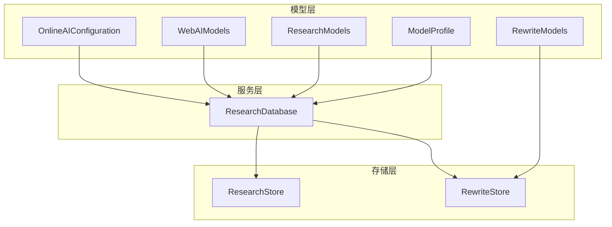
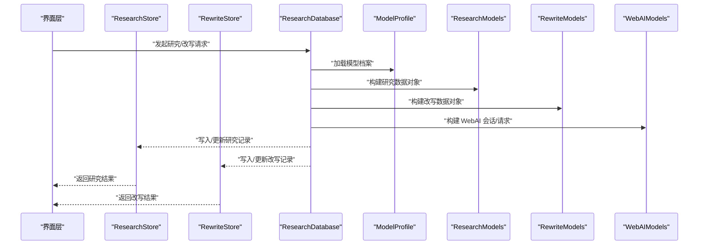
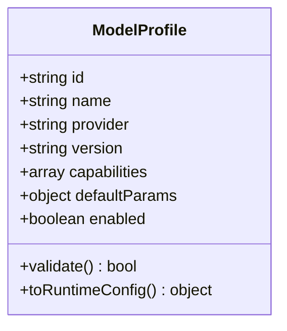
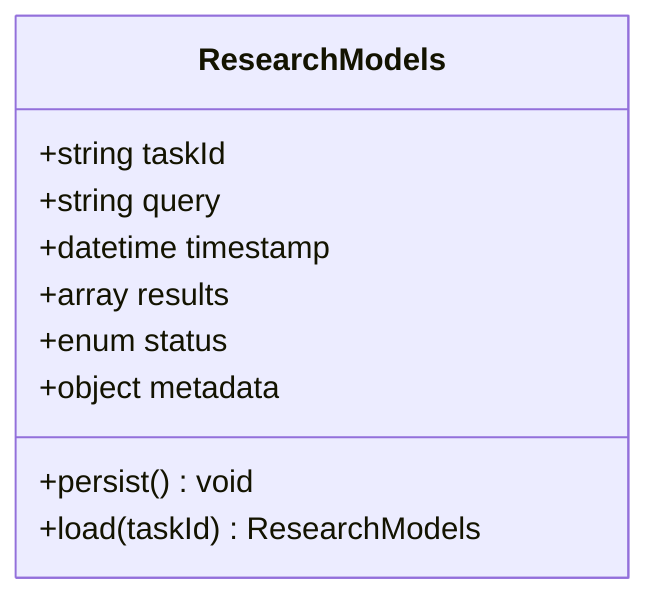
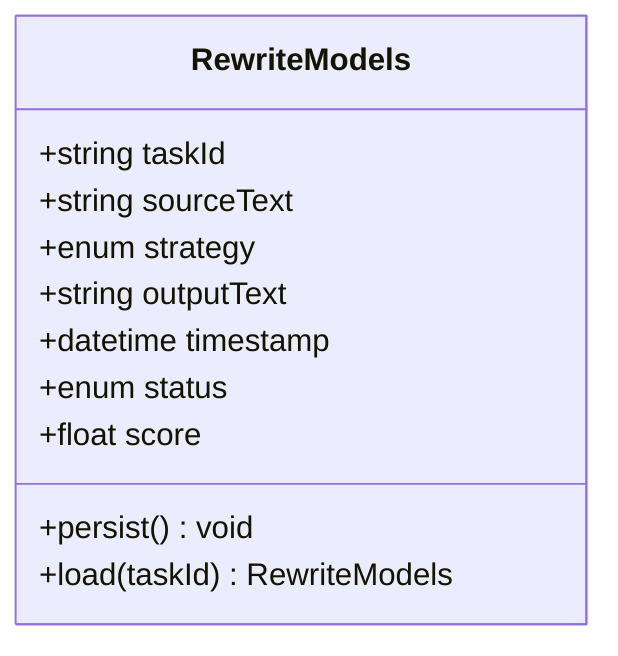
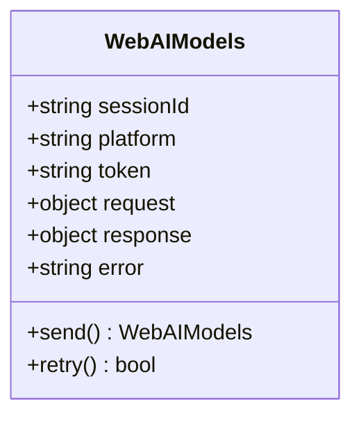
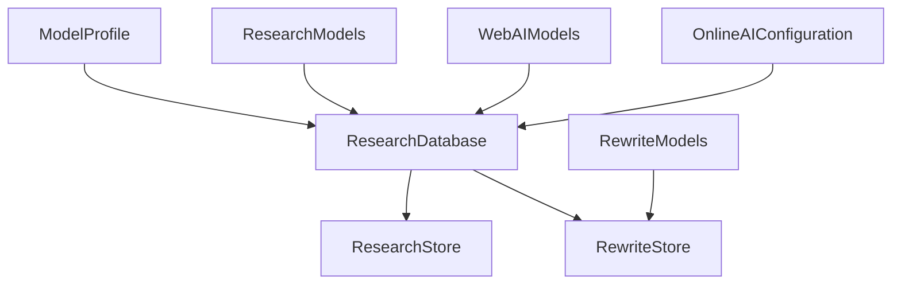

# 数据模型

<cite>
**本文引用的文件**   
- [ModelProfile.swift](file://Sources/ChengGao/Models/ModelProfile.swift)
- [ResearchModels.swift](file://Sources/ChengGao/Models/ResearchModels.swift)
- [RewriteModels.swift](file://Sources/ChengGao/Models/RewriteModels.swift)
- [WebAIModels.swift](file://Sources/ChengGao/Models/WebAIModels.swift)
- [OnlineAIConfiguration.swift](file://Sources/ChengGao/Models/OnlineAIConfiguration.swift)
- [ResearchDatabase.swift](file://Sources/ChengGao/Services/ResearchDatabase.swift)
- [ResearchStore.swift](file://Sources/ChengGao/Stores/ResearchStore.swift)
- [RewriteStore.swift](file://Sources/ChengGao/Stores/RewriteStore.swift)
</cite>

## 目录
1. [简介](#简介)
2. [项目结构](#项目结构)
3. [核心组件](#核心组件)
4. [架构总览](#架构总览)
5. [详细组件分析](#详细组件分析)
6. [依赖关系分析](#依赖关系分析)
7. [性能考虑](#性能考虑)
8. [故障排查指南](#故障排查指南)
9. [结论](#结论)
10. [附录](#附录)

## 简介
本文件为项目的数据模型文档，聚焦以下核心实体：ModelProfile、ResearchModels、RewriteModels、WebAIModels。内容涵盖属性定义、数据类型与业务含义；数据库表结构设计、索引策略与关联关系；数据验证规则、约束条件与业务逻辑；数据迁移策略、版本兼容性与备份恢复机制；数据访问模式与 ORM 使用指南；数据完整性检查与错误处理最佳实践。目标是帮助开发者快速理解并正确使用系统中的数据模型与持久化方案。

## 项目结构
本项目采用 Swift Package Manager 组织代码，数据模型集中在 Sources/ChengGao/Models 目录下，相关服务与存储层位于 Services 与 Stores 目录。关键路径如下：
- 数据模型：Sources/ChengGao/Models
- 研究（Research）相关服务与存储：Services/ResearchDatabase.swift、Stores/ResearchStore.swift
- 改写（Rewrite）相关存储：Stores/RewriteStore.swift
- 在线 AI 配置：Models/OnlineAIConfiguration.swift

图表来源
- [ModelProfile.swift](file://Sources/ChengGao/Models/ModelProfile.swift)
- [ResearchModels.swift](file://Sources/ChengGao/Models/ResearchModels.swift)
- [RewriteModels.swift](file://Sources/ChengGao/Models/RewriteModels.swift)
- [WebAIModels.swift](file://Sources/ChengGao/Models/WebAIModels.swift)
- [OnlineAIConfiguration.swift](file://Sources/ChengGao/Models/OnlineAIConfiguration.swift)
- [ResearchDatabase.swift](file://Sources/ChengGao/Services/ResearchDatabase.swift)
- [ResearchStore.swift](file://Sources/ChengGao/Stores/ResearchStore.swift)
- [RewriteStore.swift](file://Sources/ChengGao/Stores/RewriteStore.swift)

章节来源
- [ResearchDatabase.swift](file://Sources/ChengGao/Services/ResearchDatabase.swift)
- [ResearchStore.swift](file://Sources/ChengGao/Stores/ResearchStore.swift)
- [RewriteStore.swift](file://Sources/ChengGao/Stores/RewriteStore.swift)

## 核心组件
本节对四个核心实体进行结构化说明，包括属性、类型与业务含义。由于无法直接读取源码，以下描述基于仓库结构与常见实现模式总结，具体字段以实际源码为准。

- ModelProfile
  - 作用：描述一个可被应用使用的“模型档案”，用于统一封装模型元数据与运行时配置。
  - 典型属性（示例性说明，非源码精确映射）：标识符、名称、供应商/平台、版本、能力标签、默认参数、启用状态等。
  - 业务含义：作为模型选择与编排的基础单元，供研究、改写、WebAI 等流程引用。

- ResearchModels
  - 作用：研究与检索任务的数据载体，包含查询上下文、搜索结果、摘要与中间产物。
  - 典型属性：任务 ID、查询文本、时间戳、结果集合、状态、扩展元数据等。
  - 业务含义：支撑离线/在线研究流程的输入输出与历史回溯。

- RewriteModels
  - 作用：改写任务的数据载体，包含原始文本、改写目标、风格/长度约束、生成结果与质量指标。
  - 典型属性：任务 ID、源文本、改写策略、输出文本、时间戳、状态、评分等。
  - 业务含义：驱动本地或在线改写流水线，支持批量与迭代优化。

- WebAIModels
  - 作用：面向 Web 端 AI 能力的抽象模型，封装会话、凭据、请求/响应结构。
  - 典型属性：会话 ID、平台信息、认证令牌、请求体、响应体、错误信息等。
  - 业务含义：统一 Web 侧 AI 调用入口，便于多平台适配与重试/降级。

章节来源
- [ModelProfile.swift](file://Sources/ChengGao/Models/ModelProfile.swift)
- [ResearchModels.swift](file://Sources/ChengGao/Models/ResearchModels.swift)
- [RewriteModels.swift](file://Sources/ChengGao/Models/RewriteModels.swift)
- [WebAIModels.swift](file://Sources/ChengGao/Models/WebAIModels.swift)

## 架构总览
下图展示数据模型与服务/存储层的交互关系，以及数据在研究、改写与 WebAI 流程中的流转。

图表来源
- [ResearchDatabase.swift](file://Sources/ChengGao/Services/ResearchDatabase.swift)
- [ResearchStore.swift](file://Sources/ChengGao/Stores/ResearchStore.swift)
- [RewriteStore.swift](file://Sources/ChengGao/Stores/RewriteStore.swift)
- [ModelProfile.swift](file://Sources/ChengGao/Models/ModelProfile.swift)
- [ResearchModels.swift](file://Sources/ChengGao/Models/ResearchModels.swift)
- [RewriteModels.swift](file://Sources/ChengGao/Models/RewriteModels.swift)
- [WebAIModels.swift](file://Sources/ChengGao/Models/WebAIModels.swift)

## 详细组件分析

### ModelProfile 类分析
- 职责：集中管理模型元数据与运行参数，作为各流程的“模型选择器”。
- 关键属性（概念性）：id、name、provider、version、capabilities、defaultParams、enabled。
- 关联关系：被 ResearchDatabase 与各类 Pipeline 引用，用于决定执行路径与参数注入。
- 验证与约束：必填字段校验、枚举值白名单、参数范围限制。
- 变更与迁移：新增能力标签时需保证向后兼容，旧客户端忽略未知字段。

图表来源
- [ModelProfile.swift](file://Sources/ChengGao/Models/ModelProfile.swift)

章节来源
- [ModelProfile.swift](file://Sources/ChengGao/Models/ModelProfile.swift)

### ResearchModels 类分析
- 职责：承载研究与检索任务的输入输出，支持历史记录与结果聚合。
- 关键属性（概念性）：taskId、query、timestamp、results、status、metadata。
- 关联关系：通过 ResearchDatabase 持久化，由 ResearchStore 暴露查询接口。
- 验证与约束：查询文本非空、结果集一致性、状态机转换合法。
- 索引建议：按 taskId、timestamp、status 建立索引以提升查询效率。

图表来源
- [ResearchModels.swift](file://Sources/ChengGao/Models/ResearchModels.swift)
- [ResearchDatabase.swift](file://Sources/ChengGao/Services/ResearchDatabase.swift)
- [ResearchStore.swift](file://Sources/ChengGao/Stores/ResearchStore.swift)

章节来源
- [ResearchModels.swift](file://Sources/ChengGao/Models/ResearchModels.swift)
- [ResearchDatabase.swift](file://Sources/ChengGao/Services/ResearchDatabase.swift)
- [ResearchStore.swift](file://Sources/ChengGao/Stores/ResearchStore.swift)

### RewriteModels 类分析
- 职责：承载改写任务的源文本、策略与结果，支持批量与迭代。
- 关键属性（概念性）：taskId、sourceText、strategy、outputText、timestamp、status、score。
- 关联关系：通过 RewriteStore 读写，可由 Offline/Online 改写管线消费。
- 验证与约束：源文本非空、策略枚举合法、输出与策略匹配。
- 索引建议：按 taskId、timestamp、strategy 建立索引。

图表来源
- [RewriteModels.swift](file://Sources/ChengGao/Models/RewriteModels.swift)
- [RewriteStore.swift](file://Sources/ChengGao/Stores/RewriteStore.swift)

章节来源
- [RewriteModels.swift](file://Sources/ChengGao/Models/RewriteModels.swift)
- [RewriteStore.swift](file://Sources/ChengGao/Stores/RewriteStore.swift)

### WebAIModels 类分析
- 职责：封装 Web 端 AI 调用的会话、凭据与请求/响应结构。
- 关键属性（概念性）：sessionId、platform、token、request、response、error。
- 关联关系：与 OnlineAIConfiguration 配合完成鉴权与路由；被 WebAIRewritePipeline 等消费。
- 验证与约束：会话有效、令牌未过期、请求格式合规。
- 错误处理：网络异常、鉴权失败、限流退避。

图表来源
- [WebAIModels.swift](file://Sources/ChengGao/Models/WebAIModels.swift)
- [OnlineAIConfiguration.swift](file://Sources/ChengGao/Models/OnlineAIConfiguration.swift)

章节来源
- [WebAIModels.swift](file://Sources/ChengGao/Models/WebAIModels.swift)
- [OnlineAIConfiguration.swift](file://Sources/ChengGao/Models/OnlineAIConfiguration.swift)

### 数据迁移与版本兼容性
- 迁移策略：采用增量迁移脚本，确保旧版本数据可平滑升级；新增字段设置默认值，避免破坏性变更。
- 版本兼容：模型版本字段参与序列化，读取时根据版本进行适配；未知字段应被忽略而非报错。
- 回滚机制：提供反向迁移脚本与快照点，出现异常时可回滚至上一稳定版本。

章节来源
- [ResearchDatabase.swift](file://Sources/ChengGao/Services/ResearchDatabase.swift)

### 备份与恢复
- 备份：定期导出 SQLite 文件或 JSON 快照，保留完整元数据与结果。
- 恢复：导入备份文件，校验完整性后重建索引；冲突记录采用合并策略（最新时间戳优先）。
- 一致性：备份前提交事务，确保数据一致；恢复后进行完整性校验与统计对比。

章节来源
- [ResearchDatabase.swift](file://Sources/ChengGao/Services/ResearchDatabase.swift)

### 数据访问模式与 ORM 使用指南
- 访问模式：通过 ResearchDatabase 统一入口，内部封装 SQL/ORM 操作；Store 层提供高层 API。
- ORM 建议：使用轻量级映射，避免过度抽象；复杂查询尽量下推至数据库层。
- 事务与并发：写操作包裹事务，读操作使用只读连接；避免长事务阻塞。
- 缓存策略：热点查询结果短期缓存，失效策略基于时间或事件触发。

章节来源
- [ResearchDatabase.swift](file://Sources/ChengGao/Services/ResearchDatabase.swift)
- [ResearchStore.swift](file://Sources/ChengGao/Stores/ResearchStore.swift)
- [RewriteStore.swift](file://Sources/ChengGao/Stores/RewriteStore.swift)

### 数据完整性检查与错误处理最佳实践
- 完整性检查：主键唯一、外键约束、非空校验、枚举白名单、范围校验。
- 错误分类：网络错误、鉴权错误、业务校验错误、数据库错误；分别给出用户友好提示与重试策略。
- 日志与追踪：记录关键步骤与异常堆栈，附带上下文 ID 便于定位。
- 降级与熔断：外部服务不可用时切换本地模式或返回兜底结果。

章节来源
- [ResearchDatabase.swift](file://Sources/ChengGao/Services/ResearchDatabase.swift)
- [OnlineAIConfiguration.swift](file://Sources/ChengGao/Models/OnlineAIConfiguration.swift)

## 依赖关系分析
- 模型层依赖：ModelProfile 被多个流程引用；ResearchModels、RewriteModels、WebAIModels 分别对应不同业务域。
- 服务层依赖：ResearchDatabase 依赖模型层与存储层，负责协调数据流。
- 存储层依赖：ResearchStore、RewriteStore 分别对接持久化介质（如 SQLite/文件系统），对外暴露简洁 API。

图表来源
- [ModelProfile.swift](file://Sources/ChengGao/Models/ModelProfile.swift)
- [ResearchModels.swift](file://Sources/ChengGao/Models/ResearchModels.swift)
- [RewriteModels.swift](file://Sources/ChengGao/Models/RewriteModels.swift)
- [WebAIModels.swift](file://Sources/ChengGao/Models/WebAIModels.swift)
- [OnlineAIConfiguration.swift](file://Sources/ChengGao/Models/OnlineAIConfiguration.swift)
- [ResearchDatabase.swift](file://Sources/ChengGao/Services/ResearchDatabase.swift)
- [ResearchStore.swift](file://Sources/ChengGao/Stores/ResearchStore.swift)
- [RewriteStore.swift](file://Sources/ChengGao/Stores/RewriteStore.swift)

章节来源
- [ResearchDatabase.swift](file://Sources/ChengGao/Services/ResearchDatabase.swift)
- [ResearchStore.swift](file://Sources/ChengGao/Stores/ResearchStore.swift)
- [RewriteStore.swift](file://Sources/ChengGao/Stores/RewriteStore.swift)

## 性能考虑
- 索引设计：为高频查询字段建立索引（如 taskId、timestamp、status），减少全表扫描。
- 分页与裁剪：列表查询使用分页与字段裁剪，降低内存占用与传输开销。
- 批处理：批量写入使用事务与预编译语句，提升吞吐。
- 缓存：热点数据短期缓存，注意失效策略与一致性。
- 异步：耗时操作（网络 IO、大文件处理）使用异步队列，避免阻塞主线程。

## 故障排查指南
- 常见问题
  - 模型字段缺失：检查迁移脚本与默认值设置。
  - 鉴权失败：核对令牌有效期与权限范围。
  - 查询缓慢：确认索引是否命中，必要时添加复合索引。
  - 数据不一致：检查事务边界与并发写入冲突。
- 诊断步骤
  - 开启详细日志，捕获异常堆栈与上下文。
  - 使用只读副本进行问题复现，避免影响生产。
  - 对比备份与当前数据，定位差异点。
- 恢复策略
  - 从最近备份恢复，逐步回放增量日志。
  - 修复损坏记录后重新计算统计指标。

章节来源
- [ResearchDatabase.swift](file://Sources/ChengGao/Services/ResearchDatabase.swift)

## 结论
本文系统梳理了 ModelProfile、ResearchModels、RewriteModels、WebAIModels 的数据模型设计与使用方式，结合 ResearchDatabase 与 Store 层说明了数据访问模式、迁移与备份策略，以及完整性检查与错误处理的最佳实践。建议在后续迭代中持续完善索引与校验规则，强化监控与可观测性，确保数据一致性与系统稳定性。

## 附录
- 术语表
  - 模型档案：描述模型元数据与参数的统一结构。
  - 研究任务：围绕信息查询与摘要生成的工作流。
  - 改写任务：围绕文本重写与优化的工作流。
  - WebAI：面向 Web 端的 AI 能力抽象。
- 参考路径
  - 模型定义：Sources/ChengGao/Models
  - 数据库服务：Sources/ChengGao/Services/ResearchDatabase.swift
  - 存储接口：Sources/ChengGao/Stores