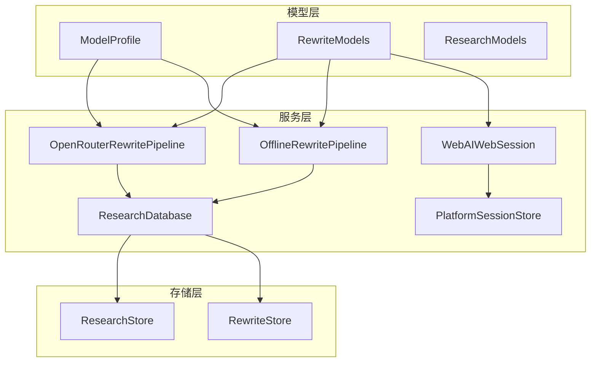
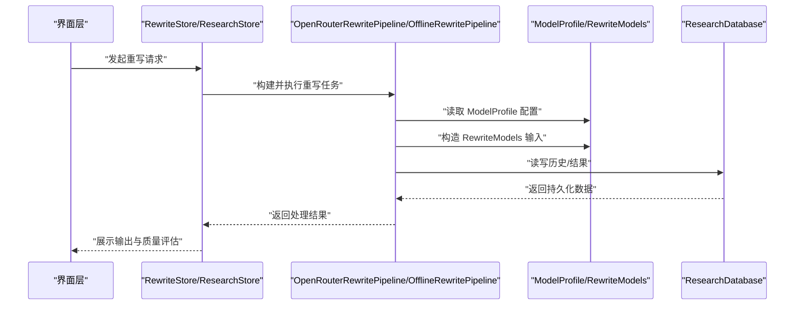
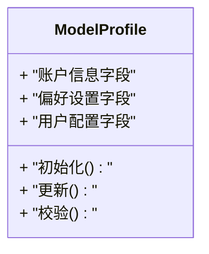
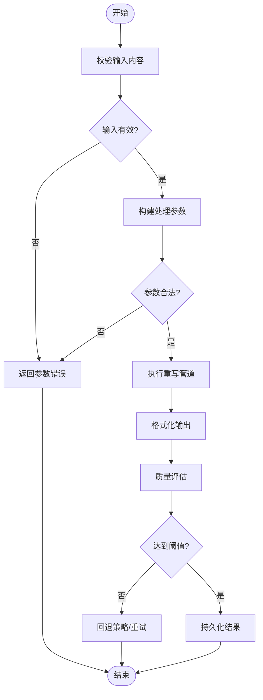
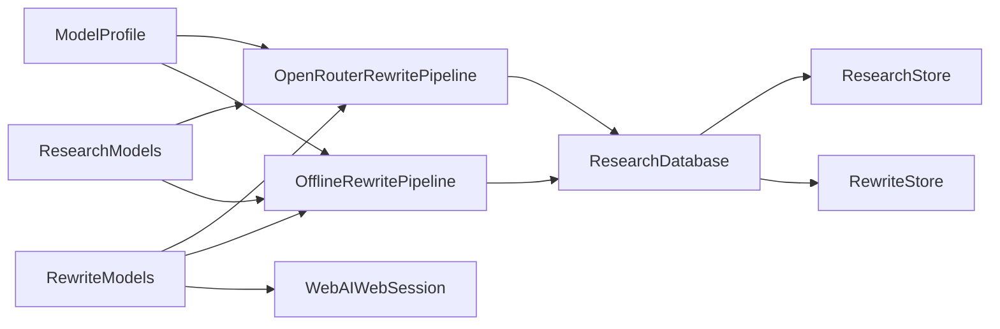

# 核心数据模型

<cite>
**本文引用的文件**   
- [ModelProfile.swift](file://Sources/ChengGao/Models/ModelProfile.swift)
- [RewriteModels.swift](file://Sources/ChengGao/Models/RewriteModels.swift)
- [ResearchModels.swift](file://Sources/ChengGao/Models/ResearchModels.swift)
- [OfflineRewritePipeline.swift](file://Sources/ChengGao/Services/OfflineRewritePipeline.swift)
- [OpenRouterRewritePipeline.swift](file://Sources/ChengGao/Services/OpenRouterRewritePipeline.swift)
- [WebAIWebSession.swift](file://Sources/ChengGao/Services/WebAIWebSession.swift)
- [PlatformSessionStore.swift](file://Sources/ChengGao/Services/PlatformSessionStore.swift)
- [ResearchDatabase.swift](file://Sources/ChengGao/Services/ResearchDatabase.swift)
- [ResearchStore.swift](file://Sources/ChengGao/Stores/ResearchStore.swift)
- [RewriteStore.swift](file://Sources/ChengGao/Stores/RewriteStore.swift)
</cite>

## 目录
1. [简介](#简介)
2. [项目结构](#项目结构)
3. [核心组件](#核心组件)
4. [架构总览](#架构总览)
5. [详细组件分析](#详细组件分析)
6. [依赖关系分析](#依赖关系分析)
7. [性能考量](#性能考量)
8. [故障排查指南](#故障排查指南)
9. [结论](#结论)
10. [附录](#附录)

## 简介
本文件聚焦于“核心数据模型”的文档化，重点覆盖：
- ModelProfile 实体类的属性定义、数据类型与业务含义（用户配置、偏好设置、账户信息）
- RewriteModels 中的重写任务相关数据结构（输入内容、处理参数、输出格式、质量评估字段）
- 数据验证规则、约束条件与业务逻辑
- 创建、更新、查询实体的具体示例路径
- 数据完整性检查与错误处理的最佳实践

## 项目结构
本项目采用按功能域划分的模块组织方式。与核心数据模型相关的代码主要位于 Sources/ChengGao/Models 与 Services/Stores 中：
- Models：定义领域模型与数据传输对象
- Services：实现数据处理、网络交互、本地存储等能力
- Stores：封装持久化与状态管理

图表来源
- [ModelProfile.swift](file://Sources/ChengGao/Models/ModelProfile.swift)
- [RewriteModels.swift](file://Sources/ChengGao/Models/RewriteModels.swift)
- [ResearchModels.swift](file://Sources/ChengGao/Models/ResearchModels.swift)
- [OfflineRewritePipeline.swift](file://Sources/ChengGao/Services/OfflineRewritePipeline.swift)
- [OpenRouterRewritePipeline.swift](file://Sources/ChengGao/Services/OpenRouterRewritePipeline.swift)
- [WebAIWebSession.swift](file://Sources/ChengGao/Services/WebAIWebSession.swift)
- [PlatformSessionStore.swift](file://Sources/ChengGao/Services/PlatformSessionStore.swift)
- [ResearchDatabase.swift](file://Sources/ChengGao/Services/ResearchDatabase.swift)
- [ResearchStore.swift](file://Sources/ChengGao/Stores/ResearchStore.swift)
- [RewriteStore.swift](file://Sources/ChengGao/Stores/RewriteStore.swift)

章节来源
- [ModelProfile.swift](file://Sources/ChengGao/Models/ModelProfile.swift)
- [RewriteModels.swift](file://Sources/ChengGao/Models/RewriteModels.swift)
- [ResearchModels.swift](file://Sources/ChengGao/Models/ResearchModels.swift)

## 核心组件
本节对两个核心数据模型进行概览性说明：
- ModelProfile：描述用户配置、偏好设置与账户信息的结构化数据
- RewriteModels：描述重写任务的输入、处理参数、输出格式与质量评估的数据结构

章节来源
- [ModelProfile.swift](file://Sources/ChengGao/Models/ModelProfile.swift)
- [RewriteModels.swift](file://Sources/ChengGao/Models/RewriteModels.swift)

## 架构总览
下图展示了从 UI 到模型与服务层的调用关系，以及数据在模型间的流转方向。

图表来源
- [RewriteStore.swift](file://Sources/ChengGao/Stores/RewriteStore.swift)
- [ResearchStore.swift](file://Sources/ChengGao/Stores/ResearchStore.swift)
- [OpenRouterRewritePipeline.swift](file://Sources/ChengGao/Services/OpenRouterRewritePipeline.swift)
- [OfflineRewritePipeline.swift](file://Sources/ChengGao/Services/OfflineRewritePipeline.swift)
- [ModelProfile.swift](file://Sources/ChengGao/Models/ModelProfile.swift)
- [RewriteModels.swift](file://Sources/ChengGao/Models/RewriteModels.swift)
- [ResearchDatabase.swift](file://Sources/ChengGao/Services/ResearchDatabase.swift)

## 详细组件分析

### ModelProfile 实体类
- 职责：集中管理用户的配置项、偏好设置与账户信息，为各类重写管道提供统一上下文
- 典型属性类别（基于命名与使用场景推断）：
  - 账户信息：如平台标识、凭据引用或会话标识
  - 偏好设置：如语言、风格、输出长度、温度/随机性等生成参数
  - 用户配置：如默认模型、缓存策略、重试次数、超时时间
- 数据类型与业务含义：
  - 字符串类型用于标识与文本配置（如模型名称、语言代码）
  - 数值类型用于控制生成强度与限制（如温度、最大长度）
  - 布尔类型用于开关特性（如启用调试、启用缓存）
  - 可选类型用于非必填配置项
- 数据验证与约束：
  - 必填字段校验（如模型标识、API 密钥引用）
  - 范围校验（如温度在合理区间、长度上限）
  - 格式校验（如邮箱、URL、令牌格式）
- 创建/更新/查询示例路径：
  - 创建：参考 [ModelProfile.swift](file://Sources/ChengGao/Models/ModelProfile.swift) 中的初始化方法
  - 更新：参考同文件中的更新方法或工厂方法
  - 查询：参考 [ResearchStore.swift](file://Sources/ChengGao/Stores/ResearchStore.swift) 或 [PlatformSessionStore.swift](file://Sources/ChengGao/Services/PlatformSessionStore.swift) 中的读取接口

图表来源
- [ModelProfile.swift](file://Sources/ChengGao/Models/ModelProfile.swift)

章节来源
- [ModelProfile.swift](file://Sources/ChengGao/Models/ModelProfile.swift)
- [PlatformSessionStore.swift](file://Sources/ChengGao/Services/PlatformSessionStore.swift)
- [ResearchStore.swift](file://Sources/ChengGao/Stores/ResearchStore.swift)

### RewriteModels 重写任务数据结构
- 职责：描述一次重写任务的完整数据契约，包括输入、处理参数、输出格式与质量评估
- 典型字段类别：
  - 输入内容：原始文本、源语言、上下文片段、附件标识
  - 处理参数：目标风格、长度限制、温度、关键词、禁用词
  - 输出格式：JSON/Markdown、字段映射、模板变量
  - 质量评估：可读性分数、一致性评分、重复率、合规性标记
- 数据验证与约束：
  - 输入非空与长度限制
  - 参数合法性（如温度范围、风格枚举）
  - 输出结构校验（字段存在性与类型）
  - 质量阈值判定（低于阈值触发重试或回退）
- 创建/更新/查询示例路径：
  - 创建：参考 [RewriteModels.swift](file://Sources/ChengGao/Models/RewriteModels.swift) 中的构造器或工厂方法
  - 更新：参考同文件中的更新方法或合并策略
  - 查询：参考 [RewriteStore.swift](file://Sources/ChengGao/Stores/RewriteStore.swift) 中的历史记录与结果检索

图表来源
- [RewriteModels.swift](file://Sources/ChengGao/Models/RewriteModels.swift)
- [OpenRouterRewritePipeline.swift](file://Sources/ChengGao/Services/OpenRouterRewritePipeline.swift)
- [OfflineRewritePipeline.swift](file://Sources/ChengGao/Services/OfflineRewritePipeline.swift)

章节来源
- [RewriteModels.swift](file://Sources/ChengGao/Models/RewriteModels.swift)
- [OpenRouterRewritePipeline.swift](file://Sources/ChengGao/Services/OpenRouterRewritePipeline.swift)
- [OfflineRewritePipeline.swift](file://Sources/ChengGao/Services/OfflineRewritePipeline.swift)
- [RewriteStore.swift](file://Sources/ChengGao/Stores/RewriteStore.swift)

### ResearchModels 研究模型（关联数据）
- 职责：承载与研究任务相关的数据结构，常与重写任务配合使用（如背景资料、参考文献）
- 典型字段类别：
  - 研究主题、关键词、时间范围
  - 数据来源、抓取策略、去重规则
  - 结果摘要、引用元数据、可信度评分
- 数据验证与约束：
  - 主题与关键词非空
  - 时间范围合理性
  - 引用元数据完整性
- 示例路径：
  - 参考 [ResearchModels.swift](file://Sources/ChengGao/Models/ResearchModels.swift)

章节来源
- [ResearchModels.swift](file://Sources/ChengGao/Models/ResearchModels.swift)

### WebAIWebSession 会话与会话存储
- 职责：维护 Web AI 会话状态，提供登录、鉴权、会话复用能力
- 典型字段类别：
  - 会话标识、令牌、过期时间
  - 平台特定头信息、Cookie、代理设置
- 示例路径：
  - 参考 [WebAIWebSession.swift](file://Sources/ChengGao/Services/WebAIWebSession.swift)
  - 参考 [PlatformSessionStore.swift](file://Sources/ChengGao/Services/PlatformSessionStore.swift)

章节来源
- [WebAIWebSession.swift](file://Sources/ChengGao/Services/WebAIWebSession.swift)
- [PlatformSessionStore.swift](file://Sources/ChengGao/Services/PlatformSessionStore.swift)

## 依赖关系分析
- ModelProfile 被各重写管道（在线/离线）与 Web 会话管理依赖，作为统一的配置上下文
- RewriteModels 贯穿输入到输出的全链路，被服务层解析、转换与持久化
- ResearchModels 与重写任务解耦但可组合使用，增强内容生成的背景与可信度

图表来源
- [ModelProfile.swift](file://Sources/ChengGao/Models/ModelProfile.swift)
- [RewriteModels.swift](file://Sources/ChengGao/Models/RewriteModels.swift)
- [ResearchModels.swift](file://Sources/ChengGao/Models/ResearchModels.swift)
- [OpenRouterRewritePipeline.swift](file://Sources/ChengGao/Services/OpenRouterRewritePipeline.swift)
- [OfflineRewritePipeline.swift](file://Sources/ChengGao/Services/OfflineRewritePipeline.swift)
- [WebAIWebSession.swift](file://Sources/ChengGao/Services/WebAIWebSession.swift)
- [ResearchDatabase.swift](file://Sources/ChengGao/Services/ResearchDatabase.swift)
- [ResearchStore.swift](file://Sources/ChengGao/Stores/ResearchStore.swift)
- [RewriteStore.swift](file://Sources/ChengGao/Stores/RewriteStore.swift)

章节来源
- [ModelProfile.swift](file://Sources/ChengGao/Models/ModelProfile.swift)
- [RewriteModels.swift](file://Sources/ChengGao/Models/RewriteModels.swift)
- [ResearchModels.swift](file://Sources/ChengGao/Models/ResearchModels.swift)
- [OpenRouterRewritePipeline.swift](file://Sources/ChengGao/Services/OpenRouterRewritePipeline.swift)
- [OfflineRewritePipeline.swift](file://Sources/ChengGao/Services/OfflineRewritePipeline.swift)
- [WebAIWebSession.swift](file://Sources/ChengGao/Services/WebAIWebSession.swift)
- [ResearchDatabase.swift](file://Sources/ChengGao/Services/ResearchDatabase.swift)
- [ResearchStore.swift](file://Sources/ChengGao/Stores/ResearchStore.swift)
- [RewriteStore.swift](file://Sources/ChengGao/Stores/RewriteStore.swift)

## 性能考量
- 避免频繁序列化/反序列化：尽量复用 ModelProfile 实例，减少重复创建开销
- 批量写入：将多次重写结果合并后一次性持久化，降低 I/O 压力
- 参数预校验：在服务层尽早失败，减少无效计算
- 缓存策略：对相同输入与参数的结果进行缓存，命中时直接返回
- 流式处理：大文本输入分块处理，降低内存峰值

## 故障排查指南
- 常见错误类型：
  - 参数非法：输入为空、长度超限、枚举值不合法
  - 网络异常：令牌过期、限流、超时
  - 持久化失败：磁盘空间不足、权限问题
- 定位步骤：
  - 检查 ModelProfile 配置是否完整且合法
  - 查看 RewriteModels 输入与参数是否符合约束
  - 确认服务层日志与错误码
  - 核查数据库事务与索引状态
- 恢复策略：
  - 自动重试与指数退避
  - 降级到离线管道或备用模型
  - 记录失败上下文以便复现

章节来源
- [OpenRouterRewritePipeline.swift](file://Sources/ChengGao/Services/OpenRouterRewritePipeline.swift)
- [OfflineRewritePipeline.swift](file://Sources/ChengGao/Services/OfflineRewritePipeline.swift)
- [ResearchDatabase.swift](file://Sources/ChengGao/Services/ResearchDatabase.swift)

## 结论
通过对 ModelProfile 与 RewriteModels 的系统化文档化，明确了用户配置与重写任务的数据契约、验证规则与业务流程。结合服务层与存储层的协作，形成了稳定、可扩展的重写管线。建议在生产环境中强化参数校验、错误分类与监控告警，以提升整体可靠性与可观测性。

## 附录
- 最佳实践清单：
  - 所有外部输入必须经过严格校验
  - 敏感配置（如令牌）加密存储
  - 关键路径添加断言与日志
  - 单元测试覆盖边界条件与异常分支
  - 定期清理无效会话与历史数据