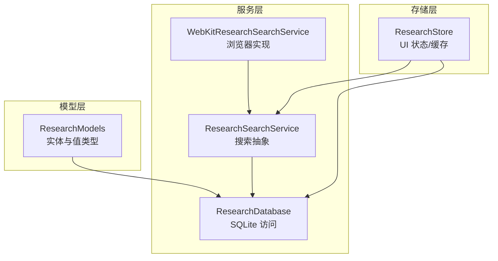
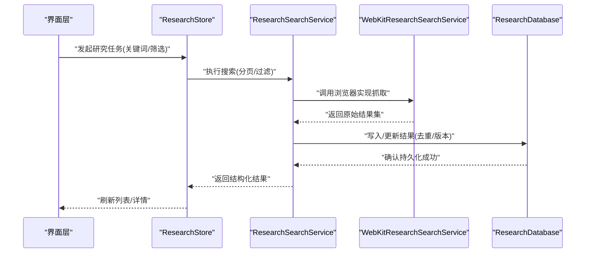
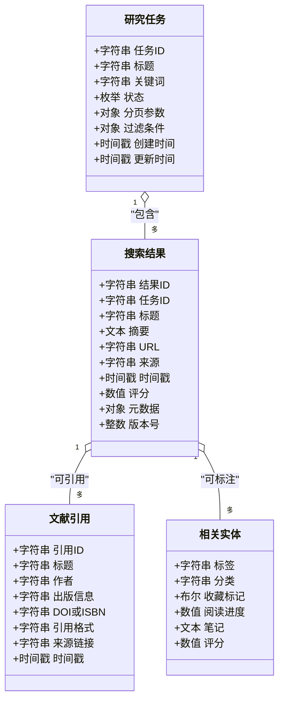
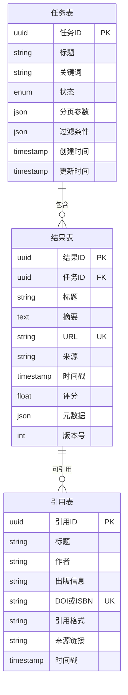
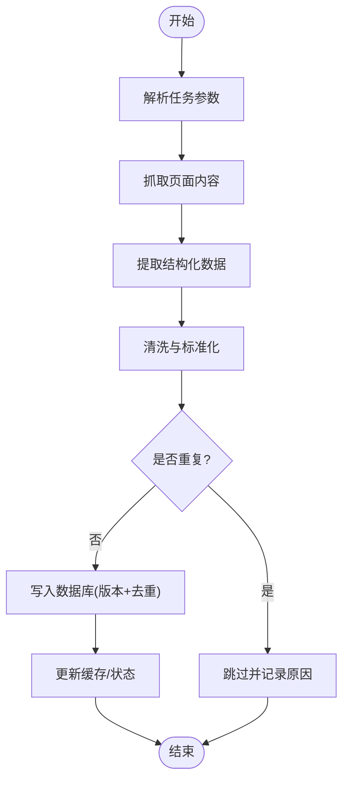
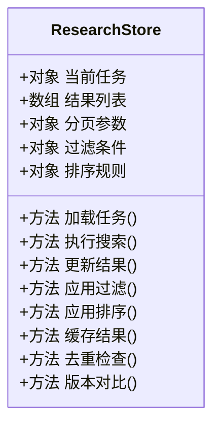
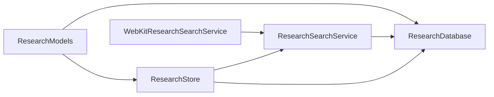
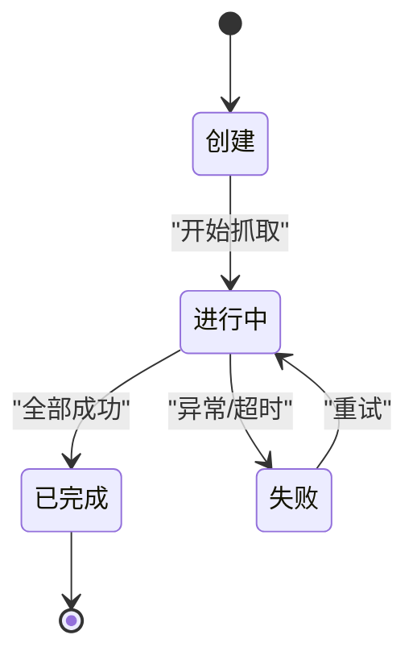

# 研究数据模型

<cite>
**本文引用的文件**   
- [ResearchModels.swift](file://Sources/ChengGao/Models/ResearchModels.swift)
- [ResearchDatabase.swift](file://Sources/ChengGao/Services/ResearchDatabase.swift)
- [ResearchSearchService.swift](file://Sources/ChengGao/Services/ResearchSearchService.swift)
- [WebKitResearchSearchService.swift](file://Sources/ChengGao/Services/WebKitResearchSearchService.swift)
- [ResearchStore.swift](file://Sources/ChengGao/Stores/ResearchStore.swift)
</cite>

## 目录
1. [简介](#简介)
2. [项目结构](#项目结构)
3. [核心组件](#核心组件)
4. [架构总览](#架构总览)
5. [详细组件分析](#详细组件分析)
6. [依赖关系分析](#依赖关系分析)
7. [性能考虑](#性能考虑)
8. [故障排查指南](#故障排查指南)
9. [结论](#结论)
10. [附录](#附录)

## 简介
本文件面向“研究系统”的数据模型与持久化设计，聚焦以下目标：
- 完整说明 ResearchModels 中定义的研究任务、搜索结果、文献引用及相关实体的数据结构。
- 文档化 ResearchDatabase 的表结构设计、索引策略与关联关系。
- 解释研究数据的生命周期管理、状态转换与一致性保证。
- 说明搜索结果的缓存策略、去重机制与版本控制。
- 提供数据库操作示例（CRUD、复杂查询、事务处理）。
- 阐述数据迁移策略与备份恢复机制。

## 项目结构
围绕研究子系统的关键代码位于 Sources/ChengGao 下：
- Models/ResearchModels.swift：定义研究域的数据模型（任务、结果、引用等）。
- Services/ResearchDatabase.swift：封装 SQLite 数据库访问、表结构、索引与事务。
- Services/ResearchSearchService.swift / WebKitResearchSearchService.swift：搜索服务接口与基于 WebKit 的实现。
- Stores/ResearchStore.swift：面向 UI 的状态管理与数据桥接。

图表来源
- [ResearchModels.swift](file://Sources/ChengGao/Models/ResearchModels.swift)
- [ResearchDatabase.swift](file://Sources/ChengGao/Services/ResearchDatabase.swift)
- [ResearchSearchService.swift](file://Sources/ChengGao/Services/ResearchSearchService.swift)
- [WebKitResearchSearchService.swift](file://Sources/ChengGao/Services/WebKitResearchSearchService.swift)
- [ResearchStore.swift](file://Sources/ChengGao/Stores/ResearchStore.swift)

章节来源
- [ResearchModels.swift](file://Sources/ChengGao/Models/ResearchModels.swift)
- [ResearchDatabase.swift](file://Sources/ChengGao/Services/ResearchDatabase.swift)
- [ResearchSearchService.swift](file://Sources/ChengGao/Services/ResearchSearchService.swift)
- [WebKitResearchSearchService.swift](file://Sources/ChengGao/Services/WebKitResearchSearchService.swift)
- [ResearchStore.swift](file://Sources/ChengGao/Stores/ResearchStore.swift)

## 核心组件
- 数据模型（ResearchModels）
  - 研究任务：标识、标题、关键词、状态、创建/更新时间、分页参数、过滤条件等。
  - 搜索结果：唯一键、标题、摘要、URL、来源、时间戳、评分/相关性、元数据等。
  - 文献引用：作者、标题、出版信息、DOI/ISBN、引用格式、来源链接等。
  - 相关实体：标签、分类、收藏标记、阅读进度、笔记等。
- 数据库（ResearchDatabase）
  - 表结构：任务表、结果表、引用表、关联表（如任务-结果、结果-引用）、字典表（标签/分类）。
  - 索引策略：按时间、来源、URL、标题分词、任务ID、状态等建立索引以优化查询。
  - 事务与一致性：读写分离、外键约束、唯一性约束、冲突解决策略。
- 搜索服务（ResearchSearchService / WebKitResearchSearchService）
  - 统一搜索接口：发起搜索、分页、过滤、排序、增量更新。
  - 浏览器实现：解析网页内容、提取结构化数据、清洗与标准化。
- 存储（ResearchStore）
  - 面向 UI 的缓存与状态：最近搜索、结果缓存、去重、版本控制、乐观更新。

章节来源
- [ResearchModels.swift](file://Sources/ChengGao/Models/ResearchModels.swift)
- [ResearchDatabase.swift](file://Sources/ChengGao/Services/ResearchDatabase.swift)
- [ResearchSearchService.swift](file://Sources/ChengGao/Services/ResearchSearchService.swift)
- [WebKitResearchSearchService.swift](file://Sources/ChengGao/Services/WebKitResearchSearchService.swift)
- [ResearchStore.swift](file://Sources/ChengGao/Stores/ResearchStore.swift)

## 架构总览
研究子系统采用分层架构：模型层定义领域实体；服务层负责搜索与持久化；存储层为 UI 提供响应式状态与缓存。

图表来源
- [ResearchStore.swift](file://Sources/ChengGao/Stores/ResearchStore.swift)
- [ResearchSearchService.swift](file://Sources/ChengGao/Services/ResearchSearchService.swift)
- [WebKitResearchSearchService.swift](file://Sources/ChengGao/Services/WebKitResearchSearchService.swift)
- [ResearchDatabase.swift](file://Sources/ChengGao/Services/ResearchDatabase.swift)

## 详细组件分析

### 数据模型（ResearchModels）
- 研究任务
  - 字段：任务ID、标题、关键词、状态（待处理/进行中/已完成/失败）、分页参数、过滤条件、创建/更新时间。
  - 用途：驱动搜索流程、记录上下文、支持重试与撤销。
- 搜索结果
  - 字段：结果ID、任务ID、标题、摘要、URL、来源、时间戳、评分/相关性、元数据（JSON）、版本号。
  - 用途：展示与检索的核心对象，支持排序、过滤、分页。
- 文献引用
  - 字段：引用ID、标题、作者、出版信息、DOI/ISBN、引用格式、来源链接、时间戳。
  - 用途：生成参考文献列表、交叉验证来源。
- 相关实体
  - 字段：标签、分类、收藏标记、阅读进度、笔记、评分。
  - 用途：增强检索体验与知识管理。

图表来源
- [ResearchModels.swift](file://Sources/ChengGao/Models/ResearchModels.swift)

章节来源
- [ResearchModels.swift](file://Sources/ChengGao/Models/ResearchModels.swift)

### 数据库设计（ResearchDatabase）
- 表结构
  - 任务表：主键任务ID，唯一索引于标题+关键词组合，状态索引，时间戳索引。
  - 结果表：主键结果ID，外键任务ID，唯一索引于URL，时间戳索引，评分索引。
  - 引用表：主键引用ID，唯一索引于DOI/ISBN，标题分词索引。
  - 关联表：任务-结果、结果-引用、结果-标签/分类。
- 索引策略
  - 高频查询字段建索引：URL、时间戳、任务ID、状态、评分。
  - 全文检索：对标题/摘要使用 FTS（若可用）或分词索引。
- 关联关系
  - 任务到结果一对多；结果到引用一对多；结果到标签/分类多对多。
- 一致性保证
  - 外键约束、唯一性约束、事务回滚、冲突解决（UPSERT）。

图表来源
- [ResearchDatabase.swift](file://Sources/ChengGao/Services/ResearchDatabase.swift)

章节来源
- [ResearchDatabase.swift](file://Sources/ChengGao/Services/ResearchDatabase.swift)

### 搜索服务（ResearchSearchService / WebKitResearchSearchService）
- 接口职责
  - 接收任务参数，执行分页抓取、过滤、排序、去重、增量更新。
- 浏览器实现
  - 基于 WebKit 解析页面，提取结构化数据，清洗噪声，标准化字段。
- 与数据库交互
  - 批量写入/更新结果，维护版本号与去重键，触发索引重建（必要时）。

图表来源
- [ResearchSearchService.swift](file://Sources/ChengGao/Services/ResearchSearchService.swift)
- [WebKitResearchSearchService.swift](file://Sources/ChengGao/Services/WebKitResearchSearchService.swift)
- [ResearchDatabase.swift](file://Sources/ChengGao/Services/ResearchDatabase.swift)

章节来源
- [ResearchSearchService.swift](file://Sources/ChengGao/Services/ResearchSearchService.swift)
- [WebKitResearchSearchService.swift](file://Sources/ChengGao/Services/WebKitResearchSearchService.swift)
- [ResearchDatabase.swift](file://Sources/ChengGao/Services/ResearchDatabase.swift)

### 存储（ResearchStore）
- 功能职责
  - 管理 UI 状态：当前任务、结果列表、分页、过滤、排序。
  - 缓存策略：最近搜索、热门结果、去重键映射、版本比较。
  - 事件驱动：监听数据库变更，推送更新到 UI。

图表来源
- [ResearchStore.swift](file://Sources/ChengGao/Stores/ResearchStore.swift)

章节来源
- [ResearchStore.swift](file://Sources/ChengGao/Stores/ResearchStore.swift)

## 依赖关系分析
- 模型层被服务层与存储层共同依赖。
- 搜索服务依赖数据库进行持久化，依赖浏览器实现进行内容抓取。
- 存储层依赖搜索服务与数据库，向 UI 暴露简洁接口。

图表来源
- [ResearchModels.swift](file://Sources/ChengGao/Models/ResearchModels.swift)
- [ResearchDatabase.swift](file://Sources/ChengGao/Services/ResearchDatabase.swift)
- [ResearchSearchService.swift](file://Sources/ChengGao/Services/ResearchSearchService.swift)
- [WebKitResearchSearchService.swift](file://Sources/ChengGao/Services/WebKitResearchSearchService.swift)
- [ResearchStore.swift](file://Sources/ChengGao/Stores/ResearchStore.swift)

章节来源
- [ResearchModels.swift](file://Sources/ChengGao/Models/ResearchModels.swift)
- [ResearchDatabase.swift](file://Sources/ChengGao/Services/ResearchDatabase.swift)
- [ResearchSearchService.swift](file://Sources/ChengGao/Services/ResearchSearchService.swift)
- [WebKitResearchSearchService.swift](file://Sources/ChengGao/Services/WebKitResearchSearchService.swift)
- [ResearchStore.swift](file://Sources/ChengGao/Stores/ResearchStore.swift)

## 性能考虑
- 索引优化
  - 对 URL、时间戳、任务ID、状态、评分建立合适索引，避免全表扫描。
  - 对标题/摘要启用全文检索或分词索引，提升搜索效率。
- 批量操作
  - 使用事务批量写入/更新结果，减少 I/O 开销。
- 缓存策略
  - 在内存中缓存最近搜索结果与去重键映射，降低重复请求。
- 分页与懒加载
  - 按需加载下一页，避免一次性加载大量数据。
- 资源限制
  - 限制并发抓取数量，避免阻塞与资源耗尽。

[本节为通用指导，不直接分析具体文件]

## 故障排查指南
- 常见问题
  - 搜索结果重复：检查去重键与唯一索引是否正确。
  - 数据不一致：确认事务边界与外键约束是否生效。
  - 性能退化：查看慢查询日志，评估索引命中情况。
  - 抓取失败：检查网络状态、反爬策略、页面结构变化。
- 调试建议
  - 开启详细日志，记录关键步骤与错误堆栈。
  - 使用数据库可视化工具检查表结构与索引。
  - 模拟不同输入参数，复现问题路径。

[本节为通用指导，不直接分析具体文件]

## 结论
本研究数据模型通过清晰的层次划分与严格的约束设计，实现了高内聚、低耦合的数据管理。结合合理的索引、缓存与事务策略，系统在性能与一致性之间取得平衡。后续可进一步优化全文检索、增量更新与分布式同步能力。

[本节为总结性内容，不直接分析具体文件]

## 附录

### 数据生命周期与状态转换
- 生命周期阶段
  - 创建：初始化任务与空结果集。
  - 进行中：抓取与解析进行中，结果逐步写入。
  - 已完成：所有结果持久化完成，状态标记为成功。
  - 失败：异常或超时，状态标记为失败，支持重试。
- 状态转换图

[本节为概念性图示，不直接映射具体文件]

### 缓存策略、去重机制与版本控制
- 缓存策略
  - 内存缓存：最近搜索、热门结果、去重键映射。
  - 磁盘缓存：长期保存常用结果与元数据。
- 去重机制
  - 基于 URL、标题相似度、DOI/ISBN 等多维度判断。
  - 使用唯一索引与 UPSERT 确保幂等写入。
- 版本控制
  - 每个结果维护版本号，支持增量更新与回滚。
  - 变更日志记录修改历史，便于审计与回溯。

[本节为概念性内容，不直接分析具体文件]

### 数据库操作示例（CRUD、复杂查询、事务）
- 创建
  - 插入新任务与初始结果占位。
- 读取
  - 按任务ID、时间范围、来源、评分过滤查询。
  - 分页与排序：按时间倒序、评分降序。
- 更新
  - 批量更新结果元数据与评分。
  - 增量更新：仅更新变更字段。
- 删除
  - 软删除：标记为已删除，保留历史。
  - 硬删除：清理无用数据与索引。
- 复杂查询
  - 多表关联：任务-结果-引用联合查询。
  - 全文检索：标题/摘要关键词匹配。
- 事务处理
  - 批量写入结果时开启事务，失败回滚。
  - 提交前校验完整性与一致性。

[本节为通用指导，不直接分析具体文件]

### 数据迁移策略与备份恢复
- 迁移策略
  - 版本化 schema，支持向前/向后兼容。
  - 增量迁移脚本，记录迁移历史。
  - 迁移前备份，失败自动回滚。
- 备份恢复
  - 定期快照备份，保留多版本。
  - 增量备份，减少存储空间占用。
  - 恢复演练，确保可用性。

[本节为通用指导，不直接分析具体文件]