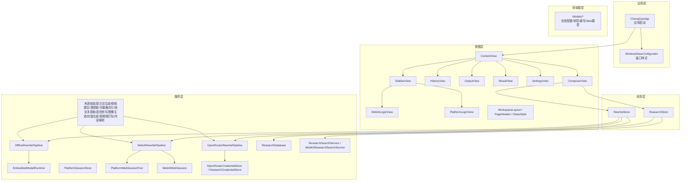
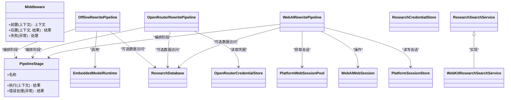
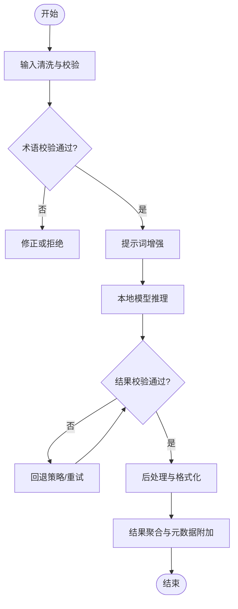
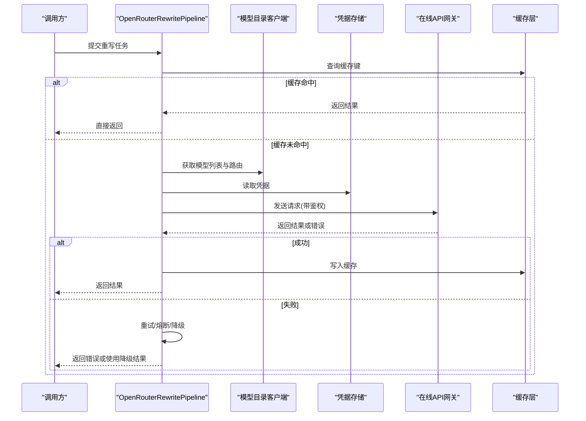
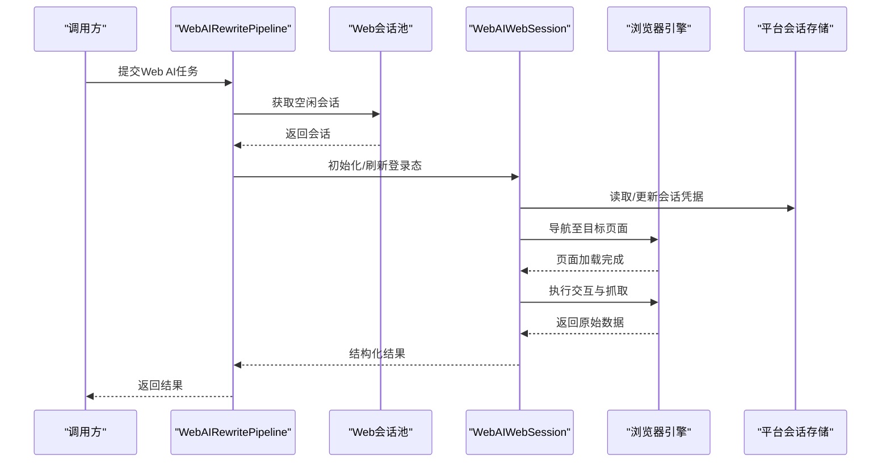
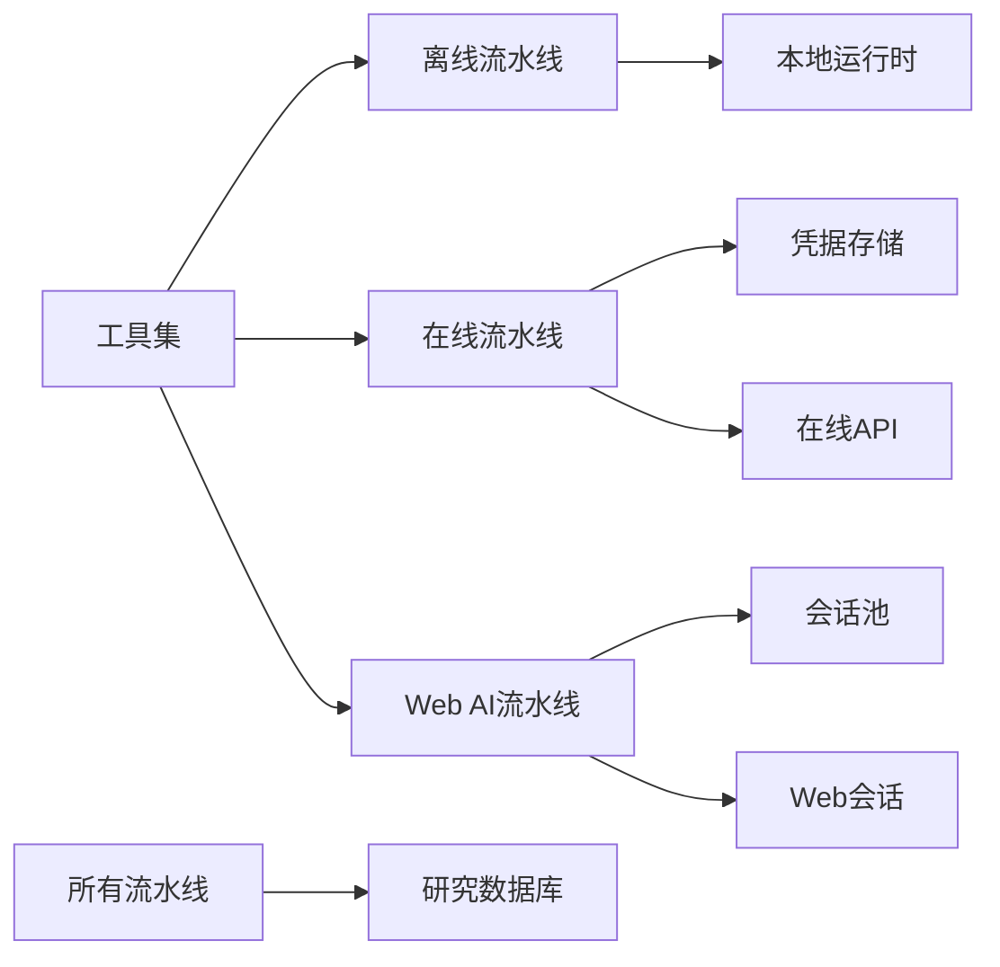

# AI处理流水线

<cite>
**本文档引用的文件**   
- [OfflineRewritePipeline.swift](file://Sources/ChengGao/Services/OfflineRewritePipeline.swift)
- [OpenRouterRewritePipeline.swift](file://Sources/ChengGao/Services/OpenRouterRewritePipeline.swift)
- [WebAIRewritePipeline.swift](file://Sources/ChengGao/Services/WebAIRewritePipeline.swift)
- [OnlineAIConfiguration.swift](file://Sources/ChengGao/Models/OnlineAIConfiguration.swift)
- [ResearchModels.swift](file://Sources/ChengGao/Models/ResearchModels.swift)
- [RewriteModels.swift](file://Sources/ChengGao/Models/RewriteModels.swift)
- [WebAIModels.swift](file://Sources/ChengGao/Models/WebAIModels.swift)
- [EmbeddedModelRuntime.swift](file://Sources/ChengGao/Services/EmbeddedModelRuntime.swift)
- [PlatformSessionStore.swift](file://Sources/ChengGao/Services/PlatformSessionStore.swift)
- [PlatformWebSessionPool.swift](file://Sources/ChengGao/Services/PlatformWebSessionPool.swift)
- [WebAIWebSession.swift](file://Sources/ChengGao/Services/WebAIWebSession.swift)
- [OpenRouterCredentialStore.swift](file://Sources/ChengGao/Services/OpenRouterCredentialStore.swift)
- [ResearchCredentialStore.swift](file://Sources/ChengGao/Services/ResearchCredentialStore.swift)
- [ResearchDatabase.swift](file://Sources/ChengGao/Services/ResearchDatabase.swift)
- [ResearchSearchService.swift](file://Sources/ChengGao/Services/ResearchSearchService.swift)
- [WebKitResearchSearchService.swift](file://Sources/ChengGao/Services/WebKitResearchSearchService.swift)
- [TerminologyVerifier.swift](file://Sources/ChengGao/Services/TerminologyVerifier.swift)
- [VisualPromptGenerator.swift](file://Sources/ChengGao/Services/VisualPromptGenerator.swift)
- [VideoSuggestionPlanner.swift](file://Sources/ChengGao/Services/VideoSuggestionPlanner.swift)
- [SourceExtractor.swift](file://Sources/ChengGao/Services/SourceExtractor.swift)
- [SpokenSubtitleFormatter.swift](file://Sources/ChengGao/Services/SpokenSubtitleFormatter.swift)
- [VideoFrameTextExtractor.swift](file://Sources/ChengGao/Services/VideoFrameTextExtractor.swift)
- [LocalSpeechTranscriber.swift](file://Sources/ChengGao/Services/LocalSpeechTranscriber.swift)
- [CompatibleImageGenerationClient.swift](file://Sources/ChengGao/Services/CompatibleImage生成客户端.swift)
- [ChatGPTImageBatchDocument.swift](file://Sources/ChengGao/Services/ChatGPTImageBatchDocument.swift)
- [CoverArtworkGenerator.swift](file://Sources/ChengGao/Services/CoverArtworkGenerator.swift)
- [DouyinVideoResolver.swift](file://Sources/ChengGao/Services/DouyinVideoResolver.swift)
- [XiaohongshuContentResolver.swift](file://Sources/ChengGao/Services/XiaohongshuContentResolver.swift)
- [ShortVideoExportPackage.swift](file://Sources/ChengGao/Services/ShortVideoExportPackage.swift)
- [ChengGaoApp.swift](file://Sources/ChengGao/App/ChengGaoApp.swift)
- [WindowGlassConfigurator.swift](file://Sources/ChengGao/App/WindowGlassConfigurator.swift)
- [ResearchStore.swift](file://Sources/ChengGao/Stores/ResearchStore.swift)
- [RewriteStore.swift](file://Sources/ChengGao/Stores/RewriteStore.swift)
- [ContentView.swift](file://Sources/ChengGao/Views/ContentView.swift)
- [ComposerView.swift](file://Sources/ChengGao/Views/ComposerView.swift)
- [HistoryView.swift](file://Sources/ChengGao/Views/HistoryView.swift)
- [OutputView.swift](file://Sources/ChengGao/Views/OutputView.swift)
- [ResultView.swift](file://Sources/ChengGao/Views/ResultView.swift)
- [SettingsView.swift](file://Sources/ChengGao/Views/SettingsView.swift)
- [SidebarView.swift](file://Sources/ChengGao/Views/SidebarView.swift)
- [WebAILoginView.swift](file://Sources/ChengGao/Views/WebAILoginView.swift)
- [PlatformLoginView.swift](file://Sources/ChengGao/Views/PlatformLoginView.swift)
- [WorkspaceLayout.swift](file://Sources/ChengGao/Views/WorkspaceLayout.swift)
- [WorkspacePageHeader.swift](file://Sources/ChengGao/Views/WorkspacePageHeader.swift)
- [WorkspaceGlassStyle.swift](file://Sources/ChengGao/Views/WorkspaceGlassStyle.swift)
- [FocusedRewriteActions.swift](file://Sources/ChengGao/Support/FocusedRewriteActions.swift)
- [OfflineRewritePipelineTests.swift](file://Tests/ChengGaoTests/OfflineRewritePipelineTests.swift)
</cite>

## 目录
1. [简介](#简介)
2. [项目结构](#项目结构)
3. [核心组件](#核心组件)
4. [架构总览](#架构总览)
5. [详细组件分析](#详细组件分析)
6. [依赖关系分析](#依赖关系分析)
7. [性能考虑](#性能考虑)
8. [故障排查指南](#故障排查指南)
9. [结论](#结论)
10. [附录](#附录)

## 简介
本文件面向“AI处理流水线”的架构设计与实现说明，覆盖离线重写、在线API调用与Web AI集成三大路径。文档聚焦以下目标：
- 步骤编排：统一抽象流水线阶段、输入输出契约、错误传播与结果聚合机制
- 配置管理：在线模型目录、凭据存储、会话池与平台会话管理
- 动态扩展：处理器接口化、中间件链式注入、可插拔后端（本地/在线/Web）
- 性能监控：吞吐、延迟、缓存命中、重试与熔断指标
- 容错策略：负载均衡、熔断降级、超时与退避、幂等与去重
- 开发指南：自定义处理器、中间件集成、调试工具使用

## 项目结构
仓库采用Swift Package组织，核心代码位于 Sources/ChengGao，按功能域划分为 App、Models、Services、Stores、Support、Views 等模块。关键入口为应用初始化与窗口配置；业务逻辑集中在 Services 下的各类流水线与服务；数据与状态通过 Stores 暴露给 UI。

图表来源
- [ChengGaoApp.swift](file://Sources/ChengGao/App/ChengGaoApp.swift)
- [WindowGlassConfigurator.swift](file://Sources/ChengGao/App/WindowGlassConfigurator.swift)
- [ContentView.swift](file://Sources/ChengGao/Views/ContentView.swift)
- [ComposerView.swift](file://Sources/ChengGao/Views/ComposerView.swift)
- [HistoryView.swift](file://Sources/ChengGao/Views/HistoryView.swift)
- [OutputView.swift](file://Sources/ChengGao/Views/OutputView.swift)
- [ResultView.swift](file://Sources/ChengGao/Views/ResultView.swift)
- [SettingsView.swift](file://Sources/ChengGao/Views/SettingsView.swift)
- [SidebarView.swift](file://Sources/ChengGao/Views/SidebarView.swift)
- [WebAILoginView.swift](file://Sources/ChengGao/Views/WebAILoginView.swift)
- [PlatformLoginView.swift](file://Sources/ChengGao/Views/PlatformLoginView.swift)
- [WorkspaceLayout.swift](file://Sources/ChengGao/Views/WorkspaceLayout.swift)
- [WorkspacePageHeader.swift](file://Sources/ChengGao/Views/WorkspacePageHeader.swift)
- [WorkspaceGlassStyle.swift](file://Sources/ChengGao/Views/WorkspaceGlassStyle.swift)
- [ResearchStore.swift](file://Sources/ChengGao/Stores/ResearchStore.swift)
- [RewriteStore.swift](file://Sources/ChengGao/Stores/RewriteStore.swift)
- [OfflineRewritePipeline.swift](file://Sources/ChengGao/Services/OfflineRewritePipeline.swift)
- [OpenRouterRewritePipeline.swift](file://Sources/ChengGao/Services/OpenRouterRewritePipeline.swift)
- [WebAIRewritePipeline.swift](file://Sources/ChengGao/Services/WebAIRewritePipeline.swift)
- [EmbeddedModelRuntime.swift](file://Sources/ChengGao/Services/EmbeddedModelRuntime.swift)
- [PlatformSessionStore.swift](file://Sources/ChengGao/Services/PlatformSessionStore.swift)
- [PlatformWebSessionPool.swift](file://Sources/ChengGao/Services/PlatformWebSessionPool.swift)
- [WebAIWebSession.swift](file://Sources/ChengGao/Services/WebAIWebSession.swift)
- [OpenRouterCredentialStore.swift](file://Sources/ChengGao/Services/OpenRouterCredentialStore.swift)
- [ResearchCredentialStore.swift](file://Sources/ChengGao/Services/ResearchCredentialStore.swift)
- [ResearchDatabase.swift](file://Sources/ChengGao/Services/ResearchDatabase.swift)
- [ResearchSearchService.swift](file://Sources/ChengGao/Services/ResearchSearchService.swift)
- [WebKitResearchSearchService.swift](file://Sources/ChengGao/Services/WebKitResearchSearchService.swift)

章节来源
- [ChengGaoApp.swift](file://Sources/ChengGao/App/ChengGaoApp.swift)
- [WindowGlassConfigurator.swift](file://Sources/ChengGao/App/WindowGlassConfigurator.swift)
- [ContentView.swift](file://Sources/ChengGao/Views/ContentView.swift)
- [ResearchStore.swift](file://Sources/ChengGao/Stores/ResearchStore.swift)
- [RewriteStore.swift](file://Sources/ChengGao/Stores/RewriteStore.swift)

## 核心组件
- 离线重写流水线：基于本地运行时执行多阶段重写，支持预处理、模型推理、后处理与结果校验
- 在线API重写流水线：对接外部模型目录与凭据存储，进行请求构建、鉴权、重试与限流
- Web AI重写流水线：通过Web会话池与浏览器会话执行Web端AI能力，包含登录态管理与资源抓取
- 运行时与工具集：本地模型运行、术语校验、提示词生成、视频建议、源提取、字幕格式化、帧文本提取、语音转写、图像生成、封面生成、短视频打包、内容解析
- 会话与凭据：平台会话存储、Web会话池、各平台凭据存储
- 研究与数据：研究数据库、搜索服务（含WebKit实现）

章节来源
- [OfflineRewritePipeline.swift](file://Sources/ChengGao/Services/OfflineRewritePipeline.swift)
- [OpenRouterRewritePipeline.swift](file://Sources/ChengGao/Services/OpenRouterRewritePipeline.swift)
- [WebAIRewritePipeline.swift](file://Sources/ChengGao/Services/WebAIRewritePipeline.swift)
- [EmbeddedModelRuntime.swift](file://Sources/ChengGao/Services/EmbeddedModelRuntime.swift)
- [PlatformSessionStore.swift](file://Sources/ChengGao/Services/PlatformSessionStore.swift)
- [PlatformWebSessionPool.swift](file://Sources/ChengGao/Services/PlatformWebSessionPool.swift)
- [WebAIWebSession.swift](file://Sources/ChengGao/Services/WebAIWebSession.swift)
- [OpenRouterCredentialStore.swift](file://Sources/ChengGao/Services/OpenRouterCredentialStore.swift)
- [ResearchCredentialStore.swift](file://Sources/ChengGao/Services/ResearchCredentialStore.swift)
- [ResearchDatabase.swift](file://Sources/ChengGao/Services/ResearchDatabase.swift)
- [ResearchSearchService.swift](file://Sources/ChengGao/Services/ResearchSearchService.swift)
- [WebKitResearchSearchService.swift](file://Sources/ChengGao/Services/WebKitResearchSearchService.swift)

## 架构总览
整体采用“流水线+中间件”的架构模式：
- 统一流水线接口定义阶段顺序、输入输出契约、错误传播与结果聚合
- 中间件用于横切关注点：日志、指标、缓存、重试、熔断、限流、鉴权
- 三种执行后端（离线/在线/Web）共享同一套编排与错误处理语义
- 配置中心提供模型目录、凭据、会话池参数、熔断阈值、重试策略等
- 状态层通过 Store 将流水线结果与历史持久化到UI

图表来源
- [OfflineRewritePipeline.swift](file://Sources/ChengGao/Services/OfflineRewritePipeline.swift)
- [OpenRouterRewritePipeline.swift](file://Sources/ChengGao/Services/OpenRouterRewritePipeline.swift)
- [WebAIRewritePipeline.swift](file://Sources/ChengGao/Services/WebAIRewritePipeline.swift)
- [EmbeddedModelRuntime.swift](file://Sources/ChengGao/Services/EmbeddedModelRuntime.swift)
- [PlatformSessionStore.swift](file://Sources/ChengGao/Services/PlatformSessionStore.swift)
- [PlatformWebSessionPool.swift](file://Sources/ChengGao/Services/PlatformWebSessionPool.swift)
- [WebAIWebSession.swift](file://Sources/ChengGao/Services/WebAIWebSession.swift)
- [OpenRouterCredentialStore.swift](file://Sources/ChengGao/Services/OpenRouterCredentialStore.swift)
- [ResearchCredentialStore.swift](file://Sources/ChengGao/Services/ResearchCredentialStore.swift)
- [ResearchDatabase.swift](file://Sources/ChengGao/Services/ResearchDatabase.swift)
- [ResearchSearchService.swift](file://Sources/ChengGao/Services/ResearchSearchService.swift)
- [WebKitResearchSearchService.swift](file://Sources/ChengGao/Services/WebKitResearchSearchService.swift)

## 详细组件分析

### 离线重写流水线（OfflineRewritePipeline）
- 设计要点
  - 阶段编排：输入清洗→术语校验→提示词增强→本地模型推理→结果校验→后处理→输出
  - 错误传播：阶段级异常上抛，统一捕获并转换为标准化错误类型，附带上下文信息
  - 结果聚合：合并多阶段产物，保留中间元数据以便回溯
  - 性能优化：批处理、内存复用、缓存热点片段、并行阶段（无副作用时）
- 中间件集成
  - 日志记录、指标上报、缓存命中统计、重试与退避、熔断开关
- 扩展点
  - 新增阶段需实现统一接口，注册到编排器；支持条件分支与短路

图表来源
- [OfflineRewritePipeline.swift](file://Sources/ChengGao/Services/OfflineRewritePipeline.swift)
- [TerminologyVerifier.swift](file://Sources/ChengGao/Services/TerminologyVerifier.swift)
- [VisualPromptGenerator.swift](file://Sources/ChengGao/Services/VisualPromptGenerator.swift)
- [EmbeddedModelRuntime.swift](file://Sources/ChengGao/Services/EmbeddedModelRuntime.swift)

章节来源
- [OfflineRewritePipeline.swift](file://Sources/ChengGao/Services/OfflineRewritePipeline.swift)
- [TerminologyVerifier.swift](file://Sources/ChengGao/Services/TerminologyVerifier.swift)
- [VisualPromptGenerator.swift](file://Sources/ChengGao/Services/VisualPromptGenerator.swift)
- [EmbeddedModelRuntime.swift](file://Sources/ChengGao/Services/EmbeddedModelRuntime.swift)

### 在线API重写流水线（OpenRouterRewritePipeline）
- 设计要点
  - 模型目录：动态发现可用模型与版本，选择最优策略（成本/延迟/质量）
  - 凭据管理：安全读取与轮换，支持多租户隔离
  - 请求构建：模板化提示词、参数校验、签名与鉴权
  - 容错策略：指数退避重试、熔断、超时控制、降级到备用模型
  - 结果聚合：结构化响应解析、错误码映射、重试决策
- 中间件集成
  - 鉴权、限流、计费统计、缓存、审计日志

图表来源
- [OpenRouterRewritePipeline.swift](file://Sources/ChengGao/Services/OpenRouterRewritePipeline.swift)
- [OnlineAIConfiguration.swift](file://Sources/ChengGao/Models/OnlineAIConfiguration.swift)
- [OpenRouterCredentialStore.swift](file://Sources/ChengGao/Services/OpenRouterCredentialStore.swift)

章节来源
- [OpenRouterRewritePipeline.swift](file://Sources/ChengGao/Services/OpenRouterRewritePipeline.swift)
- [OnlineAIConfiguration.swift](file://Sources/ChengGao/Models/OnlineAIConfiguration.swift)
- [OpenRouterCredentialStore.swift](file://Sources/ChengGao/Services/OpenRouterCredentialStore.swift)

### Web AI重写流水线（WebAIRewritePipeline）
- 设计要点
  - 会话管理：平台会话存储与Web会话池，自动登录态维护与过期刷新
  - 页面交互：模拟用户操作、等待渲染、抓取结果
  - 错误处理：网络异常、页面加载失败、反爬检测、验证码处理
  - 性能优化：会话复用、并发限制、资源预取、懒加载
- 中间件集成
  - 登录态检查、代理切换、速率限制、截图取证、审计日志

图表来源
- [WebAIRewritePipeline.swift](file://Sources/ChengGao/Services/WebAIRewritePipeline.swift)
- [PlatformWebSessionPool.swift](file://Sources/ChengGao/Services/PlatformWebSessionPool.swift)
- [WebAIWebSession.swift](file://Sources/ChengGao/Services/WebAIWebSession.swift)
- [PlatformSessionStore.swift](file://Sources/ChengGao/Services/PlatformSessionStore.swift)

章节来源
- [WebAIRewritePipeline.swift](file://Sources/ChengGao/Services/WebAIRewritePipeline.swift)
- [PlatformWebSessionPool.swift](file://Sources/ChengGao/Services/PlatformWebSessionPool.swift)
- [WebAIWebSession.swift](file://Sources/ChengGao/Services/WebAIWebSession.swift)
- [PlatformSessionStore.swift](file://Sources/ChengGao/Services/PlatformSessionStore.swift)

### 运行时与工具集
- 本地模型运行时：封装推理引擎，提供批处理、量化、设备适配
- 术语校验：术语库匹配、同义词替换、一致性检查
- 提示词生成：模板拼接、变量注入、约束校验
- 视频建议：脚本结构规划、镜头建议、时长分配
- 源提取：多格式解析、去噪、结构化抽取
- 字幕格式化：时间轴对齐、断句、语言检测
- 帧文本提取：OCR、版面分析、表格还原
- 语音转写：本地ASR、说话人分离、标点恢复
- 图像生成：兼容客户端、批量文档、封面生成
- 短视频打包：素材整合、导出封装、质量评估
- 内容解析：抖音/小红书等平台内容解析与规范化

章节来源
- [EmbeddedModelRuntime.swift](file://Sources/ChengGao/Services/EmbeddedModelRuntime.swift)
- [TerminologyVerifier.swift](file://Sources/ChengGao/Services/TerminologyVerifier.swift)
- [VisualPromptGenerator.swift](file://Sources/ChengGao/Services/VisualPromptGenerator.swift)
- [VideoSuggestionPlanner.swift](file://Sources/ChengGao/Services/VideoSuggestionPlanner.swift)
- [SourceExtractor.swift](file://Sources/ChengGao/Services/SourceExtractor.swift)
- [SpokenSubtitleFormatter.swift](file://Sources/ChengGao/Services/SpokenSubtitleFormatter.swift)
- [VideoFrameTextExtractor.swift](file://Sources/ChengGao/Services/VideoFrameTextExtractor.swift)
- [LocalSpeechTranscriber.swift](file://Sources/ChengGao/Services/LocalSpeechTranscriber.swift)
- [CompatibleImageGenerationClient.swift](file://Sources/ChengGao/Services/CompatibleImage生成客户端.swift)
- [ChatGPTImageBatchDocument.swift](file://Sources/ChengGao/Services/ChatGPTImageBatchDocument.swift)
- [CoverArtworkGenerator.swift](file://Sources/ChengGao/Services/CoverArtworkGenerator.swift)
- [DouyinVideoResolver.swift](file://Sources/ChengGao/Services/DouyinVideoResolver.swift)
- [XiaohongshuContentResolver.swift](file://Sources/ChengGao/Services/XiaohongshuContentResolver.swift)
- [ShortVideoExportPackage.swift](file://Sources/ChengGao/Services/ShortVideoExportPackage.swift)

### 配置与状态管理
- 在线配置：模型目录、路由策略、权重、成本上限、超时与重试参数
- 凭据存储：加密存储、多环境切换、权限隔离
- 会话管理：平台会话持久化、Web会话池大小与生命周期
- 研究与数据：数据库连接、索引、查询优化、缓存策略
- UI状态：研究/重写Store驱动视图更新、撤销/重做、历史记录

章节来源
- [OnlineAIConfiguration.swift](file://Sources/ChengGao/Models/OnlineAIConfiguration.swift)
- [ResearchModels.swift](file://Sources/ChengGao/Models/ResearchModels.swift)
- [RewriteModels.swift](file://Sources/ChengGao/Models/RewriteModels.swift)
- [WebAIModels.swift](file://Sources/ChengGao/Models/WebAIModels.swift)
- [OpenRouterCredentialStore.swift](file://Sources/ChengGao/Services/OpenRouterCredentialStore.swift)
- [ResearchCredentialStore.swift](file://Sources/ChengGao/Services/ResearchCredentialStore.swift)
- [PlatformSessionStore.swift](file://Sources/ChengGao/Services/PlatformSessionStore.swift)
- [PlatformWebSessionPool.swift](file://Sources/ChengGao/Services/PlatformWebSessionPool.swift)
- [ResearchDatabase.swift](file://Sources/ChengGao/Services/ResearchDatabase.swift)
- [ResearchStore.swift](file://Sources/ChengGao/Stores/ResearchStore.swift)
- [RewriteStore.swift](file://Sources/ChengGao/Stores/RewriteStore.swift)

## 依赖关系分析
- 组件耦合
  - 流水线对运行时、凭据、会话、数据库存在强依赖，应通过接口抽象降低耦合
  - 工具集相对独立，可通过依赖注入接入流水线
- 外部依赖
  - 在线API网关、浏览器引擎、本地推理引擎
- 潜在循环依赖
  - 避免Store直接依赖具体流水线实现，改为事件驱动或回调
- 接口契约
  - 统一错误类型、上下文对象、结果结构体，确保跨组件一致

图表来源
- [OfflineRewritePipeline.swift](file://Sources/ChengGao/Services/OfflineRewritePipeline.swift)
- [OpenRouterRewritePipeline.swift](file://Sources/ChengGao/Services/OpenRouterRewritePipeline.swift)
- [WebAIRewritePipeline.swift](file://Sources/ChengGao/Services/WebAIRewritePipeline.swift)
- [EmbeddedModelRuntime.swift](file://Sources/ChengGao/Services/EmbeddedModelRuntime.swift)
- [OpenRouterCredentialStore.swift](file://Sources/ChengGao/Services/OpenRouterCredentialStore.swift)
- [PlatformWebSessionPool.swift](file://Sources/ChengGao/Services/PlatformWebSessionPool.swift)
- [WebAIWebSession.swift](file://Sources/ChengGao/Services/WebAIWebSession.swift)
- [ResearchDatabase.swift](file://Sources/ChengGao/Services/ResearchDatabase.swift)

章节来源
- [OfflineRewritePipeline.swift](file://Sources/ChengGao/Services/OfflineRewritePipeline.swift)
- [OpenRouterRewritePipeline.swift](file://Sources/ChengGao/Services/OpenRouterRewritePipeline.swift)
- [WebAIRewritePipeline.swift](file://Sources/ChengGao/Services/WebAIRewritePipeline.swift)
- [ResearchDatabase.swift](file://Sources/ChengGao/Services/ResearchDatabase.swift)

## 性能考虑
- 批处理与并行
  - 离线推理与Web抓取支持批处理；无副作用阶段可并行执行
- 缓存策略
  - 请求级缓存（哈希键）、结果级缓存（TTL）、热点片段缓存
- 资源管理
  - 会话池大小限制、连接复用、内存池、GPU/CPU亲和性
- 监控指标
  - 吞吐、延迟分位、错误率、缓存命中率、重试次数、熔断触发次数
- 容量规划
  - 根据峰值QPS与SLA设定线程池、队列长度与背压阈值

[本节为通用指导，不直接分析具体文件]

## 故障排查指南
- 常见问题定位
  - 凭据失效：检查凭据存储有效期与轮换策略
  - 会话过期：查看会话池健康检查与自动刷新逻辑
  - 模型不可用：核对模型目录状态与路由策略
  - 页面加载失败：检查网络、代理、反爬策略与验证码处理
- 调试工具
  - 启用详细日志、采样追踪、快照导出
  - 单元测试覆盖关键阶段与边界条件
- 恢复策略
  - 快速回滚到上一稳定版本
  - 降级到备用模型或离线模式
  - 熔断后逐步恢复，观察指标阈值

章节来源
- [OfflineRewritePipelineTests.swift](file://Tests/ChengGaoTests/OfflineRewritePipelineTests.swift)

## 结论
本流水线以统一的编排与错误处理为核心，结合离线、在线与Web三类执行后端，形成可扩展、可观测、高可用的AI处理能力。通过中间件与配置中心，系统具备良好的弹性与运维友好性。建议在后续迭代中完善指标采集、自动化测试与灰度发布流程，进一步提升稳定性与交付效率。

[本节为总结性内容，不直接分析具体文件]

## 附录
- 自定义处理器开发
  - 实现统一阶段接口，注册到编排器；编写单元测试与集成测试
- 中间件集成
  - 前置/后置钩子、失败处理、指标上报、审计日志
- 调试与监控
  - 日志级别、采样率、分布式追踪、告警规则
- 负载均衡与熔断
  - 轮询/加权/一致性哈希；熔断阈值、半开探测、快速失败
- 容错与降级
  - 超时、重试、退避、幂等、去重、补偿事务

[本节为概念性内容，不直接分析具体文件]