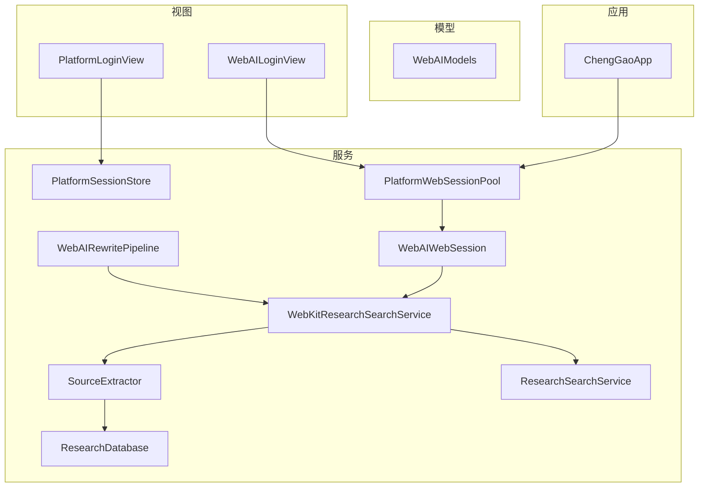
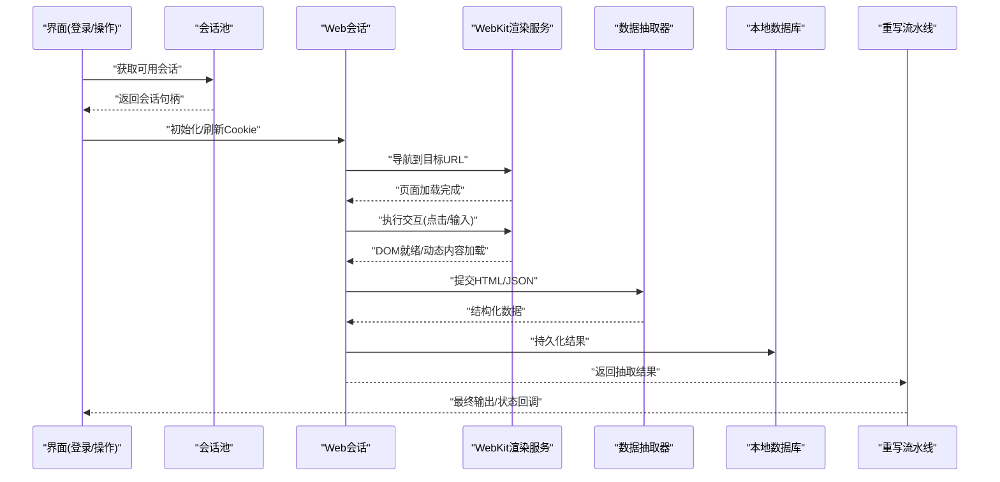
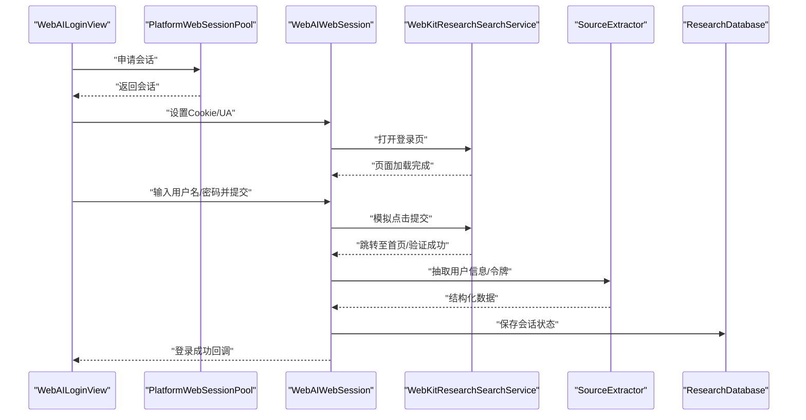
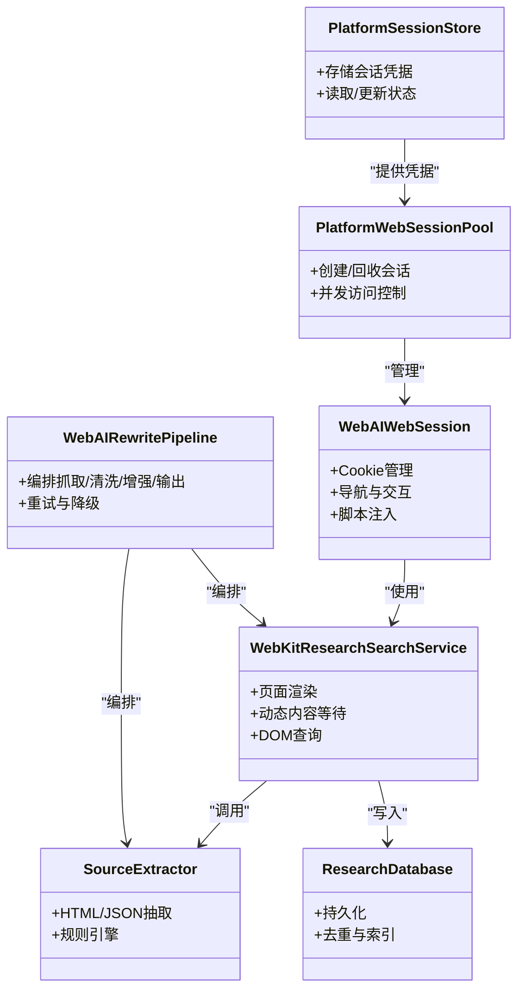

# Web AI流水线

<cite>
**本文引用的文件**   
- [Package.swift](file://Package.swift)
- [README.md](file://README.md)
- [ChengGaoApp.swift](file://Sources/ChengGao/App/ChengGaoApp.swift)
- [WebAIModels.swift](file://Sources/ChengGao/Models/WebAIModels.swift)
- [PlatformSessionStore.swift](file://Sources/ChengGao/Services/PlatformSessionStore.swift)
- [PlatformWebSessionPool.swift](file://Sources/ChengGao/Services/PlatformWebSessionPool.swift)
- [WebAIWebSession.swift](file://Sources/ChengGao/Services/WebAIWebSession.swift)
- [WebAIRewritePipeline.swift](file://Sources/ChengGao/Services/WebAIRewritePipeline.swift)
- [WebKitResearchSearchService.swift](file://Sources/ChengGao/Services/WebKitResearchSearchService.swift)
- [SourceExtractor.swift](file://Sources/ChengGao/Services/SourceExtractor.swift)
- [ResearchDatabase.swift](file://Sources/ChengGao/Services/ResearchDatabase.swift)
- [ResearchSearchService.swift](file://Sources/ChengGao/Services/ResearchSearchService.swift)
- [WebAILoginView.swift](file://Sources/ChengGao/Views/WebAILoginView.swift)
- [PlatformLoginView.swift](file://Sources/ChengGao/Views/PlatformLoginView.swift)
</cite>

## 目录
1. [简介](#简介)
2. [项目结构](#项目结构)
3. [核心组件](#核心组件)
4. [架构总览](#架构总览)
5. [详细组件分析](#详细组件分析)
6. [依赖关系分析](#依赖关系分析)
7. [性能考量](#性能考量)
8. [故障排查指南](#故障排查指南)
9. [结论](#结论)
10. [附录](#附录)

## 简介
本文件面向“Web AI流水线”的实现与使用，聚焦于在iOS/macOS平台上通过WebKit驱动的浏览器模拟能力，完成页面渲染、交互模拟、数据提取与状态管理。文档涵盖会话管理、Cookie处理、反爬虫绕过策略、动态内容等待、异步操作协调与错误恢复机制，并提供网页登录、表单填写和数据抓取的实现示例与最佳实践。该流水线以Swift为语言基础，采用模块化服务设计，将“Web会话池”“研究搜索服务”“重写流水线”等关键能力解耦，便于扩展与维护。

## 项目结构
仓库采用Swift Package组织，核心代码位于Sources/ChengGao下，按App、Models、Services、Stores、Views分层；测试与脚本位于Tests与script目录。与Web AI流水线直接相关的模块包括：
- App入口与窗口配置
- 模型定义（Web AI相关）
- 服务层（会话池、Web会话、研究搜索、源抽取、数据库）
- 视图层（Web AI登录、平台登录）

图表来源
- [ChengGaoApp.swift](file://Sources/ChengGao/App/ChengGaoApp.swift)
- [WebAIModels.swift](file://Sources/ChengGao/Models/WebAIModels.swift)
- [PlatformSessionStore.swift](file://Sources/ChengGao/Services/PlatformSessionStore.swift)
- [PlatformWebSessionPool.swift](file://Sources/ChengGao/Services/PlatformWebSessionPool.swift)
- [WebAIWebSession.swift](file://Sources/ChengGao/Services/WebAIWebSession.swift)
- [WebKitResearchSearchService.swift](file://Sources/ChengGao/Services/WebKitResearchSearchService.swift)
- [SourceExtractor.swift](file://Sources/ChengGao/Services/SourceExtractor.swift)
- [ResearchDatabase.swift](file://Sources/ChengGao/Services/ResearchDatabase.swift)
- [ResearchSearchService.swift](file://Sources/ChengGao/Services/ResearchSearchService.swift)
- [WebAIRewritePipeline.swift](file://Sources/ChengGao/Services/WebAIRewritePipeline.swift)
- [WebAILoginView.swift](file://Sources/ChengGao/Views/WebAILoginView.swift)
- [PlatformLoginView.swift](file://Sources/ChengGao/Views/PlatformLoginView.swift)

章节来源
- [Package.swift](file://Package.swift)
- [README.md](file://README.md)
- [ChengGaoApp.swift](file://Sources/ChengGao/App/ChengGaoApp.swift)

## 核心组件
- 会话存储与会话池
  - PlatformSessionStore：负责持久化平台级会话信息（如认证凭据、设备指纹等），提供跨进程/跨实例的会话一致性。
  - PlatformWebSessionPool：维护一组可复用的Web会话，支持按需创建、回收、健康检查与并发访问控制。
- Web会话封装
  - WebAIWebSession：封装单个Web会话的生命周期，包含Cookie管理、导航、注入脚本、事件监听与资源清理。
- 研究与搜索服务
  - WebKitResearchSearchService：基于WebKit的页面渲染与交互执行，负责动态内容加载、DOM查询与数据抽取。
  - ResearchSearchService：抽象化的搜索服务接口，屏蔽底层实现差异，统一调用契约。
  - SourceExtractor：对HTML/JSON等源数据进行结构化抽取，支持选择器规则与解析策略。
  - ResearchDatabase：本地持久化搜索结果与中间态数据，支持增量更新与去重。
- 重写流水线
  - WebAIRewritePipeline：编排“抓取—清洗—增强—输出”的流水线，串联搜索服务与抽取器，提供重试、回退与结果聚合。
- 视图层
  - WebAILoginView / PlatformLoginView：用户交互入口，触发登录流程并驱动会话初始化。

章节来源
- [PlatformSessionStore.swift](file://Sources/ChengGao/Services/PlatformSessionStore.swift)
- [PlatformWebSessionPool.swift](file://Sources/ChengGao/Services/PlatformWebSessionPool.swift)
- [WebAIWebSession.swift](file://Sources/ChengGao/Services/WebAIWebSession.swift)
- [WebKitResearchSearchService.swift](file://Sources/ChengGao/Services/WebKitResearchSearchService.swift)
- [ResearchSearchService.swift](file://Sources/ChengGao/Services/ResearchSearchService.swift)
- [SourceExtractor.swift](file://Sources/ChengGao/Services/SourceExtractor.swift)
- [ResearchDatabase.swift](file://Sources/ChengGao/Services/ResearchDatabase.swift)
- [WebAIRewritePipeline.swift](file://Sources/ChengGao/Services/WebAIRewritePipeline.swift)
- [WebAILoginView.swift](file://Sources/ChengGao/Views/WebAILoginView.swift)
- [PlatformLoginView.swift](file://Sources/ChengGao/Views/PlatformLoginView.swift)

## 架构总览
Web AI流水线整体遵循“会话池—Web会话—渲染服务—抽取器—数据库—流水线编排”的分层架构。视图层发起请求，经由会话池获取可用会话，再由WebKit服务进行页面渲染与交互，抽取器从渲染结果中提取结构化数据，最终由流水线编排输出结果并持久化。

图表来源
- [PlatformWebSessionPool.swift](file://Sources/ChengGao/Services/PlatformWebSessionPool.swift)
- [WebAIWebSession.swift](file://Sources/ChengGao/Services/WebAIWebSession.swift)
- [WebKitResearchSearchService.swift](file://Sources/ChengGao/Services/WebKitResearchSearchService.swift)
- [SourceExtractor.swift](file://Sources/ChengGao/Services/SourceExtractor.swift)
- [ResearchDatabase.swift](file://Sources/ChengGao/Services/ResearchDatabase.swift)
- [WebAIRewritePipeline.swift](file://Sources/ChengGao/Services/WebAIRewritePipeline.swift)

## 详细组件分析

### 会话管理与Cookie处理
- 会话存储与会话池的职责边界清晰：存储负责持久化，池负责生命周期与并发控制。
- Cookie处理应覆盖以下关键点：
  - 登录成功后同步Cookie到会话存储，确保后续请求携带有效凭证。
  - 针对多域/子域场景，正确设置Cookie作用域与过期时间。
  - 定期刷新或续期，避免会话失效导致请求失败。
- 并发安全：
  - 会话池需保证同一会话不被多个任务同时修改，必要时加锁或队列化。
  - 健康检查与自动回收空闲会话，防止资源泄漏。

章节来源
- [PlatformSessionStore.swift](file://Sources/ChengGao/Services/PlatformSessionStore.swift)
- [PlatformWebSessionPool.swift](file://Sources/ChengGao/Services/PlatformWebSessionPool.swift)
- [WebAIWebSession.swift](file://Sources/ChengGao/Services/WebAIWebSession.swift)

### 页面渲染与交互模拟
- 使用WebKit进行页面渲染时，需关注：
  - 导航超时与重试策略，避免长时间阻塞。
  - 动态内容等待：监听网络请求完成、DOM变化或特定元素可见性。
  - 交互模拟：点击、输入、滚动、弹窗处理等，确保与真实用户行为一致。
- 反爬虫绕过策略：
  - 合理设置User-Agent、Referer、Accept-Language等头部。
  - 模拟人类行为节奏（随机延迟、滚动轨迹）。
  - 处理验证码/滑块等挑战，必要时引入人工介入或第三方服务。

章节来源
- [WebKitResearchSearchService.swift](file://Sources/ChengGao/Services/WebKitResearchSearchService.swift)
- [WebAIWebSession.swift](file://Sources/ChengGao/Services/WebAIWebSession.swift)

### 数据提取与结构化
- SourceExtractor提供灵活的抽取规则：
  - CSS选择器/XPath定位目标节点。
  - JSON路径解析API响应。
  - 文本清洗与格式标准化。
- 抽取失败时的降级策略：
  - 尝试备用选择器或解析器。
  - 记录原始HTML/响应以便调试。
  - 上报异常并触发重试或告警。

章节来源
- [SourceExtractor.swift](file://Sources/ChengGao/Services/SourceExtractor.swift)

### 状态管理与持久化
- ResearchDatabase负责：
  - 结果去重与增量更新。
  - 事务性写入，保证数据一致性。
  - 索引优化，提升查询性能。
- 状态管理建议：
  - 明确每个任务的阶段状态（待处理、进行中、成功、失败、重试中）。
  - 提供状态查询与回调机制，便于UI反馈与日志追踪。

章节来源
- [ResearchDatabase.swift](file://Sources/ChengGao/Services/ResearchDatabase.swift)

### 流水线编排与错误恢复
- WebAIRewritePipeline编排步骤：
  - 抓取：调用搜索服务获取原始数据。
  - 清洗：去除噪声、标准化字段。
  - 增强：补充元数据、关联外部知识。
  - 输出：持久化与返回结果。
- 错误恢复：
  - 指数退避重试，限制最大重试次数。
  - 熔断与降级：当上游不可用时，返回缓存或默认值。
  - 可观测性：记录关键指标与错误堆栈。

章节来源
- [WebAIRewritePipeline.swift](file://Sources/ChengGao/Services/WebAIRewritePipeline.swift)

### 登录与表单填写示例流程
以下为典型登录与表单填写的序列图，展示从界面触发到数据落库的全过程：

图表来源
- [WebAILoginView.swift](file://Sources/ChengGao/Views/WebAILoginView.swift)
- [PlatformWebSessionPool.swift](file://Sources/ChengGao/Services/PlatformWebSessionPool.swift)
- [WebAIWebSession.swift](file://Sources/ChengGao/Services/WebAIWebSession.swift)
- [WebKitResearchSearchService.swift](file://Sources/ChengGao/Services/WebKitResearchSearchService.swift)
- [SourceExtractor.swift](file://Sources/ChengGao/Services/SourceExtractor.swift)
- [ResearchDatabase.swift](file://Sources/ChengGao/Services/ResearchDatabase.swift)

### 数据抓取与最佳实践
- 动态内容等待：
  - 优先监听网络请求完成，而非仅依赖DOM就绪。
  - 使用轮询+超时机制，避免无限等待。
- 异步协调：
  - 使用队列或协程管理并发任务，限制并发度。
  - 任务间通过事件或回调传递状态。
- 错误恢复：
  - 区分可重试与不可重试错误。
  - 记录上下文信息（URL、参数、响应片段）。
- 合规与伦理：
  - 遵守robots.txt与服务条款。
  - 控制请求频率，避免对目标站点造成压力。

章节来源
- [WebKitResearchSearchService.swift](file://Sources/ChengGao/Services/WebKitResearchSearchService.swift)
- [SourceExtractor.swift](file://Sources/ChengGao/Services/SourceExtractor.swift)
- [ResearchDatabase.swift](file://Sources/ChengGao/Services/ResearchDatabase.swift)

## 依赖关系分析
各组件之间的依赖关系如下：

图表来源
- [PlatformSessionStore.swift](file://Sources/ChengGao/Services/PlatformSessionStore.swift)
- [PlatformWebSessionPool.swift](file://Sources/ChengGao/Services/PlatformWebSessionPool.swift)
- [WebAIWebSession.swift](file://Sources/ChengGao/Services/WebAIWebSession.swift)
- [WebKitResearchSearchService.swift](file://Sources/ChengGao/Services/WebKitResearchSearchService.swift)
- [SourceExtractor.swift](file://Sources/ChengGao/Services/SourceExtractor.swift)
- [ResearchDatabase.swift](file://Sources/ChengGao/Services/ResearchDatabase.swift)
- [WebAIRewritePipeline.swift](file://Sources/ChengGao/Services/WebAIRewritePipeline.swift)

章节来源
- [WebAIModels.swift](file://Sources/ChengGao/Models/WebAIModels.swift)
- [ResearchSearchService.swift](file://Sources/ChengGao/Services/ResearchSearchService.swift)

## 性能考量
- 会话复用：减少重复登录与握手开销。
- 并发控制：限制WebKit实例数量，避免内存峰值过高。
- 抽取优化：预编译选择器，缓存解析结果。
- 数据库索引：对常用查询字段建立索引，提升检索速度。
- 缓存策略：对静态资源与热点数据实施缓存，降低重复抓取。

[本节为通用指导，不直接分析具体文件]

## 故障排查指南
- 常见问题定位：
  - 登录失败：检查Cookie是否同步、UA/Referer是否正确、目标站点是否变更登录逻辑。
  - 动态内容未加载：确认网络请求监听、等待条件与超时设置。
  - 抽取结果为空：核对选择器规则、DOM结构变化、编码问题。
  - 数据库写入失败：检查事务、约束与权限。
- 调试建议：
  - 启用详细日志，记录关键步骤与异常堆栈。
  - 捕获原始HTML/响应，便于离线分析。
  - 使用断点与单测覆盖关键路径。

章节来源
- [WebKitResearchSearchService.swift](file://Sources/ChengGao/Services/WebKitResearchSearchService.swift)
- [SourceExtractor.swift](file://Sources/ChengGao/Services/SourceExtractor.swift)
- [ResearchDatabase.swift](file://Sources/ChengGao/Services/ResearchDatabase.swift)

## 结论
本Web AI流水线通过清晰的层次划分与模块化设计，实现了从页面渲染、交互模拟到数据抽取与持久化的完整闭环。借助会话池与WebKit渲染服务，系统具备高可用与可扩展性；结合抽取器与数据库，保障了数据的准确性与可追溯性。在实际应用中，应重点关注动态内容等待、并发控制与错误恢复，以确保稳定高效地运行。

[本节为总结性内容，不直接分析具体文件]

## 附录
- 术语表
  - 会话：一次完整的浏览器上下文，包含Cookie、历史、存储等。
  - 渲染：将HTML/CSS/JS转换为可视页面的过程。
  - 抽取：从非结构化数据中提取结构化信息的操作。
- 参考实现路径
  - 登录流程：参见WebAILoginView与WebKitResearchSearchService的协作。
  - 表单填写：通过WebAIWebSession模拟输入与提交。
  - 数据抓取：使用SourceExtractor与ResearchDatabase完成抽取与持久化。

[本节为补充信息，不直接分析具体文件]