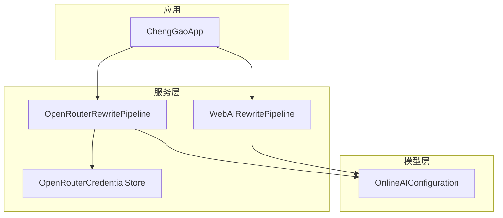
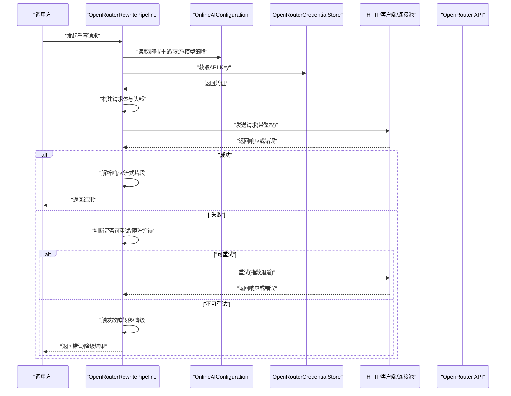
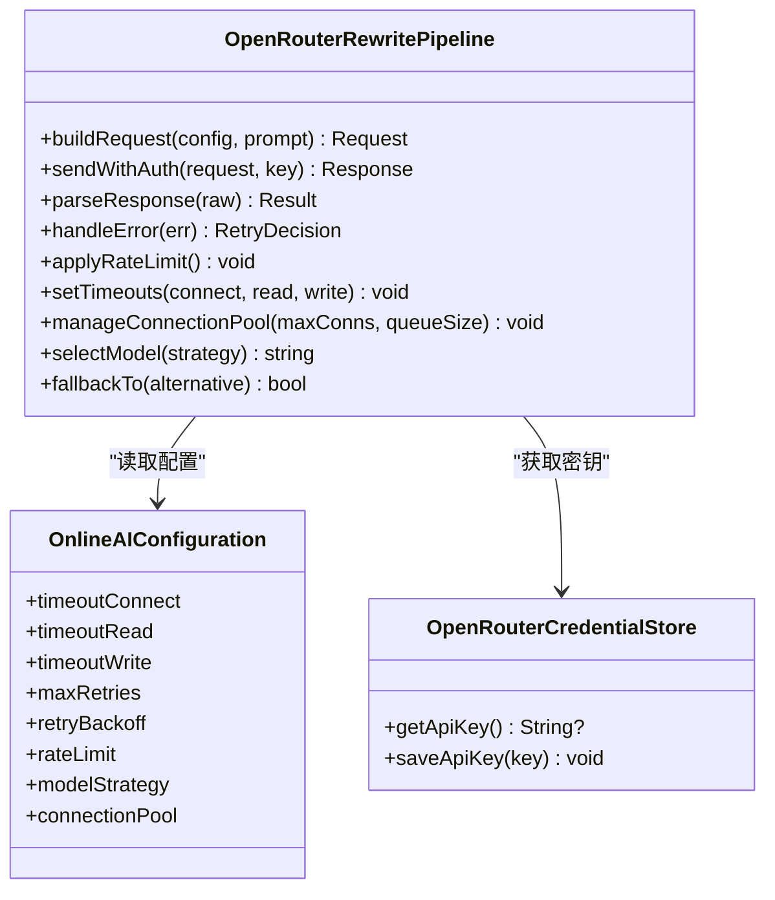
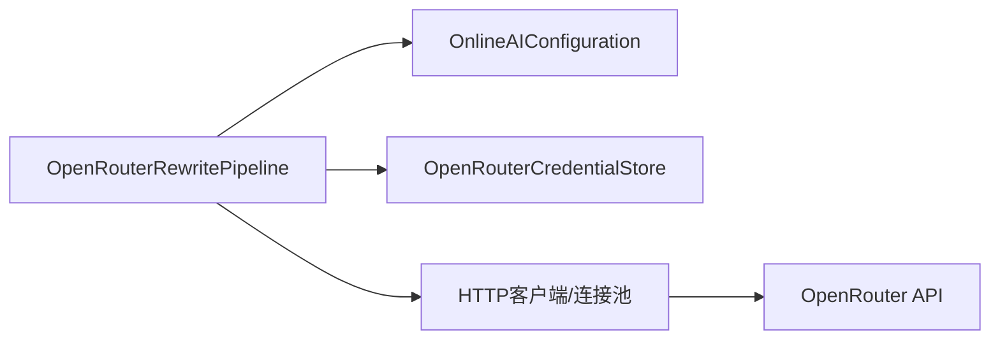
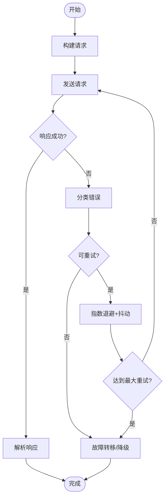

# 在线API流水线

<cite>
**本文引用的文件**   
- [OpenRouterRewritePipeline.swift](file://Sources/ChengGao/Services/OpenRouterRewritePipeline.swift)
- [OnlineAIConfiguration.swift](file://Sources/ChengGao/Models/OnlineAIConfiguration.swift)
- [OpenRouterCredentialStore.swift](file://Sources/ChengGao/Services/OpenRouterCredentialStore.swift)
- [WebAIRewritePipeline.swift](file://Sources/ChengGao/Services/WebAIRewritePipeline.swift)
- [Package.swift](file://Package.swift)
- [README.md](file://README.md)
</cite>

## 目录
1. [简介](#简介)
2. [项目结构](#项目结构)
3. [核心组件](#核心组件)
4. [架构总览](#架构总览)
5. [详细组件分析](#详细组件分析)
6. [依赖关系分析](#依赖关系分析)
7. [性能考量](#性能考量)
8. [故障排查指南](#故障排查指南)
9. [结论](#结论)
10. [附录](#附录)

## 简介
本文件面向“在线API流水线”的实现与使用，重点围绕 OpenRouter API 的集成：请求构建、认证处理、响应解析、错误重试、限流控制、超时处理、连接池管理、多模型路由策略、负载均衡算法与故障转移逻辑。文档同时给出 API 密钥配置、请求监控与性能分析的实际示例路径，帮助读者快速理解并落地实现。

## 项目结构
本项目采用 Swift Package Manager 组织代码，核心在线 API 相关能力位于 Sources/ChengGao/Services 与 Sources/ChengGao/Models 下：
- Services 层负责网络请求编排、认证、重试、限流、连接池等通用能力
- Models 层定义配置与数据模型（如 OnlineAIConfiguration）
- 入口与装配由 Package.swift 管理

图表来源
- [Package.swift](file://Package.swift)
- [README.md](file://README.md)

章节来源
- [Package.swift](file://Package.swift)
- [README.md](file://README.md)

## 核心组件
- OpenRouterRewritePipeline：封装 OpenRouter API 的请求构建、认证注入、响应解析、重试与限流、超时与连接池管理等关键流程
- OnlineAIConfiguration：集中管理在线 AI 服务的配置项（如端点、超时、重试、限流、模型选择等）
- OpenRouterCredentialStore：安全存储与获取 OpenRouter API Key，支持平台级持久化
- WebAIRewritePipeline：通用 Web AI 重写流水线，作为对比或扩展参考

章节来源
- [OpenRouterRewritePipeline.swift](file://Sources/ChengGao/Services/OpenRouterRewritePipeline.swift)
- [OnlineAIConfiguration.swift](file://Sources/ChengGao/Models/OnlineAIConfiguration.swift)
- [OpenRouterCredentialStore.swift](file://Sources/ChengGao/Services/OpenRouterCredentialStore.swift)
- [WebAIRewritePipeline.swift](file://Sources/ChengGao/Services/WebAIRewritePipeline.swift)

## 架构总览
下图展示从调用方到 OpenRouter 的端到端流程，包括认证、限流、超时、重试、路由与负载均衡、以及失败回退。

图表来源
- [OpenRouterRewritePipeline.swift](file://Sources/ChengGao/Services/OpenRouterRewritePipeline.swift)
- [OnlineAIConfiguration.swift](file://Sources/ChengGao/Models/OnlineAIConfiguration.swift)
- [OpenRouterCredentialStore.swift](file://Sources/ChengGao/Services/OpenRouterCredentialStore.swift)

## 详细组件分析

### OpenRouterRewritePipeline：在线API流水线核心
职责概览
- 请求构建：组装 OpenRouter 所需的请求体与头部（含模型名、参数、系统提示等）
- 认证处理：从凭证库获取 API Key，注入到请求头
- 响应解析：解析 JSON 或流式事件，映射为领域对象
- 错误与重试：区分可重试错误（网络抖动、临时限流）与不可重试错误（鉴权失败、参数错误），实施指数退避与最大重试次数
- 限流控制：令牌桶/滑动窗口限流，避免触发服务端 429
- 超时处理：连接超时、读超时、写超时分别配置
- 连接池管理：复用 TCP/TLS 连接，限制并发与队列长度
- 多模型路由与负载均衡：按策略选择模型，结合健康检查与权重轮询
- 故障转移：主模型失败时自动切换到备用模型或降级策略

图表来源
- [OpenRouterRewritePipeline.swift](file://Sources/ChengGao/Services/OpenRouterRewritePipeline.swift)
- [OnlineAIConfiguration.swift](file://Sources/ChengGao/Models/OnlineAIConfiguration.swift)
- [OpenRouterCredentialStore.swift](file://Sources/ChengGao/Services/OpenRouterCredentialStore.swift)

章节来源
- [OpenRouterRewritePipeline.swift](file://Sources/ChengGao/Services/OpenRouterRewritePipeline.swift)

### OnlineAIConfiguration：统一配置中心
要点
- 超时：连接/读/写超时毫秒值
- 重试：最大重试次数、退避策略（固定/指数）、抖动因子
- 限流：QPS 上限、突发容量、窗口大小
- 模型策略：轮询、加权、基于延迟/成功率动态调整
- 连接池：最大连接数、空闲超时、队列长度

章节来源
- [OnlineAIConfiguration.swift](file://Sources/ChengGao/Models/OnlineAIConfiguration.swift)

### OpenRouterCredentialStore：凭证管理
要点
- 安全存储 API Key（平台级钥匙串/加密存储）
- 提供只读访问接口，避免泄露
- 支持热更新与失效检测

章节来源
- [OpenRouterCredentialStore.swift](file://Sources/ChengGao/Services/OpenRouterCredentialStore.swift)

### WebAIRewritePipeline：通用Web AI流水线（参考）
用途
- 作为非 OpenRouter 场景的参考实现，展示通用的请求/响应/重试/限流模式
- 便于对比不同后端的差异与适配方式

章节来源
- [WebAIRewritePipeline.swift](file://Sources/ChengGao/Services/WebAIRewritePipeline.swift)

## 依赖关系分析
- OpenRouterRewritePipeline 依赖 OnlineAIConfiguration 与 OpenRouterCredentialStore
- 通过 HTTP 客户端与连接池与 OpenRouter API 交互
- 错误处理与重试逻辑内聚在 Pipeline 中，保证调用方简洁

图表来源
- [OpenRouterRewritePipeline.swift](file://Sources/ChengGao/Services/OpenRouterRewritePipeline.swift)
- [OnlineAIConfiguration.swift](file://Sources/ChengGao/Models/OnlineAIConfiguration.swift)
- [OpenRouterCredentialStore.swift](file://Sources/ChengGao/Services/OpenRouterCredentialStore.swift)

章节来源
- [OpenRouterRewritePipeline.swift](file://Sources/ChengGao/Services/OpenRouterRewritePipeline.swift)

## 性能考量
- 连接池
  - 合理设置最大连接数与队列长度，避免过多上下文切换与内存占用
  - 启用连接复用，减少握手开销
- 超时
  - 区分连接/读/写超时，避免长尾阻塞
  - 根据模型响应特征调优读超时
- 重试
  - 仅对可重试错误进行指数退避+抖动，避免雪崩
  - 设置最大重试次数与全局熔断阈值
- 限流
  - 客户端令牌桶限流，平滑突发流量，降低 429 概率
  - 结合服务端速率限制反馈动态调整
- 模型路由与负载均衡
  - 基于延迟/成功率动态权重，优先健康节点
  - 热点模型分片与缓存命中优化

[本节为通用指导，不直接分析具体文件]

## 故障排查指南
常见问题与定位步骤
- 鉴权失败
  - 检查 API Key 是否正确加载与过期
  - 确认请求头是否包含正确的 Authorization 字段
- 限流触发（429）
  - 查看客户端限流器状态与 QPS 峰值
  - 调整限流参数或增加重试间隔
- 超时
  - 检查网络状况与服务端负载
  - 适当增大读超时或开启流式响应
- 连接池耗尽
  - 观察活跃连接数与队列长度
  - 扩大连接池或优化并发策略
- 模型不可用
  - 检查健康检查与故障转移是否生效
  - 查看备用模型可用性

章节来源
- [OpenRouterRewritePipeline.swift](file://Sources/ChengGao/Services/OpenRouterRewritePipeline.swift)
- [OnlineAIConfiguration.swift](file://Sources/ChengGao/Models/OnlineAIConfiguration.swift)
- [OpenRouterCredentialStore.swift](file://Sources/ChengGao/Services/OpenRouterCredentialStore.swift)

## 结论
本流水线以 OpenRouterRewritePipeline 为核心，配合 OnlineAIConfiguration 与 OpenRouterCredentialStore，形成完整的在线 API 处理能力。通过统一的请求构建、认证注入、响应解析、重试与限流、超时与连接池管理、多模型路由与负载均衡、故障转移机制，确保在高可用与高性能要求下的稳定运行。建议在生产环境完善监控指标与告警，持续优化参数与策略。

[本节为总结性内容，不直接分析具体文件]

## 附录

### API 密钥配置示例
- 在配置界面保存 OpenRouter API Key 至凭证库
- 启动时校验 Key 有效性，必要时提示用户重新输入
- 支持多账号切换与默认账号选择

章节来源
- [OpenRouterCredentialStore.swift](file://Sources/ChengGao/Services/OpenRouterCredentialStore.swift)
- [OnlineAIConfiguration.swift](file://Sources/ChengGao/Models/OnlineAIConfiguration.swift)

### 请求监控与性能分析示例
- 记录每次请求的关键指标：耗时、状态码、重试次数、限流等待时间、模型名称
- 聚合统计 P50/P95/P99 延迟与错误率
- 输出结构化日志，便于接入外部监控系统

章节来源
- [OpenRouterRewritePipeline.swift](file://Sources/ChengGao/Services/OpenRouterRewritePipeline.swift)
- [OnlineAIConfiguration.swift](file://Sources/ChengGao/Models/OnlineAIConfiguration.swift)

### 多模型路由与负载均衡策略
- 轮询：均匀分发，简单可靠
- 加权轮询：依据历史成功率/延迟分配权重
- 最少连接：将请求发往当前连接最少的模型实例
- 动态自适应：基于实时指标调整权重与淘汰低质模型

章节来源
- [OpenRouterRewritePipeline.swift](file://Sources/ChengGao/Services/OpenRouterRewritePipeline.swift)
- [OnlineAIConfiguration.swift](file://Sources/ChengGao/Models/OnlineAIConfiguration.swift)

### 错误重试与故障转移流程图

图表来源
- [OpenRouterRewritePipeline.swift](file://Sources/ChengGao/Services/OpenRouterRewritePipeline.swift)