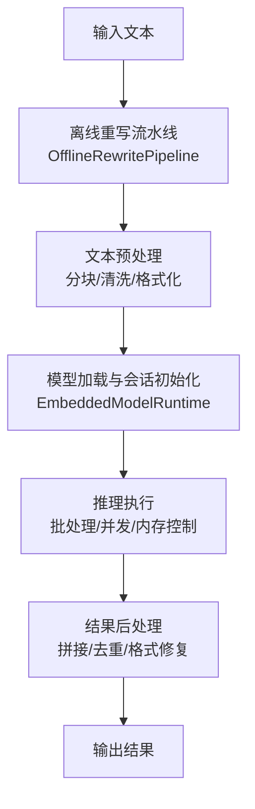
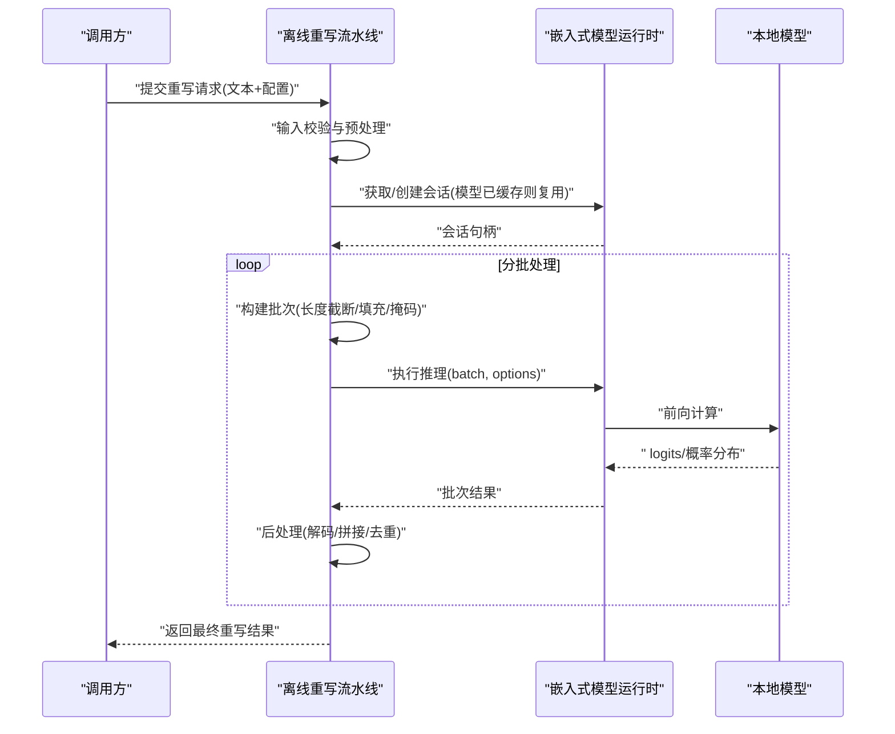
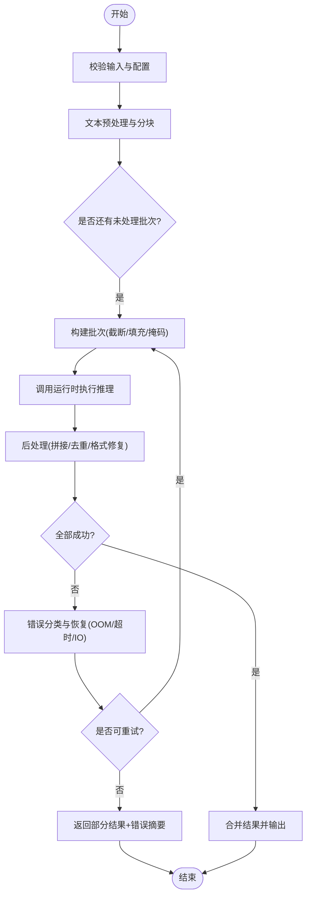
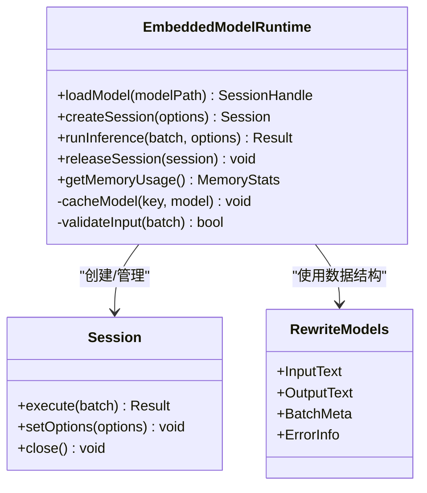
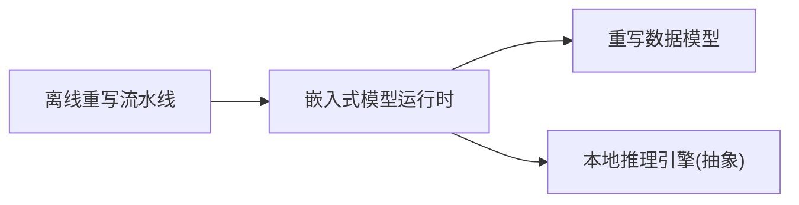

# 离线重写流水线

<cite>
**本文引用的文件**   
- [OfflineRewritePipeline.swift](file://Sources/ChengGao/Services/OfflineRewritePipeline.swift)
- [EmbeddedModelRuntime.swift](file://Sources/ChengGao/Services/EmbeddedModelRuntime.swift)
- [RewriteModels.swift](file://Sources/ChengGao/Models/RewriteModels.swift)
- [OfflineRewritePipelineTests.swift](file://Tests/ChengGaoTests/OfflineRewritePipelineTests.swift)
</cite>

## 目录
1. [简介](#简介)
2. [项目结构](#项目结构)
3. [核心组件](#核心组件)
4. [架构总览](#架构总览)
5. [详细组件分析](#详细组件分析)
6. [依赖关系分析](#依赖关系分析)
7. [性能考虑](#性能考虑)
8. [故障排查指南](#故障排查指南)
9. [结论](#结论)
10. [附录](#附录)

## 简介
本文件面向本地模型推理的离线重写流水线，系统化说明从文本预处理、模型加载、推理执行到结果后处理的完整流程。文档同时覆盖内存管理策略、批处理优化与错误恢复机制，并提供自定义模型集成方法、性能调优参数以及调试工具使用建议。文末给出实际代码示例路径，帮助快速配置和处理不同类型的文本内容。

## 项目结构
离线重写流水线位于 Services 层，围绕“流水线编排 + 运行时嵌入”的模式组织：
- 流水线编排：负责输入校验、分块、调度、并发控制、结果聚合与后处理。
- 运行时嵌入：封装本地推理引擎（如 Core ML / ONNX Runtime 等）的加载、会话创建、批处理与资源释放。
- 数据模型：定义输入输出结构、重写任务描述、批次与结果类型。
- 测试：覆盖关键路径与异常分支，确保稳定性。

[无图表来源，因为该图为概念性结构示意]

## 核心组件
- 离线重写流水线（OfflineRewritePipeline）
  - 职责：接收原始文本，进行预处理；按策略切分批次；调用嵌入式运行时执行推理；对结果进行合并与后处理；提供进度与错误上报。
  - 关键点：可配置的批大小、最大并发、超时、重试次数、内存阈值、日志级别。
- 嵌入式模型运行时（EmbeddedModelRuntime）
  - 职责：加载本地模型文件、创建推理会话、执行批量推理、管理显存/内存占用、释放资源。
  - 关键点：模型缓存、会话复用、批内填充/掩码、OOM 保护与降级。
- 重写数据模型（RewriteModels）
  - 职责：统一输入输出结构、批次元信息、任务配置、错误码与状态。
  - 关键点：强类型约束、序列化友好、便于扩展新字段。

章节来源
- [OfflineRewritePipeline.swift](file://Sources/ChengGao/Services/OfflineRewritePipeline.swift)
- [EmbeddedModelRuntime.swift](file://Sources/ChengGao/Services/EmbeddedModelRuntime.swift)
- [RewriteModels.swift](file://Sources/ChengGao/Models/RewriteModels.swift)

## 架构总览
离线重写流水线采用分层与解耦设计：上层编排关注业务流与策略，下层运行时专注计算与资源管理。两者通过清晰的数据契约交互，便于替换不同推理后端或扩展新的模型类型。

图表来源
- [OfflineRewritePipeline.swift](file://Sources/ChengGao/Services/OfflineRewritePipeline.swift)
- [EmbeddedModelRuntime.swift](file://Sources/ChengGao/Services/EmbeddedModelRuntime.swift)

## 详细组件分析

### 离线重写流水线（OfflineRewritePipeline）
- 输入预处理
  - 文本清洗：去除不可见字符、规范化换行、统一编码。
  - 语义分块：按段落/句子边界切分，保证上下文完整性。
  - 长度控制：依据模型最大上下文窗口进行截断或滑动窗口。
- 批处理与调度
  - 动态批大小：根据可用内存与设备能力自适应调整。
  - 并发控制：限制并行推理数量，避免资源争用。
  - 超时与重试：对单次推理设置超时，失败时按策略重试。
- 推理执行
  - 会话复用：同一模型会话在生命周期内复用，减少加载开销。
  - 批内填充与掩码：对齐序列长度并屏蔽无效位置。
- 结果后处理
  - 片段拼接：按顺序合并各批次输出，保持连贯性。
  - 去重与纠错：移除重复片段，修复标点与格式。
  - 质量检查：基于规则或轻量模型进行一致性校验。
- 错误恢复
  - OOM 降级：自动降低批大小或切换低精度模式。
  - 部分成功：即使部分批次失败，仍返回可用结果并附带警告。
  - 回滚与清理：异常时释放中间缓冲与临时文件。

图表来源
- [OfflineRewritePipeline.swift](file://Sources/ChengGao/Services/OfflineRewritePipeline.swift)

章节来源
- [OfflineRewritePipeline.swift](file://Sources/ChengGao/Services/OfflineRewritePipeline.swift)

### 嵌入式模型运行时（EmbeddedModelRuntime）
- 模型加载与会话管理
  - 模型缓存：按模型指纹缓存二进制与权重，避免重复加载。
  - 会话池：维护多个会话实例，支持并发与隔离。
  - 资源释放：显式释放缓冲区、句柄与临时文件。
- 推理执行
  - 批处理接口：接受张量数组与选项，返回预测结果。
  - 精度与设备：支持 FP32/FP16 切换，选择 CPU/GPU/NPU。
  - 掩码与填充：内部完成序列对齐与注意力掩码。
- 内存与安全
  - 内存监控：跟踪峰值占用，触发告警或降级。
  - 越界保护：防止非法访问与溢出。
  - 崩溃捕获：记录堆栈与上下文，便于定位问题。

图表来源
- [EmbeddedModelRuntime.swift](file://Sources/ChengGao/Services/EmbeddedModelRuntime.swift)
- [RewriteModels.swift](file://Sources/ChengGao/Models/RewriteModels.swift)

章节来源
- [EmbeddedModelRuntime.swift](file://Sources/ChengGao/Services/EmbeddedModelRuntime.swift)
- [RewriteModels.swift](file://Sources/ChengGao/Models/RewriteModels.swift)

### 数据模型（RewriteModels）
- 输入输出
  - 输入：原始文本、任务配置（风格、长度、关键词等）。
  - 输出：重写后的文本、置信度、元数据（耗时、批次号）。
- 批次与错误
  - 批次：包含子任务 ID、偏移、长度、掩码。
  - 错误：错误码、消息、可恢复标志、上下文快照。
- 扩展点
  - 新增字段需向后兼容，默认值明确。
  - 提供验证器与转换器，确保数据一致性。

章节来源
- [RewriteModels.swift](file://Sources/ChengGao/Models/RewriteModels.swift)

## 依赖关系分析
- 模块耦合
  - 流水线依赖运行时提供的会话与推理接口，不直接感知底层实现。
  - 运行时依赖数据模型进行输入输出转换。
- 外部依赖
  - 本地推理引擎（Core ML/ONNX 等）以库形式引入，通过运行时抽象。
  - 系统内存与线程池由平台 SDK 提供。
- 潜在循环依赖
  - 通过接口与数据对象解耦，避免双向引用。

图表来源
- [OfflineRewritePipeline.swift](file://Sources/ChengGao/Services/OfflineRewritePipeline.swift)
- [EmbeddedModelRuntime.swift](file://Sources/ChengGao/Services/EmbeddedModelRuntime.swift)
- [RewriteModels.swift](file://Sources/ChengGao/Models/RewriteModels.swift)

章节来源
- [OfflineRewritePipeline.swift](file://Sources/ChengGao/Services/OfflineRewritePipeline.swift)
- [EmbeddedModelRuntime.swift](file://Sources/ChengGao/Services/EmbeddedModelRuntime.swift)
- [RewriteModels.swift](file://Sources/ChengGao/Models/RewriteModels.swift)

## 性能考虑
- 批处理优化
  - 动态批大小：根据内存水位与延迟目标自动调节。
  - 序列对齐：最小化填充比例，提升吞吐。
  - 零拷贝：尽量复用缓冲区，减少分配与复制。
- 并发与调度
  - 限制并发数，避免上下文切换开销。
  - 优先级队列：重要任务优先处理。
- 精度与设备
  - FP16 加速：在精度允许范围内启用半精度。
  - 设备亲和：将任务绑定到合适硬件单元。
- 缓存与复用
  - 模型与会话缓存：避免重复加载与初始化。
  - 结果缓存：相同输入命中缓存，跳过推理。
- 内存管理
  - 峰值监控与告警：及时释放临时对象。
  - 渐进式释放：长任务中定期回收中间结果。

[本节为通用指导，不直接分析具体文件]

## 故障排查指南
- 常见问题
  - OOM：降低批大小、关闭高精度、增加系统内存。
  - 超时：增大超时阈值、减少并发、优化输入长度。
  - 结果不一致：检查随机种子、温度与采样策略。
- 诊断工具
  - 日志级别：开启详细日志，记录批次与耗时。
  - 内存快照：导出内存使用曲线，定位泄漏。
  - 性能剖析：统计热点函数与 GPU/CPU 利用率。
- 恢复策略
  - 自动重试：指数退避与上限控制。
  - 部分结果：返回可用片段并标注失败原因。
  - 回滚：清理临时文件与会话，恢复稳定状态。

章节来源
- [OfflineRewritePipelineTests.swift](file://Tests/ChengGaoTests/OfflineRewritePipelineTests.swift)

## 结论
离线重写流水线通过清晰的层次划分与严格的资源管理，实现了高效、稳定的本地模型推理。借助批处理优化、内存监控与错误恢复机制，可在多种设备上获得良好性能与可靠性。结合数据模型的扩展点与运行时抽象，便于集成新模型与适配不同平台。

[本节为总结性内容，不直接分析具体文件]

## 附录
- 自定义模型集成步骤
  - 定义模型加载与会话创建接口，遵循运行时契约。
  - 注册模型指纹与版本，纳入缓存体系。
  - 提供批处理与掩码生成逻辑，确保输入对齐。
  - 编写单元测试覆盖正常与异常路径。
- 性能调优参数
  - 批大小、最大并发、超时、重试次数、精度模式、设备选择。
  - 缓存开关、内存阈值、日志级别。
- 调试工具使用
  - 启用详细日志与性能剖析。
  - 导出内存与 CPU/GPU 使用报告。
  - 使用测试用例复现问题并回归验证。
- 实际代码示例（路径参考）
  - 基础重写流程：参见 [OfflineRewritePipeline.swift](file://Sources/ChengGao/Services/OfflineRewritePipeline.swift)
  - 模型加载与会话管理：参见 [EmbeddedModelRuntime.swift](file://Sources/ChengGao/Services/EmbeddedModelRuntime.swift)
  - 输入输出与错误模型：参见 [RewriteModels.swift](file://Sources/ChengGao/Models/RewriteModels.swift)
  - 测试用例与边界场景：参见 [OfflineRewritePipelineTests.swift](file://Tests/ChengGaoTests/OfflineRewritePipelineTests.swift)

[本节为补充信息，不直接分析具体文件]