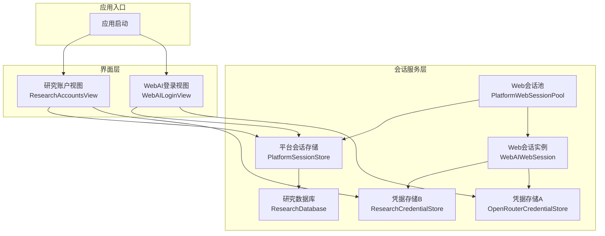
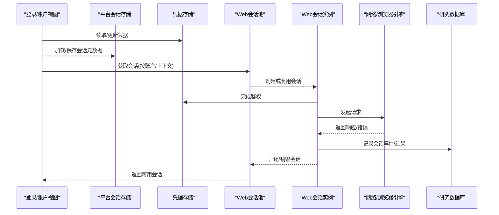
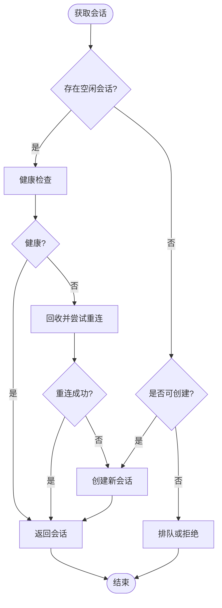
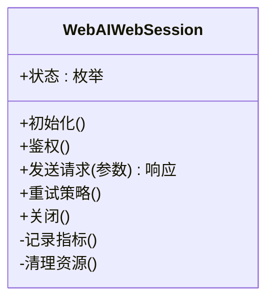
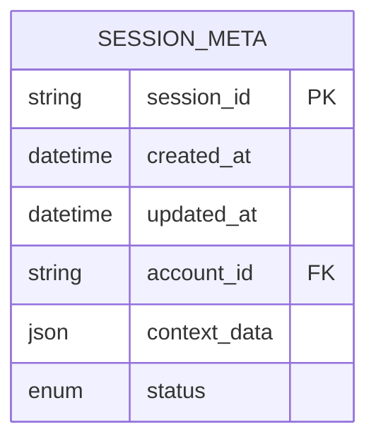
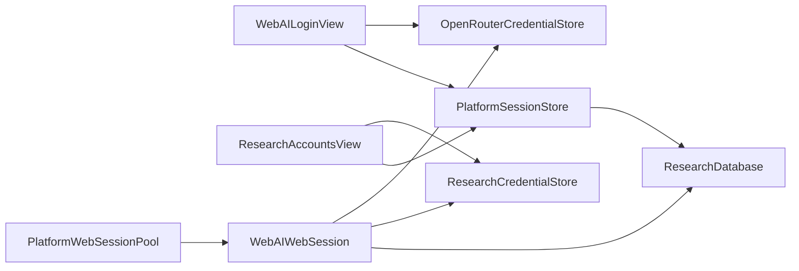

# Web会话管理

<cite>
**本文档引用的文件**   
- [Package.swift](file://Package.swift)
- [README.md](file://README.md)
- [PlatformWebSessionPool.swift](file://Sources/ChengGao/Services/PlatformWebSessionPool.swift)
- [PlatformSessionStore.swift](file://Sources/ChengGao/Services/PlatformSessionStore.swift)
- [WebAIWebSession.swift](file://Sources/ChengGao/Services/WebAIWebSession.swift)
- [ResearchDatabase.swift](file://Sources/ChengGao/Services/ResearchDatabase.swift)
- [OpenRouterCredentialStore.swift](file://Sources/ChengGao/Services/OpenRouterCredentialStore.swift)
- [ResearchCredentialStore.swift](file://Sources/ChengGao/Services/ResearchCredentialStore.swift)
- [WebAILoginView.swift](file://Sources/ChengGao/Views/WebAILoginView.swift)
- [ResearchAccountsView.swift](file://Sources/ChengGao/Views/ResearchAccountsView.swift)
</cite>

## 目录
1. [简介](#简介)
2. [项目结构](#项目结构)
3. [核心组件](#核心组件)
4. [架构总览](#架构总览)
5. [详细组件分析](#详细组件分析)
6. [依赖关系分析](#依赖关系分析)
7. [性能考虑](#性能考虑)
8. [故障排查指南](#故障排查指南)
9. [结论](#结论)
10. [附录](#附录)

## 简介
本文件面向Web会话管理系统，围绕以下目标展开：
- 会话存储机制与跨平台持久化
- 连接池管理与自动重连、故障转移
- 状态同步策略与多账户支持、权限隔离
- 会话生命周期管理、资源清理与安全考量
- 会话监控、性能统计与调试工具使用指南

该文档以仓库中的服务层与会话相关实现为依据，提供从架构到细节的系统性说明，帮助读者快速理解并正确使用系统能力。

## 项目结构
本项目采用Swift Package组织，核心会话能力位于 Services 目录下的若干模块中，UI层通过 Views 暴露登录与账户管理入口。关键路径如下：
- 会话池与会话实例：Services/PlatformWebSessionPool.swift, Services/WebAIWebSession.swift
- 会话持久化与凭据存储：Services/PlatformSessionStore.swift, Services/OpenRouterCredentialStore.swift, Services/ResearchCredentialStore.swift
- 研究数据与数据库访问：Services/ResearchDatabase.swift
- 登录与账户视图：Views/WebAILoginView.swift, Views/ResearchAccountsView.swift
- 包配置与说明：Package.swift, README.md

图表来源
- [Package.swift](file://Package.swift)
- [PlatformWebSessionPool.swift](file://Sources/ChengGao/Services/PlatformWebSessionPool.swift)
- [WebAIWebSession.swift](file://Sources/ChengGao/Services/WebAIWebSession.swift)
- [PlatformSessionStore.swift](file://Sources/ChengGao/Services/PlatformSessionStore.swift)
- [OpenRouterCredentialStore.swift](file://Sources/ChengGao/Services/OpenRouterCredentialStore.swift)
- [ResearchCredentialStore.swift](file://Sources/ChengGao/Services/ResearchCredentialStore.swift)
- [ResearchDatabase.swift](file://Sources/ChengGao/Services/ResearchDatabase.swift)
- [WebAILoginView.swift](file://Sources/ChengGao/Views/WebAILoginView.swift)
- [ResearchAccountsView.swift](file://Sources/ChengGao/Views/ResearchAccountsView.swift)

章节来源
- [Package.swift](file://Package.swift)
- [README.md](file://README.md)

## 核心组件
- Web会话池（PlatformWebSessionPool）
  - 负责创建、复用、回收Web会话实例，维护活跃会话集合与空闲队列，提供获取/归还接口，支持按账户或上下文选择会话。
  - 关注点：并发安全、最大连接数限制、超时与驱逐策略、健康检查。
- Web会话实例（WebAIWebSession）
  - 封装一次Web交互的完整生命周期：初始化、鉴权、请求发送、响应处理、错误重试、资源释放。
  - 关注点：状态机（未初始化/已鉴权/运行中/异常/关闭）、超时控制、上下文隔离。
- 平台会话存储（PlatformSessionStore）
  - 提供跨平台的会话元数据与上下文持久化，包括会话ID、时间戳、绑定账户、扩展属性等。
  - 关注点：原子写入、版本兼容、迁移策略、加密敏感字段。
- 凭据存储（OpenRouterCredentialStore / ResearchCredentialStore）
  - 分别管理不同服务的认证凭据，支持本地安全存储、轮换与最小权限原则。
  - 关注点：密钥保护、访问审计、失败回退。
- 研究数据库（ResearchDatabase）
  - 为会话相关的研究数据提供结构化存储与查询能力，支撑会话状态同步与历史回溯。
  - 关注点：事务一致性、索引优化、读写分离（如适用）。

章节来源
- [PlatformWebSessionPool.swift](file://Sources/ChengGao/Services/PlatformWebSessionPool.swift)
- [WebAIWebSession.swift](file://Sources/ChengGao/Services/WebAIWebSession.swift)
- [PlatformSessionStore.swift](file://Sources/ChengGao/Services/PlatformSessionStore.swift)
- [OpenRouterCredentialStore.swift](file://Sources/ChengGao/Services/OpenRouterCredentialStore.swift)
- [ResearchCredentialStore.swift](file://Sources/ChengGao/Services/ResearchCredentialStore.swift)
- [ResearchDatabase.swift](file://Sources/ChengGao/Services/ResearchDatabase.swift)

## 架构总览
整体采用“会话池 + 会话实例 + 持久化存储 + 凭据管理”的分层设计。UI层仅负责用户输入与展示，业务逻辑下沉至服务层，确保可测试性与可维护性。

图表来源
- [WebAILoginView.swift](file://Sources/ChengGao/Views/WebAILoginView.swift)
- [ResearchAccountsView.swift](file://Sources/ChengGao/Views/ResearchAccountsView.swift)
- [PlatformSessionStore.swift](file://Sources/ChengGao/Services/PlatformSessionStore.swift)
- [OpenRouterCredentialStore.swift](file://Sources/ChengGao/Services/OpenRouterCredentialStore.swift)
- [ResearchCredentialStore.swift](file://Sources/ChengGao/Services/ResearchCredentialStore.swift)
- [PlatformWebSessionPool.swift](file://Sources/ChengGao/Services/PlatformWebSessionPool.swift)
- [WebAIWebSession.swift](file://Sources/ChengGao/Services/WebAIWebSession.swift)
- [ResearchDatabase.swift](file://Sources/ChengGao/Services/ResearchDatabase.swift)

## 详细组件分析

### Web会话池（PlatformWebSessionPool）
- 职责
  - 维护会话对象的生命周期，提供线程安全的获取/归还操作。
  - 实现连接池策略：最大容量、空闲回收、超时驱逐、健康探测。
  - 支持按账户或上下文路由，避免跨账户数据泄露。
- 关键流程
  - 获取会话：优先复用空闲且健康的会话；否则创建新会话；达到上限时排队或拒绝。
  - 归还会话：校验状态，必要时触发清理与重建。
  - 健康检查：定期扫描，标记异常会话并触发重连或替换。
- 并发与锁
  - 使用互斥或队列保证并发安全，避免死锁与饥饿。
- 性能要点
  - 预创建与懒创建结合，降低冷启动延迟。
  - 批量清理与惰性回收，减少频繁GC压力。

图表来源
- [PlatformWebSessionPool.swift](file://Sources/ChengGao/Services/PlatformWebSessionPool.swift)

章节来源
- [PlatformWebSessionPool.swift](file://Sources/ChengGao/Services/PlatformWebSessionPool.swift)

### Web会话实例（WebAIWebSession）
- 职责
  - 封装单次会话的状态机与网络交互，提供统一的请求/响应接口。
  - 管理鉴权、超时、重试、错误恢复与资源释放。
- 状态机
  - 未初始化 → 已鉴权 → 运行中 → 异常 → 关闭
  - 异常态支持自动重连与降级策略。
- 生命周期
  - 初始化：加载凭据、建立连接、预热必要资源。
  - 运行：执行请求，记录指标，处理错误。
  - 关闭：释放底层资源，上报最终状态。
- 安全
  - 最小权限访问凭据，敏感信息不落盘或加密存储。

图表来源
- [WebAIWebSession.swift](file://Sources/ChengGao/Services/WebAIWebSession.swift)

章节来源
- [WebAIWebSession.swift](file://Sources/ChengGao/Services/WebAIWebSession.swift)

### 平台会话存储（PlatformSessionStore）
- 职责
  - 跨平台持久化会话元数据与上下文，保障进程重启后可恢复。
  - 提供原子写入、版本兼容与迁移能力。
- 数据结构
  - 会话ID、创建时间、更新时间、绑定账户、扩展属性、状态快照。
- 安全
  - 对敏感字段进行加密或脱敏，限制访问范围。
- 同步
  - 支持增量同步与冲突解决策略（如最后写入胜出或合并策略）。

图表来源
- [PlatformSessionStore.swift](file://Sources/ChengGao/Services/PlatformSessionStore.swift)

章节来源
- [PlatformSessionStore.swift](file://Sources/ChengGao/Services/PlatformSessionStore.swift)

### 凭据存储（OpenRouterCredentialStore / ResearchCredentialStore）
- 职责
  - 管理不同服务的认证凭据，支持本地安全存储、轮换与审计。
- 特性
  - 最小权限访问、失败回退、过期检测与自动刷新。
  - 与平台安全存储集成（如钥匙串/安全区域），防止明文泄露。
- 使用场景
  - 会话初始化时注入凭据，请求前校验有效性。

章节来源
- [OpenRouterCredentialStore.swift](file://Sources/ChengGao/Services/OpenRouterCredentialStore.swift)
- [ResearchCredentialStore.swift](file://Sources/ChengGao/Services/ResearchCredentialStore.swift)

### 研究数据库（ResearchDatabase）
- 职责
  - 为会话相关的研究数据提供结构化存储与查询，支撑会话状态同步与历史回溯。
- 能力
  - 事务一致性、索引优化、分页查询、备份与恢复。
- 与会话的关系
  - 记录会话事件、结果摘要、错误日志，便于监控与排障。

章节来源
- [ResearchDatabase.swift](file://Sources/ChengGao/Services/ResearchDatabase.swift)

### 登录与账户视图（WebAILoginView / ResearchAccountsView）
- 职责
  - 提供用户登录、切换账户、查看会话状态的界面入口。
- 交互
  - 调用凭据存储进行鉴权，更新会话存储，通知会话池刷新可用会话。
- 权限隔离
  - 基于账户维度隔离会话与数据，避免越权访问。

章节来源
- [WebAILoginView.swift](file://Sources/ChengGao/Views/WebAILoginView.swift)
- [ResearchAccountsView.swift](file://Sources/ChengGao/Views/ResearchAccountsView.swift)

## 依赖关系分析
- 组件耦合
  - 会话池依赖会话实例与存储；会话实例依赖凭据存储与数据库；UI依赖存储与会话池。
- 外部依赖
  - 平台安全存储、网络栈、浏览器引擎（如WebKit）等。
- 潜在循环依赖
  - 通过接口抽象与依赖注入避免直接循环引用。

图表来源
- [WebAILoginView.swift](file://Sources/ChengGao/Views/WebAILoginView.swift)
- [ResearchAccountsView.swift](file://Sources/ChengGao/Views/ResearchAccountsView.swift)
- [PlatformSessionStore.swift](file://Sources/ChengGao/Services/PlatformSessionStore.swift)
- [OpenRouterCredentialStore.swift](file://Sources/ChengGao/Services/OpenRouterCredentialStore.swift)
- [ResearchCredentialStore.swift](file://Sources/ChengGao/Services/ResearchCredentialStore.swift)
- [PlatformWebSessionPool.swift](file://Sources/ChengGao/Services/PlatformWebSessionPool.swift)
- [WebAIWebSession.swift](file://Sources/ChengGao/Services/WebAIWebSession.swift)
- [ResearchDatabase.swift](file://Sources/ChengGao/Services/ResearchDatabase.swift)

章节来源
- [PlatformWebSessionPool.swift](file://Sources/ChengGao/Services/PlatformWebSessionPool.swift)
- [WebAIWebSession.swift](file://Sources/ChengGao/Services/WebAIWebSession.swift)
- [PlatformSessionStore.swift](file://Sources/ChengGao/Services/PlatformSessionStore.swift)
- [OpenRouterCredentialStore.swift](file://Sources/ChengGao/Services/OpenRouterCredentialStore.swift)
- [ResearchCredentialStore.swift](file://Sources/ChengGao/Services/ResearchCredentialStore.swift)
- [ResearchDatabase.swift](file://Sources/ChengGao/Services/ResearchDatabase.swift)

## 性能考虑
- 连接池调优
  - 合理设置最大连接数与空闲阈值，避免过多上下文切换。
  - 启用懒创建与预创建混合策略，平衡内存与延迟。
- 超时与重试
  - 分级超时（连接、读、写），指数退避重试，熔断与降级。
- I/O与缓存
  - 会话元数据与常用配置缓存，减少磁盘与网络开销。
- 监控与统计
  - 采集连接池命中率、平均响应时间、错误率、内存占用等指标。
- 资源清理
  - 及时释放底层资源，避免泄漏；在异常路径也需确保清理。

[本节为通用指导，不直接分析具体文件]

## 故障排查指南
- 常见问题定位
  - 会话无法获取：检查连接池容量与健康检查；查看凭据有效性。
  - 鉴权失败：核对凭据存储内容、过期时间与刷新策略。
  - 请求超时：检查网络状况、服务端限流与重试策略。
  - 数据不一致：确认存储写入顺序与事务边界，检查同步冲突解决策略。
- 诊断手段
  - 开启详细日志（会话生命周期、网络请求、存储操作）。
  - 导出会话快照与数据库片段，复现问题。
  - 使用性能统计面板观察热点与瓶颈。
- 恢复策略
  - 自动重连与故障转移；必要时强制重建会话与清理脏数据。

章节来源
- [PlatformWebSessionPool.swift](file://Sources/ChengGao/Services/PlatformWebSessionPool.swift)
- [WebAIWebSession.swift](file://Sources/ChengGao/Services/WebAIWebSession.swift)
- [PlatformSessionStore.swift](file://Sources/ChengGao/Services/PlatformSessionStore.swift)
- [OpenRouterCredentialStore.swift](file://Sources/ChengGao/Services/OpenRouterCredentialStore.swift)
- [ResearchCredentialStore.swift](file://Sources/ChengGao/Services/ResearchCredentialStore.swift)
- [ResearchDatabase.swift](file://Sources/ChengGao/Services/ResearchDatabase.swift)

## 结论
本Web会话管理系统通过清晰的层次划分与模块化设计，实现了跨平台会话持久化、连接池管理、自动重连与故障转移、多账户权限隔离与数据同步。配合完善的监控与调试能力，可在复杂环境下保持高可用与高性能。建议在生产环境持续优化连接池参数、完善指标采集与告警，并加强安全审计与合规检查。

[本节为总结，不直接分析具体文件]

## 附录
- 术语表
  - 会话：一次完整的Web交互上下文，包含鉴权、状态与资源。
  - 连接池：复用会话对象的容器，提升性能与稳定性。
  - 故障转移：在主节点不可用时切换到备用节点或重建会话。
- 最佳实践
  - 始终最小化凭据暴露面，使用平台安全存储。
  - 为所有I/O操作设置超时与重试，避免阻塞。
  - 定期清理闲置会话与历史数据，控制存储增长。
  - 对关键路径添加埋点与指标，便于问题定位与容量规划。

[本节为概念性内容，不直接分析具体文件]