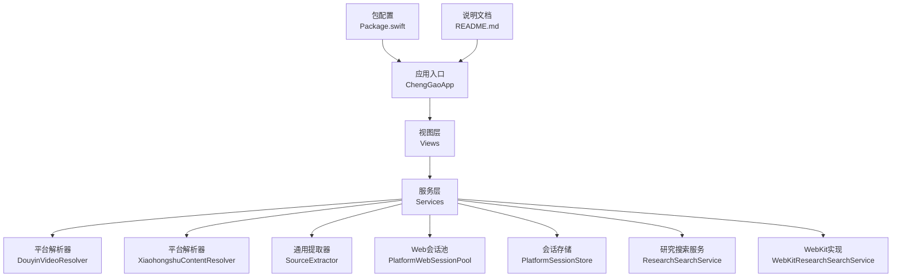
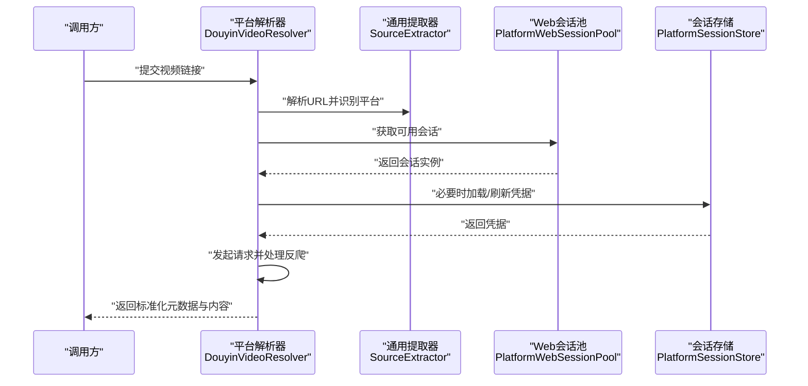
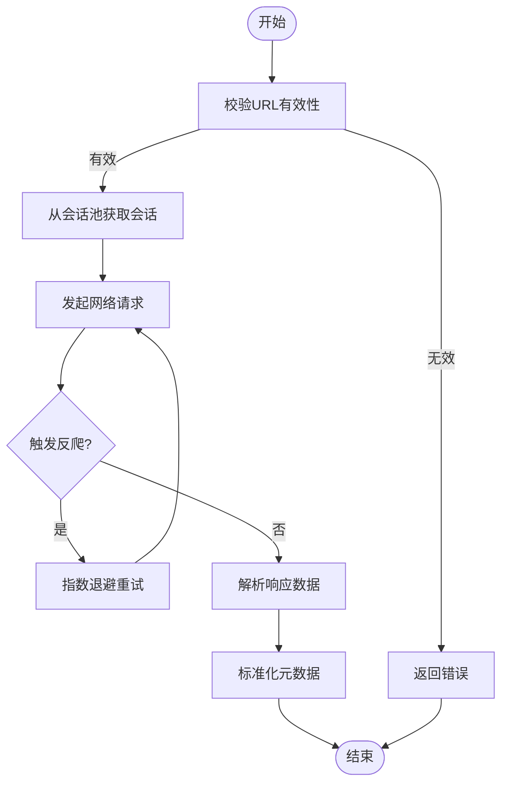
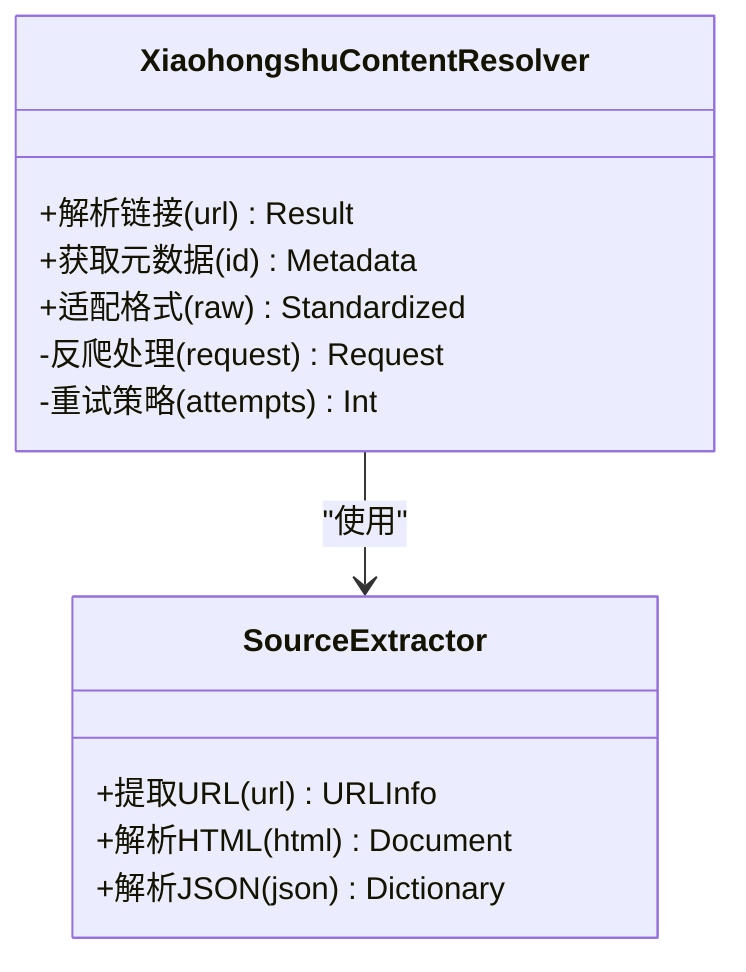
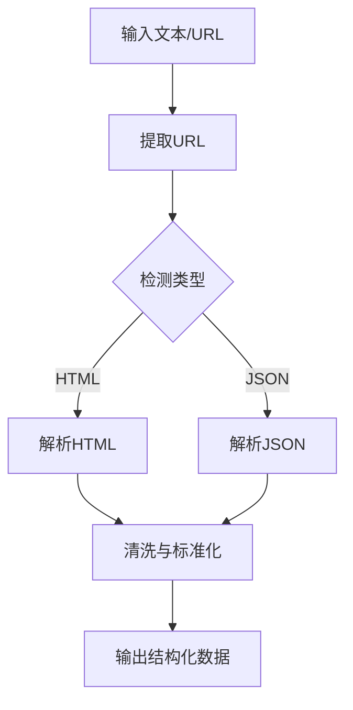
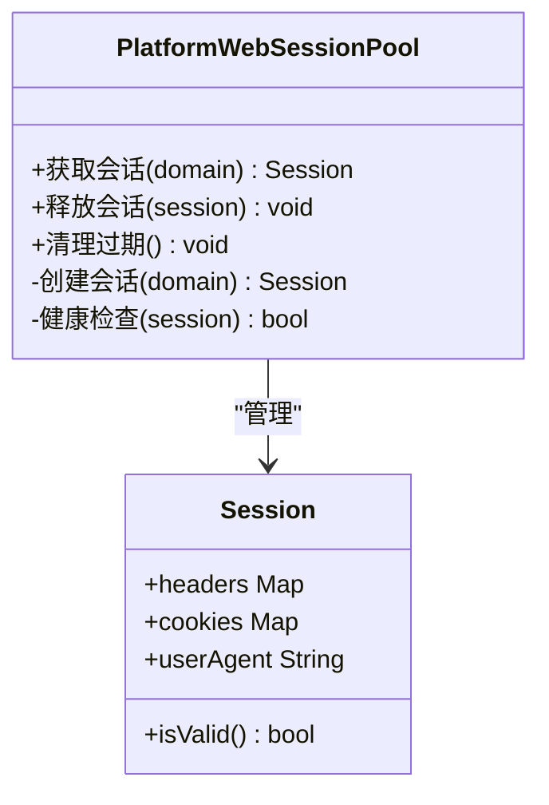
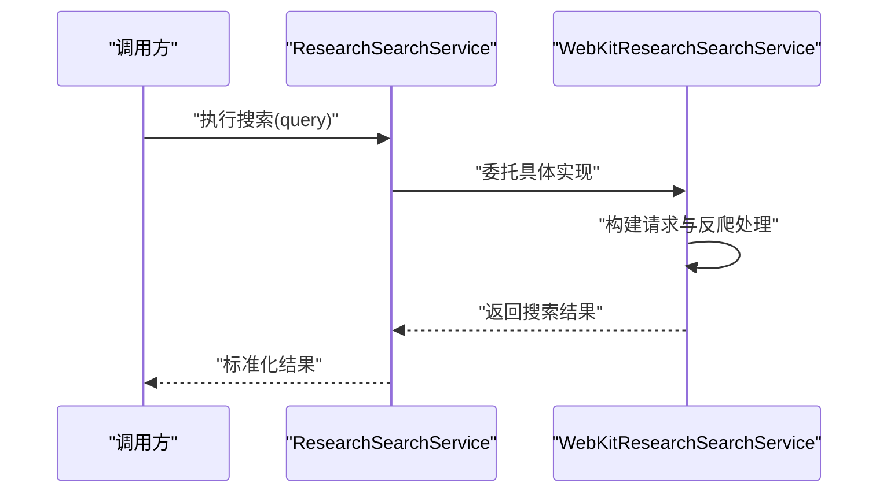
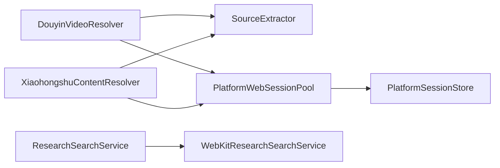

# 内容解析服务

<cite>
**本文引用的文件**   
- [DouyinVideoResolver.swift](file://Sources/ChengGao/Services/DouyinVideoResolver.swift)
- [XiaohongshuContentResolver.swift](file://Sources/ChengGao/Services/XiaohongshuContentResolver.swift)
- [SourceExtractor.swift](file://Sources/ChengGao/Services/SourceExtractor.swift)
- [PlatformWebSessionPool.swift](file://Sources/ChengGao/Services/PlatformWebSessionPool.swift)
- [PlatformSessionStore.swift](file://Sources/ChengGao/Services/PlatformSessionStore.swift)
- [ResearchSearchService.swift](file://Sources/ChengGao/Services/ResearchSearchService.swift)
- [WebKitResearchSearchService.swift](file://Sources/ChengGao/Services/WebKitResearchSearchService.swift)
- [Package.swift](file://Package.swift)
- [README.md](file://README.md)
</cite>

## 目录
1. [简介](#简介)
2. [项目结构](#项目结构)
3. [核心组件](#核心组件)
4. [架构总览](#架构总览)
5. [详细组件分析](#详细组件分析)
6. [依赖关系分析](#依赖关系分析)
7. [性能考量](#性能考量)
8. [故障排查指南](#故障排查指南)
9. [结论](#结论)
10. [附录](#附录)

## 简介
本文件为“内容解析服务”的完整技术文档，面向多平台内容提取、反爬虫策略与格式适配机制。重点覆盖：
- 视频链接解析（以抖音为例）与元数据获取
- 内容预处理流程（去重、质量评估、缓存）
- 平台特定API调用、错误处理与重试机制
- 新平台接入指南、解析器开发规范与测试方法

该服务基于Swift/SwiftUI工程组织，采用模块化服务设计，将平台解析器、会话池、搜索服务等解耦，便于扩展与维护。

## 项目结构
本项目采用按功能域划分的目录组织方式，核心解析能力集中在 Services 目录中，包含平台解析器、会话管理、搜索与辅助工具等模块。关键入口与配置位于 Package.swift 与 README.md。

图表来源
- [Package.swift](file://Package.swift)
- [README.md](file://README.md)

章节来源
- [Package.swift](file://Package.swift)
- [README.md](file://README.md)

## 核心组件
本节概述内容解析服务的核心组件及其职责：
- 平台解析器：针对具体平台（如抖音、小红书）进行链接解析、元数据抓取与内容适配
- 通用提取器：提供跨平台的URL识别、基础HTML/JSON解析能力
- Web会话池：统一管理浏览器会话、Cookie、UA等，支撑反爬与稳定性
- 会话存储：持久化平台登录态与必要凭据
- 搜索服务：封装研究与检索能力，支持不同后端实现

章节来源
- [DouyinVideoResolver.swift](file://Sources/ChengGao/Services/DouyinVideoResolver.swift)
- [XiaohongshuContentResolver.swift](file://Sources/ChengGao/Services/XiaohongshuContentResolver.swift)
- [SourceExtractor.swift](file://Sources/ChengGao/Services/SourceExtractor.swift)
- [PlatformWebSessionPool.swift](file://Sources/ChengGao/Services/PlatformWebSessionPool.swift)
- [PlatformSessionStore.swift](file://Sources/ChengGao/Services/PlatformSessionStore.swift)
- [ResearchSearchService.swift](file://Sources/ChengGao/Services/ResearchSearchService.swift)
- [WebKitResearchSearchService.swift](file://Sources/ChengGao/Services/WebKitResearchSearchService.swift)

## 架构总览
内容解析服务采用分层架构：
- 接入层：接收用户输入或外部请求，统一路由到对应平台解析器
- 解析层：平台解析器负责目标站点的数据抓取、反爬应对与结果标准化
- 数据层：通用提取器、会话池与会话存储提供底层能力
- 控制层：搜索服务与编排逻辑协调各组件完成端到端流程

图表来源
- [DouyinVideoResolver.swift](file://Sources/ChengGao/Services/DouyinVideoResolver.swift)
- [SourceExtractor.swift](file://Sources/ChengGao/Services/SourceExtractor.swift)
- [PlatformWebSessionPool.swift](file://Sources/ChengGao/Services/PlatformWebSessionPool.swift)
- [PlatformSessionStore.swift](file://Sources/ChengGao/Services/PlatformSessionStore.swift)

## 详细组件分析

### 抖音视频解析器（DouyinVideoResolver）
职责与流程：
- URL识别与校验：判断是否为抖音有效链接
- 元数据获取：标题、作者、时长、封面、播放地址等
- 反爬策略：动态UA、请求头伪装、延迟与重试
- 结果标准化：统一输出结构，便于上层消费

图表来源
- [DouyinVideoResolver.swift](file://Sources/ChengGao/Services/DouyinVideoResolver.swift)

章节来源
- [DouyinVideoResolver.swift](file://Sources/ChengGao/Services/DouyinVideoResolver.swift)

### 小红书内容解析器（XiaohongshuContentResolver）
职责与流程：
- 笔记链接解析：识别笔记ID与参数
- 内容抓取：图文、视频、标签、互动数据
- 反爬策略：模拟浏览器行为、频率控制
- 格式适配：将平台差异字段映射为标准模型

图表来源
- [XiaohongshuContentResolver.swift](file://Sources/ChengGao/Services/XiaohongshuContentResolver.swift)
- [SourceExtractor.swift](file://Sources/ChengGao/Services/SourceExtractor.swift)

章节来源
- [XiaohongshuContentResolver.swift](file://Sources/ChengGao/Services/XiaohongshuContentResolver.swift)
- [SourceExtractor.swift](file://Sources/ChengGao/Services/SourceExtractor.swift)

### 通用提取器（SourceExtractor）
职责：
- URL识别：从文本中提取有效链接
- HTML/JSON解析：提供统一的解析接口
- 数据清洗：去除噪声、规范化字段

图表来源
- [SourceExtractor.swift](file://Sources/ChengGao/Services/SourceExtractor.swift)

章节来源
- [SourceExtractor.swift](file://Sources/ChengGao/Services/SourceExtractor.swift)

### Web会话池（PlatformWebSessionPool）
职责：
- 会话生命周期管理：创建、复用、销毁
- 资源隔离：按平台或域名隔离Cookie与状态
- 健康检查：自动剔除失效会话

图表来源
- [PlatformWebSessionPool.swift](file://Sources/ChengGao/Services/PlatformWebSessionPool.swift)

章节来源
- [PlatformWebSessionPool.swift](file://Sources/ChengGao/Services/PlatformWebSessionPool.swift)

### 会话存储（PlatformSessionStore）
职责：
- 持久化平台登录态与凭据
- 安全访问：加密存储敏感信息
- 同步与异步更新：保证一致性

章节来源
- [PlatformSessionStore.swift](file://Sources/ChengGao/Services/PlatformSessionStore.swift)

### 研究搜索服务（ResearchSearchService 与 WebKitResearchSearchService）
职责：
- 抽象搜索接口：统一查询与结果处理
- WebKit实现：基于WebKit渲染页面，增强反爬能力
- 结果标准化：将不同来源结果统一为可消费格式

图表来源
- [ResearchSearchService.swift](file://Sources/ChengGao/Services/ResearchSearchService.swift)
- [WebKitResearchSearchService.swift](file://Sources/ChengGao/Services/WebKitResearchSearchService.swift)

章节来源
- [ResearchSearchService.swift](file://Sources/ChengGao/Services/ResearchSearchService.swift)
- [WebKitResearchSearchService.swift](file://Sources/ChengGao/Services/WebKitResearchSearchService.swift)

## 依赖关系分析
组件间依赖清晰，遵循单一职责与高内聚低耦合原则：
- 平台解析器依赖通用提取器与会话池
- 会话池与会话存储协作管理状态
- 搜索服务通过抽象接口屏蔽实现差异

图表来源
- [DouyinVideoResolver.swift](file://Sources/ChengGao/Services/DouyinVideoResolver.swift)
- [XiaohongshuContentResolver.swift](file://Sources/ChengGao/Services/XiaohongshuContentResolver.swift)
- [SourceExtractor.swift](file://Sources/ChengGao/Services/SourceExtractor.swift)
- [PlatformWebSessionPool.swift](file://Sources/ChengGao/Services/PlatformWebSessionPool.swift)
- [PlatformSessionStore.swift](file://Sources/ChengGao/Services/PlatformSessionStore.swift)
- [ResearchSearchService.swift](file://Sources/ChengGao/Services/ResearchSearchService.swift)
- [WebKitResearchSearchService.swift](file://Sources/ChengGao/Services/WebKitResearchSearchService.swift)

章节来源
- [DouyinVideoResolver.swift](file://Sources/ChengGao/Services/DouyinVideoResolver.swift)
- [XiaohongshuContentResolver.swift](file://Sources/ChengGao/Services/XiaohongshuContentResolver.swift)
- [SourceExtractor.swift](file://Sources/ChengGao/Services/SourceExtractor.swift)
- [PlatformWebSessionPool.swift](file://Sources/ChengGao/Services/PlatformWebSessionPool.swift)
- [PlatformSessionStore.swift](file://Sources/ChengGao/Services/PlatformSessionStore.swift)
- [ResearchSearchService.swift](file://Sources/ChengGao/Services/ResearchSearchService.swift)
- [WebKitResearchSearchService.swift](file://Sources/ChengGao/Services/WebKitResearchSearchService.swift)

## 性能考量
- 会话复用：通过会话池减少握手开销，提升并发能力
- 智能重试：指数退避与最大重试次数限制，避免雪崩
- 缓存策略：对热点元数据进行短期缓存，降低重复请求
- 去重处理：基于URL指纹与内容哈希避免重复解析
- 质量评估：根据响应完整性、时效性与可信度评分，过滤低质内容

[本节为通用指导，不直接分析具体文件]

## 故障排查指南
常见问题与定位建议：
- 解析失败：检查URL有效性、平台接口变更、反爬策略是否生效
- 会话异常：验证会话池健康检查、凭据是否过期
- 网络错误：确认超时设置、重试策略与限流配置
- 数据不一致：核对标准化字段映射与清洗规则

章节来源
- [DouyinVideoResolver.swift](file://Sources/ChengGao/Services/DouyinVideoResolver.swift)
- [PlatformWebSessionPool.swift](file://Sources/ChengGao/Services/PlatformWebSessionPool.swift)
- [PlatformSessionStore.swift](file://Sources/ChengGao/Services/PlatformSessionStore.swift)

## 结论
内容解析服务通过模块化设计与清晰的职责划分，实现了多平台内容提取、反爬应对与格式适配的统一能力。未来可进一步扩展更多平台解析器，优化缓存与去重策略，提升整体性能与稳定性。

[本节为总结性内容，不直接分析具体文件]

## 附录

### 新平台接入指南
步骤：
1. 新建平台解析器类，继承或实现标准接口
2. 实现URL识别、元数据抓取与格式适配
3. 集成会话池与会话存储，确保反爬与状态管理
4. 编写单元测试与集成测试，覆盖正常与异常路径
5. 注册到路由或工厂，供上层调用

章节来源
- [DouyinVideoResolver.swift](file://Sources/ChengGao/Services/DouyinVideoResolver.swift)
- [XiaohongshuContentResolver.swift](file://Sources/ChengGao/Services/XiaohongshuContentResolver.swift)
- [SourceExtractor.swift](file://Sources/ChengGao/Services/SourceExtractor.swift)
- [PlatformWebSessionPool.swift](file://Sources/ChengGao/Services/PlatformWebSessionPool.swift)
- [PlatformSessionStore.swift](file://Sources/ChengGao/Services/PlatformSessionStore.swift)

### 解析器开发规范
- 命名约定：以平台名+Resolver结尾，如 DouyinVideoResolver
- 接口统一：输入URL，输出标准化元数据模型
- 错误处理：明确区分网络错误、解析错误与业务错误
- 日志记录：关键步骤打点，便于追踪与调试
- 可测试性：注入依赖，支持Mock与断言

章节来源
- [DouyinVideoResolver.swift](file://Sources/ChengGao/Services/DouyinVideoResolver.swift)
- [XiaohongshuContentResolver.swift](file://Sources/ChengGao/Services/XiaohongshuContentResolver.swift)
- [SourceExtractor.swift](file://Sources/ChengGao/Services/SourceExtractor.swift)

### 测试方法
- 单元测试：针对解析逻辑、数据清洗与格式化进行断言
- 集成测试：模拟真实网络环境，验证端到端流程
- 反爬测试：覆盖限流、验证码与封禁场景
- 性能测试：压测会话池与缓存命中率

章节来源
- [DouyinVideoResolver.swift](file://Sources/ChengGao/Services/DouyinVideoResolver.swift)
- [XiaohongshuContentResolver.swift](file://Sources/ChengGao/Services/XiaohongshuContentResolver.swift)
- [PlatformWebSessionPool.swift](file://Sources/ChengGao/Services/PlatformWebSessionPool.swift)