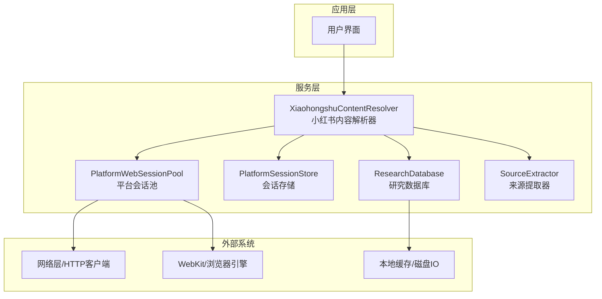
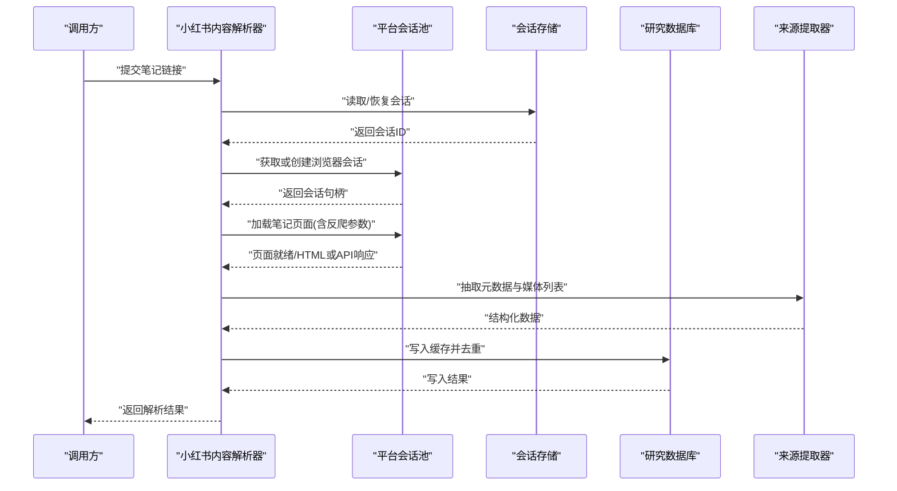
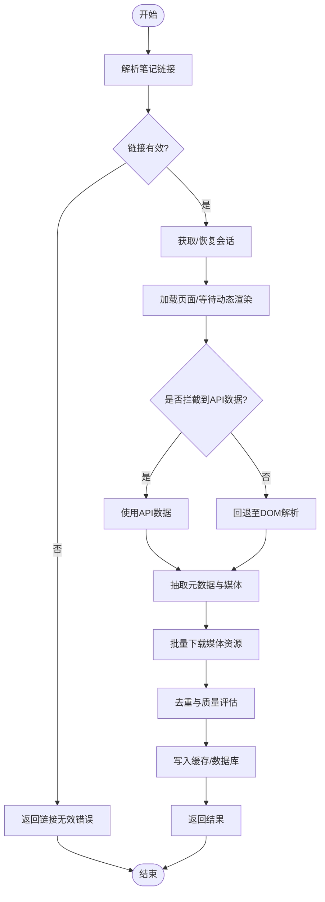
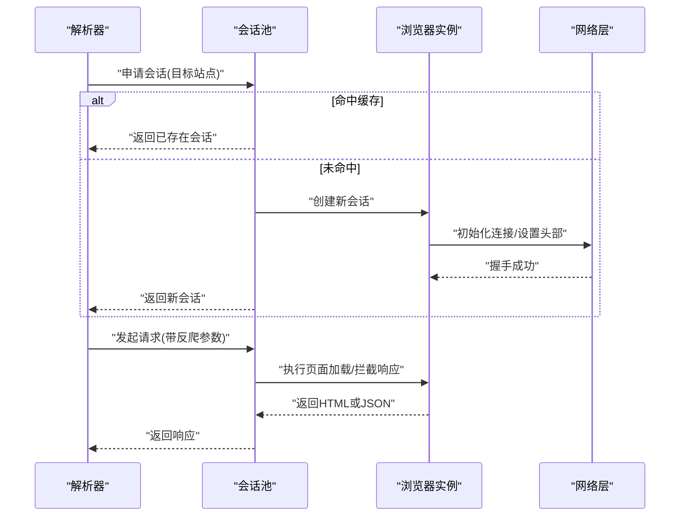
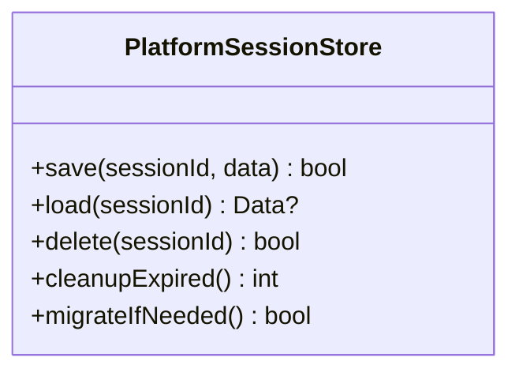
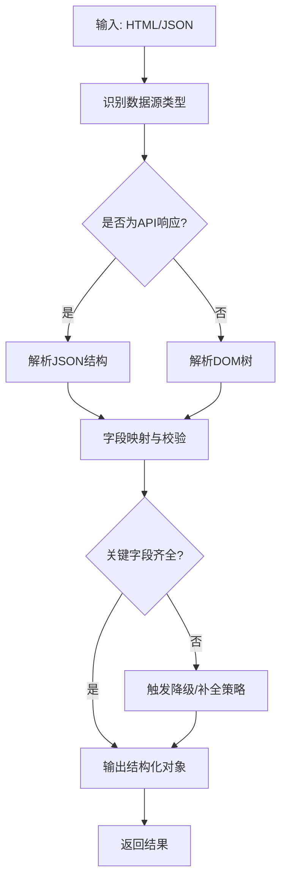
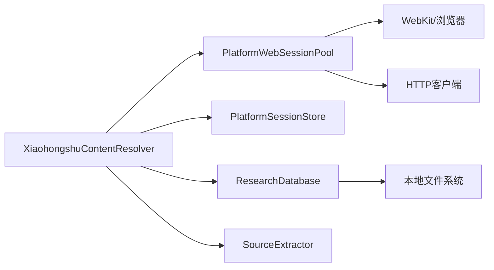

# 小红书内容解析器

<cite>
**本文引用的文件**   
- [XiaohongshuContentResolver.swift](file://Sources/ChengGao/Services/XiaohongshuContentResolver.swift)
- [PlatformWebSessionPool.swift](file://Sources/ChengGao/Services/PlatformWebSessionPool.swift)
- [PlatformSessionStore.swift](file://Sources/ChengGao/Services/PlatformSessionStore.swift)
- [ResearchDatabase.swift](file://Sources/ChengGao/Services/ResearchDatabase.swift)
- [SourceExtractor.swift](file://Sources/ChengGao/Services/SourceExtractor.swift)
- [Package.swift](file://Package.swift)
</cite>

## 目录
1. [简介](#简介)
2. [项目结构](#项目结构)
3. [核心组件](#核心组件)
4. [架构总览](#架构总览)
5. [详细组件分析](#详细组件分析)
6. [依赖关系分析](#依赖关系分析)
7. [性能考量](#性能考量)
8. [故障排查指南](#故障排查指南)
9. [结论](#结论)
10. [附录](#附录)

## 简介
本文件面向小红书内容解析器的设计与实现，重点覆盖以下能力：
- 笔记链接解析与动态内容加载
- 图文内容提取与媒体资源获取
- 反爬虫绕过策略与异步数据处理
- 笔记元数据结构、标签提取与内容分类机制
- API集成示例、数据格式转换与缓存策略
- 内容去重、质量评估与错误恢复机制

该文档以仓库中的服务层代码为依据，结合工程化实践给出可操作的说明与图示。

## 项目结构
本项目采用模块化组织，解析相关逻辑集中在 Services 目录下的若干 Swift 文件中：
- XiaohongshuContentResolver.swift：小红书内容解析主入口，负责链接解析、请求编排、结果组装
- PlatformWebSessionPool.swift：平台级 Web 会话池，管理浏览器实例与网络上下文
- PlatformSessionStore.swift：会话持久化存储，用于登录态与 Cookie 的跨进程保存
- ResearchDatabase.swift：研究数据存储，提供本地缓存与查询接口
- SourceExtractor.swift：通用来源提取工具，辅助从页面或响应中提取结构化信息
- Package.swift：Swift Package 清单，定义模块与依赖

图表来源
- [XiaohongshuContentResolver.swift](file://Sources/ChengGao/Services/XiaohongshuContentResolver.swift)
- [PlatformWebSessionPool.swift](file://Sources/ChengGao/Services/PlatformWebSessionPool.swift)
- [PlatformSessionStore.swift](file://Sources/ChengGao/Services/PlatformSessionStore.swift)
- [ResearchDatabase.swift](file://Sources/ChengGao/Services/ResearchDatabase.swift)
- [SourceExtractor.swift](file://Sources/ChengGao/Services/SourceExtractor.swift)

章节来源
- [Package.swift](file://Package.swift)

## 核心组件
- 小红书内容解析器（XiaohongshuContentResolver）
  - 职责：解析小红书笔记链接、发起请求、处理动态渲染、抽取图文与媒体、封装结果模型
  - 关键流程：URL校验 -> 会话选择/创建 -> 页面加载 -> DOM/JSON抽取 -> 媒体下载 -> 结果组装
- 平台会话池（PlatformWebSessionPool）
  - 职责：维护多个浏览器会话，支持并发访问与隔离，避免单点限流
  - 关键能力：会话复用、超时控制、重试与退避、UA/Referer 等头定制
- 会话存储（PlatformSessionStore）
  - 职责：持久化登录态、Cookie、Token，保障会话跨重启可用
  - 关键能力：安全存储、过期清理、版本兼容
- 研究数据库（ResearchDatabase）
  - 职责：本地缓存解析结果、索引与检索、增量更新
  - 关键能力：键值/关系存储、去重策略、批量写入
- 来源提取器（SourceExtractor）
  - 职责：从 HTML/JSON 中抽取标题、正文、图片、视频、标签、作者等字段
  - 关键能力：正则匹配、DOM 选择器、容错与降级

章节来源
- [XiaohongshuContentResolver.swift](file://Sources/ChengGao/Services/XiaohongshuContentResolver.swift)
- [PlatformWebSessionPool.swift](file://Sources/ChengGao/Services/PlatformWebSessionPool.swift)
- [PlatformSessionStore.swift](file://Sources/ChengGao/Services/PlatformSessionStore.swift)
- [ResearchDatabase.swift](file://Sources/ChengGao/Services/ResearchDatabase.swift)
- [SourceExtractor.swift](file://Sources/ChengGao/Services/SourceExtractor.swift)

## 架构总览
整体采用“解析器 + 会话池 + 存储 + 提取器”的分层架构，强调解耦与可扩展性。解析器作为门面协调各子系统；会话池屏蔽底层浏览器差异；存储层提供可靠的数据落地；提取器专注结构化抽取。

图表来源
- [XiaohongshuContentResolver.swift](file://Sources/ChengGao/Services/XiaohongshuContentResolver.swift)
- [PlatformWebSessionPool.swift](file://Sources/ChengGao/Services/PlatformWebSessionPool.swift)
- [PlatformSessionStore.swift](file://Sources/ChengGao/Services/PlatformSessionStore.swift)
- [ResearchDatabase.swift](file://Sources/ChengGao/Services/ResearchDatabase.swift)
- [SourceExtractor.swift](file://Sources/ChengGao/Services/SourceExtractor.swift)

## 详细组件分析

### 小红书内容解析器（XiaohongshuContentResolver）
- 功能要点
  - 链接解析：识别笔记类型（图文/视频）、提取 ID、规范化 URL
  - 动态加载：等待关键脚本执行、拦截 API 响应、处理懒加载
  - 内容抽取：标题、摘要、正文、图片序列、视频封面与地址、标签、作者、发布时间
  - 媒体获取：分片下载、断点续传、并发限制、失败重试
  - 结果封装：统一模型、状态码、错误信息、耗时统计
- 关键流程（流程图）

图表来源
- [XiaohongshuContentResolver.swift](file://Sources/ChengGao/Services/XiaohongshuContentResolver.swift)

章节来源
- [XiaohongshuContentResolver.swift](file://Sources/ChengGao/Services/XiaohongshuContentResolver.swift)

### 平台会话池（PlatformWebSessionPool）
- 功能要点
  - 会话生命周期：创建、预热、复用、回收
  - 并发控制：最大并发数、队列调度、背压
  - 反爬适配：随机 UA、Referer、延迟、指纹伪装
  - 错误恢复：超时重试、指数退避、熔断与降级
- 关键交互（时序图）

图表来源
- [PlatformWebSessionPool.swift](file://Sources/ChengGao/Services/PlatformWebSessionPool.swift)

章节来源
- [PlatformWebSessionPool.swift](file://Sources/ChengGao/Services/PlatformWebSessionPool.swift)

### 会话存储（PlatformSessionStore）
- 功能要点
  - 持久化：Cookie、Token、设备指纹、配置快照
  - 安全：加密存储、权限控制、敏感字段脱敏
  - 版本：迁移策略、兼容性检查、损坏修复
- 典型操作（类图）

图表来源
- [PlatformSessionStore.swift](file://Sources/ChengGao/Services/PlatformSessionStore.swift)

章节来源
- [PlatformSessionStore.swift](file://Sources/ChengGao/Services/PlatformSessionStore.swift)

### 研究数据库（ResearchDatabase）
- 功能要点
  - 缓存策略：LRU/TTL、按笔记ID索引、批量写入
  - 去重：基于哈希或唯一键冲突检测
  - 查询：按时间、标签、作者、关键词检索
- 数据模型（ER图）

```mermaid
erDiagram
NOTE {
string id PK
string title
text summary
datetime created_at
datetime updated_at
enum status
}
MEDIA {
string id PK
string note_id FK
string url
string type
int width
int height
int size_bytes
datetime fetched_at
}
TAG {
string id PK
string name
}
NOTE_TAG {
string note_id FK
string tag_id FK
}
NOTE ||--o{ MEDIA : "包含"
NOTE ||--o{ NOTE_TAG : "关联"
TAG ||--o{ NOTE_TAG : "被关联"
```

图表来源
- [ResearchDatabase.swift](file://Sources/ChengGao/Services/ResearchDatabase.swift)

章节来源
- [ResearchDatabase.swift](file://Sources/ChengGao/Services/ResearchDatabase.swift)

### 来源提取器（SourceExtractor）
- 功能要点
  - 多源适配：HTML DOM、JSON API、混合模式
  - 字段映射：标题、正文、图片、视频、标签、作者、时间戳
  - 容错：缺失字段默认值、降级策略、日志记录
- 抽取流程（流程图）

图表来源
- [SourceExtractor.swift](file://Sources/ChengGao/Services/SourceExtractor.swift)

章节来源
- [SourceExtractor.swift](file://Sources/ChengGao/Services/SourceExtractor.swift)

## 依赖关系分析
- 组件耦合
  - 解析器依赖会话池、存储、数据库、提取器，形成松耦合分层
  - 会话池依赖浏览器与网络层，屏蔽底层差异
  - 存储与数据库通过抽象接口解耦具体实现
- 外部依赖
  - WebKit/浏览器引擎用于动态渲染
  - HTTP 客户端用于直接 API 调用
  - 本地文件系统用于缓存与持久化

图表来源
- [XiaohongshuContentResolver.swift](file://Sources/ChengGao/Services/XiaohongshuContentResolver.swift)
- [PlatformWebSessionPool.swift](file://Sources/ChengGao/Services/PlatformWebSessionPool.swift)
- [PlatformSessionStore.swift](file://Sources/ChengGao/Services/PlatformSessionStore.swift)
- [ResearchDatabase.swift](file://Sources/ChengGao/Services/ResearchDatabase.swift)
- [SourceExtractor.swift](file://Sources/ChengGao/Services/SourceExtractor.swift)

章节来源
- [Package.swift](file://Package.swift)

## 性能考量
- 并发与吞吐
  - 会话池限制最大并发，避免过载与限流
  - 媒体下载采用分片与限速，防止带宽拥塞
- 缓存与命中率
  - 数据库层启用 LRU/TTL，减少重复解析
  - 热点笔记优先缓存，提升响应速度
- 内存与I/O
  - 大文件流式处理，避免一次性加载
  - 批量写入与事务优化，降低磁盘抖动
- 反爬影响
  - 合理延迟与随机化，降低被封概率
  - 失败快速回退与降级，保证可用性

[本节为通用指导，不直接分析具体文件]

## 故障排查指南
- 常见问题
  - 链接无效或格式异常：检查 URL 规范与参数
  - 动态内容未加载：确认页面渲染完成与拦截点
  - 会话失效或登录态丢失：检查存储与过期策略
  - 媒体下载失败：检查网络、域名白名单与代理设置
  - 解析结果为空：查看提取规则与降级路径
- 定位步骤
  - 开启详细日志，记录请求头、响应体与耗时
  - 使用独立会话调试，排除污染
  - 对比 API 响应与 DOM 结构，验证抽取规则
  - 检查数据库约束与索引，确保一致性
- 恢复策略
  - 自动重试与指数退避
  - 切换备用会话或代理
  - 降级为只读模式或仅文本内容

章节来源
- [XiaohongshuContentResolver.swift](file://Sources/ChengGao/Services/XiaohongshuContentResolver.swift)
- [PlatformWebSessionPool.swift](file://Sources/ChengGao/Services/PlatformWebSessionPool.swift)
- [PlatformSessionStore.swift](file://Sources/ChengGao/Services/PlatformSessionStore.swift)
- [ResearchDatabase.swift](file://Sources/ChengGao/Services/ResearchDatabase.swift)
- [SourceExtractor.swift](file://Sources/ChengGao/Services/SourceExtractor.swift)

## 结论
本解析器通过分层架构与模块化设计，实现了小红书笔记的高效、稳定解析。借助会话池与存储层，兼顾反爬与可靠性；通过提取器与数据库，完成结构化与缓存。建议在生产环境完善监控与告警，持续优化抽取规则与缓存策略，以提升整体质量与性能。

[本节为总结性内容，不直接分析具体文件]

## 附录
- 数据格式转换
  - 将原始 HTML/JSON 转换为统一模型，字段缺失时填充默认值
  - 媒体资源标准化：统一尺寸、格式、命名规范
- 缓存策略
  - 按笔记ID建立唯一键，避免重复写入
  - TTL 与 LRU 组合，平衡命中率与空间占用
- 内容去重与质量评估
  - 基于标题+作者+时间的相似度判断
  - 图像清晰度、视频时长、文本长度阈值过滤
- 错误恢复机制
  - 多级重试、熔断与降级
  - 失败回滚与补偿任务

[本节为概念性补充，不直接分析具体文件]