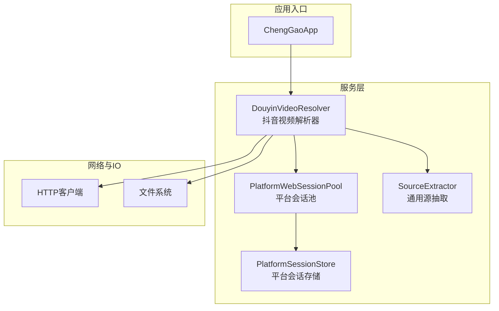
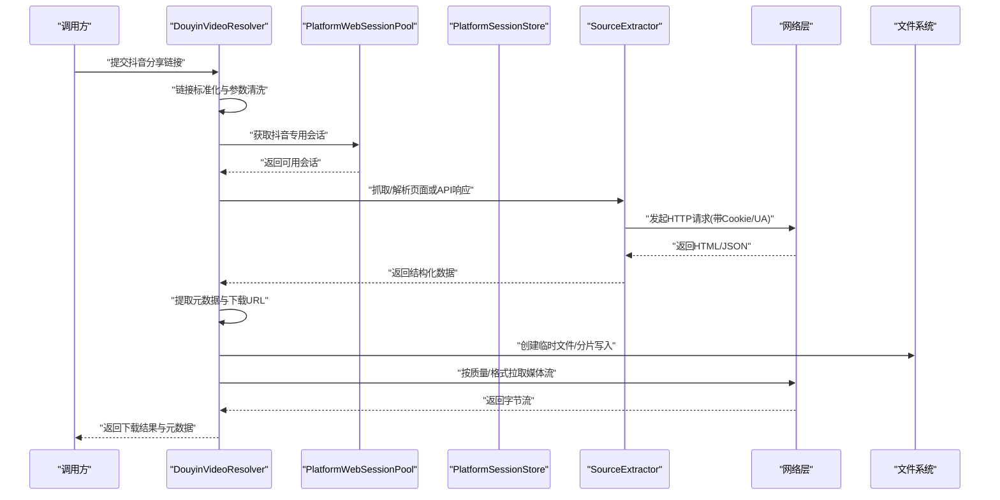
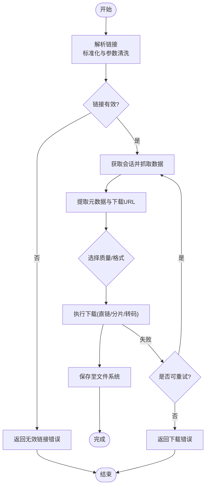
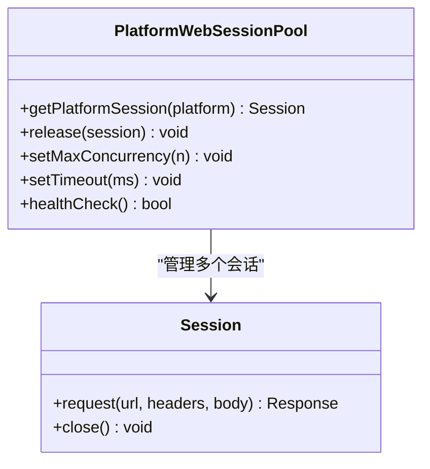
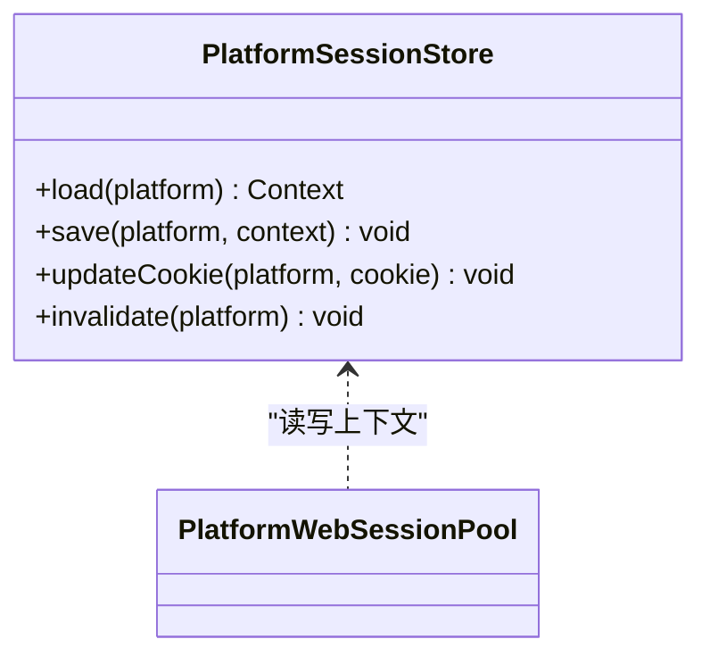
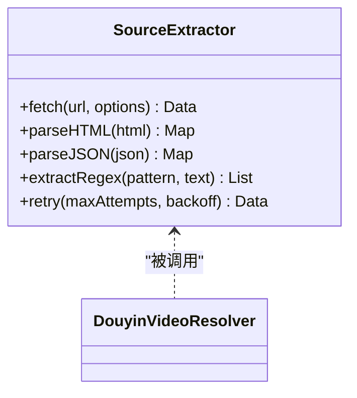
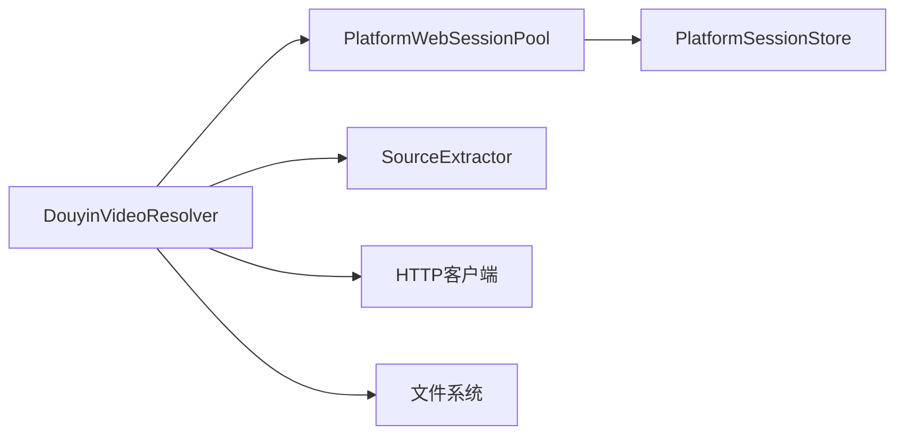

# 抖音视频解析器

<cite>
**本文引用的文件**   
- [DouyinVideoResolver.swift](file://Sources/ChengGao/Services/DouyinVideoResolver.swift)
- [PlatformWebSessionPool.swift](file://Sources/ChengGao/Services/PlatformWebSessionPool.swift)
- [PlatformSessionStore.swift](file://Sources/ChengGao/Services/PlatformSessionStore.swift)
- [SourceExtractor.swift](file://Sources/ChengGao/Services/SourceExtractor.swift)
- [Package.swift](file://Package.swift)
</cite>

## 目录
1. [简介](#简介)
2. [项目结构](#项目结构)
3. [核心组件](#核心组件)
4. [架构总览](#架构总览)
5. [详细组件分析](#详细组件分析)
6. [依赖关系分析](#依赖关系分析)
7. [性能考量](#性能考量)
8. [故障排查指南](#故障排查指南)
9. [结论](#结论)
10. [附录](#附录)

## 简介
本文件面向“抖音视频解析器”的实现与使用，围绕以下目标展开：
- 抖音链接解析算法：如何从用户提供的抖音分享链接中提取视频ID、短链或页面URL，并定位到可解析的API端点。
- 视频元数据提取：标题、作者、封面图、时长、分辨率、格式等关键信息的获取与校验。
- 下载流程：根据质量选择、格式转换策略进行流式下载与本地落盘。
- 反爬虫策略：请求头伪装、Cookie管理、会话池复用、重试与退避。
- API调用示例、参数配置与性能优化建议。
- 常见问题排查与调试方法。

说明：本文档基于仓库中 Services 层相关实现进行梳理，重点覆盖 DouyinVideoResolver、平台会话与会话存储、以及通用源抽取工具。

## 项目结构
本项目采用 Swift Package Manager 组织，核心功能位于 Sources/ChengGao/Services 下。与抖音视频解析相关的模块包括：
- 解析器：负责链接解析、元数据提取、下载编排。
- 会话与Cookie：平台会话池与持久化存储，用于维持登录态与规避反爬。
- 通用工具：网页/接口源抽取能力，供多平台复用。

图表来源
- [DouyinVideoResolver.swift](file://Sources/ChengGao/Services/DouyinVideoResolver.swift)
- [PlatformWebSessionPool.swift](file://Sources/ChengGao/Services/PlatformWebSessionPool.swift)
- [PlatformSessionStore.swift](file://Sources/ChengGao/Services/PlatformSessionStore.swift)
- [SourceExtractor.swift](file://Sources/ChengGao/Services/SourceExtractor.swift)

章节来源
- [Package.swift](file://Package.swift)

## 核心组件
- 抖音视频解析器（DouyinVideoResolver）
  - 职责：抖音链接标准化、短链跳转处理、API请求构造、响应解析、元数据提取、下载调度。
  - 关键点：支持多种抖音分享URL形态；对重定向与鉴权参数进行清理；按质量与格式策略生成下载任务。
- 平台会话池（PlatformWebSessionPool）
  - 职责：维护多个平台级HTTP会话实例，提供连接复用、超时控制、并发限制、错误隔离。
  - 关键点：为抖音会话提供独立生命周期与资源上限，避免跨平台污染。
- 平台会话存储（PlatformSessionStore）
  - 职责：持久化Cookie、Token、UA指纹等上下文信息，支持按需加载与更新。
  - 关键点：安全存储敏感字段，提供热更新与失效检测。
- 通用源抽取（SourceExtractor）
  - 职责：统一封装网页抓取、JSON解析、正则/结构化提取逻辑，屏蔽底层差异。
  - 关键点：提供失败重试、超时保护、内容长度校验。

章节来源
- [DouyinVideoResolver.swift](file://Sources/ChengGao/Services/DouyinVideoResolver.swift)
- [PlatformWebSessionPool.swift](file://Sources/ChengGao/Services/PlatformWebSessionPool.swift)
- [PlatformSessionStore.swift](file://Sources/ChengGao/Services/PlatformSessionStore.swift)
- [SourceExtractor.swift](file://Sources/ChengGao/Services/SourceExtractor.swift)

## 架构总览
下图展示抖音视频解析的整体流程：从输入链接到最终下载完成的关键步骤与组件交互。

图表来源
- [DouyinVideoResolver.swift](file://Sources/ChengGao/Services/DouyinVideoResolver.swift)
- [PlatformWebSessionPool.swift](file://Sources/ChengGao/Services/PlatformWebSessionPool.swift)
- [PlatformSessionStore.swift](file://Sources/ChengGao/Services/PlatformSessionStore.swift)
- [SourceExtractor.swift](file://Sources/ChengGao/Services/SourceExtractor.swift)

## 详细组件分析

### 抖音视频解析器（DouyinVideoResolver）
- 链接解析算法
  - 识别多种抖音分享URL形态（如移动端分享页、短链、H5页面）。
  - 通过重定向链与页面内嵌数据定位真实视频ID。
  - 对查询参数进行规范化，去除无关参数，保留必要鉴权字段。
- 元数据提取
  - 从API或页面结构中抽取标题、作者、封面、时长、分辨率、格式等信息。
  - 对缺失或异常字段进行回退策略（例如降级到默认分辨率或格式）。
- 下载流程
  - 根据用户选择的质量档位与目标格式，决定拉取策略（直链下载/分片合并/转码）。
  - 支持断点续传与并发分片下载，提升大文件效率。
- 错误处理
  - 区分网络错误、解析失败、权限不足、内容不可用等场景。
  - 提供重试次数、退避策略与友好错误码。

图表来源
- [DouyinVideoResolver.swift](file://Sources/ChengGao/Services/DouyinVideoResolver.swift)

章节来源
- [DouyinVideoResolver.swift](file://Sources/ChengGao/Services/DouyinVideoResolver.swift)

### 平台会话池（PlatformWebSessionPool）
- 设计要点
  - 为不同平台（如抖音、小红书等）维护独立的会话实例，避免Cookie/UA互相污染。
  - 控制最大并发数、连接池大小、超时时间，防止资源耗尽。
  - 支持健康检查与自动回收空闲会话。
- 与解析器的协作
  - 解析器在发起请求前向会话池申请平台专属会话。
  - 会话池根据负载与健康状态分配最优实例。

图表来源
- [PlatformWebSessionPool.swift](file://Sources/ChengGao/Services/PlatformWebSessionPool.swift)

章节来源
- [PlatformWebSessionPool.swift](file://Sources/ChengGao/Services/PlatformWebSessionPool.swift)

### 平台会话存储（PlatformSessionStore）
- 职责
  - 持久化Cookie、Token、UA指纹、设备指纹等上下文。
  - 提供读取、更新、失效检测与热重载能力。
- 安全与可用性
  - 敏感字段加密存储，访问时解密。
  - 支持多环境配置切换与备份恢复。

图表来源
- [PlatformSessionStore.swift](file://Sources/ChengGao/Services/PlatformSessionStore.swift)

章节来源
- [PlatformSessionStore.swift](file://Sources/ChengGao/Services/PlatformSessionStore.swift)

### 通用源抽取（SourceExtractor）
- 能力
  - 统一封装HTTP请求、HTML/JSON解析、正则匹配、结构化提取。
  - 内置重试、超时、内容长度校验、错误分类。
- 扩展性
  - 提供插件式解析器接口，便于接入新平台或新接口。

图表来源
- [SourceExtractor.swift](file://Sources/ChengGao/Services/SourceExtractor.swift)

章节来源
- [SourceExtractor.swift](file://Sources/ChengGao/Services/SourceExtractor.swift)

## 依赖关系分析
- 组件耦合
  - 解析器依赖会话池与存储以维持鉴权与网络稳定性。
  - 源抽取作为通用工具被解析器复用，降低重复实现。
- 外部依赖
  - HTTP客户端、文件系统、加密库（用于敏感数据存储）。
- 潜在风险
  - 若会话池未正确隔离平台上下文，可能导致Cookie串扰。
  - 源抽取失败需有明确错误分类与重试边界，避免无限循环。

图表来源
- [DouyinVideoResolver.swift](file://Sources/ChengGao/Services/DouyinVideoResolver.swift)
- [PlatformWebSessionPool.swift](file://Sources/ChengGao/Services/PlatformWebSessionPool.swift)
- [PlatformSessionStore.swift](file://Sources/ChengGao/Services/PlatformSessionStore.swift)
- [SourceExtractor.swift](file://Sources/ChengGao/Services/SourceExtractor.swift)

章节来源
- [DouyinVideoResolver.swift](file://Sources/ChengGao/Services/DouyinVideoResolver.swift)
- [PlatformWebSessionPool.swift](file://Sources/ChengGao/Services/PlatformWebSessionPool.swift)
- [PlatformSessionStore.swift](file://Sources/ChengGao/Services/PlatformSessionStore.swift)
- [SourceExtractor.swift](file://Sources/ChengGao/Services/SourceExtractor.swift)

## 性能考量
- 连接复用与并发控制
  - 使用会话池减少握手开销，合理设置最大并发避免拥塞。
- 缓存与去重
  - 对相同链接的元数据进行短期缓存，避免重复解析。
- 流式下载与分片
  - 大文件采用分片并行下载，结合断点续传提升吞吐。
- 超时与退避
  - 为网络请求设置合理的超时与指数退避，降低抖动影响。
- 内存与I/O
  - 控制缓冲大小，避免峰值内存过高；优先顺序写入磁盘。

[本节为通用指导，不直接分析具体文件]

## 故障排查指南
- 常见错误分类
  - 链接无效：检查URL形态与参数完整性。
  - 解析失败：确认页面结构变化或API变更，更新解析规则。
  - 权限不足：检查Cookie/Token有效性，必要时重新登录。
  - 下载失败：检查网络连通性与目标URL可达性。
- 调试建议
  - 开启详细日志，记录请求头、响应码、重定向链。
  - 使用抓包工具验证实际请求与响应。
  - 逐步缩小问题范围：先验证链接解析，再验证元数据提取，最后验证下载。
- 恢复策略
  - 自动重试与退避，失败后回退到更低质量或备用格式。
  - 会话失效时触发刷新流程，保持业务连续性。

章节来源
- [DouyinVideoResolver.swift](file://Sources/ChengGao/Services/DouyinVideoResolver.swift)
- [PlatformWebSessionPool.swift](file://Sources/ChengGao/Services/PlatformWebSessionPool.swift)
- [PlatformSessionStore.swift](file://Sources/ChengGao/Services/PlatformSessionStore.swift)
- [SourceExtractor.swift](file://Sources/ChengGao/Services/SourceExtractor.swift)

## 结论
抖音视频解析器通过清晰的组件划分与稳健的网络/会话管理，实现了从链接解析到下载落盘的完整链路。借助会话池与存储机制，系统具备良好的抗反爬能力与可扩展性。配合合理的性能优化与完善的错误处理，可在复杂网络环境下稳定运行。

[本节为总结性内容，不直接分析具体文件]

## 附录
- API调用示例（概念性）
  - 输入：抖音分享链接
  - 输出：视频元数据与下载URL列表（含质量/格式选项）
  - 参数：质量档位、目标格式、并发数、超时时间
- 参数配置建议
  - 会话池最大并发：根据服务器与带宽调整
  - 超时时间：网络不稳定环境适当延长
  - 重试次数与退避：默认3次，指数退避
- 最佳实践
  - 始终使用平台专属会话，避免Cookie污染
  - 对元数据进行最小化校验，快速失败
  - 下载过程支持断点续传与进度回调

[本节为补充信息，不直接分析具体文件]