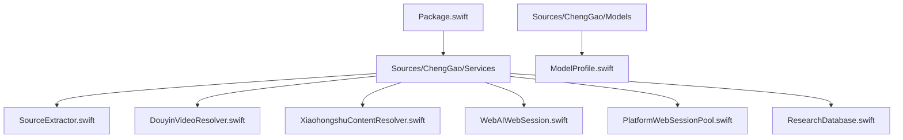
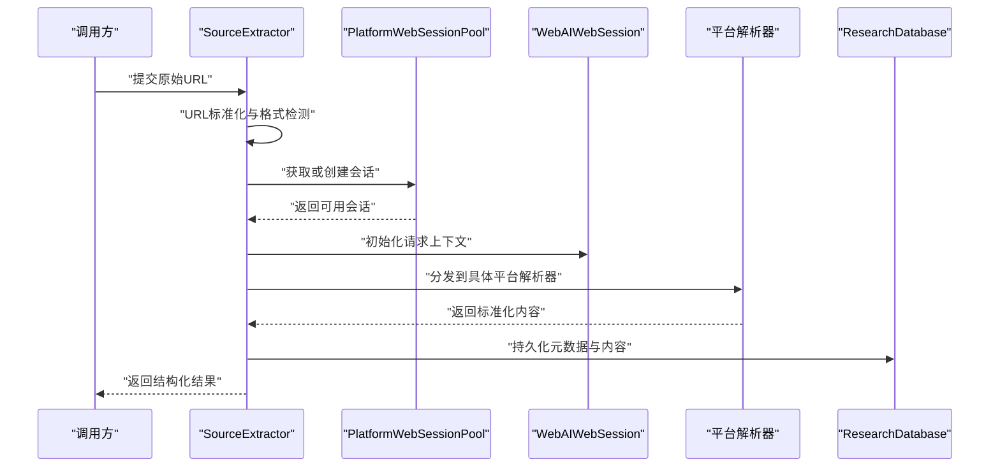
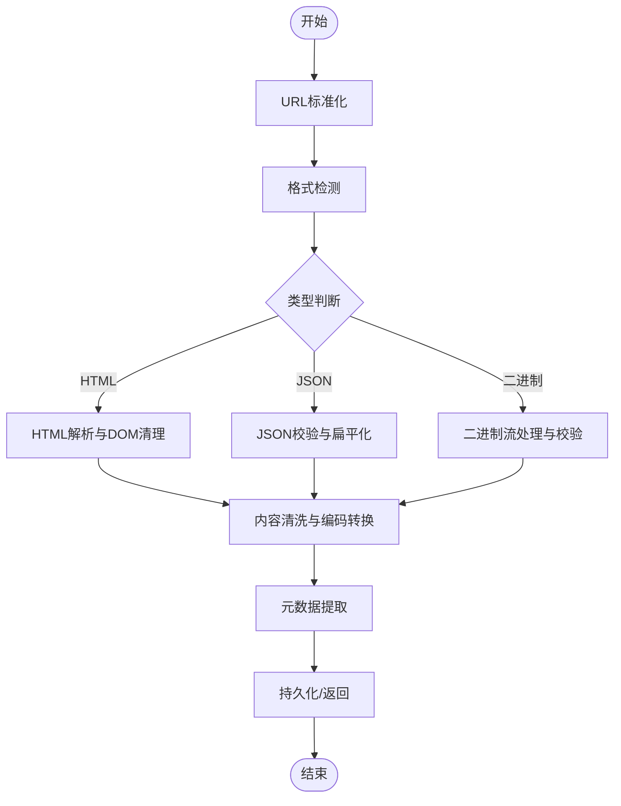
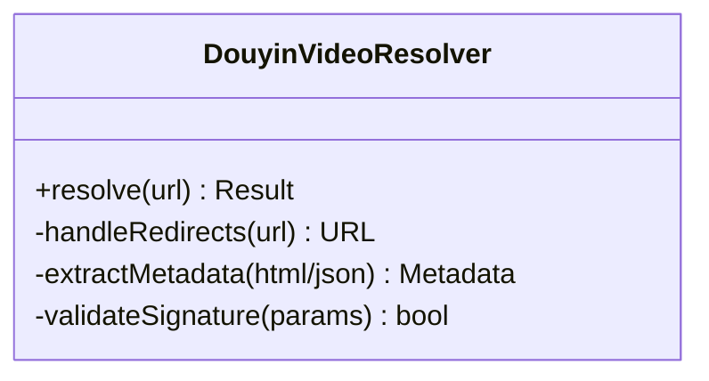
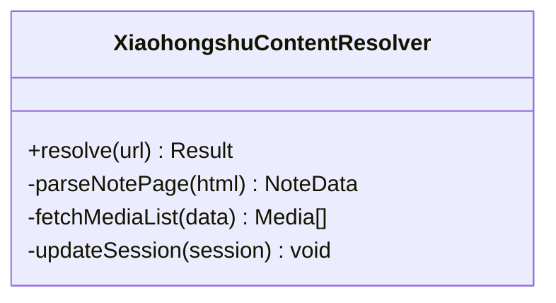
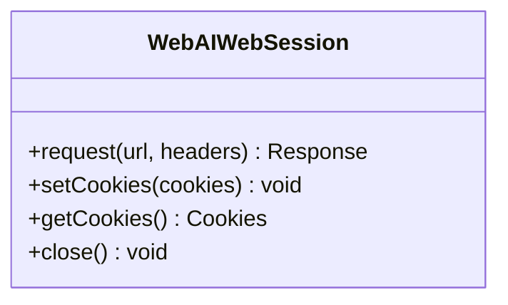
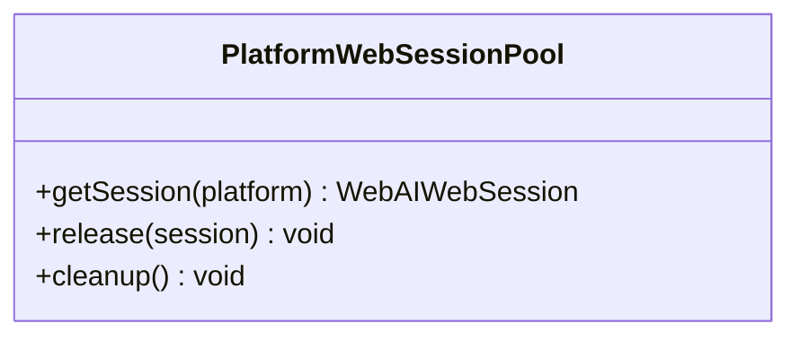
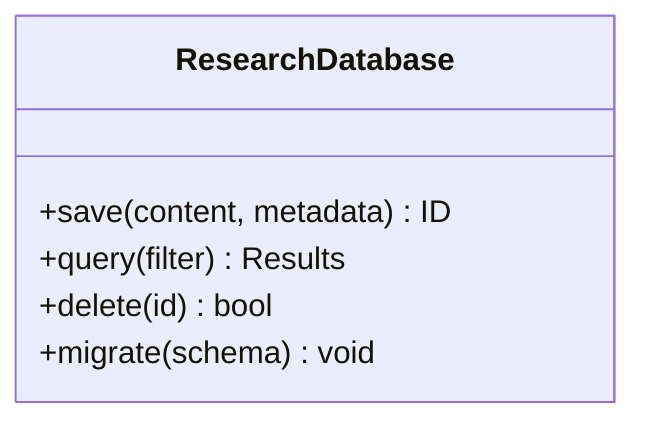
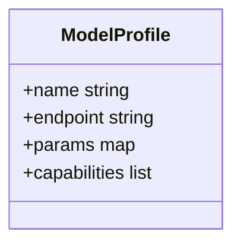
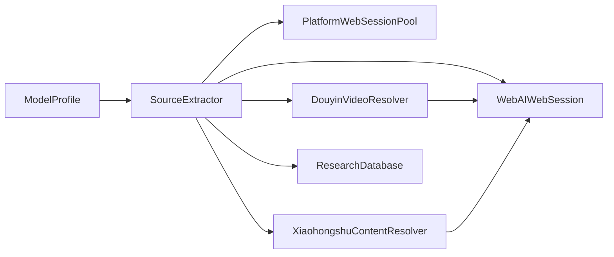

# 通用内容提取器

<cite>
**本文引用的文件**   
- [Package.swift](file://Package.swift)
- [README.md](file://README.md)
- [Sources/ChengGao/Services/SourceExtractor.swift](file://Sources/ChengGao/Services/SourceExtractor.swift)
- [Sources/ChengGao/Services/DouyinVideoResolver.swift](file://Sources/ChengGao/Services/DouyinVideoResolver.swift)
- [Sources/ChengGao/Services/XiaohongshuContentResolver.swift](file://Sources/ChengGao/Services/XiaohongshuContentResolver.swift)
- [Sources/ChengGao/Services/WebAIWebSession.swift](file://Sources/ChengGao/Services/WebAIWebSession.swift)
- [Sources/ChengGao/Services/PlatformWebSessionPool.swift](file://Sources/ChengGao/Services/PlatformWebSessionPool.swift)
- [Sources/ChengGao/Services/ResearchDatabase.swift](file://Sources/ChengGao/Services/ResearchDatabase.swift)
- [Sources/ChengGao/Models/ModelProfile.swift](file://Sources/ChengGao/Models/ModelProfile.swift)
</cite>

## 目录
1. [简介](#简介)
2. [项目结构](#项目结构)
3. [核心组件](#核心组件)
4. [架构总览](#架构总览)
5. [详细组件分析](#详细组件分析)
6. [依赖关系分析](#依赖关系分析)
7. [性能考量](#性能考量)
8. [故障排查指南](#故障排查指南)
9. [结论](#结论)
10. [附录](#附录)

## 简介
本文件面向“通用内容提取器”的设计与实现，围绕多平台内容识别、URL 标准化处理、格式检测机制展开，系统化说明内容类型分类、元数据提取、内容预处理流程（HTML 解析、JSON 数据处理、二进制流处理），并给出内容清洗、编码转换与字符集检测能力。文档同时覆盖扩展点设计、插件化架构与新平台接入指南，帮助开发者快速集成新平台或扩展现有能力。

## 项目结构
本项目采用 Swift Package Manager 组织代码，核心功能位于 Sources/ChengGao/Services 目录，包含多种平台的内容解析器与通用提取服务；模型定义在 Models 目录；应用入口与视图层位于 App 与 Views 目录。

图表来源
- [Package.swift](file://Package.swift)
- [Sources/ChengGao/Services/SourceExtractor.swift](file://Sources/ChengGao/Services/SourceExtractor.swift)
- [Sources/ChengGao/Services/DouyinVideoResolver.swift](file://Sources/ChengGao/Services/DouyinVideoResolver.swift)
- [Sources/ChengGao/Services/XiaohongshuContentResolver.swift](file://Sources/ChengGao/Services/XiaohongshuContentResolver.swift)
- [Sources/ChengGao/Services/WebAIWebSession.swift](file://Sources/ChengGao/Services/WebAIWebSession.swift)
- [Sources/ChengGao/Services/PlatformWebSessionPool.swift](file://Sources/ChengGao/Services/PlatformWebWebSessionPool.swift)
- [Sources/ChengGao/Services/ResearchDatabase.swift](file://Sources/ChengGao/Services/ResearchDatabase.swift)
- [Sources/ChengGao/Models/ModelProfile.swift](file://Sources/ChengGao/Models/ModelProfile.swift)

章节来源
- [Package.swift](file://Package.swift)
- [README.md](file://README.md)

## 核心组件
- 通用内容提取器（SourceExtractor）：统一入口，负责 URL 标准化、格式检测、内容类型分类、元数据提取与预处理调度。
- 平台解析器（DouyinVideoResolver、XiaohongshuContentResolver）：针对特定平台的页面结构与 API 进行适配，输出标准化内容。
- Web 会话管理（WebAIWebSession、PlatformWebSessionPool）：提供浏览器级会话复用、Cookie/状态管理与并发控制。
- 数据存储（ResearchDatabase）：持久化研究内容与元数据，支持查询与缓存。
- 模型定义（ModelProfile）：描述模型配置与能力，用于内容生成与改写流程的上下文。

章节来源
- [Sources/ChengGao/Services/SourceExtractor.swift](file://Sources/ChengGao/Services/SourceExtractor.swift)
- [Sources/ChengGao/Services/DouyinVideoResolver.swift](file://Sources/ChengGao/Services/DouyinVideoResolver.swift)
- [Sources/ChengGao/Services/XiaohongshuContentResolver.swift](file://Sources/ChengGao/Services/XiaohongshuContentResolver.swift)
- [Sources/ChengGao/Services/WebAIWebSession.swift](file://Sources/ChengGao/Services/WebAIWebSession.swift)
- [Sources/ChengGao/Services/PlatformWebSessionPool.swift](file://Sources/ChengGao/Services/PlatformWebSessionPool.swift)
- [Sources/ChengGao/Services/ResearchDatabase.swift](file://Sources/ChengGao/Services/ResearchDatabase.swift)
- [Sources/ChengGao/Models/ModelProfile.swift](file://Sources/ChengGao/Models/ModelProfile.swift)

## 架构总览
整体架构以“提取器 + 解析器 + 会话池 + 存储”为核心，形成可扩展的平台接入体系。URL 进入后先进行标准化与格式检测，再路由到对应平台解析器；解析结果经清洗与预处理后写入存储或返回上层调用方。

图表来源
- [Sources/ChengGao/Services/SourceExtractor.swift](file://Sources/ChengGao/Services/SourceExtractor.swift)
- [Sources/ChengGao/Services/PlatformWebSessionPool.swift](file://Sources/ChengGao/Services/PlatformWebSessionPool.swift)
- [Sources/ChengGao/Services/WebAIWebSession.swift](file://Sources/ChengGao/Services/WebAIWebSession.swift)
- [Sources/ChengGao/Services/ResearchDatabase.swift](file://Sources/ChengGao/Services/ResearchDatabase.swift)

## 详细组件分析

### SourceExtractor（通用内容提取器）
职责与流程
- URL 标准化：规范化协议、主机名、路径与查询参数，去除冗余片段与无效字符。
- 格式检测：基于 MIME、扩展名与响应头判断 HTML、JSON、二进制等类型。
- 内容类型分类：文本、富文本（HTML）、结构化数据（JSON）、媒体（视频/图片）。
- 元数据提取：标题、作者、发布时间、摘要、封面图、语言、编码等。
- 预处理：HTML 解析与 DOM 清理、JSON 校验与扁平化、二进制流分块与校验。
- 清洗与编码：去重、去广告、移除脚本样式、转码为 UTF-8、字符集检测与修复。

图表来源
- [Sources/ChengGao/Services/SourceExtractor.swift](file://Sources/ChengGao/Services/SourceExtractor.swift)

章节来源
- [Sources/ChengGao/Services/SourceExtractor.swift](file://Sources/ChengGao/Services/SourceExtractor.swift)

### DouyinVideoResolver（抖音短视频解析器）
职责与特性
- 识别抖音视频链接与分享页，处理重定向与短链还原。
- 抓取视频元信息（标题、作者、时长、封面、播放地址）。
- 处理反爬策略与鉴权参数，维护会话状态。
- 输出标准化内容对象，供上层统一消费。

图表来源
- [Sources/ChengGao/Services/DouyinVideoResolver.swift](file://Sources/ChengGao/Services/DouyinVideoResolver.swift)

章节来源
- [Sources/ChengGao/Services/DouyinVideoResolver.swift](file://Sources/ChengGao/Services/DouyinVideoResolver.swift)

### XiaohongshuContentResolver（小红书内容解析器）
职责与特性
- 识别小红书笔记链接，处理动态加载与分页。
- 提取正文、标签、互动数据与媒体资源。
- 适配平台接口变更，维护 Cookie 与会话一致性。
- 输出标准化内容对象，支持后续分析与导出。

图表来源
- [Sources/ChengGao/Services/XiaohongshuContentResolver.swift](file://Sources/ChengGao/Services/XiaohongshuContentResolver.swift)

章节来源
- [Sources/ChengGao/Services/XiaohongshuContentResolver.swift](file://Sources/ChengGao/Services/XiaohongshuContentResolver.swift)

### WebAIWebSession（Web 会话封装）
职责与特性
- 封装浏览器级会话，管理 Cookie、User-Agent、Referer 等头部。
- 提供请求重试、超时与错误恢复机制。
- 支持并发访问与资源释放，避免泄漏。

图表来源
- [Sources/ChengGao/Services/WebAIWebSession.swift](file://Sources/ChengGao/Services/WebAIWebSession.swift)

章节来源
- [Sources/ChengGao/Services/WebAIWebSession.swift](file://Sources/ChengGao/Services/WebAIWebSession.swift)

### PlatformWebSessionPool（平台会话池）
职责与特性
- 维护多平台会话实例，按域名或平台键值分配。
- 提供会话复用、健康检查与自动回收。
- 隔离不同平台的认证状态，防止串扰。

图表来源
- [Sources/ChengGao/Services/PlatformWebSessionPool.swift](file://Sources/ChengGao/Services/PlatformWebSessionPool.swift)

章节来源
- [Sources/ChengGao/Services/PlatformWebSessionPool.swift](file://Sources/ChengGao/Services/PlatformWebSessionPool.swift)

### ResearchDatabase（研究数据存储）
职责与特性
- 持久化内容、元数据与中间结果。
- 提供索引与查询能力，支持增量更新与去重。
- 与提取器协作，确保数据一致性与事务性。

图表来源
- [Sources/ChengGao/Services/ResearchDatabase.swift](file://Sources/ChengGao/Services/ResearchDatabase.swift)

章节来源
- [Sources/ChengGao/Services/ResearchDatabase.swift](file://Sources/ChengGao/Services/ResearchDatabase.swift)

### ModelProfile（模型配置）
职责与特性
- 描述 AI 模型能力、参数与端点配置。
- 作为内容生成与改写流程的上下文输入。
- 支持热更新与版本兼容。

图表来源
- [Sources/ChengGao/Models/ModelProfile.swift](file://Sources/ChengGao/Models/ModelProfile.swift)

章节来源
- [Sources/ChengGao/Models/ModelProfile.swift](file://Sources/ChengGao/Models/ModelProfile.swift)

## 依赖关系分析
- SourceExtractor 依赖 PlatformWebSessionPool 与 WebAIWebSession 完成网络访问。
- 平台解析器（DouyinVideoResolver、XiaohongshuContentResolver）依赖 WebAIWebSession 进行请求与状态管理。
- ResearchDatabase 被 SourceExtractor 与解析器用于持久化。
- ModelProfile 作为上层配置注入，影响内容生成与改写行为。

图表来源
- [Sources/ChengGao/Services/SourceExtractor.swift](file://Sources/ChengGao/Services/SourceExtractor.swift)
- [Sources/ChengGao/Services/PlatformWebSessionPool.swift](file://Sources/ChengGao/Services/PlatformWebSessionPool.swift)
- [Sources/ChengGao/Services/WebAIWebSession.swift](file://Sources/ChengGao/Services/WebAIWebSession.swift)
- [Sources/ChengGao/Services/DouyinVideoResolver.swift](file://Sources/ChengGao/Services/DouyinVideoResolver.swift)
- [Sources/ChengGao/Services/XiaohongshuContentResolver.swift](file://Sources/ChengGao/Services/XiaohongshuContentResolver.swift)
- [Sources/ChengGao/Services/ResearchDatabase.swift](file://Sources/ChengGao/Services/ResearchDatabase.swift)
- [Sources/ChengGao/Models/ModelProfile.swift](file://Sources/ChengGao/Models/ModelProfile.swift)

章节来源
- [Sources/ChengGao/Services/SourceExtractor.swift](file://Sources/ChengGao/Services/SourceExtractor.swift)
- [Sources/ChengGao/Services/PlatformWebSessionPool.swift](file://Sources/ChengGao/Services/PlatformWebSessionPool.swift)
- [Sources/ChengGao/Services/WebAIWebSession.swift](file://Sources/ChengGao/Services/WebAIWebSession.swift)
- [Sources/ChengGao/Services/DouyinVideoResolver.swift](file://Sources/ChengGao/Services/DouyinVideoResolver.swift)
- [Sources/ChengGao/Services/XiaohongshuContentResolver.swift](file://Sources/ChengGao/Services/XiaohongshuContentResolver.swift)
- [Sources/ChengGao/Services/ResearchDatabase.swift](file://Sources/ChengGao/Services/ResearchDatabase.swift)
- [Sources/ChengGao/Models/ModelProfile.swift](file://Sources/ChengGao/Models/ModelProfile.swift)

## 性能考量
- 会话复用与连接池：通过 PlatformWebSessionPool 减少握手开销，提升并发吞吐。
- 流式处理：对大体积二进制内容采用分块读取与校验，降低内存峰值。
- 缓存与去重：在 ResearchDatabase 中建立索引与去重策略，避免重复解析与存储。
- 超时与重试：在网络异常时进行指数退避重试，提高鲁棒性。
- 编码与字符集检测：优先使用 UTF-8，必要时回退检测与转换，减少乱码风险。

[本节为通用指导，不直接分析具体文件]

## 故障排查指南
- URL 标准化失败：检查协议、主机名与路径合法性，确认是否被重定向或污染。
- 格式检测误判：核对响应头与 MIME，必要时增加启发式规则。
- 平台解析异常：查看平台接口变更日志，更新解析逻辑与签名验证。
- 会话失效：刷新 Cookie 与鉴权参数，必要时重建会话。
- 存储写入失败：检查数据库连接与事务状态，确认字段约束与索引。
- 编码问题：启用字符集检测与强制转码，记录原始字节以便回溯。

[本节为通用指导，不直接分析具体文件]

## 结论
通用内容提取器通过统一的 URL 标准化、格式检测与内容分类，结合平台解析器与会话池，实现了跨平台内容的高效提取与标准化。配合数据存储与模型配置，形成了可扩展、可维护的内容处理管线。建议持续完善字符集检测、反爬适配与性能监控，以提升稳定性与扩展性。

[本节为总结性内容，不直接分析具体文件]

## 附录
- 新平台接入指南
  - 定义平台解析器类，实现 resolve 方法，处理重定向与鉴权。
  - 注册到 SourceExtractor 的路由表，按域名或协议匹配。
  - 在 PlatformWebSessionPool 中配置会话策略与超时参数。
  - 编写单元测试覆盖常见场景与边界条件。
- 扩展点设计
  - 插件接口：定义统一的解析器接口与回调钩子。
  - 事件总线：发布解析前/后事件，便于审计与统计。
  - 配置中心：集中管理平台白名单、代理与限流策略。

[本节为概念性内容，不直接分析具体文件]