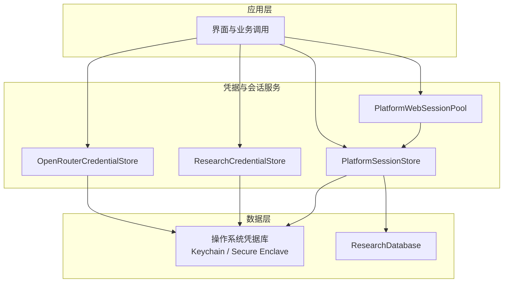
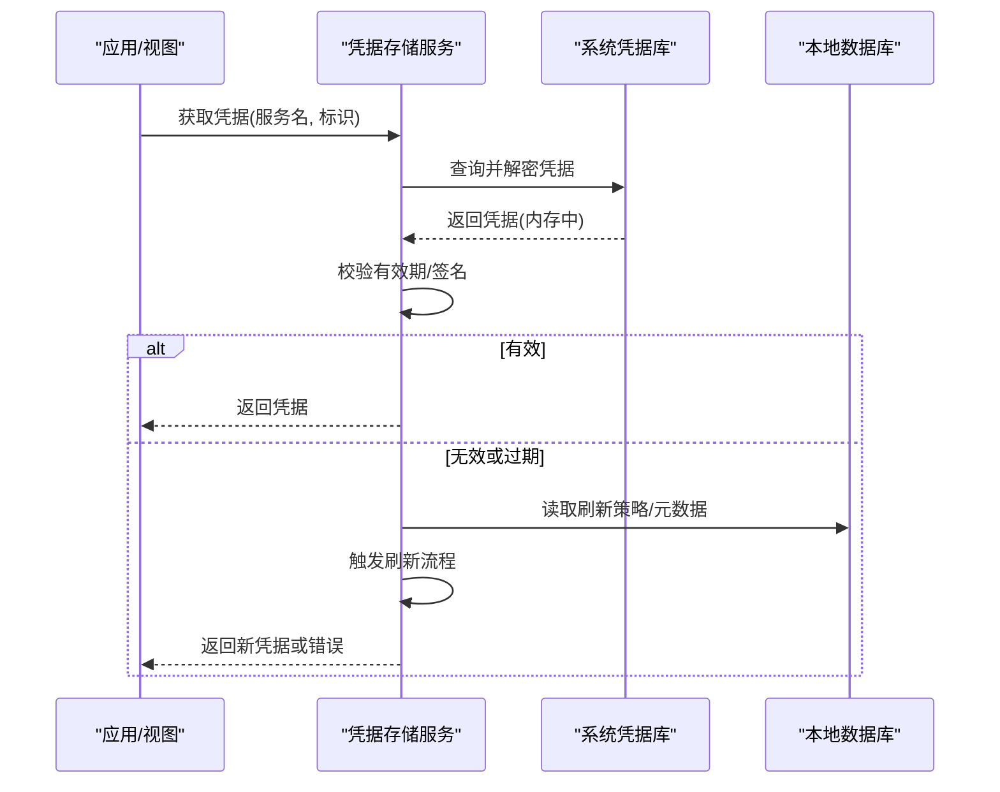
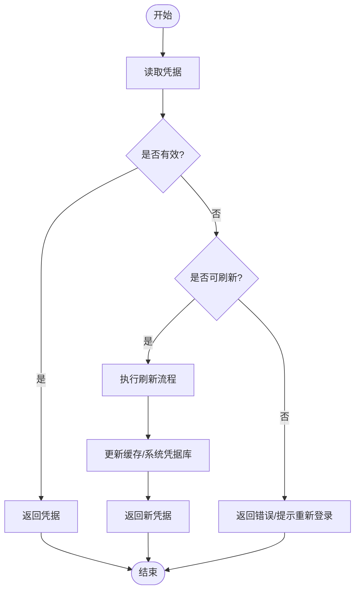
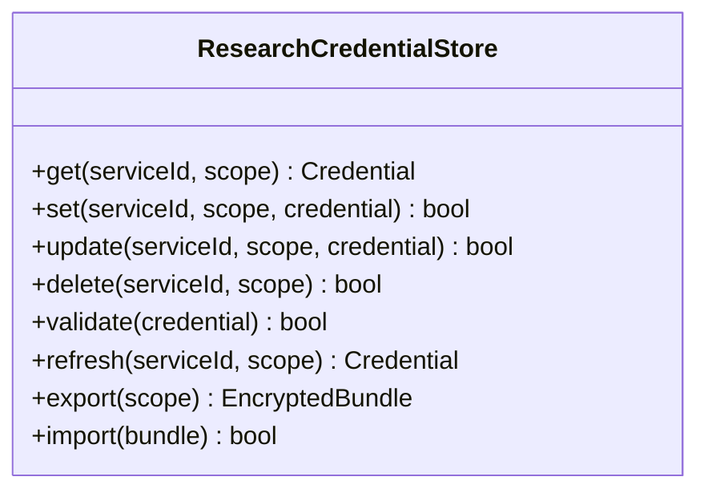
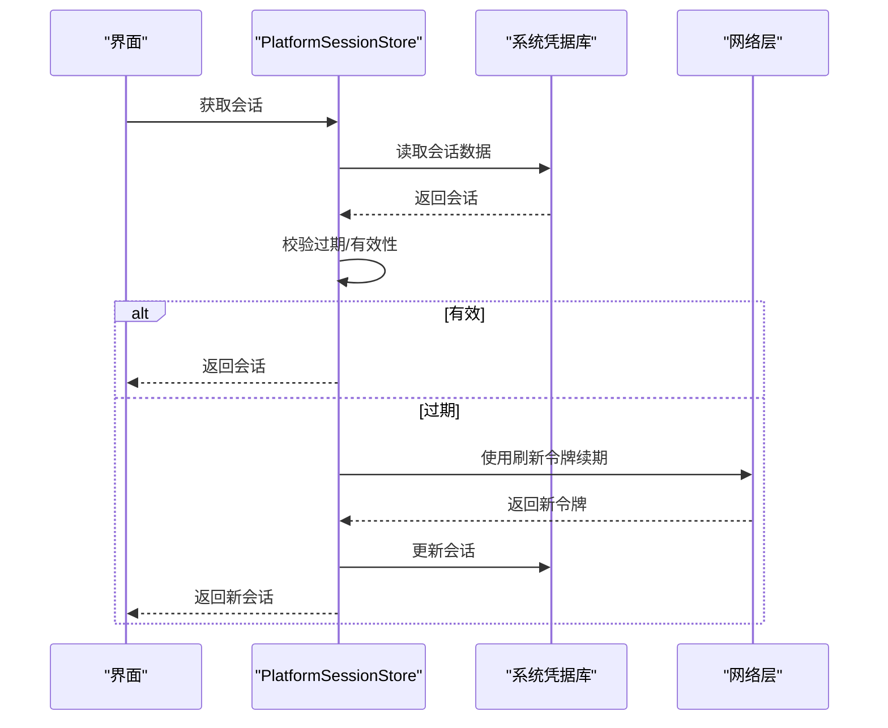
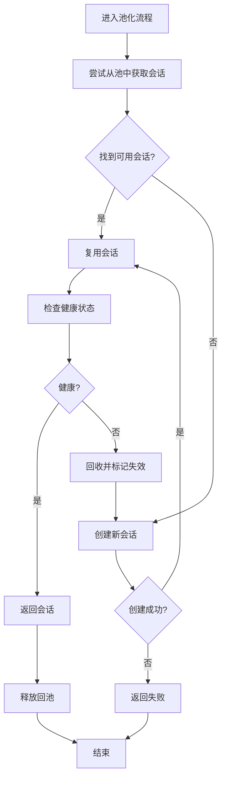
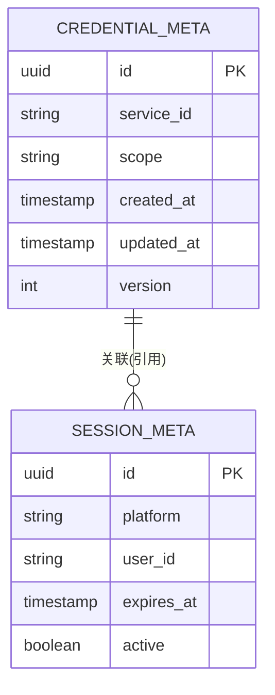
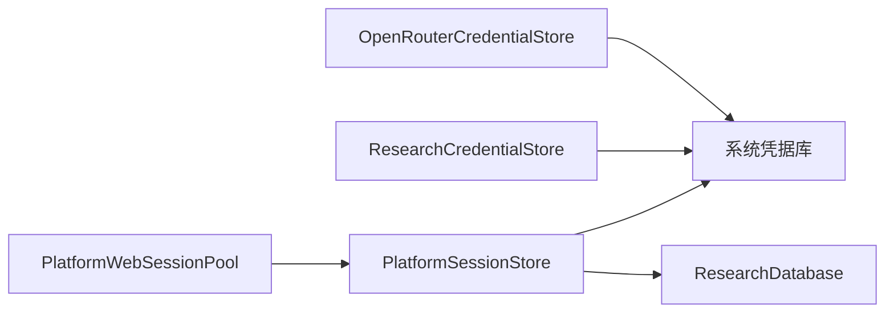

# 凭据存储服务

<cite>
**本文引用的文件**   
- [OpenRouterCredentialStore.swift](file://Sources/ChengGao/Services/OpenRouterCredentialStore.swift)
- [ResearchCredentialStore.swift](file://Sources/ChengGao/Services/ResearchCredentialStore.swift)
- [PlatformSessionStore.swift](file://Sources/ChengGao/Services/PlatformSessionStore.swift)
- [PlatformWebSessionPool.swift](file://Sources/ChengGao/Services/PlatformWebSessionPool.swift)
- [ResearchDatabase.swift](file://Sources/ChengGao/Services/ResearchDatabase.swift)
- [Package.swift](file://Package.swift)
</cite>

## 目录
1. [简介](#简介)
2. [项目结构](#项目结构)
3. [核心组件](#核心组件)
4. [架构总览](#架构总览)
5. [详细组件分析](#详细组件分析)
6. [依赖关系分析](#依赖关系分析)
7. [性能考量](#性能考量)
8. [故障排查指南](#故障排查指南)
9. [结论](#结论)
10. [附录](#附录)

## 简介
本文件面向凭据存储服务的安全实现，聚焦以下方面：加密算法、密钥管理、访问控制、不同服务凭据的存储策略、备份恢复与迁移支持、凭据验证、过期处理与自动刷新逻辑、安全最佳实践、漏洞防护与合规性要求、审计日志、异常检测与应急响应流程。文档以仓库中的凭据相关源码为依据，结合通用安全工程实践进行系统化说明，帮助读者在理解现有实现的同时，掌握可落地的加固与运维方案。

## 项目结构
凭据存储与安全相关代码主要位于 Services 目录下的若干模块：
- OpenRouterCredentialStore：第三方服务（OpenRouter）凭据存储
- ResearchCredentialStore：研究类凭据存储
- PlatformSessionStore：平台会话持久化
- PlatformWebSessionPool：Web 会话池化管理
- ResearchDatabase：研究数据与配置数据库

图表来源
- [OpenRouterCredentialStore.swift](file://Sources/ChengGao/Services/OpenRouterCredentialStore.swift)
- [ResearchCredentialStore.swift](file://Sources/ChengGao/Services/ResearchCredentialStore.swift)
- [PlatformSessionStore.swift](file://Sources/ChengGao/Services/PlatformSessionStore.swift)
- [PlatformWebSessionPool.swift](file://Sources/ChengGao/Services/PlatformWebSessionPool.swift)
- [ResearchDatabase.swift](file://Sources/ChengGao/Services/ResearchDatabase.swift)

章节来源
- [Package.swift](file://Package.swift)

## 核心组件
- OpenRouterCredentialStore：负责第三方 API 凭据（如令牌、密钥）的存取、校验与生命周期管理。典型职责包括读取、写入、更新、删除、有效性检查与错误上报。
- ResearchCredentialStore：负责研究场景下的凭据管理，可能包含多套凭据、按环境或租户隔离、以及更严格的访问控制。
- PlatformSessionStore：负责平台级会话的持久化与恢复，确保用户登录态在应用重启后可用，同时保证会话数据的机密性与完整性。
- PlatformWebSessionPool：对 Web 会话进行池化管理，减少重复创建开销，提供复用、回收与超时清理能力。
- ResearchDatabase：作为研究与配置数据的本地持久化载体，承载非敏感元数据与索引信息；敏感数据应通过系统凭据库或加密存储。

章节来源
- [OpenRouterCredentialStore.swift](file://Sources/ChengGao/Services/OpenRouterCredentialStore.swift)
- [ResearchCredentialStore.swift](file://Sources/ChengGao/Services/ResearchCredentialStore.swift)
- [PlatformSessionStore.swift](file://Sources/ChengGao/Services/PlatformSessionStore.swift)
- [PlatformWebSessionPool.swift](file://Sources/ChengGao/Services/PlatformWebSessionPool.swift)
- [ResearchDatabase.swift](file://Sources/ChengGao/Services/ResearchDatabase.swift)

## 架构总览
凭据存储采用“应用层服务 + 系统凭据库”的分层架构。应用层服务封装凭据操作语义，系统凭据库提供硬件级保护（如 Keychain/Secure Enclave）。会话与数据库仅保存必要元数据，避免明文敏感信息落地。

图表来源
- [OpenRouterCredentialStore.swift](file://Sources/ChengGao/Services/OpenRouterCredentialStore.swift)
- [ResearchCredentialStore.swift](file://Sources/ChengGao/Services/ResearchCredentialStore.swift)
- [PlatformSessionStore.swift](file://Sources/ChengGao/Services/PlatformSessionStore.swift)
- [ResearchDatabase.swift](file://Sources/ChengGao/Services/ResearchDatabase.swift)

## 详细组件分析

### OpenRouterCredentialStore（第三方服务凭据）
- 功能要点
  - 凭据读写：支持新增、更新、删除与按服务标识检索
  - 安全性：优先使用系统凭据库，避免明文落盘
  - 校验与过期：支持令牌签名校验、时间戳与 TTL 检查
  - 刷新机制：基于刷新令牌或重新认证流程自动续期
  - 错误处理：区分网络错误、凭据无效、权限不足等场景
- 安全建议
  - 最小权限：仅暴露必要的读取接口，写操作需二次确认或管理员授权
  - 防重放：请求携带一次性随机数或时间窗口限制
  - 审计日志：记录关键操作（读/写/删/刷新）但不记录敏感值

图表来源
- [OpenRouterCredentialStore.swift](file://Sources/ChengGao/Services/OpenRouterCredentialStore.swift)

章节来源
- [OpenRouterCredentialStore.swift](file://Sources/ChengGao/Services/OpenRouterCredentialStore.swift)

### ResearchCredentialStore（研究凭据）
- 功能要点
  - 多凭据管理：支持按环境、租户或项目维度隔离
  - 访问控制：基于角色或策略的细粒度访问控制
  - 版本兼容：支持凭据格式演进与向后兼容
  - 备份恢复：导出/导入受保护的凭据包（含完整性校验）
- 安全建议
  - 强加密：使用 AES-GCM 或等效算法，密钥由系统凭据库托管
  - 完整性校验：HMAC 或数字签名防止篡改
  - 审计追踪：记录访问主体、时间、目的与结果

图表来源
- [ResearchCredentialStore.swift](file://Sources/ChengGao/Services/ResearchCredentialStore.swift)

章节来源
- [ResearchCredentialStore.swift](file://Sources/ChengGao/Services/ResearchCredentialStore.swift)

### PlatformSessionStore（平台会话）
- 功能要点
  - 会话持久化：登录态、访问令牌、刷新令牌与元数据
  - 生命周期：过期检测、自动刷新、失效清理
  - 安全隔离：进程内内存缓存 + 系统凭据库持久化
- 安全建议
  - 短生命周期：缩短会话有效期，降低泄露风险
  - 绑定设备指纹：增强会话劫持防护
  - 并发安全：线程/队列保护，避免竞态条件

图表来源
- [PlatformSessionStore.swift](file://Sources/ChengGao/Services/PlatformSessionStore.swift)

章节来源
- [PlatformSessionStore.swift](file://Sources/ChengGao/Services/PlatformSessionStore.swift)

### PlatformWebSessionPool（Web 会话池）
- 功能要点
  - 会话复用：减少握手与鉴权开销
  - 资源回收：空闲超时、最大连接数限制
  - 健康检查：定期探测可用性，剔除坏节点
- 安全建议
  - 会话隔离：按域名/租户隔离会话上下文
  - 传输加密：强制 HTTPS 与证书固定
  - 限流与熔断：防止滥用与雪崩

图表来源
- [PlatformWebSessionPool.swift](file://Sources/ChengGao/Services/PlatformWebSessionPool.swift)

章节来源
- [PlatformWebSessionPool.swift](file://Sources/ChengGao/Services/PlatformWebSessionPool.swift)

### ResearchDatabase（研究数据库）
- 功能要点
  - 元数据存储：索引、配置、非敏感业务数据
  - 迁移支持：版本升级与数据迁移脚本
  - 事务与一致性：保证批量操作的原子性
- 安全建议
  - 不存敏感数据：仅存哈希、ID 或引用
  - 访问控制：数据库文件权限与访问路径保护
  - 备份加密：导出包需加密与签名

图表来源
- [ResearchDatabase.swift](file://Sources/ChengGao/Services/ResearchDatabase.swift)

章节来源
- [ResearchDatabase.swift](file://Sources/ChengGao/Services/ResearchDatabase.swift)

## 依赖关系分析
凭据服务依赖系统凭据库与本地数据库，内部模块间职责清晰、耦合度低。

图表来源
- [OpenRouterCredentialStore.swift](file://Sources/ChengGao/Services/OpenRouterCredentialStore.swift)
- [ResearchCredentialStore.swift](file://Sources/ChengGao/Services/ResearchCredentialStore.swift)
- [PlatformSessionStore.swift](file://Sources/ChengGao/Services/PlatformSessionStore.swift)
- [PlatformWebSessionPool.swift](file://Sources/ChengGao/Services/PlatformWebSessionPool.swift)
- [ResearchDatabase.swift](file://Sources/ChengGao/Services/ResearchDatabase.swift)

章节来源
- [Package.swift](file://Package.swift)

## 性能考量
- 缓存策略：热点凭据短期内存缓存，避免频繁访问系统凭据库
- 异步刷新：后台线程执行刷新与校验，避免阻塞主流程
- 连接池：Web 会话池化减少握手成本
- I/O 优化：批量操作合并提交，减少磁盘与锁竞争
- 监控指标：QPS、延迟、错误率、刷新成功率、缓存命中率

## 故障排查指南
- 常见问题
  - 凭据读取失败：检查系统凭据库权限、密钥环状态、应用沙盒
  - 会话过期频繁：核对 TTL、时区设置、服务器时间同步
  - 刷新失败：检查刷新令牌有效性、网络连通性、服务端限流
- 诊断步骤
  - 启用调试日志（脱敏），定位失败阶段
  - 复现问题并抓取堆栈与网络抓包
  - 检查数据库迁移状态与版本兼容性
- 应急措施
  - 快速回滚到上一稳定版本
  - 临时降级为备用凭据源或服务端代理
  - 通知用户重新登录或更新客户端

## 结论
凭据存储服务应以系统凭据库为核心，结合严格的访问控制、加密与完整性校验，配合会话池化与数据库元数据管理，构建高安全、高性能、易维护的凭据体系。通过完善的审计、监控与应急响应机制，保障生产环境的稳定性与合规性。

## 附录

### 加密算法与密钥管理
- 算法选择
  - 对称加密：AES-GCM（推荐）、ChaCha20-Poly1305（移动端友好）
  - 非对称加密：RSA-OAEP、ECIES（用于密钥交换）
  - 哈希与签名：SHA-256/SHA-3、EdDSA/ECDSA
- 密钥管理
  - 根密钥由系统凭据库或 HSM 托管
  - 数据密钥分层：主密钥 → 工作密钥 → 会话密钥
  - 密钥轮换：定期轮换与灰度切换，支持双写过渡期
- 安全存储
  - 禁止明文落盘，所有敏感字段加密后存储
  - 内存中尽量使用零填充与不可复制对象

### 访问控制机制
- 身份认证：OAuth2/OIDC、JWT、双向 TLS
- 授权模型：RBAC/ABAC，最小权限原则
- 会话控制：绑定设备指纹、IP 白名单、地理围栏
- 操作审计：全量记录关键操作，集中收集与分析

### 凭据验证、过期处理与自动刷新
- 验证流程：签名校验、时间戳校验、黑名单检查
- 过期策略：TTL、滑动窗口、提前刷新阈值
- 自动刷新：刷新令牌、静默重认证、失败重试与退避

### 备份恢复与迁移支持
- 备份策略：增量/全量、加密打包、异地容灾
- 恢复流程：校验完整性、版本兼容、回滚预案
- 迁移支持：向前/向后兼容、灰度发布、数据校验

### 安全最佳实践与合规性
- 开发规范：代码审查、静态扫描、依赖漏洞扫描
- 运行安全：沙箱隔离、最小权限、输入校验
- 合规要求：GDPR、CCPA、等保2.0、ISO27001

### 审计日志、异常检测与应急响应
- 审计日志：结构化、脱敏、集中存储、长期归档
- 异常检测：规则引擎与机器学习结合，实时告警
- 应急响应：预案演练、快速止血、根因分析与复盘