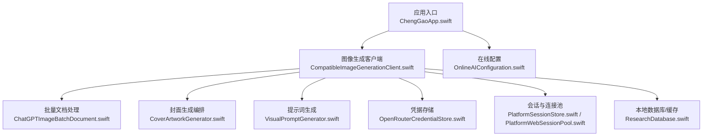
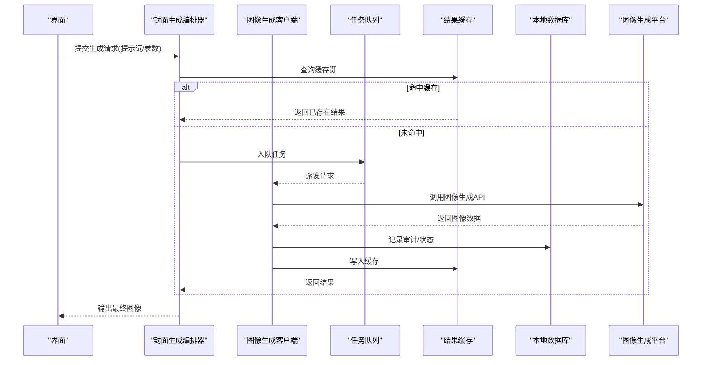
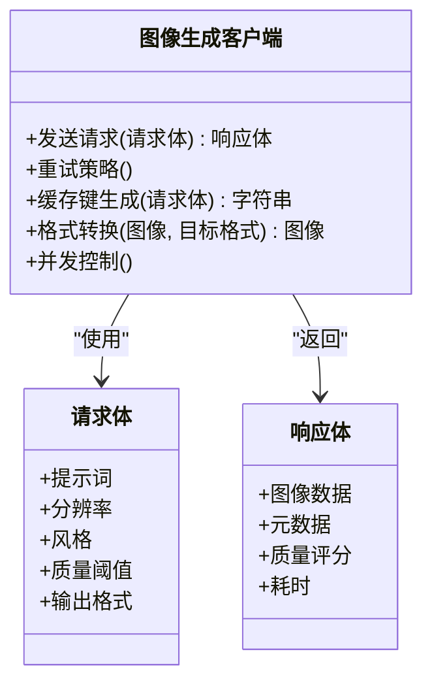
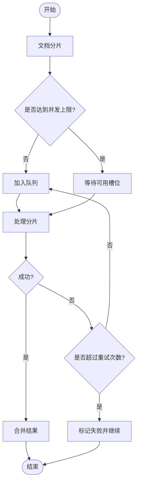
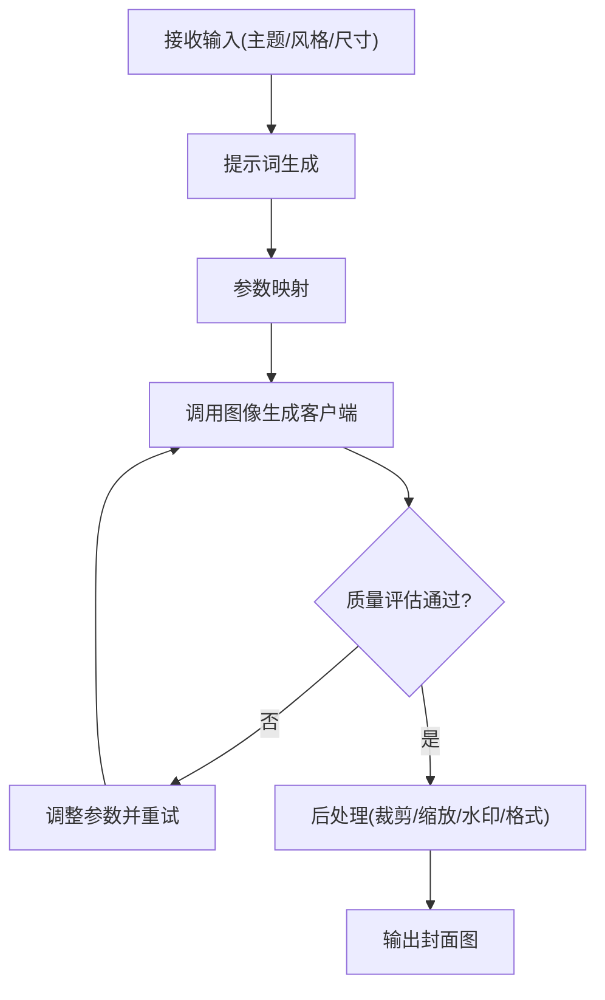
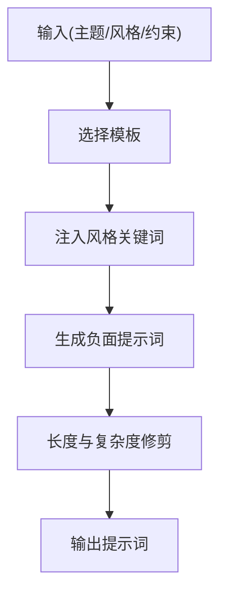
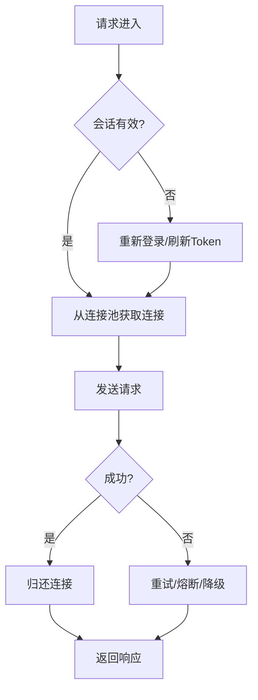
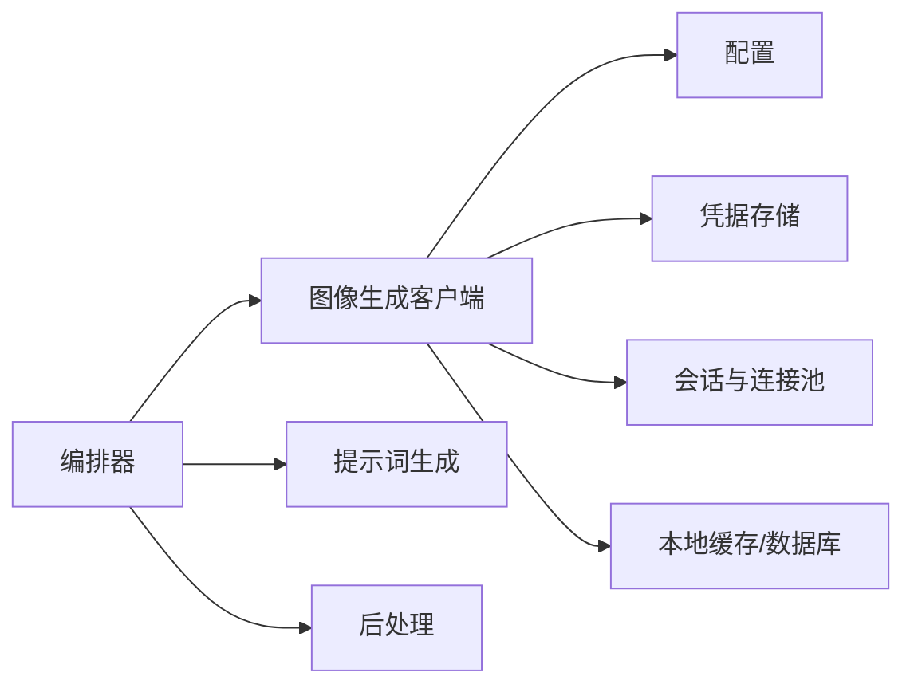

# 图像生成服务

<cite>
**本文引用的文件**   
- [Package.swift](file://Package.swift)
- [ChengGaoApp.swift](file://Sources/ChengGao/App/ChengGaoApp.swift)
- [CompatibleImageGenerationClient.swift](file://Sources/ChengGao/Services/CompatibleImageGenerationClient.swift)
- [ChatGPTImageBatchDocument.swift](file://Sources/ChengGao/Services/ChatGPTImageBatchDocument.swift)
- [CoverArtworkGenerator.swift](file://Sources/ChengGao/Services/CoverArtworkGenerator.swift)
- [OnlineAIConfiguration.swift](file://Sources/ChengGao/Models/OnlineAIConfiguration.swift)
- [ResearchDatabase.swift](file://Sources/ChengGao/Services/ResearchDatabase.swift)
- [PlatformSessionStore.swift](file://Sources/ChengGao/Services/PlatformSessionStore.swift)
- [PlatformWebSessionPool.swift](file://Sources/ChengGao/Services/PlatformWebSessionPool.swift)
- [OpenRouterCredentialStore.swift](file://Sources/ChengGao/Services/OpenRouterCredentialStore.swift)
- [VisualPromptGenerator.swift](file://Sources/ChengGao/Services/VisualPromptGenerator.swift)
</cite>

## 目录
1. [简介](#简介)
2. [项目结构](#项目结构)
3. [核心组件](#核心组件)
4. [架构总览](#架构总览)
5. [详细组件分析](#详细组件分析)
6. [依赖关系分析](#依赖关系分析)
7. [性能考量](#性能考量)
8. [故障排查指南](#故障排查指南)
9. [结论](#结论)
10. [附录](#附录)

## 简介
本文件面向“图像生成服务”的完整技术文档，覆盖以下关键主题：
- 兼容的图像生成API客户端设计与实现
- 批量文档处理与任务队列管理
- 图像生成参数配置、质量控制与格式转换
- 并发请求处理、错误重试与结果缓存机制
- 生成质量评估、风格迁移与后期处理
- 性能监控、成本优化与扩展性设计

该服务基于Swift Package组织，核心能力集中在 Services 与 Models 层，通过统一的客户端抽象对接多种在线图像生成平台，并提供批处理、队列调度、缓存与质量评估等工程化能力。

## 项目结构
- 包定义与入口
  - Package.swift：声明包目标、依赖与模块边界
  - ChengGaoApp.swift：应用启动与全局初始化（如会话、存储、配置）
- 模型与配置
  - OnlineAIConfiguration.swift：在线AI服务的统一配置项（密钥、端点、超时、并发限制等）
- 服务层
  - CompatibleImageGenerationClient.swift：图像生成API的统一客户端抽象与适配
  - ChatGPTImageBatchDocument.swift：针对特定平台的批量文档处理逻辑
  - CoverArtworkGenerator.swift：封面图生成流程编排（提示词组装、参数映射、后处理）
  - VisualPromptGenerator.swift：视觉提示词生成与增强
  - ResearchDatabase.swift：本地持久化（用于缓存、任务状态、审计日志等）
  - PlatformSessionStore.swift / PlatformWebSessionPool.swift：平台会话管理与连接池
  - OpenRouterCredentialStore.swift：凭据安全存储
- 视图与交互（与本服务间接相关）
  - Views 下的界面负责触发图像生成任务、展示进度与结果

图表来源
- [ChengGaoApp.swift](file://Sources/ChengGao/App/ChengGaoApp.swift)
- [CompatibleImageGenerationClient.swift](file://Sources/ChengGao/Services/CompatibleImageGenerationClient.swift)
- [OnlineAIConfiguration.swift](file://Sources/ChengGao/Models/OnlineAIConfiguration.swift)
- [ChatGPTImageBatchDocument.swift](file://Sources/ChengGao/Services/ChatGPTImageBatchDocument.swift)
- [CoverArtworkGenerator.swift](file://Sources/ChengGao/Services/CoverArtworkGenerator.swift)
- [VisualPromptGenerator.swift](file://Sources/ChengGao/Services/VisualPromptGenerator.swift)
- [OpenRouterCredentialStore.swift](file://Sources/ChengGao/Services/OpenRouterCredentialStore.swift)
- [PlatformSessionStore.swift](file://Sources/ChengGao/Services/PlatformSessionStore.swift)
- [PlatformWebSessionPool.swift](file://Sources/ChengGao/Services/PlatformWebSessionPool.swift)
- [ResearchDatabase.swift](file://Sources/ChengGao/Services/ResearchDatabase.swift)

章节来源
- [Package.swift](file://Package.swift)
- [ChengGaoApp.swift](file://Sources/ChengGao/App/ChengGaoApp.swift)

## 核心组件
- 图像生成客户端（CompatibleImageGenerationClient）
  - 职责：封装多平台图像生成API调用，提供统一的请求构造、响应解析、错误映射与重试策略
  - 关键点：参数标准化、格式转换、并发控制、缓存键生成、结果校验
- 批量文档处理（ChatGPTImageBatchDocument）
  - 职责：将长文档切分为可并行处理的片段，聚合结果并去重/排序
  - 关键点：分片策略、顺序保证、失败重试、内存占用控制
- 封面生成编排（CoverArtworkGenerator）
  - 职责：串联提示词生成、参数映射、图像生成、质量评估与后处理（缩放、水印、格式转换）
  - 关键点：流水线编排、中间态缓存、失败回退路径
- 提示词生成（VisualPromptGenerator）
  - 职责：根据输入内容生成高质量提示词，支持风格模板与约束条件
  - 关键点：模板注入、风格迁移、长度与复杂度控制
- 配置与凭据（OnlineAIConfiguration / OpenRouterCredentialStore）
  - 职责：集中管理API密钥、端点、超时、并发上限、重试次数等
  - 关键点：安全存储、热更新、环境隔离
- 会话与连接池（PlatformSessionStore / PlatformWebSessionPool）
  - 职责：维护平台会话生命周期与HTTP连接复用
  - 关键点：连接复用、空闲回收、限流与熔断
- 本地缓存与审计（ResearchDatabase）
  - 职责：缓存生成结果、任务状态、错误日志与审计信息
  - 关键点：索引设计、TTL策略、一致性保障

章节来源
- [CompatibleImageGenerationClient.swift](file://Sources/ChengGao/Services/CompatibleImageGenerationClient.swift)
- [ChatGPTImageBatchDocument.swift](file://Sources/ChengGao/Services/ChatGPTImageBatchDocument.swift)
- [CoverArtworkGenerator.swift](file://Sources/ChengGao/Services/CoverArtworkGenerator.swift)
- [VisualPromptGenerator.swift](file://Sources/ChengGao/Services/VisualPromptGenerator.swift)
- [OnlineAIConfiguration.swift](file://Sources/ChengGao/Models/OnlineAIConfiguration.swift)
- [OpenRouterCredentialStore.swift](file://Sources/ChengGao/Services/OpenRouterCredentialStore.swift)
- [PlatformSessionStore.swift](file://Sources/ChengGao/Services/PlatformSessionStore.swift)
- [PlatformWebSessionPool.swift](file://Sources/ChengGao/Services/PlatformWebSessionPool.swift)
- [ResearchDatabase.swift](file://Sources/ChengGao/Services/ResearchDatabase.swift)

## 架构总览
整体采用“客户端抽象 + 编排器 + 基础设施”的分层架构：
- 客户端抽象层：屏蔽不同图像生成API的差异，提供统一接口
- 编排层：组合提示词生成、参数映射、质量评估与后处理
- 基础设施层：会话、连接池、凭据、缓存与数据库

图表来源
- [CoverArtworkGenerator.swift](file://Sources/ChengGao/Services/CoverArtworkGenerator.swift)
- [CompatibleImageGenerationClient.swift](file://Sources/ChengGao/Services/CompatibleImageGenerationClient.swift)
- [ResearchDatabase.swift](file://Sources/ChengGao/Services/ResearchDatabase.swift)

## 详细组件分析

### 图像生成客户端（CompatibleImageGenerationClient）
- 功能要点
  - 统一请求构造：将内部参数映射到各平台所需字段
  - 并发控制：基于令牌桶或信号量限制并发数
  - 错误重试：指数退避、最大重试次数、幂等键
  - 结果缓存：按提示词+参数哈希作为键，避免重复生成
  - 格式转换：在返回前进行尺寸、色彩空间与编码转换
- 关键数据结构
  - 请求体：包含提示词、分辨率、风格、质量阈值、输出格式等
  - 响应体：图像二进制、元数据、质量评分、耗时统计
- 错误处理
  - 网络异常、鉴权失败、配额耗尽、模型不可用等分类处理
  - 降级策略：切换备用模型或降低分辨率

图表来源
- [CompatibleImageGenerationClient.swift](file://Sources/ChengGao/Services/CompatibleImageGenerationClient.swift)

章节来源
- [CompatibleImageGenerationClient.swift](file://Sources/ChengGao/Services/CompatibleImageGenerationClient.swift)

### 批量文档处理（ChatGPTImageBatchDocument）
- 功能要点
  - 文档分片：按段落/页码切分，保持上下文连贯
  - 并行执行：限制并发度，避免过载
  - 结果聚合：按原始顺序合并，去重与冲突解决
  - 失败恢复：对失败分片进行重试或跳过
- 算法流程

图表来源
- [ChatGPTImageBatchDocument.swift](file://Sources/ChengGao/Services/ChatGPTImageBatchDocument.swift)

章节来源
- [ChatGPTImageBatchDocument.swift](file://Sources/ChengGao/Services/ChatGPTImageBatchDocument.swift)

### 封面生成编排（CoverArtworkGenerator）
- 功能要点
  - 提示词组装：结合主题、风格、构图规则生成结构化提示词
  - 参数映射：将业务参数转换为平台参数
  - 质量评估：基于清晰度、文本可读性、构图评分筛选
  - 后处理：裁剪、缩放、水印、格式转换（PNG/JPEG/WebP）
- 流程图

图表来源
- [CoverArtworkGenerator.swift](file://Sources/ChengGao/Services/CoverArtworkGenerator.swift)
- [VisualPromptGenerator.swift](file://Sources/ChengGao/Services/VisualPromptGenerator.swift)
- [CompatibleImageGenerationClient.swift](file://Sources/ChengGao/Services/CompatibleImageGenerationClient.swift)

章节来源
- [CoverArtworkGenerator.swift](file://Sources/ChengGao/Services/CoverArtworkGenerator.swift)
- [VisualPromptGenerator.swift](file://Sources/ChengGao/Services/VisualPromptGenerator.swift)

### 提示词生成（VisualPromptGenerator）
- 功能要点
  - 模板引擎：支持风格模板、约束注入、负面提示词
  - 风格迁移：将用户描述映射到风格关键词集合
  - 长度与复杂度控制：避免过长导致模型理解偏差
- 关键流程

图表来源
- [VisualPromptGenerator.swift](file://Sources/ChengGao/Services/VisualPromptGenerator.swift)

章节来源
- [VisualPromptGenerator.swift](file://Sources/ChengGao/Services/VisualPromptGenerator.swift)

### 配置与凭据（OnlineAIConfiguration / OpenRouterCredentialStore）
- 功能要点
  - 配置项：端点、超时、并发上限、重试次数、模型列表
  - 凭据存储：加密存储API密钥，支持多账户切换
  - 热更新：运行时更新配置而不重启服务
- 数据结构建议
  - 配置对象：包含平台、认证、网络、模型、质量阈值等
  - 凭据对象：包含平台、用户名、密钥、有效期等

章节来源
- [OnlineAIConfiguration.swift](file://Sources/ChengGao/Models/OnlineAIConfiguration.swift)
- [OpenRouterCredentialStore.swift](file://Sources/ChengGao/Services/OpenRouterCredentialStore.swift)

### 会话与连接池（PlatformSessionStore / PlatformWebSessionPool）
- 功能要点
  - 会话管理：登录态、Cookie、Token刷新
  - 连接池：HTTP连接复用、空闲回收、超时清理
  - 限流与熔断：防止突发流量打垮上游
- 关键流程

图表来源
- [PlatformSessionStore.swift](file://Sources/ChengGao/Services/PlatformSessionStore.swift)
- [PlatformWebSessionPool.swift](file://Sources/ChengGao/Services/PlatformWebSessionPool.swift)

章节来源
- [PlatformSessionStore.swift](file://Sources/ChengGao/Services/PlatformSessionStore.swift)
- [PlatformWebSessionPool.swift](file://Sources/ChengGao/Services/PlatformWebSessionPool.swift)

### 本地缓存与审计（ResearchDatabase）
- 功能要点
  - 缓存策略：LRU/TTL、按提示词+参数哈希键
  - 审计日志：记录请求、响应、错误、耗时、成本
  - 一致性：读写分离、事务保护、冲突解决
- 关键表结构建议
  - 任务表：任务ID、状态、创建时间、更新时间
  - 结果表：任务ID、图像数据路径、元数据、质量评分
  - 审计表：请求摘要、错误码、重试次数、耗时

章节来源
- [ResearchDatabase.swift](file://Sources/ChengGao/Services/ResearchDatabase.swift)

## 依赖关系分析
- 模块内聚与耦合
  - 客户端与编排器低耦合，通过标准接口通信
  - 配置与凭据被多个组件共享，需保证线程安全
  - 会话与连接池为底层基础设施，向上提供稳定通道
- 外部依赖
  - 图像生成平台API（多供应商）
  - 本地SQLite数据库（轻量持久化）
  - 系统级并发原语（队列、信号量、定时器）

图表来源
- [CompatibleImageGenerationClient.swift](file://Sources/ChengGao/Services/CompatibleImageGenerationClient.swift)
- [OnlineAIConfiguration.swift](file://Sources/ChengGao/Models/OnlineAIConfiguration.swift)
- [OpenRouterCredentialStore.swift](file://Sources/ChengGao/Services/OpenRouterCredentialStore.swift)
- [PlatformSessionStore.swift](file://Sources/ChengGao/Services/PlatformSessionStore.swift)
- [PlatformWebSessionPool.swift](file://Sources/ChengGao/Services/PlatformWebSessionPool.swift)
- [ResearchDatabase.swift](file://Sources/ChengGao/Services/ResearchDatabase.swift)
- [CoverArtworkGenerator.swift](file://Sources/ChengGao/Services/CoverArtworkGenerator.swift)
- [VisualPromptGenerator.swift](file://Sources/ChengGao/Services/VisualPromptGenerator.swift)

章节来源
- [CompatibleImageGenerationClient.swift](file://Sources/ChengGao/Services/CompatibleImageGenerationClient.swift)
- [CoverArtworkGenerator.swift](file://Sources/ChengGao/Services/CoverArtworkGenerator.swift)
- [ResearchDatabase.swift](file://Sources/ChengGao/Services/ResearchDatabase.swift)

## 性能考量
- 并发与限流
  - 使用令牌桶或信号量限制并发，避免上游限流
  - 连接池复用减少握手开销
- 缓存与去重
  - 基于提示词+参数的哈希键，命中率优先
  - TTL与LRU结合，平衡内存与命中率
- 重试与退避
  - 指数退避+抖动，避免雪崩
  - 幂等键确保重复请求不产生副作用
- 资源管理
  - 图像数据流式处理，避免大对象驻留内存
  - 及时释放连接与会话，防止泄漏
- 监控与度量
  - 采集QPS、延迟分布、错误率、缓存命中率、成本指标
  - 告警阈值与自动扩缩容策略

[本节为通用指导，无需具体文件引用]

## 故障排查指南
- 常见问题定位
  - 鉴权失败：检查凭据有效期与权限范围
  - 配额耗尽：查看平台用量与限流策略
  - 模型不可用：切换备用模型或降级分辨率
  - 缓存不一致：清理过期键或强制刷新
- 诊断步骤
  - 查看审计日志中的错误码与重试次数
  - 检查连接池状态与会话有效性
  - 验证提示词长度与复杂度是否超出限制
  - 确认格式转换与后处理是否成功
- 恢复策略
  - 自动重试与降级
  - 人工介入：替换凭据、调整参数、扩容资源

章节来源
- [ResearchDatabase.swift](file://Sources/ChengGao/Services/ResearchDatabase.swift)
- [OpenRouterCredentialStore.swift](file://Sources/ChengGao/Services/OpenRouterCredentialStore.swift)
- [PlatformSessionStore.swift](file://Sources/ChengGao/Services/PlatformSessionStore.swift)
- [PlatformWebSessionPool.swift](file://Sources/ChengGao/Services/PlatformWebSessionPool.swift)

## 结论
本图像生成服务通过统一的客户端抽象、编排器与基础设施层，实现了多平台兼容、批量处理、任务队列、缓存与质量评估等核心能力。建议在后续迭代中持续完善监控与成本优化策略，提升稳定性与可扩展性。

[本节为总结性内容，无需具体文件引用]

## 附录
- 术语表
  - 提示词：用于驱动图像生成的自然语言描述
  - 质量阈值：用于过滤低质量结果的评分下限
  - 幂等键：确保重复请求不产生副作用的唯一标识
- 最佳实践
  - 合理设置并发与超时，避免上游限流
  - 使用缓存与去重降低重复成本
  - 定期清理过期缓存与审计日志
  - 灰度发布新模型与参数，观察效果后再全量

[本节为补充信息，无需具体文件引用]