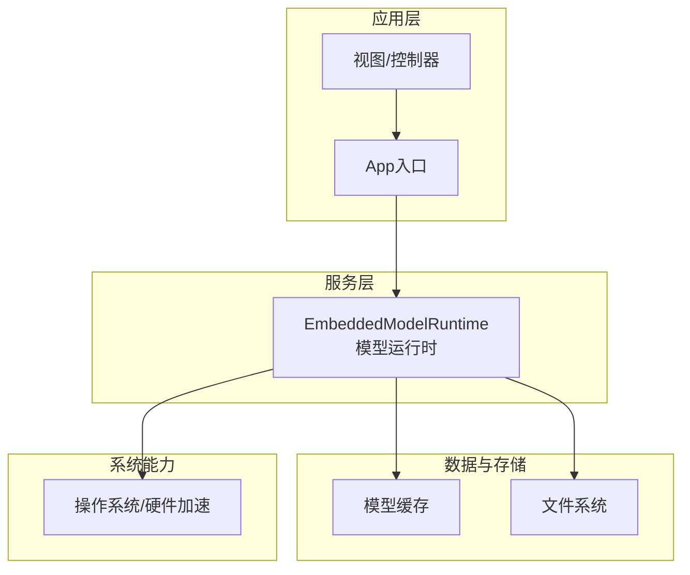
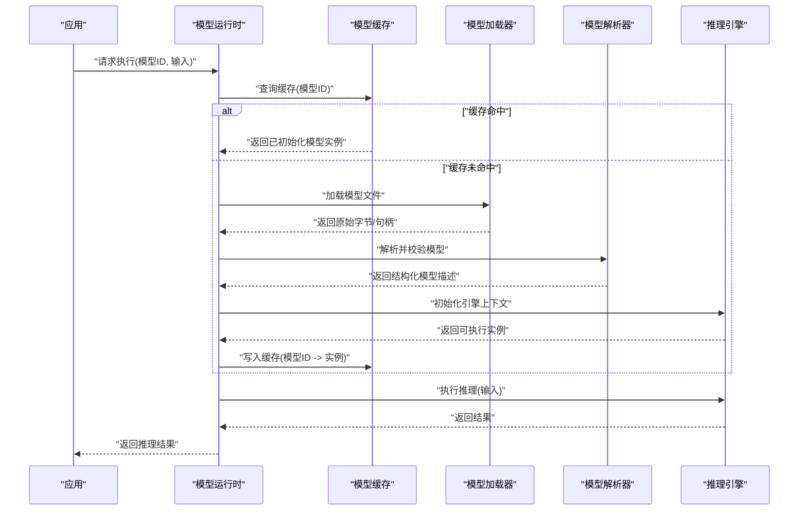
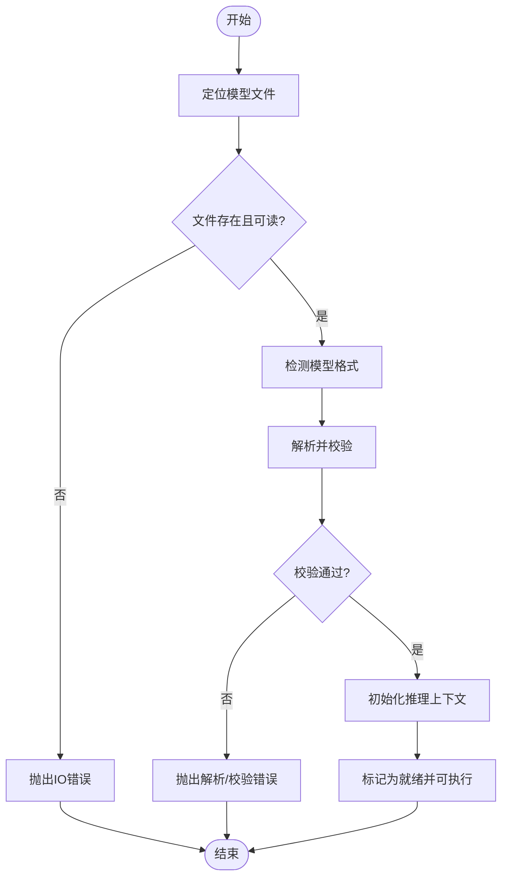
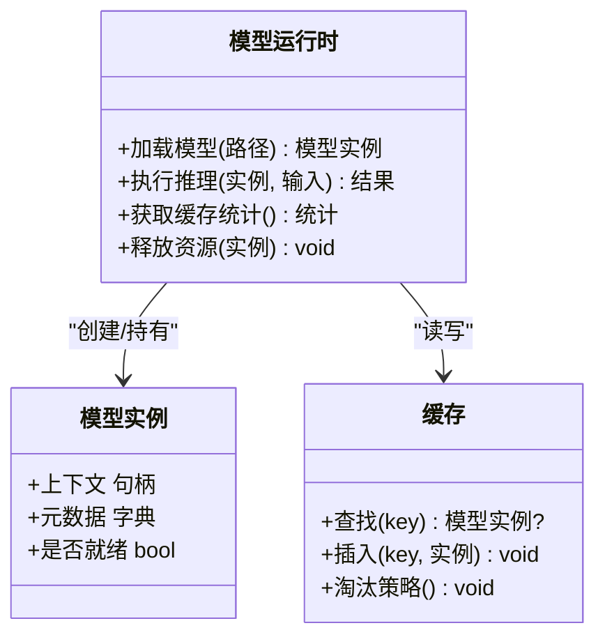
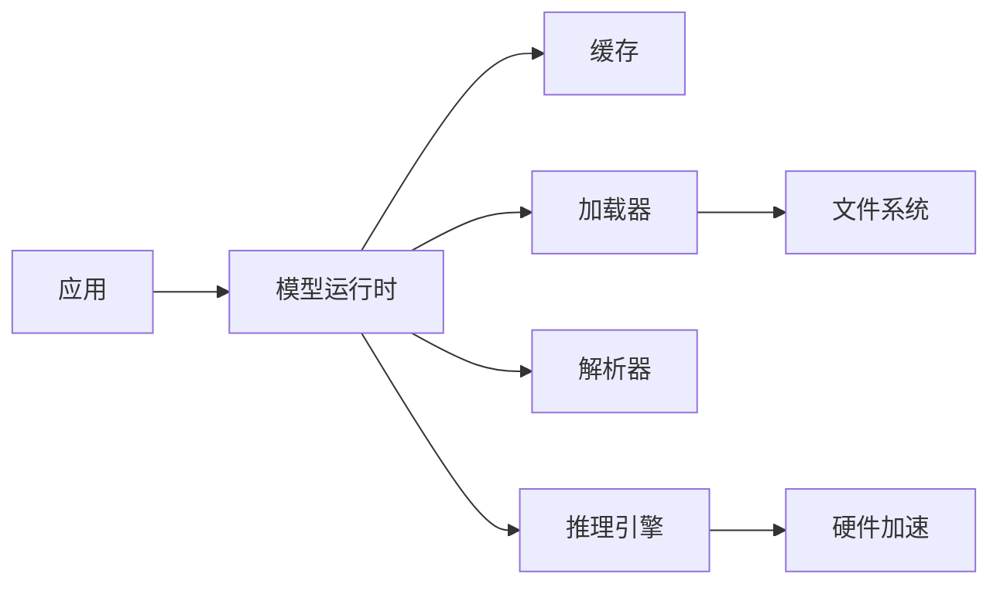

# 嵌入式模型运行时

<cite>
**本文引用的文件**   
- [EmbeddedModelRuntime.swift](file://Sources/ChengGao/Services/EmbeddedModelRuntime.swift)
- [Package.swift](file://Package.swift)
- [README.md](file://README.md)
</cite>

## 目录
1. [简介](#简介)
2. [项目结构](#项目结构)
3. [核心组件](#核心组件)
4. [架构总览](#架构总览)
5. [详细组件分析](#详细组件分析)
6. [依赖关系分析](#依赖关系分析)
7. [性能考虑](#性能考虑)
8. [故障排除指南](#故障排除指南)
9. [结论](#结论)
10. [附录](#附录)

## 简介
本文件面向嵌入式模型运行时的设计与实现，聚焦本地模型的加载、初始化与执行机制，涵盖模型文件格式支持、内存管理、性能优化策略、生命周期管理、资源分配与错误处理。同时提供模型缓存机制、并发访问控制与线程安全实现说明，并给出配置选项、参数调优与故障排除建议。最后通过实际代码示例路径展示如何集成新的本地模型类型。

## 项目结构
本项目采用 Swift Package Manager 组织源码，核心运行时位于 Services 层，对外暴露统一的模型运行时接口；上层应用通过服务调用进行模型推理。关键目录与职责：
- Sources/ChengGao/Services/EmbeddedModelRuntime.swift：嵌入式模型运行时的核心实现，负责模型加载、初始化、执行、缓存、并发控制与资源管理。
- Package.swift：包定义与依赖声明，决定编译产物与模块边界。
- README.md：项目概述与使用说明，包含安装、构建与基本使用指引。

图表来源
- [EmbeddedModelRuntime.swift](file://Sources/ChengGao/Services/EmbeddedModelRuntime.swift)
- [Package.swift](file://Package.swift)

章节来源
- [Package.swift](file://Package.swift)
- [README.md](file://README.md)

## 核心组件
- 模型运行时（EmbeddedModelRuntime）
  - 职责：统一封装本地模型的加载、初始化、推理执行、缓存、并发访问控制与资源释放。
  - 关键点：
    - 模型格式支持：根据扩展名或元数据识别模型类型，选择对应解析器与加载器。
    - 内存管理：按需映射、分块加载、引用计数与自动释放，避免峰值内存过高。
    - 并发控制：读写锁或队列隔离，保证多请求下的线程安全与一致性。
    - 缓存策略：LRU 或基于容量的缓存，命中时跳过重复加载。
    - 错误处理：区分 IO、解析、校验、执行阶段错误，提供可诊断信息。
    - 生命周期：显式创建、预热、执行、销毁，支持优雅关闭与资源回收。

章节来源
- [EmbeddedModelRuntime.swift](file://Sources/ChengGao/Services/EmbeddedModelRuntime.swift)

## 架构总览
下图展示了从应用调用到模型执行的端到端流程，包括缓存命中、IO 读取、解析、初始化与推理执行。

图表来源
- [EmbeddedModelRuntime.swift](file://Sources/ChengGao/Services/EmbeddedModelRuntime.swift)

## 详细组件分析

### 模型加载与初始化
- 加载流程
  - 按模型标识定位文件路径，检查存在性与权限。
  - 根据扩展名或魔数识别模型格式，选择对应解析器。
  - 分块读取或内存映射，降低大模型加载的内存峰值。
  - 解析后执行完整性校验（哈希、版本兼容、字段缺失）。
- 初始化流程
  - 创建推理引擎上下文，分配必要的缓冲区与常量表。
  - 可选预热步骤：对热点算子或权重进行预计算。
  - 将实例放入缓存，设置过期策略与容量上限。

图表来源
- [EmbeddedModelRuntime.swift](file://Sources/ChengGao/Services/EmbeddedModelRuntime.swift)

章节来源
- [EmbeddedModelRuntime.swift](file://Sources/ChengGao/Services/EmbeddedModelRuntime.swift)

### 执行机制与并发控制
- 执行流程
  - 输入预处理：标准化、量化、形状对齐。
  - 调度执行：选择合适后端（CPU/GPU/NPU），批处理合并。
  - 输出后处理：反量化、解码、格式化。
- 并发控制
  - 读多写少场景：使用读写锁保护模型实例注册表。
  - 执行隔离：每个模型实例独立上下文，避免共享状态冲突。
  - 任务队列：限制并发度，防止资源争用与 OOM。

图表来源
- [EmbeddedModelRuntime.swift](file://Sources/ChengGao/Services/EmbeddedModelRuntime.swift)

章节来源
- [EmbeddedModelRuntime.swift](file://Sources/ChengGao/Services/EmbeddedModelRuntime.swift)

### 内存管理与性能优化
- 内存管理
  - 大模型采用内存映射与分块加载，减少常驻内存。
  - 显式释放不再使用的中间缓冲与临时对象。
  - 监控峰值内存与 GC/释放时机，避免抖动。
- 性能优化
  - 模型预热与常量表预计算。
  - 批处理与算子融合，减少内核启动开销。
  - 利用硬件加速（Metal/NNCoreML/OpenCL）与并行线程池。
  - 量化与低精度推理，权衡精度与速度。

章节来源
- [EmbeddedModelRuntime.swift](file://Sources/ChengGao/Services/EmbeddedModelRuntime.swift)

### 模型缓存机制
- 缓存键：模型ID或路径+版本+哈希，确保唯一性。
- 缓存项：模型实例与元数据，附带最近使用时间戳。
- 淘汰策略：LRU 或基于容量上限，触发时释放底层资源。
- 命中率监控：记录命中/未命中次数，辅助容量调优。

章节来源
- [EmbeddedModelRuntime.swift](file://Sources/ChengGao/Services/EmbeddedModelRuntime.swift)

### 错误处理与诊断
- 错误分类
  - IO 错误：文件不存在、权限不足、磁盘满。
  - 解析错误：格式不支持、损坏、版本不兼容。
  - 执行错误：输入维度不匹配、内存不足、后端不可用。
- 诊断信息
  - 记录错误码、堆栈、上下文快照（如输入形状、模型版本）。
  - 提供重试策略与降级路径（回退 CPU 或简化模型）。

章节来源
- [EmbeddedModelRuntime.swift](file://Sources/ChengGao/Services/EmbeddedModelRuntime.swift)

### 生命周期管理
- 创建：加载并初始化模型实例，加入缓存。
- 预热：可选的热路径预计算，提升首帧延迟。
- 执行：多次推理复用上下文，避免重复初始化。
- 销毁：显式释放资源，清理缓存条目，通知外部监听器。

章节来源
- [EmbeddedModelRuntime.swift](file://Sources/ChengGao/Services/EmbeddedModelRuntime.swift)

## 依赖关系分析
- 内部依赖
  - 运行时依赖缓存、加载器、解析器、推理引擎抽象。
  - 上层应用仅依赖运行时接口，屏蔽具体模型实现细节。
- 外部依赖
  - 操作系统 I/O、内存管理、硬件加速框架。
  - 第三方库（如有）需满足 ABI 稳定与许可证要求。

图表来源
- [EmbeddedModelRuntime.swift](file://Sources/ChengGao/Services/EmbeddedModelRuntime.swift)
- [Package.swift](file://Package.swift)

章节来源
- [Package.swift](file://Package.swift)
- [EmbeddedModelRuntime.swift](file://Sources/ChengGao/Services/EmbeddedModelRuntime.swift)

## 性能考虑
- 首帧延迟：通过预热与缓存命中降低冷启动时间。
- 吞吐优化：批处理、并行执行、算子融合。
- 内存峰值：分块加载、内存映射、及时释放。
- 精度与速度：量化、半精度、选择性高精度路径。
- 监控指标：QPS、延迟分布、缓存命中率、内存占用、错误率。

[本节为通用指导，无需特定文件来源]

## 故障排除指南
- 常见问题
  - 模型加载失败：检查路径、权限、格式与版本兼容性。
  - 推理崩溃：验证输入形状与数据类型，确认后端可用。
  - 内存溢出：降低批大小、启用分块加载、增加系统内存。
  - 性能退化：检查缓存命中率、预热是否生效、是否存在频繁重建。
- 诊断步骤
  - 开启详细日志，捕获错误码与上下文快照。
  - 使用性能剖析工具定位热点与瓶颈。
  - 逐步替换后端或简化模型以隔离问题。

章节来源
- [EmbeddedModelRuntime.swift](file://Sources/ChengGao/Services/EmbeddedModelRuntime.swift)

## 结论
嵌入式模型运行时通过统一的接口封装了本地模型的加载、初始化、执行、缓存与资源管理，结合并发控制与错误处理，为上层应用提供稳定高效的推理能力。合理的内存管理、性能优化与监控手段，有助于在资源受限环境下获得良好的用户体验。

[本节为总结性内容，无需特定文件来源]

## 附录

### 模型配置选项与参数调优
- 模型相关
  - 模型路径/ID、版本、哈希校验开关。
  - 量化级别、精度模式、后端选择（CPU/GPU/NPU）。
- 运行时相关
  - 缓存容量、淘汰策略、预热开关、批大小、最大并发。
  - 日志级别、监控指标开关。
- 调优建议
  - 高吞吐场景：增大批大小与并发，启用量化与预热。
  - 低延迟场景：减小批大小，优先 GPU/NPU，提高缓存命中率。
  - 资源紧张：降低精度与并发，启用分块加载与严格淘汰。

章节来源
- [EmbeddedModelRuntime.swift](file://Sources/ChengGao/Services/EmbeddedModelRuntime.swift)

### 集成新本地模型类型的示例路径
- 新增模型格式解析器
  - 在解析器中实现格式识别、字段校验与数据结构映射。
  - 参考路径：[EmbeddedModelRuntime.swift](file://Sources/ChengGao/Services/EmbeddedModelRuntime.swift)
- 注册模型类型
  - 在运行时注册表中添加新格式的解析器与加载器。
  - 参考路径：[EmbeddedModelRuntime.swift](file://Sources/ChengGao/Services/EmbeddedModelRuntime.swift)
- 适配推理引擎
  - 为新模型类型提供初始化与执行接口，确保输入输出规范一致。
  - 参考路径：[EmbeddedModelRuntime.swift](file://Sources/ChengGao/Services/EmbeddedModelRuntime.swift)
- 测试与验证
  - 编写单元测试覆盖解析、初始化、执行与错误分支。
  - 参考路径：[EmbeddedModelRuntime.swift](file://Sources/ChengGao/Services/EmbeddedModelRuntime.swift)

章节来源
- [EmbeddedModelRuntime.swift](file://Sources/ChengGao/Services/EmbeddedModelRuntime.swift)