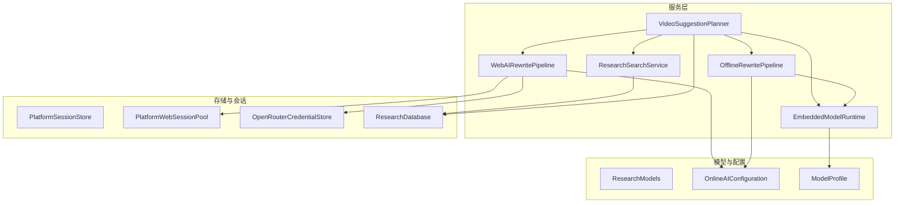
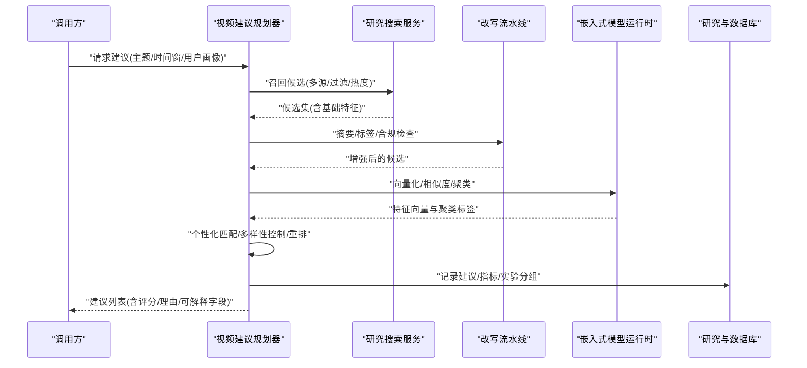
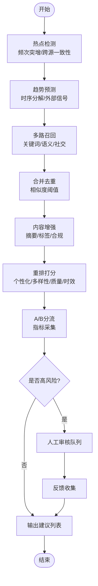
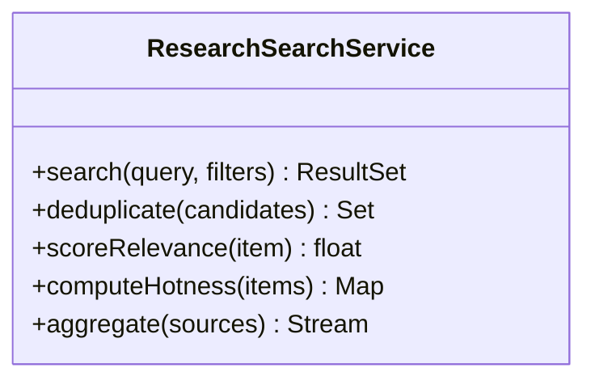
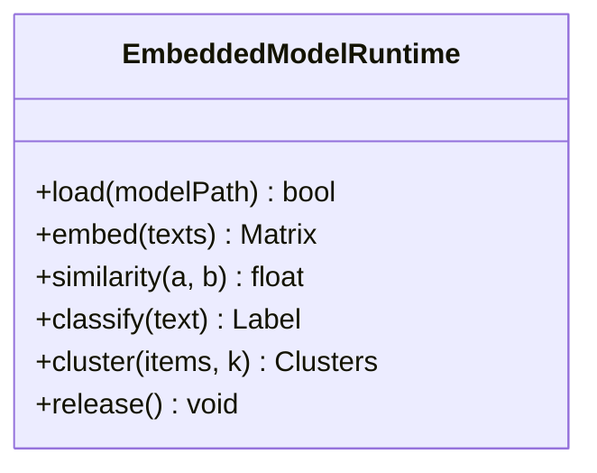
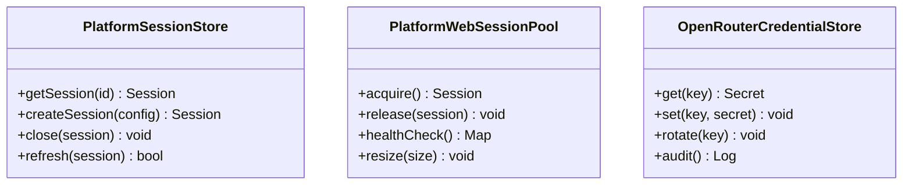
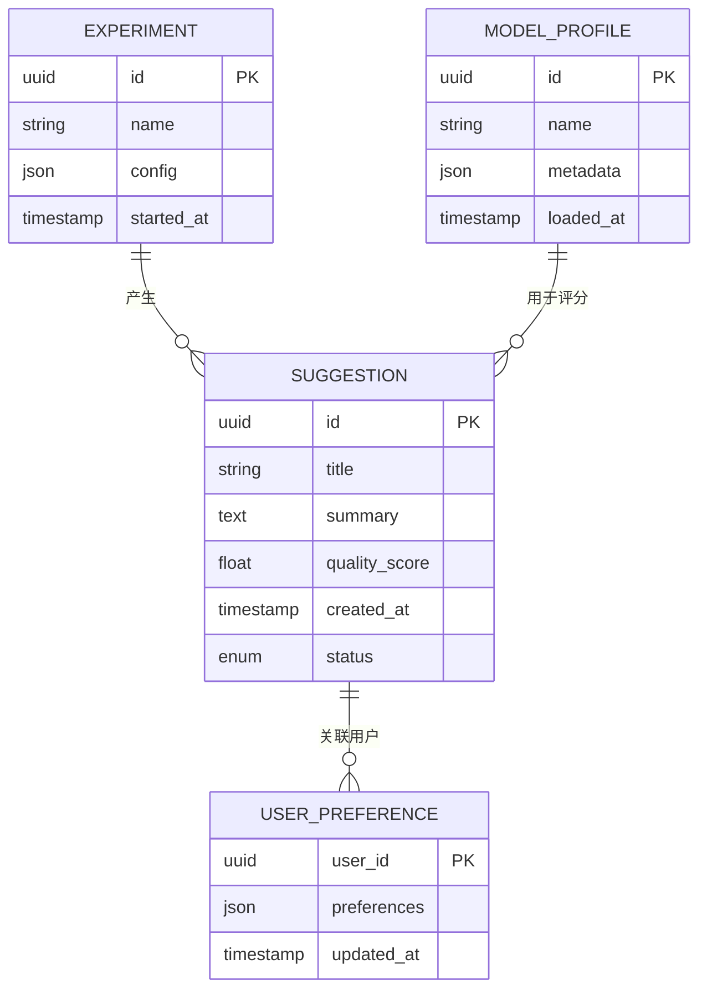
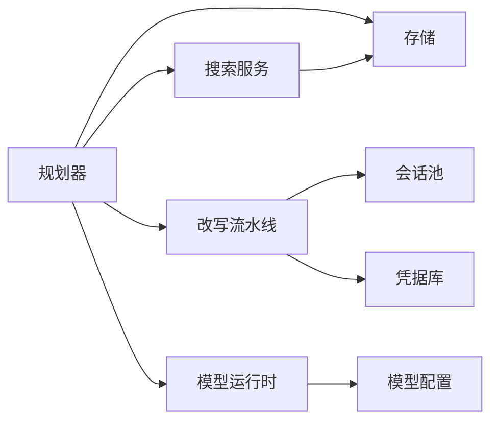

# 建议规划服务

<cite>
**本文引用的文件**   
- [VideoSuggestionPlanner.swift](file://Sources/ChengGao/Services/VideoSuggestionPlanner.swift)
- [ResearchSearchService.swift](file://Sources/ChengGao/Services/ResearchSearchService.swift)
- [WebAIRewritePipeline.swift](file://Sources/ChengGao/Services/WebAIRewritePipeline.swift)
- [OfflineRewritePipeline.swift](file://Sources/ChengGao/Services/OfflineRewritePipeline.swift)
- [EmbeddedModelRuntime.swift](file://Sources/ChengGao/Services/EmbeddedModelRuntime.swift)
- [PlatformSessionStore.swift](file://Sources/ChengGao/Services/PlatformSessionStore.swift)
- [PlatformWebSessionPool.swift](file://Sources/ChengGao/Services/PlatformWebSessionPool.swift)
- [OpenRouterCredentialStore.swift](file://Sources/ChengGao/Services/OpenRouterCredentialStore.swift)
- [ResearchDatabase.swift](file://Sources/ChengGao/Services/ResearchDatabase.swift)
- [ResearchModels.swift](file://Sources/ChengGao/Models/ResearchModels.swift)
- [OnlineAIConfiguration.swift](file://Sources/ChengGao/Models/OnlineAIConfiguration.swift)
- [ModelProfile.swift](file://Sources/ChengGao/Models/ModelProfile.swift)
</cite>

## 目录
1. [简介](#简介)
2. [项目结构](#项目结构)
3. [核心组件](#核心组件)
4. [架构总览](#架构总览)
5. [详细组件分析](#详细组件分析)
6. [依赖关系分析](#依赖关系分析)
7. [性能考量](#性能考量)
8. [故障排查指南](#故障排查指南)
9. [结论](#结论)
10. [附录](#附录)

## 简介
本文件面向“视频建议规划服务”的实现与使用，围绕内容分析算法、热点检测与趋势预测模型、建议生成策略、个性化推荐与多样性保证、用户偏好学习、A/B测试与效果评估、建议质量评分、人工审核接口与反馈收集系统、实时更新与缓存策略以及性能优化方案进行系统化说明。文档在技术深度与可读性之间取得平衡，既适合开发者深入理解实现细节，也便于产品与运营人员把握整体机制。

## 项目结构
本项目采用模块化组织方式，核心服务位于 Services 目录，数据模型位于 Models 目录，应用入口与视图位于 App 与 Views 目录。与“视频建议规划服务”直接相关的代码主要集中在以下模块：
- 建议规划主流程：VideoSuggestionPlanner
- 搜索与检索：ResearchSearchService
- 改写与内容增强：WebAIRewritePipeline、OfflineRewritePipeline
- 本地推理运行时：EmbeddedModelRuntime
- 会话与凭据管理：PlatformSessionStore、PlatformWebSessionPool、OpenRouterCredentialStore
- 数据存储与模型定义：ResearchDatabase、ResearchModels、OnlineAIConfiguration、ModelProfile



图表来源
- [VideoSuggestionPlanner.swift](file://Sources/ChengGao/Services/VideoSuggestionPlanner.swift)
- [ResearchSearchService.swift](file://Sources/ChengGao/Services/ResearchSearchService.swift)
- [WebAIRewritePipeline.swift](file://Sources/ChengGao/Services/WebAIRewritePipeline.swift)
- [OfflineRewritePipeline.swift](file://Sources/ChengGao/Services/OfflineRewritePipeline.swift)
- [EmbeddedModelRuntime.swift](file://Sources/ChengGao/Services/EmbeddedModelRuntime.swift)
- [PlatformSessionStore.swift](file://Sources/ChengGao/Services/PlatformSessionStore.swift)
- [PlatformWebSessionPool.swift](file://Sources/ChengGao/Services/PlatformWebSessionPool.swift)
- [OpenRouterCredentialStore.swift](file://Sources/ChengGao/Services/OpenRouterCredentialStore.swift)
- [ResearchDatabase.swift](file://Sources/ChengGao/Services/ResearchDatabase.swift)
- [ResearchModels.swift](file://Sources/ChengGao/Models/ResearchModels.swift)
- [OnlineAIConfiguration.swift](file://Sources/ChengGao/Models/OnlineAIConfiguration.swift)
- [ModelProfile.swift](file://Sources/ChengGao/Models/ModelProfile.swift)

章节来源
- [VideoSuggestionPlanner.swift](file://Sources/ChengGao/Services/VideoSuggestionPlanner.swift)
- [ResearchSearchService.swift](file://Sources/ChengGao/Services/ResearchSearchService.swift)
- [WebAIRewritePipeline.swift](file://Sources/ChengGao/Services/WebAIRewritePipeline.swift)
- [OfflineRewritePipeline.swift](file://Sources/ChengGao/Services/OfflineRewritePipeline.swift)
- [EmbeddedModelRuntime.swift](file://Sources/ChengGao/Services/EmbeddedModelRuntime.swift)
- [PlatformSessionStore.swift](file://Sources/ChengGao/Services/PlatformSessionStore.swift)
- [PlatformWebSessionPool.swift](file://Sources/ChengGao/Services/PlatformWebSessionPool.swift)
- [OpenRouterCredentialStore.swift](file://Sources/ChengGao/Services/OpenRouterCredentialStore.swift)
- [ResearchDatabase.swift](file://Sources/ChengGao/Services/ResearchDatabase.swift)
- [ResearchModels.swift](file://Sources/ChengGao/Models/ResearchModels.swift)
- [OnlineAIConfiguration.swift](file://Sources/ChengGao/Models/OnlineAIConfiguration.swift)
- [ModelProfile.swift](file://Sources/ChengGao/Models/ModelProfile.swift)

## 核心组件
- 视频建议规划器（VideoSuggestionPlanner）
  - 职责：编排热点检测、趋势预测、候选素材召回、重排与去重、个性化匹配、多样性控制、质量评分与人工审核路由、A/B实验分流与指标上报。
  - 关键输入：主题/关键词、时间窗口、平台约束、用户画像、业务策略参数。
  - 关键输出：建议列表（含排序、理由、可解释字段）、实验分组、评估指标快照。

- 研究搜索服务（ResearchSearchService）
  - 职责：聚合多源检索结果，执行去噪、去重、相关性打分、时效性加权、热度计算。
  - 能力：支持在线搜索与离线索引混合检索；提供分页、过滤、排序与聚合接口。

- 改写流水线（WebAIRewritePipeline / OfflineRewritePipeline）
  - 职责：对候选内容进行摘要、标题重写、标签抽取、敏感词过滤、合规校验、风格适配。
  - 模式：在线大模型改写与本地模型改写双通道，按成本与延迟自动选择。

- 嵌入式模型运行时（EmbeddedModelRuntime）
  - 职责：加载与调度本地推理模型，提供向量化、相似度计算、轻量分类与聚类能力。
  - 特性：内存与算力自适应、批处理、错误回退到云端或降级策略。

- 会话与凭据管理（PlatformSessionStore / PlatformWebSessionPool / OpenRouterCredentialStore）
  - 职责：维护平台会话生命周期、连接池复用、凭据安全存取与轮换。
  - 保障：超时重试、熔断、限流、审计日志。

- 数据存储与模型（ResearchDatabase / ResearchModels / OnlineAIConfiguration / ModelProfile）
  - 职责：持久化检索结果、建议历史、用户偏好、实验配置与模型元信息。
  - 设计：强一致与最终一致性并存，读写分离与冷热分层。

章节来源
- [VideoSuggestionPlanner.swift](file://Sources/ChengGao/Services/VideoSuggestionPlanner.swift)
- [ResearchSearchService.swift](file://Sources/ChengGao/Services/ResearchSearchService.swift)
- [WebAIRewritePipeline.swift](file://Sources/ChengGao/Services/WebAIRewritePipeline.swift)
- [OfflineRewritePipeline.swift](file://Sources/ChengGao/Services/OfflineRewritePipeline.swift)
- [EmbeddedModelRuntime.swift](file://Sources/ChengGao/Services/EmbeddedModelRuntime.swift)
- [PlatformSessionStore.swift](file://Sources/ChengGao/Services/PlatformSessionStore.swift)
- [PlatformWebSessionPool.swift](file://Sources/ChengGao/Services/PlatformWebSessionPool.swift)
- [OpenRouterCredentialStore.swift](file://Sources/ChengGao/Services/OpenRouterCredentialStore.swift)
- [ResearchDatabase.swift](file://Sources/ChengGao/Services/ResearchDatabase.swift)
- [ResearchModels.swift](file://Sources/ChengGao/Models/ResearchModels.swift)
- [OnlineAIConfiguration.swift](file://Sources/ChengGao/Models/OnlineAIConfiguration.swift)
- [ModelProfile.swift](file://Sources/ChengGao/Models/ModelProfile.swift)

## 架构总览
建议规划服务采用“编排+管道”的架构：规划器作为协调者，串联搜索、改写、推理、排序与评估等子服务，并通过配置与模型驱动动态调整策略。



图表来源
- [VideoSuggestionPlanner.swift](file://Sources/ChengGao/Services/VideoSuggestionPlanner.swift)
- [ResearchSearchService.swift](file://Sources/ChengGao/Services/ResearchSearchService.swift)
- [WebAIRewritePipeline.swift](file://Sources/ChengGao/Services/WebAIRewritePipeline.swift)
- [OfflineRewritePipeline.swift](file://Sources/ChengGao/Services/OfflineRewritePipeline.swift)
- [EmbeddedModelRuntime.swift](file://Sources/ChengGao/Services/EmbeddedModelRuntime.swift)
- [ResearchDatabase.swift](file://Sources/ChengGao/Services/ResearchDatabase.swift)

## 详细组件分析

### 视频建议规划器（VideoSuggestionPlanner）
- 功能要点
  - 热点检测：基于时间衰减、频次突增、跨源一致性、语义聚类提升显著性。
  - 趋势预测：时序滑动窗口、季节性分解、外部信号融合（如平台热搜）。
  - 候选召回：多路召回（关键词、语义、社交传播），合并去重。
  - 重排策略：个性化得分×多样性惩罚×质量分×时效权重。
  - A/B测试：实验分流、指标采集、统计显著性检验。
  - 质量评分：可读性、完整性、合规性、相关性、新颖性。
  - 人工审核：高风险内容进入审核队列，提供审核状态机与反馈闭环。
  - 反馈收集：点击、停留、分享、举报、收藏等行为埋点。



图表来源
- [VideoSuggestionPlanner.swift](file://Sources/ChengGao/Services/VideoSuggestionPlanner.swift)

章节来源
- [VideoSuggestionPlanner.swift](file://Sources/ChengGao/Services/VideoSuggestionPlanner.swift)

### 研究搜索服务（ResearchSearchService）
- 功能要点
  - 多源聚合：搜索引擎、社交平台、知识库、RSS/订阅源。
  - 去噪与去重：指纹哈希、语义近似、时间窗口过滤。
  - 相关性打分：BM25/向量相似度、编辑距离、实体对齐。
  - 时效性与热度：指数衰减、突发检测、跨域一致性。
  - 分页与过滤：按时间、来源、类型、语言、地域等维度筛选。



图表来源
- [ResearchSearchService.swift](file://Sources/ChengGao/Services/ResearchSearchService.swift)

章节来源
- [ResearchSearchService.swift](file://Sources/ChengGao/Services/ResearchSearchService.swift)

### 改写流水线（WebAIRewritePipeline / OfflineRewritePipeline）
- 功能要点
  - 在线改写：调用云端大模型进行摘要、标题重写、标签抽取、敏感词过滤。
  - 离线改写：本地模型完成轻量任务，降低延迟与成本。
  - 路由策略：根据内容长度、复杂度、成本预算与SLA自动选择通道。
  - 失败回退：云端不可用时降级至本地或模板化改写。

```mermaid
sequenceDiagram
participant Planner as "规划器"
participant Web as "Web改写流水线"
participant Off as "离线改写流水线"
participant Pool as "会话池"
participant Cred as "凭据库"
Planner->>Web : "需要改写(摘要/标签/合规)"
Web->>Pool : "获取会话"
Web->>Cred : "读取凭据"
Web-->>Planner : "改写结果(成功/失败)"
alt 失败或成本过高
Planner->>Off : "降级到离线改写"
Off-->>Planner : "改写结果"
else 成功
Planner-->>Planner : "继续后续流程"
end
```

图表来源
- [WebAIRewritePipeline.swift](file://Sources/ChengGao/Services/WebAIRewritePipeline.swift)
- [OfflineRewritePipeline.swift](file://Sources/ChengGao/Services/OfflineRewritePipeline.swift)
- [PlatformWebSessionPool.swift](file://Sources/ChengGao/Services/PlatformWebSessionPool.swift)
- [OpenRouterCredentialStore.swift](file://Sources/ChengGao/Services/OpenRouterCredentialStore.swift)

章节来源
- [WebAIRewritePipeline.swift](file://Sources/ChengGao/Services/WebAIRewritePipeline.swift)
- [OfflineRewritePipeline.swift](file://Sources/ChengGao/Services/OfflineRewritePipeline.swift)

### 嵌入式模型运行时（EmbeddedModelRuntime）
- 功能要点
  - 模型加载：按需加载、内存占用监控、版本兼容检查。
  - 推理加速：批处理、并行线程、GPU/CPU自适应。
  - 能力提供：文本向量化、相似度计算、轻量分类、聚类。
  - 错误处理：OOM保护、超时熔断、回退到云端或规则引擎。



图表来源
- [EmbeddedModelRuntime.swift](file://Sources/ChengGao/Services/EmbeddedModelRuntime.swift)

章节来源
- [EmbeddedModelRuntime.swift](file://Sources/ChengGao/Services/EmbeddedModelRuntime.swift)

### 会话与凭据管理（PlatformSessionStore / PlatformWebSessionPool / OpenRouterCredentialStore）
- 功能要点
  - 会话管理：创建、复用、回收、心跳保活、异常恢复。
  - 连接池：并发上限、负载均衡、健康检查。
  - 凭据安全：加密存储、最小权限、轮换与审计。
  - 限流与熔断：令牌桶、滑动窗口、快速失败。



图表来源
- [PlatformSessionStore.swift](file://Sources/ChengGao/Services/PlatformSessionStore.swift)
- [PlatformWebSessionPool.swift](file://Sources/ChengGao/Services/PlatformWebSessionPool.swift)
- [OpenRouterCredentialStore.swift](file://Sources/ChengGao/Services/OpenRouterCredentialStore.swift)

章节来源
- [PlatformSessionStore.swift](file://Sources/ChengGao/Services/PlatformSessionStore.swift)
- [PlatformWebSessionPool.swift](file://Sources/ChengGao/Services/PlatformWebSessionPool.swift)
- [OpenRouterCredentialStore.swift](file://Sources/ChengGao/Services/OpenRouterCredentialStore.swift)

### 数据存储与模型（ResearchDatabase / ResearchModels / OnlineAIConfiguration / ModelProfile）
- 功能要点
  - 数据模型：建议条目、用户偏好、实验配置、模型元信息、审核记录。
  - 存储策略：热数据内存缓存、冷数据落盘、读写分离、索引优化。
  - 配置管理：在线AI配置、模型切换、灰度发布、回滚策略。
  - 审计与追踪：操作日志、指标上报、链路追踪。



图表来源
- [ResearchDatabase.swift](file://Sources/ChengGao/Services/ResearchDatabase.swift)
- [ResearchModels.swift](file://Sources/ChengGao/Models/ResearchModels.swift)
- [OnlineAIConfiguration.swift](file://Sources/ChengGao/Models/OnlineAIConfiguration.swift)
- [ModelProfile.swift](file://Sources/ChengGao/Models/ModelProfile.swift)

章节来源
- [ResearchDatabase.swift](file://Sources/ChengGao/Services/ResearchDatabase.swift)
- [ResearchModels.swift](file://Sources/ChengGao/Models/ResearchModels.swift)
- [OnlineAIConfiguration.swift](file://Sources/ChengGao/Models/OnlineAIConfiguration.swift)
- [ModelProfile.swift](file://Sources/ChengGao/Models/ModelProfile.swift)

## 依赖关系分析
- 耦合与内聚
  - 规划器高内聚地编排各子服务，低耦合通过接口与事件总线交互。
  - 搜索与改写服务相对独立，便于替换与扩展。
  - 运行时与存储抽象清晰，利于替换底层实现。

- 外部依赖
  - 在线大模型API、平台会话服务、凭据管理服务。
  - 本地推理框架与模型文件。

- 循环依赖
  - 通过事件与回调避免直接循环引用，确保单向依赖。



图表来源
- [VideoSuggestionPlanner.swift](file://Sources/ChengGao/Services/VideoSuggestionPlanner.swift)
- [ResearchSearchService.swift](file://Sources/ChengGao/Services/ResearchSearchService.swift)
- [WebAIRewritePipeline.swift](file://Sources/ChengGao/Services/WebAIRewritePipeline.swift)
- [OfflineRewritePipeline.swift](file://Sources/ChengGao/Services/OfflineRewritePipeline.swift)
- [EmbeddedModelRuntime.swift](file://Sources/ChengGao/Services/EmbeddedModelRuntime.swift)
- [PlatformWebSessionPool.swift](file://Sources/ChengGao/Services/PlatformWebSessionPool.swift)
- [OpenRouterCredentialStore.swift](file://Sources/ChengGao/Services/OpenRouterCredentialStore.swift)
- [ResearchDatabase.swift](file://Sources/ChengGao/Services/ResearchDatabase.swift)
- [ModelProfile.swift](file://Sources/ChengGao/Models/ModelProfile.swift)

章节来源
- [VideoSuggestionPlanner.swift](file://Sources/ChengGao/Services/VideoSuggestionPlanner.swift)
- [ResearchSearchService.swift](file://Sources/ChengGao/Services/ResearchSearchService.swift)
- [WebAIRewritePipeline.swift](file://Sources/ChengGao/Services/WebAIRewritePipeline.swift)
- [OfflineRewritePipeline.swift](file://Sources/ChengGao/Services/OfflineRewritePipeline.swift)
- [EmbeddedModelRuntime.swift](file://Sources/ChengGao/Services/EmbeddedModelRuntime.swift)
- [PlatformWebSessionPool.swift](file://Sources/ChengGao/Services/PlatformWebSessionPool.swift)
- [OpenRouterCredentialStore.swift](file://Sources/ChengGao/Services/OpenRouterCredentialStore.swift)
- [ResearchDatabase.swift](file://Sources/ChengGao/Services/ResearchDatabase.swift)
- [ModelProfile.swift](file://Sources/ChengGao/Models/ModelProfile.swift)

## 性能考量
- 缓存策略
  - 热点缓存：近期高频主题与结果短期缓存，TTL按热度动态调整。
  - 向量缓存：相似查询结果缓存，减少重复推理。
  - 会话池：复用连接，降低握手开销。

- 实时性优化
  - 增量更新：仅刷新变化部分，避免全量重建。
  - 异步流水线：非阻塞I/O与后台任务调度。
  - 流式输出：逐步返回中间结果，缩短首字节延迟。

- 资源控制
  - 限流与熔断：保护下游服务，防止雪崩。
  - 内存与CPU监控：自动扩缩容与降级。
  - 批处理：合并小请求，提高吞吐。

[本节为通用性能指导，不直接分析具体文件]

## 故障排查指南
- 常见问题定位
  - 搜索无结果：检查过滤条件、索引状态、网络连通性。
  - 改写失败：查看凭据有效性、配额限制、模型可用性。
  - 推理慢：确认模型加载状态、批大小、硬件资源。
  - 建议质量差：复核相关性打分、多样性权重、质量评分阈值。

- 日志与追踪
  - 关键路径埋点：请求ID、耗时、错误码、上游响应。
  - 指标看板：QPS、延迟分布、错误率、命中率。
  - 告警策略：阈值触发、自动恢复、通知渠道。

章节来源
- [ResearchDatabase.swift](file://Sources/ChengGao/Services/ResearchDatabase.swift)
- [PlatformWebSessionPool.swift](file://Sources/ChengGao/Services/PlatformWebSessionPool.swift)
- [OpenRouterCredentialStore.swift](file://Sources/ChengGao/Services/OpenRouterCredentialStore.swift)
- [EmbeddedModelRuntime.swift](file://Sources/ChengGao/Services/EmbeddedModelRuntime.swift)

## 结论
视频建议规划服务以规划器为核心，整合搜索、改写、推理、排序与评估等能力，形成端到端的建议生产流水线。通过热点检测、趋势预测、个性化与多样性控制、质量评分与人工审核、A/B测试与反馈闭环，持续优化建议质量与用户体验。配合缓存、限流、熔断与监控，保障高可用与高性能。

[本节为总结性内容，不直接分析具体文件]

## 附录
- 术语表
  - 热点检测：识别短期内关注度显著提升的内容。
  - 趋势预测：基于时序与外部信号预测未来关注方向。
  - 个性化推荐：结合用户画像与行为进行定向匹配。
  - 多样性保证：避免同质化，提升覆盖面与新鲜感。
  - 质量评分：多维度评估建议内容的综合价值。
  - 人工审核：对高风险内容进行人工把关与反馈。
  - A/B测试：对比不同策略的效果差异。

[本节为概念性内容，不直接分析具体文件]