# 服务层

<cite>
**本文引用的文件**   
- [EmbeddedModelRuntime.swift](file://Sources/ChengGao/Services/EmbeddedModelRuntime.swift)
- [LocalSpeechTranscriber.swift](file://Sources/ChengGao/Services/LocalSpeechTranscriber.swift)
- [TerminologyVerifier.swift](file://Sources/ChengGao/Services/TerminologyVerifier.swift)
- [SpokenSubtitleFormatter.swift](file://Sources/ChengGao/Services/SpokenSubtitleFormatter.swift)
- [VisualPromptGenerator.swift](file://Sources/ChengGao/Services/VisualPromptGenerator.swift)
- [OfflineRewritePipeline.swift](file://Sources/ChengGao/Services/OfflineRewritePipeline.swift)
- [OnlineAIModelCatalogClient.swift](file://Sources/ChengGao/Services/OnlineAIModelCatalogClient.swift)
- [OpenRouterCredentialStore.swift](file://Sources/ChengGao/Services/OpenRouterCredentialStore.swift)
- [ResearchDatabase.swift](file://Sources/ChengGao/Services/ResearchDatabase.swift)
- [ResearchSearchService.swift](file://Sources/ChengGao/Services/ResearchSearchService.swift)
- [PlatformSessionStore.swift](file://Sources/ChengGao/Services/PlatformSessionStore.swift)
- [PlatformWebSessionPool.swift](file://Sources/ChengGao/Services/PlatformWebSessionPool.swift)
- [WebAIRewritePipeline.swift](file://Sources/ChengGao/Services/WebAIRewritePipeline.swift)
- [CompatibleImageGenerationClient.swift](file://Sources/ChengGao/Services/CompatibleImage生成客户端.swift)
- [CoverArtworkGenerator.swift](file://Sources/ChengGao/Services/CoverArtworkGenerator.swift)
- [DouyinVideoResolver.swift](file://Sources/ChengGao/Services/DouyinVideoResolver.swift)
- [ShortVideoExportPackage.swift](file://Sources/ChengGao/Services/ShortVideoExportPackage.swift)
- [SourceExtractor.swift](file://ChengGao/Services/SourceExtractor.swift)
- [VideoFrameTextExtractor.swift](file://Sources/ChengGao/Services/VideoFrameTextExtractor.swift)
- [VideoSuggestionPlanner.swift](file://Sources/ChengGao/Services/VideoSuggestionPlanner.swift)
- [WebAIWebSession.swift](file://Sources/ChengGao/Services/WebAIWebSession.swift)
- [WebKitResearchSearchService.swift](file://Sources/ChengGao/Services/WebKitResearchSearchService.swift)
- [XiaohongshuContentResolver.swift](file://Sources/ChengGao/Services/XiaohongshuContentResolver.swift)
- [ResearchStore.swift](file://Sources/ChengGao/Stores/ResearchStore.swift)
- [RewriteStore.swift](file://Sources/ChengGao/Stores/RewriteStore.swift)
- [ChengGaoApp.swift](file://Sources/ChengGao/App/ChengGaoApp.swift)
</cite>

## 目录
1. [简介](#简介)
2. [项目结构](#项目结构)
3. [核心组件](#核心组件)
4. [架构总览](#架构总览)
5. [详细组件分析](#详细组件分析)
6. [依赖关系分析](#依赖关系分析)
7. [性能考量](#性能考量)
8. [故障排查指南](#故障排查指南)
9. [结论](#结论)
10. [附录](#附录)

## 简介
本文件聚焦于服务层的设计与实现，围绕嵌入式模型运行时、语音转录、术语验证、字幕格式化与视觉提示生成等核心服务展开。文档将阐述：
- 各服务的职责边界、接口契约与调用协议
- 服务间依赖关系与数据流
- 生命周期管理、资源池化与并发控制策略
- 错误处理机制与可观测性（监控、日志）
- 新服务开发规范与服务注册机制
- 性能调优与最佳实践

## 项目结构
服务层位于 Sources/ChengGao/Services 目录下，按功能域组织：
- 模型与推理：EmbeddedModelRuntime、OfflineRewritePipeline、OnlineAIModelCatalogClient
- 语音与字幕：LocalSpeechTranscriber、SpokenSubtitleFormatter
- 内容理解与增强：TerminologyVerifier、VisualPromptGenerator、VideoFrameTextExtractor、VideoSuggestionPlanner
- 平台与网络：PlatformSessionStore、PlatformWebSessionPool、WebAIWebSession、WebKitResearchSearchService
- 存储与凭证：ResearchDatabase、OpenRouterCredentialStore
- 导出与素材：ShortVideoExportPackage、CoverArtworkGenerator、CompatibleImageGenerationClient
- 解析器：DouyinVideoResolver、XiaohongshuContentResolver、SourceExtractor

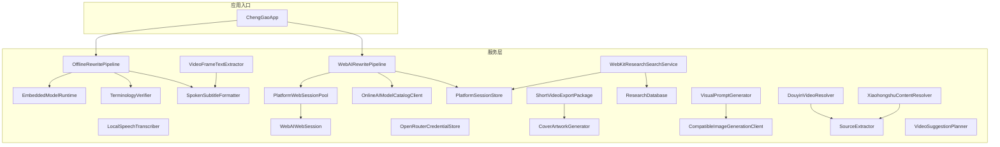

图表来源
- [ChengGaoApp.swift](file://Sources/ChengGao/App/ChengGaoApp.swift)
- [EmbeddedModelRuntime.swift](file://Sources/ChengGao/Services/EmbeddedModelRuntime.swift)
- [LocalSpeechTranscriber.swift](file://Sources/ChengGao/Services/LocalSpeechTranscriber.swift)
- [TerminologyVerifier.swift](file://Sources/ChengGao/Services/TerminologyVerifier.swift)
- [SpokenSubtitleFormatter.swift](file://Sources/ChengGao/Services/SpokenSubtitleFormatter.swift)
- [VisualPromptGenerator.swift](file://Sources/ChengGao/Services/VisualPromptGenerator.swift)
- [OfflineRewritePipeline.swift](file://Sources/ChengGao/Services/OfflineRewritePipeline.swift)
- [OnlineAIModelCatalogClient.swift](file://Sources/ChengGao/Services/OnlineAIModelCatalogClient.swift)
- [PlatformSessionStore.swift](file://Sources/ChengGao/Services/PlatformSessionStore.swift)
- [PlatformWebSessionPool.swift](file://Sources/ChengGao/Services/PlatformWebSessionPool.swift)
- [WebAIWebSession.swift](file://Sources/ChengGao/Services/WebAIWebSession.swift)
- [ResearchDatabase.swift](file://Sources/ChengGao/Services/ResearchDatabase.swift)
- [OpenRouterCredentialStore.swift](file://Sources/ChengGao/Services/OpenRouterCredentialStore.swift)
- [ShortVideoExportPackage.swift](file://Sources/ChengGao/Services/ShortVideoExportPackage.swift)
- [CoverArtworkGenerator.swift](file://Sources/ChengGao/Services/CoverArtworkGenerator.swift)
- [CompatibleImageGenerationClient.swift](file://Sources/ChengGao/Services/CompatibleImage生成客户端.swift)
- [DouyinVideoResolver.swift](file://Sources/ChengGao/Services/DouyinVideoResolver.swift)
- [XiaohongshuContentResolver.swift](file://Sources/ChengGao/Services/XiaohongshuContentResolver.swift)
- [SourceExtractor.swift](file://ChengGao/Services/SourceExtractor.swift)
- [VideoFrameTextExtractor.swift](file://Sources/ChengGao/Services/VideoFrameTextExtractor.swift)
- [VideoSuggestionPlanner.swift](file://Sources/ChengGao/Services/VideoSuggestionPlanner.swift)
- [WebAIRewritePipeline.swift](file://Sources/ChengGao/Services/WebAIRewritePipeline.swift)
- [WebKitResearchSearchService.swift](file://Sources/ChengGao/Services/WebKitResearchSearchService.swift)

章节来源
- [ChengGaoApp.swift](file://Sources/ChengGao/App/ChengGaoApp.swift)

## 核心组件
本节对关键服务进行职责说明与交互要点概述：
- 嵌入式模型运行时：提供本地推理能力，封装模型加载、上下文管理与执行调度，支持异步任务与资源回收。
- 本地语音转录：基于系统或第三方引擎完成音频到文本的转换，具备采样率适配、分段与时间戳对齐能力。
- 术语验证：维护术语词典与规则，对输入文本进行校验、替换与一致性检查。
- 口语字幕格式化：将转录结果与时间轴转换为标准字幕格式，支持多语言与样式标记。
- 视觉提示生成：根据视频帧或元数据生成图像提示词，驱动图像生成客户端产出封面或插图。
- 离线重写流水线：串联术语验证、字幕格式化与模型推理，形成端到端的内容改写流程。
- 在线模型目录客户端：查询可用模型、版本与配额信息，支撑动态选择与降级策略。
- 平台会话与网络：统一会话存储、连接池与会话复用，降低握手开销并提升吞吐。
- 研究与数据库：研究数据存储、检索与缓存，为搜索与分析提供持久化能力。
- 导出与素材：打包短视频产物、生成封面图与兼容图像生成接口，满足多平台输出需求。
- 解析器与提取器：从不同平台抽取源内容与视频帧文本，丰富上游输入。

章节来源
- [EmbeddedModelRuntime.swift](file://Sources/ChengGao/Services/EmbeddedModelRuntime.swift)
- [LocalSpeechTranscriber.swift](file://Sources/ChengGao/Services/LocalSpeechTranscriber.swift)
- [TerminologyVerifier.swift](file://Sources/ChengGao/Services/TerminologyVerifier.swift)
- [SpokenSubtitleFormatter.swift](file://Sources/ChengGao/Services/SpokenSubtitleFormatter.swift)
- [VisualPromptGenerator.swift](file://Sources/ChengGao/Services/VisualPromptGenerator.swift)
- [OfflineRewritePipeline.swift](file://Sources/ChengGao/Services/OfflineRewritePipeline.swift)
- [OnlineAIModelCatalogClient.swift](file://Sources/ChengGao/Services/OnlineAIModelCatalogClient.swift)
- [PlatformSessionStore.swift](file://Sources/ChengGao/Services/PlatformSessionStore.swift)
- [PlatformWebSessionPool.swift](file://Sources/ChengGao/Services/PlatformWebSessionPool.swift)
- [WebAIWebSession.swift](file://Sources/ChengGao/Services/WebAIWebSession.swift)
- [ResearchDatabase.swift](file://Sources/ChengGao/Services/ResearchDatabase.swift)
- [OpenRouterCredentialStore.swift](file://Sources/ChengGao/Services/OpenRouterCredentialStore.swift)
- [ShortVideoExportPackage.swift](file://Sources/ChengGao/Services/ShortVideoExportPackage.swift)
- [CoverArtworkGenerator.swift](file://Sources/ChengGao/Services/CoverArtworkGenerator.swift)
- [CompatibleImageGenerationClient.swift](file://Sources/ChengGao/Services/CompatibleImage生成客户端.swift)
- [DouyinVideoResolver.swift](file://Sources/ChengGao/Services/DouyinVideoResolver.swift)
- [XiaohongshuContentResolver.swift](file://Sources/ChengGao/Services/XiaohongshuContentResolver.swift)
- [SourceExtractor.swift](file://ChengGao/Services/SourceExtractor.swift)
- [VideoFrameTextExtractor.swift](file://Sources/ChengGao/Services/VideoFrameTextExtractor.swift)
- [VideoSuggestionPlanner.swift](file://Sources/ChengGao/Services/VideoSuggestionPlanner.swift)
- [WebAIRewritePipeline.swift](file://Sources/ChengGao/Services/WebAIRewritePipeline.swift)
- [WebKitResearchSearchService.swift](file://Sources/ChengGao/Services/WebKitResearchSearchService.swift)

## 架构总览
服务层采用“流水线 + 资源池”的混合架构：
- 流水线编排：离线与在线重写流水线分别编排本地与远程能力，保证可扩展与可替换。
- 资源池化：会话池与模型运行时共享上下文，减少重复初始化成本。
- 并发控制：通过队列与限流保护后端与本地资源，避免过载。
- 错误隔离：各阶段独立错误处理与降级路径，保障整体可用性。

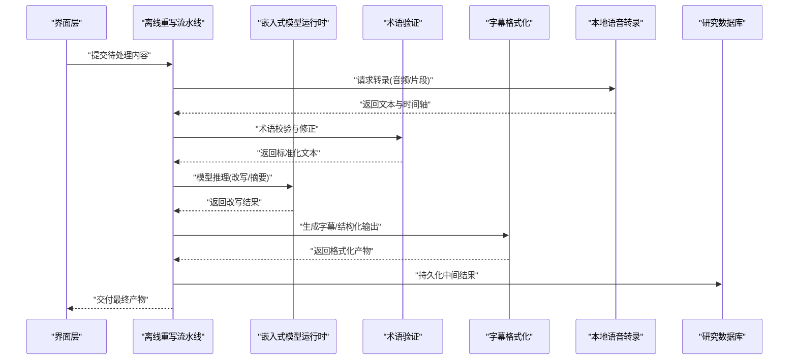

图表来源
- [OfflineRewritePipeline.swift](file://Sources/ChengGao/Services/OfflineRewritePipeline.swift)
- [EmbeddedModelRuntime.swift](file://Sources/ChengGao/Services/EmbeddedModelRuntime.swift)
- [TerminologyVerifier.swift](file://Sources/ChengGao/Services/TerminologyVerifier.swift)
- [SpokenSubtitleFormatter.swift](file://Sources/ChengGao/Services/SpokenSubtitleFormatter.swift)
- [LocalSpeechTranscriber.swift](file://Sources/ChengGao/Services/LocalSpeechTranscriber.swift)
- [ResearchDatabase.swift](file://Sources/ChengGao/Services/ResearchDatabase.swift)

## 详细组件分析

### 嵌入式模型运行时
- 职责：加载与缓存模型、管理推理上下文、调度异步任务、释放资源。
- 关键特性：
  - 模型预热与懒加载，按需实例化以减少内存占用。
  - 批处理与队列化执行，限制并发度避免阻塞主线程。
  - 错误分类与重试策略，区分可恢复与不可恢复异常。
- 生命周期：初始化→预热→运行→清理；支持热更新与版本切换。
- 并发与资源：内部使用线程池与内存池，确保稳定吞吐。

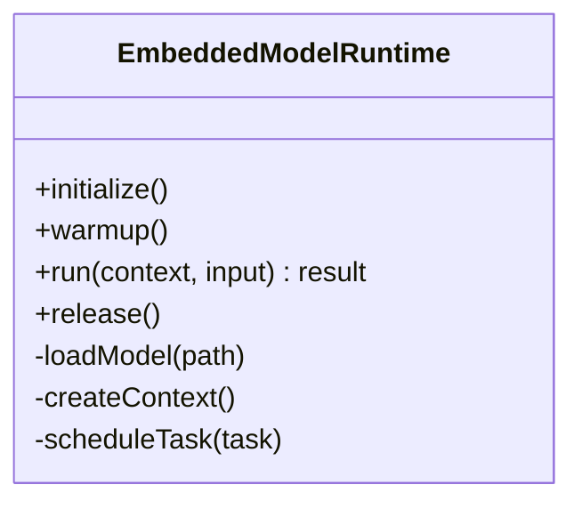

图表来源
- [EmbeddedModelRuntime.swift](file://Sources/ChengGao/Services/EmbeddedModelRuntime.swift)

章节来源
- [EmbeddedModelRuntime.swift](file://Sources/ChengGao/Services/EmbeddedModelRuntime.swift)

### 本地语音转录
- 职责：音频输入预处理、调用转录引擎、输出带时间戳的文本片段。
- 关键特性：
  - 采样率与编码自适应，支持常见音频格式。
  - 分段切分与静音检测，提高识别准确率。
  - 失败回退与重试，保障稳定性。
- 生命周期：创建→配置→转录→销毁；支持增量更新。
- 并发：后台队列执行，避免阻塞 UI。

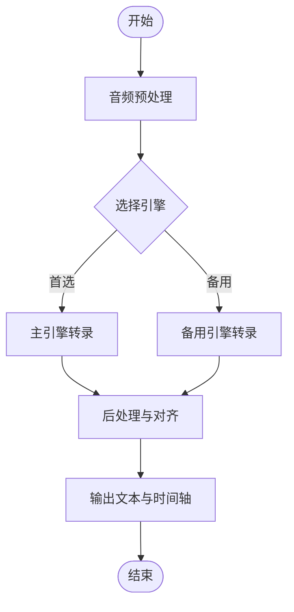

图表来源
- [LocalSpeechTranscriber.swift](file://Sources/ChengGao/Services/LocalSpeechTranscriber.swift)

章节来源
- [LocalSpeechTranscriber.swift](file://Sources/ChengGao/Services/LocalSpeechTranscriber.swift)

### 术语验证
- 职责：维护术语库与规则，对输入文本进行校验、替换与一致性检查。
- 关键特性：
  - 词典增量更新与缓存命中优化。
  - 规则引擎支持正则与上下文匹配。
  - 冲突解决与审计日志。
- 生命周期：加载词典→构建索引→验证→刷新。
- 并发：只读共享索引，写操作串行化。

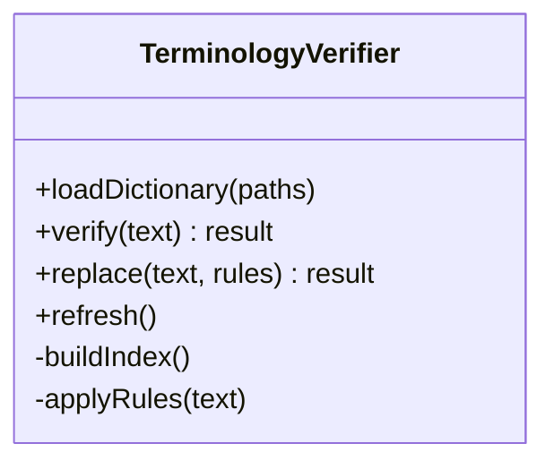

图表来源
- [TerminologyVerifier.swift](file://Sources/ChengGao/Services/TerminologyVerifier.swift)

章节来源
- [TerminologyVerifier.swift](file://Sources/ChengGao/Services/TerminologyVerifier.swift)

### 字幕格式化
- 职责：将转录文本与时间轴转换为标准字幕格式，支持多语言与样式。
- 关键特性：
  - 多格式输出（如 SRT、ASS），字段映射与校验。
  - 断句与换行优化，提升可读性。
  - 批量处理与流式写入，降低内存峰值。
- 生命周期：配置→格式化→导出→清理。
- 并发：按批次并行处理，合并结果。

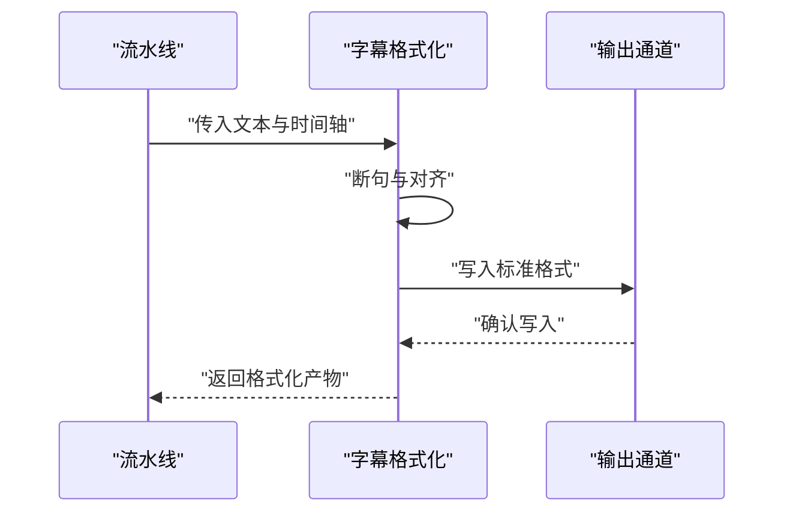

图表来源
- [SpokenSubtitleFormatter.swift](file://Sources/ChengGao/Services/SpokenSubtitleFormatter.swift)

章节来源
- [SpokenSubtitleFormatter.swift](file://Sources/ChengGao/Services/SpokenSubtitleFormatter.swift)

### 视觉提示生成
- 职责：根据视频帧或元数据生成图像提示词，驱动图像生成客户端产出封面或插图。
- 关键特性：
  - 帧采样与关键帧选择，平衡质量与性能。
  - 提示词模板与变量注入，支持风格化。
  - 与图像生成客户端解耦，便于替换实现。
- 生命周期：采集→生成→缓存→复用。
- 并发：异步生成，结果缓存避免重复计算。

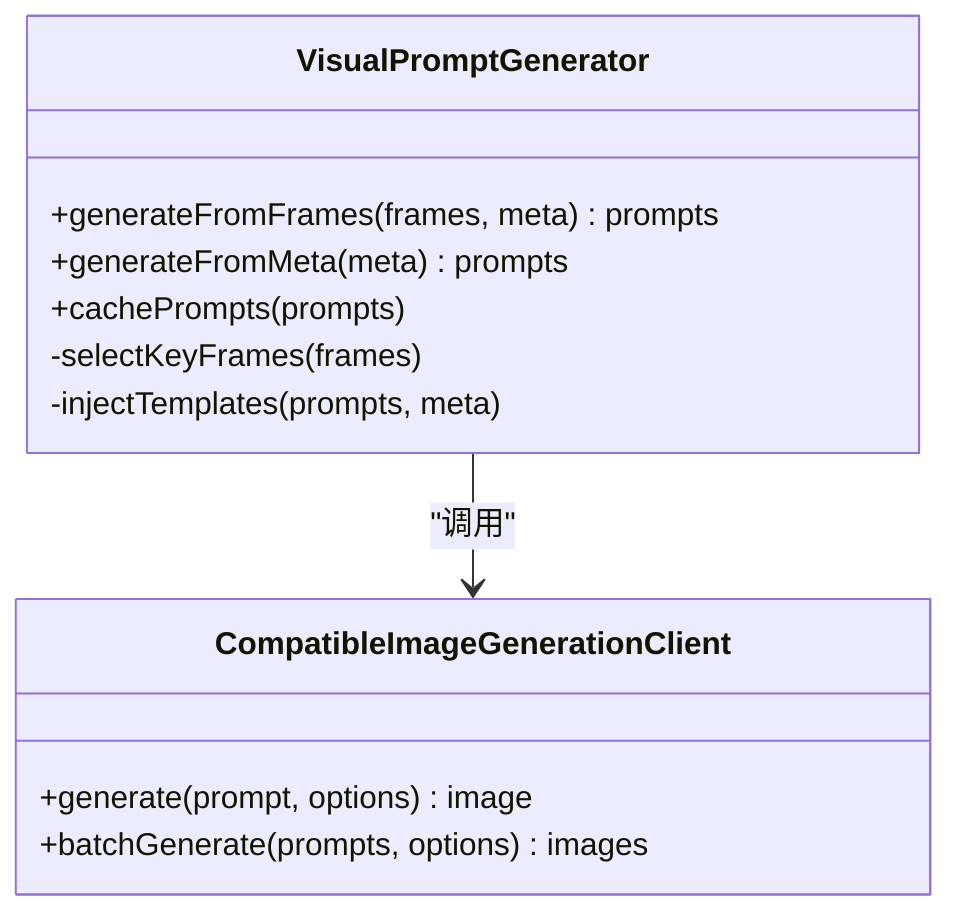

图表来源
- [VisualPromptGenerator.swift](file://Sources/ChengGao/Services/VisualPromptGenerator.swift)
- [CompatibleImageGenerationClient.swift](file://Sources/ChengGao/Services/CompatibleImage生成客户端.swift)

章节来源
- [VisualPromptGenerator.swift](file://Sources/ChengGao/Services/VisualPromptGenerator.swift)
- [CompatibleImageGenerationClient.swift](file://Sources/ChengGao/Services/CompatibleImage生成客户端.swift)

### 离线重写流水线
- 职责：编排本地能力（转录、术语、模型、字幕）完成端到端内容改写。
- 关键特性：
  - 阶段化管道，支持插拔式扩展。
  - 错误隔离与降级路径，保障鲁棒性。
  - 进度与状态上报，便于前端展示。
- 生命周期：创建→配置→执行→清理。
- 并发：阶段内并行、阶段间顺序。

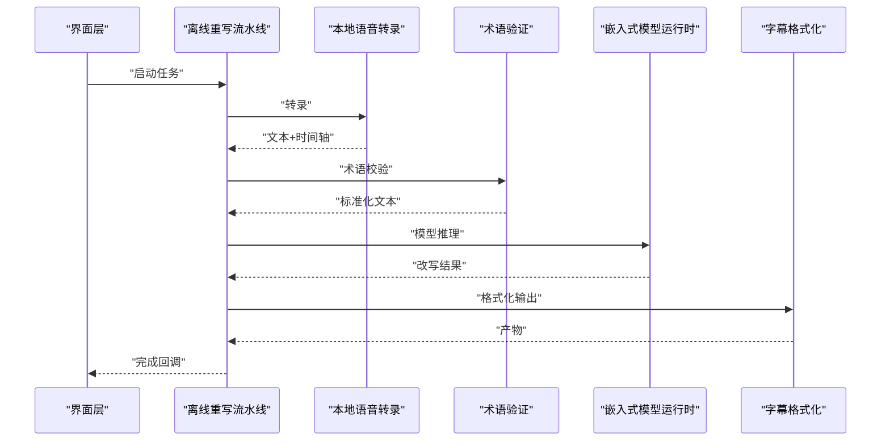

图表来源
- [OfflineRewritePipeline.swift](file://Sources/ChengGao/Services/OfflineRewritePipeline.swift)
- [LocalSpeechTranscriber.swift](file://Sources/ChengGao/Services/LocalSpeechTranscriber.swift)
- [TerminologyVerifier.swift](file://Sources/ChengGao/Services/TerminologyVerifier.swift)
- [EmbeddedModelRuntime.swift](file://Sources/ChengGao/Services/EmbeddedModelRuntime.swift)
- [SpokenSubtitleFormatter.swift](file://Sources/ChengGao/Services/SpokenSubtitleFormatter.swift)

章节来源
- [OfflineRewritePipeline.swift](file://Sources/ChengGao/Services/OfflineRewritePipeline.swift)

### 在线模型目录客户端
- 职责：查询在线模型目录、版本与配额，支撑动态选择与降级。
- 关键特性：
  - 缓存目录信息，定期刷新。
  - 错误码映射与重试策略。
  - 与凭证存储集成，安全访问。
- 生命周期：初始化→拉取→缓存→失效。
- 并发：读写分离，读多写少。

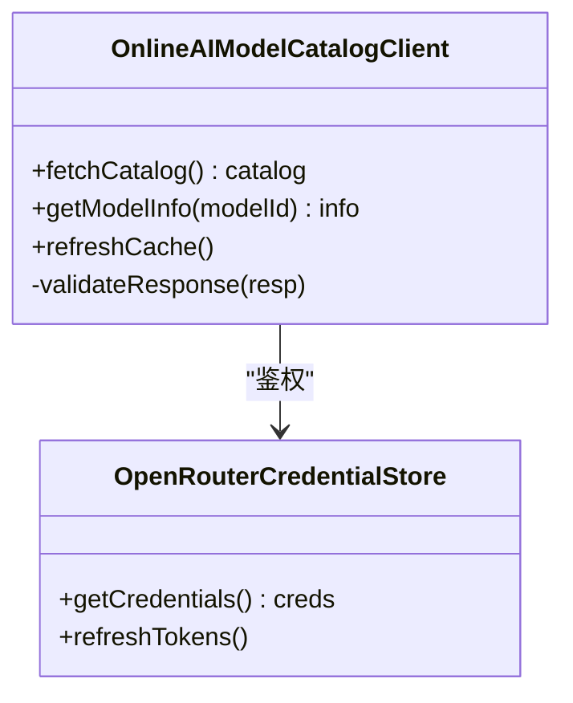

图表来源
- [OnlineAIModelCatalogClient.swift](file://Sources/ChengGao/Services/OnlineAIModelCatalogClient.swift)
- [OpenRouterCredentialStore.swift](file://Sources/ChengGao/Services/OpenRouterCredentialStore.swift)

章节来源
- [OnlineAIModelCatalogClient.swift](file://Sources/ChengGao/Services/OnlineAIModelCatalogClient.swift)
- [OpenRouterCredentialStore.swift](file://Sources/ChengGao/Services/OpenRouterCredentialStore.swift)

### 平台会话与网络
- 平台会话存储：集中管理用户会话、令牌与偏好设置。
- Web 会话池：复用 HTTP 连接与会话，降低握手开销。
- Web AI 会话：封装浏览器内核交互，支持页面级状态。
- WebKit 研究搜索：基于 WebKit 的搜索服务，结合缓存与数据库。

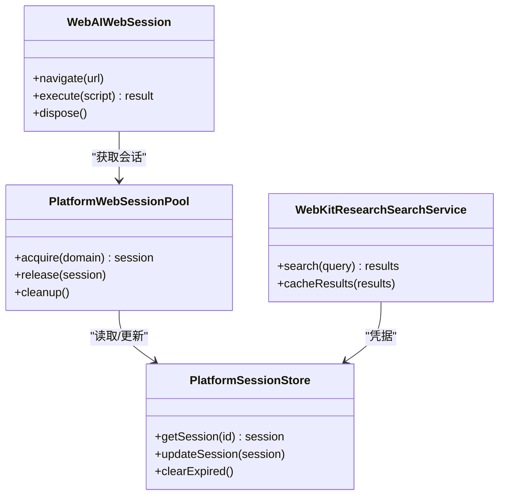

图表来源
- [PlatformSessionStore.swift](file://Sources/ChengGao/Services/PlatformSessionStore.swift)
- [PlatformWebSessionPool.swift](file://Sources/ChengGao/Services/PlatformWebSessionPool.swift)
- [WebAIWebSession.swift](file://Sources/ChengGao/Services/WebAIWebSession.swift)
- [WebKitResearchSearchService.swift](file://Sources/ChengGao/Services/WebKitResearchSearchService.swift)

章节来源
- [PlatformSessionStore.swift](file://Sources/ChengGao/Services/PlatformSessionStore.swift)
- [PlatformWebSessionPool.swift](file://Sources/ChengGao/Services/PlatformWebSessionPool.swift)
- [WebAIWebSession.swift](file://Sources/ChengGao/Services/WebAIWebSession.swift)
- [WebKitResearchSearchService.swift](file://Sources/ChengGao/Services/WebKitResearchSearchService.swift)

### 研究与数据库
- 研究数据库：提供结构化存储、索引与查询能力，支持事务与备份。
- 研究搜索服务：面向用户的搜索入口，整合缓存与持久化。

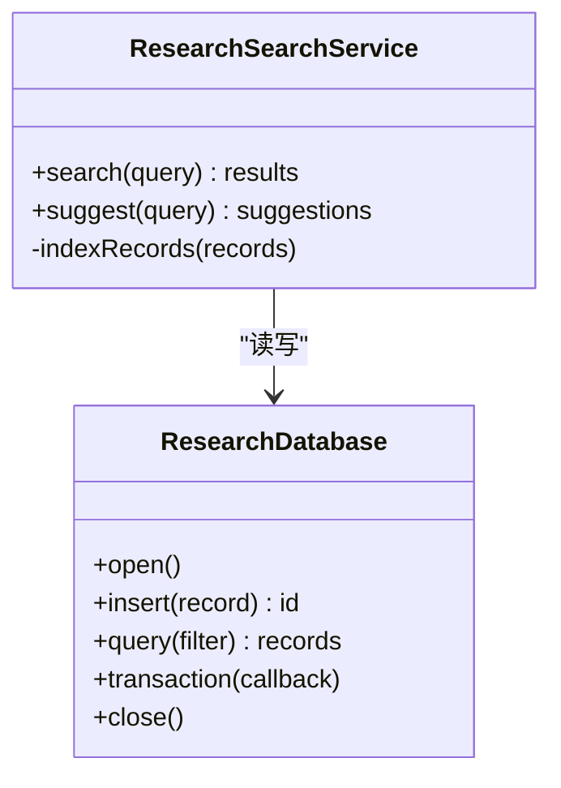

图表来源
- [ResearchDatabase.swift](file://Sources/ChengGao/Services/ResearchDatabase.swift)
- [ResearchSearchService.swift](file://Sources/ChengGao/Services/ResearchSearchService.swift)

章节来源
- [ResearchDatabase.swift](file://Sources/ChengGao/Services/ResearchDatabase.swift)
- [ResearchSearchService.swift](file://Sources/ChengGao/Services/ResearchSearchService.swift)

### 导出与素材
- 短视频导出包：打包视频、字幕与封面，生成可分发产物。
- 封面艺术生成：基于提示词生成高质量封面图。
- 兼容图像生成客户端：抽象图像生成接口，支持多种后端。

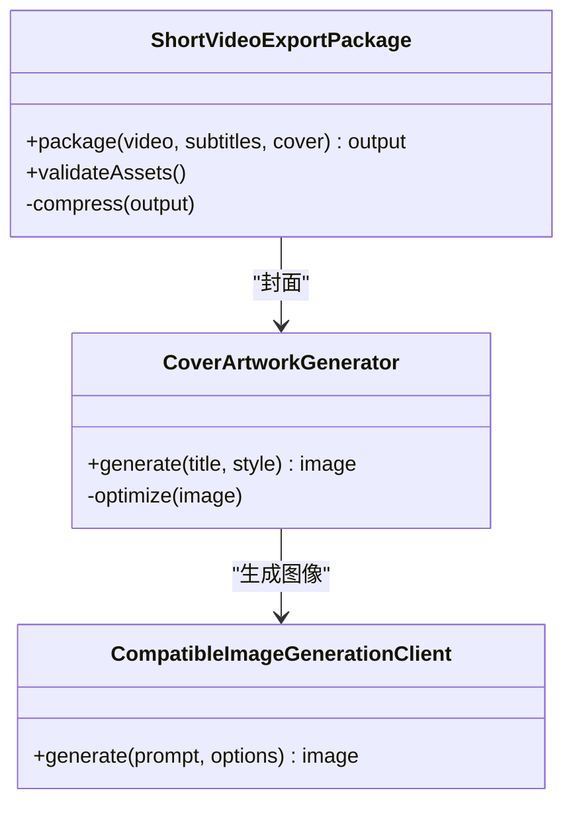

图表来源
- [ShortVideoExportPackage.swift](file://Sources/ChengGao/Services/ShortVideoExportPackage.swift)
- [CoverArtworkGenerator.swift](file://Sources/ChengGao/Services/CoverArtworkGenerator.swift)
- [CompatibleImageGenerationClient.swift](file://Sources/ChengGao/Services/CompatibleImage生成客户端.swift)

章节来源
- [ShortVideoExportPackage.swift](file://Sources/ChengGao/Services/ShortVideoExportPackage.swift)
- [CoverArtworkGenerator.swift](file://Sources/ChengGao/Services/CoverArtworkGenerator.swift)
- [CompatibleImageGenerationClient.swift](file://Sources/ChengGao/Services/CompatibleImage生成客户端.swift)

### 解析器与提取器
- 抖音视频解析器：解析抖音链接，提取元数据与媒体资源。
- 小红书内容解析器：解析小红书内容，抽取文本与图片。
- 源提取器：统一抽象不同来源的提取逻辑。
- 视频帧文本提取器：从视频帧中提取文字，辅助字幕与提示生成。

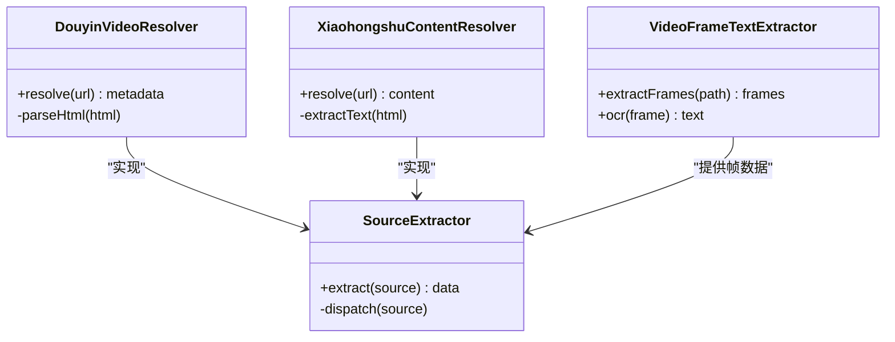

图表来源
- [DouyinVideoResolver.swift](file://Sources/ChengGao/Services/DouyinVideoResolver.swift)
- [XiaohongshuContentResolver.swift](file://Sources/ChengGao/Services/XiaohongshuContentResolver.swift)
- [SourceExtractor.swift](file://ChengGao/Services/SourceExtractor.swift)
- [VideoFrameTextExtractor.swift](file://Sources/ChengGao/Services/VideoFrameTextExtractor.swift)

章节来源
- [DouyinVideoResolver.swift](file://Sources/ChengGao/Services/DouyinVideoResolver.swift)
- [XiaohongshuContentResolver.swift](file://Sources/ChengGao/Services/XiaohongshuContentResolver.swift)
- [SourceExtractor.swift](file://ChengGao/Services/SourceExtractor.swift)
- [VideoFrameTextExtractor.swift](file://Sources/ChengGao/Services/VideoFrameTextExtractor.swift)

### 在线重写流水线
- 职责：编排在线模型能力，结合会话与凭证完成远程改写。
- 关键特性：
  - 模型目录查询与选择，支持 A/B 与降级。
  - 会话复用与连接池，提升吞吐。
  - 错误分类与重试，保障稳定性。

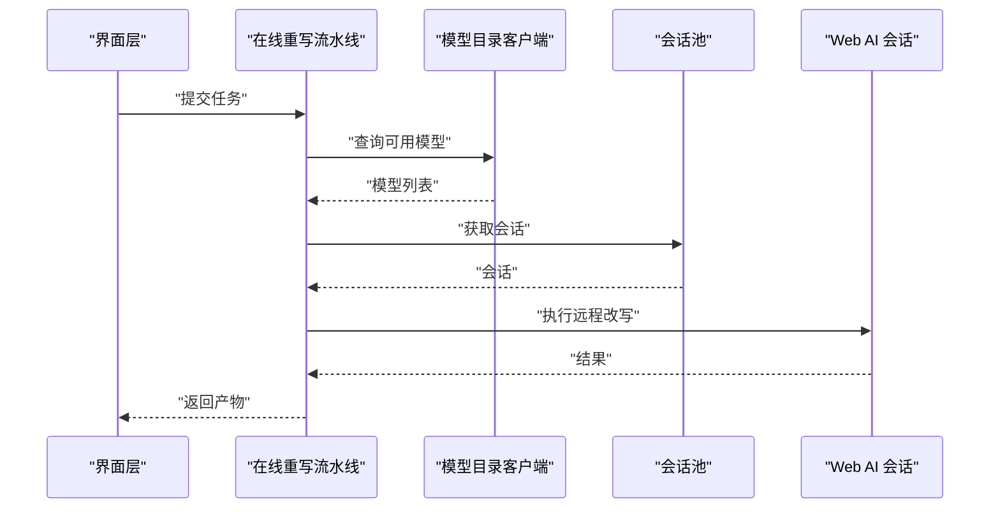

图表来源
- [WebAIRewritePipeline.swift](file://Sources/ChengGao/Services/WebAIRewritePipeline.swift)
- [OnlineAIModelCatalogClient.swift](file://Sources/ChengGao/Services/OnlineAIModelCatalogClient.swift)
- [PlatformWebSessionPool.swift](file://Sources/ChengGao/Services/PlatformWebSessionPool.swift)
- [WebAIWebSession.swift](file://Sources/ChengGao/Services/WebAIWebSession.swift)

章节来源
- [WebAIRewritePipeline.swift](file://Sources/ChengGao/Services/WebAIRewritePipeline.swift)

## 依赖关系分析
- 低耦合高内聚：每个服务职责单一，通过明确接口协作。
- 依赖方向：上层流水线依赖底层能力（转录、术语、模型、字幕），网络与存储作为横向支撑。
- 潜在循环：通过抽象与适配器避免循环依赖，例如图像生成客户端抽象。
- 外部依赖：系统转录引擎、WebKit、SQLite 等，通过封装屏蔽差异。

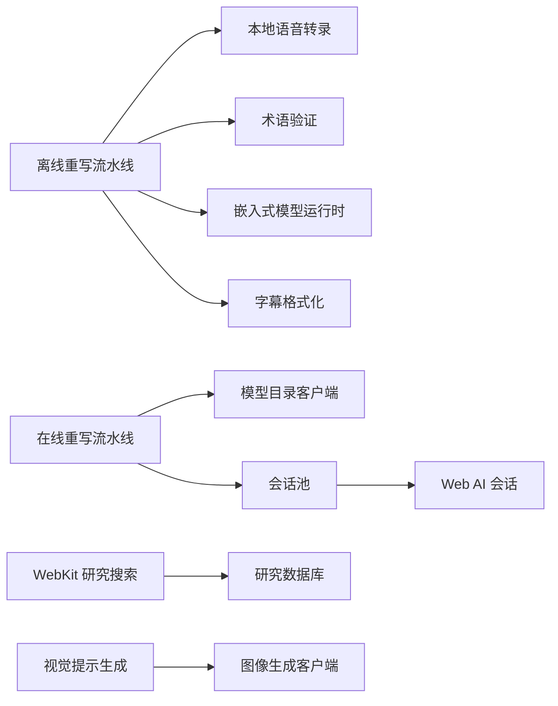

图表来源
- [OfflineRewritePipeline.swift](file://Sources/ChengGao/Services/OfflineRewritePipeline.swift)
- [LocalSpeechTranscriber.swift](file://Sources/ChengGao/Services/LocalSpeechTranscriber.swift)
- [TerminologyVerifier.swift](file://Sources/ChengGao/Services/TerminologyVerifier.swift)
- [EmbeddedModelRuntime.swift](file://Sources/ChengGao/Services/EmbeddedModelRuntime.swift)
- [SpokenSubtitleFormatter.swift](file://Sources/ChengGao/Services/SpokenSubtitleFormatter.swift)
- [WebAIRewritePipeline.swift](file://Sources/ChengGao/Services/WebAIRewritePipeline.swift)
- [OnlineAIModelCatalogClient.swift](file://Sources/ChengGao/Services/OnlineAIModelCatalogClient.swift)
- [PlatformWebSessionPool.swift](file://Sources/ChengGao/Services/PlatformWebSessionPool.swift)
- [WebAIWebSession.swift](file://Sources/ChengGao/Services/WebAIWebSession.swift)
- [WebKitResearchSearchService.swift](file://Sources/ChengGao/Services/WebKitResearchSearchService.swift)
- [ResearchDatabase.swift](file://Sources/ChengGao/Services/ResearchDatabase.swift)
- [VisualPromptGenerator.swift](file://Sources/ChengGao/Services/VisualPromptGenerator.swift)
- [CompatibleImageGenerationClient.swift](file://Sources/ChengGao/Services/CompatibleImage生成客户端.swift)

章节来源
- [OfflineRewritePipeline.swift](file://Sources/ChengGao/Services/OfflineRewritePipeline.swift)
- [WebAIRewritePipeline.swift](file://Sources/ChengGao/Services/WebAIRewritePipeline.swift)

## 性能考量
- 模型预热与懒加载：减少冷启动延迟，按需分配内存。
- 批处理与队列化：合并小任务，提升吞吐，降低上下文切换。
- 连接池与会话复用：减少握手与认证开销。
- 缓存策略：术语索引、模型目录、搜索结果多级缓存。
- I/O 优化：流式写入、分页读取、压缩传输。
- 监控指标：CPU/内存、队列长度、错误率、延迟分布。

[本节为通用指导，不直接分析具体文件]

## 故障排查指南
- 常见问题定位：
  - 转录失败：检查音频格式、采样率与引擎可用性。
  - 术语冲突：查看词典版本与规则优先级。
  - 模型推理超时：调整并发与批大小，检查资源占用。
  - 网络错误：检查凭据、代理与域名白名单。
- 日志建议：
  - 结构化日志，包含请求 ID、阶段、耗时与错误码。
  - 敏感信息脱敏，避免泄露凭据。
- 监控与告警：
  - 关键指标上报至监控系统，设置阈值告警。
  - 健康检查接口暴露服务状态。

章节来源
- [OpenRouterCredentialStore.swift](file://Sources/ChengGao/Services/OpenRouterCredentialStore.swift)
- [PlatformSessionStore.swift](file://Sources/ChengGao/Services/PlatformSessionStore.swift)
- [ResearchDatabase.swift](file://Sources/ChengGao/Services/ResearchDatabase.swift)

## 结论
服务层以流水线为核心，结合资源池化与并发控制，实现了高效、稳定的内容处理能力。通过清晰的接口与错误隔离，服务具备良好的可扩展性与可维护性。遵循本文的开发规范与最佳实践，可快速扩展新服务并保障整体质量。

[本节为总结，不直接分析具体文件]

## 附录
- 新服务开发指南：
  - 定义清晰接口与错误类型，遵循现有命名约定。
  - 实现生命周期管理（初始化、运行、清理）。
  - 接入日志与监控，记录关键指标。
  - 编写单元测试与集成测试，覆盖正常与异常路径。
- 服务注册机制：
  - 在应用入口集中注册服务实例，统一管理依赖注入。
  - 支持按需启用与禁用，便于灰度发布。
- 接口设计规范：
  - 输入输出类型明确，避免隐式转换。
  - 错误码与消息标准化，便于前端处理。
  - 异步接口统一使用回调或 Future/Promise。

章节来源
- [ChengGaoApp.swift](file://Sources/ChengGao/App/ChengGaoApp.swift)
- [ResearchStore.swift](file://Sources/ChengGao/Stores/ResearchStore.swift)
- [RewriteStore.swift](file://Sources/ChengGao/Stores/RewriteStore.swift)