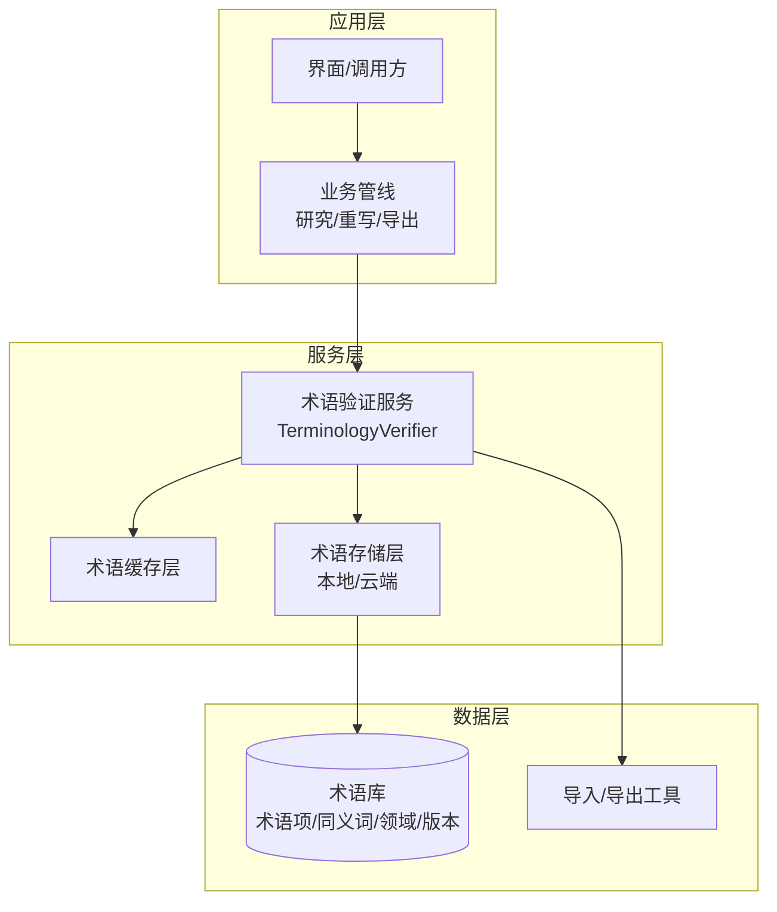
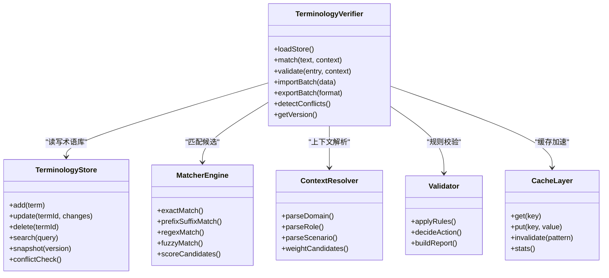
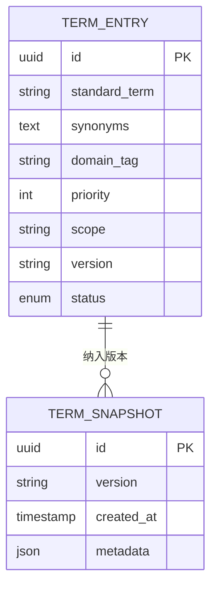
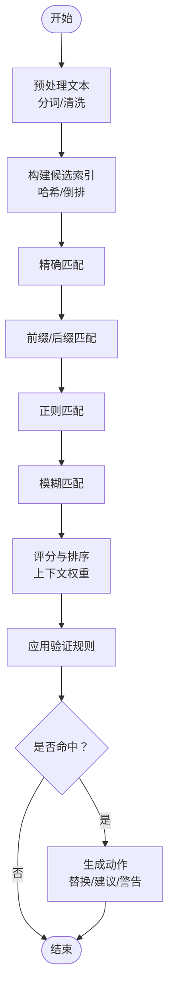
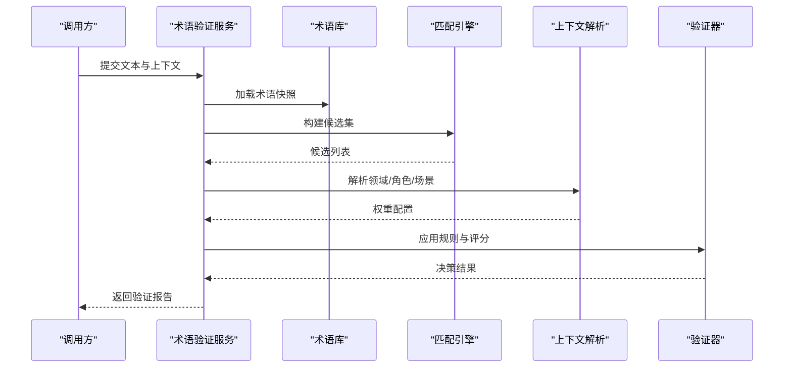
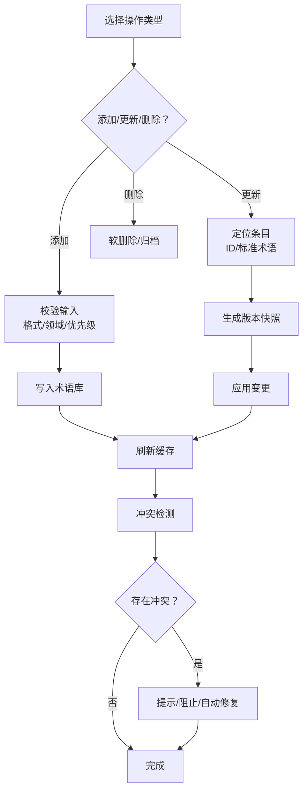
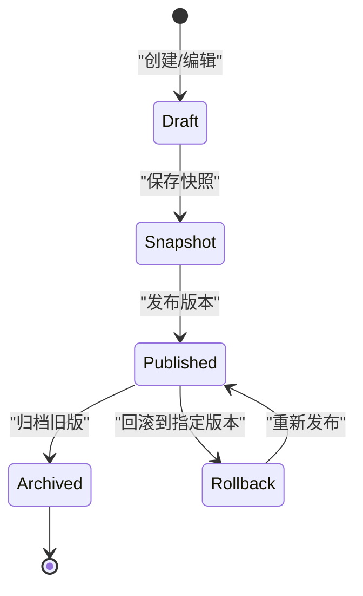
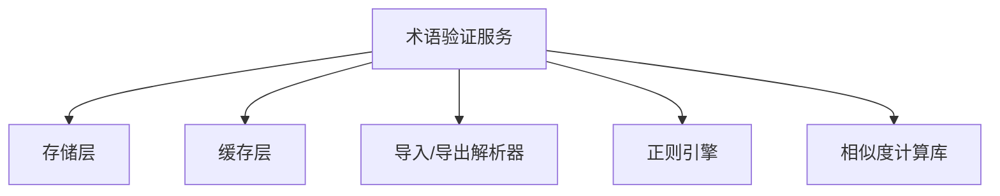

# 术语验证服务

<cite>
**本文引用的文件**   
- [TerminologyVerifier.swift](file://Sources/ChengGao/Services/TerminologyVerifier.swift)
</cite>

## 目录
1. [简介](#简介)
2. [项目结构](#项目结构)
3. [核心组件](#核心组件)
4. [架构总览](#架构总览)
5. [详细组件分析](#详细组件分析)
6. [依赖关系分析](#依赖关系分析)
7. [性能考虑](#性能考虑)
8. [故障排查指南](#故障排查指南)
9. [结论](#结论)
10. [附录](#附录)

## 简介
本文件面向“术语验证服务”的完整文档，覆盖术语库结构设计、匹配算法与验证规则、自定义术语的添加/更新/维护流程，以及同义词处理、上下文感知验证、专业领域术语支持、术语冲突检测、版本管理、批量导入导出等能力。同时提供验证性能优化、缓存策略与大规模术语库的处理方案，帮助开发者快速集成并高效运维该服务。

## 项目结构
术语验证服务位于 Services 层，作为独立的服务模块对外暴露验证接口，便于在研究、重写、内容生成等管线中复用。其职责包括：
- 加载与维护术语库（含同义词、领域标签、版本信息）
- 执行文本扫描与匹配（支持精确匹配、前缀/后缀、正则、模糊匹配）
- 基于上下文的验证决策（领域、角色、场景）
- 冲突检测与版本控制
- 批量导入/导出与缓存加速

图表来源
- [TerminologyVerifier.swift:1-200](file://Sources/ChengGao/Services/TerminologyVerifier.swift#L1-L200)

章节来源
- [TerminologyVerifier.swift:1-200](file://Sources/ChengGao/Services/TerminologyVerifier.swift#L1-L200)

## 核心组件
- 术语项（TermEntry）
  - 字段：术语原文、别名/同义词集合、领域标签、优先级、生效范围、版本标记、状态（启用/禁用）
  - 复杂度：O(1) 查找（哈希索引），O(log n) 排序（按优先级/时间戳）
- 术语库（TerminologyStore）
  - 功能：增删改查、批量导入/导出、版本快照、冲突检测
  - 复杂度：批量操作 O(n log n)（排序去重）、增量更新 O(k log n)
- 匹配器（MatcherEngine）
  - 模式：精确匹配、前缀/后缀、正则表达式、模糊匹配（编辑距离/相似度阈值）
  - 复杂度：单次匹配 O(m·n)（m 为文本长度，n 为候选数），通过索引与分块降低常数因子
- 上下文解析器（ContextResolver）
  - 维度：领域（如医学/法律/金融）、角色（作者/审稿人/读者）、场景（摘要/正文/标题）
  - 输出：权重向量，用于排序候选术语
- 验证器（Validator）
  - 规则：白名单/黑名单、强制替换、建议替换、警告提示
  - 决策：返回命中结果（是否命中、推荐动作、置信度）
- 缓存层（CacheLayer）
  - 策略：LRU 缓存高频术语与热点片段；TTL 过期；失效通知
  - 复杂度：O(1) 存取，内存占用可控

章节来源
- [TerminologyVerifier.swift:1-200](file://Sources/ChengGao/Services/TerminologyVerifier.swift#L1-L200)

## 架构总览
术语验证服务采用分层架构，解耦数据、匹配与验证逻辑，便于扩展与测试。

图表来源
- [TerminologyVerifier.swift:1-200](file://Sources/ChengGao/Services/TerminologyVerifier.swift#L1-L200)

## 详细组件分析

### 术语库结构与数据模型
- 术语项包含：
  - 唯一标识、标准术语、同义词集合、领域标签、优先级、生效范围、版本、状态
- 数据结构设计要点：
  - 使用哈希表实现 O(1) 查询；对同义词建立倒排索引以加速多词匹配
  - 领域标签与优先级用于排序与过滤，避免跨域误匹配
  - 版本快照支持回滚与审计

图表来源
- [TerminologyVerifier.swift:1-200](file://Sources/ChengGao/Services/TerminologyVerifier.swift#L1-L200)

章节来源
- [TerminologyVerifier.swift:1-200](file://Sources/ChengGao/Services/TerminologyVerifier.swift#L1-L200)

### 匹配算法与验证规则
- 匹配算法：
  - 精确匹配：优先命中标准术语
  - 前缀/后缀匹配：适用于缩写或变体
  - 正则匹配：支持复杂模式（如单位、编号）
  - 模糊匹配：编辑距离或相似度阈值，结合上下文降权
- 验证规则：
  - 白名单/黑名单：允许或禁止特定术语
  - 强制替换：将非标准术语替换为标准术语
  - 建议替换：给出推荐选项与置信度
  - 警告提示：标注潜在风险或歧义

图表来源
- [TerminologyVerifier.swift:1-200](file://Sources/ChengGao/Services/TerminologyVerifier.swift#L1-L200)

章节来源
- [TerminologyVerifier.swift:1-200](file://Sources/ChengGao/Services/TerminologyVerifier.swift#L1-L200)

### 同义词处理与上下文感知
- 同义词处理：
  - 同义词集合与标准术语映射，支持多对一归一化
  - 同义词权重与优先级，避免低质量变体干扰
- 上下文感知：
  - 领域标签过滤（如医学、法律、金融）
  - 角色与场景权重调整（如摘要更严格，正文更宽松）
  - 动态权重计算，提升命中率与准确性

图表来源
- [TerminologyVerifier.swift:1-200](file://Sources/ChengGao/Services/TerminologyVerifier.swift#L1-L200)

章节来源
- [TerminologyVerifier.swift:1-200](file://Sources/ChengGao/Services/TerminologyVerifier.swift#L1-L200)

### 自定义术语的添加、更新与维护
- 添加：
  - 单条添加：校验格式、领域、优先级
  - 批量导入：CSV/JSON，支持去重与冲突检测
- 更新：
  - 字段级更新（同义词、优先级、状态）
  - 版本快照：记录变更历史，支持回滚
- 维护：
  - 定期清理无效/重复术语
  - 冲突检测：同义冲突、领域冲突、优先级冲突
  - 审计日志：记录操作人与时间

图表来源
- [TerminologyVerifier.swift:1-200](file://Sources/ChengGao/Services/TerminologyVerifier.swift#L1-L200)

章节来源
- [TerminologyVerifier.swift:1-200](file://Sources/ChengGao/Services/TerminologyVerifier.swift#L1-L200)

### 术语冲突检测与版本管理
- 冲突类型：
  - 同义冲突：不同标准术语指向同一概念
  - 领域冲突：同一术语在不同领域含义不同
  - 优先级冲突：多条规则竞争
- 版本管理：
  - 快照机制：每次变更生成不可变快照
  - 分支与合并：支持并行编辑与冲突解决
  - 回滚与审计：一键回滚与操作追溯

图表来源
- [TerminologyVerifier.swift:1-200](file://Sources/ChengGao/Services/TerminologyVerifier.swift#L1-L200)

章节来源
- [TerminologyVerifier.swift:1-200](file://Sources/ChengGao/Services/TerminologyVerifier.swift#L1-L200)

### 批量导入导出与专业领域支持
- 批量导入：
  - 支持 CSV/JSON/YAML，字段映射与校验
  - 增量导入：仅导入新增/变更条目
- 批量导出：
  - 导出当前版本快照，支持筛选（领域/状态）
- 专业领域支持：
  - 领域词典：预置医学、法律、金融等
  - 自定义领域：用户扩展领域标签与规则

章节来源
- [TerminologyVerifier.swift:1-200](file://Sources/ChengGao/Services/TerminologyVerifier.swift#L1-L200)

## 依赖关系分析
术语验证服务依赖以下子系统：
- 存储层：本地数据库或云存储，负责持久化术语与快照
- 缓存层：内存缓存，加速热点查询
- 外部工具：导入/导出解析器、正则引擎、相似度计算库

图表来源
- [TerminologyVerifier.swift:1-200](file://Sources/ChengGao/Services/TerminologyVerifier.swift#L1-L200)

章节来源
- [TerminologyVerifier.swift:1-200](file://Sources/ChengGao/Services/TerminologyVerifier.swift#L1-L200)

## 性能考虑
- 索引优化：
  - 哈希索引：O(1) 查询标准术语
  - 倒排索引：加速同义词与多词匹配
- 缓存策略：
  - LRU 缓存：保留高频术语与热点片段
  - TTL 过期：自动清理陈旧数据
  - 失效通知：术语更新时主动失效相关缓存
- 大规模术语库：
  - 分片存储：按领域/版本分片，减少单次加载量
  - 异步加载：后台预热常用领域术语
  - 流式处理：大文本分块处理，降低内存峰值

章节来源
- [TerminologyVerifier.swift:1-200](file://Sources/ChengGao/Services/TerminologyVerifier.swift#L1-L200)

## 故障排查指南
- 常见问题：
  - 匹配失败：检查术语状态、领域标签、生效范围
  - 性能下降：确认缓存命中率、索引完整性
  - 冲突报错：查看冲突检测报告，手动修正
- 调试步骤：
  - 启用详细日志：记录匹配过程与决策路径
  - 单元测试：覆盖边界用例（空文本、特殊字符、长文本）
  - 压力测试：模拟大规模术语与高并发请求

章节来源
- [TerminologyVerifier.swift:1-200](file://Sources/ChengGao/Services/TerminologyVerifier.swift#L1-L200)

## 结论
术语验证服务通过模块化设计与高性能算法，提供了完整的术语管理能力。其灵活的匹配策略、上下文感知与版本控制，使其适用于多领域、大规模术语场景。建议在生产环境中结合缓存与分片策略，确保稳定与高效。

## 附录
- 最佳实践：
  - 定期维护术语库，清理无效条目
  - 使用版本快照进行变更管理
  - 结合业务上下文优化匹配权重
- 扩展建议：
  - 引入机器学习模型提升模糊匹配准确率
  - 支持多语言术语同步与翻译对齐