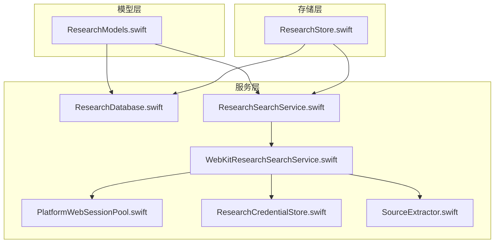
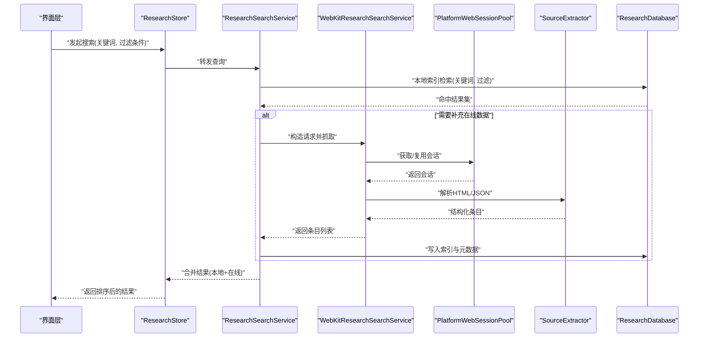
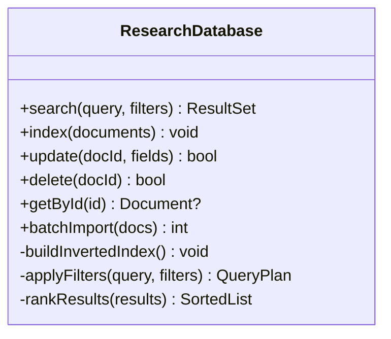
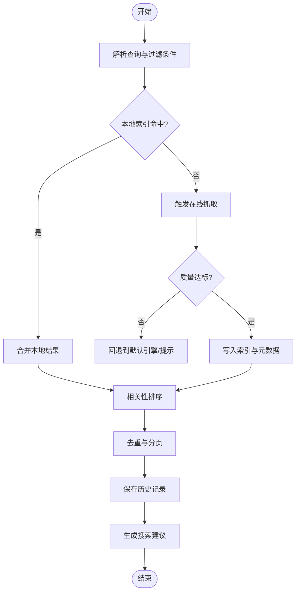
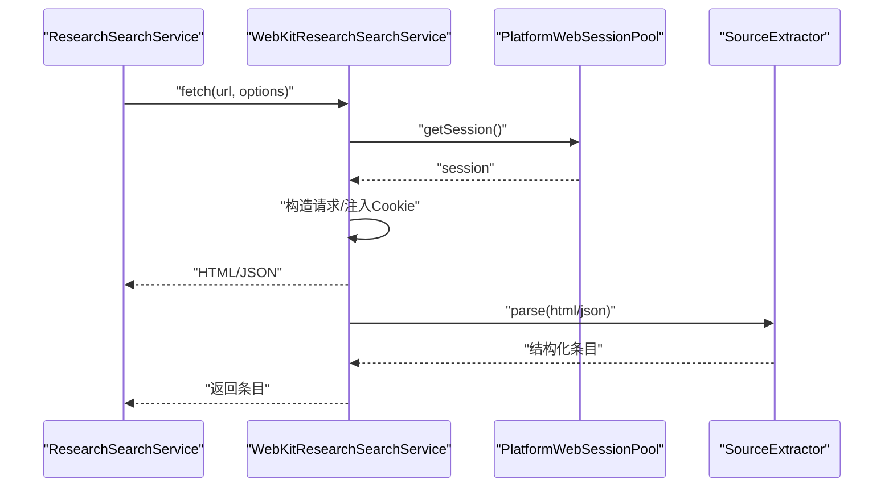
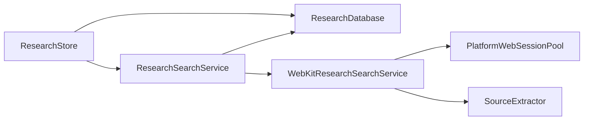

# 研究服务

<cite>
**本文引用的文件**   
- [ResearchDatabase.swift](file://Sources/ChengGao/Services/ResearchDatabase.swift)
- [ResearchSearchService.swift](file://Sources/ChengGao/Services/ResearchSearchService.swift)
- [WebKitResearchSearchService.swift](file://Sources/ChengGao/Services/WebKitResearchSearchService.swift)
- [ResearchStore.swift](file://Sources/ChengGao/Stores/ResearchStore.swift)
- [ResearchModels.swift](file://Sources/ChengGao/Models/ResearchModels.swift)
- [PlatformWebSessionPool.swift](file://Sources/ChengGao/Services/PlatformWebSessionPool.swift)
- [ResearchCredentialStore.swift](file://Sources/ChengGao/Services/ResearchCredentialStore.swift)
- [SourceExtractor.swift](file://Sources/ChengGao/Services/SourceExtractor.swift)
</cite>

## 目录
1. [简介](#简介)
2. [项目结构](#项目结构)
3. [核心组件](#核心组件)
4. [架构总览](#架构总览)
5. [详细组件分析](#详细组件分析)
6. [依赖关系分析](#依赖关系分析)
7. [性能考虑](#性能考虑)
8. [故障排查指南](#故障排查指南)
9. [结论](#结论)
10. [附录](#附录)

## 简介
本文件面向“研究服务”的核心能力，围绕数据库设计、搜索算法与网页抓取技术进行系统化说明。重点覆盖：
- 研究数据存储模型与索引构建策略
- 查询优化与排序机制
- 搜索引擎集成与结果过滤
- 搜索建议与历史记录管理
- 知识图谱构建思路
- 性能优化、缓存策略与大规模数据处理方案

## 项目结构
研究服务位于 Swift 工程中的 Services、Stores 与 Models 三个层次：
- Services：数据持久化、搜索服务、网页会话池、凭证存储、内容提取等
- Stores：状态管理与 UI 交互桥接
- Models：研究相关的数据结构与协议定义

图表来源
- [ResearchDatabase.swift](file://Sources/ChengGao/Services/ResearchDatabase.swift)
- [ResearchSearchService.swift](file://Sources/ChengGao/Services/ResearchSearchService.swift)
- [WebKitResearchSearchService.swift](file://Sources/ChengGao/Services/WebKitResearchSearchService.swift)
- [PlatformWebSessionPool.swift](file://Sources/ChengGao/Services/PlatformWebSessionPool.swift)
- [ResearchCredentialStore.swift](file://Sources/ChengGao/Services/ResearchCredentialStore.swift)
- [SourceExtractor.swift](file://Sources/ChengGao/Services/SourceExtractor.swift)
- [ResearchStore.swift](file://Sources/ChengGao/Stores/ResearchStore.swift)
- [ResearchModels.swift](file://Sources/ChengGao/Models/ResearchModels.swift)

章节来源
- [ResearchDatabase.swift](file://Sources/ChengGao/Services/ResearchDatabase.swift)
- [ResearchSearchService.swift](file://Sources/ChengGao/Services/ResearchSearchService.swift)
- [WebKitResearchSearchService.swift](file://Sources/ChengGao/Services/WebKitResearchSearchService.swift)
- [ResearchStore.swift](file://Sources/ChengGao/Stores/ResearchStore.swift)
- [ResearchModels.swift](file://Sources/ChengGao/Models/ResearchModels.swift)
- [PlatformWebSessionPool.swift](file://Sources/ChengGao/Services/PlatformWebSessionPool.swift)
- [ResearchCredentialStore.swift](file://Sources/ChengGao/Services/ResearchCredentialStore.swift)
- [SourceExtractor.swift](file://Sources/ChengGao/Services/SourceExtractor.swift)

## 核心组件
- 研究数据库（ResearchDatabase）
  - 负责研究数据的本地持久化、索引维护与查询执行
  - 提供增删改查接口，支持按关键词、时间、来源等多维度筛选
- 研究搜索服务（ResearchSearchService）
  - 统一搜索入口，协调本地检索与在线抓取
  - 实现相关性评分、结果去重与分页
- WebKit 研究搜索服务（WebKitResearchSearchService）
  - 基于 WebKit 的网页抓取与解析，适配不同站点结构
  - 管理会话、Cookie、反爬策略与重试
- 平台网页会话池（PlatformWebSessionPool）
  - 复用浏览器会话，降低认证开销与封禁风险
- 研究凭证存储（ResearchCredentialStore）
  - 安全存储 API Key、Token、Cookie 等敏感信息
- 源内容提取器（SourceExtractor）
  - 从 HTML/JSON 中提取标题、摘要、正文、作者、发布时间等结构化字段
- 研究状态存储（ResearchStore）
  - 为 UI 暴露可观察的研究结果、历史与建议列表

章节来源
- [ResearchDatabase.swift](file://Sources/ChengGao/Services/ResearchDatabase.swift)
- [ResearchSearchService.swift](file://Sources/ChengGao/Services/ResearchSearchService.swift)
- [WebKitResearchSearchService.swift](file://Sources/ChengGao/Services/WebKitResearchSearchService.swift)
- [PlatformWebSessionPool.swift](file://Sources/ChengGao/Services/PlatformWebSessionPool.swift)
- [ResearchCredentialStore.swift](file://Sources/ChengGao/Services/ResearchCredentialStore.swift)
- [SourceExtractor.swift](file://Sources/ChengGao/Services/SourceExtractor.swift)
- [ResearchStore.swift](file://Sources/ChengGao/Stores/ResearchStore.swift)

## 架构总览
研究服务采用“搜索编排 + 抓取解析 + 本地索引”的分层架构：
- 搜索编排层：ResearchSearchService 接收查询，决定走本地索引还是在线抓取
- 抓取解析层：WebKitResearchSearchService 通过 PlatformWebSessionPool 获取页面，SourceExtractor 抽取结构化数据
- 本地索引层：ResearchDatabase 维护倒排索引与元数据表，支持快速检索与排序
- 状态层：ResearchStore 将结果、历史与建议暴露给 UI

图表来源
- [ResearchSearchService.swift](file://Sources/ChengGao/Services/ResearchSearchService.swift)
- [WebKitResearchSearchService.swift](file://Sources/ChengGao/Services/WebKitResearchSearchService.swift)
- [PlatformWebSessionPool.swift](file://Sources/ChengGao/Services/PlatformWebSessionPool.swift)
- [SourceExtractor.swift](file://Sources/ChengGao/Services/SourceExtractor.swift)
- [ResearchDatabase.swift](file://Sources/ChengGao/Services/ResearchDatabase.swift)
- [ResearchStore.swift](file://Sources/ChengGao/Stores/ResearchStore.swift)

## 详细组件分析

### 研究数据库（ResearchDatabase）
- 职责
  - 维护研究条目表、索引表与关联表
  - 提供全文检索、字段过滤、排序与分页
  - 增量更新与批量导入
- 关键设计
  - 倒排索引：以词项到文档ID映射为主，支持多字段分词
  - 元数据表：存储标题、摘要、URL、来源、时间戳、权重等
  - 事务与并发：读写分离，写路径串行化避免竞争
- 查询优化
  - 前缀匹配与通配符优化
  - 过滤下推至 SQL 层，减少内存计算
  - 热点结果缓存（最近查询、热门词条）

图表来源
- [ResearchDatabase.swift](file://Sources/ChengGao/Services/ResearchDatabase.swift)

章节来源
- [ResearchDatabase.swift](file://Sources/ChengGao/Services/ResearchDatabase.swift)

### 研究搜索服务（ResearchSearchService）
- 职责
  - 统一搜索入口，协调本地与在线检索
  - 结果合并、去重、排序与分页
  - 搜索建议生成与历史记录写入
- 关键流程
  - 解析查询，构建过滤条件
  - 优先本地索引检索，未命中或不足时触发在线抓取
  - 对在线结果进行质量评估与入库
  - 合并结果后按相关性排序返回

图表来源
- [ResearchSearchService.swift](file://Sources/ChengGao/Services/ResearchSearchService.swift)

章节来源
- [ResearchSearchService.swift](file://Sources/ChengGao/Services/ResearchSearchService.swift)

### WebKit 研究搜索服务（WebKitResearchSearchService）
- 职责
  - 基于 WebKit 的网页抓取与解析
  - 管理会话生命周期、Cookie 与鉴权
  - 处理反爬策略、超时与重试
- 关键能力
  - 动态渲染与脚本执行
  - 选择器与规则配置，适配多站点
  - 错误分类与降级策略

图表来源
- [WebKitResearchSearchService.swift](file://Sources/ChengGao/Services/WebKitResearchSearchService.swift)
- [PlatformWebSessionPool.swift](file://Sources/ChengGao/Services/PlatformWebSessionPool.swift)
- [SourceExtractor.swift](file://Sources/ChengGao/Services/SourceExtractor.swift)

章节来源
- [WebKitResearchSearchService.swift](file://Sources/ChengGao/Services/WebKitResearchSearchService.swift)
- [PlatformWebSessionPool.swift](file://Sources/ChengGao/Services/PlatformWebSessionPool.swift)
- [SourceExtractor.swift](file://Sources/ChengGao/Services/SourceExtractor.swift)

### 平台网页会话池（PlatformWebSessionPool）
- 职责
  - 维护跨站点的会话实例，支持 Cookie 与 Token 复用
  - 控制并发与会话健康检查
  - 提供会话隔离与资源回收
- 关键特性
  - 会话池大小限制与懒加载
  - 自动刷新过期凭据
  - 失败回退与熔断

章节来源
- [PlatformWebSessionPool.swift](file://Sources/ChengGao/Services/PlatformWebSessionPool.swift)

### 研究凭证存储（ResearchCredentialStore）
- 职责
  - 安全存储 API Key、Token、Cookie 等敏感信息
  - 提供访问控制与加密存储
  - 支持多账户与切换
- 关键特性
  - 密钥轮换与过期检测
  - 最小权限原则与审计日志

章节来源
- [ResearchCredentialStore.swift](file://Sources/ChengGao/Services/ResearchCredentialStore.swift)

### 源内容提取器（SourceExtractor）
- 职责
  - 从 HTML/JSON 中抽取标题、摘要、正文、作者、发布时间、链接等
  - 支持多种模板与规则配置
  - 清洗与标准化输出
- 关键能力
  - 正则与选择器混合解析
  - 异常容错与降级回退
  - 可扩展的插件式解析器

章节来源
- [SourceExtractor.swift](file://Sources/ChengGao/Services/SourceExtractor.swift)

### 研究状态存储（ResearchStore）
- 职责
  - 为 UI 暴露可观察的研究结果、历史与建议列表
  - 管理搜索上下文与分页状态
  - 与 ResearchSearchService 和 ResearchDatabase 协作
- 关键特性
  - 响应式更新与撤销/重做
  - 内存与磁盘双缓冲

章节来源
- [ResearchStore.swift](file://Sources/ChengGao/Stores/ResearchStore.swift)

### 数据模型（ResearchModels）
- 职责
  - 定义研究条目、查询参数、过滤条件、排序选项等数据结构
  - 规范序列化与校验规则
- 关键类型
  - 研究条目：标题、摘要、URL、来源、时间戳、权重
  - 查询对象：关键词、过滤、分页、排序
  - 搜索结果：条目集合、统计信息与建议

章节来源
- [ResearchModels.swift](file://Sources/ChengGao/Models/ResearchModels.swift)

## 依赖关系分析
- 低耦合高内聚
  - ResearchSearchService 作为编排者，依赖 ResearchDatabase 与 WebKitResearchSearchService
  - WebKitResearchSearchService 依赖 PlatformWebSessionPool 与 SourceExtractor
  - ResearchStore 仅依赖服务接口，不直接操作数据库
- 外部依赖
  - WebKit 用于动态渲染与抓取
  - 系统安全框架用于凭证加密存储
- 潜在循环依赖
  - 通过接口抽象与服务编排避免循环引用

图表来源
- [ResearchSearchService.swift](file://Sources/ChengGao/Services/ResearchSearchService.swift)
- [ResearchDatabase.swift](file://Sources/ChengGao/Services/ResearchDatabase.swift)
- [WebKitResearchSearchService.swift](file://Sources/ChengGao/Services/WebKitResearchSearchService.swift)
- [PlatformWebSessionPool.swift](file://Sources/ChengGao/Services/PlatformWebSessionPool.swift)
- [SourceExtractor.swift](file://Sources/ChengGao/Services/SourceExtractor.swift)
- [ResearchStore.swift](file://Sources/ChengGao/Stores/ResearchStore.swift)

章节来源
- [ResearchSearchService.swift](file://Sources/ChengGao/Services/ResearchSearchService.swift)
- [ResearchDatabase.swift](file://Sources/ChengGao/Services/ResearchDatabase.swift)
- [WebKitResearchSearchService.swift](file://Sources/ChengGao/Services/WebKitResearchSearchService.swift)
- [PlatformWebSessionPool.swift](file://Sources/ChengGao/Services/PlatformWebSessionPool.swift)
- [SourceExtractor.swift](file://Sources/ChengGao/Services/SourceExtractor.swift)
- [ResearchStore.swift](file://Sources/ChengGao/Stores/ResearchStore.swift)

## 性能考虑
- 索引构建
  - 增量索引：仅对新增或变更文档构建倒排索引
  - 批量写入：使用事务与批处理提升写入吞吐
  - 分片与分区：按来源或时间分区，缩小查询范围
- 查询优化
  - 过滤下推：在 SQL 层完成时间、来源等过滤
  - 缓存热点：最近查询、热门词条与常用过滤组合
  - 预取与懒加载：首屏快速返回，后续异步补齐
- 抓取优化
  - 会话复用与连接池：减少握手与认证开销
  - 并发控制与限流：避免目标站点压力过大
  - 智能重试与退避：指数退避与熔断保护
- 内存与存储
  - 分页与游标：避免一次性加载大量结果
  - 压缩与归档：冷数据归档与压缩存储
  - 清理策略：过期条目与临时文件的定期清理

[本节为通用性能指导，不直接分析具体文件]

## 故障排查指南
- 常见问题
  - 抓取失败：检查会话有效性、Cookie 与网络连通性
  - 解析异常：核对选择器与模板配置，查看 SourceExtractor 日志
  - 索引不一致：重建索引与校验完整性
  - 权限问题：确认凭证存储与访问权限
- 诊断步骤
  - 启用调试日志与追踪 ID
  - 复现最小用例并隔离问题模块
  - 检查数据库事务与锁等待
  - 监控会话池与健康检查指标
- 恢复策略
  - 回滚到稳定版本与快照
  - 重置会话与清除缓存
  - 重建索引与重新抓取缺失数据

章节来源
- [WebKitResearchSearchService.swift](file://Sources/ChengGao/Services/WebKitResearchSearchService.swift)
- [SourceExtractor.swift](file://Sources/ChengGao/Services/SourceExtractor.swift)
- [ResearchDatabase.swift](file://Sources/ChengGao/Services/ResearchDatabase.swift)
- [ResearchCredentialStore.swift](file://Sources/ChengGao/Services/ResearchCredentialStore.swift)

## 结论
研究服务通过分层架构实现了高效的本地索引与在线抓取协同工作。其核心在于：
- 可靠的本地数据库与倒排索引
- 灵活的 WebKit 抓取与解析能力
- 统一的搜索编排与结果排序
- 完善的会话与凭证管理
- 可扩展的状态存储与 UI 集成

建议在后续迭代中持续优化索引构建效率、抓取稳定性与查询性能，并引入更丰富的过滤与排序策略以提升用户体验。

[本节为总结性内容，不直接分析具体文件]

## 附录
- 搜索建议
  - 基于历史查询与热门词条生成建议
  - 结合用户行为与上下文个性化推荐
- 历史记录管理
  - 记录查询时间、关键词与结果数量
  - 支持导出与分享
- 知识图谱构建
  - 实体识别与关系抽取
  - 图数据库存储与可视化
  - 基于图的推理与推荐

[本节为概念性内容，不直接分析具体文件]