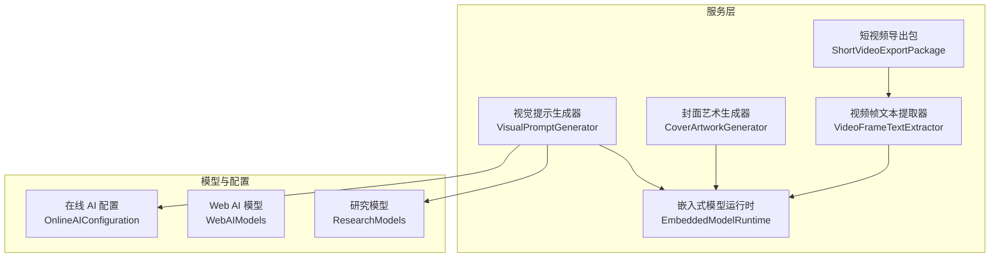
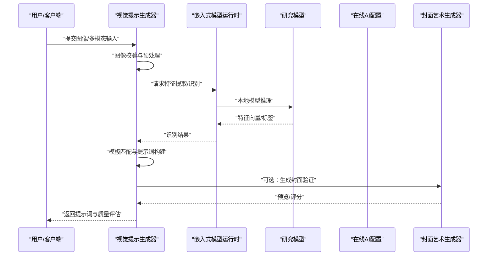
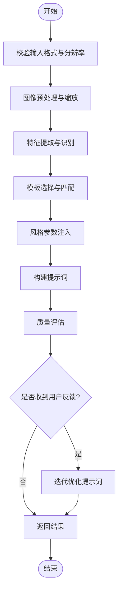
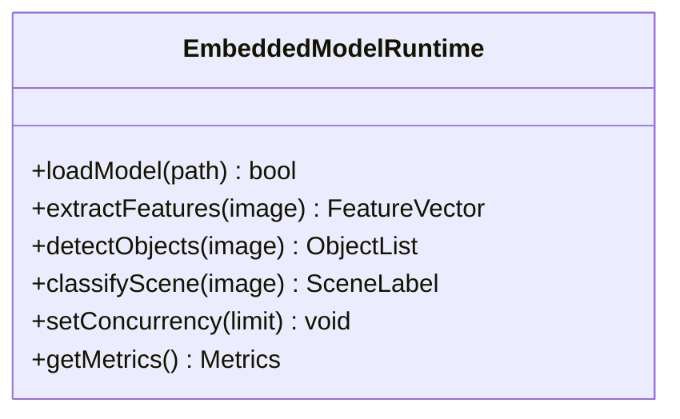
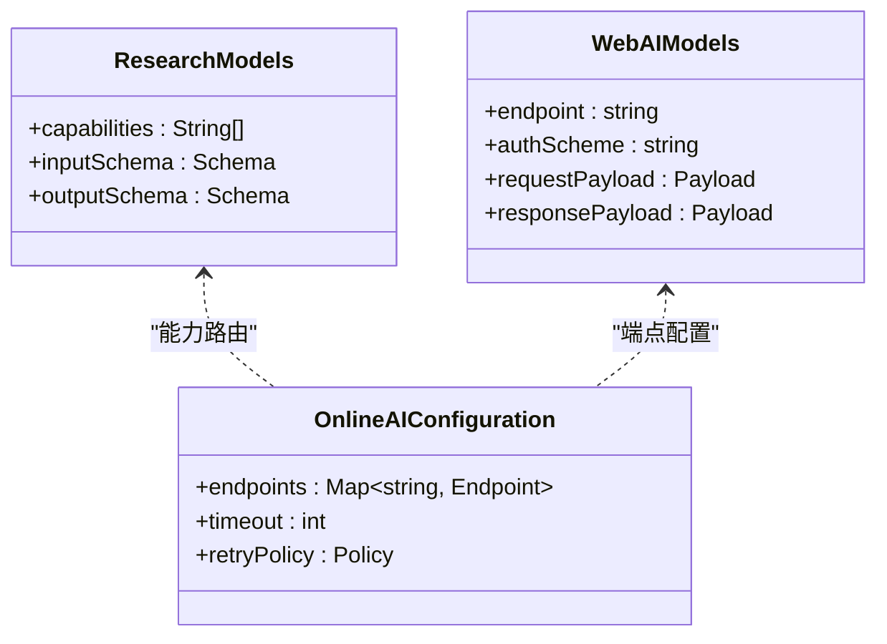
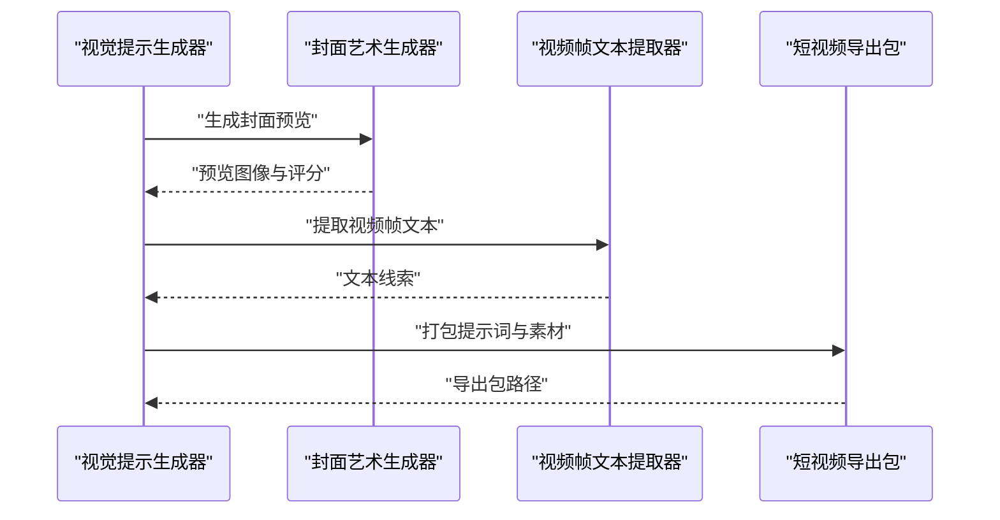
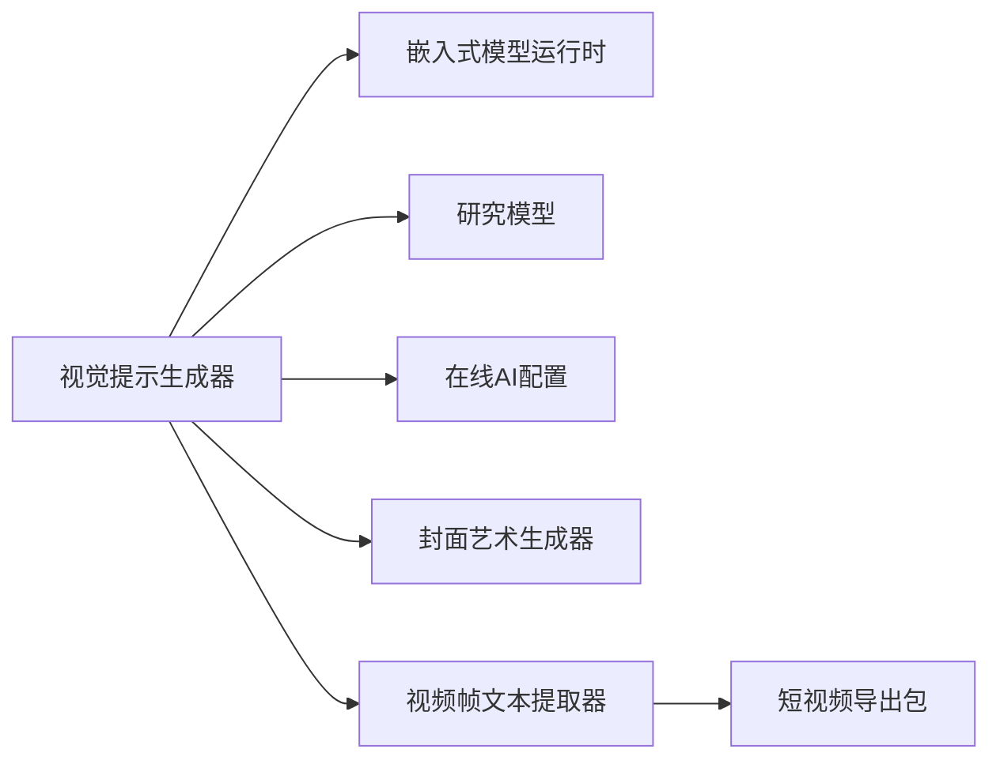

# 视觉提示生成

<cite>
**本文引用的文件**   
- [VisualPromptGenerator.swift](file://Sources/ChengGao/Services/VisualPromptGenerator.swift)
- [EmbeddedModelRuntime.swift](file://Sources/ChengGao/Services/EmbeddedModelRuntime.swift)
- [ResearchModels.swift](file://Sources/ChengGao/Models/ResearchModels.swift)
- [WebAIModels.swift](file://Sources/ChengGao/Models/WebAIModels.swift)
- [OnlineAIConfiguration.swift](file://Sources/ChengGao/Models/OnlineAIConfiguration.swift)
- [CoverArtworkGenerator.swift](file://Sources/ChengGao/Services/CoverArtworkGenerator.swift)
- [VideoFrameTextExtractor.swift](file://Sources/ChengGao/Services/VideoFrameTextExtractor.swift)
- [ShortVideoExportPackage.swift](file://Sources/ChengGao/Services/ShortVideoExportPackage.swift)
</cite>

## 目录
1. [简介](#简介)
2. [项目结构](#项目结构)
3. [核心组件](#核心组件)
4. [架构总览](#架构总览)
5. [详细组件分析](#详细组件分析)
6. [依赖关系分析](#依赖关系分析)
7. [性能考量](#性能考量)
8. [故障排查指南](#故障排查指南)
9. [结论](#结论)
10. [附录](#附录)

## 简介
本文件系统化说明“视觉提示生成服务”的设计与实现，聚焦于图像分析算法、特征提取与提示词构建策略。文档涵盖支持的图像格式与分辨率要求、处理流水线、AI驱动的图像理解（场景识别与对象检测）、提示词模板系统、风格定制与多模态输入处理，以及生成质量评估、迭代优化和用户反馈集成机制。内容面向不同技术背景的读者，既提供高层概览，也给出代码级映射与可视化图示。

## 项目结构
本项目采用模块化组织方式，视觉提示生成相关能力主要位于 Services 与 Models 层：
- Services 层负责图像处理、模型运行时、视频帧文本提取、封面生成等具体业务逻辑。
- Models 层定义数据模型与配置，如在线 AI 配置、研究模型与 Web AI 模型等。

图表来源
- [VisualPromptGenerator.swift](file://Sources/ChengGao/Services/VisualPromptGenerator.swift)
- [EmbeddedModelRuntime.swift](file://Sources/ChengGao/Services/EmbeddedModelRuntime.swift)
- [ResearchModels.swift](file://Sources/ChengGao/Models/ResearchModels.swift)
- [WebAIModels.swift](file://Sources/ChengGao/Models/WebAIModels.swift)
- [OnlineAIConfiguration.swift](file://Sources/ChengGao/Models/OnlineAIConfiguration.swift)
- [CoverArtworkGenerator.swift](file://Sources/ChengGao/Services/CoverArtworkGenerator.swift)
- [VideoFrameTextExtractor.swift](file://Sources/ChengGao/Services/VideoFrameTextExtractor.swift)
- [ShortVideoExportPackage.swift](file://Sources/ChengGao/Services/ShortVideoExportPackage.swift)

章节来源
- [VisualPromptGenerator.swift](file://Sources/ChengGao/Services/VisualPromptGenerator.swift)
- [EmbeddedModelRuntime.swift](file://Sources/ChengGao/Services/EmbeddedModelRuntime.swift)
- [ResearchModels.swift](file://Sources/ChengGao/Models/ResearchModels.swift)
- [WebAIModels.swift](file://Sources/ChengGao/Models/WebAIModels.swift)
- [OnlineAIConfiguration.swift](file://Sources/ChengGao/Models/OnlineAIConfiguration.swift)
- [CoverArtworkGenerator.swift](file://Sources/ChengGao/Services/CoverArtworkGenerator.swift)
- [VideoFrameTextExtractor.swift](file://Sources/ChengGao/Services/VideoFrameTextExtractor.swift)
- [ShortVideoExportPackage.swift](file://Sources/ChengGao/Services/ShortVideoExportPackage.swift)

## 核心组件
- 视觉提示生成器（VisualPromptGenerator）
  - 职责：协调图像预处理、特征提取、提示词模板匹配与组合、风格化参数注入，并输出结构化提示词。
  - 关键流程：输入图像校验与缩放 → 特征提取（本地或云端）→ 场景/对象识别 → 模板选择与填充 → 风格定制 → 结果校验与返回。
- 嵌入式模型运行时（EmbeddedModelRuntime）
  - 职责：封装本地推理引擎调用，统一模型加载、内存管理与批处理接口，为上层服务提供稳定推理能力。
- 研究模型（ResearchModels）与 Web AI 模型（WebAIModels）
  - 职责：定义模型元数据、能力清单与请求/响应结构，支撑多源模型接入与能力路由。
- 在线 AI 配置（OnlineAIConfiguration）
  - 职责：管理远程模型访问凭据、端点与超时策略，支持动态切换与降级。
- 辅助服务
  - 封面艺术生成器（CoverArtworkGenerator）：基于提示词生成封面图，验证提示词可用性。
  - 视频帧文本提取器（VideoFrameTextExtractor）：从视频帧中提取文本线索，增强提示词语义。
  - 短视频导出包（ShortVideoExportPackage）：将生成的提示词与素材打包，便于后续使用。

章节来源
- [VisualPromptGenerator.swift](file://Sources/ChengGao/Services/VisualPromptGenerator.swift)
- [EmbeddedModelRuntime.swift](file://Sources/ChengGao/Services/EmbeddedModelRuntime.swift)
- [ResearchModels.swift](file://Sources/ChengGao/Models/ResearchModels.swift)
- [WebAIModels.swift](file://Sources/ChengGao/Models/WebAIModels.swift)
- [OnlineAIConfiguration.swift](file://Sources/ChengGao/Models/OnlineAIConfiguration.swift)
- [CoverArtworkGenerator.swift](file://Sources/ChengGao/Services/CoverArtworkGenerator.swift)
- [VideoFrameTextExtractor.swift](file://Sources/ChengGao/Services/VideoFrameTextExtractor.swift)
- [ShortVideoExportPackage.swift](file://Sources/ChengGao/Services/ShortVideoExportPackage.swift)

## 架构总览
视觉提示生成服务采用分层与插件化设计：
- 输入层：接收图像、视频帧或多模态输入（图像+文本）。
- 处理层：图像预处理、特征提取、AI 理解（场景/对象识别）、提示词模板匹配与组合。
- 模型层：通过嵌入式模型运行时统一调度本地与在线模型。
- 输出层：结构化提示词、风格化参数、质量评估指标与可迭代优化建议。

图表来源
- [VisualPromptGenerator.swift](file://Sources/ChengGao/Services/VisualPromptGenerator.swift)
- [EmbeddedModelRuntime.swift](file://Sources/ChengGao/Services/EmbeddedModelRuntime.swift)
- [ResearchModels.swift](file://Sources/ChengGao/Models/ResearchModels.swift)
- [OnlineAIConfiguration.swift](file://Sources/ChengGao/Models/OnlineAIConfiguration.swift)
- [CoverArtworkGenerator.swift](file://Sources/ChengGao/Services/CoverArtworkGenerator.swift)

## 详细组件分析

### 视觉提示生成器（VisualPromptGenerator）
- 功能要点
  - 图像格式支持与分辨率要求：支持常见图像格式；对超大分辨率进行自适应缩放与裁剪，保证推理效率与质量平衡。
  - 特征提取与 AI 理解：调用嵌入式模型运行时执行特征提取与对象/场景识别，融合多模态输入提升语义准确性。
  - 提示词模板系统：内置多种模板（写实、插画、抽象、产品摄影等），根据识别结果自动选择并填充关键词。
  - 风格定制：允许注入风格参数（光影、构图、材质、色调），支持用户自定义风格库。
  - 质量评估与迭代优化：基于生成预览与反馈信号，计算一致性、清晰度、主题契合度等指标，驱动提示词微调。
  - 用户反馈集成：收集用户对提示词的修改与采纳情况，用于模板权重更新与推荐策略优化。

图表来源
- [VisualPromptGenerator.swift](file://Sources/ChengGao/Services/VisualPromptGenerator.swift)

章节来源
- [VisualPromptGenerator.swift](file://Sources/ChengGao/Services/VisualPromptGenerator.swift)

### 嵌入式模型运行时（EmbeddedModelRuntime）
- 功能要点
  - 模型加载与管理：统一加载本地模型，维护模型生命周期与缓存。
  - 推理接口：提供特征提取、分类、检测等标准化接口，支持批量与异步调用。
  - 资源控制：限制内存占用与并发数，确保稳定性。
  - 错误处理：捕获推理异常并返回明确错误码，便于上层重试与降级。

图表来源
- [EmbeddedModelRuntime.swift](file://Sources/ChengGao/Services/EmbeddedModelRuntime.swift)

章节来源
- [EmbeddedModelRuntime.swift](file://Sources/ChengGao/Services/EmbeddedModelRuntime.swift)

### 模型与配置（ResearchModels / WebAIModels / OnlineAIConfiguration）
- ResearchModels
  - 定义本地研究模型的元数据、能力清单与输入输出规范。
- WebAIModels
  - 定义在线模型的服务端契约，包括端点、鉴权与响应结构。
- OnlineAIConfiguration
  - 管理在线模型访问配置，支持多端点切换、超时与重试策略。

图表来源
- [ResearchModels.swift](file://Sources/ChengGao/Models/ResearchModels.swift)
- [WebAIModels.swift](file://Sources/ChengGao/Models/WebAIModels.swift)
- [OnlineAIConfiguration.swift](file://Sources/ChengGao/Models/OnlineAIConfiguration.swift)

章节来源
- [ResearchModels.swift](file://Sources/ChengGao/Models/ResearchModels.swift)
- [WebAIModels.swift](file://Sources/ChengGao/Models/WebAIModels.swift)
- [OnlineAIConfiguration.swift](file://Sources/ChengGao/Models/OnlineAIConfiguration.swift)

### 辅助服务（CoverArtworkGenerator / VideoFrameTextExtractor / ShortVideoExportPackage）
- CoverArtworkGenerator
  - 基于提示词生成封面预览，用于快速验证提示词效果与质量。
- VideoFrameTextExtractor
  - 从视频帧中抽取文本线索，增强提示词的语义表达与上下文一致性。
- ShortVideoExportPackage
  - 将提示词与相关素材打包，便于导出与复用。

图表来源
- [CoverArtworkGenerator.swift](file://Sources/ChengGao/Services/CoverArtworkGenerator.swift)
- [VideoFrameTextExtractor.swift](file://Sources/ChengGao/Services/VideoFrameTextExtractor.swift)
- [ShortVideoExportPackage.swift](file://Sources/ChengGao/Services/ShortVideoExportPackage.swift)

章节来源
- [CoverArtworkGenerator.swift](file://Sources/ChengGao/Services/CoverArtworkGenerator.swift)
- [VideoFrameTextExtractor.swift](file://Sources/ChengGao/Services/VideoFrameTextExtractor.swift)
- [ShortVideoExportPackage.swift](file://Sources/ChengGao/Services/ShortVideoExportPackage.swift)

## 依赖关系分析
- 耦合与内聚
  - VisualPromptGenerator 高内聚地编排图像处理与提示词构建流程，低耦合地依赖 EmbeddedModelRuntime 与模型配置。
  - EmbeddedModelRuntime 作为推理抽象层，屏蔽底层模型差异，提升整体内聚性。
- 外部依赖
  - 在线模型通过 OnlineAIConfiguration 管理，支持动态切换与降级。
  - 辅助服务（封面生成、视频文本提取、导出包）按需调用，避免主流程阻塞。

图表来源
- [VisualPromptGenerator.swift](file://Sources/ChengGao/Services/VisualPromptGenerator.swift)
- [EmbeddedModelRuntime.swift](file://Sources/ChengGao/Services/EmbeddedModelRuntime.swift)
- [ResearchModels.swift](file://Sources/ChengGao/Models/ResearchModels.swift)
- [OnlineAIConfiguration.swift](file://Sources/ChengGao/Models/OnlineAIConfiguration.swift)
- [CoverArtworkGenerator.swift](file://Sources/ChengGao/Services/CoverArtworkGenerator.swift)
- [VideoFrameTextExtractor.swift](file://Sources/ChengGao/Services/VideoFrameTextExtractor.swift)
- [ShortVideoExportPackage.swift](file://Sources/ChengGao/Services/ShortVideoExportPackage.swift)

章节来源
- [VisualPromptGenerator.swift](file://Sources/ChengGao/Services/VisualPromptGenerator.swift)
- [EmbeddedModelRuntime.swift](file://Sources/ChengGao/Services/EmbeddedModelRuntime.swift)
- [ResearchModels.swift](file://Sources/ChengGao/Models/ResearchModels.swift)
- [OnlineAIConfiguration.swift](file://Sources/ChengGao/Models/OnlineAIConfiguration.swift)
- [CoverArtworkGenerator.swift](file://Sources/ChengGao/Services/CoverArtworkGenerator.swift)
- [VideoFrameTextExtractor.swift](file://Sources/ChengGao/Services/VideoFrameTextExtractor.swift)
- [ShortVideoExportPackage.swift](file://Sources/ChengGao/Services/ShortVideoExportPackage.swift)

## 性能考量
- 图像预处理
  - 自适应缩放与裁剪，减少不必要的高分辨率推理开销。
  - 批量处理与缓存机制，降低重复计算成本。
- 模型推理
  - 并发控制与内存限制，避免峰值负载导致崩溃。
  - 本地优先、在线降级的策略，保障可用性与延迟。
- 提示词构建
  - 模板匹配采用索引与权重排序，提高选择效率。
  - 增量更新模板权重，减少全量扫描。
- 质量评估
  - 轻量级指标计算（清晰度、主题契合度），避免重型评估带来的延迟。
  - 异步评估与缓存，提升用户体验。

[本节为通用指导，不直接分析具体文件]

## 故障排查指南
- 常见问题
  - 图像格式不支持：检查输入格式与编码，必要时转换为标准格式。
  - 分辨率过大：启用自适应缩放，确认阈值设置合理。
  - 模型加载失败：检查模型路径与权限，确认嵌入式运行时状态。
  - 在线模型超时：调整超时与重试策略，检查网络与凭据。
  - 提示词质量不佳：查看质量评估指标，结合用户反馈迭代优化。
- 调试建议
  - 启用详细日志，记录预处理、推理与模板匹配的关键步骤。
  - 使用封面预览快速定位问题环节。
  - 收集用户反馈数据，分析模板命中率与采纳率。

章节来源
- [VisualPromptGenerator.swift](file://Sources/ChengGao/Services/VisualPromptGenerator.swift)
- [EmbeddedModelRuntime.swift](file://Sources/ChengGao/Services/EmbeddedModelRuntime.swift)
- [OnlineAIConfiguration.swift](file://Sources/ChengGao/Models/OnlineAIConfiguration.swift)

## 结论
视觉提示生成服务通过分层与插件化架构，实现了从图像输入到高质量提示词输出的完整流水线。借助嵌入式模型运行时与多源模型配置，系统在本地与在线环境间灵活切换，兼顾性能与可用性。模板系统与风格定制满足多样化需求，质量评估与用户反馈闭环持续优化生成效果。未来可进一步扩展多模态输入、增强语义理解与个性化风格库，以提升整体体验与适用范围。

[本节为总结性内容，不直接分析具体文件]

## 附录
- 术语表
  - 提示词：用于描述图像内容与风格的自然语言指令。
  - 特征提取：从图像中抽取可用于识别与分类的数值表示。
  - 场景识别：判断图像所属场景类别（如室内、户外、产品等）。
  - 对象检测：定位并识别图像中的关键对象。
- 最佳实践
  - 合理设置分辨率阈值与并发限制，平衡质量与性能。
  - 定期更新模板与风格库，保持提示词多样性与时效性。
  - 建立用户反馈采集与分析机制，驱动持续优化。

[本节为补充信息，不直接分析具体文件]