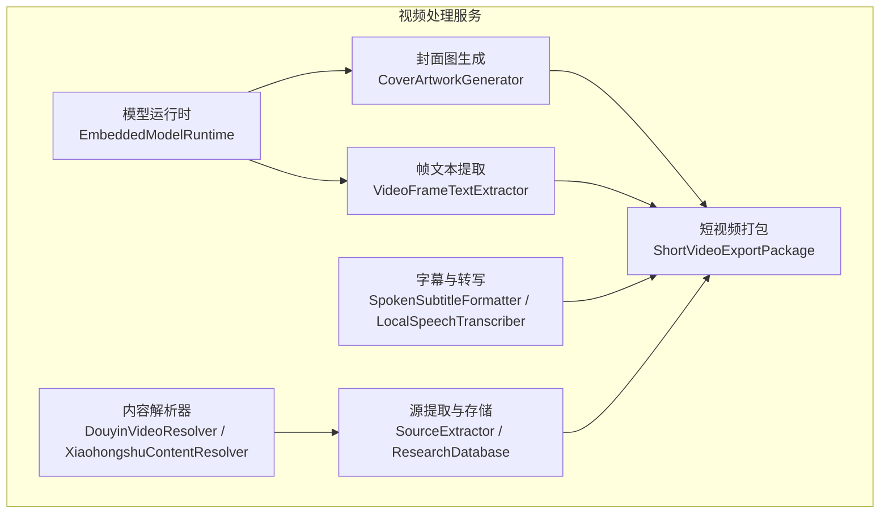
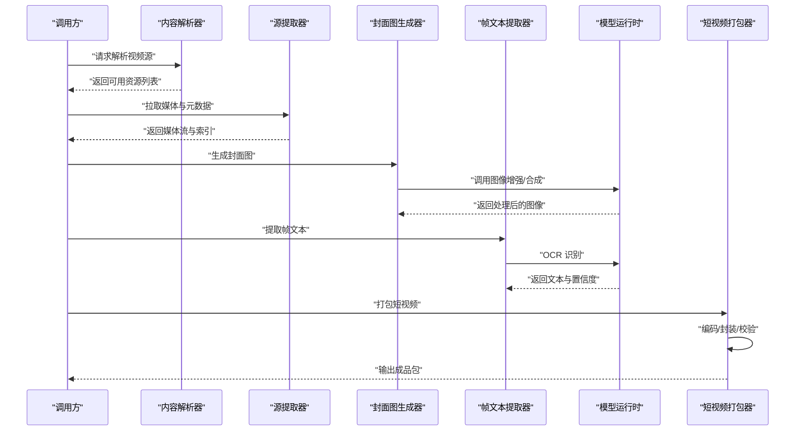
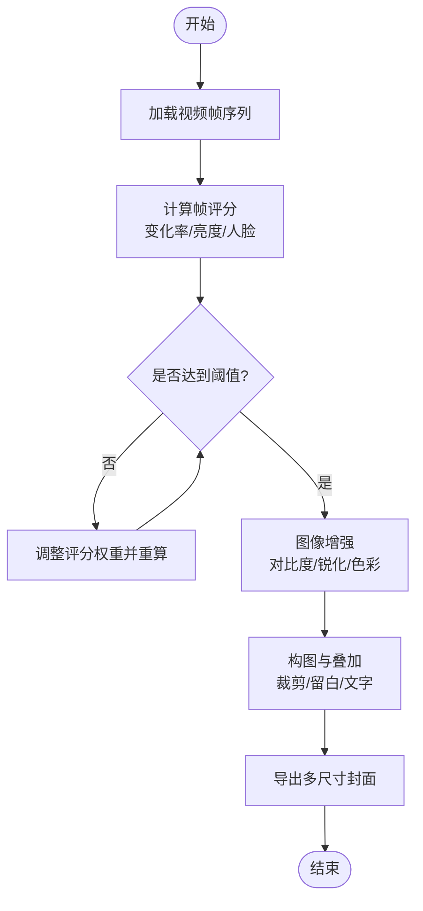
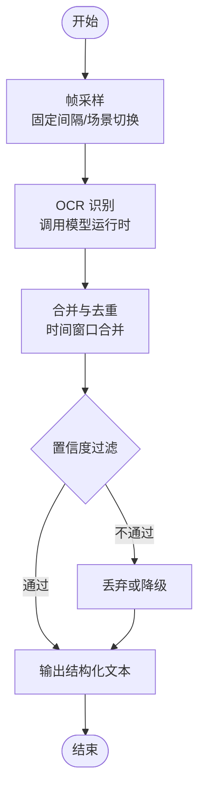
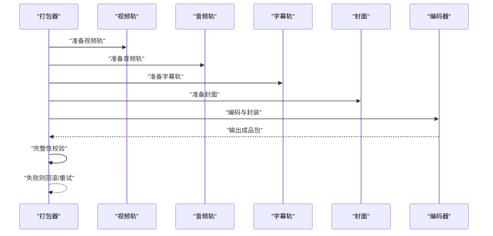
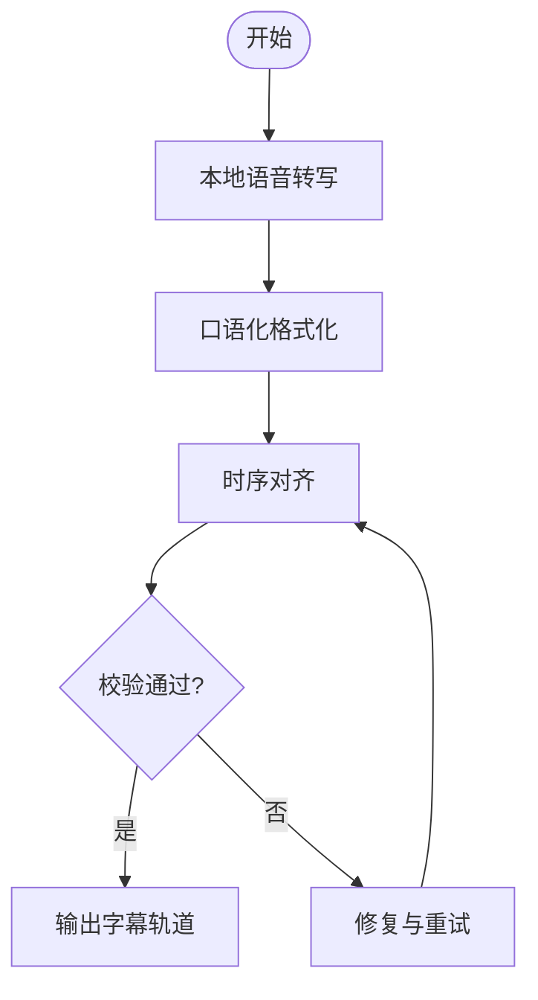
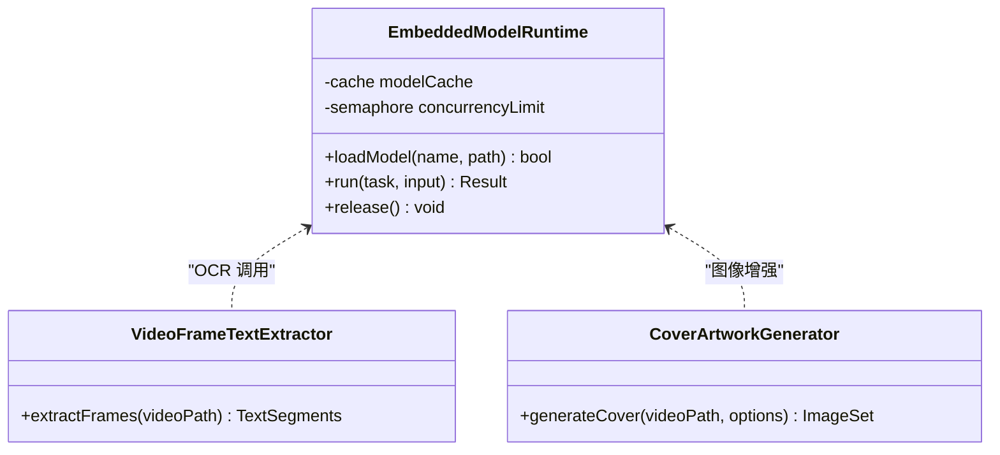
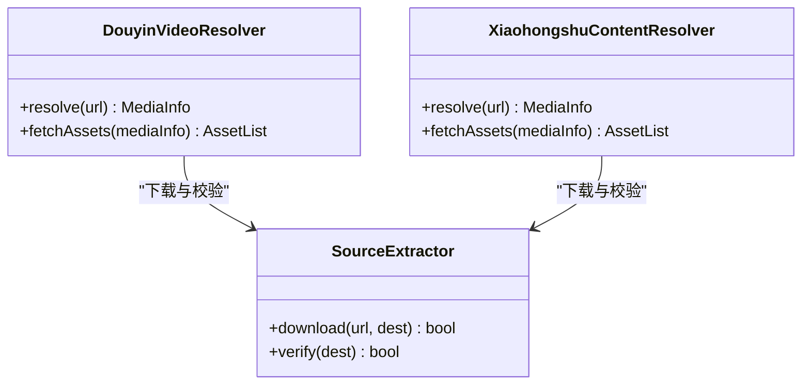
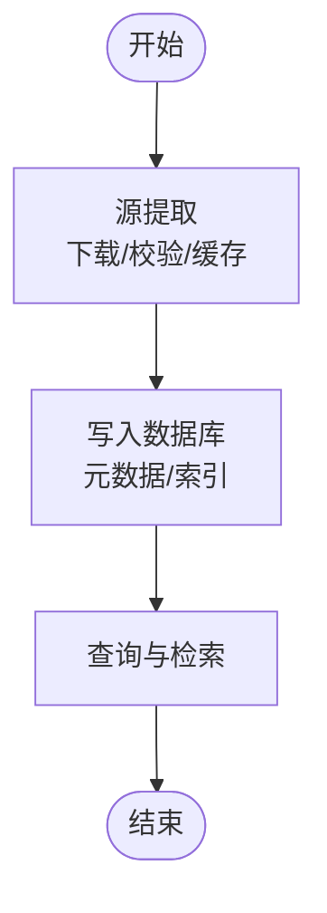
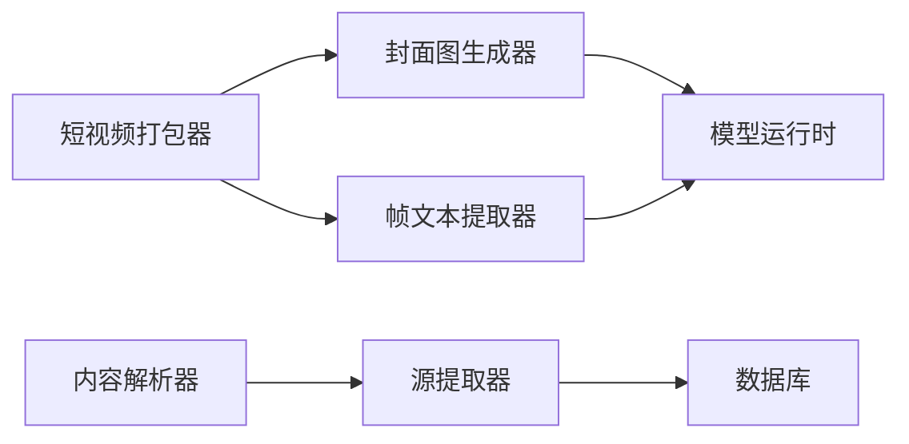

# 视频处理服务

<cite>
**本文引用的文件**   
- [CoverArtworkGenerator.swift](file://Sources/ChengGao/Services/CoverArtworkGenerator.swift)
- [VideoFrameTextExtractor.swift](file://Sources/ChengGao/Services/VideoFrameTextExtractor.swift)
- [ShortVideoExportPackage.swift](file://Sources/ChengGao/Services/ShortVideoExportPackage.swift)
- [SpokenSubtitleFormatter.swift](file://Sources/ChengGao/Services/SpokenSubtitleFormatter.swift)
- [LocalSpeechTranscriber.swift](file://Sources/ChengGao/Services/LocalSpeechTranscriber.swift)
- [EmbeddedModelRuntime.swift](file://Sources/ChengGao/Services/EmbeddedModelRuntime.swift)
- [DouyinVideoResolver.swift](file://Sources/ChengGao/Services/DouyinVideoResolver.swift)
- [XiaohongshuContentResolver.swift](file://Sources/ChengGao/Services/XiaohongshuContentResolver.swift)
- [SourceExtractor.swift](file://Sources/ChengGao/Services/SourceExtractor.swift)
- [ResearchDatabase.swift](file://Sources/ChengGao/Services/ResearchDatabase.swift)
</cite>

## 目录
1. [简介](#简介)
2. [项目结构](#项目结构)
3. [核心组件](#核心组件)
4. [架构总览](#架构总览)
5. [详细组件分析](#详细组件分析)
6. [依赖关系分析](#依赖关系分析)
7. [性能考量](#性能考量)
8. [故障排查指南](#故障排查指南)
9. [结论](#结论)
10. [附录](#附录)

## 简介
本文件面向“视频处理服务”的功能实现，围绕封面图生成算法、帧文本提取技术、短视频打包流程展开，系统阐述图像处理管道、OCR 集成与视频编码优化策略。文档同时覆盖批量处理能力、内存管理、异步任务调度、质量配置选项、输出格式支持、性能调优参数、错误恢复、进度跟踪与用户体验优化等关键主题，帮助开发者快速理解并高效使用或扩展该服务。

## 项目结构
视频处理相关能力集中在 Services 层，按职责划分为：
- 封面图生成：负责从视频中抽取关键帧并进行图像合成，输出高质量封面。
- 帧文本提取：对视频帧进行 OCR 识别，结合时间轴生成结构化文本。
- 短视频打包：将素材、字幕、转写结果与元数据整合为可发布的短视频包。
- 语音与字幕：本地转写与口语化字幕格式化，提升可读性与播放体验。
- 模型运行时：提供嵌入式推理环境，支撑 OCR 与轻量模型调用。
- 内容解析器：对接外部平台（如抖音、小红书）的视频与素材来源。
- 源提取与数据库：统一资源访问与持久化存储。

**图表来源** 
- [CoverArtworkGenerator.swift](file://Sources/ChengGao/Services/CoverArtworkGenerator.swift)
- [VideoFrameTextExtractor.swift](file://Sources/ChengGao/Services/VideoFrameTextExtractor.swift)
- [ShortVideoExportPackage.swift](file://Sources/ChengGao/Services/ShortVideoExportPackage.swift)
- [SpokenSubtitleFormatter.swift](file://Sources/ChengGao/Services/SpokenSubtitleFormatter.swift)
- [LocalSpeechTranscriber.swift](file://Sources/ChengGao/Services/LocalSpeechTranscriber.swift)
- [EmbeddedModelRuntime.swift](file://Sources/ChengGao/Services/EmbeddedModelRuntime.swift)
- [DouyinVideoResolver.swift](file://Sources/ChengGao/Services/DouyinVideoResolver.swift)
- [XiaohongshuContentResolver.swift](file://Sources/ChengGao/Services/XiaohongshuContentResolver.swift)
- [SourceExtractor.swift](file://Sources/ChengGao/Services/SourceExtractor.swift)
- [ResearchDatabase.swift](file://Sources/ChengGao/Services/ResearchDatabase.swift)

**章节来源**
- [CoverArtworkGenerator.swift](file://Sources/ChengGao/Services/CoverArtworkGenerator.swift)
- [VideoFrameTextExtractor.swift](file://Sources/ChengGao/Services/VideoFrameTextExtractor.swift)
- [ShortVideoExportPackage.swift](file://Sources/ChengGao/Services/ShortVideoExportPackage.swift)
- [SpokenSubtitleFormatter.swift](file://Sources/ChengGao/Services/SpokenSubtitleFormatter.swift)
- [LocalSpeechTranscriber.swift](file://Sources/ChengGao/Services/LocalSpeechTranscriber.swift)
- [EmbeddedModelRuntime.swift](file://Sources/ChengGao/Services/EmbeddedModelRuntime.swift)
- [DouyinVideoResolver.swift](file://Sources/ChengGao/Services/DouyinVideoResolver.swift)
- [XiaohongshuContentResolver.swift](file://Sources/ChengGao/Services/XiaohongshuContentResolver.swift)
- [SourceExtractor.swift](file://Sources/ChengGao/Services/SourceExtractor.swift)
- [ResearchDatabase.swift](file://Sources/ChengGao/Services/ResearchDatabase.swift)

## 核心组件
- 封面图生成器：从视频流中采样关键帧，执行缩放、裁剪、对比度增强与文字叠加，输出多尺寸封面图。
- 帧文本提取器：基于 OCR 引擎对视频帧进行文本识别，结合时间戳生成带时序的文本片段，支持去重与合并。
- 短视频打包器：聚合视频、音频、字幕、封面与元数据，执行编码封装与校验，输出标准格式包。
- 字幕与转写：本地语音转写与口语化字幕格式化，保证字幕可读性与时序对齐。
- 模型运行时：提供嵌入式推理环境，隔离 OCR 与轻量模型的加载、缓存与并发控制。
- 内容解析器：统一接入外部平台视频与素材，屏蔽差异协议与鉴权细节。
- 源提取与数据库：抽象资源读取路径与缓存策略，提供结构化存储与查询接口。

**章节来源**
- [CoverArtworkGenerator.swift](file://Sources/ChengGao/Services/CoverArtworkGenerator.swift)
- [VideoFrameTextExtractor.swift](file://Sources/ChengGao/Services/VideoFrameTextExtractor.swift)
- [ShortVideoExportPackage.swift](file://Sources/ChengGao/Services/ShortVideoExportPackage.swift)
- [SpokenSubtitleFormatter.swift](file://Sources/ChengGao/Services/SpokenSubtitleFormatter.swift)
- [LocalSpeechTranscriber.swift](file://Sources/ChengGao/Services/LocalSpeechTranscriber.swift)
- [EmbeddedModelRuntime.swift](file://Sources/ChengGao/Services/EmbeddedModelRuntime.swift)
- [DouyinVideoResolver.swift](file://Sources/ChengGao/Services/DouyinVideoResolver.swift)
- [XiaohongshuContentResolver.swift](file://Sources/ChengGao/Services/XiaohongshuContentResolver.swift)
- [SourceExtractor.swift](file://Sources/ChengGao/Services/SourceExtractor.swift)
- [ResearchDatabase.swift](file://Sources/ChengGao/Services/ResearchDatabase.swift)

## 架构总览
视频处理服务采用分层与流水线式架构：输入源经解析器统一接入，随后进入并行处理的图像处理与 OCR 管道；结果由打包器汇聚并编码输出。模型运行时作为共享基础设施，提供 OCR 与轻量模型的加载、缓存与并发限制。

**图表来源** 
- [DouyinVideoResolver.swift](file://Sources/ChengGao/Services/DouyinVideoResolver.swift)
- [XiaohongshuContentResolver.swift](file://Sources/ChengGao/Services/XiaohongshuContentResolver.swift)
- [SourceExtractor.swift](file://Sources/ChengGao/Services/SourceExtractor.swift)
- [CoverArtworkGenerator.swift](file://Sources/ChengGao/Services/CoverArtworkGenerator.swift)
- [VideoFrameTextExtractor.swift](file://Sources/ChengGao/Services/VideoFrameTextExtractor.swift)
- [EmbeddedModelRuntime.swift](file://Sources/ChengGao/Services/EmbeddedModelRuntime.swift)
- [ShortVideoExportPackage.swift](file://Sources/ChengGao/Services/ShortVideoExportPackage.swift)

## 详细组件分析

### 封面图生成器（CoverArtworkGenerator）
- 功能要点
  - 关键帧选择：基于画面变化率、亮度分布与人脸检测策略选取代表性帧。
  - 图像增强：对比度、饱和度、锐化与色彩校正，确保视觉吸引力。
  - 构图与叠加：自适应裁剪、安全区域留白、标题与标签叠加。
  - 多尺寸输出：适配不同平台的封面规格，批量生成与缓存命中。
- 算法流程

**图表来源** 
- [CoverArtworkGenerator.swift](file://Sources/ChengGao/Services/CoverArtworkGenerator.swift)

**章节来源**
- [CoverArtworkGenerator.swift](file://Sources/ChengGao/Services/CoverArtworkGenerator.swift)

### 帧文本提取器（VideoFrameTextExtractor）
- 功能要点
  - 帧采样：按时间间隔与场景切换点采样，减少冗余。
  - OCR 识别：调用模型运行时进行文本识别，输出带时间戳的文本片段。
  - 后处理：去噪、合并相邻片段、过滤低置信度结果。
- 处理流程

**图表来源** 
- [VideoFrameTextExtractor.swift](file://Sources/ChengGao/Services/VideoFrameTextExtractor.swift)
- [EmbeddedModelRuntime.swift](file://Sources/ChengGao/Services/EmbeddedModelRuntime.swift)

**章节来源**
- [VideoFrameTextExtractor.swift](file://Sources/ChengGao/Services/VideoFrameTextExtractor.swift)
- [EmbeddedModelRuntime.swift](file://Sources/ChengGao/Services/EmbeddedModelRuntime.swift)

### 短视频打包器（ShortVideoExportPackage）
- 功能要点
  - 素材聚合：视频、音频、字幕、封面与元数据的统一装配。
  - 编码封装：根据目标平台规范选择编码器与容器，执行码率与分辨率适配。
  - 校验与回滚：完整性校验、失败重试与中间产物清理。
- 打包流程

**图表来源** 
- [ShortVideoExportPackage.swift](file://Sources/ChengGao/Services/ShortVideoExportPackage.swift)

**章节来源**
- [ShortVideoExportPackage.swift](file://Sources/ChengGao/Services/ShortVideoExportPackage.swift)

### 字幕与转写（SpokenSubtitleFormatter / LocalSpeechTranscriber）
- 功能要点
  - 本地转写：离线语音转文本，降低延迟与网络依赖。
  - 口语化格式化：去除填充词、断句优化、标点恢复，提升可读性。
  - 时序对齐：与视频帧时间轴对齐，确保字幕同步。
- 处理流程

**图表来源** 
- [LocalSpeechTranscriber.swift](file://Sources/ChengGao/Services/LocalSpeechTranscriber.swift)
- [SpokenSubtitleFormatter.swift](file://Sources/ChengGao/Services/SpokenSubtitleFormatter.swift)

**章节来源**
- [LocalSpeechTranscriber.swift](file://Sources/ChengGao/Services/LocalSpeechTranscriber.swift)
- [SpokenSubtitleFormatter.swift](file://Sources/ChengGao/Services/SpokenSubtitleFormatter.swift)

### 模型运行时（EmbeddedModelRuntime）
- 功能要点
  - 模型加载与缓存：按需加载 OCR 与轻量模型，避免重复初始化开销。
  - 并发控制：限制并发任务数，防止内存峰值过高。
  - 资源回收：任务完成后释放显存与临时缓冲区。
- 调用关系

**图表来源** 
- [EmbeddedModelRuntime.swift](file://Sources/ChengGao/Services/EmbeddedModelRuntime.swift)
- [VideoFrameTextExtractor.swift](file://Sources/ChengGao/Services/VideoFrameTextExtractor.swift)
- [CoverArtworkGenerator.swift](file://Sources/ChengGao/Services/CoverArtworkGenerator.swift)

**章节来源**
- [EmbeddedModelRuntime.swift](file://Sources/ChengGao/Services/EmbeddedModelRuntime.swift)

### 内容解析器（DouyinVideoResolver / XiaohongshuContentResolver）
- 功能要点
  - 统一接口：对外暴露一致的解析方法，屏蔽平台差异。
  - 鉴权与会话：管理登录态、Cookie 与请求头。
  - 错误处理：网络异常、反爬策略与限流的容错与重试。
- 调用关系

**图表来源** 
- [DouyinVideoResolver.swift](file://Sources/ChengGao/Services/DouyinVideoResolver.swift)
- [XiaohongshuContentResolver.swift](file://Sources/ChengGao/Services/XiaohongshuContentResolver.swift)
- [SourceExtractor.swift](file://Sources/ChengGao/Services/SourceExtractor.swift)

**章节来源**
- [DouyinVideoResolver.swift](file://Sources/ChengGao/Services/DouyinVideoResolver.swift)
- [XiaohongshuContentResolver.swift](file://Sources/ChengGao/Services/XiaohongshuContentResolver.swift)
- [SourceExtractor.swift](file://Sources/ChengGao/Services/SourceExtractor.swift)

### 源提取与数据库（SourceExtractor / ResearchDatabase）
- 功能要点
  - 源提取：统一下载、分块读取、断点续传与完整性校验。
  - 数据库：结构化存储元数据、任务状态与中间产物索引。
- 数据流

**图表来源** 
- [SourceExtractor.swift](file://Sources/ChengGao/Services/SourceExtractor.swift)
- [ResearchDatabase.swift](file://Sources/ChengGao/Services/ResearchDatabase.swift)

**章节来源**
- [SourceExtractor.swift](file://Sources/ChengGao/Services/SourceExtractor.swift)
- [ResearchDatabase.swift](file://Sources/ChengGao/Services/ResearchDatabase.swift)

## 依赖关系分析
- 组件耦合
  - 封面图生成器与帧文本提取器均依赖模型运行时，形成共享依赖。
  - 短视频打包器聚合上游产出，承担最终编码与封装职责。
  - 内容解析器与源提取器解耦平台差异与 I/O 操作。
- 潜在循环依赖
  - 通过明确接口边界与单向依赖，避免循环引用。
- 外部依赖
  - OCR 模型、音视频编解码库与平台 API。

**图表来源** 
- [CoverArtworkGenerator.swift](file://Sources/ChengGao/Services/CoverArtworkGenerator.swift)
- [VideoFrameTextExtractor.swift](file://Sources/ChengGao/Services/VideoFrameTextExtractor.swift)
- [ShortVideoExportPackage.swift](file://Sources/ChengGao/Services/ShortVideoExportPackage.swift)
- [EmbeddedModelRuntime.swift](file://Sources/ChengGao/Services/EmbeddedModelRuntime.swift)
- [DouyinVideoResolver.swift](file://Sources/ChengGao/Services/DouyinVideoResolver.swift)
- [XiaohongshuContentResolver.swift](file://Sources/ChengGao/Services/XiaohongshuContentResolver.swift)
- [SourceExtractor.swift](file://Sources/ChengGao/Services/SourceExtractor.swift)
- [ResearchDatabase.swift](file://Sources/ChengGao/Services/ResearchDatabase.swift)

**章节来源**
- [CoverArtworkGenerator.swift](file://Sources/ChengGao/Services/CoverArtworkGenerator.swift)
- [VideoFrameTextExtractor.swift](file://Sources/ChengGao/Services/VideoFrameTextExtractor.swift)
- [ShortVideoExportPackage.swift](file://Sources/ChengGao/Services/ShortVideoExportPackage.swift)
- [EmbeddedModelRuntime.swift](file://Sources/ChengGao/Services/EmbeddedModelRuntime.swift)
- [DouyinVideoResolver.swift](file://Sources/ChengGao/Services/DouyinVideoResolver.swift)
- [XiaohongshuContentResolver.swift](file://Sources/ChengGao/Services/XiaohongshuContentResolver.swift)
- [SourceExtractor.swift](file://Sources/ChengGao/Services/SourceExtractor.swift)
- [ResearchDatabase.swift](file://Sources/ChengGao/Services/ResearchDatabase.swift)

## 性能考量
- 批量处理
  - 任务队列与批大小可调，避免瞬时内存峰值。
  - 结果缓存与去重，减少重复计算。
- 内存管理
  - 分块读取与流式处理，及时释放中间缓冲。
  - 模型运行时并发上限与显存回收策略。
- 异步调度
  - 基于事件驱动的异步管线，提高吞吐。
  - 超时与重试机制，保障稳定性。
- 编码优化
  - 根据目标平台选择编码器与码率曲线。
  - 关键帧间隔与分辨率自适应。
- 质量配置
  - 封面图清晰度、文字叠加样式与位置可调。
  - OCR 置信度阈值与合并窗口可调。
- 输出格式
  - 支持常见容器与编码组合，便于跨平台发布。
- 进度跟踪
  - 阶段化进度回调，便于 UI 展示与用户反馈。

[本节为通用指导，不直接分析具体文件]

## 故障排查指南
- 常见问题定位
  - 封面图模糊或失真：检查图像增强参数与关键帧选择策略。
  - OCR 识别率低：调整置信度阈值、增加帧采样密度或更换模型。
  - 打包失败：核对编码参数、容器兼容性与完整性校验日志。
  - 内存溢出：降低并发、减小批大小、启用流式处理。
- 错误恢复
  - 自动重试与退避策略，失败任务入队等待。
  - 中间产物清理与状态回滚，保证一致性。
- 调试建议
  - 开启详细日志与指标采集，记录关键节点耗时与资源占用。
  - 使用最小数据集复现问题，逐步缩小范围。

**章节来源**
- [EmbeddedModelRuntime.swift](file://Sources/ChengGao/Services/EmbeddedModelRuntime.swift)
- [ShortVideoExportPackage.swift](file://Sources/ChengGao/Services/ShortVideoExportPackage.swift)
- [VideoFrameTextExtractor.swift](file://Sources/ChengGao/Services/VideoFrameTextExtractor.swift)
- [CoverArtworkGenerator.swift](file://Sources/ChengGao/Services/CoverArtworkGenerator.swift)

## 结论
视频处理服务以模块化与流水线为核心，实现了从封面图生成、帧文本提取到短视频打包的完整闭环。通过模型运行时的统一支撑、严格的内存与并发控制、以及完善的错误恢复与进度跟踪，系统在质量、性能与用户体验之间取得平衡。建议在生产环境中结合业务需求细化质量配置与性能参数，持续监控关键指标并迭代优化。

[本节为总结性内容，不直接分析具体文件]

## 附录
- 术语说明
  - 关键帧：代表视频段落的典型画面，用于封面与 OCR 采样。
  - 置信度：OCR 识别结果的可靠性度量，用于过滤与合并。
  - 编码封装：将音视频与字幕等轨道编码并写入容器文件的过程。
- 最佳实践
  - 合理设置批大小与并发上限，避免资源争用。
  - 使用缓存与去重策略，减少重复计算。
  - 针对不同平台制定差异化输出配置。

[本节为补充信息，不直接分析具体文件]