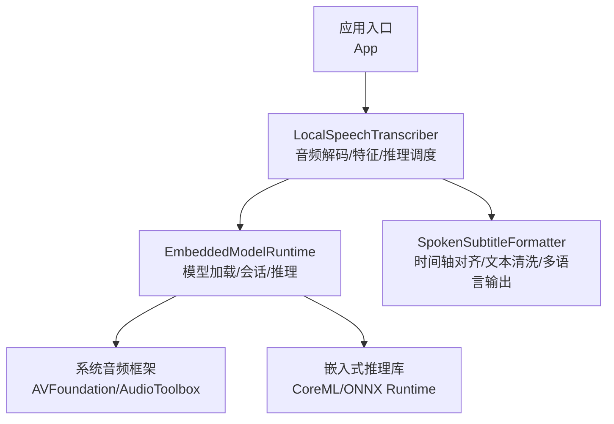
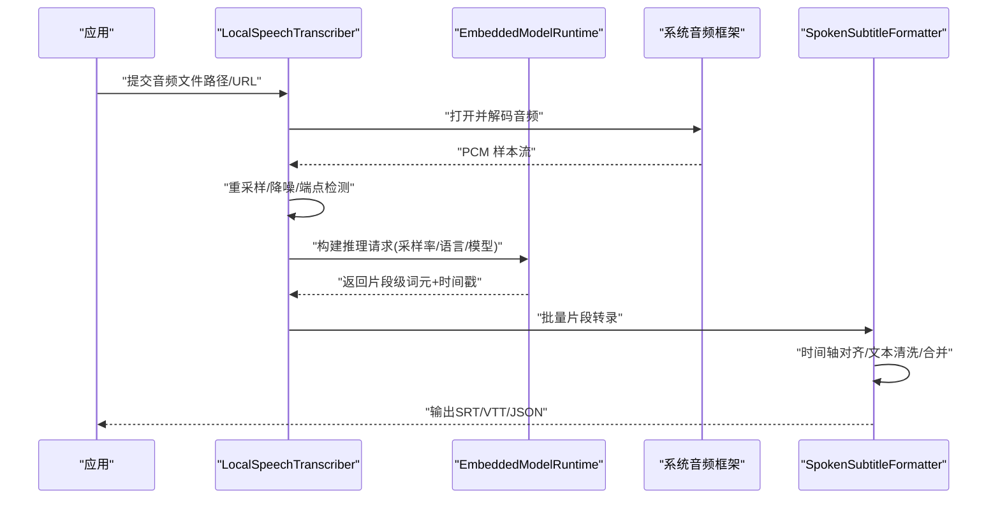
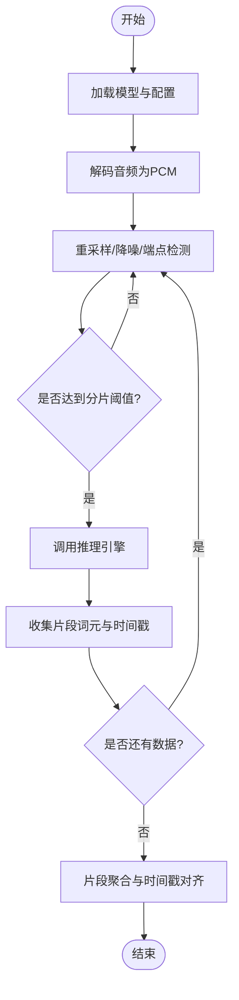
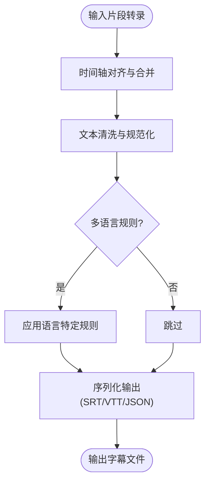
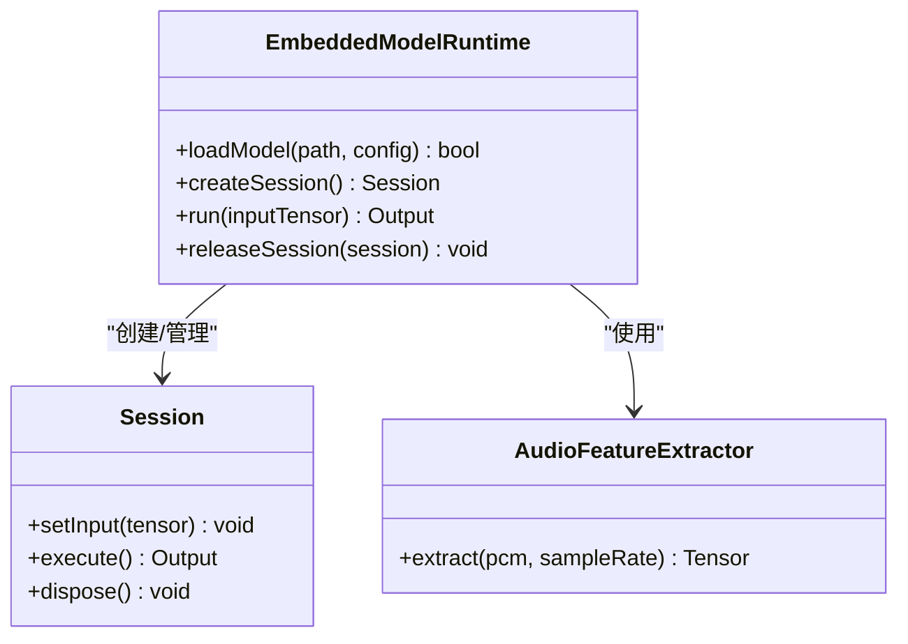
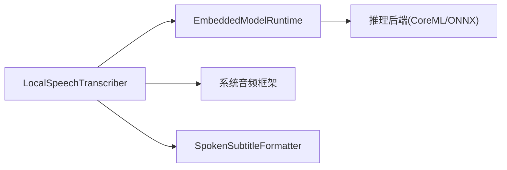

# 语音转录服务

<cite>
**本文引用的文件**   
- [LocalSpeechTranscriber.swift](file://Sources/ChengGao/Services/LocalSpeechTranscriber.swift)
- [SpokenSubtitleFormatter.swift](file://Sources/ChengGao/Services/SpokenSubtitleFormatter.swift)
- [EmbeddedModelRuntime.swift](file://Sources/ChengGao/Services/EmbeddedModelRuntime.swift)
- [Package.swift](file://Package.swift)
- [README.md](file://README.md)
</cite>

## 目录
1. [简介](#简介)
2. [项目结构](#项目结构)
3. [核心组件](#核心组件)
4. [架构总览](#架构总览)
5. [详细组件分析](#详细组件分析)
6. [依赖关系分析](#依赖关系分析)
7. [性能考量](#性能考量)
8. [故障排查指南](#故障排查指南)
9. [结论](#结论)
10. [附录](#附录)

## 简介
本文件面向“语音转录服务”的实现与使用，围绕音频文件处理、本地语音识别引擎集成、转录结果后处理（含字幕格式化）进行系统化说明。文档覆盖支持的音频格式、采样率要求、语言模型配置；阐述时间轴对齐、文本清洗与多语言支持；并提供转录质量优化、噪音处理、实时转录实现要点；同时给出错误恢复机制、进度跟踪与性能监控建议。

## 项目结构
本项目采用 Swift Package Manager 组织代码，核心能力位于 Services 层：
- LocalSpeechTranscriber：负责音频解码、特征提取、调用嵌入式推理运行时执行语音识别，并产出带时间戳的片段级转录。
- SpokenSubtitleFormatter：对片段级转录进行时间轴对齐、文本清洗、分段合并与多语言字幕输出。
- EmbeddedModelRuntime：封装底层推理运行时（如 Core ML / onnxruntime 等），提供统一的模型加载、会话创建与推理接口。

图表来源
- [LocalSpeechTranscriber.swift](file://Sources/ChengGao/Services/LocalSpeechTranscriber.swift)
- [SpokenSubtitleFormatter.swift](file://Sources/ChengGao/Services/SpokenSubtitleFormatter.swift)
- [EmbeddedModelRuntime.swift](file://Sources/ChengGao/Services/EmbeddedModelRuntime.swift)

章节来源
- [Package.swift](file://Package.swift)
- [README.md](file://README.md)

## 核心组件
- 音频输入与解码
  - 支持常见容器与编码（如 AAC、MP3、FLAC、WAV、PCM 等），通过系统音频框架完成解码为线性 PCM。
  - 统一重采样到目标采样率（典型 16kHz），必要时进行声道数归一化（单声道）。
- 语音识别推理
  - 通过 EmbeddedModelRuntime 加载本地模型，创建推理会话，按帧或分块送入模型，获取词元序列与时间戳。
- 转录后处理
  - 将碎片化词元聚合为句子/段落，进行标点恢复、大小写与空格规范化、去噪词过滤、多语言字符集兼容。
  - 生成 SRT/VTT 等字幕格式，确保时间轴对齐与可读性。

章节来源
- [LocalSpeechTranscriber.swift](file://Sources/ChengGao/Services/LocalSpeechTranscriber.swift)
- [SpokenSubtitleFormatter.swift](file://Sources/ChengGao/Services/SpokenSubtitleFormatter.swift)
- [EmbeddedModelRuntime.swift](file://Sources/ChengGao/Services/EmbeddedModelRuntime.swift)

## 架构总览
整体数据流从音频文件进入，经解码与预处理后进入推理引擎，得到片段级转录，再由格式化器输出最终字幕。

图表来源
- [LocalSpeechTranscriber.swift](file://Sources/ChengGao/Services/LocalSpeechTranscriber.swift)
- [EmbeddedModelRuntime.swift](file://Sources/ChengGao/Services/EmbeddedModelRuntime.swift)
- [SpokenSubtitleFormatter.swift](file://Sources/ChengGao/Services/SpokenSubtitleFormatter.swift)

## 详细组件分析

### LocalSpeechTranscriber（本地语音转录器）
职责
- 音频解码与预处理：读取音频、转换为线性 PCM、重采样至目标采样率、可选降噪与静音段裁剪。
- 推理调度：按帧/分块构造推理请求，管理会话生命周期，收集片段级转录结果。
- 结果聚合：将片段级结果拼接为连贯文本，保留时间戳用于后续字幕对齐。

关键流程
- 初始化：加载模型、配置语言、设置采样率与分片策略。
- 处理管线：解码 → 预处理 → 推理 → 后处理 → 输出。
- 资源管理：会话复用、缓存中间特征、及时释放内存。

图表来源
- [LocalSpeechTranscriber.swift](file://Sources/ChengGao/Services/LocalSpeechTranscriber.swift)

章节来源
- [LocalSpeechTranscriber.swift](file://Sources/ChengGao/Services/LocalSpeechTranscriber.swift)

### SpokenSubtitleFormatter（口语字幕格式化器）
职责
- 时间轴对齐：基于片段时间戳生成连续时间段，处理重叠与间隙，保证播放时序正确。
- 文本清洗：去除无意义填充词、统一标点与大小写、数字与单位标准化、多语言字符兼容。
- 多语言支持：根据语言标签选择分词/标点规则，输出对应语言的字幕样式。
- 格式输出：生成 SRT/VTT/JSON 等标准格式，便于下游播放器或编辑工具消费。

关键流程
- 输入：片段级转录（文本 + 起止时间）。
- 对齐：合并相邻短句、修正时间边界、插入必要停顿标记。
- 清洗：正则替换、字典映射、语言特定规则。
- 输出：序列化字幕文件。

图表来源
- [SpokenSubtitleFormatter.swift](file://Sources/ChengGao/Services/SpokenSubtitleFormatter.swift)

章节来源
- [SpokenSubtitleFormatter.swift](file://Sources/ChengGao/Services/SpokenSubtitleFormatter.swift)

### EmbeddedModelRuntime（嵌入式模型运行时）
职责
- 模型加载：从包内或外部路径加载模型权重与配置文件。
- 会话管理：创建/复用推理会话，管理输入张量与输出缓冲。
- 推理接口：统一封装不同后端（Core ML/ONNX）的差异，暴露一致的 API。

关键特性
- 线程安全：并发推理时的锁与缓冲区隔离。
- 资源回收：会话销毁、内存池释放。
- 可插拔后端：通过配置切换具体推理引擎。

图表来源
- [EmbeddedModelRuntime.swift](file://Sources/ChengGao/Services/EmbeddedModelRuntime.swift)

章节来源
- [EmbeddedModelRuntime.swift](file://Sources/ChengGao/Services/EmbeddedModelRuntime.swift)

## 依赖关系分析
- 模块耦合
  - LocalSpeechTranscriber 依赖 EmbeddedModelRuntime 进行推理，依赖系统音频框架进行解码。
  - SpokenSubtitleFormatter 仅依赖转录结果数据结构，低耦合，便于替换输出格式。
- 外部依赖
  - 系统音频框架（AVFoundation/AudioToolbox）
  - 嵌入式推理库（Core ML/ONNX Runtime）
- 潜在循环依赖
  - 当前设计为单向依赖，无循环引用风险。

图表来源
- [LocalSpeechTranscriber.swift](file://Sources/ChengGao/Services/LocalSpeechTranscriber.swift)
- [EmbeddedModelRuntime.swift](file://Sources/ChengGao/Services/EmbeddedModelRuntime.swift)
- [SpokenSubtitleFormatter.swift](file://Sources/ChengGao/Services/SpokenSubtitleFormatter.swift)

章节来源
- [Package.swift](file://Package.swift)

## 性能考量
- 音频预处理
  - 重采样与降噪应在 CPU/GPU 可用时选择合适的加速路径，避免频繁内存分配。
  - 分片长度需平衡延迟与准确率，通常 1–3 秒为宜。
- 推理优化
  - 会话复用、批处理、量化模型、启用硬件加速（Metal/Core ML GPU/NPU）。
  - 控制输入张量尺寸，减少拷贝与转换开销。
- I/O 与内存
  - 流式读取大文件，避免一次性加载全量音频。
  - 及时释放中间缓冲，限制峰值内存占用。
- 实时监控
  - 记录每阶段耗时、吞吐、GPU/CPU 利用率、内存峰值，便于定位瓶颈。

[本节为通用指导，不直接分析具体文件]

## 故障排查指南
- 常见问题
  - 音频解码失败：检查文件格式、编码、损坏情况；确认权限与路径有效性。
  - 推理崩溃：核对输入采样率、声道数、张量维度；验证模型版本与配置一致性。
  - 字幕时间轴错乱：检查片段时间戳顺序与重叠处理逻辑；确认合并策略。
  - 多语言输出异常：确认语言标签与规则匹配；检查字符集与字体支持。
- 错误恢复
  - 重试机制：对瞬时错误（I/O、网络、资源不足）进行有限次重试。
  - 降级策略：当某后端不可用时自动切换到备用后端或降低精度模式。
  - 断点续传：长音频分片处理，失败片段单独重试，已处理片段缓存结果。
- 调试建议
  - 开启详细日志，记录关键节点输入输出摘要。
  - 导出中间特征与片段转录，便于离线复现问题。
  - 使用性能剖析工具定位热点函数与内存泄漏。

章节来源
- [LocalSpeechTranscriber.swift](file://Sources/ChengGao/Services/LocalSpeechTranscriber.swift)
- [SpokenSubtitleFormatter.swift](file://Sources/ChengGao/Services/SpokenSubtitleFormatter.swift)
- [EmbeddedModelRuntime.swift](file://Sources/ChengGao/Services/EmbeddedModelRuntime.swift)

## 结论
该语音转录服务以模块化设计将音频处理、推理与字幕格式化解耦，便于扩展与维护。通过合理的预处理、推理优化与后处理策略，可在本地设备上实现高质量、低延迟的转录体验。建议在部署前结合目标设备能力进行参数调优与基准测试，确保稳定性与性能满足业务需求。

[本节为总结性内容，不直接分析具体文件]

## 附录
- 支持的音频格式（示例）
  - 容器：MP4/M4A、MKV、WebM、AVI、MOV
  - 编码：AAC、MP3、FLAC、WAV、PCM、Opus
- 采样率要求
  - 推荐 16kHz（单声道），部分模型支持 8kHz/48kHz，需与模型配置一致。
- 语言模型配置
  - 语言标签：ISO 639-1/639-3，如 zh-CN、en-US、ja-JP 等。
  - 词汇表与热词：可注入领域术语提升准确率。
  - 置信度阈值：过滤低置信度片段，减少误识。
- 字幕格式
  - SRT/VTT：通用播放器兼容；JSON：便于二次加工。
- 实时转录要点
  - 流式解码与推理、滑动窗口、增量更新字幕、延迟与准确率的权衡。
- 噪音处理
  - 前端降噪（NS）、回声消除（AEC）、增益控制（AGC）、静音段检测（VAD）。
- 转录质量优化
  - 数据增强、模型量化、上下文语言模型融合、后验纠错。
- 进度跟踪与监控
  - 进度回调、事件上报、指标采集（耗时、吞吐、错误率、资源使用）。

[本节为补充信息，不直接分析具体文件]