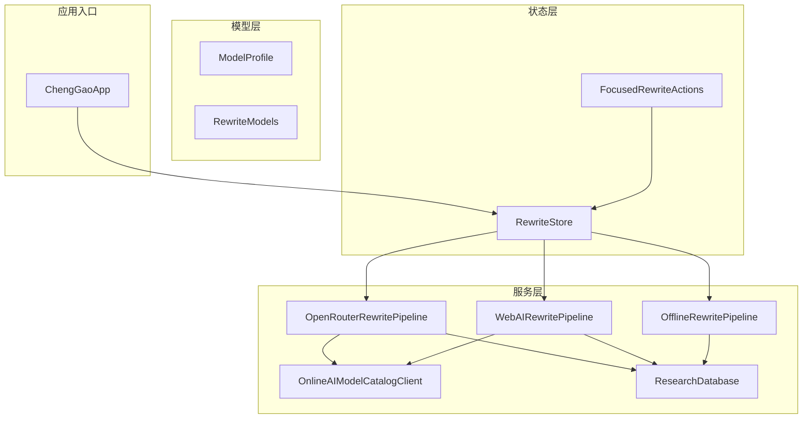
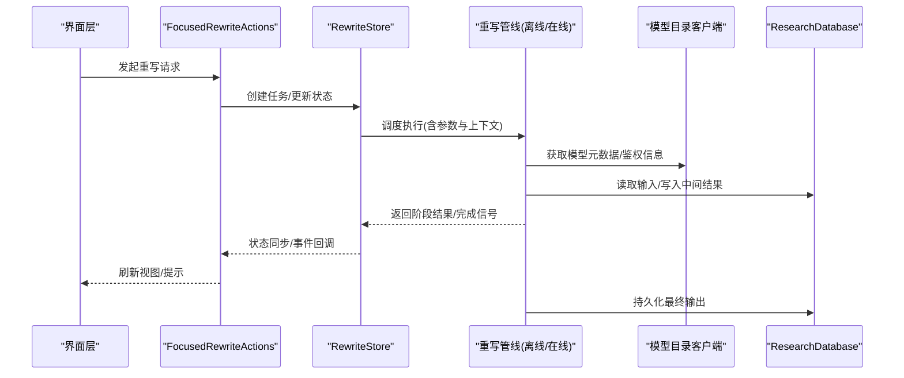
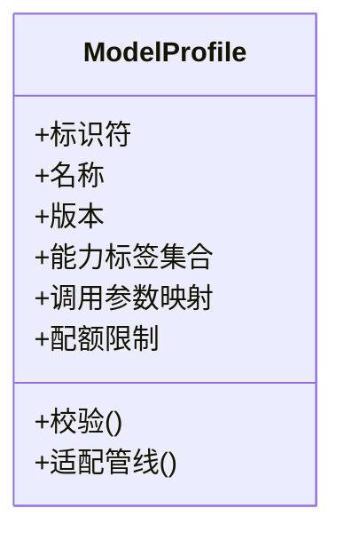
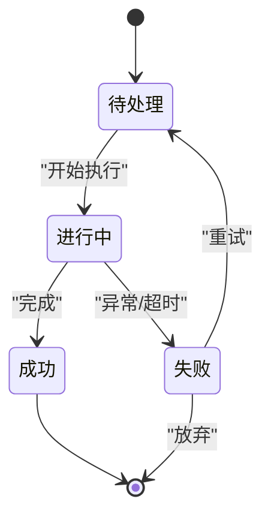
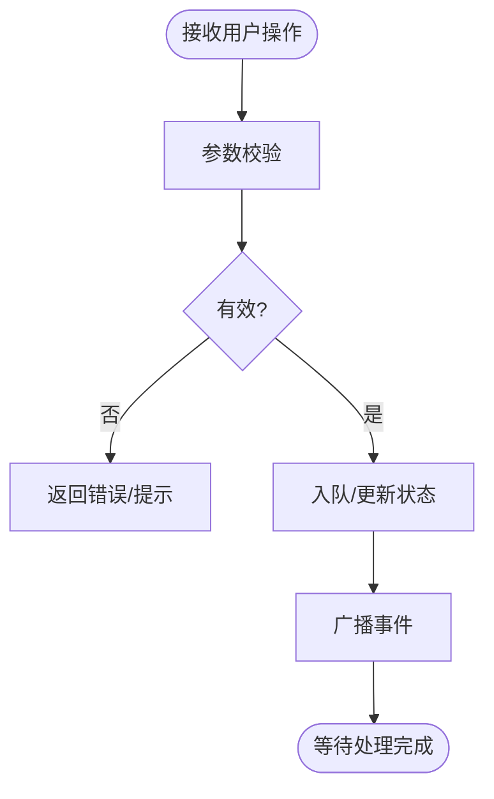
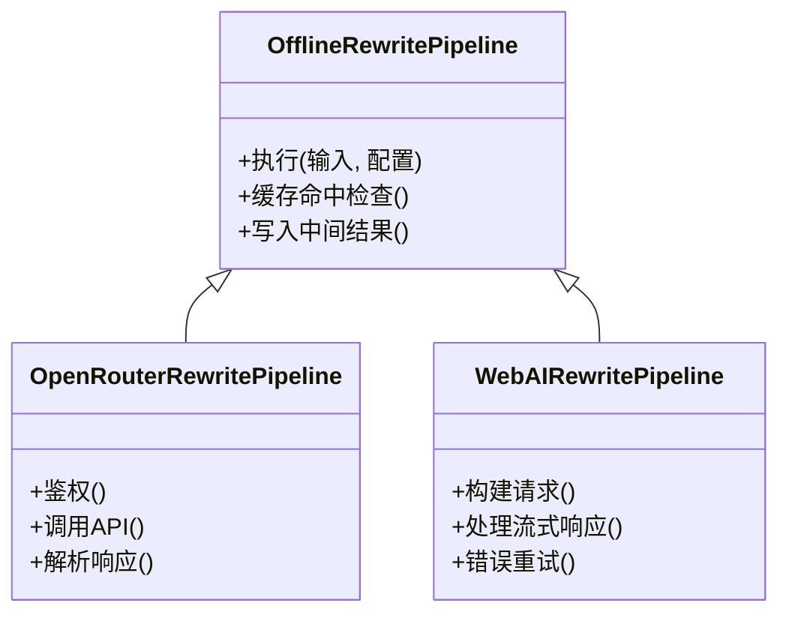
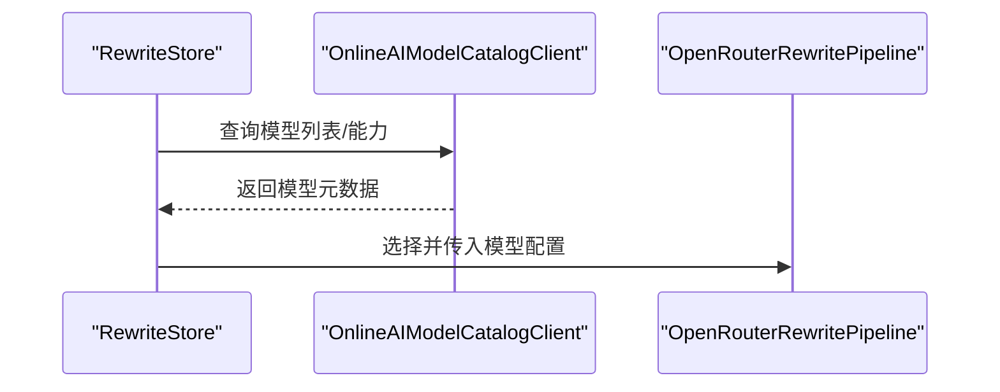
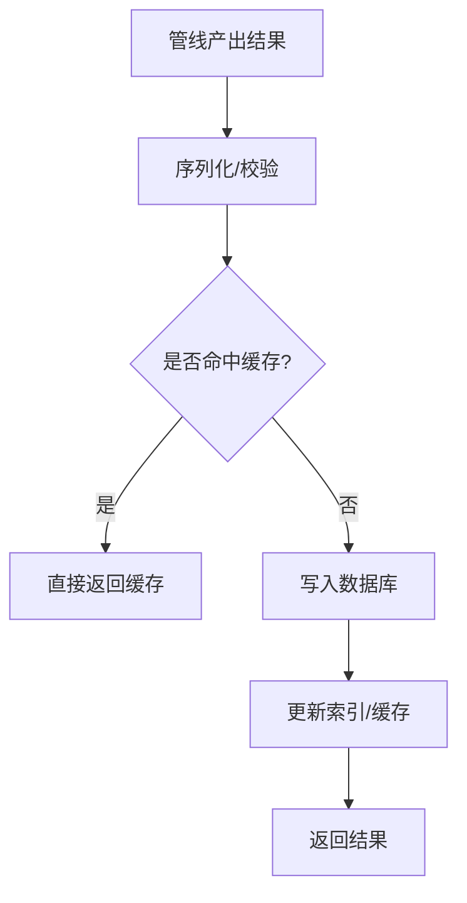
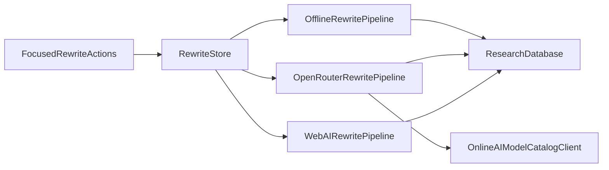

# 数据处理链路

<cite>
**本文引用的文件**   
- [ModelProfile.swift](file://Sources/ChengGao/Models/ModelProfile.swift)
- [RewriteStore.swift](file://Sources/ChengGao/Stores/RewriteStore.swift)
- [FocusedRewriteActions.swift](file://Sources/ChengGao/Support/FocusedRewriteActions.swift)
- [OfflineRewritePipeline.swift](file://Sources/ChengGao/Services/OfflineRewritePipeline.swift)
- [OnlineAIModelCatalogClient.swift](file://Sources/ChengGao/Services/OnlineAIModelCatalogClient.swift)
- [OpenRouterRewritePipeline.swift](file://Sources/ChengGao/Services/OpenRouterRewritePipeline.swift)
- [WebAIRewritePipeline.swift](file://Sources/ChengGao/Services/WebAIRewritePipeline.swift)
- [ResearchDatabase.swift](file://Sources/ChengGao/Services/ResearchDatabase.swift)
- [Package.swift](file://Package.swift)
</cite>

## 目录
1. [简介](#简介)
2. [项目结构](#项目结构)
3. [核心组件](#核心组件)
4. [架构总览](#架构总览)
5. [详细组件分析](#详细组件分析)
6. [依赖关系分析](#依赖关系分析)
7. [性能考量](#性能考量)
8. [故障排查指南](#故障排查指南)
9. [结论](#结论)
10. [附录](#附录)

## 简介
本文件面向“数据处理链路”的端到端说明，覆盖从原始输入到最终输出的完整流程：数据验证、转换、缓存与持久化。重点文档化以下关键对象与机制：
- ModelProfile 的数据模型定义、字段约束与业务规则
- RewriteStore 的状态管理、数据同步与并发处理策略
- FocusedRewriteActions 的操作封装与事件驱动架构
- 离线与在线重写管线（Offline/Online/WebAI）在链路中的角色与协作
- 数据流图、状态转换图与错误处理策略
- 最佳实践与性能优化建议

## 项目结构
本项目采用模块化组织，核心代码位于 Sources/ChengGao 下，按功能分层：
- Models：数据模型与配置（如 ModelProfile、重写相关模型等）
- Services：服务层，包含各类重写管线、数据库访问、外部客户端等
- Stores：状态存储与同步（如 RewriteStore）
- Support：支撑能力（如 FocusedRewriteActions）
- Views：UI 层（不在本文范围）

图表来源
- [Package.swift](file://Package.swift)

章节来源
- [Package.swift](file://Package.swift)

## 核心组件
本节聚焦数据处理链路的核心组件及其职责边界：
- ModelProfile：统一描述模型配置与行为，作为各管线选择与参数化的依据
- RewriteStore：集中管理重写任务的状态、队列与结果，提供线程安全的读写接口
- FocusedRewriteActions：将用户操作封装为可组合的动作，驱动 Store 状态变更并触发后续处理
- 重写管线（Offline/Online/WebAI）：实现具体数据转换逻辑，对接本地或远端 AI 能力
- ResearchDatabase：持久化层，负责写入与查询中间态与结果

章节来源
- [ModelProfile.swift](file://Sources/ChengGao/Models/ModelProfile.swift)
- [RewriteStore.swift](file://Sources/ChengGao/Stores/RewriteStore.swift)
- [FocusedRewriteActions.swift](file://Sources/ChengGao/Support/FocusedRewriteActions.swift)
- [OfflineRewritePipeline.swift](file://Sources/ChengGao/Services/OfflineRewritePipeline.swift)
- [OnlineAIModelCatalogClient.swift](file://Sources/ChengGao/Services/OnlineAIModelCatalogClient.swift)
- [OpenRouterRewritePipeline.swift](file://Sources/ChengGao/Services/OpenRouterRewritePipeline.swift)
- [WebAIRewritePipeline.swift](file://Sources/ChengGao/Services/WebAIRewritePipeline.swift)
- [ResearchDatabase.swift](file://Sources/ChengGao/Services/ResearchDatabase.swift)

## 架构总览
下图展示从输入到输出的端到端数据流，包括验证、转换、缓存与持久化环节。

图表来源
- [RewriteStore.swift](file://Sources/ChengGao/Stores/RewriteStore.swift)
- [FocusedRewriteActions.swift](file://Sources/ChengGao/Support/FocusedRewriteActions.swift)
- [OfflineRewritePipeline.swift](file://Sources/ChengGao/Services/OfflineRewritePipeline.swift)
- [OpenRouterRewritePipeline.swift](file://Sources/ChengGao/Services/OpenRouterRewritePipeline.swift)
- [WebAIRewritePipeline.swift](file://Sources/ChengGao/Services/WebAIRewritePipeline.swift)
- [OnlineAIModelCatalogClient.swift](file://Sources/ChengGao/Services/OnlineAIModelCatalogClient.swift)
- [ResearchDatabase.swift](file://Sources/ChengGao/Services/ResearchDatabase.swift)

## 详细组件分析

### ModelProfile 数据模型与业务规则
- 职责：统一描述模型配置（名称、版本、能力标签、调用参数、配额限制等），供管线选择与校验
- 字段约束：必填字段、格式校验、取值范围、互斥/依赖关系
- 业务规则：不同管线对 ModelProfile 的兼容性要求；默认值与回退策略；多模型切换时的优先级

图表来源
- [ModelProfile.swift](file://Sources/ChengGao/Models/ModelProfile.swift)

章节来源
- [ModelProfile.swift](file://Sources/ChengGao/Models/ModelProfile.swift)

### RewriteStore 状态管理与并发策略
- 状态模型：任务生命周期（待处理/进行中/成功/失败）、进度、错误信息、结果引用
- 数据同步：基于观察者模式的事件通知，保证 UI 与后台处理一致
- 并发策略：任务队列、限流、重试与取消；读写锁或不可变快照确保一致性
- 错误处理：分类错误码、降级策略、用户可见提示

图表来源
- [RewriteStore.swift](file://Sources/ChengGao/Stores/RewriteStore.swift)

章节来源
- [RewriteStore.swift](file://Sources/ChengGao/Stores/RewriteStore.swift)

### FocusedRewriteActions 操作封装与事件驱动
- 操作封装：将用户意图抽象为原子动作（新建、编辑、提交、撤销、重试等）
- 事件驱动：动作触发 Store 状态变更，Store 广播事件，UI 订阅响应
- 幂等性：重复动作不产生副作用；支持事务式批量操作

图表来源
- [FocusedRewriteActions.swift](file://Sources/ChengGao/Support/FocusedRewriteActions.swift)
- [RewriteStore.swift](file://Sources/ChengGao/Stores/RewriteStore.swift)

章节来源
- [FocusedRewriteActions.swift](file://Sources/ChengGao/Support/FocusedRewriteActions.swift)
- [RewriteStore.swift](file://Sources/ChengGao/Stores/RewriteStore.swift)

### 重写管线（离线/在线/WebAI）
- OfflineRewritePipeline：本地模型或脚本处理，低延迟、无网络依赖
- OpenRouterRewritePipeline：通过统一网关调用外部模型，具备鉴权与计费
- WebAIRewritePipeline：基于 Web API 的重写能力，适合复杂文本生成

图表来源
- [OfflineRewritePipeline.swift](file://Sources/ChengGao/Services/OfflineRewritePipeline.swift)
- [OpenRouterRewritePipeline.swift](file://Sources/ChengGao/Services/OpenRouterRewritePipeline.swift)
- [WebAIRewritePipeline.swift](file://Sources/ChengGao/Services/WebAIRewritePipeline.swift)

章节来源
- [OfflineRewritePipeline.swift](file://Sources/ChengGao/Services/OfflineRewritePipeline.swift)
- [OpenRouterRewritePipeline.swift](file://Sources/ChengGao/Services/OpenRouterRewritePipeline.swift)
- [WebAIRewritePipeline.swift](file://Sources/ChengGao/Services/WebAIRewritePipeline.swift)

### 模型目录与鉴权（OnlineAIModelCatalogClient）
- 职责：维护可用模型清单、版本与能力标签，辅助管线选择
- 鉴权：令牌管理、会话保持、错误回退

图表来源
- [OnlineAIModelCatalogClient.swift](file://Sources/ChengGao/Services/OnlineAIModelCatalogClient.swift)
- [OpenRouterRewritePipeline.swift](file://Sources/ChengGao/Services/OpenRouterRewritePipeline.swift)
- [RewriteStore.swift](file://Sources/ChengGao/Stores/RewriteStore.swift)

章节来源
- [OnlineAIModelCatalogClient.swift](file://Sources/ChengGao/Services/OnlineAIModelCatalogClient.swift)
- [OpenRouterRewritePipeline.swift](file://Sources/ChengGao/Services/OpenRouterRewritePipeline.swift)
- [RewriteStore.swift](file://Sources/ChengGao/Stores/RewriteStore.swift)

### 持久化（ResearchDatabase）
- 职责：中间结果、最终输出、任务元数据的增删改查
- 策略：事务、索引优化、批量写入、读写分离（如适用）

图表来源
- [ResearchDatabase.swift](file://Sources/ChengGao/Services/ResearchDatabase.swift)

章节来源
- [ResearchDatabase.swift](file://Sources/ChengGao/Services/ResearchDatabase.swift)

## 依赖关系分析
- Store 依赖 Actions 提供的操作语义，依赖管线进行实际处理
- 管线依赖 Catalog 获取模型信息与鉴权，依赖 Database 进行持久化
- UI 仅依赖 Store 的事件，不直接耦合管线细节

图表来源
- [FocusedRewriteActions.swift](file://Sources/ChengGao/Support/FocusedRewriteActions.swift)
- [RewriteStore.swift](file://Sources/ChengGao/Stores/RewriteStore.swift)
- [OfflineRewritePipeline.swift](file://Sources/ChengGao/Services/OfflineRewritePipeline.swift)
- [OpenRouterRewritePipeline.swift](file://Sources/ChengGao/Services/OpenRouterRewritePipeline.swift)
- [WebAIRewritePipeline.swift](file://Sources/ChengGao/Services/WebAIRewritePipeline.swift)
- [OnlineAIModelCatalogClient.swift](file://Sources/ChengGao/Services/OnlineAIModelCatalogClient.swift)
- [ResearchDatabase.swift](file://Sources/ChengGao/Services/ResearchDatabase.swift)

章节来源
- [RewriteStore.swift](file://Sources/ChengGao/Stores/RewriteStore.swift)
- [FocusedRewriteActions.swift](file://Sources/ChengGao/Support/FocusedRewriteActions.swift)
- [OfflineRewritePipeline.swift](file://Sources/ChengGao/Services/OfflineRewritePipeline.swift)
- [OpenRouterRewritePipeline.swift](file://Sources/ChengGao/Services/OpenRouterRewritePipeline.swift)
- [WebAIRewritePipeline.swift](file://Sources/ChengGao/Services/WebAIRewritePipeline.swift)
- [OnlineAIModelCatalogClient.swift](file://Sources/ChengGao/Services/OnlineAIModelCatalogClient.swift)
- [ResearchDatabase.swift](file://Sources/ChengGao/Services/ResearchDatabase.swift)

## 性能考量
- 缓存策略：对相同输入与配置的管线结果进行缓存，减少重复计算与网络开销
- 批处理与合并：批量写入数据库，合并多次状态更新，降低 I/O 压力
- 异步与背压：使用队列与限流控制并发，避免阻塞主线程
- 增量更新：只更新变化部分，减少 UI 重绘与内存占用
- 资源回收：及时释放临时对象与连接，防止内存泄漏

[本节为通用指导，无需特定文件来源]

## 故障排查指南
- 常见错误分类：
  - 输入校验失败：检查字段约束与业务规则
  - 管线执行异常：查看日志、重试次数与降级路径
  - 鉴权失败：确认令牌有效期与权限范围
  - 数据库写入失败：检查事务与索引，确认磁盘空间
- 定位方法：
  - 通过 Store 的任务 ID 追踪全链路日志
  - 使用 Catalog 的模型清单核对能力匹配
  - 检查缓存键生成规则与命中率
- 恢复策略：
  - 自动重试与指数退避
  - 降级到备用管线或本地模型
  - 清理损坏中间数据并重放

章节来源
- [RewriteStore.swift](file://Sources/ChengGao/Stores/RewriteStore.swift)
- [OnlineAIModelCatalogClient.swift](file://Sources/ChengGao/Services/OnlineAIModelCatalogClient.swift)
- [ResearchDatabase.swift](file://Sources/ChengGao/Services/ResearchDatabase.swift)

## 结论
本链路以 Store 为中心，结合 Actions 的语义化操作与管线的多样化实现，形成可扩展、可观测、可恢复的数据处理体系。通过 ModelProfile 的统一配置、缓存与持久化策略，以及完善的错误处理与性能优化手段，能够在高并发与不稳定网络环境下稳定运行。

[本节为总结性内容，无需特定文件来源]

## 附录
- 术语表：
  - 管线：执行数据转换的具体逻辑单元
  - 任务：一次完整的处理单元，包含输入、配置与结果
  - 缓存：基于输入与配置的中间/最终结果复用
  - 持久化：将结果写入数据库或其他存储介质
- 参考文件：
  - [ModelProfile.swift](file://Sources/ChengGao/Models/ModelProfile.swift)
  - [RewriteStore.swift](file://Sources/ChengGao/Stores/RewriteStore.swift)
  - [FocusedRewriteActions.swift](file://Sources/ChengGao/Support/FocusedRewriteActions.swift)
  - [OfflineRewritePipeline.swift](file://Sources/ChengGao/Services/OfflineRewritePipeline.swift)
  - [OpenRouterRewritePipeline.swift](file://Sources/ChengGao/Services/OpenRouterRewritePipeline.swift)
  - [WebAIRewritePipeline.swift](file://Sources/ChengGao/Services/WebAIRewritePipeline.swift)
  - [OnlineAIModelCatalogClient.swift](file://Sources/ChengGao/Services/OnlineAIModelCatalogClient.swift)
  - [ResearchDatabase.swift](file://Sources/ChengGao/Services/ResearchDatabase.swift)
  - [Package.swift](file://Package.swift)