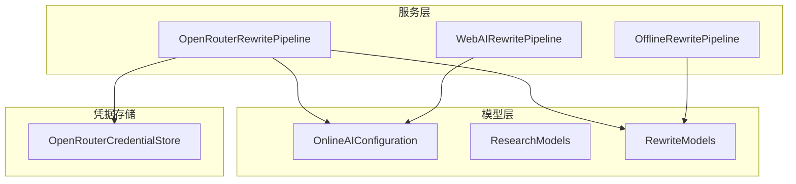
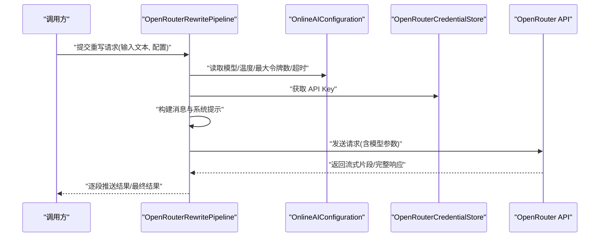
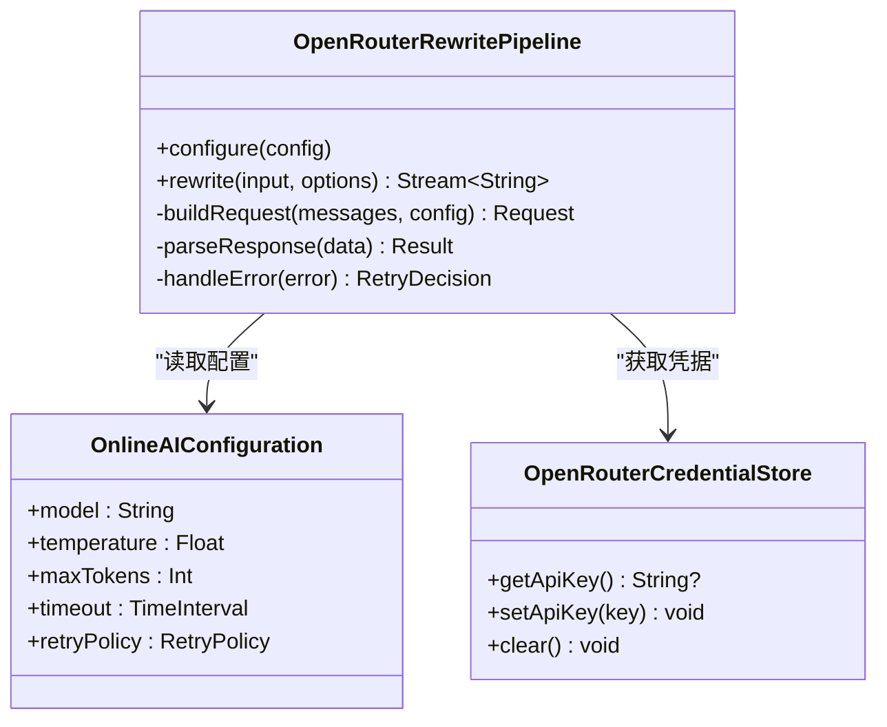
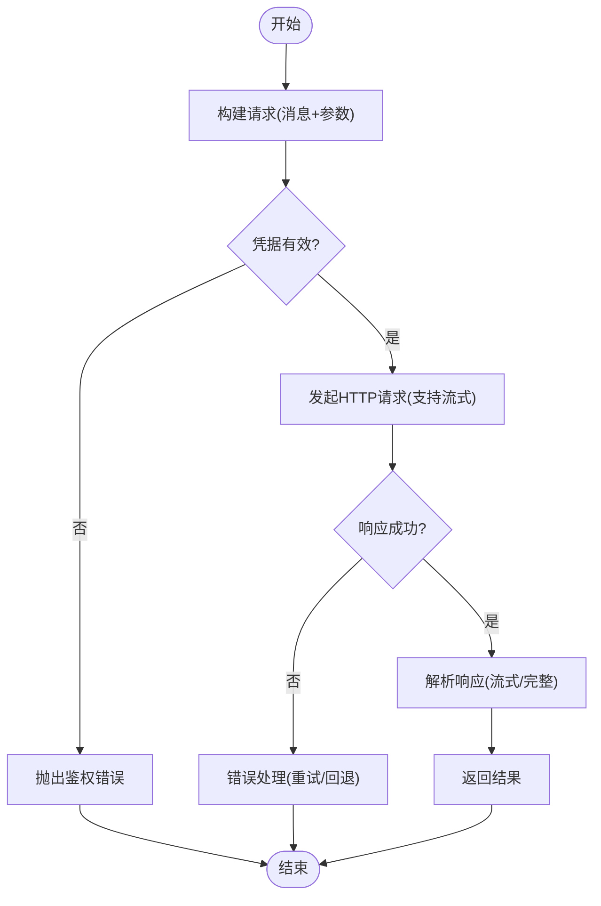
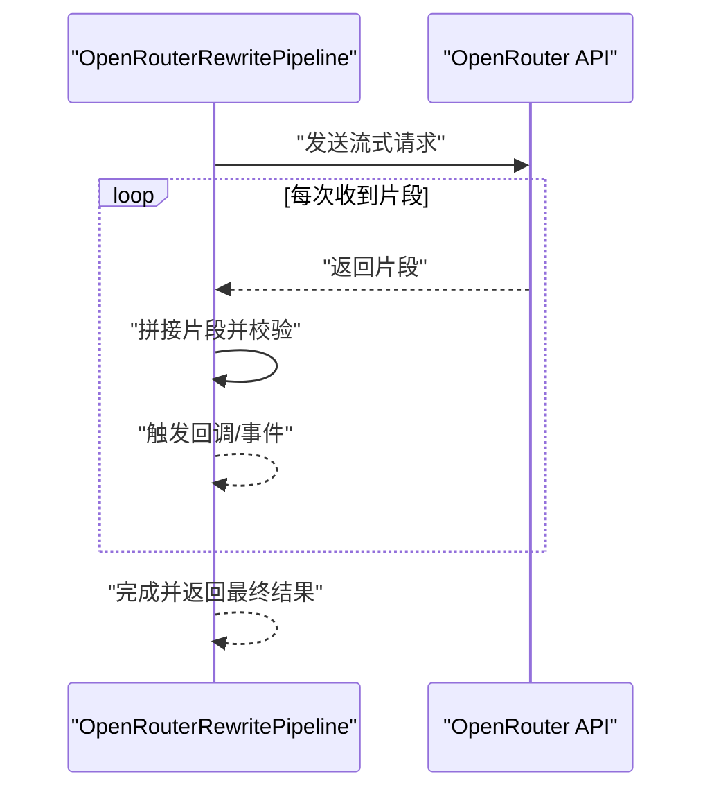
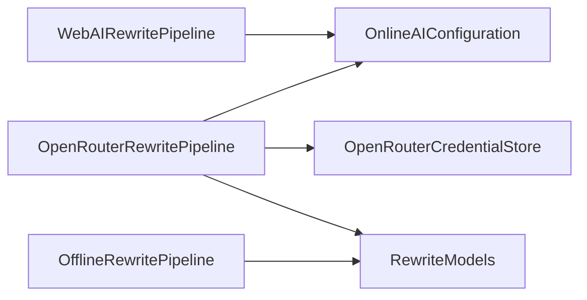

# OpenRouter集成重写管道

<cite>
**本文档引用的文件**   
- [OpenRouterRewritePipeline.swift](file://Sources/ChengGao/Services/OpenRouterRewritePipeline.swift)
- [OpenRouterCredentialStore.swift](file://Sources/ChengGao/Services/OpenRouterCredentialStore.swift)
- [OnlineAIConfiguration.swift](file://Sources/ChengGao/Models/OnlineAIConfiguration.swift)
- [WebAIRewritePipeline.swift](file://Sources/ChengGao/Services/WebAIRewritePipeline.swift)
- [OfflineRewritePipeline.swift](file://Sources/ChengGao/Services/OfflineRewritePipeline.swift)
- [ResearchModels.swift](file://Sources/ChengGao/Models/ResearchModels.swift)
- [RewriteModels.swift](file://Sources/ChengGao/Models/RewriteModels.swift)
- [Package.swift](file://Package.swift)
</cite>

## 目录
1. [简介](#简介)
2. [项目结构](#项目结构)
3. [核心组件](#核心组件)
4. [架构总览](#架构总览)
5. [详细组件分析](#详细组件分析)
6. [依赖关系分析](#依赖关系分析)
7. [性能考量](#性能考量)
8. [故障排查指南](#故障排查指南)
9. [结论](#结论)
10. [附录](#附录)

## 简介
本文件面向需要集成与使用 OpenRouter 的开发者，系统化阐述 OpenRouter 重写管道的实现、路由策略、模型选择机制以及与 OpenRouter API 的交互流程。文档覆盖消息格式转换、流式响应处理、模型配置（温度、最大令牌数、自定义提示模板）、负载均衡、成本控制与速率限制处理，并提供调试与性能监控方法。目标是帮助读者快速理解并高效优化基于 OpenRouter 的重写能力。

## 项目结构
本项目采用 Swift Package Manager 组织代码，核心逻辑位于 Sources/ChengGao/Services 与 Models 目录：
- Services 层包含多种重写管线实现（在线、离线、通用 Web AI）以及 OpenRouter 专用集成。
- Models 层定义在线 AI 配置、研究数据模型与重写相关的数据结构。
- Package.swift 为包入口，声明模块与依赖。

图表来源
- [OpenRouterRewritePipeline.swift](file://Sources/ChengGao/Services/OpenRouterRewritePipeline.swift)
- [WebAIRewritePipeline.swift](file://Sources/ChengGao/Services/WebAIRewritePipeline.swift)
- [OfflineRewritePipeline.swift](file://Sources/ChengGao/Services/OfflineRewritePipeline.swift)
- [OnlineAIConfiguration.swift](file://Sources/ChengGao/Models/OnlineAIConfiguration.swift)
- [ResearchModels.swift](file://Sources/ChengGao/Models/ResearchModels.swift)
- [RewriteModels.swift](file://Sources/ChengGao/Models/RewriteModels.swift)

章节来源
- [Package.swift](file://Package.swift)

## 核心组件
- OpenRouterRewritePipeline：OpenRouter 专用的重写管线，负责将输入文本转换为结构化请求、调用 OpenRouter API、解析响应并支持流式输出。
- OnlineAIConfiguration：集中管理在线 AI 的配置项，如模型名称、温度、最大令牌数、超时、重试策略等。
- OpenRouterCredentialStore：安全地存取 OpenRouter 凭据（例如 API Key），提供访问控制与缓存。
- WebAIRewritePipeline：通用 Web AI 重写管线，可作为对比参考，展示不同后端适配的抽象与差异。
- OfflineRewritePipeline：本地离线重写管线，用于无网络场景或作为降级路径。
- ResearchModels / RewriteModels：研究与重写相关的领域模型，承载输入、输出及中间状态。

章节来源
- [OpenRouterRewritePipeline.swift](file://Sources/ChengGao/Services/OpenRouterRewritePipeline.swift)
- [OnlineAIConfiguration.swift](file://Sources/ChengGao/Models/OnlineAIConfiguration.swift)
- [OpenRouterCredentialStore.swift](file://Sources/ChengGao/Services/OpenRouterCredentialStore.swift)
- [WebAIRewritePipeline.swift](file://Sources/ChengGao/Services/WebAIRewritePipeline.swift)
- [OfflineRewritePipeline.swift](file://Sources/ChengGao/Services/OfflineRewritePipeline.swift)
- [ResearchModels.swift](file://Sources/ChengGao/Models/ResearchModels.swift)
- [RewriteModels.swift](file://Sources/ChengGao/Models/RewriteModels.swift)

## 架构总览
OpenRouter 重写管线的整体架构围绕“配置—凭据—请求构建—API 调用—响应解析—流式输出”展开。OpenRouterRewritePipeline 作为协调者，组合 OnlineAIConfiguration 与 OpenRouterCredentialStore，完成从输入到输出的端到端处理。

图表来源
- [OpenRouterRewritePipeline.swift](file://Sources/ChengGao/Services/OpenRouterRewritePipeline.swift)
- [OnlineAIConfiguration.swift](file://Sources/ChengGao/Models/OnlineAIConfiguration.swift)
- [OpenRouterCredentialStore.swift](file://Sources/ChengGao/Services/OpenRouterCredentialStore.swift)

## 详细组件分析

### OpenRouterRewritePipeline 组件分析
该组件是 OpenRouter 集成的核心，职责包括：
- 根据 OnlineAIConfiguration 生成标准化请求体（模型、温度、最大令牌数、系统/用户消息）。
- 通过 OpenRouterCredentialStore 获取凭据并设置认证头。
- 发起 HTTP 请求，支持流式读取以逐步返回结果。
- 解析响应并转换为内部数据结构，供上层消费。
- 错误处理与重试策略（网络异常、鉴权失败、速率限制等）。

图表来源
- [OpenRouterRewritePipeline.swift](file://Sources/ChengGao/Services/OpenRouterRewritePipeline.swift)
- [OnlineAIConfiguration.swift](file://Sources/ChengGao/Models/OnlineAIConfiguration.swift)
- [OpenRouterCredentialStore.swift](file://Sources/ChengGao/Services/OpenRouterCredentialStore.swift)

章节来源
- [OpenRouterRewritePipeline.swift](file://Sources/ChengGao/Services/OpenRouterRewritePipeline.swift)
- [OnlineAIConfiguration.swift](file://Sources/ChengGao/Models/OnlineAIConfiguration.swift)
- [OpenRouterCredentialStore.swift](file://Sources/ChengGao/Services/OpenRouterCredentialStore.swift)

### 与 OpenRouter API 的交互流程
- 请求构建：将输入文本与系统提示组装为标准消息数组，附加模型参数（模型名、温度、最大令牌数等）。
- 认证：从凭据存储中获取 API Key，并在请求头中设置 Authorization。
- 调用：发起 HTTP 请求，优先尝试流式接口以获得增量输出。
- 解析：对响应进行分块解析，合并为完整结果；遇到错误时按策略重试或回退。

图表来源
- [OpenRouterRewritePipeline.swift](file://Sources/ChengGao/Services/OpenRouterRewritePipeline.swift)

章节来源
- [OpenRouterRewritePipeline.swift](file://Sources/ChengGao/Services/OpenRouterRewritePipeline.swift)

### 消息格式转换与流式响应处理
- 消息格式：统一为系统/用户/助手三类消息，确保与 OpenRouter 兼容。
- 流式处理：通过流式接口逐步接收片段，降低首字节延迟，提升用户体验。
- 拼接与校验：对片段进行顺序拼接，必要时进行完整性校验与截断处理。

图表来源
- [OpenRouterRewritePipeline.swift](file://Sources/ChengGao/Services/OpenRouterRewritePipeline.swift)

章节来源
- [OpenRouterRewritePipeline.swift](file://Sources/ChengGao/Services/OpenRouterRewritePipeline.swift)

### 模型配置、温度参数、最大令牌数与自定义提示模板
- 模型配置：通过 OnlineAIConfiguration 指定模型名称、温度、最大令牌数、超时与重试策略。
- 温度参数：控制创造性与确定性之间的平衡，较低值更稳定，较高值更具多样性。
- 最大令牌数：限制输出长度，避免过长响应导致成本与延迟上升。
- 自定义提示模板：在请求构建阶段注入系统提示与任务指令，提高重写质量与一致性。

章节来源
- [OnlineAIConfiguration.swift](file://Sources/ChengGao/Models/OnlineAIConfiguration.swift)
- [OpenRouterRewritePipeline.swift](file://Sources/ChengGao/Services/OpenRouterRewritePipeline.swift)

### 负载均衡、成本控制与速率限制处理
- 负载均衡：可通过多模型或多区域端点轮询，结合健康检查与失败回退，提升可用性。
- 成本控制：依据模型价格与令牌用量统计，动态调整最大令牌数与采样策略，控制成本上限。
- 速率限制：检测 429 等状态码，实施指数退避与队列限流，避免频繁重试造成雪崩。

章节来源
- [OpenRouterRewritePipeline.swift](file://Sources/ChengGao/Services/OpenRouterRewritePipeline.swift)
- [OnlineAIConfiguration.swift](file://Sources/ChengGao/Models/OnlineAIConfiguration.swift)

### 与 WebAIRewritePipeline 和 OfflineRewritePipeline 的关系
- WebAIRewritePipeline：通用 Web AI 重写管线，适用于多种在线后端，可作为 OpenRouter 实现的对照。
- OfflineRewritePipeline：本地离线重写管线，用于无网络或低延迟场景，也可作为降级路径。
- 三者共享部分模型与配置抽象，便于统一接入与切换。

章节来源
- [WebAIRewritePipeline.swift](file://Sources/ChengGao/Services/WebAIRewritePipeline.swift)
- [OfflineRewritePipeline.swift](file://Sources/ChengGao/Services/OfflineRewritePipeline.swift)
- [ResearchModels.swift](file://Sources/ChengGao/Models/ResearchModels.swift)
- [RewriteModels.swift](file://Sources/ChengGao/Models/RewriteModels.swift)

## 依赖关系分析
OpenRouter 重写管线依赖配置与凭据存储，同时与在线/离线重写管线共享领域模型。依赖关系如下：

图表来源
- [OpenRouterRewritePipeline.swift](file://Sources/ChengGao/Services/OpenRouterRewritePipeline.swift)
- [OnlineAIConfiguration.swift](file://Sources/ChengGao/Models/OnlineAIConfiguration.swift)
- [OpenRouterCredentialStore.swift](file://Sources/ChengGao/Services/OpenRouterCredentialStore.swift)
- [WebAIRewritePipeline.swift](file://Sources/ChengGao/Services/WebAIRewritePipeline.swift)
- [OfflineRewritePipeline.swift](file://Sources/ChengGao/Services/OfflineRewritePipeline.swift)
- [RewriteModels.swift](file://Sources/ChengGao/Models/RewriteModels.swift)

章节来源
- [OpenRouterRewritePipeline.swift](file://Sources/ChengGao/Services/OpenRouterRewritePipeline.swift)
- [OnlineAIConfiguration.swift](file://Sources/ChengGao/Models/OnlineAIConfiguration.swift)
- [OpenRouterCredentialStore.swift](file://Sources/ChengGao/Services/OpenRouterCredentialStore.swift)
- [WebAIRewritePipeline.swift](file://Sources/ChengGao/Services/WebAIRewritePipeline.swift)
- [OfflineRewritePipeline.swift](file://Sources/ChengGao/Services/OfflineRewritePipeline.swift)
- [RewriteModels.swift](file://Sources/ChengGao/Models/RewriteModels.swift)

## 性能考量
- 流式输出：优先使用流式接口以降低首字节延迟，提升交互体验。
- 连接复用：保持 HTTP 连接池，减少握手开销。
- 批处理与缓存：对相似请求进行去重与缓存，降低重复调用成本。
- 资源限制：合理设置超时与最大令牌数，避免长尾请求占用过多资源。
- 监控指标：记录请求耗时、成功率、错误分布与令牌用量，辅助调优。

[本节为通用指导，不直接分析具体文件]

## 故障排查指南
- 鉴权失败：检查 OpenRouterCredentialStore 中的 API Key 是否有效且未过期。
- 速率限制：捕获 429 状态码，启用指数退避与队列限流，观察重试次数。
- 超时与网络异常：增加超时阈值或切换备用端点，记录网络错误详情。
- 响应不完整：校验流式拼接完整性，必要时进行分段重试与补全。
- 日志与调试：开启详细日志，记录请求参数、响应片段与错误堆栈，定位问题根因。

章节来源
- [OpenRouterRewritePipeline.swift](file://Sources/ChengGao/Services/OpenRouterRewritePipeline.swift)
- [OpenRouterCredentialStore.swift](file://Sources/ChengGao/Services/OpenRouterCredentialStore.swift)

## 结论
OpenRouter 重写管道通过清晰的配置与凭据管理、标准化的消息格式与流式响应处理，实现了高性能、可观测与可扩展的重写能力。结合负载均衡、成本控制与速率限制策略，可在复杂生产环境中稳定运行。建议持续完善监控与调试工具，优化提示模板与模型选择，以提升重写质量与用户体验。

[本节为总结性内容，不直接分析具体文件]

## 附录
- 配置示例要点：
  - 设置模型名称、温度、最大令牌数与超时时间。
  - 初始化 OpenRouterCredentialStore 并保存 API Key。
  - 构建系统提示与用户消息，调用 OpenRouterRewritePipeline 的 rewrite 方法。
- 优化建议：
  - 根据业务需求调整温度与最大令牌数以平衡质量与成本。
  - 使用流式输出提升实时性，配合前端增量渲染。
  - 引入重试与回退策略，增强鲁棒性。

[本节为补充说明，不直接分析具体文件]