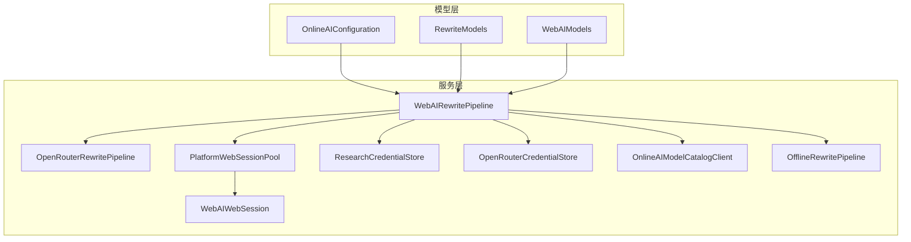
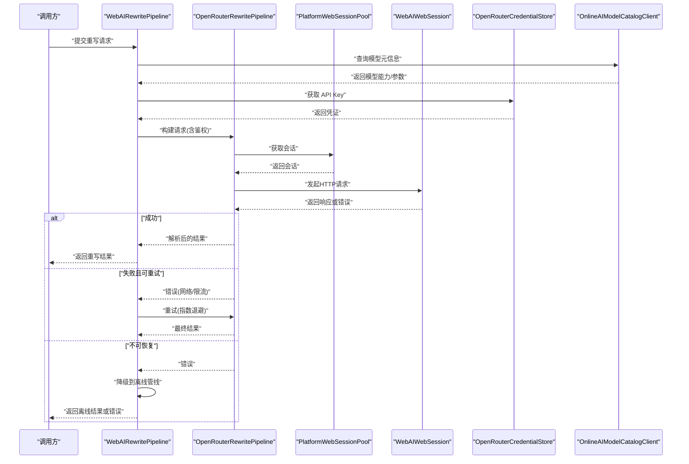
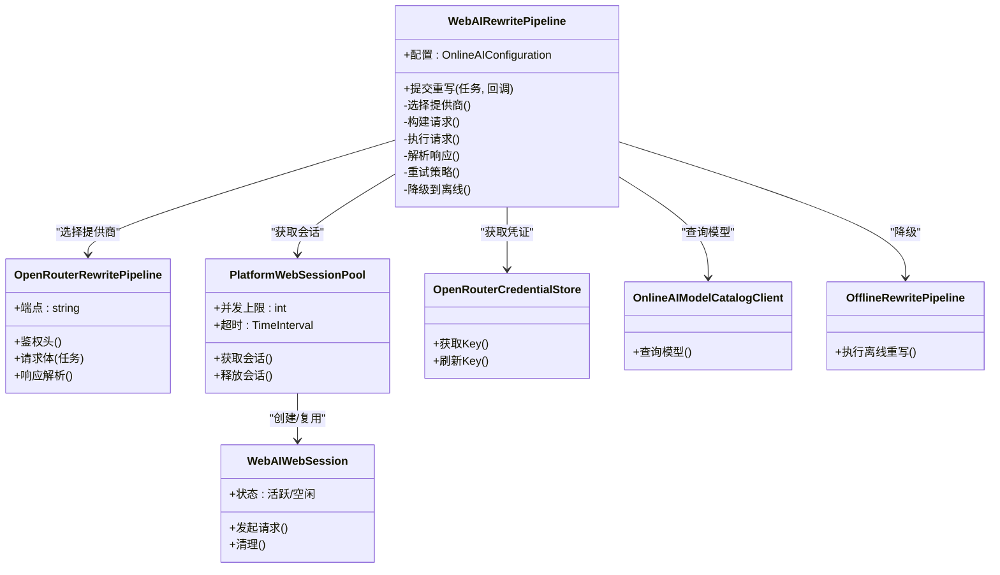
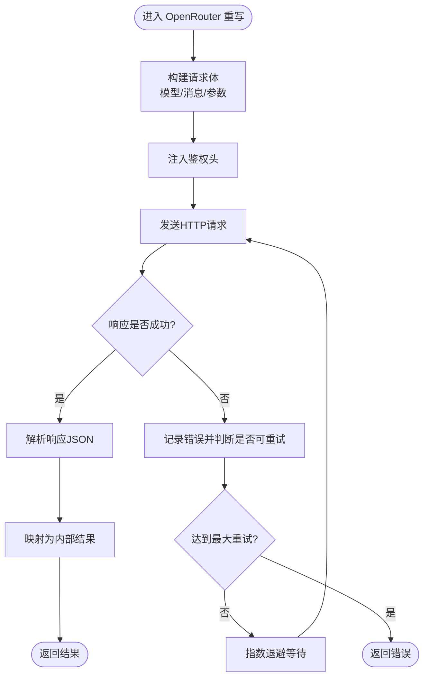
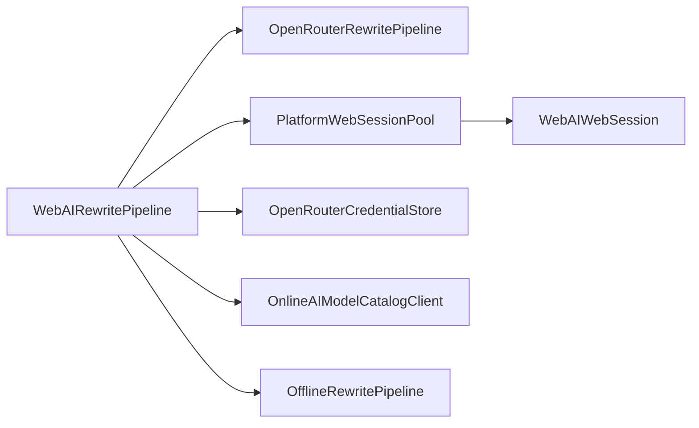

# 在线AI重写管道

<cite>
**本文引用的文件**   
- [WebAIRewritePipeline.swift](file://Sources/ChengGao/Services/WebAIRewritePipeline.swift)
- [OpenRouterRewritePipeline.swift](file://Sources/ChengGao/Services/OpenRouterRewritePipeline.swift)
- [OnlineAIConfiguration.swift](file://Sources/ChengGao/Models/OnlineAIConfiguration.swift)
- [ResearchCredentialStore.swift](file://Sources/ChengGao/Services/ResearchCredentialStore.swift)
- [OpenRouterCredentialStore.swift](file://Sources/ChengGao/Services/OpenRouterCredentialStore.swift)
- [PlatformWebSessionPool.swift](file://Sources/ChengGao/Services/PlatformWebSessionPool.swift)
- [WebAIWebSession.swift](file://Sources/ChengGao/Services/WebAIWebSession.swift)
- [OnlineAIModelCatalogClient.swift](file://Sources/ChengGao/Services/OnlineAIModelCatalogClient.swift)
- [OfflineRewritePipeline.swift](file://Sources/ChengGao/Services/OfflineRewritePipeline.swift)
- [RewriteModels.swift](file://Sources/ChengGao/Models/RewriteModels.swift)
- [WebAIModels.swift](file://Sources/ChengGao/Models/WebAIModels.swift)
</cite>

## 目录
1. [简介](#简介)
2. [项目结构](#项目结构)
3. [核心组件](#核心组件)
4. [架构总览](#架构总览)
5. [详细组件分析](#详细组件分析)
6. [依赖关系分析](#依赖关系分析)
7. [性能考虑](#性能考虑)
8. [故障排查指南](#故障排查指南)
9. [结论](#结论)
10. [附录](#附录)

## 简介
本文件面向在线 AI 重写管道的实现与使用，重点覆盖 WebAIRewritePipeline 的网络请求处理、API 集成机制与错误重试策略。文档将详细说明支持的 AI 服务提供商（如 OpenRouter）、认证方式、请求格式与响应解析流程；并给出网络配置、超时设置、并发控制与缓存策略的说明。同时提供如何配置不同 AI 服务、发送重写请求、处理异步响应的实践指引，以及网络异常处理、降级策略与服务选择逻辑。最后包含 API 密钥管理与安全最佳实践建议。

## 项目结构
本项目采用按功能域组织源码的方式，核心在线重写能力位于 Services 与 Models 目录：
- Services：封装网络会话、凭证存储、模型目录客户端、离线/在线重写管线等。
- Models：定义在线 AI 配置、重写数据模型、Web AI 通用模型等。

图表来源
- [WebAIRewritePipeline.swift](file://Sources/ChengGao/Services/WebAIRewritePipeline.swift)
- [OpenRouterRewritePipeline.swift](file://Sources/ChengGao/Services/OpenRouterRewritePipeline.swift)
- [PlatformWebSessionPool.swift](file://Sources/ChengGao/Services/PlatformWebSessionPool.swift)
- [WebAIWebSession.swift](file://Sources/ChengGao/Services/WebAIWebSession.swift)
- [ResearchCredentialStore.swift](file://Sources/ChengGao/Services/ResearchCredentialStore.swift)
- [OpenRouterCredentialStore.swift](file://Sources/ChengGao/Services/OpenRouterCredentialStore.swift)
- [OnlineAIModelCatalogClient.swift](file://Sources/ChengGao/Services/OnlineAIModelCatalogClient.swift)
- [OfflineRewritePipeline.swift](file://Sources/ChengGao/Services/OfflineRewritePipeline.swift)
- [OnlineAIConfiguration.swift](file://Sources/ChengGao/Models/OnlineAIConfiguration.swift)
- [RewriteModels.swift](file://Sources/ChengGao/Models/RewriteModels.swift)
- [WebAIModels.swift](file://Sources/ChengGao/Models/WebAIModels.swift)

章节来源
- [WebAIRewritePipeline.swift](file://Sources/ChengGao/Services/WebAIRewritePipeline.swift)
- [OpenRouterRewritePipeline.swift](file://Sources/ChengGao/Services/OpenRouterRewritePipeline.swift)
- [OnlineAIConfiguration.swift](file://Sources/ChengGao/Models/OnlineAIConfiguration.swift)
- [ResearchCredentialStore.swift](file://Sources/ChengGao/Services/ResearchCredentialStore.swift)
- [OpenRouterCredentialStore.swift](file://Sources/ChengGao/Services/OpenRouterCredentialStore.swift)
- [PlatformWebSessionPool.swift](file://Sources/ChengGao/Services/PlatformWebWebSessionPool.swift)
- [WebAIWebSession.swift](file://Sources/ChengGao/Services/WebAIWebSession.swift)
- [OnlineAIModelCatalogClient.swift](file://Sources/ChengGao/Services/OnlineAIModelCatalogClient.swift)
- [OfflineRewritePipeline.swift](file://Sources/ChengGao/Services/OfflineRewritePipeline.swift)
- [RewriteModels.swift](file://Sources/ChengGao/Models/RewriteModels.swift)
- [WebAIModels.swift](file://Sources/ChengGao/Models/WebAIModels.swift)

## 核心组件
- WebAIRewritePipeline：在线重写的统一入口，负责编排网络会话、凭证获取、请求构建、重试与降级、结果解析与回调。
- OpenRouterRewritePipeline：针对 OpenRouter 的具体实现，包括端点、鉴权头、请求体结构与响应解析。
- PlatformWebSessionPool：平台级 HTTP 会话池，管理连接复用、并发上限与超时。
- WebAIWebSession：单次会话封装，持有请求上下文、Cookie/Token 状态与生命周期。
- ResearchCredentialStore / OpenRouterCredentialStore：凭证存储，支持加密持久化与按需加载。
- OnlineAIModelCatalogClient：模型目录查询，用于动态发现可用模型与参数。
- OfflineRewritePipeline：本地离线重写实现，作为在线失败时的降级路径。
- OnlineAIConfiguration：在线 AI 服务的配置项（提供商、模型、超时、并发、缓存开关等）。
- RewriteModels / WebAIModels：重写任务与 Web AI 交互的数据模型。

章节来源
- [WebAIRewritePipeline.swift](file://Sources/ChengGao/Services/WebAIRewritePipeline.swift)
- [OpenRouterRewritePipeline.swift](file://Sources/ChengGao/Services/OpenRouterRewritePipeline.swift)
- [PlatformWebSessionPool.swift](file://Sources/ChengGao/Services/PlatformWebSessionPool.swift)
- [WebAIWebSession.swift](file://Sources/ChengGao/Services/WebAIWebSession.swift)
- [ResearchCredentialStore.swift](file://Sources/ChengGao/Services/ResearchCredentialStore.swift)
- [OpenRouterCredentialStore.swift](file://Sources/ChengGao/Services/OpenRouterCredentialStore.swift)
- [OnlineAIModelCatalogClient.swift](file://Sources/ChengGao/Services/OnlineAIModelCatalogClient.swift)
- [OfflineRewritePipeline.swift](file://Sources/ChengGao/Services/OfflineRewritePipeline.swift)
- [OnlineAIConfiguration.swift](file://Sources/ChengGao/Models/OnlineAIConfiguration.swift)
- [RewriteModels.swift](file://Sources/ChengGao/Models/RewriteModels.swift)
- [WebAIModels.swift](file://Sources/ChengGao/Models/WebAIModels.swift)

## 架构总览
在线重写管道以“统一入口 + 多提供商适配”的模式组织。WebAIRewritePipeline 根据配置选择具体提供商（如 OpenRouter），通过会话池建立连接，构造标准化请求，调用提供商接口，解析响应并回传结果。若失败则触发重试与降级到离线管线。

图表来源
- [WebAIRewritePipeline.swift](file://Sources/ChengGao/Services/WebAIRewritePipeline.swift)
- [OpenRouterRewritePipeline.swift](file://Sources/ChengGao/Services/OpenRouterRewritePipeline.swift)
- [PlatformWebSessionPool.swift](file://Sources/ChengGao/Services/PlatformWebSessionPool.swift)
- [WebAIWebSession.swift](file://Sources/ChengGao/Services/WebAIWebSession.swift)
- [OpenRouterCredentialStore.swift](file://Sources/ChengGao/Services/OpenRouterCredentialStore.swift)
- [OnlineAIModelCatalogClient.swift](file://Sources/ChengGao/Services/OnlineAIModelCatalogClient.swift)
- [OfflineRewritePipeline.swift](file://Sources/ChengGao/Services/OfflineRewritePipeline.swift)

## 详细组件分析

### WebAIRewritePipeline 组件分析
职责与流程
- 接收重写任务，校验输入参数与配置。
- 根据配置选择提供商（默认 OpenRouter），必要时查询模型目录。
- 从凭证存储获取 API Key，构建标准化请求。
- 通过会话池获取会话，执行网络请求。
- 解析响应，处理错误并执行重试策略（指数退避、最大重试次数）。
- 失败时降级到离线重写管线，保证可用性。

关键设计要点
- 统一抽象：屏蔽不同提供商差异，对外暴露一致接口。
- 可插拔提供商：新增提供商只需实现对应适配器。
- 幂等与重试：对可重试错误进行受控重试，避免雪崩。
- 降级策略：在线失败自动切换离线，保障用户体验。

图表来源
- [WebAIRewritePipeline.swift](file://Sources/ChengGao/Services/WebAIRewritePipeline.swift)
- [OpenRouterRewritePipeline.swift](file://Sources/ChengGao/Services/OpenRouterRewritePipeline.swift)
- [PlatformWebSessionPool.swift](file://Sources/ChengGao/Services/PlatformWebSessionPool.swift)
- [WebAIWebSession.swift](file://Sources/ChengGao/Services/WebAIWebSession.swift)
- [OpenRouterCredentialStore.swift](file://Sources/ChengGao/Services/OpenRouterCredentialStore.swift)
- [OnlineAIModelCatalogClient.swift](file://Sources/ChengGao/Services/OnlineAIModelCatalogClient.swift)
- [OfflineRewritePipeline.swift](file://Sources/ChengGao/Services/OfflineRewritePipeline.swift)

章节来源
- [WebAIRewritePipeline.swift](file://Sources/ChengGao/Services/WebAIRewritePipeline.swift)

### OpenRouterRewritePipeline 组件分析
职责与流程
- 维护 OpenRouter 的端点与鉴权方式（通常为 Bearer Token）。
- 将标准重写任务转换为 OpenRouter 的请求体（模型名、消息内容、参数等）。
- 解析 OpenRouter 的响应（文本生成、流式输出等）并映射为内部模型。

关键设计要点
- 鉴权头注入：从凭证存储读取 Key 并注入 Authorization 头。
- 请求体映射：将内部任务字段映射到提供商要求的字段。
- 响应解析：处理 JSON 结构，提取生成内容与元数据。

图表来源
- [OpenRouterRewritePipeline.swift](file://Sources/ChengGao/Services/OpenRouterRewritePipeline.swift)

章节来源
- [OpenRouterRewritePipeline.swift](file://Sources/ChengGao/Services/OpenRouterRewritePipeline.swift)

### 网络会话与会话池
- PlatformWebSessionPool：管理 HTTP 会话的生命周期，限制并发数，复用连接，设置超时与重试。
- WebAIWebSession：封装单次会话的状态与请求方法，确保资源释放。

章节来源
- [PlatformWebSessionPool.swift](file://Sources/ChengGao/Services/PlatformWebSessionPool.swift)
- [WebAIWebSession.swift](file://Sources/ChengGao/Services/WebAIWebSession.swift)

### 凭证存储
- ResearchCredentialStore / OpenRouterCredentialStore：提供 API Key 的安全存取，支持加密与刷新。

章节来源
- [ResearchCredentialStore.swift](file://Sources/ChengGao/Services/ResearchCredentialStore.swift)
- [OpenRouterCredentialStore.swift](file://Sources/ChengGao/Services/OpenRouterCredentialStore.swift)

### 模型目录客户端
- OnlineAIModelCatalogClient：查询在线模型的元数据（名称、能力、参数范围），辅助选择合适模型。

章节来源
- [OnlineAIModelCatalogClient.swift](file://Sources/ChengGao/Services/OnlineAIModelCatalogClient.swift)

### 离线降级
- OfflineRewritePipeline：当在线服务不可用时，提供本地重写能力，保证基本功能可用。

章节来源
- [OfflineRewritePipeline.swift](file://Sources/ChengGao/Services/OfflineRewritePipeline.swift)

### 数据模型
- OnlineAIConfiguration：在线 AI 的配置项（提供商、模型、超时、并发、缓存开关等）。
- RewriteModels / WebAIModels：重写任务与 Web AI 交互的数据结构。

章节来源
- [OnlineAIConfiguration.swift](file://Sources/ChengGao/Models/OnlineAIConfiguration.swift)
- [RewriteModels.swift](file://Sources/ChengGao/Models/RewriteModels.swift)
- [WebAIModels.swift](file://Sources/ChengGao/Models/WebAIModels.swift)

## 依赖关系分析
- WebAIRewritePipeline 依赖 OpenRouterRewritePipeline 完成具体提供商调用。
- 通过 PlatformWebSessionPool 与 WebAIWebSession 管理网络资源。
- 通过 CredentialStore 获取鉴权信息。
- 通过 ModelCatalogClient 获取模型能力。
- 失败时降级到 OfflineRewritePipeline。

图表来源
- [WebAIRewritePipeline.swift](file://Sources/ChengGao/Services/WebAIRewritePipeline.swift)
- [OpenRouterRewritePipeline.swift](file://Sources/ChengGao/Services/OpenRouterRewritePipeline.swift)
- [PlatformWebSessionPool.swift](file://Sources/ChengGao/Services/PlatformWebSessionPool.swift)
- [WebAIWebSession.swift](file://Sources/ChengGao/Services/WebAIWebSession.swift)
- [OpenRouterCredentialStore.swift](file://Sources/ChengGao/Services/OpenRouterCredentialStore.swift)
- [OnlineAIModelCatalogClient.swift](file://Sources/ChengGao/Services/OnlineAIModelCatalogClient.swift)
- [OfflineRewritePipeline.swift](file://Sources/ChengGao/Services/OfflineRewritePipeline.swift)

章节来源
- [WebAIRewritePipeline.swift](file://Sources/ChengGao/Services/WebAIRewritePipeline.swift)
- [OpenRouterRewritePipeline.swift](file://Sources/ChengGao/Services/OpenRouterRewritePipeline.swift)
- [PlatformWebSessionPool.swift](file://Sources/ChengGao/Services/PlatformWebSessionPool.swift)
- [WebAIWebSession.swift](file://Sources/ChengGao/Services/WebAIWebSession.swift)
- [OpenRouterCredentialStore.swift](file://Sources/ChengGao/Services/OpenRouterCredentialStore.swift)
- [OnlineAIModelCatalogClient.swift](file://Sources/ChengGao/Services/OnlineAIModelCatalogClient.swift)
- [OfflineRewritePipeline.swift](file://Sources/ChengGao/Services/OfflineRewritePipeline.swift)

## 性能考虑
- 会话复用：通过 PlatformWebSessionPool 复用 TCP 连接，减少握手开销。
- 并发控制：限制并发请求数，避免服务端限流与本地资源耗尽。
- 超时设置：合理设置连接、读写超时，快速失败并释放资源。
- 重试策略：指数退避与最大重试次数，避免抖动放大。
- 缓存策略：对相同请求的响应进行短期缓存，降低重复请求压力。
- 流式响应：支持流式解析，提升首字节延迟体验。

[本节为通用性能指导，不直接分析具体文件]

## 故障排查指南
常见问题与定位步骤
- 鉴权失败：检查 OpenRouterCredentialStore 中 Key 是否正确、是否过期。
- 网络超时：确认 PlatformWebSessionPool 的超时配置与网络环境。
- 限流错误：观察重试间隔与最大重试次数，必要时调整并发与退避策略。
- 模型不可用：通过 OnlineAIModelCatalogClient 查询模型状态与参数范围。
- 降级触发：确认在线服务错误类型，验证 OfflineRewritePipeline 是否正常工作。

章节来源
- [OpenRouterCredentialStore.swift](file://Sources/ChengGao/Services/OpenRouterCredentialStore.swift)
- [PlatformWebSessionPool.swift](file://Sources/ChengGao/Services/PlatformWebSessionPool.swift)
- [OnlineAIModelCatalogClient.swift](file://Sources/ChengGao/Services/OnlineAIModelCatalogClient.swift)
- [OfflineRewritePipeline.swift](file://Sources/ChengGao/Services/OfflineRewritePipeline.swift)

## 结论
在线 AI 重写管道通过统一的 WebAIRewritePipeline 编排网络请求、鉴权、重试与降级，结合 OpenRouter 提供商适配与平台级会话池，实现了高可用、可扩展的重写能力。合理的网络配置、并发控制与缓存策略能显著提升性能与稳定性。建议在部署时严格管理 API 密钥，启用最小权限原则，并结合监控与日志完善排障能力。

[本节为总结性内容，不直接分析具体文件]

## 附录

### 支持的 AI 服务提供商与认证方式
- OpenRouter：使用 Bearer Token 鉴权，Authorization 头携带 API Key。
- 其他提供商：可通过实现对应适配器接入，遵循统一请求/响应映射规范。

章节来源
- [OpenRouterRewritePipeline.swift](file://Sources/ChengGao/Services/OpenRouterRewritePipeline.swift)
- [OpenRouterCredentialStore.swift](file://Sources/ChengGao/Services/OpenRouterCredentialStore.swift)

### 请求格式与响应解析
- 请求体：包含模型名、消息内容、温度等参数，需映射到提供商要求格式。
- 响应解析：提取生成文本与元数据，处理流式与非流式响应。

章节来源
- [OpenRouterRewritePipeline.swift](file://Sources/ChengGao/Services/OpenRouterRewritePipeline.swift)
- [WebAIModels.swift](file://Sources/ChengGao/Models/WebAIModels.swift)

### 网络配置、超时设置、并发控制与缓存策略
- 超时：连接超时、读超时、写超时分别配置，避免长时间阻塞。
- 并发：限制最大并发请求数，防止过载。
- 缓存：对相同请求的响应进行短期缓存，提高命中率。

章节来源
- [PlatformWebSessionPool.swift](file://Sources/ChengGao/Services/PlatformWebSessionPool.swift)
- [OnlineAIConfiguration.swift](file://Sources/ChengGao/Models/OnlineAIConfiguration.swift)

### 配置示例与实践指引
- 配置不同的 AI 服务：在 OnlineAIConfiguration 中设置提供商、模型、超时、并发、缓存开关。
- 发送重写请求：通过 WebAIRewritePipeline 提交任务，监听回调获取结果。
- 处理异步响应：支持流式或非流式回调，及时更新 UI 或后续处理。

章节来源
- [OnlineAIConfiguration.swift](file://Sources/ChengGao/Models/OnlineAIConfiguration.swift)
- [WebAIRewritePipeline.swift](file://Sources/ChengGao/Services/WebAIRewritePipeline.swift)

### 网络异常处理、降级策略与服务选择逻辑
- 异常分类：网络错误、鉴权错误、限流错误、服务端错误。
- 重试策略：指数退避、最大重试次数、退避上限。
- 降级策略：在线失败自动切换到离线管线，保证基础功能可用。
- 服务选择：根据模型目录与配置选择最优提供商与模型。

章节来源
- [WebAIRewritePipeline.swift](file://Sources/ChengGao/Services/WebAIRewritePipeline.swift)
- [OfflineRewritePipeline.swift](file://Sources/ChengGao/Services/OfflineRewritePipeline.swift)
- [OnlineAIModelCatalogClient.swift](file://Sources/ChengGao/Services/OnlineAIModelCatalogClient.swift)

### API 密钥管理与安全最佳实践
- 存储：使用加密存储（如 Keychain），避免明文保存。
- 权限：最小权限原则，仅授予必要访问权限。
- 轮换：定期轮换 API Key，缩短泄露影响窗口。
- 审计：记录密钥访问日志，便于追踪与审计。

章节来源
- [OpenRouterCredentialStore.swift](file://Sources/ChengGao/Services/OpenRouterCredentialStore.swift)
- [ResearchCredentialStore.swift](file://Sources/ChengGao/Services/ResearchCredentialStore.swift)