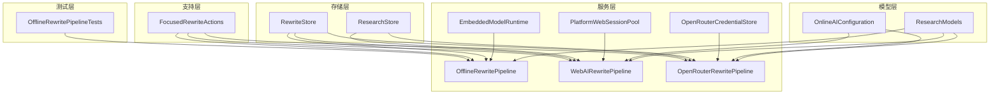
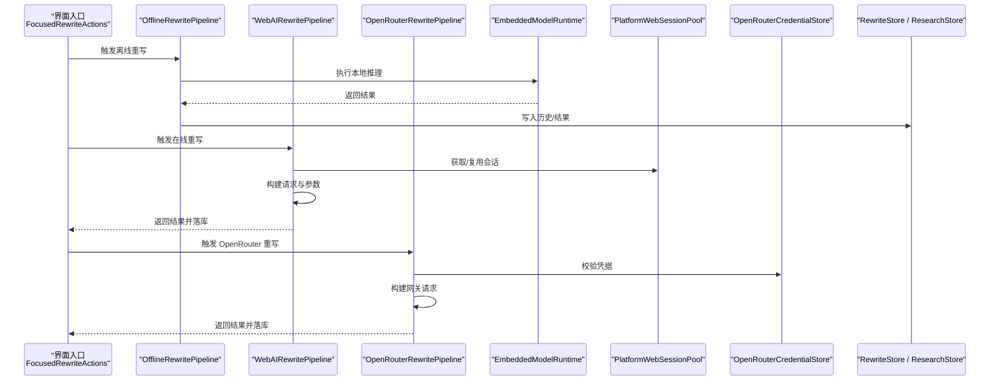
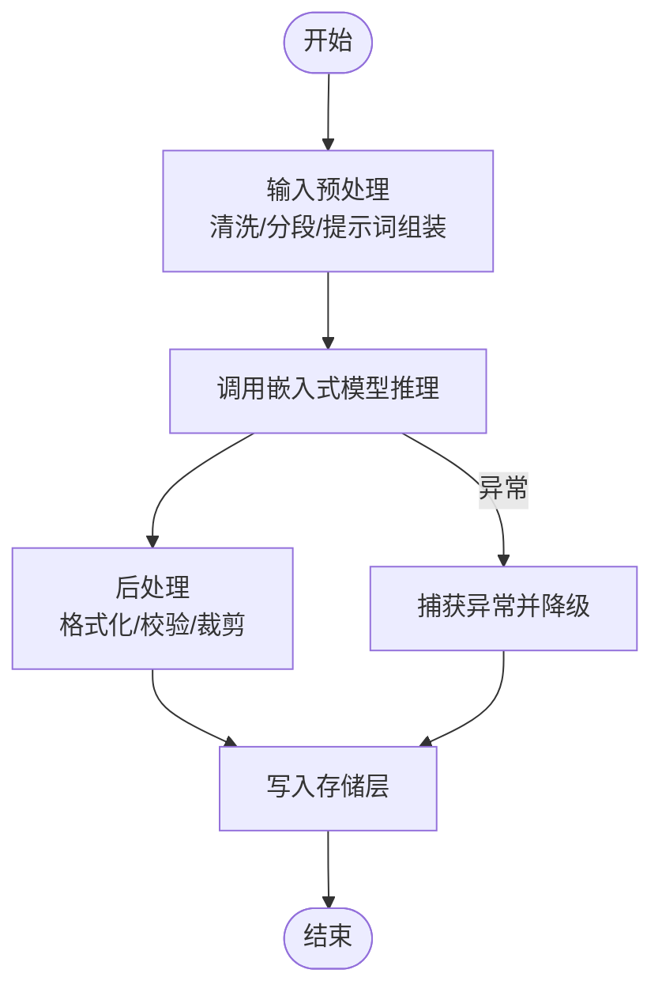
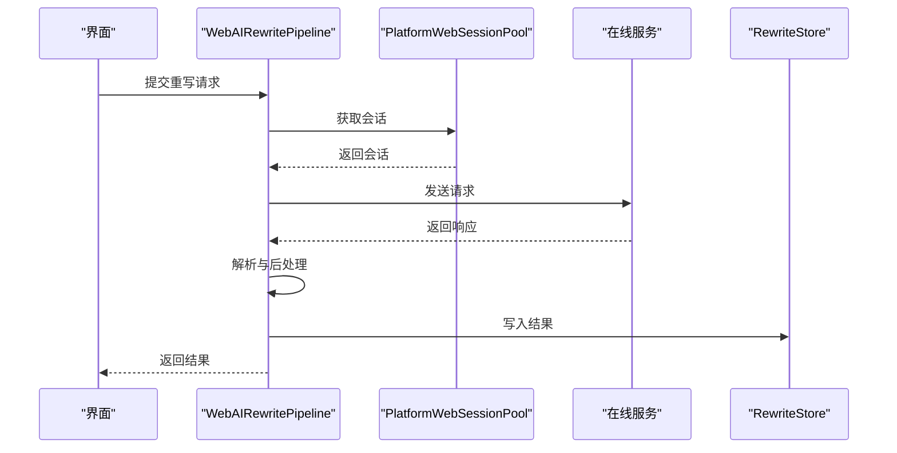
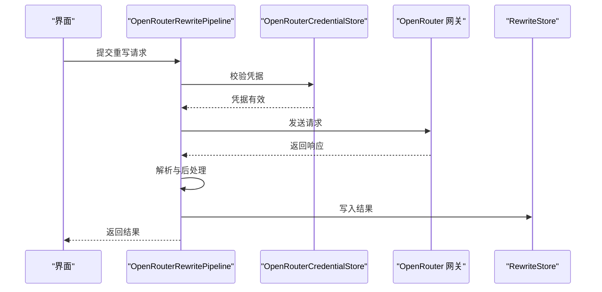
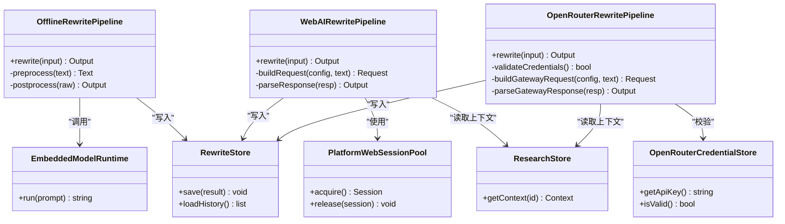

# 文本重写管道

<cite>
**本文档引用的文件**   
- [OfflineRewritePipeline.swift](file://Sources/ChengGao/Services/OfflineRewritePipeline.swift)
- [WebAIRewritePipeline.swift](file://Sources/ChengGao/Services/WebAIRewritePipeline.swift)
- [OpenRouterRewritePipeline.swift](file://Sources/ChengGao/Services/OpenRouterRewritePipeline.swift)
- [ResearchModels.swift](file://Sources/ChengGao/Models/ResearchModels.swift)
- [OnlineAIConfiguration.swift](file://Sources/ChengGao/Models/OnlineAIConfiguration.swift)
- [OpenRouterCredentialStore.swift](file://Sources/ChengGao/Services/OpenRouterCredentialStore.swift)
- [PlatformWebSessionPool.swift](file://Sources/ChengGao/Services/PlatformWebSessionPool.swift)
- [EmbeddedModelRuntime.swift](file://Sources/ChengGao/Services/EmbeddedModelRuntime.swift)
- [ResearchStore.swift](file://Sources/ChengGao/Stores/ResearchStore.swift)
- [RewriteStore.swift](file://Sources/ChengGao/Stores/RewriteStore.swift)
- [FocusedRewriteActions.swift](file://Sources/ChengGao/Support/FocusedRewriteActions.swift)
- [OfflineRewritePipelineTests.swift](file://Tests/ChengGaoTests/OfflineRewritePipelineTests.swift)
</cite>

## 目录
1. [简介](#简介)
2. [项目结构](#项目结构)
3. [核心组件](#核心组件)
4. [架构总览](#架构总览)
5. [详细组件分析](#详细组件分析)
6. [依赖关系分析](#依赖关系分析)
7. [性能考量](#性能考量)
8. [故障排查指南](#故障排查指南)
9. [结论](#结论)
10. [附录](#附录)

## 简介
本文件面向“文本重写管道”的完整技术文档，覆盖三种实现：本地离线重写（OfflineRewritePipeline）、在线 AI 重写（WebAIRewritePipeline）与 OpenRouter 集成重写（OpenRouterRewritePipeline）。文档从触发条件、处理流程、配置项、输入输出格式、数据转换、错误处理、性能特征到扩展实践进行系统化说明，帮助读者快速理解并正确使用或扩展重写能力。

## 项目结构
围绕重写管道的关键代码位于 Services 与 Models 层，配合 Stores 提供状态持久化，Support 层暴露 UI 交互入口，Tests 层提供回归保障。下图展示了与重写相关的模块组织与职责边界。

图表来源
- [ResearchModels.swift](file://Sources/ChengGao/Models/ResearchModels.swift)
- [OnlineAIConfiguration.swift](file://Sources/ChengGao/Models/OnlineAIConfiguration.swift)
- [OfflineRewritePipeline.swift](file://Sources/ChengGao/Services/OfflineRewritePipeline.swift)
- [WebAIRewritePipeline.swift](file://Sources/ChengGao/Services/WebAIRewritePipeline.swift)
- [OpenRouterRewritePipeline.swift](file://Sources/ChengGao/Services/OpenRouterRewritePipeline.swift)
- [EmbeddedModelRuntime.swift](file://Sources/ChengGao/Services/EmbeddedModelRuntime.swift)
- [PlatformWebSessionPool.swift](file://Sources/ChengGao/Services/PlatformWebSessionPool.swift)
- [OpenRouterCredentialStore.swift](file://Sources/ChengGao/Services/OpenRouterCredentialStore.swift)
- [ResearchStore.swift](file://Sources/ChengGao/Stores/ResearchStore.swift)
- [RewriteStore.swift](file://Sources/ChengGao/Stores/RewriteStore.swift)
- [FocusedRewriteActions.swift](file://Sources/ChengGao/Support/FocusedRewriteActions.swift)
- [OfflineRewritePipelineTests.swift](file://Tests/ChengGaoTests/OfflineRewritePipelineTests.swift)

章节来源
- [OfflineRewritePipeline.swift](file://Sources/ChengGao/Services/OfflineRewritePipeline.swift)
- [WebAIRewritePipeline.swift](file://Sources/ChengGao/Services/WebAIRewritePipeline.swift)
- [OpenRouterRewritePipeline.swift](file://Sources/ChengGao/Services/OpenRouterRewritePipeline.swift)
- [ResearchModels.swift](file://Sources/ChengGao/Models/ResearchModels.swift)
- [OnlineAIConfiguration.swift](file://Sources/ChengGao/Models/OnlineAIConfiguration.swift)
- [EmbeddedModelRuntime.swift](file://Sources/ChengGao/Services/EmbeddedModelRuntime.swift)
- [PlatformWebSessionPool.swift](file://Sources/ChengGao/Services/PlatformWebSessionPool.swift)
- [OpenRouterCredentialStore.swift](file://Sources/ChengGao/Services/OpenRouterCredentialStore.swift)
- [ResearchStore.swift](file://Sources/ChengGao/Stores/ResearchStore.swift)
- [RewriteStore.swift](file://Sources/ChengGao/Stores/RewriteStore.swift)
- [FocusedRewriteActions.swift](file://Sources/ChengGao/Support/FocusedRewriteActions.swift)
- [OfflineRewritePipelineTests.swift](file://Tests/ChengGaoTests/OfflineRewritePipelineTests.swift)

## 核心组件
- 本地离线重写（OfflineRewritePipeline）
  - 特点：完全在设备端运行，无需网络；适合隐私敏感、低延迟场景；依赖嵌入式运行时。
  - 触发条件：用户选择“离线模式”或目标模型为本地可用模型时自动选择。
  - 处理流程：输入文本 → 预处理（清洗/分块/提示词组装）→ 调用嵌入式模型推理 → 后处理（格式化/校验）→ 结果回写。
  - 配置选项：模型路径、上下文长度、温度/采样参数、批大小、缓存开关等。
  - 性能特点：首字延迟极低，吞吐受限于 CPU/GPU 算力；内存占用与模型大小相关。
  - 适用场景：断网环境、批量离线处理、对隐私要求高的内容改写。

- 在线 AI 重写（WebAIRewritePipeline）
  - 特点：通过 Web 会话访问在线服务；具备更强的语言理解与风格控制能力。
  - 触发条件：用户选择“在线模式”或目标模型为云端模型时自动选择。
  - 处理流程：输入文本 → 构建请求（含会话/鉴权/参数）→ 发起 HTTP 请求 → 解析响应 → 后处理 → 结果回写。
  - 配置选项：服务端地址、API Key、超时、重试策略、并发限制、会话池大小。
  - 性能特点：延迟受网络与服务端影响；吞吐可通过并发与连接池优化。
  - 适用场景：需要高质量改写、多风格模板、复杂指令遵循的场景。

- OpenRouter 集成重写（OpenRouterRewritePipeline）
  - 特点：基于 OpenRouter 统一网关接入多家模型；支持动态路由与计费透明。
  - 触发条件：用户选择 OpenRouter 渠道或配置了有效凭据时启用。
  - 处理流程：输入文本 → 凭据校验 → 构建 OpenRouter 请求（含模型路由/参数）→ 发送请求 → 解析响应 → 后处理 → 结果回写。
  - 配置选项：API Key、默认模型、路由策略、超时、重试、速率限制。
  - 性能特点：延迟取决于所选后端模型；可借助网关缓存与负载均衡提升稳定性。
  - 适用场景：跨模型对比、成本优化、高可用需求。

章节来源
- [OfflineRewritePipeline.swift](file://Sources/ChengGao/Services/OfflineRewritePipeline.swift)
- [WebAIRewritePipeline.swift](file://Sources/ChengGao/Services/WebAIRewritePipeline.swift)
- [OpenRouterRewritePipeline.swift](file://Sources/ChengGao/Services/OpenRouterRewritePipeline.swift)
- [EmbeddedModelRuntime.swift](file://Sources/ChengGao/Services/EmbeddedModelRuntime.swift)
- [PlatformWebSessionPool.swift](file://Sources/ChengGao/Services/PlatformWebSessionPool.swift)
- [OpenRouterCredentialStore.swift](file://Sources/ChengGao/Services/OpenRouterCredentialStore.swift)

## 架构总览
下图展示三类重写管道的整体交互：UI 入口通过支持层动作触发对应管道，管道内部协调模型/会话/凭据与存储，最终将结果写入 Store 并反馈给 UI。

图表来源
- [FocusedRewriteActions.swift](file://Sources/ChengGao/Support/FocusedRewriteActions.swift)
- [OfflineRewritePipeline.swift](file://Sources/ChengGao/Services/OfflineRewritePipeline.swift)
- [WebAIRewritePipeline.swift](file://Sources/ChengGao/Services/WebAIRewritePipeline.swift)
- [OpenRouterRewritePipeline.swift](file://Sources/ChengGao/Services/OpenRouterRewritePipeline.swift)
- [EmbeddedModelRuntime.swift](file://Sources/ChengGao/Services/EmbeddedModelRuntime.swift)
- [PlatformWebSessionPool.swift](file://Sources/ChengGao/Services/PlatformWebSessionPool.swift)
- [OpenRouterCredentialStore.swift](file://Sources/ChengGao/Services/OpenRouterCredentialStore.swift)
- [RewriteStore.swift](file://Sources/ChengGao/Stores/RewriteStore.swift)
- [ResearchStore.swift](file://Sources/ChengGao/Stores/ResearchStore.swift)

## 详细组件分析

### 本地离线重写（OfflineRewritePipeline）
- 触发条件
  - 当用户明确选择离线模式，或当前设备存在可用的本地模型且未配置在线凭据时。
- 处理流程
  - 输入文本预处理（去噪、分段、提示词拼装）
  - 调用嵌入式运行时进行推理
  - 后处理（格式规范化、长度裁剪、敏感信息过滤）
  - 写入 RewriteStore 并更新 UI
- 配置选项
  - 模型路径、上下文窗口、采样参数（温度、Top-P）、批处理大小、是否启用 KV 缓存
- 输入输出格式
  - 输入：结构化文本对象（包含原始文本、元数据、重写目标）
  - 输出：重写后的文本对象（包含正文、版本信息、耗时统计）
- 数据转换
  - 将自然语言输入转换为模型可接受的 Prompt 结构，再将模型输出解码为标准化文本对象
- 错误处理
  - 模型加载失败、内存不足、推理超时等异常需捕获并降级（如回退到短上下文或提示用户切换在线模式）
- 性能特点
  - 首字延迟低、无网络开销；吞吐受硬件限制；建议开启批处理与缓存以提升吞吐

图表来源
- [OfflineRewritePipeline.swift](file://Sources/ChengGao/Services/OfflineRewritePipeline.swift)
- [EmbeddedModelRuntime.swift](file://Sources/ChengGao/Services/EmbeddedModelRuntime.swift)
- [RewriteStore.swift](file://Sources/ChengGao/Stores/RewriteStore.swift)

章节来源
- [OfflineRewritePipeline.swift](file://Sources/ChengGao/Services/OfflineRewritePipeline.swift)
- [EmbeddedModelRuntime.swift](file://Sources/ChengGao/Services/EmbeddedModelRuntime.swift)
- [RewriteStore.swift](file://Sources/ChengGao/Stores/RewriteStore.swift)
- [OfflineRewritePipelineTests.swift](file://Tests/ChengGaoTests/OfflineRewritePipelineTests.swift)

### 在线 AI 重写（WebAIRewritePipeline）
- 触发条件
  - 用户选择在线模式，或目标模型为云端模型且已配置会话与凭据。
- 处理流程
  - 从会话池获取/创建会话
  - 组装请求体（含模型、参数、Prompt）
  - 发起 HTTP 请求并等待响应
  - 解析响应并进行后处理
  - 写入存储并返回结果
- 配置选项
  - 服务端地址、API Key、超时时间、重试次数、并发上限、会话池大小
- 输入输出格式
  - 输入：文本对象 + 在线配置（模型名、参数）
  - 输出：标准化文本对象 + 元数据（耗时、模型名、请求ID）
- 数据转换
  - 将输入文本序列化为请求 JSON，解析响应 JSON 为文本对象
- 错误处理
  - 网络异常、鉴权失败、限流、超时等需重试或降级；记录日志便于排查

图表来源
- [WebAIRewritePipeline.swift](file://Sources/ChengGao/Services/WebAIRewritePipeline.swift)
- [PlatformWebSessionPool.swift](file://Sources/ChengGao/Services/PlatformWebSessionPool.swift)
- [RewriteStore.swift](file://Sources/ChengGao/Stores/RewriteStore.swift)

章节来源
- [WebAIRewritePipeline.swift](file://Sources/ChengGao/Services/WebAIRewritePipeline.swift)
- [PlatformWebSessionPool.swift](file://Sources/ChengGao/Services/PlatformWebSessionPool.swift)
- [RewriteStore.swift](file://Sources/ChengGao/Stores/RewriteStore.swift)

### OpenRouter 集成重写（OpenRouterRewritePipeline）
- 触发条件
  - 用户选择 OpenRouter 渠道，且凭据有效。
- 处理流程
  - 校验凭据（OpenRouterCredentialStore）
  - 构建 OpenRouter 请求（含模型路由、参数、Prompt）
  - 发送请求并等待响应
  - 解析响应并进行后处理
  - 写入存储并返回结果
- 配置选项
  - API Key、默认模型、路由策略、超时、重试、速率限制
- 输入输出格式
  - 输入：文本对象 + OpenRouter 配置
  - 输出：标准化文本对象 + 元数据（模型名、计费信息、请求ID）
- 数据转换
  - 将输入序列化为 OpenRouter 兼容的请求体，解析响应为标准文本对象
- 错误处理
  - 鉴权失败、模型不可用、限流、超时等需重试或切换备用模型

图表来源
- [OpenRouterRewritePipeline.swift](file://Sources/ChengGao/Services/OpenRouterRewritePipeline.swift)
- [OpenRouterCredentialStore.swift](file://Sources/ChengGao/Services/OpenRouterCredentialStore.swift)
- [RewriteStore.swift](file://Sources/ChengGao/Stores/RewriteStore.swift)

章节来源
- [OpenRouterRewritePipeline.swift](file://Sources/ChengGao/Services/OpenRouterRewritePipeline.swift)
- [OpenRouterCredentialStore.swift](file://Sources/ChengGao/Services/OpenRouterCredentialStore.swift)
- [RewriteStore.swift](file://Sources/ChengGao/Stores/RewriteStore.swift)

## 依赖关系分析
- 组件耦合
  - 三个 Pipeline 均依赖统一的输入/输出数据结构（ResearchModels），确保接口一致性
  - 在线类 Pipeline 依赖会话池与凭据管理，离线类依赖嵌入式运行时
  - 所有 Pipeline 均写入 RewriteStore，部分场景读取 ResearchStore 以获取上下文
- 外部依赖
  - 网络 I/O（在线与 OpenRouter）
  - 本地推理引擎（离线）
  - 凭据存储（OpenRouter）
- 潜在循环依赖
  - 通过分层设计避免循环：Models 不依赖 Services，Services 仅依赖 Models 与基础设施

图表来源
- [OfflineRewritePipeline.swift](file://Sources/ChengGao/Services/OfflineRewritePipeline.swift)
- [WebAIRewritePipeline.swift](file://Sources/ChengGao/Services/WebAIRewritePipeline.swift)
- [OpenRouterRewritePipeline.swift](file://Sources/ChengGao/Services/OpenRouterRewritePipeline.swift)
- [EmbeddedModelRuntime.swift](file://Sources/ChengGao/Services/EmbeddedModelRuntime.swift)
- [PlatformWebSessionPool.swift](file://Sources/ChengGao/Services/PlatformWebSessionPool.swift)
- [OpenRouterCredentialStore.swift](file://Sources/ChengGao/Services/OpenRouterCredentialStore.swift)
- [RewriteStore.swift](file://Sources/ChengGao/Stores/RewriteStore.swift)
- [ResearchStore.swift](file://Sources/ChengGao/Stores/ResearchStore.swift)

章节来源
- [OfflineRewritePipeline.swift](file://Sources/ChengGao/Services/OfflineRewritePipeline.swift)
- [WebAIRewritePipeline.swift](file://Sources/ChengGao/Services/WebAIRewritePipeline.swift)
- [OpenRouterRewritePipeline.swift](file://Sources/ChengGao/Services/OpenRouterRewritePipeline.swift)
- [EmbeddedModelRuntime.swift](file://Sources/ChengGao/Services/EmbeddedModelRuntime.swift)
- [PlatformWebSessionPool.swift](file://Sources/ChengGao/Services/PlatformWebSessionPool.swift)
- [OpenRouterCredentialStore.swift](file://Sources/ChengGao/Services/OpenRouterCredentialStore.swift)
- [RewriteStore.swift](file://Sources/ChengGao/Stores/RewriteStore.swift)
- [ResearchStore.swift](file://Sources/ChengGao/Stores/ResearchStore.swift)

## 性能考量
- 离线模式
  - 优势：无网络延迟、隐私安全、可控性强
  - 瓶颈：CPU/GPU 算力、内存占用、模型大小
  - 优化：批处理、KV 缓存、量化模型、降低上下文长度
- 在线模式
  - 优势：能力强、灵活度高
  - 瓶颈：网络抖动、服务端负载、限流
  - 优化：连接池、并发控制、重试退避、缓存热点 Prompt
- OpenRouter
  - 优势：多模型路由、成本优化、高可用
  - 瓶颈：网关转发延迟、后端差异
  - 优化：合理选择模型、设置超时与重试、监控指标

[本节为通用指导，不直接分析具体文件]

## 故障排查指南
- 离线模式常见问题
  - 模型加载失败：检查模型路径与权限
  - 内存不足：减小上下文或批大小
  - 推理超时：调整温度/采样参数或缩短输入
- 在线模式常见问题
  - 鉴权失败：核对 API Key 与有效期
  - 网络异常：检查代理与防火墙
  - 限流：降低并发或增加重试间隔
- OpenRouter 常见问题
  - 凭据无效：重新获取并保存
  - 模型不可用：切换备用模型或检查配额
  - 响应解析失败：确认响应结构与字段映射

章节来源
- [OfflineRewritePipeline.swift](file://Sources/ChengGao/Services/OfflineRewritePipeline.swift)
- [WebAIRewritePipeline.swift](file://Sources/ChengGao/Services/WebAIRewritePipeline.swift)
- [OpenRouterRewritePipeline.swift](file://Sources/ChengGao/Services/OpenRouterRewritePipeline.swift)
- [OpenRouterCredentialStore.swift](file://Sources/ChengGao/Services/OpenRouterCredentialStore.swift)

## 结论
三种重写管道各有侧重：离线模式强调隐私与低延迟，在线模式强调质量与灵活性，OpenRouter 强调多模型与成本优化。实际应用中可根据场景组合使用，并通过统一的数据结构与存储层实现无缝切换与结果追踪。

[本节为总结性内容，不直接分析具体文件]

## 附录
- 调用示例（概念性步骤）
  - 离线重写：准备输入文本 → 构造离线配置 → 调用 OfflineRewritePipeline.rewrite → 读取结果与元数据
  - 在线重写：准备输入文本 → 构造在线配置（模型/参数）→ 调用 WebAIRewritePipeline.rewrite → 读取结果与元数据
  - OpenRouter 重写：准备输入文本 → 确保凭据有效 → 调用 OpenRouterRewritePipeline.rewrite → 读取结果与元数据
- 自定义扩展指南
  - 定义新的 Pipeline 类，实现统一的 rewrite 接口
  - 复用输入/输出数据结构（ResearchModels）
  - 根据需要接入会话池或凭据管理
  - 将结果写入 RewriteStore，并在 UI 层暴露触发入口
- 最佳实践
  - 统一错误码与日志规范
  - 对关键路径添加埋点与性能指标
  - 对敏感信息进行脱敏与最小化传输
  - 定期评估模型与配置，保持最优性价比

[本节为通用指导，不直接分析具体文件]