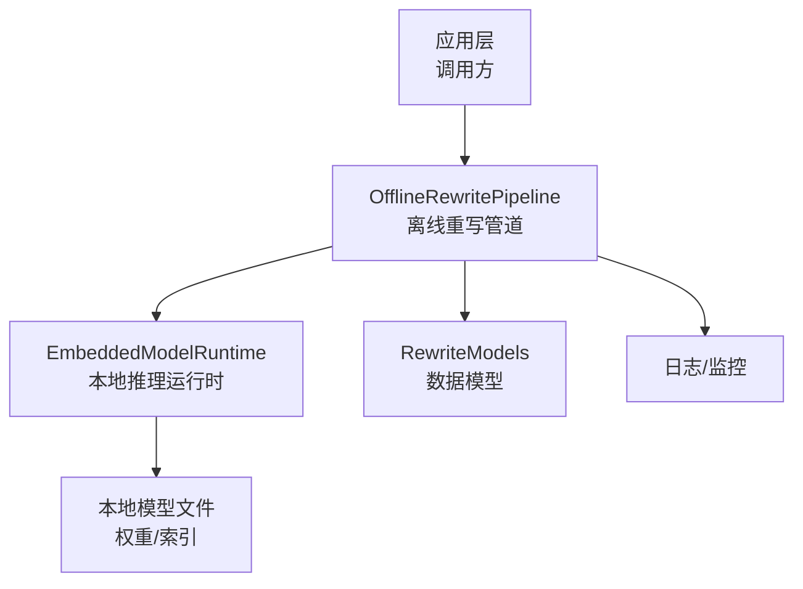
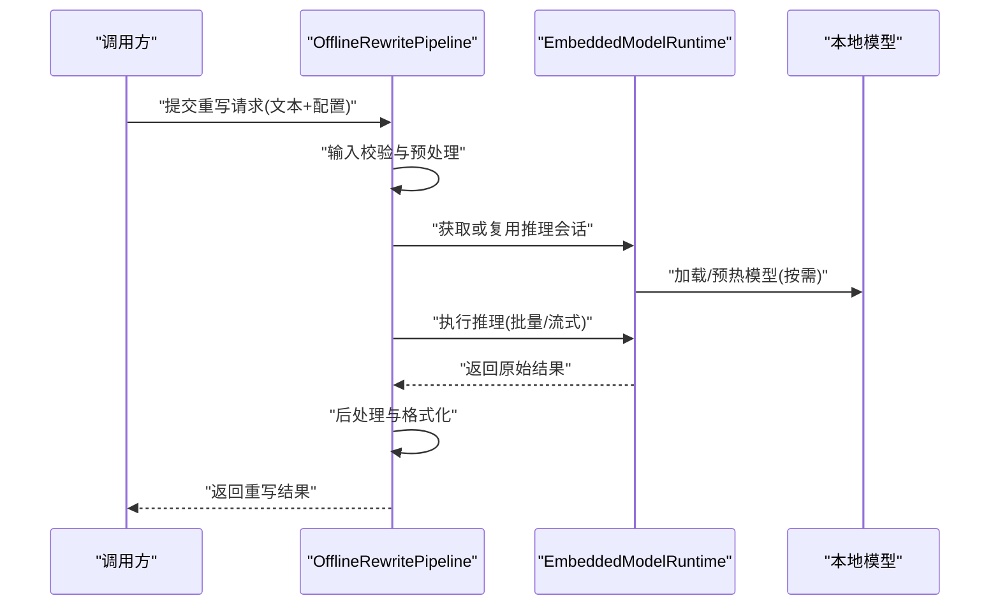
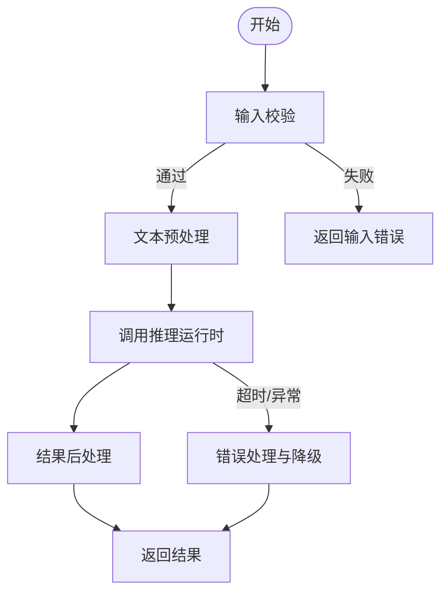
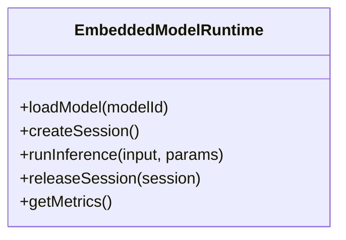
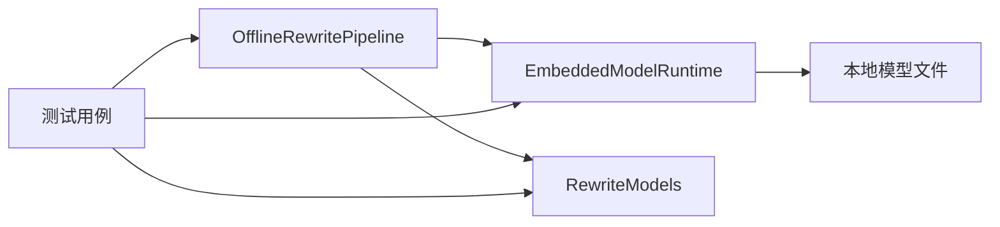

# 本地离线重写管道

<cite>
**本文档引用的文件**   
- [OfflineRewritePipeline.swift](file://Sources/ChengGao/Services/OfflineRewritePipeline.swift)
- [EmbeddedModelRuntime.swift](file://Sources/ChengGao/Services/EmbeddedModelRuntime.swift)
- [RewriteModels.swift](file://Sources/ChengGao/Models/RewriteModels.swift)
- [OfflineRewritePipelineTests.swift](file://Tests/ChengGaoTests/OfflineRewritePipelineTests.swift)
</cite>

## 目录
1. [简介](#简介)
2. [项目结构](#项目结构)
3. [核心组件](#核心组件)
4. [架构总览](#架构总览)
5. [详细组件分析](#详细组件分析)
6. [依赖关系分析](#依赖关系分析)
7. [性能考量](#性能考量)
8. [故障排查指南](#故障排查指南)
9. [结论](#结论)
10. [附录](#附录)

## 简介
本文件面向“本地离线重写管道”（OfflineRewritePipeline），系统性阐述其实现原理、算法逻辑与处理流程，覆盖本地模型加载机制、文本预处理步骤、重写算法核心逻辑与结果后处理过程。文档同时给出配置参数说明、性能优化选项与内存管理策略，并提供初始化、调用与获取结果的示例路径，解释适用场景、限制条件及与其他重写管道的对比优势，最后提供故障排查与性能调优建议。

## 项目结构
围绕本地离线重写能力，关键代码位于 Services 与 Models 层：
- Services/OfflineRewritePipeline.swift：离线重写主流程编排、输入校验、预处理、调用本地推理、后处理与错误处理。
- Services/EmbeddedModelRuntime.swift：本地嵌入/推理运行时封装，负责模型加载、会话管理与资源释放。
- Models/RewriteModels.swift：重写任务、配置、输入输出等数据模型定义。
- Tests/ChengGaoTests/OfflineRewritePipelineTests.swift：单元测试用例，覆盖典型流程与边界情况。

图表来源 
- [OfflineRewritePipeline.swift](file://Sources/ChengGao/Services/OfflineRewritePipeline.swift)
- [EmbeddedModelRuntime.swift](file://Sources/ChengGao/Services/EmbeddedModelRuntime.swift)
- [RewriteModels.swift](file://Sources/ChengGao/Models/RewriteModels.swift)

章节来源
- [OfflineRewritePipeline.swift](file://Sources/ChengGao/Services/OfflineRewritePipeline.swift)
- [EmbeddedModelRuntime.swift](file://Sources/ChengGao/Services/EmbeddedModelRuntime.swift)
- [RewriteModels.swift](file://Sources/ChengGao/Models/RewriteModels.swift)

## 核心组件
- OfflineRewritePipeline：对外暴露的离线重写入口，负责端到端流程编排与错误处理。
- EmbeddedModelRuntime：对底层推理引擎的抽象，统一模型加载、上下文创建、推理执行与资源释放。
- RewriteModels：定义重写任务、配置项、输入输出结构与中间态数据结构。

章节来源
- [OfflineRewritePipeline.swift](file://Sources/ChengGao/Services/OfflineRewritePipeline.swift)
- [EmbeddedModelRuntime.swift](file://Sources/ChengGao/Services/EmbeddedModelRuntime.swift)
- [RewriteModels.swift](file://Sources/ChengGao/Models/RewriteModels.swift)

## 架构总览
离线重写管道采用“编排器 + 运行时”的分层设计：
- 编排层（OfflineRewritePipeline）：接收用户输入与配置，进行输入校验与文本预处理；调用运行时执行推理；对输出进行后处理与格式化。
- 运行时层（EmbeddedModelRuntime）：屏蔽具体推理引擎细节，提供统一的模型加载、会话管理、批处理与资源回收接口。
- 数据层（RewriteModels）：贯穿全链路的结构化数据契约，确保输入输出一致性与可测试性。

图表来源 
- [OfflineRewritePipeline.swift](file://Sources/ChengGao/Services/OfflineRewritePipeline.swift)
- [EmbeddedModelRuntime.swift](file://Sources/ChengGao/Services/EmbeddedModelRuntime.swift)

## 详细组件分析

### OfflineRewritePipeline：离线重写编排器
职责与流程
- 输入校验：检查文本长度、编码、敏感词过滤开关、目标语言等。
- 文本预处理：清洗空白与换行、规范化标点、分句/分段、去重与截断、可选的术语替换。
- 推理调用：通过 EmbeddedModelRuntime 发起推理，支持批处理与超时控制。
- 后处理：解码生成内容、修复标点与段落、风格化与一致性校验、敏感信息脱敏。
- 错误处理：网络不可用时的降级策略（纯本地）、异常分类与重试、资源清理。

关键方法（概念性描述）
- 初始化：根据配置构建运行时实例与处理器链。
- 重写：接受输入与配置，返回标准化结果对象。
- 批量重写：对多个片段并行处理，合并结果并保证顺序。
- 资源释放：显式关闭会话、释放缓存与临时缓冲区。

图表来源 
- [OfflineRewritePipeline.swift](file://Sources/ChengGao/Services/OfflineRewritePipeline.swift)

章节来源
- [OfflineRewritePipeline.swift](file://Sources/ChengGao/Services/OfflineRewritePipeline.swift)

### EmbeddedModelRuntime：本地推理运行时
职责与特性
- 模型加载：从本地路径加载权重与索引，支持多模型切换与热更新。
- 会话管理：创建推理上下文、缓存 KV 状态、支持并发会话上限。
- 推理执行：提供同步/异步接口，支持批处理、采样参数与停止条件。
- 资源管理：自动释放显存/内存、清理临时文件、统计耗时与命中率。

关键方法（概念性描述）
- 加载模型：按模型标识加载或复用已加载实例。
- 创建会话：为单次或多次推理分配上下文。
- 执行推理：传入 tokenized 输入与采样参数，返回原始输出。
- 释放资源：关闭会话、清空缓存、统计指标上报。

图表来源 
- [EmbeddedModelRuntime.swift](file://Sources/ChengGao/Services/EmbeddedModelRuntime.swift)

章节来源
- [EmbeddedModelRuntime.swift](file://Sources/ChengGao/Services/EmbeddedModelRuntime.swift)

### RewriteModels：数据模型
作用
- 定义重写任务的输入结构（原文、上下文、约束）。
- 定义配置项（语言、风格、长度限制、温度、Top-K/Top-P、最大生成长度等）。
- 定义输出结构（重写后的文本、元数据、质量评分、耗时统计）。

章节来源
- [RewriteModels.swift](file://Sources/ChengGao/Models/RewriteModels.swift)

## 依赖关系分析
- OfflineRewritePipeline 依赖 EmbeddedModelRuntime 完成推理，依赖 RewriteModels 作为数据契约。
- EmbeddedModelRuntime 依赖本地模型文件与底层推理引擎（由运行时封装）。
- 测试依赖上述三者以验证端到端行为与边界条件。

图表来源 
- [OfflineRewritePipeline.swift](file://Sources/ChengGao/Services/OfflineRewritePipeline.swift)
- [EmbeddedModelRuntime.swift](file://Sources/ChengGao/Services/EmbeddedModelRuntime.swift)
- [RewriteModels.swift](file://Sources/ChengGao/Models/RewriteModels.swift)
- [OfflineRewritePipelineTests.swift](file://Tests/ChengGaoTests/OfflineRewritePipelineTests.swift)

章节来源
- [OfflineRewritePipeline.swift](file://Sources/ChengGao/Services/OfflineRewritePipeline.swift)
- [EmbeddedModelRuntime.swift](file://Sources/ChengGao/Services/EmbeddedModelRuntime.swift)
- [RewriteModels.swift](file://Sources/ChengGao/Models/RewriteModels.swift)
- [OfflineRewritePipelineTests.swift](file://Tests/ChengGaoTests/OfflineRewritePipelineTests.swift)

## 性能考量
- 批处理与缓存：对相似输入启用缓存与批处理，减少重复推理。
- 会话复用：避免频繁创建/销毁上下文，降低开销。
- 内存管理：限制最大上下文长度，及时释放临时缓冲与 KV 缓存。
- 并发控制：限制并发会话数，防止 OOM。
- I/O 优化：模型文件预加载与热缓存，减少冷启动延迟。
- 采样参数：合理设置温度、Top-K/Top-P 与最大生成长度，平衡速度与质量。

[本节为通用指导，不直接分析具体文件]

## 故障排查指南
常见问题与定位要点
- 模型加载失败：检查模型路径、权限与完整性；确认运行时版本兼容。
- 推理超时：增大超时阈值或降低生成长度；检查并发与会话上限。
- 输出异常：检查预处理规则与后处理逻辑；确认输入编码与语言设置。
- 内存溢出：降低批大小与上下文长度；增加系统内存或减少并发。
- 性能退化：开启缓存与批处理；预热常用模型与会话。

章节来源
- [OfflineRewritePipeline.swift](file://Sources/ChengGao/Services/OfflineRewritePipeline.swift)
- [EmbeddedModelRuntime.swift](file://Sources/ChengGao/Services/EmbeddedModelRuntime.swift)
- [OfflineRewritePipelineTests.swift](file://Tests/ChengGaoTests/OfflineRewritePipelineTests.swift)

## 结论
本地离线重写管道通过清晰的编排与运行时分层，实现了高可用、低延迟与强隐私保护的文本重写能力。借助严格的输入预处理与稳健的后处理，结合本地模型的稳定推理，能够在无网络环境下提供高质量的重写服务。配合合理的配置与性能优化策略，可在不同设备与负载下取得良好表现。

[本节为总结性内容，不直接分析具体文件]

## 附录

### 使用示例（路径指引）
- 初始化与调用：参考测试用例中的初始化与调用方式，了解如何构造配置、传入输入与获取结果。
- 批量处理：参考测试用例中批量重写的用例，了解如何组织输入批次与合并结果。
- 错误处理：参考测试用例中的异常分支，了解如何处理输入错误、推理异常与资源释放。

章节来源
- [OfflineRewritePipelineTests.swift](file://Tests/ChengGaoTests/OfflineRewritePipelineTests.swift)

### 配置参数说明（概念性）
- 文本相关：最大输入长度、分句策略、术语替换表、语言与风格。
- 推理相关：温度、Top-K、Top-P、最大生成长度、停止条件。
- 运行时相关：会话上限、批大小、超时时间、缓存开关。
- 输出相关：是否包含元数据、质量评分、耗时统计。

[本节为通用说明，不直接分析具体文件]

### 适用场景与限制
- 适用场景：离线环境、隐私敏感、低延迟要求、稳定质量优先。
- 限制条件：受限于本地模型能力与设备资源；超长文本需分段处理；极端风格可能影响稳定性。

[本节为通用说明，不直接分析具体文件]

### 与其他重写管道的对比优势
- 离线 vs 在线：无需网络、数据不出设备、更可控的延迟与成本。
- 本地 vs 云端：更强的隐私保护、更低的边际成本、更好的可定制性。
- 编排 vs 直连：更清晰的错误处理、可插拔的后处理与监控。

[本节为通用说明，不直接分析具体文件]