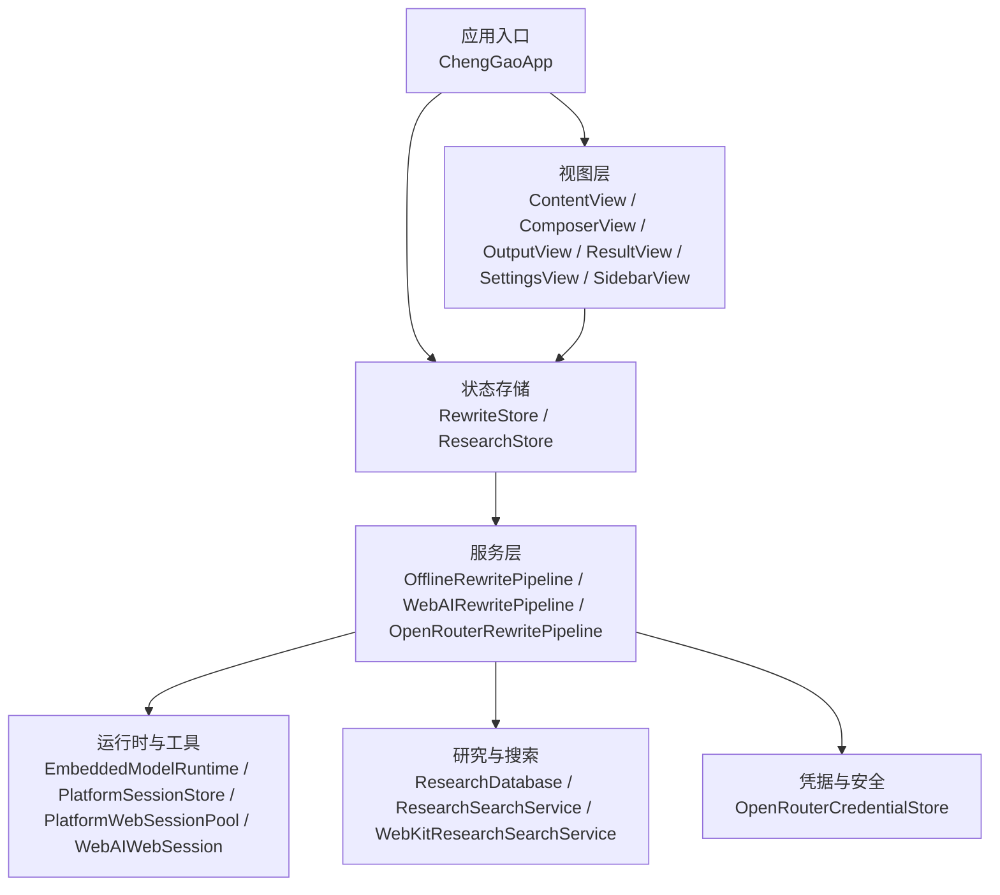
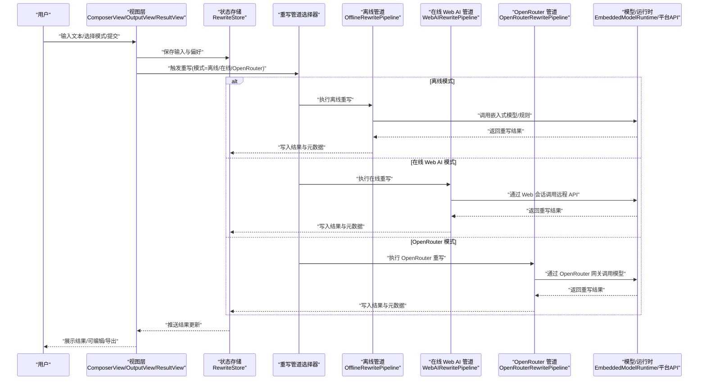
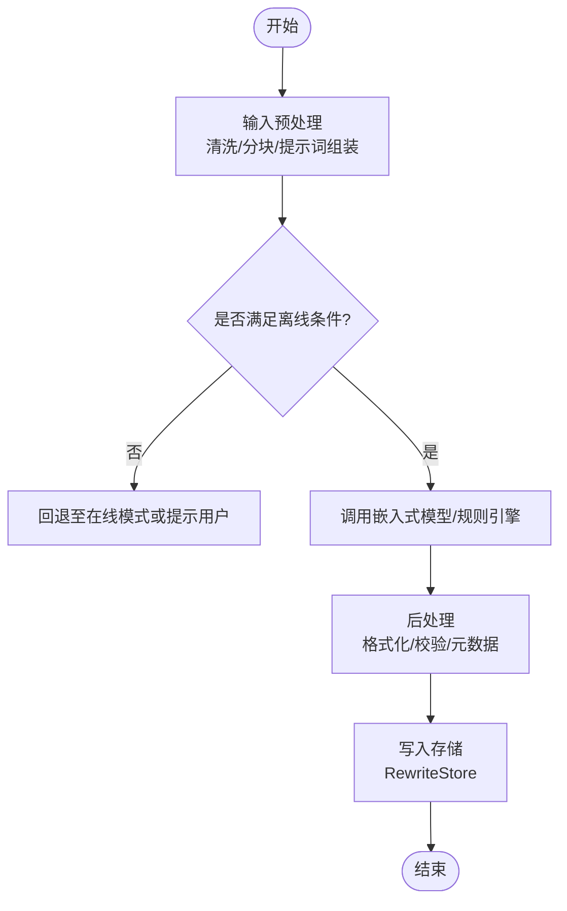
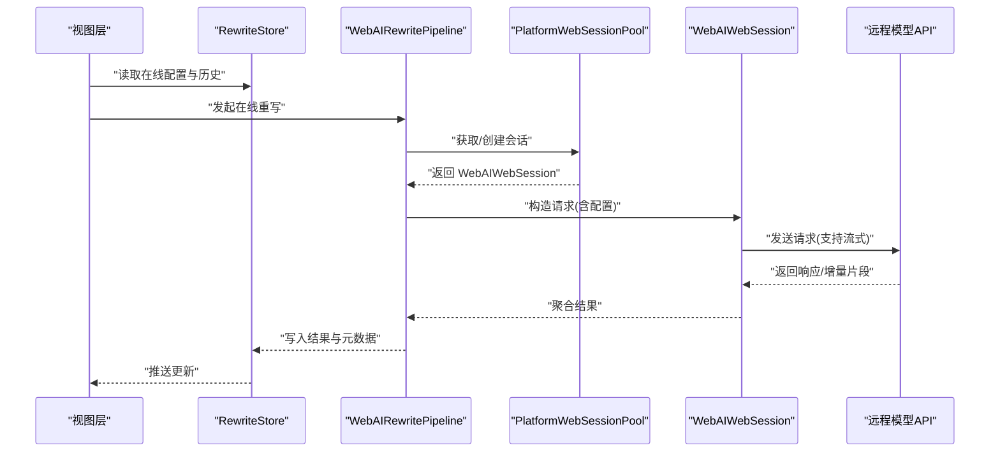
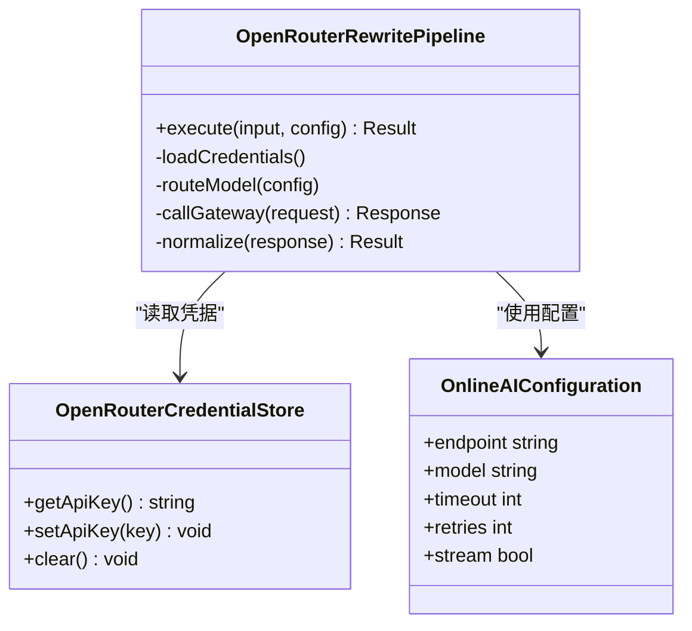
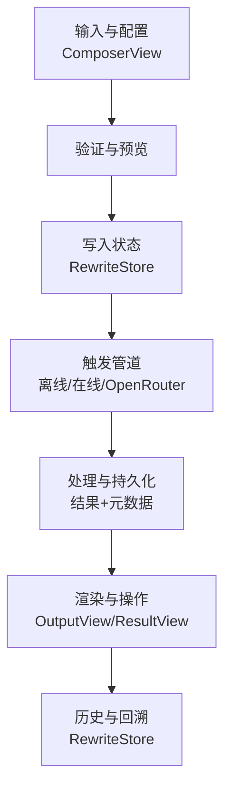
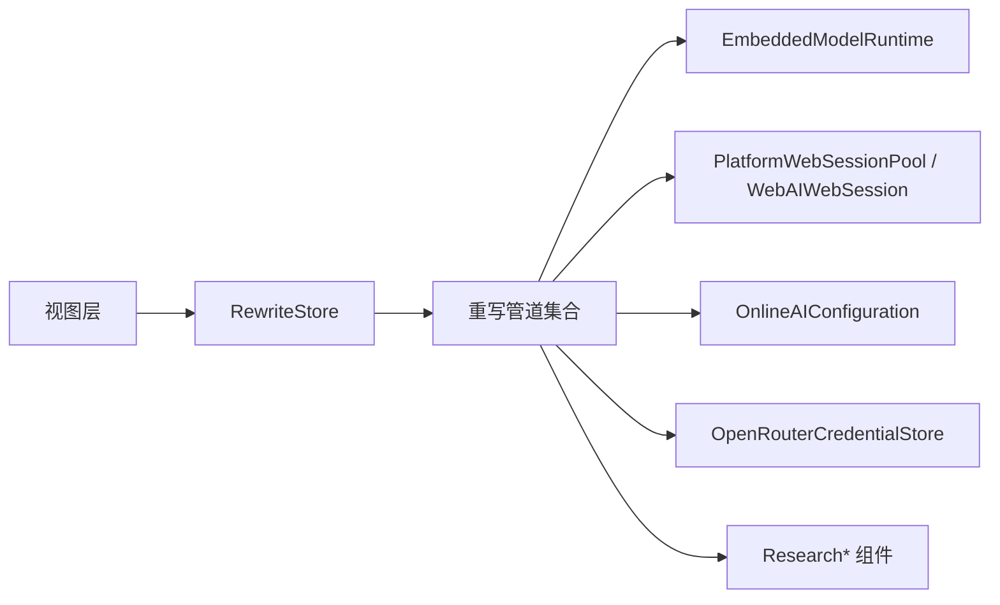

# 核心功能

<cite>
**本文引用的文件**   
- [Package.swift](file://Package.swift)
- [ChengGaoApp.swift](file://Sources/ChengGao/App/ChengGaoApp.swift)
- [RewriteModels.swift](file://Sources/ChengGao/Models/RewriteModels.swift)
- [OnlineAIConfiguration.swift](file://Sources/ChengGao/Models/OnlineAIConfiguration.swift)
- [OfflineRewritePipeline.swift](file://Sources/ChengGao/Services/OfflineRewritePipeline.swift)
- [WebAIRewritePipeline.swift](file://Sources/ChengGao/Services/WebAIRewritePipeline.swift)
- [OpenRouterRewritePipeline.swift](file://Sources/ChengGao/Services/OpenRouterRewritePipeline.swift)
- [OpenRouterCredentialStore.swift](file://Sources/ChengGao/Services/OpenRouterCredentialStore.swift)
- [EmbeddedModelRuntime.swift](file://Sources/ChengGao/Services/EmbeddedModelRuntime.swift)
- [ResearchDatabase.swift](file://Sources/ChengGao/Services/ResearchDatabase.swift)
- [ResearchSearchService.swift](file://Sources/ChengGao/Services/ResearchSearchService.swift)
- [WebKitResearchSearchService.swift](file://Sources/ChengGao/Services/WebKitResearchSearchService.swift)
- [PlatformSessionStore.swift](file://Sources/ChengGao/Services/PlatformSessionStore.swift)
- [PlatformWebSessionPool.swift](file://Sources/ChengGao/Services/PlatformWebSessionPool.swift)
- [WebAIWebSession.swift](file://Sources/ChengGao/Services/WebAIWebSession.swift)
- [ResearchStore.swift](file://Sources/ChengGao/Stores/ResearchStore.swift)
- [RewriteStore.swift](file://Sources/ChengGao/Stores/RewriteStore.swift)
- [ContentView.swift](file://Sources/ChengGao/Views/ContentView.swift)
- [ComposerView.swift](file://Sources/ChengGao/Views/ComposerView.swift)
- [OutputView.swift](file://Sources/ChengGao/Views/OutputView.swift)
- [ResultView.swift](file://Sources/ChengGao/Views/ResultView.swift)
- [SettingsView.swift](file://Sources/ChengGao/Views/SettingsView.swift)
- [SidebarView.swift](file://Sources/ChengGao/Views/SidebarView.swift)
- [FocusedRewriteActions.swift](file://Sources/ChengGao/Support/FocusedRewriteActions.swift)
- [OfflineRewritePipelineTests.swift](file://Tests/ChengGaoTests/OfflineRewritePipelineTests.swift)
</cite>

## 目录
1. [简介](#简介)
2. [项目结构](#项目结构)
3. [核心组件](#核心组件)
4. [架构总览](#架构总览)
5. [详细组件分析](#详细组件分析)
6. [依赖关系分析](#依赖关系分析)
7. [性能考量](#性能考量)
8. [故障排查指南](#故障排查指南)
9. [结论](#结论)
10. [附录](#附录)

## 简介
本文件面向 ChengGao 的核心功能，重点围绕“文本重写”能力进行系统化说明。内容涵盖：
- 三种重写管道：本地离线重写、在线 AI 重写（通用 Web AI）、OpenRouter 集成
- 触发条件、处理流程与输出格式
- 用户界面交互流程与数据链路
- 不同模式的适用场景、性能特点与配置项
- 扩展点与自定义重写逻辑实现方法
- 使用示例与最佳实践建议

## 项目结构
ChengGao 采用模块化 Swift Package 组织方式，核心代码位于 Sources/ChengGao 下，按 App、Models、Services、Stores、Support、Views 分层；测试位于 Tests/ChengGaoTests；构建与脚本位于 script；文档位于 docs。

图表来源
- [ChengGaoApp.swift](file://Sources/ChengGao/App/ChengGaoApp.swift)
- [RewriteStore.swift](file://Sources/ChengGao/Stores/RewriteStore.swift)
- [ResearchStore.swift](file://Sources/ChengGao/Stores/ResearchStore.swift)
- [OfflineRewritePipeline.swift](file://Sources/ChengGao/Services/OfflineRewritePipeline.swift)
- [WebAIRewritePipeline.swift](file://Sources/ChengGao/Services/WebAIRewritePipeline.swift)
- [OpenRouterRewritePipeline.swift](file://Sources/ChengGao/Services/OpenRouterRewritePipeline.swift)
- [EmbeddedModelRuntime.swift](file://Sources/ChengGao/Services/EmbeddedModelRuntime.swift)
- [PlatformSessionStore.swift](file://Sources/ChengGao/Services/PlatformSessionStore.swift)
- [PlatformWebSessionPool.swift](file://Sources/ChengGao/Services/PlatformWebSessionPool.swift)
- [WebAIWebSession.swift](file://Sources/ChengGao/Services/WebAIWebSession.swift)
- [ResearchDatabase.swift](file://Sources/ChengGao/Services/ResearchDatabase.swift)
- [ResearchSearchService.swift](file://Sources/ChengGao/Services/ResearchSearchService.swift)
- [WebKitResearchSearchService.swift](file://Sources/ChengGao/Services/WebKitResearchSearchService.swift)
- [OpenRouterCredentialStore.swift](file://Sources/ChengGao/Services/OpenRouterCredentialStore.swift)

章节来源
- [Package.swift](file://Package.swift)
- [ChengGaoApp.swift](file://Sources/ChengGao/App/ChengGaoApp.swift)

## 核心组件
- 模型层
  - 重写相关模型：定义输入文本、提示词模板、重写模式、输出结构与元数据等
  - 在线 AI 配置：封装平台鉴权、端点、超时、重试等参数
- 服务层（重写管道）
  - 本地离线重写：基于嵌入式模型或规则引擎的离线推理
  - 在线 AI 重写：通过 Web AI 会话池调用远程大模型
  - OpenRouter 集成：统一接入 OpenRouter 网关，支持多模型路由与密钥管理
- 存储层
  - RewriteStore：缓存重写任务、历史结果、用户偏好
  - ResearchStore：研究检索结果、会话上下文持久化
- 运行时与工具
  - EmbeddedModelRuntime：本地推理运行时
  - PlatformSessionStore / PlatformWebSessionPool / WebAIWebSession：Web 会话管理与复用
  - ResearchDatabase / ResearchSearchService / WebKitResearchSearchService：研究与搜索能力
  - OpenRouterCredentialStore：OpenRouter 凭据安全存储

章节来源
- [RewriteModels.swift](file://Sources/ChengGao/Models/RewriteModels.swift)
- [OnlineAIConfiguration.swift](file://Sources/ChengGao/Models/OnlineAIConfiguration.swift)
- [OfflineRewritePipeline.swift](file://Sources/ChengGao/Services/OfflineRewritePipeline.swift)
- [WebAIRewritePipeline.swift](file://Sources/ChengGao/Services/WebAIRewritePipeline.swift)
- [OpenRouterRewritePipeline.swift](file://Sources/ChengGao/Services/OpenRouterRewritePipeline.swift)
- [RewriteStore.swift](file://Sources/ChengGao/Stores/RewriteStore.swift)
- [ResearchStore.swift](file://Sources/ChengGao/Stores/ResearchStore.swift)
- [EmbeddedModelRuntime.swift](file://Sources/ChengGao/Services/EmbeddedModelRuntime.swift)
- [PlatformSessionStore.swift](file://Sources/ChengGao/Services/PlatformSessionStore.swift)
- [PlatformWebSessionPool.swift](file://Sources/ChengGao/Services/PlatformWebSessionPool.swift)
- [WebAIWebSession.swift](file://Sources/ChengGao/Services/WebAIWebSession.swift)
- [ResearchDatabase.swift](file://Sources/ChengGao/Services/ResearchDatabase.swift)
- [ResearchSearchService.swift](file://Sources/ChengGao/Services/ResearchSearchService.swift)
- [WebKitResearchSearchService.swift](file://Sources/ChengGao/Services/WebKitResearchSearchService.swift)
- [OpenRouterCredentialStore.swift](file://Sources/ChengGao/Services/OpenRouterCredentialStore.swift)

## 架构总览
下图展示从 UI 到各重写管道的端到端数据流与控制流。

图表来源
- [ComposerView.swift](file://Sources/ChengGao/Views/ComposerView.swift)
- [OutputView.swift](file://Sources/ChengGao/Views/OutputView.swift)
- [ResultView.swift](file://Sources/ChengGao/Views/ResultView.swift)
- [RewriteStore.swift](file://Sources/ChengGao/Stores/RewriteStore.swift)
- [OfflineRewritePipeline.swift](file://Sources/ChengGao/Services/OfflineRewritePipeline.swift)
- [WebAIRewritePipeline.swift](file://Sources/ChengGao/Services/WebAIRewritePipeline.swift)
- [OpenRouterRewritePipeline.swift](file://Sources/ChengGao/Services/OpenRouterRewritePipeline.swift)
- [EmbeddedModelRuntime.swift](file://Sources/ChengGao/Services/EmbeddedModelRuntime.swift)

## 详细组件分析

### 离线重写管道（本地离线）
- 触发条件
  - 用户选择“离线”模式，或网络不可用且存在可用本地模型
  - 输入文本长度在本地模型上下文限制内
- 处理流程
  - 预处理：清洗输入、提取关键段落、生成提示词
  - 推理：调用嵌入式模型或规则引擎进行改写
  - 后处理：格式化输出、插入元数据（耗时、模型名、温度等）
  - 持久化：写入 RewriteStore，供历史查看与对比
- 输出格式
  - 结构化结果对象，包含重写文本、版本信息、置信度、耗时、模型标识等
- 适用场景
  - 隐私敏感、离线环境、低延迟需求
- 性能特点
  - 无网络开销，首字响应快；受限于本地模型能力与资源占用
- 配置选项
  - 模型路径/权重、上下文窗口、温度/Top-P、最大生成长度、并行度
- 扩展点
  - 新增本地模型后端：实现统一的推理接口并注册到运行时
  - 自定义提示词模板：注入领域术语或风格约束

图表来源
- [OfflineRewritePipeline.swift](file://Sources/ChengGao/Services/OfflineRewritePipeline.swift)
- [EmbeddedModelRuntime.swift](file://Sources/ChengGao/Services/EmbeddedModelRuntime.swift)
- [RewriteStore.swift](file://Sources/ChengGao/Stores/RewriteStore.swift)

章节来源
- [OfflineRewritePipeline.swift](file://Sources/ChengGao/Services/OfflineRewritePipeline.swift)
- [EmbeddedModelRuntime.swift](file://Sources/ChengGao/Services/EmbeddedModelRuntime.swift)
- [RewriteStore.swift](file://Sources/ChengGao/Stores/RewriteStore.swift)
- [OfflineRewritePipelineTests.swift](file://Tests/ChengGaoTests/OfflineRewritePipelineTests.swift)

### 在线 AI 重写（通用 Web AI）
- 触发条件
  - 用户选择“在线”模式，或离线失败自动回退
  - 具备有效的平台会话与会话池资源
- 处理流程
  - 会话获取：从 PlatformWebSessionPool 获取或创建 WebAIWebSession
  - 请求构造：根据 OnlineAIConfiguration 组装请求头、体、重试策略
  - 调用远程 API：发送重写请求，解析响应流或一次性响应
  - 结果处理：标准化为统一输出结构，记录日志与指标
- 输出格式
  - 统一的重写结果对象，包含文本、来源模型、请求 ID、耗时、错误码等
- 适用场景
  - 需要更强语言理解与创意改写能力，网络稳定环境
- 性能特点
  - 首字节时间受网络与模型影响；支持流式输出提升体验
- 配置选项
  - 端点 URL、鉴权方式、超时、重试次数、并发上限、流式开关
- 扩展点
  - 新增 Web AI 平台：实现会话与请求适配层，纳入会话池管理

图表来源
- [WebAIRewritePipeline.swift](file://Sources/ChengGao/Services/WebAIRewritePipeline.swift)
- [PlatformWebSessionPool.swift](file://Sources/ChengGao/Services/PlatformWebSessionPool.swift)
- [WebAIWebSession.swift](file://Sources/ChengGao/Services/WebAIWebSession.swift)
- [OnlineAIConfiguration.swift](file://Sources/ChengGao/Models/OnlineAIConfiguration.swift)
- [RewriteStore.swift](file://Sources/ChengGao/Stores/RewriteStore.swift)

章节来源
- [WebAIRewritePipeline.swift](file://Sources/ChengGao/Services/WebAIRewritePipeline.swift)
- [PlatformWebSessionPool.swift](file://Sources/ChengGao/Services/PlatformWebSessionPool.swift)
- [WebAIWebSession.swift](file://Sources/ChengGao/Services/WebAIWebSession.swift)
- [OnlineAIConfiguration.swift](file://Sources/ChengGao/Models/OnlineAIConfiguration.swift)
- [RewriteStore.swift](file://Sources/ChengGao/Stores/RewriteStore.swift)

### OpenRouter 集成重写
- 触发条件
  - 用户选择“OpenRouter”模式，或配置了默认网关
  - 已正确配置 OpenRouter 凭据
- 处理流程
  - 凭据加载：从 OpenRouterCredentialStore 读取密钥与账户信息
  - 请求路由：根据模型名称与负载情况选择最优端点
  - 调用网关：通过 OpenRouter 统一接口发起重写请求
  - 结果归一化：将不同模型的响应统一为标准结构
- 输出格式
  - 标准重写结果对象，包含模型路由信息、成本估算、延迟统计等
- 适用场景
  - 多模型统一管理、按需切换、成本控制
- 性能特点
  - 网关层可能引入额外延迟；支持负载均衡与熔断
- 配置选项
  - API Key、默认模型、路由策略、超时、重试、费用阈值
- 扩展点
  - 新增路由策略：按质量/价格/延迟动态选择模型
  - 自定义计费与配额控制

图表来源
- [OpenRouterRewritePipeline.swift](file://Sources/ChengGao/Services/OpenRouterRewritePipeline.swift)
- [OpenRouterCredentialStore.swift](file://Sources/ChengGao/Services/OpenRouterCredentialStore.swift)
- [OnlineAIConfiguration.swift](file://Sources/ChengGao/Models/OnlineAIConfiguration.swift)

章节来源
- [OpenRouterRewritePipeline.swift](file://Sources/ChengGao/Services/OpenRouterRewritePipeline.swift)
- [OpenRouterCredentialStore.swift](file://Sources/ChengGao/Services/OpenRouterCredentialStore.swift)
- [OnlineAIConfiguration.swift](file://Sources/ChengGao/Models/OnlineAIConfiguration.swift)

### 用户界面交互流程与数据链路
- 输入阶段
  - ComposerView 接收用户输入，提供模式选择（离线/在线/OpenRouter）、提示词模板、参数调节
  - 输入校验与预览，支持粘贴富文本与清理
- 处理阶段
  - 视图层将输入与偏好写入 RewriteStore
  - 根据选择触发对应重写管道
  - 管道内部完成预处理、推理/调用、后处理与持久化
- 输出阶段
  - OutputView/ResultView 渲染结果，支持对比、编辑、复制、导出
  - 历史记录与版本回溯由 Store 管理
- 设置与配置
  - SettingsView 提供在线配置、OpenRouter 凭据、行为偏好等

图表来源
- [ComposerView.swift](file://Sources/ChengGao/Views/ComposerView.swift)
- [OutputView.swift](file://Sources/ChengGao/Views/OutputView.swift)
- [ResultView.swift](file://Sources/ChengGao/Views/ResultView.swift)
- [RewriteStore.swift](file://Sources/ChengGao/Stores/RewriteStore.swift)

章节来源
- [ComposerView.swift](file://Sources/ChengGao/Views/ComposerView.swift)
- [OutputView.swift](file://Sources/ChengGao/Views/OutputView.swift)
- [ResultView.swift](file://Sources/ChengGao/Views/ResultView.swift)
- [RewriteStore.swift](file://Sources/ChengGao/Stores/RewriteStore.swift)
- [SettingsView.swift](file://Sources/ChengGao/Views/SettingsView.swift)
- [SidebarView.swift](file://Sources/ChengGao/Views/SidebarView.swift)

### 研究与搜索辅助（可选增强）
- 作用
  - 为重写任务提供背景资料、术语校验、事实核查等增强能力
- 组件
  - ResearchDatabase：本地研究数据存储
  - ResearchSearchService / WebKitResearchSearchService：搜索与抓取
  - ResearchStore：研究上下文与结果缓存
- 集成点
  - 在重写前注入参考资料，或在重写后做一致性校验

章节来源
- [ResearchDatabase.swift](file://Sources/ChengGao/Services/ResearchDatabase.swift)
- [ResearchSearchService.swift](file://Sources/ChengGao/Services/ResearchSearchService.swift)
- [WebKitResearchSearchService.swift](file://Sources/ChengGao/Services/WebKitResearchSearchService.swift)
- [ResearchStore.swift](file://Sources/ChengGao/Stores/ResearchStore.swift)

## 依赖关系分析
- 组件耦合
  - 视图层依赖 Store 进行状态同步
  - 各重写管道依赖运行时与会话管理
  - OpenRouter 管道依赖凭据存储与在线配置
- 外部依赖
  - 嵌入式模型运行时（本地）
  - 远端模型 API（在线）
  - OpenRouter 网关（统一路由）
- 潜在循环依赖
  - 通过 Store 解耦视图与服务，避免直接耦合
- 接口契约
  - 统一的结果对象与错误码规范，便于替换与扩展

图表来源
- [RewriteStore.swift](file://Sources/ChengGao/Stores/RewriteStore.swift)
- [OfflineRewritePipeline.swift](file://Sources/ChengGao/Services/OfflineRewritePipeline.swift)
- [WebAIRewritePipeline.swift](file://Sources/ChengGao/Services/WebAIRewritePipeline.swift)
- [OpenRouterRewritePipeline.swift](file://Sources/ChengGao/Services/OpenRouterRewritePipeline.swift)
- [EmbeddedModelRuntime.swift](file://Sources/ChengGao/Services/EmbeddedModelRuntime.swift)
- [PlatformWebSessionPool.swift](file://Sources/ChengGao/Services/PlatformWebSessionPool.swift)
- [WebAIWebSession.swift](file://Sources/ChengGao/Services/WebAIWebSession.swift)
- [OnlineAIConfiguration.swift](file://Sources/ChengGao/Models/OnlineAIConfiguration.swift)
- [OpenRouterCredentialStore.swift](file://Sources/ChengGao/Services/OpenRouterCredentialStore.swift)
- [ResearchDatabase.swift](file://Sources/ChengGao/Services/ResearchDatabase.swift)
- [ResearchSearchService.swift](file://Sources/ChengGao/Services/ResearchSearchService.swift)
- [WebKitResearchSearchService.swift](file://Sources/ChengGao/Services/WebKitResearchSearchService.swift)

章节来源
- [RewriteStore.swift](file://Sources/ChengGao/Stores/RewriteStore.swift)
- [OnlineAIConfiguration.swift](file://Sources/ChengGao/Models/OnlineAIConfiguration.swift)
- [OpenRouterCredentialStore.swift](file://Sources/ChengGao/Services/OpenRouterCredentialStore.swift)

## 性能考量
- 离线模式
  - 优势：无网络延迟、隐私安全、可控资源
  - 注意：内存与 CPU 占用、模型大小与量化策略
- 在线 Web AI
  - 优势：模型能力强、灵活升级
  - 注意：网络抖动、超时与重试、流式输出优化
- OpenRouter
  - 优势：多模型路由、成本与质量平衡
  - 注意：网关延迟、配额与限流、错误回退策略
- 通用优化
  - 输入分块与批处理
  - 结果缓存与增量更新
  - 异步任务与取消机制
  - 监控与指标上报（延迟、成功率、成本）

[本节为通用指导，不直接分析具体文件]

## 故障排查指南
- 常见问题
  - 离线模式失败：检查模型加载、磁盘空间、权限
  - 在线模式失败：检查网络、会话有效性、端点可达性
  - OpenRouter 失败：检查凭据、配额、模型可用性
- 定位手段
  - 查看 Store 中的错误信息与重试计数
  - 启用调试日志，关注请求/响应与中间状态
  - 使用单元测试覆盖关键路径（如离线管道）
- 恢复策略
  - 自动回退（离线→在线→OpenRouter）
  - 用户提示与手动干预入口
  - 临时禁用高风险功能（如流式）

章节来源
- [OfflineRewritePipelineTests.swift](file://Tests/ChengGaoTests/OfflineRewritePipelineTests.swift)
- [RewriteStore.swift](file://Sources/ChengGao/Stores/RewriteStore.swift)

## 结论
ChengGao 的重写系统以“离线/在线/OpenRouter”三管道为核心，配合统一的模型与配置抽象、会话与凭据管理、以及 Store 驱动的状态流转，实现了从输入到输出的完整闭环。通过清晰的扩展点与良好的解耦设计，开发者可以便捷地接入新模型、新平台与新策略，满足不同场景下的质量、性能与成本需求。

[本节为总结性内容，不直接分析具体文件]

## 附录
- 使用示例与最佳实践
  - 离线优先：默认使用离线模式，网络异常时自动回退在线
  - 提示词工程：为不同目标受众与风格准备模板，结合术语库提升一致性
  - 参数调优：温度与 Top-P 控制创造性，最大长度避免过长输出
  - 成本控制：OpenRouter 设置费用阈值与模型优先级
  - 用户体验：流式输出、进度反馈、错误友好提示
  - 数据安全：敏感信息不落盘，凭据加密存储
  - 可观测性：记录关键指标与错误堆栈，便于问题定位

[本节为通用指导，不直接分析具体文件]