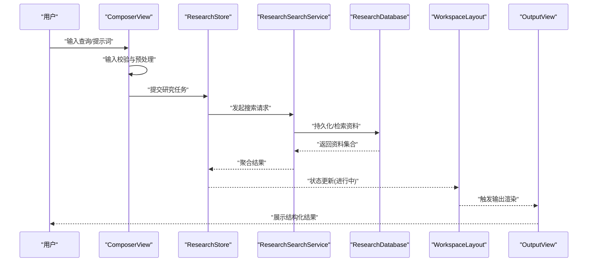
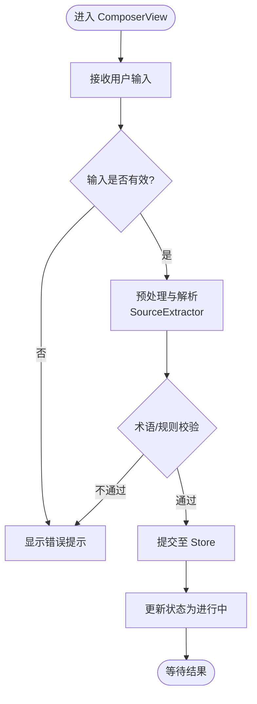
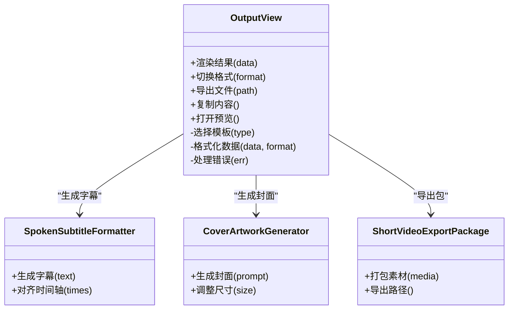
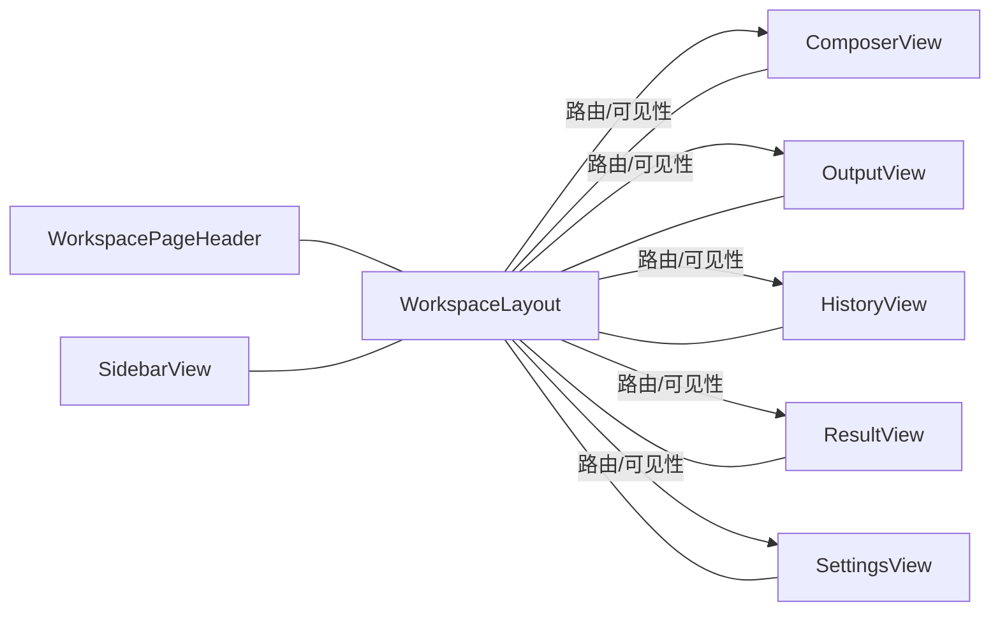
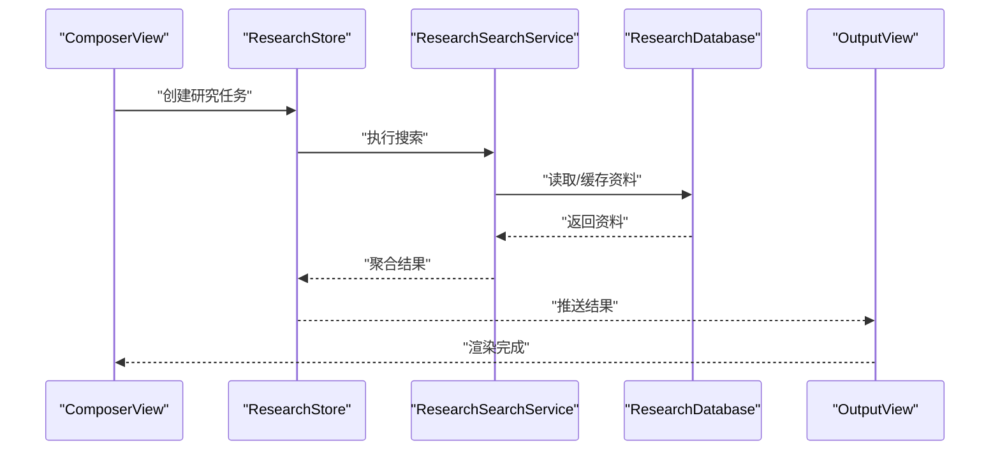
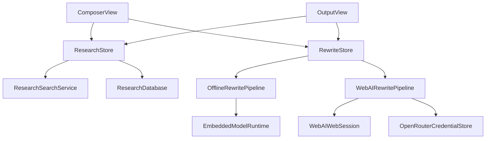

# 用户界面交互流程

<cite>
**本文引用的文件**   
- [ChengGaoApp.swift](file://Sources/ChengGao/App/ChengGaoApp.swift)
- [ContentView.swift](file://Sources/ChengGao/Views/ContentView.swift)
- [ComposerView.swift](file://Sources/ChengGao/Views/ComposerView.swift)
- [OutputView.swift](file://Sources/ChengGao/Views/OutputView.swift)
- [WorkspaceLayout.swift](file://Sources/ChengGao/Views/WorkspaceLayout.swift)
- [WorkspaceGlassStyle.swift](file://Sources/ChengGao/Views/WorkspaceGlassStyle.swift)
- [ResearchStore.swift](file://Sources/ChengGao/Stores/ResearchStore.swift)
- [RewriteStore.swift](file://Sources/ChengGao/Stores/RewriteStore.swift)
- [OfflineRewritePipeline.swift](file://Sources/ChengGao/Services/OfflineRewritePipeline.swift)
- [WebAIRewritePipeline.swift](file://Sources/ChengGao/Services/WebAIRewritePipeline.swift)
- [EmbeddedModelRuntime.swift](file://Sources/ChengGao/Services/EmbeddedModelRuntime.swift)
- [TerminologyVerifier.swift](file://Sources/ChengGao/Services/TerminologyVerifier.swift)
- [SpokenSubtitleFormatter.swift](file://Sources/ChengGao/Services/SpokenSubtitleFormatter.swift)
- [CoverArtworkGenerator.swift](file://Sources/ChengGao/Services/CoverArtworkGenerator.swift)
- [PlatformSessionStore.swift](file://Sources/ChengGao/Services/PlatformSessionStore.swift)
- [PlatformWebSessionPool.swift](file://Sources/ChengGao/Services/PlatformWebSessionPool.swift)
- [OpenRouterCredentialStore.swift](file://Sources/ChengGao/Services/OpenRouterCredentialStore.swift)
- [ResearchDatabase.swift](file://Sources/ChengGao/Services/ResearchDatabase.swift)
- [ResearchSearchService.swift](file://Sources/ChengGao/Services/ResearchSearchService.swift)
- [WebKitResearchSearchService.swift](file://Sources/ChengGao/Services/WebKitResearchSearchService.swift)
- [ShortVideoExportPackage.swift](file://Sources/ChengGao/Services/ShortVideoExportPackage.swift)
- [LocalSpeechTranscriber.swift](file://Sources/ChengGao/Services/LocalSpeechTranscriber.swift)
- [OnlineAIModelCatalogClient.swift](file://Sources/ChengGao/Services/OnlineAIModel目录客户端.swift)
- [CompatibleImageGenerationClient.swift](file://Sources/ChengGao/Services/CompatibleImageGenerationClient.swift)
- [SourceExtractor.swift](file://Sources/ChengGao/Services/SourceExtractor.swift)
- [XiaohongshuContentResolver.swift](file://Sources/ChengGao/Services/Xiaohongshu内容解析器.swift)
- [DouyinVideoResolver.swift](file://Sources/ChengGao/Services/Douyin视频解析器.swift)
- [VideoFrameTextExtractor.swift](file://Sources/ChengGao/Services/VideoFrameText提取器.swift)
- [VideoSuggestionPlanner.swift](file://Sources/ChengGao/Services/VideoSuggestionPlanner.swift)
- [VisualPromptGenerator.swift](file://Sources/ChengGao/Services/VisualPromptGenerator.swift)
- [WebAIWebSession.swift](file://Sources/ChengGao/Services/WebAIWebSession.swift)
- [ModelProfile.swift](file://Sources/ChengGao/Models/ModelProfile.swift)
- [OnlineAIConfiguration.swift](file://Sources/ChengGao/Models/OnlineAIConfiguration.swift)
- [ResearchModels.swift](file://Sources/ChengGao/Models/ResearchModels.swift)
- [RewriteModels.swift](file://Sources/ChengGao/Models/RewriteModels.swift)
- [WebAIModels.swift](file://Sources/ChengGao/Models/WebAIModels.swift)
- [SidebarView.swift](file://Sources/ChengGao/Views/SidebarView.swift)
- [SettingsView.swift](file://Sources/ChengGao/Views/SettingsView.swift)
- [HistoryView.swift](file://Sources/ChengGao/Views/HistoryView.swift)
- [ResultView.swift](file://Sources/ChengGao/Views/ResultView.swift)
- [WorkspacePageHeader.swift](file://Sources/ChengGao/Views/WorkspacePageHeader.swift)
</cite>

## 目录
1. [简介](#简介)
2. [项目结构](#项目结构)
3. [核心组件](#核心组件)
4. [架构总览](#架构总览)
5. [详细组件分析](#详细组件分析)
6. [依赖关系分析](#依赖关系分析)
7. [性能考量](#性能考量)
8. [故障排查指南](#故障排查指南)
9. [结论](#结论)
10. [附录](#附录)

## 简介
本文件系统化梳理 ChengGao 的用户界面交互流程与数据处理链路，聚焦从用户输入到最终输出的完整数据流转。重点覆盖：
- ComposerView 的输入处理、状态管理与验证机制
- OutputView 的输出渲染、格式化选项与用户交互
- WorkspaceLayout 的整体布局架构与组件通信模式
- 界面状态管理、错误处理与用户反馈机制
- 界面定制选项、主题支持与响应式设计实现
- UI 组件使用示例与扩展方法

## 项目结构
ChengGao 采用 SwiftUI 构建，应用入口位于 App 层，视图集中在 Views，业务逻辑通过 Services 提供，状态由 Stores 管理，模型定义在 Models。整体分层清晰，便于扩展与维护。

```mermaid
graph TB
subgraph "应用层"
App["ChengGaoApp"]
ContentView["ContentView"]
end
subgraph "工作区"
WorkspaceLayout["WorkspaceLayout"]
Sidebar["SidebarView"]
PageHeader["WorkspacePageHeader"]
Composer["ComposerView"]
Output["OutputView"]
History["HistoryView"]
Result["ResultView"]
Settings["SettingsView"]
end
subgraph "状态与模型"
ResearchStore["ResearchStore"]
RewriteStore["RewriteStore"]
ModelProfile["ModelProfile"]
OnlineConfig["OnlineAIConfiguration"]
ResearchModels["ResearchModels"]
RewriteModels["RewriteModels"]
WebAIModels["WebAIModels"]
end
subgraph "服务层"
OfflinePipeline["OfflineRewritePipeline"]
WebPipeline["WebAIRewritePipeline"]
EmbeddedRuntime["EmbeddedModelRuntime"]
Verifier["TerminologyVerifier"]
SubtitleFmt["SpokenSubtitleFormatter"]
CoverGen["CoverArtworkGenerator"]
SessionStore["PlatformSessionStore"]
WebSessionPool["PlatformWebSessionPool"]
CredentialStore["OpenRouterCredentialStore"]
ResearchDB["ResearchDatabase"]
SearchSvc["ResearchSearchService"]
WebKitSearch["WebKitResearchSearchService"]
ExportPkg["ShortVideoExportPackage"]
LocalTranscriber["LocalSpeechTranscriber"]
ModelCatalog["OnlineAIModelCatalogClient"]
ImageClient["CompatibleImageGenerationClient"]
SourceExt["SourceExtractor"]
XHSResolver["XiaohongshuContentResolver"]
DouyinResolver["DouyinVideoResolver"]
FrameExtractor["VideoFrameTextExtractor"]
SuggestPlanner["VideoSuggestionPlanner"]
PromptGen["VisualPromptGenerator"]
WebSession["WebAIWebSession"]
end
App --> ContentView
ContentView --> WorkspaceLayout
WorkspaceLayout --> Sidebar
WorkspaceLayout --> PageHeader
WorkspaceLayout --> Composer
WorkspaceLayout --> Output
WorkspaceLayout --> History
WorkspaceLayout --> Result
WorkspaceLayout --> Settings
Composer --> ResearchStore
Composer --> RewriteStore
Output --> ResearchStore
Output --> RewriteStore
ResearchStore --> ResearchDB
ResearchStore --> SearchSvc
SearchSvc --> WebKitSearch
RewriteStore --> OfflinePipeline
RewriteStore --> WebPipeline
OfflinePipeline --> EmbeddedRuntime
WebPipeline --> WebSession
WebPipeline --> CredentialStore
WebPipeline --> ModelCatalog
Output --> SubtitleFmt
Output --> CoverGen
Output --> ExportPkg
Output --> ImageClient
Output --> PromptGen
```

图表来源
- [ChengGaoApp.swift](file://Sources/ChengGao/App/ChengGaoApp.swift)
- [ContentView.swift](file://Sources/ChengGao/Views/ContentView.swift)
- [WorkspaceLayout.swift](file://Sources/ChengGao/Views/WorkspaceLayout.swift)
- [ComposerView.swift](file://Sources/ChengGao/Views/ComposerView.swift)
- [OutputView.swift](file://Sources/ChengGao/Views/OutputView.swift)
- [ResearchStore.swift](file://Sources/ChengGao/Stores/ResearchStore.swift)
- [RewriteStore.swift](file://Sources/ChengGao/Stores/RewriteStore.swift)
- [OfflineRewritePipeline.swift](file://Sources/ChengGao/Services/OfflineRewritePipeline.swift)
- [WebAIRewritePipeline.swift](file://Sources/ChengGao/Services/WebAIRewritePipeline.swift)
- [EmbeddedModelRuntime.swift](file://Sources/ChengGao/Services/EmbeddedModelRuntime.swift)
- [TerminologyVerifier.swift](file://Sources/ChengGao/Services/TerminologyVerifier.swift)
- [SpokenSubtitleFormatter.swift](file://Sources/ChengGao/Services/SpokenSubtitleFormatter.swift)
- [CoverArtworkGenerator.swift](file://Sources/ChengGao/Services/CoverArtworkGenerator.swift)
- [PlatformSessionStore.swift](file://Sources/ChengGao/Services/PlatformSessionStore.swift)
- [PlatformWebSessionPool.swift](file://Sources/ChengGao/Services/PlatformWebSessionPool.swift)
- [OpenRouterCredentialStore.swift](file://Sources/ChengGao/Services/OpenRouterCredentialStore.swift)
- [ResearchDatabase.swift](file://Sources/ChengGao/Services/ResearchDatabase.swift)
- [ResearchSearchService.swift](file://Sources/ChengGao/Services/ResearchSearchService.swift)
- [WebKitResearchSearchService.swift](file://Sources/ChengGao/Services/WebKitResearchSearchService.swift)
- [ShortVideoExportPackage.swift](file://Sources/ChengGao/Services/ShortVideoExportPackage.swift)
- [LocalSpeechTranscriber.swift](file://Sources/ChengGao/Services/LocalSpeechTranscriber.swift)
- [OnlineAIModelCatalogClient.swift](file://Sources/ChengGao/Services/OnlineAIModel目录客户端.swift)
- [CompatibleImageGenerationClient.swift](file://Sources/ChengGao/Services/CompatibleImageGenerationClient.swift)
- [SourceExtractor.swift](file://Sources/ChengGao/Services/SourceExtractor.swift)
- [XiaohongshuContentResolver.swift](file://Sources/ChengGao/Services/Xiaohongshu内容解析器.swift)
- [DouyinVideoResolver.swift](file://Sources/ChengGao/Services/Douyin视频解析器.swift)
- [VideoFrameTextExtractor.swift](file://Sources/ChengGao/Services/VideoFrameText提取器.swift)
- [VideoSuggestionPlanner.swift](file://Sources/ChengGao/Services/VideoSuggestionPlanner.swift)
- [VisualPromptGenerator.swift](file://Sources/ChengGao/Services/VisualPromptGenerator.swift)
- [WebAIWebSession.swift](file://Sources/ChengGao/Services/WebAIWebSession.swift)

章节来源
- [ChengGaoApp.swift](file://Sources/ChengGao/App/ChengGaoApp.swift)
- [ContentView.swift](file://Sources/ChengGao/Views/ContentView.swift)
- [WorkspaceLayout.swift](file://Sources/ChengGao/Views/WorkspaceLayout.swift)

## 核心组件
- 应用入口与根视图：负责初始化全局环境、注入依赖、挂载主布局。
- 工作区布局：组织侧边栏、页面头部、编辑区与输出区的布局与导航。
- 编辑器（ComposerView）：承载用户输入、校验、预览与提交。
- 输出（OutputView）：渲染结果、支持多种格式导出与交互操作。
- 状态存储（ResearchStore/RewriteStore）：集中管理研究任务与改写任务的状态与历史。
- 服务层：离线/在线改写、搜索、转写、图像生成、导出等能力。

章节来源
- [ChengGaoApp.swift](file://Sources/ChengGao/App/ChengGaoApp.swift)
- [ContentView.swift](file://Sources/ChengGao/Views/ContentView.swift)
- [WorkspaceLayout.swift](file://Sources/ChengGao/Views/WorkspaceLayout.swift)
- [ComposerView.swift](file://Sources/ChengGao/Views/ComposerView.swift)
- [OutputView.swift](file://Sources/ChengGao/Views/OutputView.swift)
- [ResearchStore.swift](file://Sources/ChengGao/Stores/ResearchStore.swift)
- [RewriteStore.swift](file://Sources/ChengGao/Stores/RewriteStore.swift)

## 架构总览
ChengGao 遵循“视图-状态-服务”的分层架构：
- 视图层（SwiftUI）：ComposerView、OutputView、WorkspaceLayout 等负责展示与交互。
- 状态层（Stores）：ResearchStore、RewriteStore 作为单一事实源，驱动视图更新。
- 服务层（Services）：封装离线/在线改写、搜索、转写、导出等功能，提供异步能力。
- 模型层（Models）：统一数据结构，贯穿各层。

图表来源
- [ComposerView.swift](file://Sources/ChengGao/Views/ComposerView.swift)
- [ResearchStore.swift](file://Sources/ChengGao/Stores/ResearchStore.swift)
- [ResearchSearchService.swift](file://Sources/ChengGao/Services/ResearchSearchService.swift)
- [ResearchDatabase.swift](file://Sources/ChengGao/Services/ResearchDatabase.swift)
- [WorkspaceLayout.swift](file://Sources/ChengGao/Views/WorkspaceLayout.swift)
- [OutputView.swift](file://Sources/ChengGao/Views/OutputView.swift)

## 详细组件分析

### ComposerView 输入处理、状态管理与验证机制
- 输入处理：接收文本、附件或链接，进行基础校验（非空、长度、格式），必要时调用 SourceExtractor 解析外部资源。
- 状态管理：将任务写入 ResearchStore/RewriteStore，维护任务生命周期（待处理、进行中、完成、失败）。
- 验证机制：内置规则校验（术语一致性、敏感信息过滤），可结合 TerminologyVerifier 进行术语核验。
- 用户反馈：通过进度指示、错误提示与成功通知提升可用性。

图表来源
- [ComposerView.swift](file://Sources/ChengGao/Views/ComposerView.swift)
- [SourceExtractor.swift](file://Sources/ChengGao/Services/SourceExtractor.swift)
- [TerminologyVerifier.swift](file://Sources/ChengGao/Services/TerminologyVerifier.swift)
- [ResearchStore.swift](file://Sources/ChengGao/Stores/ResearchStore.swift)
- [RewriteStore.swift](file://Sources/ChengGao/Stores/RewriteStore.swift)

章节来源
- [ComposerView.swift](file://Sources/ChengGao/Views/ComposerView.swift)
- [SourceExtractor.swift](file://Sources/ChengGao/Services/SourceExtractor.swift)
- [TerminologyVerifier.swift](file://Sources/ChengGao/Services/TerminologyVerifier.swift)
- [ResearchStore.swift](file://Sources/ChengGao/Stores/ResearchStore.swift)
- [RewriteStore.swift](file://Sources/ChengGao/Stores/RewriteStore.swift)

### OutputView 输出渲染、格式化选项与用户交互
- 渲染策略：根据任务类型选择渲染模板（文本、表格、媒体、代码片段等），支持富文本与 Markdown。
- 格式化选项：支持导出为纯文本、Markdown、JSON、字幕（SpokenSubtitleFormatter）、封面图（CoverArtworkGenerator）等。
- 用户交互：复制、下载、分享、预览切换、分页/折叠、搜索定位。
- 错误处理：网络异常、解析失败时回退到安全视图并提示重试。

图表来源
- [OutputView.swift](file://Sources/ChengGao/Views/OutputView.swift)
- [SpokenSubtitleFormatter.swift](file://Sources/ChengGao/Services/SpokenSubtitleFormatter.swift)
- [CoverArtworkGenerator.swift](file://Sources/ChengGao/Services/CoverArtworkGenerator.swift)
- [ShortVideoExportPackage.swift](file://Sources/ChengGao/Services/ShortVideoExportPackage.swift)

章节来源
- [OutputView.swift](file://Sources/ChengGao/Views/OutputView.swift)
- [SpokenSubtitleFormatter.swift](file://Sources/ChengGao/Services/SpokenSubtitleFormatter.swift)
- [CoverArtworkGenerator.swift](file://Sources/ChengGao/Services/CoverArtworkGenerator.swift)
- [ShortVideoExportPackage.swift](file://Sources/ChengGao/Services/ShortVideoExportPackage.swift)

### WorkspaceLayout 整体布局架构与组件通信
- 布局结构：顶部页头（WorkspacePageHeader）、左侧导航（SidebarView）、主内容区（ComposerView/OutputView/History/Result/Settings）。
- 通信模式：基于 Store 的单向数据流；子组件通过回调或闭包向父组件传递事件；跨组件共享状态通过 Store 订阅。
- 响应式：适配不同窗口尺寸，动态切换布局（单列/双列/三列）。

图表来源
- [WorkspaceLayout.swift](file://Sources/ChengGao/Views/WorkspaceLayout.swift)
- [WorkspacePageHeader.swift](file://Sources/ChengGao/Views/WorkspacePageHeader.swift)
- [SidebarView.swift](file://Sources/ChengGao/Views/SidebarView.swift)
- [ComposerView.swift](file://Sources/ChengGao/Views/ComposerView.swift)
- [OutputView.swift](file://Sources/ChengGao/Views/OutputView.swift)
- [HistoryView.swift](file://Sources/ChengGao/Views/HistoryView.swift)
- [ResultView.swift](file://Sources/ChengGao/Views/ResultView.swift)
- [SettingsView.swift](file://Sources/ChengGao/Views/SettingsView.swift)

章节来源
- [WorkspaceLayout.swift](file://Sources/ChengGao/Views/WorkspaceLayout.swift)
- [WorkspacePageHeader.swift](file://Sources/ChengGao/Views/WorkspacePageHeader.swift)
- [SidebarView.swift](file://Sources/ChengGao/Views/SidebarView.swift)

### 数据处理链路：从输入到输出
- 研究链路：ComposerView 提交 -> ResearchStore -> ResearchSearchService -> ResearchDatabase -> 结果聚合 -> OutputView 渲染。
- 改写链路：ComposerView 提交 -> RewriteStore -> OfflineRewritePipeline/EmbeddedModelRuntime 或 WebAIRewritePipeline/WebAIWebSession -> OutputView 渲染。
- 辅助能力：本地转写（LocalSpeechTranscriber）、字幕生成（SpokenSubtitleFormatter）、封面生成（CoverArtworkGenerator）、短剧导出（ShortVideoExportPackage）。

图表来源
- [ComposerView.swift](file://Sources/ChengGao/Views/ComposerView.swift)
- [ResearchStore.swift](file://Sources/ChengGao/Stores/ResearchStore.swift)
- [ResearchSearchService.swift](file://Sources/ChengGao/Services/ResearchSearchService.swift)
- [ResearchDatabase.swift](file://Sources/ChengGao/Services/ResearchDatabase.swift)
- [OutputView.swift](file://Sources/ChengGao/Views/OutputView.swift)

章节来源
- [ResearchStore.swift](file://Sources/ChengGao/Stores/ResearchStore.swift)
- [ResearchSearchService.swift](file://Sources/ChengGao/Services/ResearchSearchService.swift)
- [ResearchDatabase.swift](file://Sources/ChengGao/Services/ResearchDatabase.swift)
- [OfflineRewritePipeline.swift](file://Sources/ChengGao/Services/OfflineRewritePipeline.swift)
- [WebAIRewritePipeline.swift](file://Sources/ChengGao/Services/WebAIRewritePipeline.swift)
- [EmbeddedModelRuntime.swift](file://Sources/ChengGao/Services/EmbeddedModelRuntime.swift)
- [WebAIWebSession.swift](file://Sources/ChengGao/Services/WebAIWebSession.swift)

### 界面状态管理、错误处理与用户反馈
- 状态管理：Store 作为单一事实源，视图仅消费状态；变更通过动作派发，确保可预测更新。
- 错误处理：网络/解析/权限错误统一捕获，降级到安全视图，并提供重试与日志上报。
- 用户反馈：加载态、成功/失败提示、进度条、可撤销操作。

章节来源
- [ResearchStore.swift](file://Sources/ChengGao/Stores/ResearchStore.swift)
- [RewriteStore.swift](file://Sources/ChengGao/Stores/RewriteStore.swift)
- [OutputView.swift](file://Sources/ChengGao/Views/OutputView.swift)
- [ComposerView.swift](file://Sources/ChengGao/Views/ComposerView.swift)

### 界面定制选项、主题支持与响应式设计
- 主题支持：通过 WorkspaceGlassStyle 提供玻璃态风格与配色方案，支持明暗主题切换。
- 定制选项：字体大小、行距、边距、颜色变量可通过设置面板配置。
- 响应式：依据窗口尺寸自动切换布局模式，保证多屏体验一致。

章节来源
- [WorkspaceGlassStyle.swift](file://Sources/ChengGao/Views/WorkspaceGlassStyle.swift)
- [SettingsView.swift](file://Sources/ChengGao/Views/SettingsView.swift)
- [WorkspaceLayout.swift](file://Sources/ChengGao/Views/WorkspaceLayout.swift)

### UI 组件使用示例与扩展方法
- 使用示例：在 WorkspaceLayout 中嵌入 ComposerView 与 OutputView，并通过 Store 同步状态。
- 扩展方法：新增渲染器（如新的导出格式）只需实现对应 Formatter/Generator 并在 OutputView 注册。
- 自定义验证：在 ComposerView 中接入 TerminologyVerifier 或自定义校验器，增强输入质量。

章节来源
- [WorkspaceLayout.swift](file://Sources/ChengGao/Views/WorkspaceLayout.swift)
- [OutputView.swift](file://Sources/ChengGao/Views/OutputView.swift)
- [ComposerView.swift](file://Sources/ChengGao/Views/ComposerView.swift)
- [TerminologyVerifier.swift](file://Sources/ChengGao/Services/TerminologyVerifier.swift)

## 依赖关系分析
- 视图依赖 Store：ComposerView/OutputView 依赖 ResearchStore/RewriteStore 获取与更新状态。
- Store 依赖 Services：ResearchStore 依赖搜索与数据库服务；RewriteStore 依赖离线/在线改写管线。
- 服务间解耦：各 Service 职责单一，通过协议或接口组合，降低耦合度。

图表来源
- [ComposerView.swift](file://Sources/ChengGao/Views/ComposerView.swift)
- [OutputView.swift](file://Sources/ChengGao/Views/OutputView.swift)
- [ResearchStore.swift](file://Sources/ChengGao/Stores/ResearchStore.swift)
- [RewriteStore.swift](file://Sources/ChengGao/Stores/RewriteStore.swift)
- [ResearchSearchService.swift](file://Sources/ChengGao/Services/ResearchSearchService.swift)
- [ResearchDatabase.swift](file://Sources/ChengGao/Services/ResearchDatabase.swift)
- [OfflineRewritePipeline.swift](file://Sources/ChengGao/Services/OfflineRewritePipeline.swift)
- [WebAIRewritePipeline.swift](file://Sources/ChengGao/Services/WebAIRewritePipeline.swift)
- [EmbeddedModelRuntime.swift](file://Sources/ChengGao/Services/EmbeddedModelRuntime.swift)
- [WebAIWebSession.swift](file://Sources/ChengGao/Services/WebAIWebSession.swift)
- [OpenRouterCredentialStore.swift](file://Sources/ChengGao/Services/OpenRouterCredentialStore.swift)

章节来源
- [ResearchStore.swift](file://Sources/ChengGao/Stores/ResearchStore.swift)
- [RewriteStore.swift](file://Sources/ChengGao/Stores/RewriteStore.swift)
- [ResearchSearchService.swift](file://Sources/ChengGao/Services/ResearchSearchService.swift)
- [ResearchDatabase.swift](file://Sources/ChengGao/Services/ResearchDatabase.swift)
- [OfflineRewritePipeline.swift](file://Sources/ChengGao/Services/OfflineRewritePipeline.swift)
- [WebAIRewritePipeline.swift](file://Sources/ChengGao/Services/WebAIRewritePipeline.swift)
- [EmbeddedModelRuntime.swift](file://Sources/ChengGao/Services/EmbeddedModelRuntime.swift)
- [WebAIWebSession.swift](file://Sources/ChengGao/Services/WebAIWebSession.swift)
- [OpenRouterCredentialStore.swift](file://Sources/ChengGao/Services/OpenRouterCredentialStore.swift)

## 性能考量
- 异步与并发：所有耗时操作（搜索、改写、转写、导出）均异步执行，避免阻塞 UI。
- 缓存策略：ResearchDatabase 缓存搜索结果，减少重复请求；WebSessionPool 复用会话连接。
- 内存优化：大对象（图片、视频帧）按需加载与释放；导出任务分块处理。
- 渲染优化：OutputView 对长列表进行虚拟化渲染；按需刷新最小状态单元。

[本节为通用指导，无需特定文件引用]

## 故障排查指南
- 常见问题
  - 输入校验失败：检查 ComposerView 的校验规则与 TerminologyVerifier 配置。
  - 搜索无结果：确认 ResearchSearchService 的网络与权限，查看 ResearchDatabase 缓存。
  - 改写失败：区分离线/在线管线，检查 EmbeddedModelRuntime 或 WebAIWebSession 的认证与配额。
  - 导出失败：检查文件格式与目标路径权限，查看 SpokenSubtitleFormatter/CoverArtworkGenerator 的错误码。
- 调试建议
  - 启用详细日志，关注 Store 的状态变更与 Services 的错误堆栈。
  - 使用 SettingsView 切换调试模式，观察网络请求与本地缓存。

章节来源
- [ComposerView.swift](file://Sources/ChengGao/Views/ComposerView.swift)
- [TerminologyVerifier.swift](file://Sources/ChengGao/Services/TerminologyVerifier.swift)
- [ResearchSearchService.swift](file://Sources/ChengGao/Services/ResearchSearchService.swift)
- [ResearchDatabase.swift](file://Sources/ChengGao/Services/ResearchDatabase.swift)
- [OfflineRewritePipeline.swift](file://Sources/ChengGao/Services/OfflineRewritePipeline.swift)
- [WebAIRewritePipeline.swift](file://Sources/ChengGao/Services/WebAIRewritePipeline.swift)
- [EmbeddedModelRuntime.swift](file://Sources/ChengGao/Services/EmbeddedModelRuntime.swift)
- [WebAIWebSession.swift](file://Sources/ChengGao/Services/WebAIWebSession.swift)
- [SpokenSubtitleFormatter.swift](file://Sources/ChengGao/Services/SpokenSubtitleFormatter.swift)
- [CoverArtworkGenerator.swift](file://Sources/ChengGao/Services/CoverArtworkGenerator.swift)
- [SettingsView.swift](file://Sources/ChengGao/Views/SettingsView.swift)

## 结论
ChengGao 以清晰的“视图-状态-服务”分层与 Store 驱动的单向数据流，实现了从用户输入到多模态输出的完整链路。ComposerView 与 OutputView 分别承担输入与渲染的核心职责，WorkspaceLayout 提供灵活的布局与导航。通过模块化服务与可扩展的渲染器，系统具备良好的可维护性与扩展性。建议在后续迭代中继续强化错误恢复、性能监控与主题定制能力。

[本节为总结性内容，无需特定文件引用]

## 附录
- 模型参考：ModelProfile、OnlineAIConfiguration、ResearchModels、RewriteModels、WebAIModels 定义了跨层的数据契约。
- 平台集成：PlatformSessionStore、PlatformWebSessionPool、OpenRouterCredentialStore 提供平台相关能力。
- 媒体处理：LocalSpeechTranscriber、SpokenSubtitleFormatter、CoverArtworkGenerator、ShortVideoExportPackage 支持音视频与图像生成。

章节来源
- [ModelProfile.swift](file://Sources/ChengGao/Models/ModelProfile.swift)
- [OnlineAIConfiguration.swift](file://Sources/ChengGao/Models/OnlineAIConfiguration.swift)
- [ResearchModels.swift](file://Sources/ChengGao/Models/ResearchModels.swift)
- [RewriteModels.swift](file://Sources/ChengGao/Models/RewriteModels.swift)
- [WebAIModels.swift](file://Sources/ChengGao/Models/WebAIModels.swift)
- [PlatformSessionStore.swift](file://Sources/ChengGao/Services/PlatformSessionStore.swift)
- [PlatformWebSessionPool.swift](file://Sources/ChengGao/Services/PlatformWebSessionPool.swift)
- [OpenRouterCredentialStore.swift](file://Sources/ChengGao/Services/OpenRouterCredentialStore.swift)
- [LocalSpeechTranscriber.swift](file://Sources/ChengGao/Services/LocalSpeechTranscriber.swift)
- [SpokenSubtitleFormatter.swift](file://Sources/ChengGao/Services/SpokenSubtitleFormatter.swift)
- [CoverArtworkGenerator.swift](file://Sources/ChengGao/Services/CoverArtworkGenerator.swift)
- [ShortVideoExportPackage.swift](file://Sources/ChengGao/Services/ShortVideoExportPackage.swift)