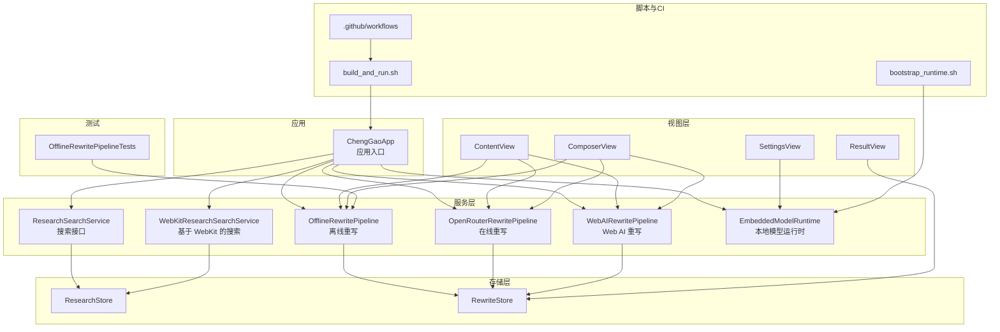
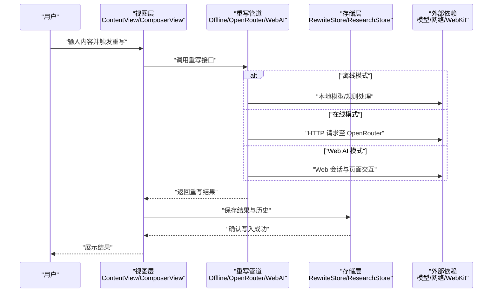
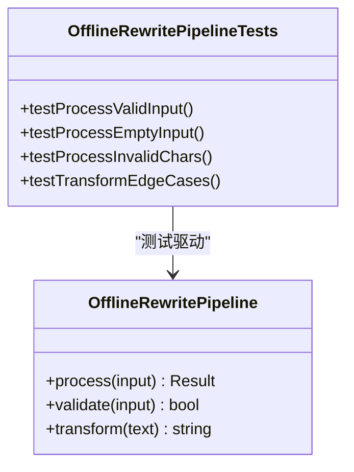
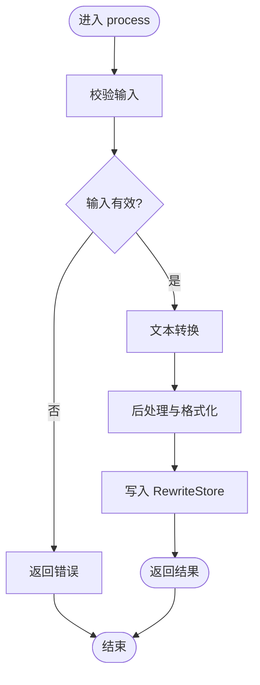
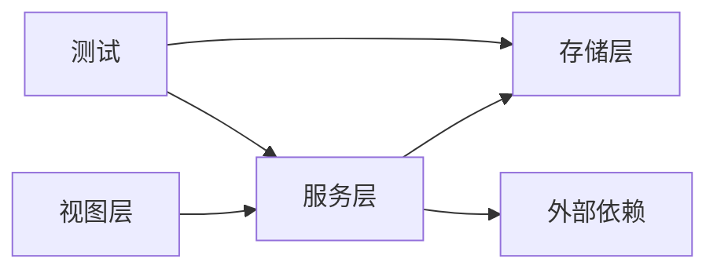

# 测试指南

<cite>
**本文档引用的文件**   
- [Package.swift](file://Package.swift)
- [ChengGaoApp.swift](file://Sources/ChengGao/App/ChengGaoApp.swift)
- [OfflineRewritePipeline.swift](file://Sources/ChengGao/Services/OfflineRewritePipeline.swift)
- [OpenRouterRewritePipeline.swift](file://Sources/ChengGao/Services/OpenRouterRewritePipeline.swift)
- [WebAIRewritePipeline.swift](file://Sources/ChengGao/Services/WebAIRewritePipeline.swift)
- [ResearchSearchService.swift](file://Sources/ChengGao/Services/ResearchSearchService.swift)
- [WebKitResearchSearchService.swift](file://Sources/ChengGao/Services/WebKitResearchSearchService.swift)
- [EmbeddedModelRuntime.swift](file://Sources/ChengGao/Services/EmbeddedModelRuntime.swift)
- [ResearchStore.swift](file://Sources/ChengGao/Stores/ResearchStore.swift)
- [RewriteStore.swift](file://Sources/ChengGao/Stores/RewriteStore.swift)
- [ContentView.swift](file://Sources/ChengGao/Views/ContentView.swift)
- [ComposerView.swift](file://Sources/ChengGao/Views/ComposerView.swift)
- [ResultView.swift](file://Sources/ChengGao/Views/ResultView.swift)
- [SettingsView.swift](file://Sources/ChengGao/Views/SettingsView.swift)
- [OfflineRewritePipelineTests.swift](file://Tests/ChengGaoTests/OfflineRewritePipelineTests.swift)
- [build_and_run.sh](file://script/build_and_run.sh)
- [bootstrap_runtime.sh](file://script/bootstrap_runtime.sh)
- [.github/workflows](file://.github/workflows)
</cite>

## 目录
1. [简介](#简介)
2. [项目结构](#项目结构)
3. [核心组件](#核心组件)
4. [架构总览](#架构总览)
5. [详细组件分析](#详细组件分析)
6. [依赖分析](#依赖分析)
7. [性能考虑](#性能考虑)
8. [故障排查指南](#故障排查指南)
9. [结论](#结论)
10. [附录](#附录)

## 简介
本测试指南面向 ChengGao 项目的单元测试、集成测试与 UI 测试，覆盖重写管道（离线、在线、Web AI）、搜索服务与 AI 集成的测试策略与实现。文档包含：
- 测试框架选择与配置
- 测试数据准备与模拟对象创建
- 关键业务流程的测试用例设计
- 测试环境搭建、持续集成与自动化流程
- 覆盖率分析、性能与负载测试方法
- 调试技巧与常见问题排查

## 项目结构
本项目采用 Swift Package Manager 组织代码，应用入口位于 App 层，业务逻辑集中在 Services 层，状态管理在 Stores 层，UI 在 Views 层。测试位于 Tests/ChengGaoTests。脚本位于 script，CI 配置位于 .github/workflows。

图表来源
- [ChengGaoApp.swift](file://Sources/ChengGao/App/ChengGaoApp.swift)
- [OfflineRewritePipeline.swift](file://Sources/ChengGao/Services/OfflineRewritePipeline.swift)
- [OpenRouterRewritePipeline.swift](file://Sources/ChengGao/Services/OpenRouterRewritePipeline.swift)
- [WebAIRewritePipeline.swift](file://Sources/ChengGao/Services/WebAIRewritePipeline.swift)
- [ResearchSearchService.swift](file://Sources/ChengGao/Services/ResearchSearchService.swift)
- [WebKitResearchSearchService.swift](file://Sources/ChengGao/Services/WebKitResearchSearchService.swift)
- [EmbeddedModelRuntime.swift](file://Sources/ChengGao/Services/EmbeddedModelRuntime.swift)
- [ResearchStore.swift](file://Sources/ChengGao/Stores/ResearchStore.swift)
- [RewriteStore.swift](file://Sources/ChengGao/Stores/RewriteStore.swift)
- [ContentView.swift](file://Sources/ChengGao/Views/ContentView.swift)
- [ComposerView.swift](file://Sources/ChengGao/Views/ComposerView.swift)
- [ResultView.swift](file://Sources/ChengGao/Views/ResultView.swift)
- [SettingsView.swift](file://Sources/ChengGao/Views/SettingsView.swift)
- [OfflineRewritePipelineTests.swift](file://Tests/ChengGaoTests/OfflineRewritePipelineTests.swift)
- [build_and_run.sh](file://script/build_and_run.sh)
- [bootstrap_runtime.sh](file://script/bootstrap_runtime.sh)
- [.github/workflows](file://.github/workflows)

章节来源
- [Package.swift](file://Package.swift)
- [ChengGaoApp.swift](file://Sources/ChengGao/App/ChengGaoApp.swift)

## 核心组件
- 重写管道
  - 离线重写：OfflineRewritePipeline，用于本地模型或规则引擎的重写流程。
  - 在线重写：OpenRouterRewritePipeline，调用外部 OpenRouter 服务进行重写。
  - Web AI 重写：WebAIRewritePipeline，通过 Web 会话访问 AI 能力。
- 搜索服务
  - ResearchSearchService：抽象搜索接口。
  - WebKitResearchSearchService：基于 WebKit 的具体实现。
- AI 运行时
  - EmbeddedModelRuntime：本地模型运行时的封装。
- 存储
  - RewriteStore：重写结果与历史持久化。
  - ResearchStore：研究相关数据持久化。
- UI
  - ContentView、ComposerView、ResultView、SettingsView：用户交互入口与展示。

章节来源
- [OfflineRewritePipeline.swift](file://Sources/ChengGao/Services/OfflineRewritePipeline.swift)
- [OpenRouterRewritePipeline.swift](file://Sources/ChengGao/Services/OpenRouterRewritePipeline.swift)
- [WebAIRewritePipeline.swift](file://Sources/ChengGao/Services/WebAIRewritePipeline.swift)
- [ResearchSearchService.swift](file://Sources/ChengGao/Services/ResearchSearchService.swift)
- [WebKitResearchSearchService.swift](file://Sources/ChengGao/Services/WebKitResearchSearchService.swift)
- [EmbeddedModelRuntime.swift](file://Sources/ChengGao/Services/EmbeddedModelRuntime.swift)
- [ResearchStore.swift](file://Sources/ChengGao/Stores/ResearchStore.swift)
- [RewriteStore.swift](file://Sources/ChengGao/Stores/RewriteStore.swift)
- [ContentView.swift](file://Sources/ChengGao/Views/ContentView.swift)
- [ComposerView.swift](file://Sources/ChengGao/Views/ComposerView.swift)
- [ResultView.swift](file://Sources/ChengGao/Views/ResultView.swift)
- [SettingsView.swift](file://Sources/ChengGao/Views/SettingsView.swift)

## 架构总览
下图展示了从 UI 到服务层再到存储与外部依赖的整体调用关系，以及测试如何介入关键路径。

图表来源
- [ContentView.swift](file://Sources/ChengGao/Views/ContentView.swift)
- [ComposerView.swift](file://Sources/ChengGao/Views/ComposerView.swift)
- [OfflineRewritePipeline.swift](file://Sources/ChengGao/Services/OfflineRewritePipeline.swift)
- [OpenRouterRewritePipeline.swift](file://Sources/ChengGao/Services/OpenRouterRewritePipeline.swift)
- [WebAIRewritePipeline.swift](file://Sources/ChengGao/Services/WebAIRewritePipeline.swift)
- [RewriteStore.swift](file://Sources/ChengGao/Stores/RewriteStore.swift)
- [ResearchStore.swift](file://Sources/ChengGao/Stores/ResearchStore.swift)

## 详细组件分析

### 单元测试：重写管道（离线）
- 目标
  - 验证 OfflineRewritePipeline 的核心处理逻辑与边界条件。
  - 确保对输入校验、错误分支、输出格式的正确性。
- 策略
  - 使用 Xcode 测试目标与 XCTest 框架。
  - 针对纯函数式或可注入依赖的方法，提供最小化的测试夹具。
  - 隔离外部依赖（如文件系统、网络），必要时使用内存替代。
- 数据准备
  - 构造典型输入、空输入、超长输入、非法字符等场景。
  - 预置期望输出与中间状态断言点。
- 模拟对象
  - 若存在外部依赖（如模型运行时），可通过协议或闭包注入替换为内存实现。
- 执行与报告
  - 通过命令行 swift test 或 Xcode 运行测试。
  - 生成覆盖率报告，关注关键分支与异常路径。

章节来源
- [OfflineRewritePipelineTests.swift](file://Tests/ChengGaoTests/OfflineRewritePipelineTests.swift)
- [OfflineRewritePipeline.swift](file://Sources/ChengGao/Services/OfflineRewritePipeline.swift)

#### 类图（单元测试视角）

图表来源
- [OfflineRewritePipeline.swift](file://Sources/ChengGao/Services/OfflineRewritePipeline.swift)
- [OfflineRewritePipelineTests.swift](file://Tests/ChengGaoTests/OfflineRewritePipelineTests.swift)

### 单元测试：搜索服务（抽象接口）
- 目标
  - 验证 ResearchSearchService 的契约行为（查询、分页、错误码）。
- 策略
  - 定义 SearchServiceProtocol（建议），以 Mock 实现替换真实网络或 WebKit 依赖。
  - 针对超时、网络错误、解析失败等场景编写用例。
- 数据准备
  - 构造不同关键词、分页参数、空结果集。
- 模拟对象
  - 使用内存响应或固定 JSON 字符串作为网络响应替身。

章节来源
- [ResearchSearchService.swift](file://Sources/ChengGao/Services/ResearchSearchService.swift)

### 单元测试：在线重写（OpenRouter）
- 目标
  - 验证 OpenRouterRewritePipeline 的请求构建、鉴权、重试与错误处理。
- 策略
  - 使用 HTTP 客户端拦截器或内存网络栈模拟服务端响应。
  - 覆盖鉴权失败、限流、超时、无效响应体等分支。
- 数据准备
  - 预设有效/无效凭证、不同模型参数、响应延迟。
- 模拟对象
  - 自定义 HTTP 服务器或内存响应工厂。

章节来源
- [OpenRouterRewritePipeline.swift](file://Sources/ChengGao/Services/OpenRouterRewritePipeline.swift)

### 单元测试：Web AI 重写（Web 会话）
- 目标
  - 验证 WebAIRewritePipeline 的会话生命周期、页面交互与结果提取。
- 策略
  - 使用内存 Web 会话或轻量级浏览器仿真（如 WKWebView 的测试模式）。
  - 针对登录态、Cookie、跨域、动态加载内容进行断言。
- 数据准备
  - 预置页面模板、DOM 片段、异步加载事件。
- 模拟对象
  - 注入页面加载回调与 DOM 查询结果。

章节来源
- [WebAIRewritePipeline.swift](file://Sources/ChengGao/Services/WebAIRewritePipeline.swift)

### 集成测试：搜索服务（WebKit）
- 目标
  - 端到端验证 WebKitResearchSearchService 的搜索流程与结果解析。
- 策略
  - 启动独立进程或沙箱环境，避免污染主进程。
  - 使用本地静态站点或 Mock 搜索引擎返回固定结果。
- 数据准备
  - 准备 HTML 模板与预期解析结果映射表。
- 注意事项
  - 控制超时与资源占用；避免阻塞 CI。

章节来源
- [WebKitResearchSearchService.swift](file://Sources/ChengGao/Services/WebKitResearchSearchService.swift)

### 集成测试：AI 运行时（本地模型）
- 目标
  - 验证 EmbeddedModelRuntime 的模型加载、推理与缓存。
- 策略
  - 使用小型示例模型或占位模型进行快速推理。
  - 断言输出维度、精度阈值与耗时上限。
- 数据准备
  - 预置模型文件、输入张量、期望输出。
- 性能考量
  - 记录首次加载时间与后续推理时延。

章节来源
- [EmbeddedModelRuntime.swift](file://Sources/ChengGao/Services/EmbeddedModelRuntime.swift)

### UI 测试：核心工作流
- 目标
  - 验证从输入到输出的完整用户旅程，包括重写、结果展示与设置变更。
- 策略
  - 使用 XCUITest 驱动界面操作，断言关键控件状态与文本。
  - 通过环境变量切换测试模式（如禁用网络、启用内存存储）。
- 数据准备
  - 预置账号、权限、偏好设置与初始数据。
- 模拟对象
  - 替换网络与模型调用，保证 UI 测试稳定。

章节来源
- [ContentView.swift](file://Sources/ChengGao/Views/ContentView.swift)
- [ComposerView.swift](file://Sources/ChengGao/Views/ComposerView.swift)
- [ResultView.swift](file://Sources/ChengGao/Views/ResultView.swift)
- [SettingsView.swift](file://Sources/ChengGao/Views/SettingsView.swift)

### 复杂逻辑流程图：离线重写处理

图表来源
- [OfflineRewritePipeline.swift](file://Sources/ChengGao/Services/OfflineRewritePipeline.swift)
- [RewriteStore.swift](file://Sources/ChengGao/Stores/RewriteStore.swift)

## 依赖分析
- 组件耦合
  - 视图层依赖服务层，服务层依赖存储层与外部依赖（网络、模型、WebKit）。
  - 测试通过注入或协议解耦，降低耦合度。
- 外部依赖
  - 网络：OpenRouter API、Web 会话。
  - 本地：模型运行时、文件系统。
- 循环依赖
  - 通过分层与协议避免循环引用。

图表来源
- [ContentView.swift](file://Sources/ChengGao/Views/ContentView.swift)
- [OfflineRewritePipeline.swift](file://Sources/ChengGao/Services/OfflineRewritePipeline.swift)
- [OpenRouterRewritePipeline.swift](file://Sources/ChengGao/Services/OpenRouterRewritePipeline.swift)
- [WebAIRewritePipeline.swift](file://Sources/ChengGao/Services/WebAIRewritePipeline.swift)
- [ResearchSearchService.swift](file://Sources/ChengGao/Services/ResearchSearchService.swift)
- [WebKitResearchSearchService.swift](file://Sources/ChengGao/Services/WebKitResearchSearchService.swift)
- [EmbeddedModelRuntime.swift](file://Sources/ChengGao/Services/EmbeddedModelRuntime.swift)
- [ResearchStore.swift](file://Sources/ChengGao/Stores/ResearchStore.swift)
- [RewriteStore.swift](file://Sources/ChengGao/Stores/RewriteStore.swift)

章节来源
- [Package.swift](file://Package.swift)

## 性能考虑
- 基准测试
  - 对重写管道与搜索服务的关键路径添加基准用例，监控时延与内存峰值。
- 负载测试
  - 并发发起重写请求，观察吞吐、错误率与资源占用。
- 优化建议
  - 引入结果缓存、批处理与连接池。
  - 对大文本分块处理，避免一次性加载。
  - 合理设置超时与重试策略。

[本节为通用指导，不直接分析具体文件]

## 故障排查指南
- 常见问题
  - 网络超时与鉴权失败：检查凭证、代理与网络策略。
  - Web 会话不稳定：清理 Cookie、重置会话、捕获 JS 错误。
  - 模型加载失败：核对模型路径、权限与依赖库版本。
- 调试技巧
  - 开启详细日志与追踪 ID，定位问题链路。
  - 使用内存存储与固定响应隔离外部因素。
  - 在 UI 测试中录制步骤与截图对比。
- 环境与脚本
  - 使用 bootstrap_runtime.sh 初始化运行时依赖。
  - 使用 build_and_run.sh 构建与运行，便于复现问题。

章节来源
- [bootstrap_runtime.sh](file://script/bootstrap_runtime.sh)
- [build_and_run.sh](file://script/build_and_run.sh)

## 结论
本指南提供了从单元到集成与 UI 的全链路测试策略，覆盖重写管道、搜索服务与 AI 集成的关键流程。通过合理的依赖注入、模拟对象与环境隔离，结合覆盖率分析与性能测试，可有效提升质量与稳定性。建议在 CI 中固化自动化测试与报告，形成闭环反馈。

[本节为总结，不直接分析具体文件]

## 附录
- 测试环境搭建
  - 安装依赖：运行 bootstrap_runtime.sh。
  - 构建与运行：使用 build_and_run.sh。
  - 运行测试：swift test 或通过 Xcode 执行。
- 持续集成
  - 在 .github/workflows 中配置构建、测试与覆盖率上报任务。
  - 缓存依赖与构建产物，缩短流水线时间。
- 覆盖率分析
  - 使用 xcrun llvm-cov 或 Xcode 内置覆盖率工具生成报告。
  - 关注关键模块与分支覆盖率，设定阈值门禁。
- 性能与负载测试
  - 使用 Instruments 或第三方工具采集指标。
  - 设计压测脚本，模拟高并发与长尾请求。

章节来源
- [bootstrap_runtime.sh](file://script/bootstrap_runtime.sh)
- [build_and_run.sh](file://script/build_and_run.sh)
- [.github/workflows](file://.github/workflows)