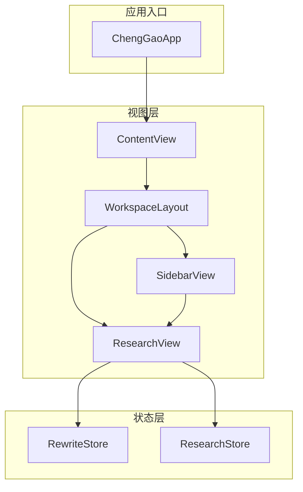
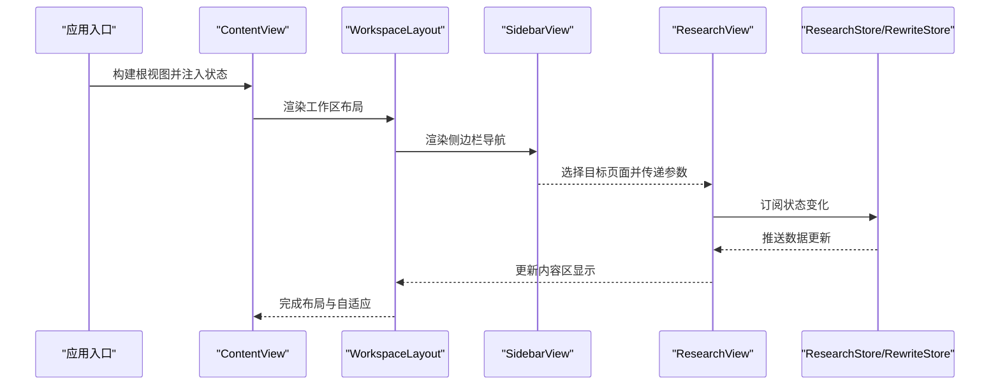
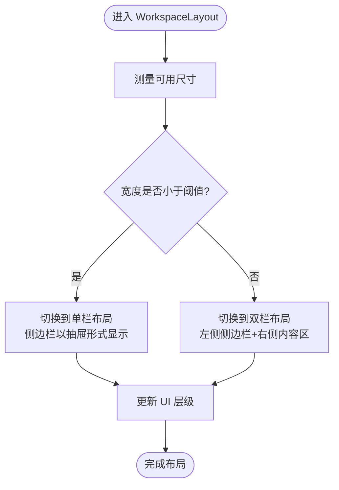
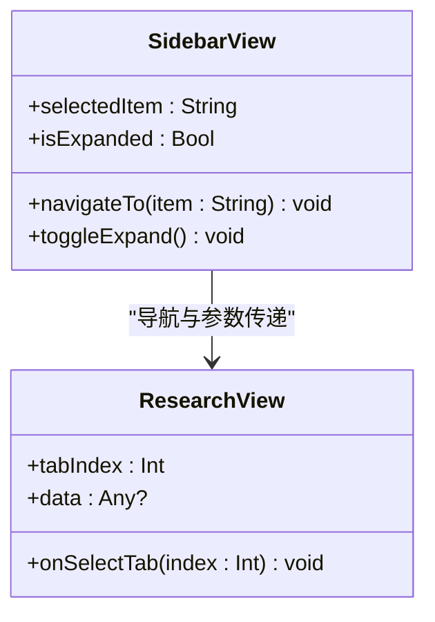
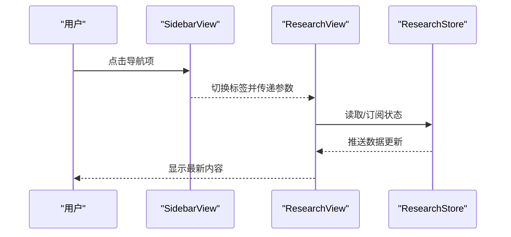
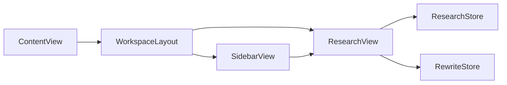

# 主工作区界面

<cite>
**本文引用的文件**   
- [ContentView.swift](file://Sources/ChengGao/Views/ContentView.swift)
- [WorkspaceLayout.swift](file://Sources/ChengGao/Views/WorkspaceLayout.swift)
- [SidebarView.swift](file://Sources/ChengGao/Views/SidebarView.swift)
- [ResearchView.swift](file://Sources/ChengGao/Views/ResearchView.swift)
- [RewriteStore.swift](file://Sources/ChengGao/Stores/RewriteStore.swift)
- [ResearchStore.swift](file://Sources/ChengGao/Stores/ResearchStore.swift)
- [ChengGaoApp.swift](file://Sources/ChengGao/App/ChengGaoApp.swift)
</cite>

## 目录
1. [简介](#简介)
2. [项目结构](#项目结构)
3. [核心组件](#核心组件)
4. [架构总览](#架构总览)
5. [详细组件分析](#详细组件分析)
6. [依赖关系分析](#依赖关系分析)
7. [性能考虑](#性能考虑)
8. [故障排查指南](#故障排查指南)
9. [结论](#结论)
10. [附录](#附录)

## 简介
本文件围绕主工作区界面的设计与实现进行系统化说明，重点覆盖以下方面：
- ContentView 作为应用根视图的架构职责与组织方式
- WorkspaceLayout 的布局策略、响应式适配机制与约束设计
- 侧边栏导航、多标签页管理与状态同步方案
- 工作区初始化流程、数据绑定模式与用户交互处理
- 布局约束、自适应设计与性能优化技巧
- 自定义布局组件的开发指南与调试方法

## 项目结构
主工作区界面位于 Sources/ChengGao/Views 目录下，核心文件包括 ContentView、WorkspaceLayout、SidebarView 以及各功能页面（如 ResearchView）。状态管理集中在 Stores 目录下的 Store 文件中。应用入口在 App 目录中定义。

图表来源
- [ChengGaoApp.swift](file://Sources/ChengGao/App/ChengGaoApp.swift)
- [ContentView.swift](file://Sources/ChengGao/Views/ContentView.swift)
- [WorkspaceLayout.swift](file://Sources/ChengGao/Views/WorkspaceLayout.swift)
- [SidebarView.swift](file://Sources/ChengGao/Views/SidebarView.swift)
- [ResearchView.swift](file://Sources/ChengGao/Views/ResearchView.swift)
- [RewriteStore.swift](file://Sources/ChengGao/Stores/RewriteStore.swift)
- [ResearchStore.swift](file://Sources/ChengGao/Stores/ResearchStore.swift)

章节来源
- [ChengGaoApp.swift](file://Sources/ChengGao/App/ChengGaoApp.swift)
- [ContentView.swift](file://Sources/ChengGao/Views/ContentView.swift)
- [WorkspaceLayout.swift](file://Sources/ChengGao/Views/WorkspaceLayout.swift)
- [SidebarView.swift](file://Sources/ChengGao/Views/SidebarView.swift)
- [ResearchView.swift](file://Sources/ChengGao/Views/ResearchView.swift)
- [RewriteStore.swift](file://Sources/ChengGao/Stores/RewriteStore.swift)
- [ResearchStore.swift](file://Sources/ChengGao/Stores/ResearchStore.swift)

## 核心组件
- ContentView：应用根视图，负责顶层窗口容器、主题与全局样式注入、初始路由与状态挂载。
- WorkspaceLayout：工作区布局容器，承载侧边栏与内容区域，提供响应式布局切换与尺寸感知。
- SidebarView：侧边栏导航，维护当前选中项、展开/折叠状态，驱动内容区切换。
- ResearchView：研究功能页面，作为多标签页中的一个典型示例，展示数据绑定与交互逻辑。
- Stores：状态管理中心，通过可观察对象向视图层推送更新，保证跨组件状态一致性。

章节来源
- [ContentView.swift](file://Sources/ChengGao/Views/ContentView.swift)
- [WorkspaceLayout.swift](file://Sources/ChengGao/Views/WorkspaceLayout.swift)
- [SidebarView.swift](file://Sources/ChengGao/Views/SidebarView.swift)
- [ResearchView.swift](file://Sources/ChengGao/Views/ResearchView.swift)
- [RewriteStore.swift](file://Sources/ChengGao/Stores/RewriteStore.swift)
- [ResearchStore.swift](file://Sources/ChengGao/Stores/ResearchStore.swift)

## 架构总览
整体采用“视图层 + 状态层”的分层架构。应用入口创建根视图并注入全局状态；ContentView 将工作区布局与主题配置组合；WorkspaceLayout 根据屏幕尺寸与方向动态调整布局；SidebarView 与内容页通过 Store 进行状态同步，确保导航与数据的一致性。

图表来源
- [ChengGaoApp.swift](file://Sources/ChengGao/App/ChengGaoApp.swift)
- [ContentView.swift](file://Sources/ChengGao/Views/ContentView.swift)
- [WorkspaceLayout.swift](file://Sources/ChengGao/Views/WorkspaceLayout.swift)
- [SidebarView.swift](file://Sources/ChengGao/Views/SidebarView.swift)
- [ResearchView.swift](file://Sources/ChengGao/Views/ResearchView.swift)
- [ResearchStore.swift](file://Sources/ChengGao/Stores/ResearchStore.swift)
- [RewriteStore.swift](file://Sources/ChengGao/Stores/RewriteStore.swift)

## 详细组件分析

### ContentView：应用根视图
- 职责
  - 作为应用根视图，负责窗口容器、主题样式注入与全局状态挂载。
  - 初始化工作区布局，并将 Store 实例注入到子视图树中。
- 关键点
  - 使用环境值或依赖注入将状态传递给子视图，避免硬耦合。
  - 统一设置窗口外观与行为（如玻璃效果、标题栏等）。
- 常见问题
  - 状态未正确注入导致子视图无法响应更新。
  - 主题配置冲突导致样式不一致。

章节来源
- [ContentView.swift](file://Sources/ChengGao/Views/ContentView.swift)
- [ChengGaoApp.swift](file://Sources/ChengGao/App/ChengGaoApp.swift)

### WorkspaceLayout：布局策略与响应式适配
- 布局策略
  - 左右分栏：左侧为 SidebarView，右侧为内容区（如 ResearchView）。
  - 基于可用宽度与高度计算布局比例，支持拖拽调整侧边栏宽度。
  - 在小屏设备上自动切换为单列布局，侧边栏以抽屉或全屏形式呈现。
- 响应式适配
  - 监听窗口尺寸变化，动态切换布局模式（双栏/单栏）。
  - 使用约束与弹性布局确保在不同分辨率下保持良好体验。
- 性能优化
  - 懒加载内容页，仅在需要时渲染。
  - 避免在布局计算中进行重绘，尽量使用不可变数据与缓存。

图表来源
- [WorkspaceLayout.swift](file://Sources/ChengGao/Views/WorkspaceLayout.swift)

章节来源
- [WorkspaceLayout.swift](file://Sources/ChengGao/Views/WorkspaceLayout.swift)

### SidebarView：侧边栏导航与多标签页管理
- 导航管理
  - 维护当前选中项与展开/折叠状态，点击项触发内容区切换。
  - 支持键盘快捷键与手势操作提升可用性。
- 多标签页管理
  - 通过标签数组与索引控制当前激活标签。
  - 标签切换时传递必要参数给内容页，确保数据一致性。
- 状态同步
  - 与 Store 联动，当外部状态变更时刷新侧边栏高亮与内容。
  - 避免循环更新，确保单向数据流。

图表来源
- [SidebarView.swift](file://Sources/ChengGao/Views/SidebarView.swift)
- [ResearchView.swift](file://Sources/ChengGao/Views/ResearchView.swift)

章节来源
- [SidebarView.swift](file://Sources/ChengGao/Views/SidebarView.swift)
- [ResearchView.swift](file://Sources/ChengGao/Views/ResearchView.swift)

### ResearchView：多标签页与数据绑定
- 多标签页
  - 使用标签数组与索引管理多个子页面。
  - 每个标签对应不同的数据模型与业务逻辑。
- 数据绑定
  - 订阅 Store 中的状态变化，实时更新界面。
  - 用户输入通过回调或命令模式写入 Store，保证状态集中管理。
- 交互处理
  - 支持键盘导航、鼠标点击与手势操作。
  - 错误提示与加载状态反馈，提升用户体验。

图表来源
- [ResearchView.swift](file://Sources/ChengGao/Views/ResearchView.swift)
- [ResearchStore.swift](file://Sources/ChengGao/Stores/ResearchStore.swift)

章节来源
- [ResearchView.swift](file://Sources/ChengGao/Views/ResearchView.swift)
- [ResearchStore.swift](file://Sources/ChengGao/Stores/ResearchStore.swift)

### Stores：状态管理中心
- 设计原则
  - 单一事实来源，所有状态集中管理。
  - 提供只读接口与写操作方法，确保数据流向清晰。
- 更新机制
  - 使用可观察对象或事件总线通知视图层更新。
  - 批量更新减少重绘次数，提升性能。
- 错误处理
  - 捕获异常并转换为用户友好的错误信息。
  - 提供重试与回滚机制，增强健壮性。

章节来源
- [ResearchStore.swift](file://Sources/ChengGao/Stores/ResearchStore.swift)
- [RewriteStore.swift](file://Sources/ChengGao/Stores/RewriteStore.swift)

## 依赖关系分析
- 视图层依赖状态层，但不反向依赖。
- WorkspaceLayout 依赖 SidebarView 与具体页面组件，但通过协议或抽象降低耦合。
- Store 独立于视图层，仅暴露必要的读写接口。

图表来源
- [ContentView.swift](file://Sources/ChengGao/Views/ContentView.swift)
- [WorkspaceLayout.swift](file://Sources/ChengGao/Views/WorkspaceLayout.swift)
- [SidebarView.swift](file://Sources/ChengGao/Views/SidebarView.swift)
- [ResearchView.swift](file://Sources/ChengGao/Views/ResearchView.swift)
- [ResearchStore.swift](file://Sources/ChengGao/Stores/ResearchStore.swift)
- [RewriteStore.swift](file://Sources/ChengGao/Stores/RewriteStore.swift)

章节来源
- [ContentView.swift](file://Sources/ChengGao/Views/ContentView.swift)
- [WorkspaceLayout.swift](file://Sources/ChengGao/Views/WorkspaceLayout.swift)
- [SidebarView.swift](file://Sources/ChengGao/Views/SidebarView.swift)
- [ResearchView.swift](file://Sources/ChengGao/Views/ResearchView.swift)
- [ResearchStore.swift](file://Sources/ChengGao/Stores/ResearchStore.swift)
- [RewriteStore.swift](file://Sources/ChengGao/Stores/RewriteStore.swift)

## 性能考虑
- 延迟加载：仅在需要时渲染复杂页面，减少初始加载时间。
- 状态合并：批量更新状态，避免频繁重绘。
- 内存管理：及时释放不再使用的资源，防止内存泄漏。
- 布局优化：避免嵌套过深的布局层级，使用扁平化结构。
- 动画优化：禁用不必要的动画，或使用硬件加速。

[本节为通用指导，不直接分析具体文件]

## 故障排查指南
- 状态不同步
  - 检查 Store 是否正确订阅与更新。
  - 确认视图层是否正确接收状态变化。
- 布局错乱
  - 验证尺寸测量逻辑与阈值判断。
  - 检查约束冲突与优先级设置。
- 导航异常
  - 确认侧边栏选中状态与内容页参数传递。
  - 检查标签切换时的生命周期管理。
- 性能问题
  - 使用性能分析工具定位瓶颈。
  - 优化数据绑定与渲染路径。

章节来源
- [ResearchStore.swift](file://Sources/ChengGao/Stores/ResearchStore.swift)
- [RewriteStore.swift](file://Sources/ChengGao/Stores/RewriteStore.swift)
- [WorkspaceLayout.swift](file://Sources/ChengGao/Views/WorkspaceLayout.swift)
- [SidebarView.swift](file://Sources/ChengGao/Views/SidebarView.swift)
- [ResearchView.swift](file://Sources/ChengGao/Views/ResearchView.swift)

## 结论
主工作区界面通过清晰的层次结构与状态管理实现了良好的可扩展性与可维护性。ContentView 作为根视图负责全局配置，WorkspaceLayout 提供灵活的布局策略，SidebarView 与 ResearchView 协同完成导航与数据绑定。通过合理的性能优化与错误处理，确保了用户体验与系统稳定性。

[本节为总结性内容，不直接分析具体文件]

## 附录
- 自定义布局组件开发指南
  - 遵循单一职责原则，明确组件边界。
  - 使用不可变数据与单向数据流。
  - 提供可配置的属性与回调接口。
- 调试方法
  - 启用日志输出，记录关键状态变化。
  - 使用断点与调试器逐步排查问题。
  - 模拟极端场景测试鲁棒性。

[本节为补充指导，不直接分析具体文件]