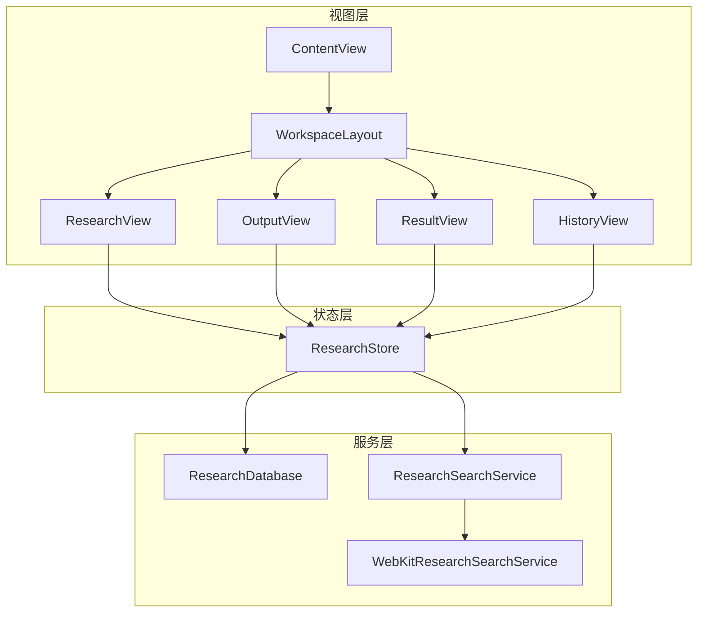
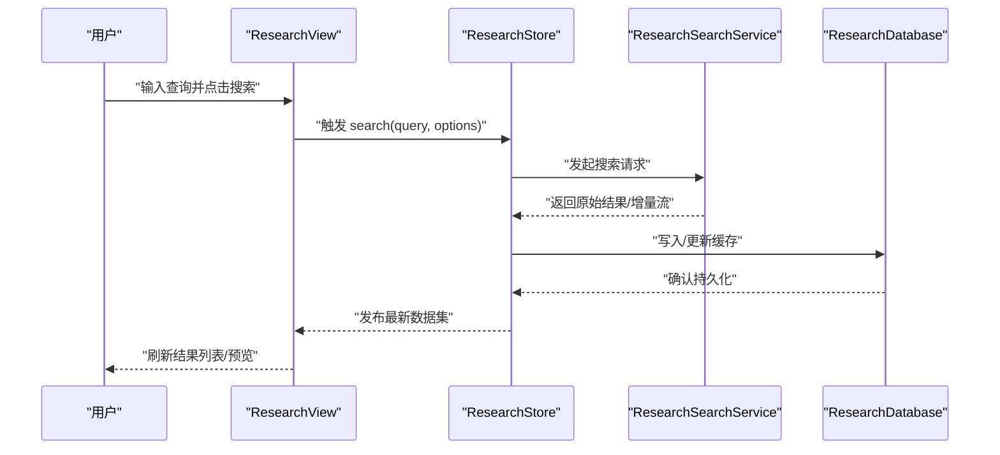
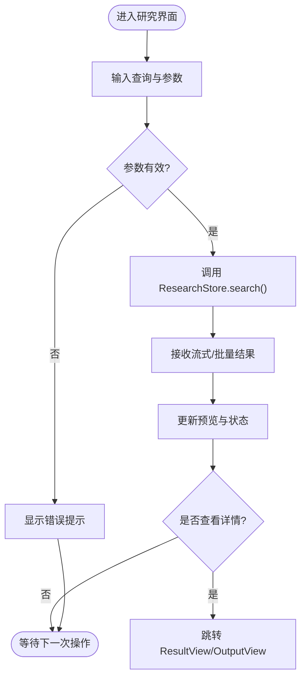
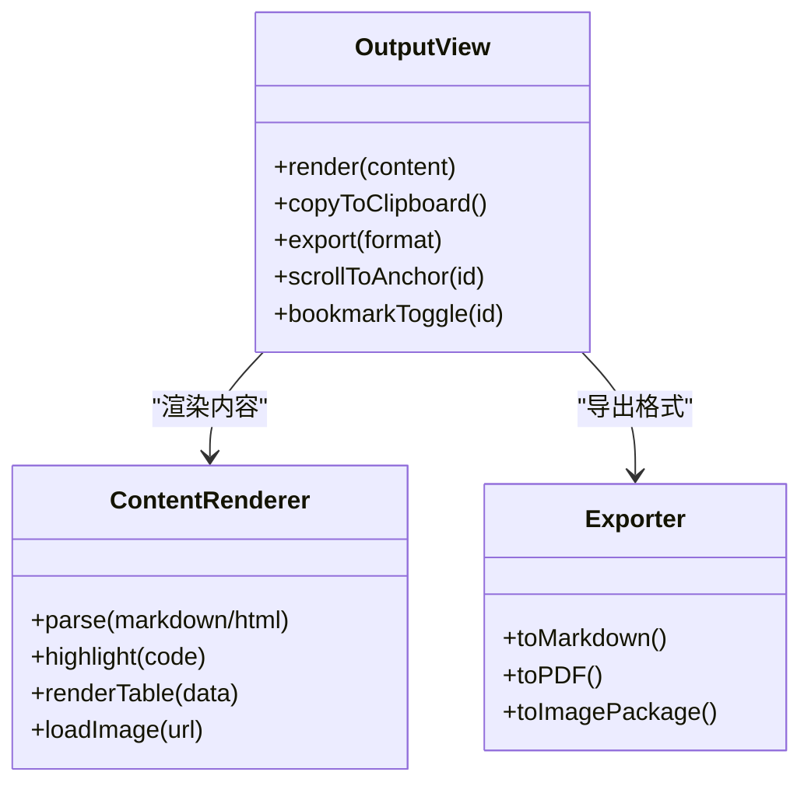
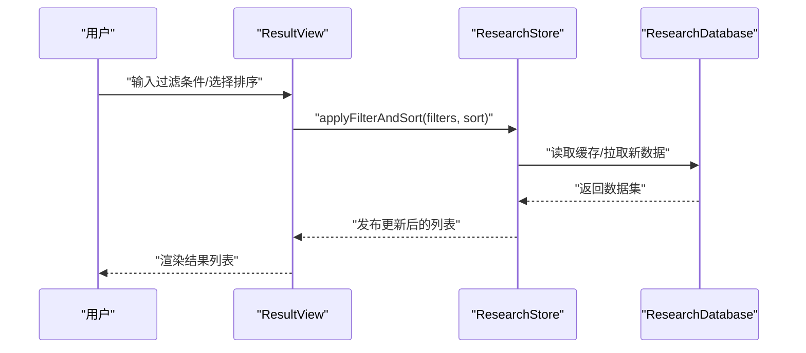
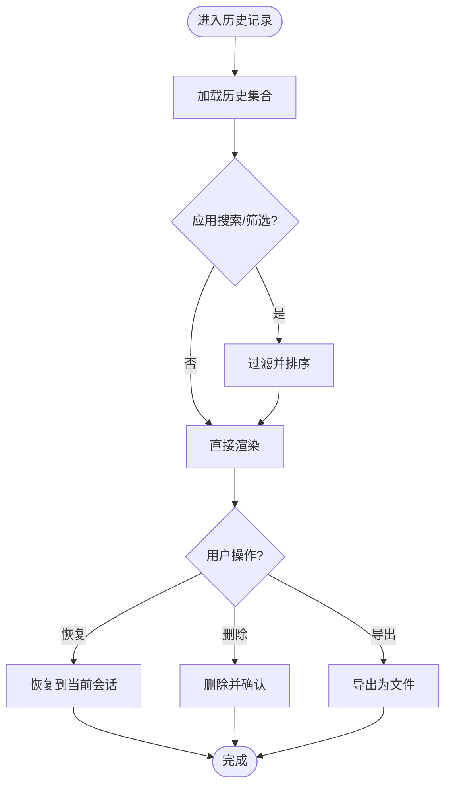
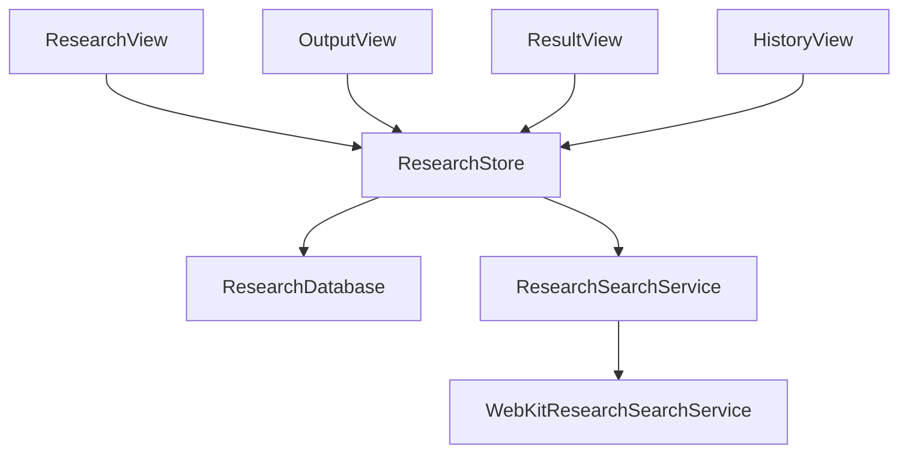

# 内容展示界面

<cite>
**本文引用的文件**   
- [ResearchView.swift](file://Sources/ChengGao/Views/ResearchView.swift)
- [OutputView.swift](file://Sources/ChengGao/Views/OutputView.swift)
- [ResultView.swift](file://Sources/ChengGao/Views/ResultView.swift)
- [HistoryView.swift](file://Sources/ChengGao/Views/HistoryView.swift)
- [ResearchStore.swift](file://Sources/ChengGao/Stores/ResearchStore.swift)
- [ResearchDatabase.swift](file://Sources/ChengGao/Services/ResearchDatabase.swift)
- [ResearchSearchService.swift](file://Sources/ChengGao/Services/ResearchSearchService.swift)
- [WebkitResearchSearchService.swift](file://Sources/ChengGao/Services/WebKitResearchSearchService.swift)
- [ContentView.swift](file://Sources/ChengGao/Views/ContentView.swift)
- [WorkspaceLayout.swift](file://Sources/ChengGao/Views/WorkspaceLayout.swift)
</cite>

## 目录
1. [简介](#简介)
2. [项目结构](#项目结构)
3. [核心组件](#核心组件)
4. [架构总览](#架构总览)
5. [详细组件分析](#详细组件分析)
6. [依赖关系分析](#依赖关系分析)
7. [性能考虑](#性能考虑)
8. [故障排查指南](#故障排查指南)
9. [结论](#结论)
10. [附录](#附录)

## 简介
本文件围绕内容展示界面的设计与实现进行系统化说明，重点覆盖 ResearchView（研究界面）、OutputView（输出面板）、ResultView（结果展示）与 HistoryView（历史记录）。文档从数据渲染、列表虚拟化、搜索过滤与排序、实时更新机制、缓存策略与性能优化等维度展开，并提供自定义内容组件开发指南、数据绑定模式与状态管理实践，以及内容格式化、导出功能与用户交互优化的实现细节。

## 项目结构
本项目采用 SwiftUI 视图层 + Store 状态层 + Services 服务层的分层组织方式：
- 视图层：ResearchView、OutputView、ResultView、HistoryView 等负责 UI 渲染与用户交互
- 状态层：ResearchStore 集中管理研究相关状态与变更
- 服务层：ResearchDatabase、ResearchSearchService、WebKitResearchSearchService 提供数据持久化与检索能力
- 布局与导航：ContentView、WorkspaceLayout 负责页面布局与模块编排

图表来源
- [ContentView.swift](file://Sources/ChengGao/Views/ContentView.swift)
- [WorkspaceLayout.swift](file://Sources/ChengGao/Views/WorkspaceLayout.swift)
- [ResearchView.swift](file://Sources/ChengGao/Views/ResearchView.swift)
- [OutputView.swift](file://Sources/ChengGao/Views/OutputView.swift)
- [ResultView.swift](file://Sources/ChengGao/Views/ResultView.swift)
- [HistoryView.swift](file://Sources/ChengGao/Views/HistoryView.swift)
- [ResearchStore.swift](file://Sources/ChengGao/Stores/ResearchStore.swift)
- [ResearchDatabase.swift](file://Sources/ChengGao/Services/ResearchDatabase.swift)
- [ResearchSearchService.swift](file://Sources/ChengGao/Services/ResearchSearchService.swift)
- [WebKitResearchSearchService.swift](file://Sources/ChengGao/Services/WebKitResearchSearchService.swift)

章节来源
- [ContentView.swift](file://Sources/ChengGao/Views/ContentView.swift)
- [WorkspaceLayout.swift](file://Sources/ChengGao/Views/WorkspaceLayout.swift)

## 核心组件
- ResearchView：研究任务入口，支持输入查询、选择模型/配置、发起搜索与流式更新预览
- OutputView：输出面板，承载富文本渲染、代码高亮、表格/图片等多媒体展示，支持复制与导出
- ResultView：结果展示页，提供搜索结果列表、分页、筛选、排序与详情跳转
- HistoryView：历史记录页，按时间线展示历史条目，支持搜索、删除与恢复

章节来源
- [ResearchView.swift](file://Sources/ChengGao/Views/ResearchView.swift)
- [OutputView.swift](file://Sources/ChengGao/Views/OutputView.swift)
- [ResultView.swift](file://Sources/ChengGao/Views/ResultView.swift)
- [HistoryView.swift](file://Sources/ChengGao/Views/HistoryView.swift)

## 架构总览
整体采用“视图-状态-服务”的单向数据流：
- 视图通过 @StateObject/@ObservedObject 订阅 ResearchStore 的状态变化
- ResearchStore 聚合数据库与服务调用，统一暴露可观察的数据集与操作接口
- 服务层封装网络请求、解析与本地缓存，保证数据一致性与稳定性

图表来源
- [ResearchView.swift](file://Sources/ChengGao/Views/ResearchView.swift)
- [ResearchStore.swift](file://Sources/ChengGao/Stores/ResearchStore.swift)
- [ResearchSearchService.swift](file://Sources/ChengGao/Services/ResearchSearchService.swift)
- [WebKitResearchSearchService.swift](file://Sources/ChengGao/Services/WebKitResearchSearchService.swift)
- [ResearchDatabase.swift](file://Sources/ChengGao/Services/ResearchDatabase.swift)

## 详细组件分析

### ResearchView（研究界面）
- 功能要点
  - 查询输入与参数配置（关键词、范围、模型/引擎选择）
  - 启动/停止搜索，显示进度与错误提示
  - 实时预览搜索结果，支持跳转到 ResultView 或 OutputView
- 数据绑定与状态管理
  - 使用 @State 管理本地输入与临时状态
  - 通过 @ObservedObject 订阅 ResearchStore，响应数据更新
- 交互优化
  - 防抖输入、加载骨架屏、错误重试按钮
  - 键盘快捷键与焦点管理

图表来源
- [ResearchView.swift](file://Sources/ChengGao/Views/ResearchView.swift)
- [ResearchStore.swift](file://Sources/ChengGao/Stores/ResearchStore.swift)

章节来源
- [ResearchView.swift](file://Sources/ChengGao/Views/ResearchView.swift)
- [ResearchStore.swift](file://Sources/ChengGao/Stores/ResearchStore.swift)

### OutputView（输出面板）
- 功能要点
  - 富文本渲染（Markdown/HTML），代码块高亮，表格与图片展示
  - 内容复制、导出为 Markdown/PDF/图片包
  - 滚动定位、锚点跳转、书签标记
- 数据渲染与性能
  - 懒加载大文档片段，按需渲染可见区域
  - 图片异步加载与占位图，失败重试
- 用户交互
  - 右键菜单（复制、导出、分享）
  - 快捷键（全选、复制、打印）

图表来源
- [OutputView.swift](file://Sources/ChengGao/Views/OutputView.swift)

章节来源
- [OutputView.swift](file://Sources/ChengGao/Views/OutputView.swift)

### ResultView（结果展示）
- 功能要点
  - 搜索结果列表展示，支持分页与无限滚动
  - 搜索过滤（关键词、类型、时间范围）与多列排序
  - 结果详情预览与快速编辑
- 列表虚拟化
  - 基于可见区域的行渲染，避免全量构建
  - 行高度估算与动态调整，减少重排
- 数据绑定
  - 订阅 ResearchStore 的结果集合，局部刷新选中项

图表来源
- [ResultView.swift](file://Sources/ChengGao/Views/ResultView.swift)
- [ResearchStore.swift](file://Sources/ChengGao/Stores/ResearchStore.swift)
- [ResearchDatabase.swift](file://Sources/ChengGao/Services/ResearchDatabase.swift)

章节来源
- [ResultView.swift](file://Sources/ChengGao/Views/ResultView.swift)
- [ResearchStore.swift](file://Sources/ChengGao/Stores/ResearchStore.swift)

### HistoryView（历史记录）
- 功能要点
  - 时间线展示历史条目，支持搜索与批量删除
  - 恢复某条历史到当前会话，支持导出单条记录
- 数据绑定与状态
  - 订阅 ResearchStore 的历史集合
  - 本地缓存最近访问记录，提升打开速度
- 交互优化
  - 拖拽排序、撤销删除、空状态引导

图表来源
- [HistoryView.swift](file://Sources/ChengGao/Views/HistoryView.swift)
- [ResearchStore.swift](file://Sources/ChengGao/Stores/ResearchStore.swift)

章节来源
- [HistoryView.swift](file://Sources/ChengGao/Views/HistoryView.swift)
- [ResearchStore.swift](file://Sources/ChengGao/Stores/ResearchStore.swift)

### 概念性概览
以下为通用工作流示意，不直接映射具体源码文件：

[此图为概念流程，无需图表来源]

## 依赖关系分析
- 视图对状态的依赖
  - ResearchView、OutputView、ResultView、HistoryView 均依赖 ResearchStore 提供的可观察数据
- 状态对服务的依赖
  - ResearchStore 依赖 ResearchDatabase 与 ResearchSearchService（含 WebKit 实现）
- 服务间耦合
  - ResearchSearchService 作为抽象接口，WebKitResearchSearchService 提供具体实现
  - ResearchDatabase 提供本地持久化与缓存

图表来源
- [ResearchView.swift](file://Sources/ChengGao/Views/ResearchView.swift)
- [OutputView.swift](file://Sources/ChengGao/Views/OutputView.swift)
- [ResultView.swift](file://Sources/ChengGao/Views/ResultView.swift)
- [HistoryView.swift](file://Sources/ChengGao/Views/HistoryView.swift)
- [ResearchStore.swift](file://Sources/ChengGao/Stores/ResearchStore.swift)
- [ResearchDatabase.swift](file://Sources/ChengGao/Services/ResearchDatabase.swift)
- [ResearchSearchService.swift](file://Sources/ChengGao/Services/ResearchSearchService.swift)
- [WebKitResearchSearchService.swift](file://Sources/ChengGao/Services/WebKitResearchSearchService.swift)

章节来源
- [ResearchStore.swift](file://Sources/ChengGao/Stores/ResearchStore.swift)
- [ResearchDatabase.swift](file://Sources/ChengGao/Services/ResearchDatabase.swift)
- [ResearchSearchService.swift](file://Sources/ChengGao/Services/ResearchSearchService.swift)
- [WebKitResearchSearchService.swift](file://Sources/ChengGao/Services/WebKitResearchSearchService.swift)

## 性能考虑
- 列表虚拟化
  - 仅渲染可视区域内的行，结合行高估算与惰性加载，降低内存占用与重绘开销
- 数据缓存
  - 本地缓存热点数据，减少重复网络请求；支持失效策略与版本控制
- 渲染优化
  - 大文档分段渲染，图片懒加载与占位图；代码高亮按需启用
- 并发与流式
  - 使用流式更新逐步渲染结果，避免阻塞主线程；后台处理耗时任务
- 搜索与排序
  - 索引化字段与预计算排序键，增量更新而非全量重建

[本节为通用指导，无需章节来源]

## 故障排查指南
- 常见问题
  - 搜索结果不更新：检查 ResearchStore 的发布逻辑与视图订阅是否正确
  - 列表卡顿：确认是否启用了虚拟化与懒加载，检查行高估算准确性
  - 导出失败：验证文件格式权限与目标路径有效性
  - 图片加载失败：检查网络状态与占位图回退逻辑
- 调试建议
  - 在 ResearchStore 中增加日志输出，追踪数据变更事件
  - 使用系统性能工具监控主线程负载与内存峰值
  - 针对网络请求添加超时与重试策略，捕获异常并提示用户

章节来源
- [ResearchStore.swift](file://Sources/ChengGao/Stores/ResearchStore.swift)
- [ResearchDatabase.swift](file://Sources/ChengGao/Services/ResearchDatabase.swift)
- [ResearchSearchService.swift](file://Sources/ChengGao/Services/ResearchSearchService.swift)

## 结论
内容展示界面以 ResearchView、OutputView、ResultView、HistoryView 为核心，配合 ResearchStore 与 Services 层形成清晰的数据流与职责分离。通过列表虚拟化、缓存策略与流式更新，实现了高性能与良好的用户体验。遵循本文档的开发指南与最佳实践，可进一步扩展自定义内容组件、完善数据绑定与状态管理，并持续优化导出与交互体验。

[本节为总结，无需章节来源]

## 附录
- 自定义内容组件开发指南
  - 定义可复用的渲染器（如 Markdown/HTML 解析器、代码高亮器）
  - 通过协议抽象渲染接口，便于替换与测试
  - 提供配置项（主题、语言、行号、折叠）以满足多样化需求
- 数据绑定模式与状态管理
  - 使用单一可信源（ResearchStore）管理状态，视图只读订阅
  - 将复杂状态拆分为子状态，提高可维护性
  - 使用不可变数据结构与快照对比，减少不必要的重渲染
- 内容格式化与导出
  - 统一内容模型（标题、正文、附件、元数据）
  - 支持多种导出格式（Markdown、PDF、图片包），提供模板与样式配置
  - 导出过程异步执行，提供进度与错误反馈
- 用户交互优化
  - 提供快捷操作（复制、导出、书签、跳转）
  - 键盘导航与无障碍支持
  - 空状态与错误状态的友好提示与引导

[本节为补充信息，无需章节来源]