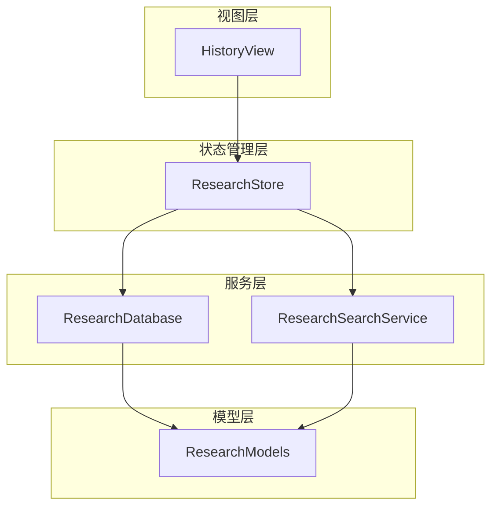
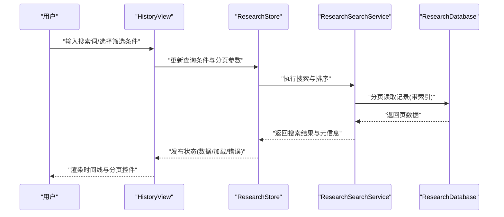
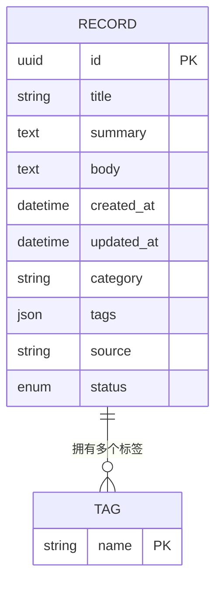
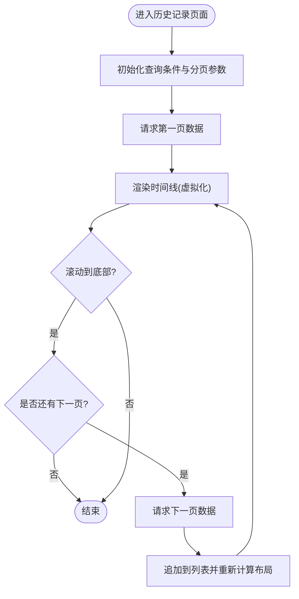
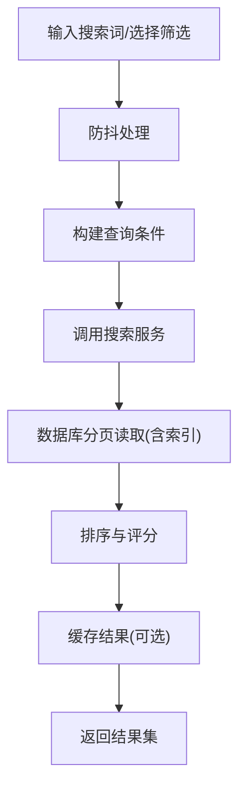
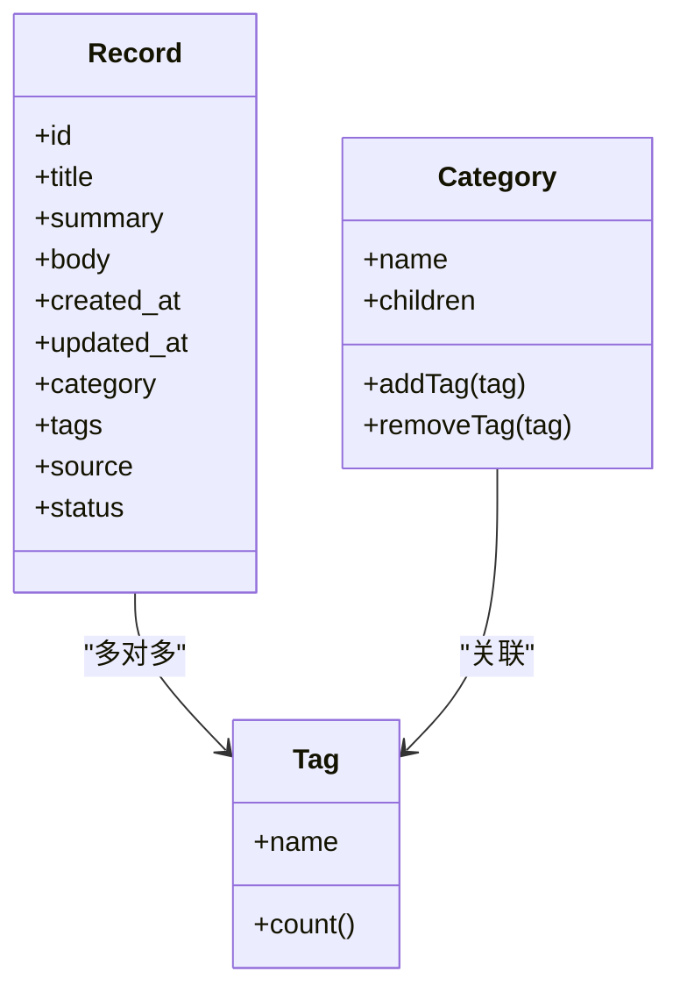
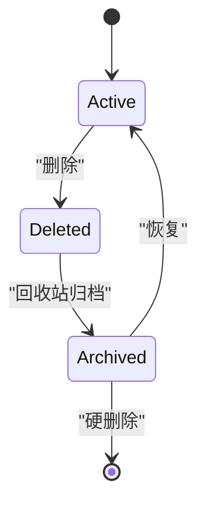
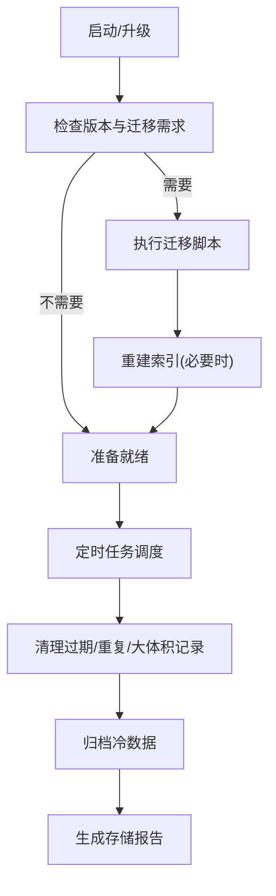
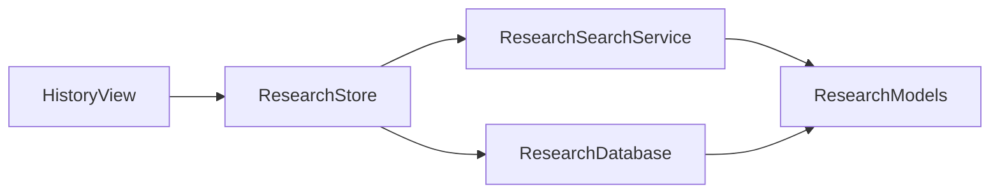

# 历史记录

<cite>
**本文引用的文件**   
- [HistoryView.swift](file://Sources/ChengGao/Views/HistoryView.swift)
- [ResearchStore.swift](file://Sources/ChengGao/Stores/ResearchStore.swift)
- [ResearchDatabase.swift](file://Sources/ChengGao/Services/ResearchDatabase.swift)
- [ResearchSearchService.swift](file://Sources/ChengGao/Services/ResearchSearchService.swift)
- [ResearchModels.swift](file://Sources/ChengGao/Models/ResearchModels.swift)
</cite>

## 目录
1. [简介](#简介)
2. [项目结构](#项目结构)
3. [核心组件](#核心组件)
4. [架构总览](#架构总览)
5. [详细组件分析](#详细组件分析)
6. [依赖关系分析](#依赖关系分析)
7. [性能考量](#性能考量)
8. [故障排查指南](#故障排查指南)
9. [结论](#结论)
10. [附录](#附录)

## 简介
本文件围绕 HistoryView 历史记录界面，系统阐述其设计与实现。内容涵盖历史记录的存储结构、时间线展示与检索、分页加载与虚拟滚动、搜索过滤与分类整理、标签管理、记录恢复与删除、批量操作、数据迁移与清理策略以及存储空间管理方案。文档面向不同技术背景的读者，既提供高层概览，也给出代码级分析与图示，帮助快速理解与扩展该模块。

## 项目结构
HistoryView 位于视图层，负责渲染历史记录列表、交互与状态更新；数据存储与查询由 ResearchDatabase 提供；搜索服务由 ResearchSearchService 封装；业务状态与命令由 ResearchStore 管理；数据结构定义在 ResearchModels。整体采用 SwiftUI + Store/Service/DB 的分层组织方式，视图仅持有必要的状态与回调，避免直接访问持久化层。

**图表来源** 
- [HistoryView.swift](file://Sources/ChengGao/Views/HistoryView.swift)
- [ResearchStore.swift](file://Sources/ChengGao/Stores/ResearchStore.swift)
- [ResearchSearchService.swift](file://Sources/ChengGao/Services/ResearchSearchService.swift)
- [ResearchDatabase.swift](file://Sources/ChengGao/Services/ResearchDatabase.swift)
- [ResearchModels.swift](file://Sources/ChengGao/Models/ResearchModels.swift)

**章节来源**
- [HistoryView.swift](file://Sources/ChengGao/Views/HistoryView.swift)
- [ResearchStore.swift](file://Sources/ChengGao/Stores/ResearchStore.swift)
- [ResearchDatabase.swift](file://Sources/ChengGao/Services/ResearchDatabase.swift)
- [ResearchSearchService.swift](file://Sources/ChengGao/Services/ResearchSearchService.swift)
- [ResearchModels.swift](file://Sources/ChengGao/Models/ResearchModels.swift)

## 核心组件
- HistoryView：渲染时间线、分页控件、搜索栏、筛选面板与批量操作工具栏；响应用户交互并调用 Store 执行操作。
- ResearchStore：维护当前查询条件、分页参数、选中项集合、加载状态与错误信息；协调 SearchService 与 Database 的调用。
- ResearchSearchService：封装全文检索、关键词匹配、排序与聚合统计；支持按时间、相关性等排序。
- ResearchDatabase：提供记录的增删改查、分页读取、索引构建与清理任务；负责事务与并发安全。
- ResearchModels：定义记录实体、标签、分类、分页结果与查询条件等数据结构。

**章节来源**
- [HistoryView.swift](file://Sources/ChengGao/Views/HistoryView.swift)
- [ResearchStore.swift](file://Sources/ChengGao/Stores/ResearchStore.swift)
- [ResearchSearchService.swift](file://Sources/ChengGao/Services/ResearchSearchService.swift)
- [ResearchDatabase.swift](file://Sources/ChengGao/Services/ResearchDatabase.swift)
- [ResearchModels.swift](file://Sources/ChengGao/Models/ResearchModels.swift)

## 架构总览
HistoryView 通过 Store 暴露的状态驱动 UI 更新；Store 将查询与变更委托给 SearchService 与 Database。数据库层对记录进行分页读取与索引优化；搜索服务对文本与标签进行检索与排序。模型层统一描述记录结构与查询条件，确保各层间契约一致。

**图表来源** 
- [HistoryView.swift](file://Sources/ChengGao/Views/HistoryView.swift)
- [ResearchStore.swift](file://Sources/ChengGao/Stores/ResearchStore.swift)
- [ResearchSearchService.swift](file://Sources/ChengGao/Services/ResearchSearchService.swift)
- [ResearchDatabase.swift](file://Sources/ChengGao/Services/ResearchDatabase.swift)

## 详细组件分析

### 历史记录存储结构
- 记录实体：包含唯一标识、标题、摘要、正文、创建时间、更新时间、分类、标签数组、来源、状态等字段。
- 标签与分类：标签为字符串集合，分类为枚举或字符串类别；支持多对多关系。
- 索引与排序键：基于时间与相关性（如关键词命中分数）建立索引，加速分页与排序。
- 分页结果：包含当前页数据、总页数、是否还有下一页、查询耗时等元信息。

**图表来源** 
- [ResearchModels.swift](file://Sources/ChengGao/Models/ResearchModels.swift)

**章节来源**
- [ResearchModels.swift](file://Sources/ChengGao/Models/ResearchModels.swift)

### 时间线展示与分页加载
- 时间线渲染：按时间倒序排列，显示关键元信息与缩略预览；支持点击展开详情。
- 分页加载：默认首屏加载一页，滚动到底部触发下一页；Store 维护 isFetching、hasMore 等状态。
- 虚拟滚动：长列表使用虚拟化渲染，仅渲染可视区域条目，降低内存占用与重绘开销。
- 骨架屏与占位：加载期间显示骨架屏，提升感知性能。

**图表来源** 
- [HistoryView.swift](file://Sources/ChengGao/Views/HistoryView.swift)
- [ResearchStore.swift](file://Sources/ChengGao/Stores/ResearchStore.swift)
- [ResearchDatabase.swift](file://Sources/ChengGao/Services/ResearchDatabase.swift)

**章节来源**
- [HistoryView.swift](file://Sources/ChengGao/Views/HistoryView.swift)
- [ResearchStore.swift](file://Sources/ChengGao/Stores/ResearchStore.swift)
- [ResearchDatabase.swift](file://Sources/ChengGao/Services/ResearchDatabase.swift)

### 检索功能与搜索过滤
- 全文检索：支持标题、摘要、正文的关键词匹配；可配置大小写敏感与模糊匹配。
- 组合筛选：按分类、标签、时间范围、来源等维度组合过滤。
- 排序策略：按时间、相关性得分、来源优先级等排序。
- 实时搜索：输入防抖后触发搜索，避免频繁 IO；缓存最近查询结果。

**图表来源** 
- [ResearchSearchService.swift](file://Sources/ChengGao/Services/ResearchSearchService.swift)
- [ResearchDatabase.swift](file://Sources/ChengGao/Services/ResearchDatabase.swift)
- [ResearchStore.swift](file://Sources/ChengGao/Stores/ResearchStore.swift)

**章节来源**
- [ResearchSearchService.swift](file://Sources/ChengGao/Services/ResearchSearchService.swift)
- [ResearchStore.swift](file://Sources/ChengGao/Stores/ResearchStore.swift)
- [ResearchDatabase.swift](file://Sources/ChengGao/Services/ResearchDatabase.swift)

### 分类整理与标签管理
- 分类：支持多级分类树，便于分组浏览与统计。
- 标签：支持新增、编辑、删除与批量添加；标签冲突时自动合并。
- 批量操作：选中多条记录后统一修改分类或标签。
- 可视化：侧边栏展示分类树与标签云，点击即应用筛选。

**图表来源** 
- [ResearchModels.swift](file://Sources/ChengGao/Models/ResearchModels.swift)

**章节来源**
- [ResearchModels.swift](file://Sources/ChengGao/Models/ResearchModels.swift)

### 记录的恢复、删除与批量操作
- 软删除与回收站：删除记录先标记为已删除，保留一定时间可在回收站恢复。
- 硬删除：超过保留期或手动确认后执行物理删除，释放空间。
- 批量操作：支持批量移动分类、批量打标签、批量删除与恢复。
- 撤销机制：近期操作提供撤销入口，防止误删。

**图表来源** 
- [ResearchDatabase.swift](file://Sources/ChengGao/Services/ResearchDatabase.swift)
- [ResearchStore.swift](file://Sources/ChengGao/Stores/ResearchStore.swift)

**章节来源**
- [ResearchDatabase.swift](file://Sources/ChengGao/Services/ResearchDatabase.swift)
- [ResearchStore.swift](file://Sources/ChengGao/Stores/ResearchStore.swift)

### 数据迁移、清理策略与存储空间管理
- 数据迁移：版本升级时执行迁移脚本，保证字段兼容与索引重建。
- 清理策略：定期清理过期临时文件、回收站中长时间未恢复的记录与重复内容。
- 存储配额：限制单条记录大小与总容量，超限提示用户清理或扩容。
- 压缩与归档：对历史较久且低频访问的记录进行压缩归档，减少热存储压力。

**图表来源** 
- [ResearchDatabase.swift](file://Sources/ChengGao/Services/ResearchDatabase.swift)

**章节来源**
- [ResearchDatabase.swift](file://Sources/ChengGao/Services/ResearchDatabase.swift)

## 依赖关系分析
- HistoryView 依赖 ResearchStore 提供的状态与回调，不直接访问数据库。
- ResearchStore 依赖 ResearchSearchService 与 ResearchDatabase，解耦查询与持久化。
- ResearchSearchService 依赖 ResearchModels 定义的数据结构，确保类型安全。
- ResearchDatabase 依赖 ResearchModels，并通过索引与事务保障性能与一致性。

**图表来源** 
- [HistoryView.swift](file://Sources/ChengGao/Views/HistoryView.swift)
- [ResearchStore.swift](file://Sources/ChengGao/Stores/ResearchStore.swift)
- [ResearchSearchService.swift](file://Sources/ChengGao/Services/ResearchSearchService.swift)
- [ResearchDatabase.swift](file://Sources/ChengGao/Services/ResearchDatabase.swift)
- [ResearchModels.swift](file://Sources/ChengGao/Models/ResearchModels.swift)

**章节来源**
- [HistoryView.swift](file://Sources/ChengGao/Views/HistoryView.swift)
- [ResearchStore.swift](file://Sources/ChengGao/Stores/ResearchStore.swift)
- [ResearchSearchService.swift](file://Sources/ChengGao/Services/ResearchSearchService.swift)
- [ResearchDatabase.swift](file://Sources/ChengGao/Services/ResearchDatabase.swift)
- [ResearchModels.swift](file://Sources/ChengGao/Models/ResearchModels.swift)

## 性能考量
- 虚拟化渲染：仅渲染可见区域条目，显著降低内存与重绘成本。
- 分页加载：按需拉取数据，避免一次性加载全量记录。
- 搜索防抖与缓存：减少无效查询与重复 IO。
- 索引优化：对常用查询字段建立索引，提升检索与排序速度。
- 后台线程：数据库与搜索在后台执行，避免阻塞主线程。
- 增量更新：只更新变化部分，减少 SwiftUI 视图重算。

[本节为通用性能建议，不直接分析具体文件]

## 故障排查指南
- 搜索无结果：检查关键词与筛选条件是否正确；确认索引是否重建；查看搜索服务日志。
- 分页卡死：验证 hasMore 状态与网络/IO 错误处理；检查数据库连接与事务锁。
- 内存过高：确认虚拟化是否生效；检查大图或长文本是否被缓存；监控堆栈峰值。
- 数据不一致：核对事务提交与回滚逻辑；检查迁移脚本是否完整执行。
- 存储空间不足：查看清理任务是否运行；评估归档策略与配额阈值。

**章节来源**
- [ResearchStore.swift](file://Sources/ChengGao/Stores/ResearchStore.swift)
- [ResearchSearchService.swift](file://Sources/ChengGao/Services/ResearchSearchService.swift)
- [ResearchDatabase.swift](file://Sources/ChengGao/Services/ResearchDatabase.swift)

## 结论
HistoryView 以清晰的层次结构与职责分离实现了高效的历史记录管理与检索。通过虚拟化与分页、搜索与索引、分类与标签、回收站与迁移清理等机制，兼顾了用户体验与系统性能。建议在后续迭代中持续优化索引策略、增强搜索语义能力，并完善存储配额与告警机制。

[本节为总结性内容，不直接分析具体文件]

## 附录
- 术语表：记录、标签、分类、分页、虚拟化、索引、回收站、迁移、归档。
- 最佳实践：保持 Store 单一职责、避免视图层直接访问数据库、合理使用缓存与防抖、定期审计存储与健康度。

[本节为补充说明，不直接分析具体文件]