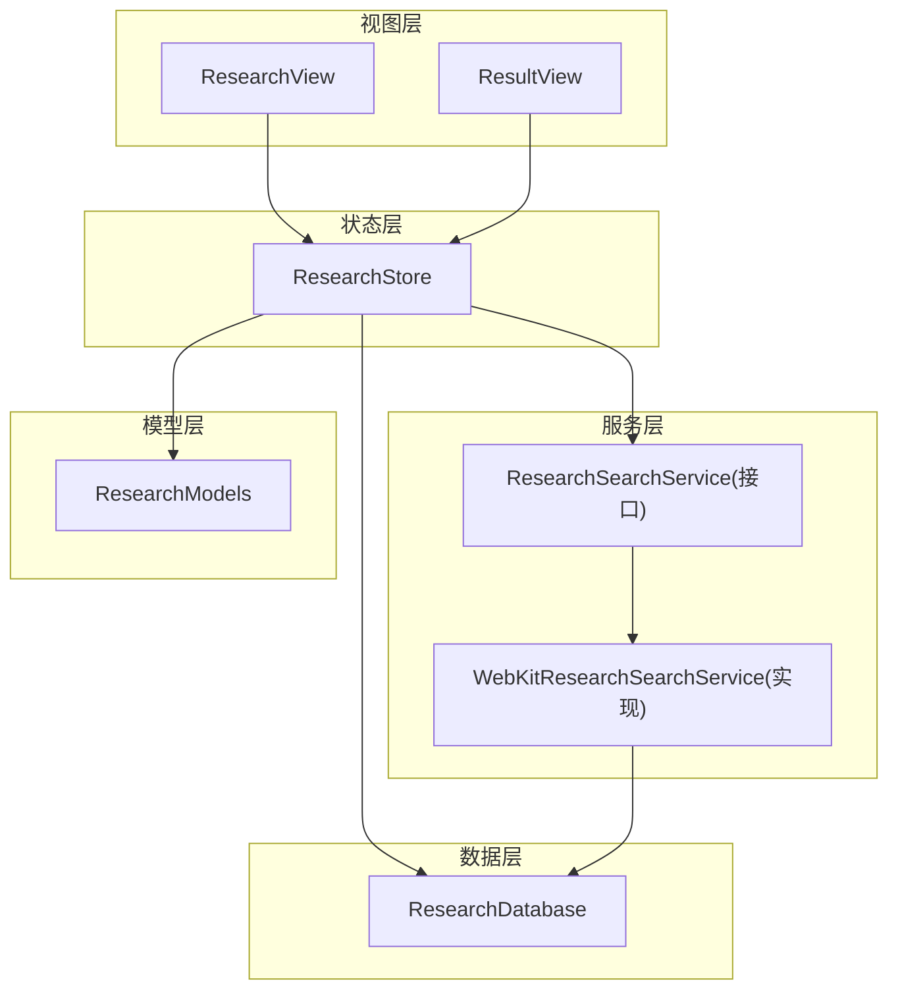
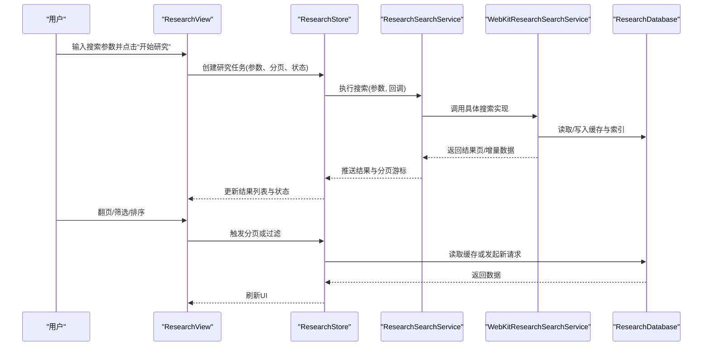
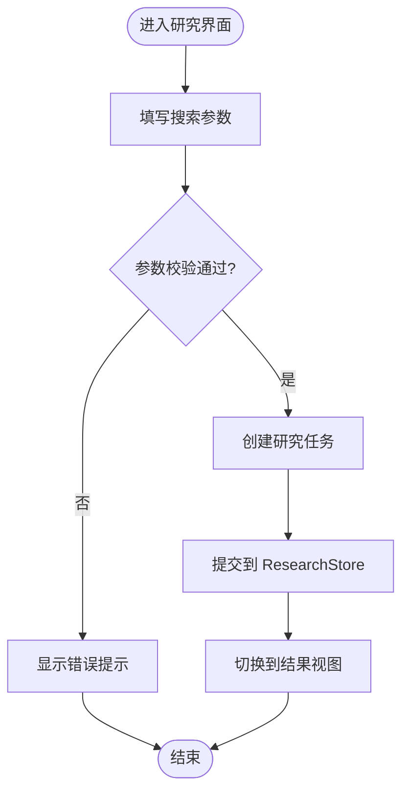
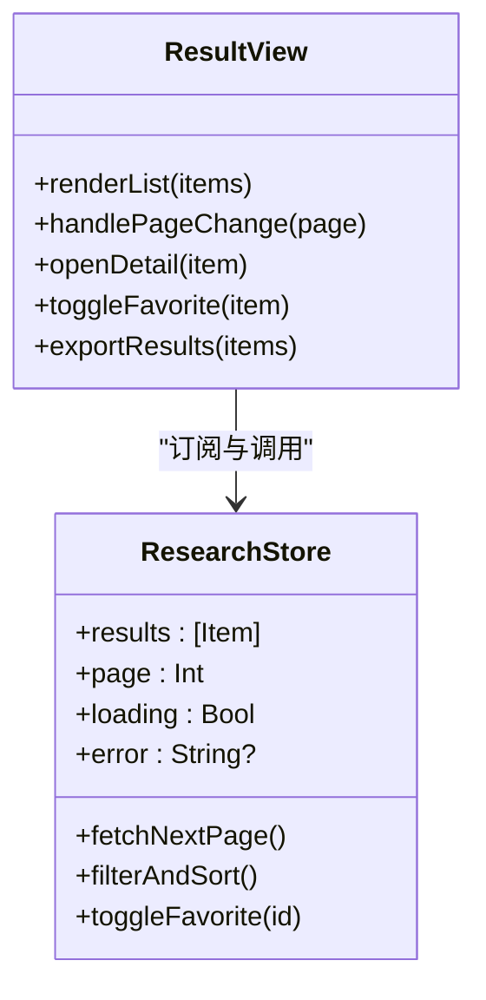
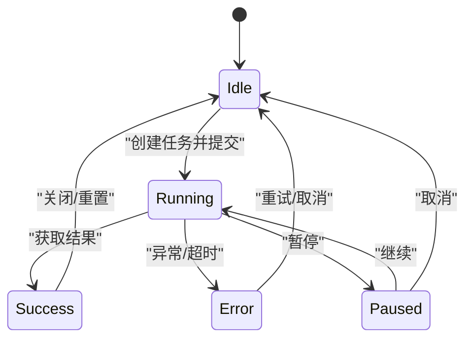
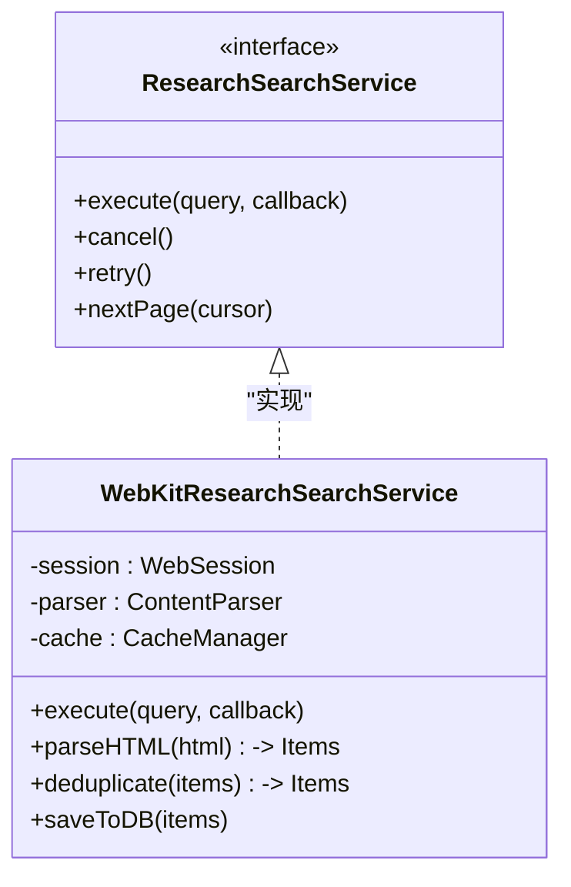
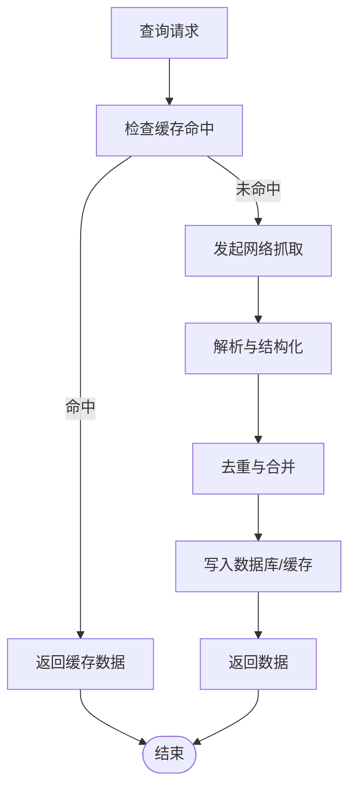
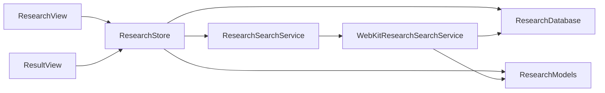

# 研究视图

<cite>
**本文引用的文件**   
- [ResearchView.swift](file://Sources/ChengGao/Views/ResearchView.swift)
- [ResultView.swift](file://Sources/ChengGao/Views/ResultView.swift)
- [ResearchStore.swift](file://Sources/ChengGao/Stores/ResearchStore.swift)
- [ResearchSearchService.swift](file://Sources/ChengGao/Services/ResearchSearchService.swift)
- [WebKitResearchSearchService.swift](file://Sources/ChengGao/Services/WebKitResearchSearchService.swift)
- [ResearchDatabase.swift](file://Sources/ChengGao/Services/ResearchDatabase.swift)
- [ResearchModels.swift](file://Sources/ChengGao/Models/ResearchModels.swift)
</cite>

## 目录
1. [简介](#简介)
2. [项目结构](#项目结构)
3. [核心组件](#核心组件)
4. [架构总览](#架构总览)
5. [详细组件分析](#详细组件分析)
6. [依赖关系分析](#依赖关系分析)
7. [性能考量](#性能考量)
8. [故障排查指南](#故障排查指南)
9. [结论](#结论)
10. [附录](#附录)

## 简介
本文件系统性阐述 ResearchView 研究界面的设计与实现，覆盖研究任务创建、搜索参数配置、结果展示与交互流程；文档化研究状态管理、数据绑定模式与实时更新机制；解释搜索结果渲染、分页加载与缓存策略；并提供自定义搜索组件开发指南、错误处理与用户反馈机制；最后给出研究性能优化、内存管理与并发处理的实现细节。

## 项目结构
围绕“研究”功能，代码按职责分层组织：
- 视图层：ResearchView、ResultView 负责界面与交互
- 状态层：ResearchStore 集中管理研究任务、查询条件、结果集与状态
- 服务层：ResearchSearchService 抽象搜索能力，WebKitResearchSearchService 提供基于 WebKit 的具体实现
- 数据层：ResearchDatabase 持久化研究记录与结果
- 模型层：ResearchModels 定义研究相关的数据结构与枚举

图表来源
- [ResearchView.swift](file://Sources/ChengGao/Views/ResearchView.swift)
- [ResultView.swift](file://Sources/ChengGao/Views/ResultView.swift)
- [ResearchStore.swift](file://Sources/ChengGao/Stores/ResearchStore.swift)
- [ResearchSearchService.swift](file://Sources/ChengGao/Services/ResearchSearchService.swift)
- [WebKitResearchSearchService.swift](file://Sources/ChengGao/Services/WebKitResearchSearchService.swift)
- [ResearchDatabase.swift](file://Sources/ChengGao/Services/ResearchDatabase.swift)
- [ResearchModels.swift](file://Sources/ChengGao/Models/ResearchModels.swift)

章节来源
- [ResearchView.swift](file://Sources/ChengGao/Views/ResearchView.swift)
- [ResultView.swift](file://Sources/ChengGao/Views/ResultView.swift)
- [ResearchStore.swift](file://Sources/ChengGao/Stores/ResearchStore.swift)
- [ResearchSearchService.swift](file://Sources/ChengGao/Services/ResearchSearchService.swift)
- [WebKitResearchSearchService.swift](file://Sources/ChengGao/Services/WebKitResearchSearchService.swift)
- [ResearchDatabase.swift](file://Sources/ChengGao/Services/ResearchDatabase.swift)
- [ResearchModels.swift](file://Sources/ChengGao/Models/ResearchModels.swift)

## 核心组件
- ResearchView：研究入口视图，承载搜索参数输入、任务创建与启动、结果面板切换等交互
- ResultView：结果展示视图，支持列表/卡片渲染、分页加载、详情展开、收藏/导出等操作
- ResearchStore：统一的状态容器，维护查询条件、任务生命周期、结果集合、分页游标、错误与提示
- ResearchSearchService：搜索服务抽象，定义执行搜索、取消、重试、分页等契约
- WebKitResearchSearchService：基于 WebKit 的搜索实现，负责页面抓取、解析、去重与结构化
- ResearchDatabase：本地持久化，存储研究任务、结果条目、索引与缓存元数据
- ResearchModels：研究相关的模型定义（如任务、查询、结果项、分页信息、状态枚举）

章节来源
- [ResearchView.swift](file://Sources/ChengGao/Views/ResearchView.swift)
- [ResultView.swift](file://Sources/ChengGao/Views/ResultView.swift)
- [ResearchStore.swift](file://Sources/ChengGao/Stores/ResearchStore.swift)
- [ResearchSearchService.swift](file://Sources/ChengGao/Services/ResearchSearchService.swift)
- [WebKitResearchSearchService.swift](file://Sources/ChengGao/Services/WebKitResearchSearchService.swift)
- [ResearchDatabase.swift](file://Sources/ChengGao/Services/ResearchDatabase.swift)
- [ResearchModels.swift](file://Sources/ChengGao/Models/ResearchModels.swift)

## 架构总览
研究视图采用 MVVM + Store 的模式：
- 视图通过 @StateObject/@ObservedObject 订阅 ResearchStore 的变化
- ResearchStore 协调搜索服务与数据库，保证状态一致性与可恢复性
- 搜索服务对外暴露统一接口，屏蔽底层实现差异
- 数据层提供持久化与缓存，提升响应速度与离线可用性

图表来源
- [ResearchView.swift](file://Sources/ChengGao/Views/ResearchView.swift)
- [ResultView.swift](file://Sources/ChengGao/Views/ResultView.swift)
- [ResearchStore.swift](file://Sources/ChengGao/Stores/ResearchStore.swift)
- [ResearchSearchService.swift](file://Sources/ChengGao/Services/ResearchSearchService.swift)
- [WebKitResearchSearchService.swift](file://Sources/ChengGao/Services/WebKitResearchSearchService.swift)
- [ResearchDatabase.swift](file://Sources/ChengGao/Services/ResearchDatabase.swift)

## 详细组件分析

### ResearchView：研究任务创建与参数配置
- 负责收集搜索关键词、时间范围、来源、语言、排序等参数
- 创建研究任务并初始化分页游标、状态与错误消息
- 将任务提交给 ResearchStore，并切换到结果视图
- 支持取消当前任务、重置参数、保存常用模板

图表来源
- [ResearchView.swift](file://Sources/ChengGao/Views/ResearchView.swift)
- [ResearchStore.swift](file://Sources/ChengGao/Stores/ResearchStore.swift)

章节来源
- [ResearchView.swift](file://Sources/ChengGao/Views/ResearchView.swift)
- [ResearchStore.swift](file://Sources/ChengGao/Stores/ResearchStore.swift)

### ResultView：结果展示与交互
- 以列表/卡片形式渲染搜索结果，支持标题、摘要、来源、时间戳等字段
- 提供分页加载（上拉/按钮）、排序与筛选
- 支持查看详情、收藏、复制、导出、打开链接等操作
- 与 ResearchStore 双向绑定，实时反映加载、成功、失败、空态等状态

图表来源
- [ResultView.swift](file://Sources/ChengGao/Views/ResultView.swift)
- [ResearchStore.swift](file://Sources/ChengGao/Stores/ResearchStore.swift)

章节来源
- [ResultView.swift](file://Sources/ChengGao/Views/ResultView.swift)
- [ResearchStore.swift](file://Sources/ChengGao/Stores/ResearchStore.swift)

### ResearchStore：状态管理与数据绑定
- 使用观察者模式暴露 results、page、loading、error 等属性
- 封装任务生命周期：创建、运行、暂停、取消、完成、失败
- 协调分页逻辑：游标推进、去重合并、边界检查
- 与数据库交互：读写缓存、索引更新、历史回溯
- 提供统一的错误处理与用户提示通道

图表来源
- [ResearchStore.swift](file://Sources/ChengGao/Stores/ResearchStore.swift)
- [ResearchModels.swift](file://Sources/ChengGao/Models/ResearchModels.swift)

章节来源
- [ResearchStore.swift](file://Sources/ChengGao/Stores/ResearchStore.swift)
- [ResearchModels.swift](file://Sources/ChengGao/Models/ResearchModels.swift)

### ResearchSearchService 与 WebKitResearchSearchService：搜索服务与实现
- ResearchSearchService 定义搜索契约：execute(query)、cancel()、retry()、nextPage(cursor)
- WebKitResearchSearchService 基于 WebKit 进行页面抓取、DOM 解析、内容抽取与结构化
- 支持并发控制、超时与重试、网络错误降级、反爬策略适配
- 与 ResearchDatabase 协作，实现结果缓存、去重与增量更新

图表来源
- [ResearchSearchService.swift](file://Sources/ChengGao/Services/ResearchSearchService.swift)
- [WebKitResearchSearchService.swift](file://Sources/ChengGao/Services/WebKitResearchSearchService.swift)
- [ResearchDatabase.swift](file://Sources/ChengGao/Services/ResearchDatabase.swift)

章节来源
- [ResearchSearchService.swift](file://Sources/ChengGao/Services/ResearchSearchService.swift)
- [WebKitResearchSearchService.swift](file://Sources/ChengGao/Services/WebKitResearchSearchService.swift)
- [ResearchDatabase.swift](file://Sources/ChengGao/Services/ResearchDatabase.swift)

### ResearchDatabase：持久化与缓存策略
- 存储研究任务元数据、结果条目、分页游标与索引
- 提供缓存键生成、过期策略、LRU 淘汰与容量限制
- 支持增量写入、批量插入、事务回滚与一致性校验
- 为搜索结果提供快速检索与离线可用能力

图表来源
- [ResearchDatabase.swift](file://Sources/ChengGao/Services/ResearchDatabase.swift)
- [ResearchModels.swift](file://Sources/ChengGao/Models/ResearchModels.swift)

章节来源
- [ResearchDatabase.swift](file://Sources/ChengGao/Services/ResearchDatabase.swift)
- [ResearchModels.swift](file://Sources/ChengGao/Models/ResearchModels.swift)

### ResearchModels：数据模型与枚举
- 定义研究任务、查询参数、结果项、分页信息、状态枚举等
- 提供序列化/反序列化、校验与默认值
- 支撑 UI 渲染、状态流转与持久化

章节来源
- [ResearchModels.swift](file://Sources/ChengGao/Models/ResearchModels.swift)

## 依赖关系分析
- 视图层依赖状态层（ResearchStore），不直接访问服务与数据库
- 状态层依赖服务层（ResearchSearchService）与数据层（ResearchDatabase）
- 服务层依赖具体实现（WebKitResearchSearchService）与数据库
- 模型贯穿各层，确保数据结构一致

图表来源
- [ResearchView.swift](file://Sources/ChengGao/Views/ResearchView.swift)
- [ResultView.swift](file://Sources/ChengGao/Views/ResultView.swift)
- [ResearchStore.swift](file://Sources/ChengGao/Stores/ResearchStore.swift)
- [ResearchSearchService.swift](file://Sources/ChengGao/Services/ResearchSearchService.swift)
- [WebKitResearchSearchService.swift](file://Sources/ChengGao/Services/WebKitResearchSearchService.swift)
- [ResearchDatabase.swift](file://Sources/ChengGao/Services/ResearchDatabase.swift)
- [ResearchModels.swift](file://Sources/ChengGao/Models/ResearchModels.swift)

章节来源
- [ResearchStore.swift](file://Sources/ChengGao/Stores/ResearchStore.swift)
- [ResearchSearchService.swift](file://Sources/ChengGao/Services/ResearchSearchService.swift)
- [WebKitResearchSearchService.swift](file://Sources/ChengGao/Services/WebKitResearchSearchService.swift)
- [ResearchDatabase.swift](file://Sources/ChengGao/Services/ResearchDatabase.swift)
- [ResearchModels.swift](file://Sources/ChengGao/Models/ResearchModels.swift)

## 性能考量
- 分页加载：按需加载下一页，避免一次性加载全部数据；维护游标与去重集合
- 缓存策略：基于查询指纹生成缓存键，设置过期时间与 LRU 淘汰；优先读缓存再请求网络
- 并发控制：限制同时进行的搜索任务数量，避免资源争用；支持任务取消与超时
- 内存管理：大对象及时释放，图片与富文本延迟加载；结果集滚动回收
- 渲染优化：虚拟列表/懒加载，减少主线程压力；批量更新状态，避免频繁重绘
- 网络优化：连接复用、压缩传输、断点续传与重试退避

[本节为通用指导，无需特定文件引用]

## 故障排查指南
- 常见错误类型：网络超时、解析失败、权限不足、缓存损坏、分页越界
- 错误处理策略：捕获异常、降级策略（返回缓存/空态）、用户提示与重试入口
- 日志与诊断：记录关键步骤、耗时、错误堆栈；提供导出日志与复现步骤
- 调试建议：开启详细日志、模拟弱网、清空缓存后重试、验证查询参数合法性

章节来源
- [ResearchStore.swift](file://Sources/ChengGao/Stores/ResearchStore.swift)
- [WebKitResearchSearchService.swift](file://Sources/ChengGao/Services/WebKitResearchSearchService.swift)
- [ResearchDatabase.swift](file://Sources/ChengGao/Services/ResearchDatabase.swift)

## 结论
ResearchView 研究界面通过清晰的层次划分与职责分离，实现了从参数配置、任务创建、搜索执行到结果展示与交互的完整闭环。借助 ResearchStore 的状态管理与数据绑定，结合 ResearchSearchService 的可插拔实现与 ResearchDatabase 的缓存持久化，系统在性能、稳定性与可扩展性方面具备良好基础。后续可在更多搜索引擎接入、更丰富的筛选维度与更强的离线能力上持续演进。

[本节为总结性内容，无需特定文件引用]

## 附录
- 自定义搜索组件开发指南
  - 遵循 ResearchSearchService 接口契约，实现 execute/cancel/retry/nextPage
  - 在 WebKitResearchSearchService 中扩展解析器与去重策略
  - 与 ResearchDatabase 集成缓存与索引，保证一致性与性能
  - 在 ResearchStore 中注册新的搜索实现，并在 UI 层提供切换入口
- 数据绑定与实时更新
  - 使用观察者模式暴露状态属性，视图层订阅变化
  - 批量更新与最小化变更，避免不必要的重渲染
- 错误处理与用户反馈
  - 统一错误码与消息映射，提供友好提示与操作引导
  - 支持重试、回退与导出问题报告

[本节为概念性内容，无需特定文件引用]