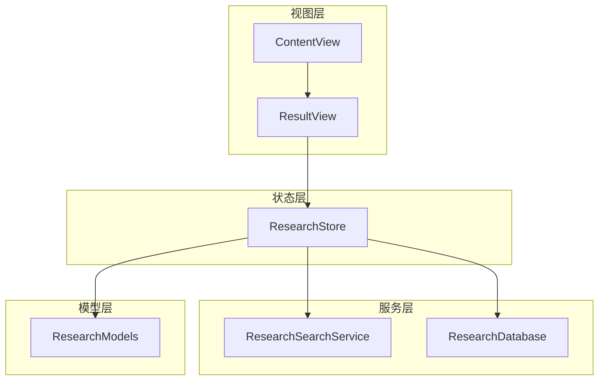
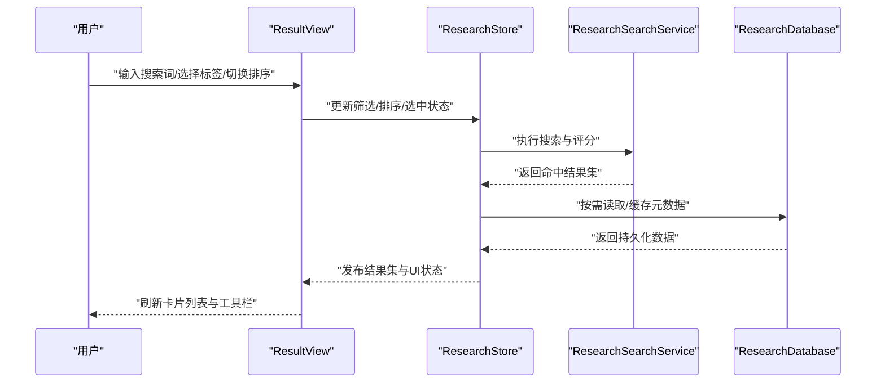
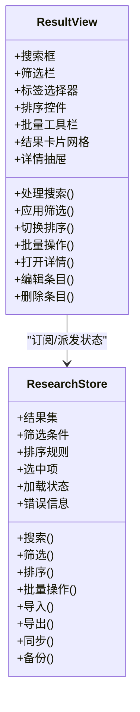
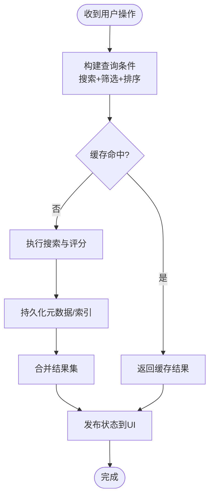
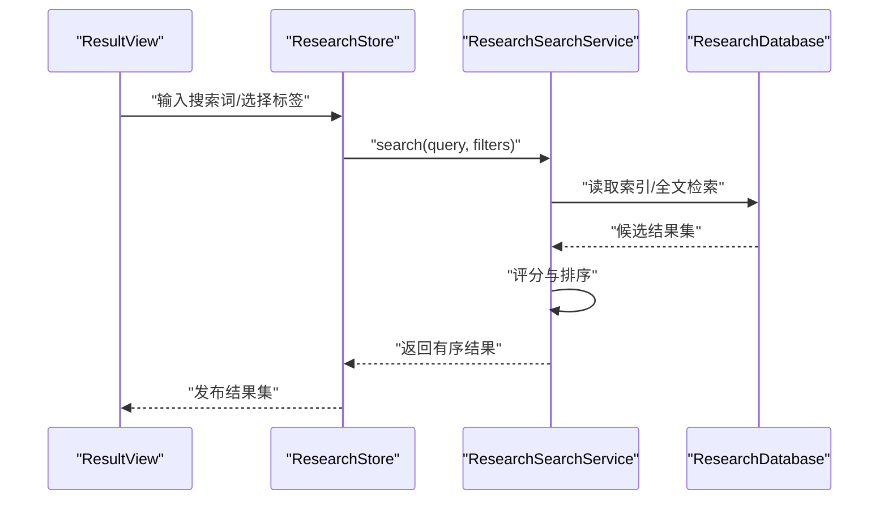
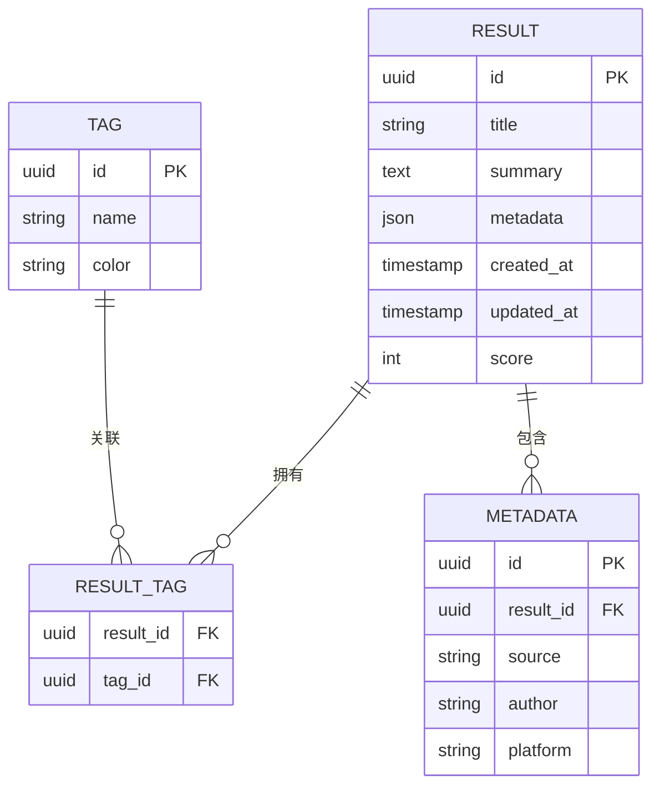
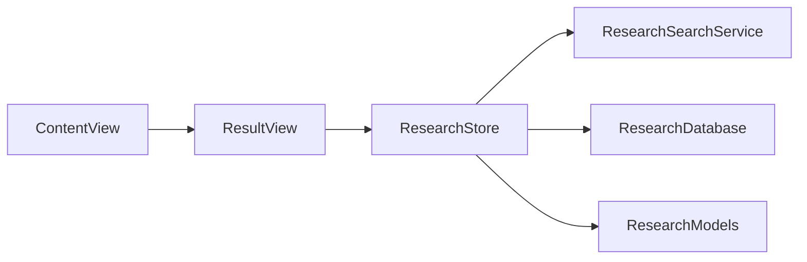

# 结果展示

<cite>
**本文引用的文件**   
- [ResultView.swift](file://Sources/ChengGao/Views/ResultView.swift)
- [ResearchStore.swift](file://Sources/ChengGao/Stores/ResearchStore.swift)
- [ResearchSearchService.swift](file://Sources/ChengGao/Services/ResearchSearchService.swift)
- [ResearchDatabase.swift](file://Sources/ChengGao/Services/ResearchDatabase.swift)
- [ResearchModels.swift](file://Sources/ChengGao/Models/ResearchModels.swift)
- [ContentView.swift](file://Sources/ChengGao/Views/ContentView.swift)
</cite>

## 目录
1. [简介](#简介)
2. [项目结构](#项目结构)
3. [核心组件](#核心组件)
4. [架构总览](#架构总览)
5. [详细组件分析](#详细组件分析)
6. [依赖分析](#依赖分析)
7. [性能考虑](#性能考虑)
8. [故障排查指南](#故障排查指南)
9. [结论](#结论)
10. [附录](#附录)

## 简介
本章节围绕 ResultView 结果展示界面，系统性阐述其设计与实现。内容涵盖研究结果的分类展示、标签系统与筛选功能；结果卡片的设计模式、交互行为与动画效果；结果排序、搜索与批量操作；结果详情查看、编辑与删除；以及结果导入导出、数据同步与备份恢复的技术方案。文档力求在技术深度与可读性之间取得平衡，帮助开发者快速理解并扩展该模块。

## 项目结构
ResultView 位于 Views 层，负责渲染研究结果列表与交互；数据与状态由 Stores 层的 ResearchStore 管理；搜索能力由 Services 层的 ResearchSearchService 提供；持久化由 ResearchDatabase 负责；数据模型集中在 Models 层的 ResearchModels。整体采用 SwiftUI + MVVM 风格：视图层仅关注 UI 与用户交互，业务逻辑下沉至 Store 与服务层，数据通过响应式绑定驱动 UI 更新。

图表来源
- [ResultView.swift](file://Sources/ChengGao/Views/ResultView.swift)
- [ResearchStore.swift](file://Sources/ChengGao/Stores/ResearchStore.swift)
- [ResearchSearchService.swift](file://Sources/ChengGao/Services/ResearchSearchService.swift)
- [ResearchDatabase.swift](file://Sources/ChengGao/Services/ResearchDatabase.swift)
- [ResearchModels.swift](file://Sources/ChengGao/Models/ResearchModels.swift)
- [ContentView.swift](file://Sources/ChengGao/Views/ContentView.swift)

章节来源
- [ResultView.swift](file://Sources/ChengGao/Views/ResultView.swift)
- [ResearchStore.swift](file://Sources/ChengGao/Stores/ResearchStore.swift)
- [ResearchSearchService.swift](file://Sources/ChengGao/Services/ResearchSearchService.swift)
- [ResearchDatabase.swift](file://Sources/ChengGao/Services/ResearchDatabase.swift)
- [ResearchModels.swift](file://Sources/ChengGao/Models/ResearchModels.swift)
- [ContentView.swift](file://Sources/ChengGao/Views/ContentView.swift)

## 核心组件
- ResultView：结果列表的展示与交互入口，包含搜索框、筛选栏、标签选择器、排序控制、批量操作工具栏、结果卡片网格/列表等。
- ResearchStore：维护结果集合、当前筛选条件、排序规则、选中项、加载状态与错误信息；对外暴露增删改查、批量操作、导入导出、同步与备份接口。
- ResearchSearchService：封装关键词检索、分词、相关性评分与分页查询策略。
- ResearchDatabase：本地持久化（SQLite）读写、事务、索引优化与迁移。
- ResearchModels：研究结果实体、标签、分类、排序字段、搜索参数等数据结构定义。

章节来源
- [ResultView.swift](file://Sources/ChengGao/Views/ResultView.swift)
- [ResearchStore.swift](file://Sources/ChengGao/Stores/ResearchStore.swift)
- [ResearchSearchService.swift](file://Sources/ChengGao/Services/ResearchSearchService.swift)
- [ResearchDatabase.swift](file://Sources/ChengGao/Services/ResearchDatabase.swift)
- [ResearchModels.swift](file://Sources/ChengGao/Models/ResearchModels.swift)

## 架构总览
ResultView 通过 @StateObject/@ObservedObject 订阅 ResearchStore 的状态变化，触发 SwiftUI 重绘。用户输入（搜索、筛选、排序、选择）先写入 Store，Store 调用 SearchService 或 Database 完成计算与持久化，再发布新状态回推 UI。

图表来源
- [ResultView.swift](file://Sources/ChengGao/Views/ResultView.swift)
- [ResearchStore.swift](file://Sources/ChengGao/Stores/ResearchStore.swift)
- [ResearchSearchService.swift](file://Sources/ChengGao/Services/ResearchSearchService.swift)
- [ResearchDatabase.swift](file://Sources/ChengGao/Services/ResearchDatabase.swift)

## 详细组件分析

### ResultView 结果展示界面
- 分类展示：按主题/领域/时间等维度分组显示，支持折叠与展开。
- 标签系统：多标签选择、互斥与组合过滤，支持自定义标签创建与颜色映射。
- 筛选功能：文本模糊匹配、标签交集/并集、时间范围、来源平台、作者等复合条件。
- 结果卡片：统一卡片布局，包含标题、摘要、标签、来源、时间戳、收藏/下载按钮；支持点击查看详情、长按进入多选模式。
- 交互与动画：卡片入场渐显、选中高亮、批量操作工具栏滑入、搜索建议下拉面板淡入。
- 排序：按相关度、时间、热度、评分等多指标排序，支持升/降序切换。
- 搜索：实时搜索、去抖、历史热词、快捷语法（如 tag:xxx）。
- 批量操作：全选/反选、移动至文件夹、打标签、导出为压缩包、删除。
- 详情查看：侧边抽屉或模态页展示完整内容、引用、关联结果。
- 编辑与删除：行内编辑标题/摘要、批量删除确认、撤销最近删除。

图表来源
- [ResultView.swift](file://Sources/ChengGao/Views/ResultView.swift)
- [ResearchStore.swift](file://Sources/ChengGao/Stores/ResearchStore.swift)

章节来源
- [ResultView.swift](file://Sources/ChengGao/Views/ResultView.swift)

### ResearchStore 状态与业务编排
- 数据流：接收 View 事件，合并筛选/排序/搜索条件，调用 Service/DB 获取数据，发布到 @Published 属性驱动 UI。
- 并发与线程：后台队列执行搜索与 IO，主线程更新状态，避免阻塞 UI。
- 错误处理：网络失败、解析异常、磁盘 I/O 错误统一捕获并上报，提供重试与降级策略。
- 缓存策略：搜索结果与热门标签短期缓存，减少重复计算。
- 事务与一致性：批量操作使用事务保证原子性，失败回滚。

图表来源
- [ResearchStore.swift](file://Sources/ChengGao/Stores/ResearchStore.swift)
- [ResearchSearchService.swift](file://Sources/ChengGao/Services/ResearchSearchService.swift)
- [ResearchDatabase.swift](file://Sources/ChengGao/Services/ResearchDatabase.swift)

章节来源
- [ResearchStore.swift](file://Sources/ChengGao/Stores/ResearchStore.swift)

### ResearchSearchService 搜索与评分
- 关键词分词与同义词扩展，支持中文分词与停用词过滤。
- 相关性评分：TF-IDF/BM25 变体，结合标签权重、时间衰减、来源可信度。
- 分页与游标：基于时间戳或 ID 的分页，提升大数据量下的滚动性能。
- 搜索建议：前缀匹配与热词推荐，降低用户输入成本。

图表来源
- [ResearchSearchService.swift](file://Sources/ChengGao/Services/ResearchSearchService.swift)
- [ResearchDatabase.swift](file://Sources/ChengGao/Services/ResearchDatabase.swift)
- [ResearchStore.swift](file://Sources/ChengGao/Stores/ResearchStore.swift)

章节来源
- [ResearchSearchService.swift](file://Sources/ChengGao/Services/ResearchSearchService.swift)

### ResearchDatabase 持久化与索引
- 表结构：结果主表、标签关联表、来源元数据表、索引表。
- 索引策略：全文索引、标签倒排索引、时间戳索引，加速查询。
- 事务与迁移：版本化迁移脚本，确保升级兼容。
- 备份与恢复：快照导出/导入、增量备份、校验和验证。

图表来源
- [ResearchDatabase.swift](file://Sources/ChengGao/Services/ResearchDatabase.swift)
- [ResearchModels.swift](file://Sources/ChengGao/Models/ResearchModels.swift)

章节来源
- [ResearchDatabase.swift](file://Sources/ChengGao/Services/ResearchDatabase.swift)
- [ResearchModels.swift](file://Sources/ChengGao/Models/ResearchModels.swift)

### 结果卡片设计模式与交互
- 设计模式：组合式卡片（标题区、摘要区、标签区、操作区），支持主题色与暗色模式适配。
- 交互行为：点击打开详情、双击编辑、长按进入多选、滑动显示快捷操作。
- 动画效果：卡片入场 fade-in/scale-up、选中边框高亮、批量工具栏 slide-in、搜索建议 panel 淡入。
- 无障碍：语义化标签、键盘导航、屏幕阅读器支持。

章节来源
- [ResultView.swift](file://Sources/ChengGao/Views/ResultView.swift)

### 排序、搜索与批量操作
- 排序：相关度、时间、热度、评分，支持自定义权重配置。
- 搜索：实时去抖、语法提示、历史热词、跨字段检索。
- 批量：全选/反选、移动、打标签、导出、删除；操作前二次确认，支持撤销。

章节来源
- [ResultView.swift](file://Sources/ChengGao/Views/ResultView.swift)
- [ResearchStore.swift](file://Sources/ChengGao/Stores/ResearchStore.swift)

### 结果详情查看、编辑与删除
- 详情查看：侧边抽屉或模态页，展示完整内容、引用、关联结果、下载附件。
- 编辑：行内或弹窗编辑标题/摘要/标签，保存后实时更新列表。
- 删除：单条删除与批量删除，软删除保留回收站，支持恢复。

章节来源
- [ResultView.swift](file://Sources/ChengGao/Views/ResultView.swift)
- [ResearchStore.swift](file://Sources/ChengGao/Stores/ResearchStore.swift)

### 结果导入导出、数据同步与备份恢复
- 导入：支持 JSON/CSV/ZIP 包导入，自动去重与冲突解决，进度条与失败重试。
- 导出：按筛选条件导出，支持 ZIP 打包与选择性字段。
- 同步：云端同步（可选），增量同步、冲突合并策略、断点续传。
- 备份恢复：本地快照与远程备份，校验完整性，一键恢复。

章节来源
- [ResearchStore.swift](file://Sources/ChengGao/Stores/ResearchStore.swift)
- [ResearchDatabase.swift](file://Sources/ChengGao/Services/ResearchDatabase.swift)

## 依赖分析
ResultView 依赖 ResearchStore 提供状态与业务编排；ResearchStore 依赖 ResearchSearchService 进行检索与评分，依赖 ResearchDatabase 进行持久化；所有数据模型来自 ResearchModels。ContentView 作为容器页面，承载 ResultView 与其他子视图。

图表来源
- [ResultView.swift](file://Sources/ChengGao/Views/ResultView.swift)
- [ResearchStore.swift](file://Sources/ChengGao/Stores/ResearchStore.swift)
- [ResearchSearchService.swift](file://Sources/ChengGao/Services/ResearchSearchService.swift)
- [ResearchDatabase.swift](file://Sources/ChengGao/Services/ResearchDatabase.swift)
- [ResearchModels.swift](file://Sources/ChengGao/Models/ResearchModels.swift)
- [ContentView.swift](file://Sources/ChengGao/Views/ContentView.swift)

章节来源
- [ResultView.swift](file://Sources/ChengGao/Views/ResultView.swift)
- [ResearchStore.swift](file://Sources/ChengGao/Stores/ResearchStore.swift)
- [ResearchSearchService.swift](file://Sources/ChengGao/Services/ResearchSearchService.swift)
- [ResearchDatabase.swift](file://Sources/ChengGao/Services/ResearchDatabase.swift)
- [ResearchModels.swift](file://Sources/ChengGao/Models/ResearchModels.swift)
- [ContentView.swift](file://Sources/ChengGao/Views/ContentView.swift)

## 性能考虑
- 虚拟列表与懒加载：仅渲染可视区域卡片，减少内存占用。
- 搜索去抖与分页：限制高频输入导致的重复计算，分页提升滚动流畅度。
- 索引与缓存：全文索引与热点数据缓存，降低数据库压力。
- 异步与线程：IO 与搜索任务放后台，主线程只负责状态更新。
- 动画优化：使用硬件加速与最小重绘，避免复杂布局重排。

[本节为通用指导，不直接分析具体文件]

## 故障排查指南
- 搜索无结果：检查分词与停用词配置、索引是否重建、搜索语法是否正确。
- 筛选无效：确认标签映射与筛选条件组合逻辑，检查数据库索引是否存在。
- 批量操作失败：查看事务日志与错误码，确认权限与磁盘空间。
- 导入导出异常：校验文件格式与字段映射，检查解压与编码问题。
- 同步失败：核对网络与认证状态，查看冲突合并策略与重试次数。

章节来源
- [ResearchStore.swift](file://Sources/ChengGao/Stores/ResearchStore.swift)
- [ResearchSearchService.swift](file://Sources/ChengGao/Services/ResearchSearchService.swift)
- [ResearchDatabase.swift](file://Sources/ChengGao/Services/ResearchDatabase.swift)

## 结论
ResultView 以清晰的职责划分与响应式数据流，实现了高效、可扩展的结果展示与交互。通过分层架构（视图-状态-服务-持久化-模型），系统在搜索、筛选、排序、批量操作、导入导出与同步备份等方面具备良好的可维护性与性能表现。建议在后续迭代中持续优化索引与缓存策略，完善错误监控与用户体验细节。

[本节为总结性内容，不直接分析具体文件]

## 附录
- 术语表：结果卡片、标签系统、筛选条件、排序规则、批量操作、导入导出、数据同步、备份恢复。
- 最佳实践：保持视图简洁、将业务逻辑下沉至 Store/Service、使用事务保证一致性、优先异步与缓存、重视错误与边界情况处理。

[本节为补充说明，不直接分析具体文件]