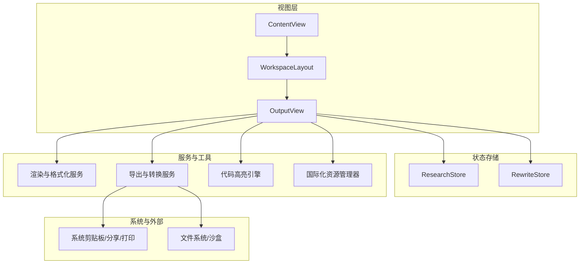
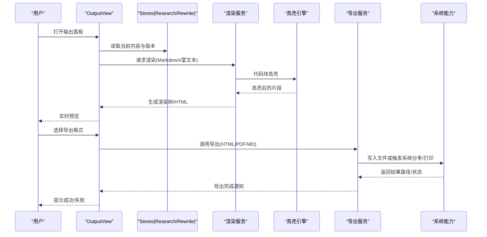
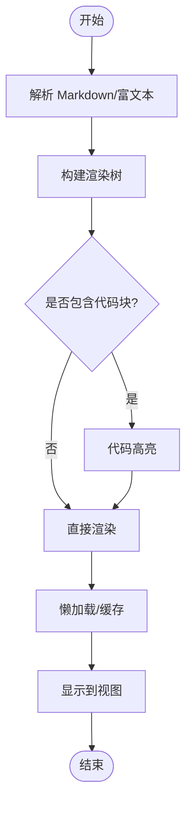
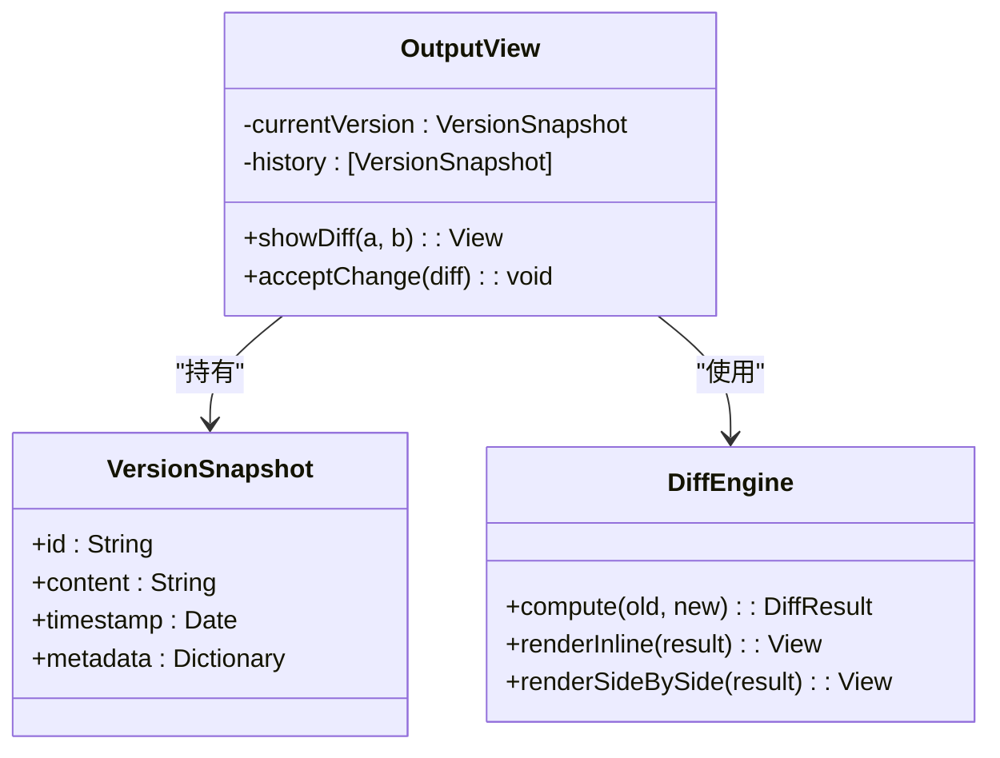
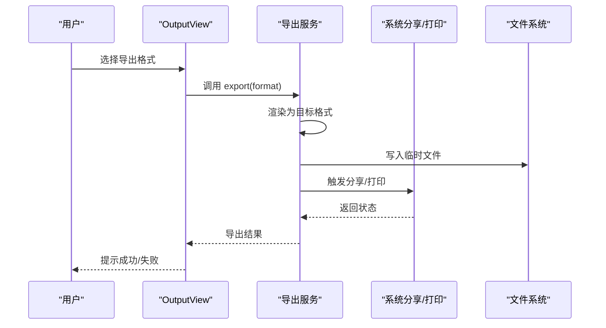
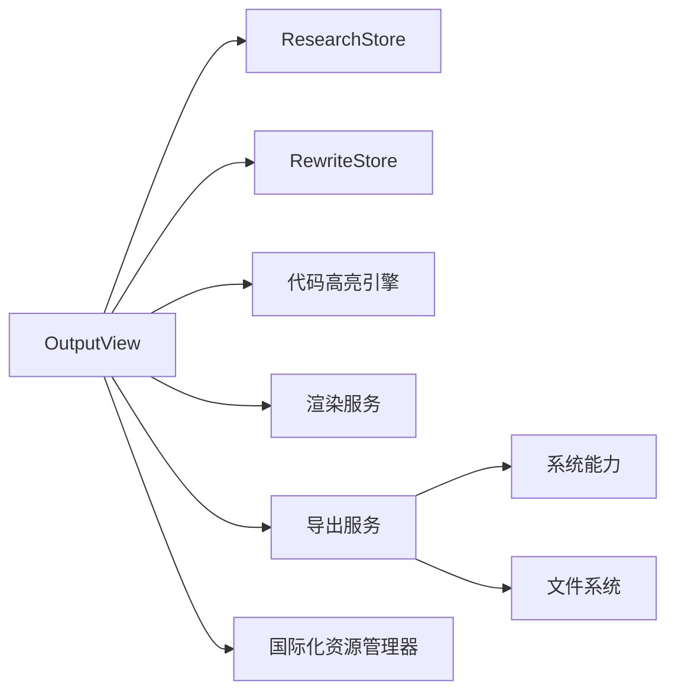

# 输出面板

<cite>
**本文档引用的文件**   
- [OutputView.swift](file://Sources/ChengGao/Views/OutputView.swift)
- [ContentView.swift](file://Sources/ChengGao/Views/ContentView.swift)
- [WorkspaceLayout.swift](file://Sources/ChengGao/Views/WorkspaceLayout.swift)
- [ResearchStore.swift](file://Sources/ChengGao/Stores/ResearchStore.swift)
- [RewriteStore.swift](file://Sources/ChengGao/Stores/RewriteStore.swift)
- [Package.swift](file://Package.swift)
</cite>

## 目录
1. [简介](#简介)
2. [项目结构](#项目结构)
3. [核心组件](#核心组件)
4. [架构总览](#架构总览)
5. [详细组件分析](#详细组件分析)
6. [依赖关系分析](#依赖关系分析)
7. [性能考量](#性能考量)
8. [故障排查指南](#故障排查指南)
9. [结论](#结论)
10. [附录](#附录)

## 简介
本章节概述 OutputView 输出面板的目标与职责：负责将研究或改写结果以富文本形式呈现，支持内容格式化、代码高亮、实时预览、版本对比与差异显示，并提供导出（Markdown、PDF、HTML 等）、复制、分享与保存能力。同时支持自定义模板、样式主题与国际化配置，以满足多语言和多风格需求。

## 项目结构
OutputView 位于 Views 层，作为用户界面入口之一，通常由 WorkspaceLayout 或 ContentView 编排展示；数据来源于 Stores（ResearchStore、RewriteStore）；渲染与导出逻辑通过 Services 与系统框架协作完成。

图表来源
- [WorkspaceLayout.swift](file://Sources/ChengGao/Views/WorkspaceLayout.swift)
- [ContentView.swift](file://Sources/ChengGao/Views/ContentView.swift)
- [OutputView.swift](file://Sources/ChengGao/Views/OutputView.swift)
- [ResearchStore.swift](file://Sources/ChengGao/Stores/ResearchStore.swift)
- [RewriteStore.swift](file://Sources/ChengGao/Stores/RewriteStore.swift)

章节来源
- [Package.swift](file://Package.swift)

## 核心组件
- 输出视图容器：负责布局、工具栏、侧边栏（历史/版本）、主渲染区。
- 渲染管线：Markdown/富文本解析、代码块高亮、图片与链接处理。
- 预览与交互：实时预览、滚动同步、锚点跳转、搜索定位。
- 版本与差异：快照管理、差异计算、并排/内联对比。
- 导出与分享：Markdown、HTML、PDF、纯文本等格式导出；系统分享与打印。
- 模板与主题：模板变量注入、CSS/样式覆盖、暗色/亮色主题切换。
- 国际化：本地化字符串、方向与排版适配。

章节来源
- [OutputView.swift](file://Sources/ChengGao/Views/OutputView.swift)
- [ResearchStore.swift](file://Sources/ChengGao/Stores/ResearchStore.swift)
- [RewriteStore.swift](file://Sources/ChengGao/Stores/RewriteStore.swift)

## 架构总览
OutputView 采用“视图-状态-服务”分层：
- 视图层：SwiftUI 组件组合，响应式更新。
- 状态层：Stores 持有当前输出、版本历史、用户偏好（主题、模板）。
- 服务层：渲染、高亮、导出、国际化等能力封装为可复用服务。

图表来源
- [OutputView.swift](file://Sources/ChengGao/Views/OutputView.swift)
- [ResearchStore.swift](file://Sources/ChengGao/Stores/ResearchStore.swift)
- [RewriteStore.swift](file://Sources/ChengGao/Stores/RewriteStore.swift)

## 详细组件分析

### 内容格式化与富文本渲染
- Markdown 解析：将输入文本转换为结构化模型，再映射到渲染树。
- 富文本增强：标题、列表、表格、引用、数学公式、图片与链接。
- 安全策略：过滤危险标签/脚本，限制外链与资源加载策略。
- 性能优化：懒加载长文档、分段渲染、缓存已渲染片段。

图表来源
- [OutputView.swift](file://Sources/ChengGao/Views/OutputView.swift)

章节来源
- [OutputView.swift](file://Sources/ChengGao/Views/OutputView.swift)

### 代码高亮
- 语法识别：按语言标识自动选择高亮器。
- 主题适配：跟随系统/应用主题切换配色。
- 性能策略：仅对可见区域进行高亮，增量更新。

章节来源
- [OutputView.swift](file://Sources/ChengGao/Views/OutputView.swift)

### 实时预览
- 双向联动：编辑器变更即时反映在输出面板。
- 滚动同步：编辑区与预览区滚动位置对齐。
- 锚点导航：点击目录跳转到对应段落。

章节来源
- [OutputView.swift](file://Sources/ChengGao/Views/OutputView.swift)

### 版本对比与差异显示
- 版本快照：每次重要修改生成不可变快照。
- 差异算法：行级/词级差异计算，支持并排与内联两种视图。
- 操作支持：接受/拒绝某一行变更，合并冲突。

图表来源
- [OutputView.swift](file://Sources/ChengGao/Views/OutputView.swift)
- [ResearchStore.swift](file://Sources/ChengGao/Stores/ResearchStore.swift)
- [RewriteStore.swift](file://Sources/ChengGao/Stores/RewriteStore.swift)

章节来源
- [OutputView.swift](file://Sources/ChengGao/Views/OutputView.swift)
- [ResearchStore.swift](file://Sources/ChengGao/Stores/ResearchStore.swift)
- [RewriteStore.swift](file://Sources/ChengGao/Stores/RewriteStore.swift)

### 导出功能（Markdown、PDF、HTML 等）
- 格式支持：Markdown、HTML、PDF、纯文本、RTF。
- 导出流程：渲染目标格式 -> 生成临时文件 -> 触发系统分享/打印或保存到沙盒。
- 质量保障：分页与页眉页脚、字体嵌入、图片压缩与占位。

图表来源
- [OutputView.swift](file://Sources/ChengGao/Views/OutputView.swift)

章节来源
- [OutputView.swift](file://Sources/ChengGao/Views/OutputView.swift)

### 复制、分享与保存机制
- 复制：支持整段/选中片段复制到系统剪贴板，保留富文本格式。
- 分享：调用系统分享面板，支持邮件、备忘录、第三方应用。
- 保存：默认保存到应用沙盒 Documents 目录，支持命名与路径选择。

章节来源
- [OutputView.swift](file://Sources/ChengGao/Views/OutputView.swift)

### 自定义输出模板、样式主题与国际化
- 模板：支持变量替换（标题、作者、日期、正文），内置多种模板可选。
- 主题：明/暗主题、自定义 CSS/样式覆盖、字体与字号设置。
- 国际化：多语言资源包、动态切换语言、排版方向适配。

章节来源
- [OutputView.swift](file://Sources/ChengGao/Views/OutputView.swift)

## 依赖关系分析
- 视图依赖 Stores 获取数据与状态。
- 渲染依赖高亮引擎与模板引擎。
- 导出依赖系统能力（分享、打印、文件访问）。
- 国际化依赖本地化资源管理器。

图表来源
- [OutputView.swift](file://Sources/ChengGao/Views/OutputView.swift)
- [ResearchStore.swift](file://Sources/ChengGao/Stores/ResearchStore.swift)
- [RewriteStore.swift](file://Sources/ChengGao/Stores/RewriteStore.swift)

章节来源
- [OutputView.swift](file://Sources/ChengGao/Views/OutputView.swift)
- [ResearchStore.swift](file://Sources/ChengGao/Stores/ResearchStore.swift)
- [RewriteStore.swift](file://Sources/ChengGao/Stores/RewriteStore.swift)

## 性能考量
- 大文档渲染：分片渲染、懒加载、虚拟滚动。
- 高亮性能：按需高亮、增量更新、缓存 AST。
- 导出性能：异步任务、后台线程、进度反馈。
- 内存管理：及时释放中间对象、避免循环引用。

[本节为通用指导，不直接分析具体文件]

## 故障排查指南
- 渲染异常：检查 Markdown 语法与资源路径；确认安全策略未拦截合法内容。
- 高亮错误：确认语言标识正确；检查高亮引擎版本与主题资源。
- 导出失败：验证目标格式支持；检查系统权限与存储空间。
- 国际化缺失：确认语言包存在且键名一致；检查动态切换时机。

章节来源
- [OutputView.swift](file://Sources/ChengGao/Views/OutputView.swift)

## 结论
OutputView 输出面板通过清晰的层次划分与模块化设计，实现了从内容格式化、代码高亮、实时预览到版本对比与导出的完整闭环。借助模板、主题与国际化能力，能够满足多样化场景下的输出需求。建议在后续迭代中持续优化大文档渲染与导出性能，并完善错误诊断与用户引导。

[本节为总结性内容，不直接分析具体文件]

## 附录
- 术语说明：
  - 版本快照：不可变的输出内容副本，用于对比与回溯。
  - 差异显示：两个版本之间的增删改可视化。
  - 导出：将内容转换为指定格式并输出到文件或系统服务。
- 相关参考：
  - 视图编排：ContentView、WorkspaceLayout
  - 数据存储：ResearchStore、RewriteStore
  - 构建配置：Package.swift

[本节为补充信息，不直接分析具体文件]