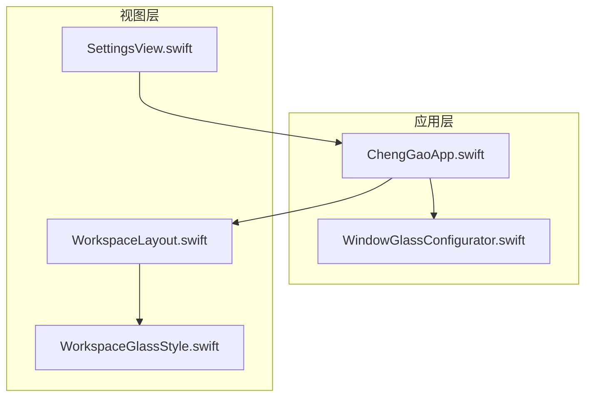
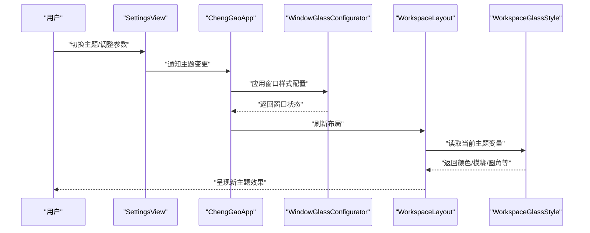
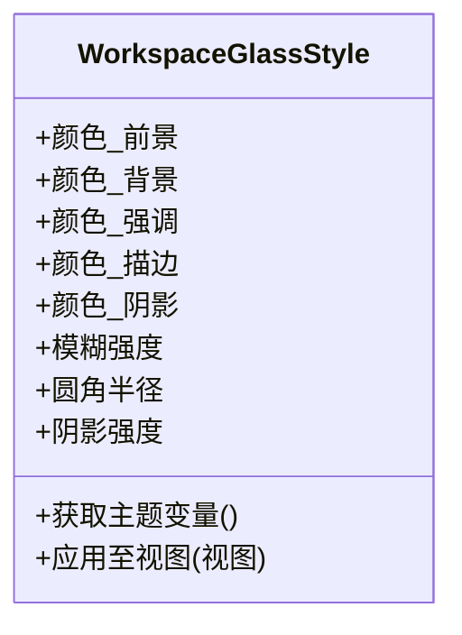
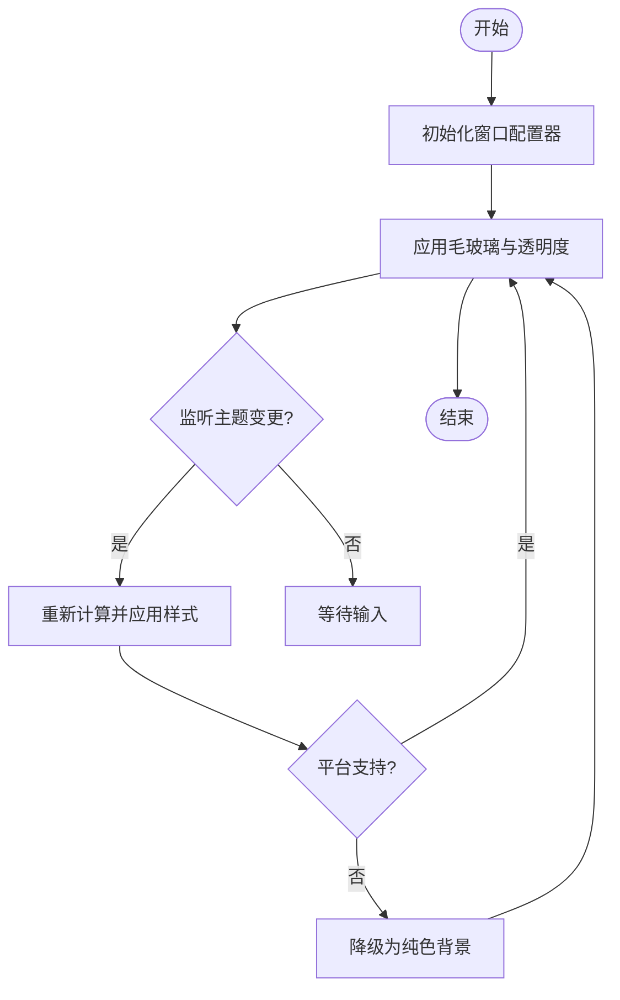
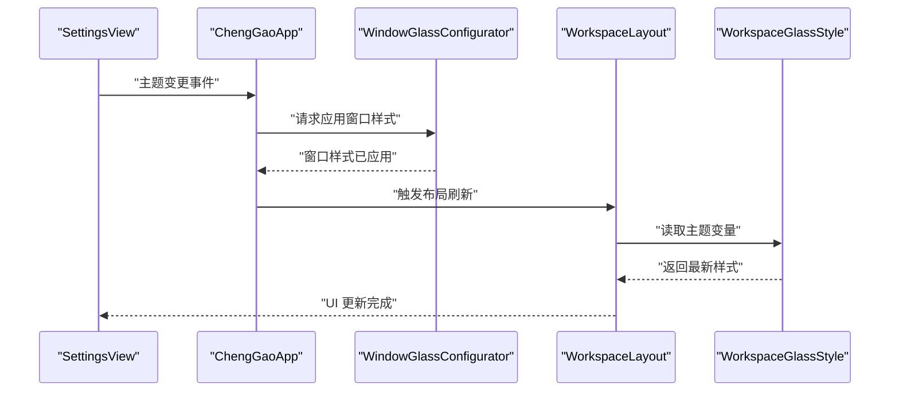
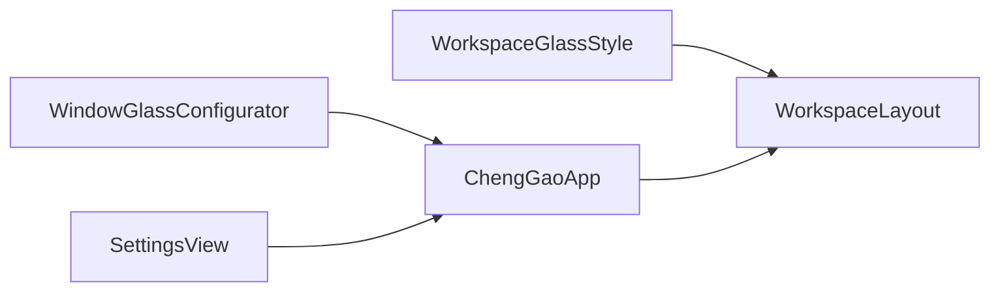

# 玻璃风格主题系统

<cite>
**本文档引用的文件**   
- [WorkspaceGlassStyle.swift](file://Sources/ChengGao/Views/WorkspaceGlassStyle.swift)
- [WindowGlassConfigurator.swift](file://Sources/ChengGao/App/WindowGlassConfigurator.swift)
- [ChengGaoApp.swift](file://Sources/ChengGao/App/ChengGaoApp.swift)
- [WorkspaceLayout.swift](file://Sources/ChengGao/Views/WorkspaceLayout.swift)
- [SettingsView.swift](file://Sources/ChengGao/Views/SettingsView.swift)
</cite>

## 目录
1. [简介](#简介)
2. [项目结构](#项目结构)
3. [核心组件](#核心组件)
4. [架构总览](#架构总览)
5. [详细组件分析](#详细组件分析)
6. [依赖关系分析](#依赖关系分析)
7. [性能考虑](#性能考虑)
8. [故障排查指南](#故障排查指南)
9. [结论](#结论)
10. [附录](#附录)

## 简介
本文件系统化阐述“玻璃风格主题系统”的实现与使用，重点覆盖：
- WorkspaceGlassStyle 的设计模式、颜色系统与视觉效果配置
- WindowGlassConfigurator 的窗口样式定制、毛玻璃效果与透明度控制
- 主题切换机制、动态样式更新与性能优化策略
- 自定义主题开发指南、颜色管理最佳实践与跨平台兼容性
- 主题调试工具与视觉测试方法

该主题系统以 SwiftUI 为核心，通过集中式样式定义与窗口级配置，实现一致的毛玻璃（Glass）外观与可插拔的主题能力。

## 项目结构
与玻璃风格主题相关的代码主要分布在以下模块：
- App 层：应用入口与窗口配置器
- Views 层：工作区布局与玻璃样式定义
- Settings：用户设置界面（用于触发主题切换等交互）

图表来源
- [ChengGaoApp.swift](file://Sources/ChengGao/App/ChengGaoApp.swift)
- [WindowGlassConfigurator.swift](file://Sources/ChengGao/App/WindowGlassConfigurator.swift)
- [WorkspaceLayout.swift](file://Sources/ChengGao/Views/WorkspaceLayout.swift)
- [WorkspaceGlassStyle.swift](file://Sources/ChengGao/Views/WorkspaceGlassStyle.swift)
- [SettingsView.swift](file://Sources/ChengGao/Views/SettingsView.swift)

章节来源
- [ChengGaoApp.swift](file://Sources/ChengGao/App/ChengGaoApp.swift)
- [WindowGlassConfigurator.swift](file://Sources/ChengGao/App/WindowGlassConfigurator.swift)
- [WorkspaceLayout.swift](file://Sources/ChengGao/Views/WorkspaceLayout.swift)
- [WorkspaceGlassStyle.swift](file://Sources/ChengGao/Views/WorkspaceGlassStyle.swift)
- [SettingsView.swift](file://Sources/ChengGao/Views/SettingsView.swift)

## 核心组件
- WorkspaceGlassStyle：定义工作区的玻璃主题样式，包括颜色体系、模糊强度、圆角、阴影、边框等视觉参数，并提供统一的访问方式。
- WindowGlassConfigurator：负责窗口级别的样式注入与运行时调整，如毛玻璃背景、透明度、窗口边框与标题栏行为等。
- ChengGaoApp：应用启动时装配主题与窗口配置，确保全局一致的主题生效。
- WorkspaceLayout：将 WorkspaceGlassStyle 应用到具体布局容器，保证 UI 一致性。
- SettingsView：提供用户交互入口，驱动主题切换与参数调整。

章节来源
- [WorkspaceGlassStyle.swift](file://Sources/ChengGao/Views/WorkspaceGlassStyle.swift)
- [WindowGlassConfigurator.swift](file://Sources/ChengGao/App/WindowGlassConfigurator.swift)
- [ChengGaoApp.swift](file://Sources/ChengGao/App/ChengGaoApp.swift)
- [WorkspaceLayout.swift](file://Sources/ChengGao/Views/WorkspaceLayout.swift)
- [SettingsView.swift](file://Sources/ChengGao/Views/SettingsView.swift)

## 架构总览
主题系统采用“样式定义 + 窗口配置 + 视图装配”的分层架构：
- 样式定义层（WorkspaceGlassStyle）：集中维护颜色、模糊、圆角、阴影等视觉变量
- 窗口配置层（WindowGlassConfigurator）：在窗口级别注入样式，控制毛玻璃与透明度
- 视图装配层（WorkspaceLayout）：消费样式变量，渲染一致的玻璃外观
- 应用装配层（ChengGaoApp）：初始化并绑定主题与窗口配置
- 用户交互层（SettingsView）：触发主题切换与参数更新

图表来源
- [SettingsView.swift](file://Sources/ChengGao/Views/SettingsView.swift)
- [ChengGaoApp.swift](file://Sources/ChengGao/App/ChengGaoApp.swift)
- [WindowGlassConfigurator.swift](file://Sources/ChengGao/App/WindowGlassConfigurator.swift)
- [WorkspaceLayout.swift](file://Sources/ChengGao/Views/WorkspaceLayout.swift)
- [WorkspaceGlassStyle.swift](file://Sources/ChengGao/Views/WorkspaceGlassStyle.swift)

## 详细组件分析

### WorkspaceGlassStyle：设计模式与颜色系统
- 设计模式
  - 单例/集中式访问：通过统一入口暴露主题变量，避免分散定义导致不一致
  - 只读变量与计算属性：对外暴露稳定的颜色与效果值，内部支持派生计算
  - 可扩展性：预留扩展点以便新增主题变体或平台差异化处理
- 颜色系统
  - 语义化命名：前景、背景、强调色、描边、阴影等按用途分组
  - 明暗适配：基于系统或用户偏好自动切换深浅色板
  - 对比度保障：关键文本与控件满足可读性要求
- 视觉效果配置
  - 模糊强度：根据层级与场景调节毛玻璃程度
  - 圆角与阴影：统一卡片与面板的外观
  - 边框与描边：增强层次与边界感
  - 不透明度：区分层级与交互态

图表来源
- [WorkspaceGlassStyle.swift](file://Sources/ChengGao/Views/WorkspaceGlassStyle.swift)

章节来源
- [WorkspaceGlassStyle.swift](file://Sources/ChengGao/Views/WorkspaceGlassStyle.swift)

### WindowGlassConfigurator：窗口样式定制与毛玻璃控制
- 功能职责
  - 窗口背景毛玻璃：启用系统级透明与模糊
  - 透明度控制：按层级与场景调节整体不透明度
  - 窗口边框与标题栏：隐藏或自定义边框，适配 macOS 原生行为
  - 动态更新：响应主题切换实时刷新窗口外观
- 关键流程
  - 初始化时注册窗口样式
  - 监听主题变更事件
  - 调用系统 API 应用透明与模糊
  - 处理平台差异与回退策略

图表来源
- [WindowGlassConfigurator.swift](file://Sources/ChengGao/App/WindowGlassConfigurator.swift)

章节来源
- [WindowGlassConfigurator.swift](file://Sources/ChengGao/App/WindowGlassConfigurator.swift)

### 主题切换机制与动态样式更新
- 触发源
  - 用户操作：设置页开关或滑块调整
  - 系统偏好：深色/浅色模式变化
- 传播路径
  - SettingsView 发出主题变更事件
  - ChengGaoApp 接收并广播到各组件
  - WindowGlassConfigurator 更新窗口样式
  - WorkspaceLayout 消费 WorkspaceGlassStyle 变量重绘
- 性能要点
  - 事件去抖与批处理：合并频繁更新
  - 延迟渲染：仅在可见区域重绘
  - 资源复用：缓存颜色与模糊参数

图表来源
- [SettingsView.swift](file://Sources/ChengGao/Views/SettingsView.swift)
- [ChengGaoApp.swift](file://Sources/ChengGao/App/ChengGaoApp.swift)
- [WindowGlassConfigurator.swift](file://Sources/ChengGao/App/WindowGlassConfigurator.swift)
- [WorkspaceLayout.swift](file://Sources/ChengGao/Views/WorkspaceLayout.swift)
- [WorkspaceGlassStyle.swift](file://Sources/ChengGao/Views/WorkspaceGlassStyle.swift)

章节来源
- [SettingsView.swift](file://Sources/ChengGao/Views/SettingsView.swift)
- [ChengGaoApp.swift](file://Sources/ChengGao/App/ChengGaoApp.swift)
- [WindowGlassConfigurator.swift](file://Sources/ChengGao/App/WindowGlassConfigurator.swift)
- [WorkspaceLayout.swift](file://Sources/ChengGao/Views/WorkspaceLayout.swift)
- [WorkspaceGlassStyle.swift](file://Sources/ChengGao/Views/WorkspaceGlassStyle.swift)

### 自定义主题开发指南
- 步骤
  - 新建主题变量集：定义颜色、模糊、圆角、阴影等
  - 接入样式中心：通过统一接口暴露给视图层
  - 适配窗口配置：在配置器中增加主题分支逻辑
  - 验证与回归：运行视觉测试与自动化检查
- 最佳实践
  - 语义化命名：避免硬编码颜色值
  - 分层管理：基础色板与业务色分离
  - 可组合性：允许局部覆盖默认值
  - 文档化：记录每个变量的用途与取值范围

章节来源
- [WorkspaceGlassStyle.swift](file://Sources/ChengGao/Views/WorkspaceGlassStyle.swift)
- [WindowGlassConfigurator.swift](file://Sources/ChengGao/App/WindowGlassConfigurator.swift)

### 颜色管理最佳实践
- 原则
  - 单一事实来源：所有颜色从样式中心读取
  - 对比度校验：确保文本与背景的对比度达标
  - 主题隔离：不同主题间颜色互不影响
  - 可测试性：提供快照与断言工具
- 工具
  - 颜色选择器：可视化编辑与预览
  - 对比度检测：自动提示不合规配色
  - 主题导出：生成配置文件或样式表

章节来源
- [WorkspaceGlassStyle.swift](file://Sources/ChengGao/Views/WorkspaceGlassStyle.swift)

### 跨平台兼容性考虑
- macOS 特性
  - 原生毛玻璃与透明背景
  - 窗口边框与标题栏行为
- 回退策略
  - 不支持毛玻璃时降级为半透明纯色
  - 限制模糊强度以避免性能问题
- 平台差异处理
  - 条件编译或运行时检测
  - 针对不同 DPI 与缩放因子调整圆角与阴影

章节来源
- [WindowGlassConfigurator.swift](file://Sources/ChengGao/App/WindowGlassConfigurator.swift)

## 依赖关系分析
- 组件耦合
  - WorkspaceLayout 依赖 WorkspaceGlassStyle 提供的样式变量
  - WindowGlassConfigurator 依赖系统 API 与主题事件
  - ChengGaoApp 协调样式与窗口配置的生命周期
- 外部依赖
  - SwiftUI 视图与状态管理
  - 系统窗口与图形栈（透明、模糊、阴影）

图表来源
- [WorkspaceGlassStyle.swift](file://Sources/ChengGao/Views/WorkspaceGlassStyle.swift)
- [WorkspaceLayout.swift](file://Sources/ChengGao/Views/WorkspaceLayout.swift)
- [WindowGlassConfigurator.swift](file://Sources/ChengGao/App/WindowGlassConfigurator.swift)
- [ChengGaoApp.swift](file://Sources/ChengGao/App/ChengGaoApp.swift)
- [SettingsView.swift](file://Sources/ChengGao/Views/SettingsView.swift)

章节来源
- [WorkspaceGlassStyle.swift](file://Sources/ChengGao/Views/WorkspaceGlassStyle.swift)
- [WorkspaceLayout.swift](file://Sources/ChengGao/Views/WorkspaceLayout.swift)
- [WindowGlassConfigurator.swift](file://Sources/ChengGao/App/WindowGlassConfigurator.swift)
- [ChengGaoApp.swift](file://Sources/ChengGao/App/ChengGaoApp.swift)
- [SettingsView.swift](file://Sources/ChengGao/Views/SettingsView.swift)

## 性能考虑
- 渲染优化
  - 减少不必要的重绘：仅在主题或参数变化时更新
  - 批量更新：合并多次样式变更
  - 懒加载：按需加载高成本效果（如大尺寸模糊）
- 内存与 CPU
  - 缓存样式变量与中间结果
  - 限制模糊半径与采样次数
  - 避免在主线程执行阻塞操作
- 平台限制
  - 检测系统能力并降级
  - 针对低性能设备关闭高级效果

[本节为通用指导，无需特定文件引用]

## 故障排查指南
- 常见问题
  - 毛玻璃不生效：检查系统权限与平台支持
  - 透明度异常：确认窗口层级与背景绘制顺序
  - 主题切换卡顿：排查事件频率与渲染开销
- 诊断方法
  - 启用日志：记录样式应用与窗口配置过程
  - 截图对比：固定场景下比较主题前后差异
  - 性能剖析：定位重绘热点与耗时操作
- 修复建议
  - 增加回退逻辑与错误提示
  - 引入去抖与节流策略
  - 拆分复杂视图以降低重绘范围

章节来源
- [WindowGlassConfigurator.swift](file://Sources/ChengGao/App/WindowGlassConfigurator.swift)
- [WorkspaceGlassStyle.swift](file://Sources/ChengGao/Views/WorkspaceGlassStyle.swift)

## 结论
玻璃风格主题系统通过清晰的层次划分与集中式样式管理，实现了可维护、可扩展且高性能的毛玻璃外观。配合窗口级配置与动态更新机制，能够在多平台上保持一致的用户体验。遵循本文的最佳实践与调试方法，可快速构建高质量的主题方案。

[本节为总结性内容，无需特定文件引用]

## 附录
- 术语表
  - 毛玻璃：背景模糊与半透明叠加的视觉效果
  - 主题变量：描述颜色、模糊、圆角等视觉参数的集合
  - 窗口配置：对窗口外观与行为的集中设置
- 参考路径
  - 样式定义：[WorkspaceGlassStyle.swift](file://Sources/ChengGao/Views/WorkspaceGlassStyle.swift)
  - 窗口配置：[WindowGlassConfigurator.swift](file://Sources/ChengGao/App/WindowGlassConfigurator.swift)
  - 应用装配：[ChengGaoApp.swift](file://Sources/ChengGao/App/ChengGaoApp.swift)
  - 布局装配：[WorkspaceLayout.swift](file://Sources/ChengGao/Views/WorkspaceLayout.swift)
  - 设置入口：[SettingsView.swift](file://Sources/ChengGao/Views/SettingsView.swift)

[本节为补充信息，无需特定文件引用]